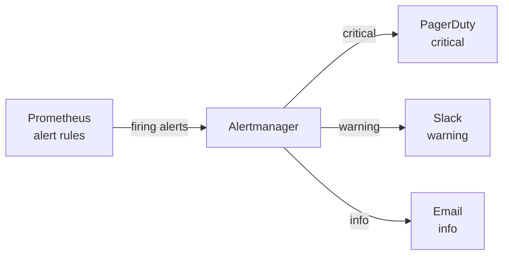

# 17.6 Alerting, SLOs and health checks for GPU clusters

| Field | Value |
|---|---|
| Level | Advanced |
| Priority tier | 2 |
| Lab venue | GCP / GKE |
| Part | Part 17: Observability, performance and operations |
| Cross-references | Chapter 17.2 (Prometheus and Grafana); Chapter 17.4 (DCGM exporter); Chapter 17.5 (Distributed observability and profiling); Chapter 16.14 (Platform design: SLOs) |
| Coverage file | `planning/coverage/chapters/17-06.md` |
| Claim & number ledger | `planning/ledgers/17-06.md` |

## Why this matters for AI infrastructure

Picture the phone on your nightstand lighting up at four in the morning because a token API has started returning errors. The first question is whether this is a real outage or a blip that will clear by itself. The earlier chapters in this part collected the signals that answer that question. This chapter is about acting on them. Alerting turns metrics and traces into pages for the on-call engineer. SLOs turn the same metrics into commitments the business can read. Health checks let Kubernetes decide whether a workload is alive and able to serve traffic.

Imagine each piece is missing. Without alerting, the on-call learns about an outage from a customer. Without SLOs, nobody can say which alerts the business cares about most. Without health checks, Kubernetes keeps sending requests to a pod that cannot answer them.

Here is the failure this chapter prevents. A token API starts returning errors for two percent of requests at four in the morning. A threshold alert on the error rate pages the on-call for every one-minute blip all week, so by Thursday the pager is muted. This time the errors last all night, and the first person to notice is a customer. The fix has two parts. Alert on how fast the error budget is burning, which is what separates a blip from an outage, and send every alert to a route that matches how urgent it is.

Three operating realities make this a platform-team concern rather than only a data-science one.

1. Alert routing is a platform decision. Every alert has a severity, every severity has a route, and every route ends at an on-call rotation. The platform team owns that chain.
2. SLOs are the contract between engineering and the business. The business may agree that 99.9% availability is acceptable, while engineering confirms that the target is achievable. The platform team owns the SLOs.
3. Health checks decide whether a pod receives traffic at all. A failing readiness probe takes the pod out of the load balancer, and a failing liveness probe restarts it. The platform team owns the health check templates.

Without alerting, the on-call reacts to failures after they happen. With it, the on-call can act first. **Before a team runs an AI workload on a GPU cluster, the workload needs health checks, the cluster needs SLOs, and the platform needs alert routing.**

## Prerequisites and outcomes

### Prerequisites

Read these chapters first. The rest of this chapter assumes their tools are running.

- Chapter 17.2 (Prometheus and Grafana) for the metrics stack and Alertmanager.
- Chapter 17.4 (DCGM exporter) for the GPU-specific alerts.
- Chapter 16.14 (Platform design) for the SLO-based platform design.

### Outcomes

Think of this chapter as the path from a number on a dashboard to a page that helps someone. It specifies the SLOs for an AI factory, covering availability, latency, throughput and model quality. It configures Alertmanager routing, with severity-based routes, an on-call rotation and an escalation policy. It then implements Kubernetes health checks for AI workloads, using readiness, liveness and startup probes, and it defines the error budget and shows how alerts burn against it. The last sections build an on-call runbook that says what to do when each alert fires, and run the whole alerting and SLO stack on GKE. Each part maps to one of the sections below.

---

## 1. The SLOs

### 1.1 What an SLO is

Picture a customer who asks, "Is your service reliable?" If the team has no shared definition, every engineer answers differently. One engineer thinks about the server, another thinks about the average response, and a third thinks about the worst requests of the day. A Service Level Objective (SLO) gives that answer a measurable form. An SLO has three parts: a Service Level Indicator (SLI), a target, and a time window. The SLI is the measurement itself, the target is the line it must stay on, and the window is the period over which the team checks.

A good SLI is close to what the customer experiences. A count of requests that returned a success code is a fair choice for availability, because a customer who gets an error feels it directly. A CPU reading on a server is a poor SLI for the same promise, because a server can run hot and still answer every request quickly, or run cool and still drop them. Pick the measurement first, then pick the target, so the target always means something a customer would notice.

| Component | Example |
|---|---|
| **SLI** | The metric that measures the SLO |
| **Target** | The threshold that the SLI must meet |
| **Time window** | The period over which the SLI is measured |


### 1.2 The SLOs for an AI factory

Picture a product manager asking whether the chatbot is up. The cluster team hears "is the GPU pool running", the model team hears "is the endpoint answering", and the customer means "does my answer arrive quickly". All three are reasonable, and they produce three different answers. An AI factory makes promises at three layers. The cluster team promises that the infrastructure stays up. The team that runs a model promises latency and availability for its endpoint. The customer feels only the end-to-end result, and that is the layer the business cares about most.

Every target in the table below is an example starting point for your team to choose, not a figure from a source. Read each row as a promise with one layer, one measurement and one window.

| Layer | SLO | SLI | Target | Window |
|---|---|---|---|---|
| **Cluster** | Cluster availability | Uptime of the cluster | 99.9% | Monthly |
| **Cluster** | GPU pool availability | Uptime of the GPU pool | 99.5% | Monthly |
| **Cluster** | Registry availability | Uptime of the model registry | 99.95% | Monthly |
| **Team** | Inference latency p99 | p99 inference latency | < 300 ms | Monthly |
| **Team** | Inference availability | Uptime of the InferenceService | 99.9% | Monthly |
| **Team** | Training throughput | Training samples per second | > 1000 samples/sec | Per run |
| **Customer** | End-to-end latency p99 | p99 latency from request to response | < 500 ms | Monthly |
| **Customer** | End-to-end availability | Uptime of the customer-facing service | 99.9% | Monthly |

A chain of services can never be more reliable than its weakest link. When a customer request passes through several services, the combined availability ends up below any single target. Check the dependencies before you promise a customer-facing number. If the customer path passes through three services that each promise 99.9%, the customer cannot be promised the same 99.9%, because any one of those services can fail the request.

### 1.3 The error budget

Suppose your SLO promises 99.9% availability for the month. That promise leaves a small amount of allowed downtime, and the allowance is the error budget. Think of it as a bank account for failure. Every minute of downtime is a withdrawal, and the account refills at the start of the next window. Teams spend it on work that carries risk, such as canary releases, chaos experiments, and rolling upgrades. A canary release sends a small share of traffic to a new version first, so a bad change costs less.

When the budget runs out, a common policy is to pause new deployments until the next window begins. That policy is a team choice, not something an SLO imposes on you. The SLO only states the target. What the team does when the target is at risk is a separate decision that should be written down before the bad month arrives.

```text
Error budget at 99.9% monthly availability:
- Total time per month: 30 days * 24 hours * 60 minutes = 43,200 minutes
- Budget: 0.1% * 43,200 = 43.2 minutes of downtime per month
- Burn rate 1 spends the budget at an even pace: 43.2 minutes / 30 days = 1.44 minutes per day
- Burn rate 10 spends it in 3 days: 14.4 minutes per day
```

Read the block as a chain of small facts. The month has 43,200 minutes, a tenth of a percent of that is 43.2 minutes, and spreading those minutes evenly over 30 days gives 1.44 minutes a day. A burn rate of 10 means you are spending the budget ten times faster than that even pace, which empties it in 3 days.

The arithmetic assumes a 30-day month. If your window is different, recalculate the 43.2 minutes before you publish the number. Section 1.4 turns burn rate into alert rules.

Before you publish an SLO, do the budget arithmetic for its window, so the team knows how much room it really has. A team that discovers its budget is 43 minutes on the day of an outage will make different choices than a team that knew the number in advance.

### 1.4 Burn-rate alerting for a token API

Picture a token API, which is an HTTP service that streams model output one token at a time. Its owners want to know the moment it starts failing, but not every bad minute deserves a page. Chapter 20.19 owns what to measure for it: time to first token, inter-token latency, and per-tenant slices. This section owns the alerting method, shown with the simplest SLI, availability.

The method works on a ratio. The burn rate is the observed error ratio divided by the error budget ratio. With a 99.9 percent SLO the budget ratio is 0.001, so an error ratio of 0.02 is a burn rate of 20. A burn rate of 1 uses exactly the whole budget by the end of the window. Think of the burn rate as a speedometer for the budget. It tells you how fast the account is emptying right now, which is more useful than a count of how much has already gone.

Start with the traffic. Say the API serves 100 requests per second. In a 30-day month that is 259,200,000 requests, and the budget allows 259,200 failures. At a 2 percent error ratio the API fails 7,200 requests per hour, and the budget lasts 36 hours.

A single threshold such as "error ratio above 0.1 percent for 5 minutes" fails in both directions. It pages on a one-minute blip that costs almost nothing, and it stays silent on a steady 0.2 percent error ratio that spends the budget in 15 days. The fix is to alert on burn rate over two windows at once. The long window shows the problem is large enough to matter. The short window shows it is still happening, so the alert clears soon after the fix.

| Severity | Long window | Short window | Burn rate | Error ratio threshold | Budget spent in the long window |
|---|---|---|---|---|---|
| Page | 1 hour | 5 minutes | 14.4 | 0.0144 | 2% |
| Page | 6 hours | 30 minutes | 6 | 0.006 | 5% |
| Ticket | 3 days | 6 hours | 1 | 0.001 | 10% |

Check the first row by hand. A burn rate of 14.4 for one hour spends 14.4 times 1 divided by 720 hours, which is 2 percent of the budget. At 100 requests per second that is 5,184 failed requests, and 5,184 divided by 259,200 is 0.02. The second row gives 6 times 6 over 720, which is 5 percent. The third gives 1 times 72 over 720, which is 10 percent. Doing this arithmetic once by hand is the best way to trust the table, because then you know where each number came from.

How fast do the rules fire? If the API goes fully dark after a clean hour, the one-hour ratio reaches 0.0144 after 0.0144 hours, about 52 seconds. At a steady 2 percent error ratio the first row fires after 0.0144 divided by 0.02 hours, about 43 minutes. At 1 percent errors the first row never fires, because 1 percent is below 1.44 percent, and the second row fires after 3.6 hours. At 0.5 percent only the ticket rule fires, after about 14 hours. Slower leaks cost less per hour, so a slower alert is acceptable.

Here is the page rule as PromQL, with the ratios kept as recording rules so the alert stays short.

```promql
# page when both windows burn above 14.4 times the budget
gateway_error_ratio:rate1h > 0.0144 and gateway_error_ratio:rate5m > 0.0144
```

The tested rule files for this method are `code/part20/slo_burn_alerts_availability.yaml` and the calculator beside it, and chapter 20.19 explains them. Two limits apply. A tenant with 100 percent errors can hide inside a healthy global ratio, so page on per-model ratios and use per-tenant ratios for tickets. And a low-traffic series needs a traffic guard, or three failed requests produce a 100 percent ratio. Chapter 20.19 covers both.

**A page should mean the budget is burning fast and is still burning now.**

---

## 2. Alertmanager

### 2.1 The Alertmanager architecture

Picture a network switch failing in the middle of the night. Within a short time, dozens of alerts fire across the cluster, all with the same root cause. The on-call should receive one page, not dozens. A single network fault can make many alerts fire in the same minute, and the on-call should not receive them one by one. Alertmanager is the router that stands between Prometheus and the on-call. It receives the alerts, removes duplicates, groups related ones, and sends each group to the right receiver.



Read the diagram as one-way traffic. Prometheus evaluates the rules and sends the firing alerts to Alertmanager, and Alertmanager decides where each one goes based on its severity. Prometheus never talks to PagerDuty or Slack directly, which keeps the routing decisions in one place.

### 2.2 The alert routing

Picture the first week on a new rotation, when someone asks which alerts go to the pager and which go to chat. The answer lives in one routing file. Routing lives in one YAML file. It names which alerts go to which receiver, and how often each one repeats. A route is a rule that matches alerts by their labels, such as a severity, and sends the matches to a named receiver. A receiver is the destination itself, such as a PagerDuty service or a Slack channel. Routes are checked in order, so a narrow route placed early can catch alerts before a broader one sees them. When you read the file, start with the critical route, since that is the one that wakes someone up.

```yaml
# code/part17/alertmanager.yaml
route:
  receiver: 'default-receiver'
  group_by: ['alertname', 'cluster', 'service']
  group_wait: 30s
  group_interval: 5m
  repeat_interval: 4h
  routes:
    - matchers:
        - severity="critical"
      receiver: 'pagerduty-critical'
      group_wait: 10s
      repeat_interval: 1h
    - matchers:
        - severity="warning"
      receiver: 'slack-warnings'
      repeat_interval: 12h
    - matchers:
        - severity="info"
      receiver: 'email-info'
      repeat_interval: 24h

receivers:
  - name: 'default-receiver'
    webhook_configs:
      - url: 'http://alertmanager-webhook/health'
  - name: 'pagerduty-critical'
    pagerduty_configs:
      - service_key: 'REPLACE_WITH_PAGERDUTY_INTEGRATION_KEY'
        description: '{{ .CommonAnnotations.summary }}'
  - name: 'slack-warnings'
    slack_configs:
      - api_url: 'https://hooks.slack.com/services/REPLACE/WITH/WEBHOOK'
        channel: '#ai-factory-warnings'
  - name: 'email-info'
    email_configs:
      - to: 'platform-team@example.com'
        from: 'alertmanager@example.com'
        smarthost: 'smtp.example.com:587'
```

In this config, critical alerts go to PagerDuty and repeat every hour. Warnings go to Slack and repeat every 12 hours, and info alerts go to email and repeat daily. The repeat interval keeps one unchanged alert from re-notifying too often, and the group interval keeps related alerts together. The group wait is the short pause Alertmanager takes before it sends the first notification, so that a burst of related alerts can be combined. Production Kubernetes, chapter 9, warns that excessive critical alerts burn out on-call engineers and bury the real ones, so tune each route until a page means someone must act now.

### 2.3 The alert inhibition

Picture a cluster that has gone down entirely. Every workload on it raises its own alert, and the on-call sees a wall of red that hides the one fact that matters. Inhibition tackles a different kind of noise. When a whole cluster is down, its many lower-severity alerts add little new information. An inhibit rule can mute them, so the on-call sees the root cause first.

```yaml
# code/part17/inhibit_rules.yaml
inhibit_rules:
  - source_matchers:
      - alertname="ClusterDown"
    target_matchers:
      - severity!="critical"
    equal: ['cluster']
  - source_matchers:
      - alertname="GPUNodeDown"
    target_matchers:
      - alertname=~"GPUXidTier[23]"
    equal: ['gpu', 'node']
```

The first rule mutes any alert below critical severity that shares a cluster label with a firing ClusterDown alert. The second rule mutes the tier 2 and tier 3 Xid alerts from chapter 17.4 that share the gpu and node labels with a firing GPUNodeDown alert. Both rules cut noise, so the on-call sees the most important alert first. Before you rely on them, check that your exporters really set the labels the rules match on. A rule that matches nothing fails quietly, and you only find out during the next outage.

---

## 3. Health checks

### 3.1 The Kubernetes health check primitives

Picture a pod that is running in the cluster but answers every request with an error. Kubernetes sees a running process and does nothing. A running pod can still fail to serve a single request. Kubernetes uses three probes to tell those states apart: the readiness probe, the liveness probe, and the startup probe. A probe is a check that Kubernetes runs on a schedule, and its result decides what Kubernetes does with the pod. The three probes run at different times in a pod's life. The startup probe runs first, while the pod is starting. Once it passes, the liveness and readiness probes take over, and they keep running for as long as the pod exists.

It helps to read each probe as a different kind of question. A readiness failure is a question about traffic, and the answer is "not right now". A liveness failure is a question about survival, and the answer is "this process is stuck, so replace it". Mixing those two questions is where most probe trouble begins.

| Probe | What it does | When it fires |
|---|---|---|
| **Readiness probe** | Is the workload ready to serve traffic? | Removes the workload from the load balancer |
| **Liveness probe** | Is the workload alive? | Restarts the workload |
| **Startup probe** | Is the workload starting up? | Disables the liveness probe until the startup is complete |

### 3.2 Health checks for AI workloads

Picture a model server that starts, opens its port and begins answering the health endpoint, while it is still reading tens of gigabytes of weights from disk. A process can be alive and still useless. A check that only asks whether the process exists would send it traffic too early, so the check has to ask whether the workload can serve. Model weights are the learned numbers that make up the model, and loading them takes time that a simple check cannot see.

```yaml
# code/part17/health_checks.yaml
livenessProbe:
  httpGet:
    path: /health/live
    port: 8080
  initialDelaySeconds: 30
  periodSeconds: 10
  timeoutSeconds: 3
  failureThreshold: 3

readinessProbe:
  httpGet:
    path: /health/ready
    port: 8080
  initialDelaySeconds: 10
  periodSeconds: 5
  timeoutSeconds: 3
  failureThreshold: 3

startupProbe:
  httpGet:
    path: /health/startup
    port: 8080
  periodSeconds: 5
  timeoutSeconds: 3
  failureThreshold: 30

lifecycle:
  preStop:
    exec:
      command: ["/bin/sh", "-c", "sleep 10"]
```

Each probe asks a different question. The liveness probe asks whether the process is alive, the readiness probe asks whether the model is loaded and the inference engine is ready, and the startup probe asks whether the model is still loading. Keep the liveness check local. Kubernetes restarts a pod when liveness fails, so a liveness check that calls a database would restart healthy pods during a database outage. Production Kubernetes, chapter 14, makes the same point and suggests failing the readiness probe instead. The preStop hook gives in-flight requests time to finish before Kubernetes sends SIGTERM, which is the signal that asks a process to shut down. That sleep counts against the pod's graceful shutdown period, which defaults to 30 seconds and can be tuned with terminationGracePeriodSeconds. The timing values in the manifest are examples, so set them from how long your model takes to load and drain.

### 3.3 Health checks for GPU nodes

Picture a pod whose probe passes while the GPU on its node has quietly stopped responding. The probe lives inside the pod, and it cannot see the driver or the DCGM service on the host. A probe inside a pod cannot see a broken GPU stack on the host. The script below checks the node itself. It asks whether the DCGM service and the DCGM exporter are active, and whether nvidia-smi returns utilization output.

```bash
# Health check script for a GPU node
#!/bin/bash
# Check that DCGM is running
systemctl is-active nvidia-dcgm || exit 1
# Check that the GPU is responsive
nvidia-smi -q -d UTILIZATION | grep -q "GPU" || exit 1
# Check that the DCGM exporter is running
systemctl is-active dcgm-exporter || exit 1
exit 0
```

Be careful with the third check. The grep only tests that the word GPU appears in the output. It does not read a utilization value, so treat it as a weak signal and add a real query if you need certainty. A script that looks thorough but checks only a word can pass on a broken node, and that false comfort is worse than no check at all.

---

## 4. The on-call runbook

### 4.1 What the runbook contains

Picture an on-call engineer, half awake, reading an alert on a phone with a cluster that is misbehaving. At night, an on-call engineer needs one question answered fast: what do I do now? A runbook answers that question for each alert. Every runbook has six sections, and each section answers one question, from what the alert means to what to write in the post-mortem. A post-mortem is the written review that follows an incident, and it turns the outage into a fix. The sections are in the order the engineer needs them. The first two sections explain whether the alert is real. The next two say what to type. The last two say who to call and what to write down afterwards.

A runbook that skips any of those sections leaves a gap at the worst possible time. A runbook with no escalation path leaves the engineer alone once the first mitigation fails, and a runbook with no post-mortem template means the lesson from the outage is lost.

| Section | What it contains |
|---|---|
| **What the alert means** | A one-paragraph explanation of the alert |
| **Symptoms** | The user-facing symptoms that the alert detects |
| **Diagnostic steps** | The commands to run to confirm the alert |
| **Mitigation steps** | The commands to run to fix the alert |
| **Escalation path** | Who to page if the mitigation fails |
| **Post-mortem template** | The template for the post-mortem document |

### 4.2 The runbook template

Picture a new engineer taking their first on-call shift, with a single alert and no context. The template below is what they can follow without asking anyone. It is a complete example for one alert. The escalation conditions are example values. Set them from your own incident history and your team's response time. The Xid tiers come from chapter 10.21, and chapter 17.4 holds the alert.

```markdown
# Alert: GPUXidTier3

## What the alert means
A GPU reported a tier 3 Xid code (48, 61, 62, 64, 79 or 95) in the last hour. These codes mean uncorrectable memory errors, a failed row remap or a GPU that fell off the bus. Running jobs on this GPU may have produced bad output.

## Symptoms
- A training job on the node hangs or crashes with a CUDA or NCCL error
- The kernel log shows an NVRM Xid line for the GPU
- The node may report fewer GPUs than it advertises

## Diagnostic steps
1. Read the Xid sequence: `dmesg -T | grep Xid` on the node
2. Check the GPU count: `nvidia-smi -L` and `lspci | grep -i nvidia`
3. Check the row remapper: `nvidia-smi -q -d ROW_REMAPPER`

## Mitigation steps
1. Cordon and drain the node: `kubectl cordon <node>` then `kubectl drain <node> --ignore-daemonsets`
2. Flag checkpoints written during the fault window as suspect
3. After recovery, run `dcgmi diag -r 3` before the node takes work again

## Escalation path
If the diagnostic fails or the Xid repeats after reset, open an RMA with the hardware vendor and page the platform lead if a training run lost more than one checkpoint interval.

## Post-mortem template
- What was the alert?
- What was the root cause?
- What was the impact (downtime, customer-facing)?
- What was the mitigation?
- What is the prevention (alert tuning, code change, hardware change)?
```

### 4.3 The runbook integration with Alertmanager

Picture the page arriving with a link in it, and the link opening the exact steps for that alert. The runbook is integrated with Alertmanager via the `runbook_url` annotation. An annotation is a note attached to an alert, and it travels with the alert into the page.

```yaml
- alert: GPUXidTier3
  expr: (DCGM_FI_DEV_XID_ERROR == 79) and (changes(DCGM_FI_DEV_XID_ERROR[1h]) > 0)
  labels:
    severity: critical
  annotations:
    summary: "GPU {{ $labels.gpu }} on {{ $labels.node }} reported Xid 79"
    runbook_url: "https://wiki.example.com/runbooks/gpu-xid-tier3"
```

The expression here is a one-code excerpt using the 4.9.0 name. The full rule, with every tier 3 code and the 4.8.x names, is in `code/part17/gpu_alerts.yaml`, and chapter 17.4 explains the renames. Every alert should carry a `runbook_url` annotation, so the page links straight to its steps. Alert annotations should give enough context to act on, including a link to the runbook. A page with no link forces the on-call to search a wiki at the worst moment, and that search is where minutes go missing.

---

## 5. Operating the alerting and SLO stack on GKE

### 5.1 The components

Picture the alerting stack going quiet on a Sunday because a single pod was evicted and nobody was watching it. The alerting stack is a production service in its own right. If Alertmanager stops, pages stop with it, and nobody notices until a customer does. Each component below therefore needs its own target and its own owner.

| Component | Where it runs | Backing store | SLO |
|---|---|---|---|
| Alertmanager | Kubernetes Deployment, 2 replicas (HA) | (sends to PagerDuty) | Alert latency p99 < 10 s |
| Prometheus alert rules | (in Prometheus server) | TSDB | Alert evaluation latency p99 < 30 s |
| PagerDuty integration | Managed service | (PagerDuty) | Page latency p99 < 30 s |
| Runbook repository | Git repo | Git history | Runbook freshness p99 < 1 day |

The targets in the table above are example values. Measure your own stack before you commit to any of them. A target you have never measured is a guess, and a guess does not help you during an incident.

### 5.2 IAM and the alert routing

Picture a junior engineer who accidentally changes the routing and silences the critical route for an afternoon. Give the alerting stack its own permissions, so each group can do only its job. IAM, short for identity and access management, is the system that decides who can change what. The role names below are illustrative. Check them against your identity system before you copy them.

| Role | Who | What they can do |
|---|---|---|
| `alertmanager.reader` | Every team's on-call | View alerts; view runbooks |
| `alertmanager.writer` | Prometheus | Fire alerts to Alertmanager |
| `alertmanager.admin` | The platform team | Manage the alert routing; manage the inhibit rules |

Routing is the platform team's job. Each alert needs a severity, each severity needs a route, and each route needs a named on-call owner. When a route has no owner, the alerts on it belong to nobody, and they tend to be the ones that go unanswered.

The table also shows why roles matter for alerting. The people who respond to pages need to read the alerts and the runbooks, but only the platform team should change where the alerts go. If an on-call engineer can edit the routing during an incident, a quick fix can silence the very route that was meant to wake them.

### 5.3 Observability

Picture the team's review of the alerting stack once a month. The review asks whether the alerts are firing too often, whether pages arrive on time, and whether the runbooks are still true. The table gives one metric for each of those questions, with its starting alert.

| Metric | Why it matters | Alert |
|---|---|---|
| Alertmanager latency p99 | Hot path for every alert | > 30 s |
| Alert firing rate | Alert volume | > 200 per day |
| Page delivery latency p99 | Hot path for every critical alert | > 60 s |
| Runbook freshness | Runbook accuracy | > 30 days since last update |
| SLO compliance per service | Customer-facing contract | < target for 1 hour |

The thresholds in this table are example values, so tune them to your alert volume and response time. The per-service SLO compliance alert matters most, because it tracks the promise made to customers. A team that stays below target for the example window of one hour should discuss pausing deployments, using the error budget that remains as the basis for that decision.

---

## 6. How it fails

Picture the same week going wrong in six different ways. Each failure below shows up in a different place, so the first job is to match the symptom to a pattern. Most alerting and health-check problems fall into six patterns. When something misbehaves, you can match the symptom to one of these patterns and go straight to its fix. Each pattern has a telltale symptom, and each one points to a different fix.

### 6.1 "The on-call is paged for every alert"

The on-call wakes up to a phone full of pages from one night. Most of them were ignored by morning, and the one that mattered is somewhere in the pile.

**Symptom:** The on-call receives 200 pages a day, which is an example volume, and cannot respond to all of them. Soon the pages are ignored.

**Diagnosis:** The routing is too aggressive. Alerts are not grouped or inhibited, and the severity labels are wrong.

**Fix:** Tune the routing, and group alerts by cluster and service. Add inhibit rules, review the severity labels, and page only for alerts the on-call can act on.

### 6.2 "The critical alert is not paged"

A customer emails to say the service is down. The on-call has no alert, no page and no idea that anything happened. The team checks the logs and finds the critical alert did fire in Prometheus, so the failure sits somewhere between the rule and the phone. That gap is the one to close first, because every minute spent there is a minute the customer waits.

**Symptom:** The cluster is down, but the on-call does not know. The customer reports the outage first.

**Diagnosis:** The critical alert may be misconfigured, inhibited by another alert, sent to the wrong route, or blocked by a broken PagerDuty integration.

**Fix:** Simulate a cluster failure and confirm that you see the critical alert fire and reach PagerDuty. Then add an integration test, so the path is checked again after every change.

### 6.3 "The SLO is breached but the alert does not fire"

A manager points at the dashboard, where the SLO line is red, and asks why nobody was paged. Nobody can say, because the alert never fired.

**Symptom:** The dashboard shows the SLO breach, but no alert fires. If you see this, the alert rule is the first thing to check.

**Diagnosis:** The alert rule may contain a PromQL typo, track the wrong SLI, or use the wrong time window.

**Fix:** Compare the alert rule with the SLO, field by field. Confirm that the SLI and the window both match the SLO, and add a test that catches any mismatch.

### 6.4 "The liveness probe fails and Kubernetes restarts the pod in a loop"

A model pod restarts every few minutes, and its logs show it never reaches the point of serving. The restarts look like a crash, but the process is actually healthy and only slow.

**Symptom:** The liveness probe fails again and again, so Kubernetes restarts the pod. The workload never finishes starting and never serves traffic. A failing readiness probe alone would not cause this. It only keeps the pod out of the load balancer.

**Diagnosis:** The liveness probe may be too aggressive, check a dependency that is not ready yet, or use a timeout that is too short.

**Fix:** Increase the initial delay and the timeout of the liveness probe. Use a startup probe for slow starts, since it holds off the other probes until it passes. Production Kubernetes, chapter 14, adds a useful rule here: let the readiness check reflect a dependency, and keep the liveness check local, because restarting a pod rarely fixes a dependency that is down.

### 6.5 "The error budget is exhausted but the team does not know"

The team ships a release on a Friday afternoon, and the month's budget was already gone on Wednesday. Nobody had looked at the number since the start of the month.

**Symptom:** The budget is spent, but the team keeps deploying. Customers feel an outage the team did not expect.

**Diagnosis:** No budget alert exists, nobody tracks the budget on a dashboard, and nothing pauses releases when the budget runs out.

**Fix:** Add a budget alert that fires early, before the budget is gone. An early trigger such as 75 percent spent is an example value. Show the remaining budget on the team dashboard, and pause new deployments when it runs out.

### 6.6 "The runbook is out of date"

The on-call follows the runbook step by step, and the first command fails because a flag was renamed months ago. The incident grows while the engineer searches for the new way to do it.

**Symptom:** The on-call follows the runbook, but the mitigation no longer works, so the incident grows.

**Diagnosis:** Nobody updated the runbook after the last incident. The mitigation or the escalation path changed after it was written.

**Fix:** Before you trust a runbook, check its last update date. Update the runbook after every incident, and review it on a fixed schedule, such as each quarter. Automate a freshness check, so a stale runbook gets flagged before an incident exposes it.

---

## 7. Hands-on lab

Picture a fresh GKE cluster with Prometheus already running and an empty alerting setup. Reading about alert routing is not the same as running it. This lab installs Alertmanager on GKE, configures the routing, and checks the runbook integration. The commands were not run on hardware for this book, so check flags against your versions before you trust the output.

### 7.1 Prerequisites

Before you begin, the cluster and the metrics stack should already be in place. Without Prometheus there is nothing for Alertmanager to receive, so check that first.

- A GKE Autopilot or Standard cluster (1.27+).
- Helm 3 for installing Alertmanager.
- Prometheus installed (Chapter 17.2).

### 7.2 Step 1: install Alertmanager

Start by installing Alertmanager into the monitoring namespace with Helm. The one setting here controls how long an alert stays marked as firing after its source stops reporting it.

```bash
helm repo add prometheus-community https://prometheus-community.github.io/helm-charts
helm install alertmanager prometheus-community/alertmanager \
  --namespace monitoring --create-namespace \
  --set alertmanager.config.global.resolve_timeout=5m
# expected: Alertmanager pods are running
```

### 7.3 Step 2: configure the alert routing

Next, load the routing and the inhibit rules into the cluster. The routing file goes in as a secret because it holds receiver keys. The inhibit rules go in as a config map. Then restart the deployment so Alertmanager reads the new files.

```bash
kubectl -n monitoring create secret generic alertmanager-config \
  --from-file=configs/alertmanager.yaml

kubectl -n monitoring create configmap alertmanager-routes \
  --from-file=configs/inhibit_rules.yaml

# Reload Alertmanager
kubectl -n monitoring rollout restart deployment alertmanager
# expected: Alertmanager picks up the new configuration
```

### 7.4 Step 3: configure the runbook URLs

Now load the alert rules that carry the runbook links. The rules go into a config map, and Prometheus is told to reread its configuration. After the reload, each alert holds its runbook URL.

```bash
# Add the runbook URL to the alert rule
kubectl -n monitoring create configmap alert-rules \
  --from-file=configs/gpu_alerts.yaml

# Reload Prometheus
curl -X POST http://prometheus.monitoring:9090/-/reload
# expected: the alert rules are updated with runbook URLs
```

### 7.5 Step 4: simulate a critical alert

Next, send a fake critical alert straight to Alertmanager. This tests the path from alert to route without waiting for a real failure. The alert is labeled critical, so it should follow the critical route.

```bash
# Inject a synthetic critical alert
curl -X POST http://alertmanager.monitoring:9093/api/v2/alerts \
  -H "Content-Type: application/json" \
  -d '[{"labels": {"alertname": "alert_test", "severity": "critical"}}]'
# expected: the alert fires; Alertmanager routes the alert
```

### 7.6 Step 5: verify the alert routing

Now check that the fake alert arrived and went to the right place. You open a tunnel to Alertmanager and list the alerts it holds. The receiver name tells you which route the alert took.

```bash
# Query Alertmanager
kubectl -n monitoring port-forward svc/alertmanager-operated 9093:9093 &
curl -s http://localhost:9093/api/v2/alerts | jq .
# expected: the critical alert is routed to the pagerduty-critical receiver
```

### 7.7 Step 6: verify the error budget

Last, check that the error budget metric exists and holds a value. A budget you cannot query cannot drive a dashboard or an alert. The query asks Prometheus for the remaining budget for the current month.

```bash
# Query the error budget
curl -s 'http://prometheus.monitoring:9090/api/v1/query?query=cluster_availability_budget_remaining' | jq .
# expected: the remaining error budget for the current month
```

### 7.8 What to record

After the lab, answer these five questions quickly. Each answer is a number or a name you can read from the stack, and a team that can answer them in seconds has a stack it can operate. Write the answers into the team notes with the date, so the next review has something to compare against. The five-second bar is an example, so set your own.

1. What is the current Alertmanager latency p99?
2. What is the current alert firing rate?
3. What is the current error budget remaining?
4. What is the current SLO compliance per service?
5. What is the most recent critical alert, and what was the runbook URL?

The 30-second limit is also an example value. If an answer takes longer than your limit, the stack is not yet ready for production. The lab was not run against a live GKE cluster.

---

## Exercises

Picture a lab cluster where the alerting stack is running but has never been tested by a real incident. The exercises below push it in the directions a real team would need, one piece at a time. Work through these on a lab cluster, not on production. The lab cluster lets you break things on purpose, and that is the whole point of the exercises. Try to explain each result to a teammate before you move on. If you get stuck, reread the runbook section first.

1. **Add a runbook for a tier 2 Xid alert.** Configure the alert, add the runbook URL, and verify that the alert fires. *Solution sketch:* start from the Xid rules in chapter 17.4, add a runbook URL annotation, and test with `promtool test rules`.
2. **Add an inhibit rule for cluster down.** Add an inhibit rule that mutes per-workload alerts while the cluster is down. *Solution sketch:* an Alertmanager inhibit rule whose source matches ClusterDown and whose targets are the per-workload alerts.
3. **Add an error budget dashboard.** Build a Grafana dashboard that shows the remaining error budget for each service. *Solution sketch:* a Prometheus recording rule that computes the remaining budget, then a Grafana dashboard that plots it.
4. **Add a runbook freshness check.** Configure a Prometheus alert that fires when a runbook has not changed in 30 days. *Solution sketch:* a CI step that records each runbook's last update time, and a Prometheus alert that compares that time with the current time. The 30 days is an example threshold.
5. **Add a readiness probe template.** Build a Kubernetes template with readiness, liveness, and startup probes for an AI workload. *Solution sketch:* a Helm template or Kustomize patch that holds the three probes and the preStop hook.
6. **Add an SLO-based alert routing.** Configure Alertmanager to route alerts by the SLO they affect. *Solution sketch:* Alertmanager matchers on an SLO label, followed by the routes and receivers they lead to.

---

## Checkpoint questions

<details><summary>1. The on-call receives 200 pages a day and has started ignoring them. What is wrong and what do you change?</summary>
The routing is too aggressive. Alerts are not grouped or inhibited, and the severity labels are wrong. Tune the routing, group alerts by cluster and service, add inhibit rules, and review the severity labels. Page only for alerts the on-call can act on, so a page means someone must act now.
</details>

<details><summary>2. The cluster is down and the customer reports it before the on-call knows. What do you check?</summary>
The critical alert may be misconfigured, inhibited by another alert, sent to the wrong route, or blocked by a broken PagerDuty integration. Simulate a cluster failure and confirm the critical alert fires and reaches PagerDuty. Then add an integration test so the path is checked again after every change.
</details>

<details><summary>3. The dashboard shows an SLO breach, but no alert fires. Where do you look?</summary>
Look at the alert rule first. It may contain a PromQL typo, track the wrong SLI, or use the wrong time window. Compare the rule with the SLO field by field, confirm the SLI and window match, and add a test that catches any mismatch.
</details>

<details><summary>4. A database outage restarts healthy model pods across the cluster. What mistake in the probes would explain this?</summary>
The liveness probe probably calls the database. Kubernetes restarts a pod when liveness fails, so every healthy pod restarts when the database goes down. Keep the liveness check local. Let the readiness check reflect the dependency, so the pod leaves the load balancer instead of restarting.
</details>

<details><summary>5. The team spent its whole error budget but keeps deploying, and customers hit an outage nobody expected. What was missing?</summary>
There was no budget alert, nobody tracked the budget on a dashboard, and nothing paused releases when the budget ran out. Add a budget alert that fires early, such as at 75 percent spent. Show the remaining budget on the team dashboard and pause new deployments when it is gone.
</details>

<details><summary>6. A GPUXidTier3 alert fires for a node. What do you do, in what order?</summary>
The alert means a GPU reported an Xid that signals uncorrectable memory errors, a failed remap or a lost GPU. Read the Xid sequence in the kernel log and check the GPU count. Then cordon and drain the node, flag checkpoints from the fault window, and run `dcgmi diag -r 3` before it takes work again. Start an RMA if the diagnostic fails.
</details>

<details><summary>7. Why is the end-to-end availability of a request below every single service's target?</summary>
A chain of services can never be more reliable than its weakest link. When a request passes through several services, each one can fail, so the combined availability ends up below any single target. Check the dependencies before you promise a customer-facing number.
</details>

<details><summary>8. Why does the ClusterDown inhibit rule use `equal: ['cluster']`?</summary>
The rule mutes only alerts that share the same cluster label as the firing ClusterDown alert. Without that match, it would mute alerts from healthy clusters too. If your exporters do not set the label, the rule never matches, so check the labels before you rely on it.
</details>

<details><summary>9. Why does adding a startup probe stop a slow-loading model from being restarted in a loop?</summary>
The startup probe disables the liveness probe until startup completes. A model that needs a long time to load can therefore fail early liveness checks without being killed. Without it, the other probes run too early and restart the pod before the weights are loaded.
</details>

<details><summary>10. Why does the pod spec have a preStop hook that sleeps 10 seconds?</summary>
The hook gives in-flight requests time to finish before Kubernetes sends SIGTERM. The sleep counts against the pod's graceful shutdown period, which defaults to 30 seconds and can be tuned with `terminationGracePeriodSeconds`. Set the timing from how long your model takes to drain.
</details>

<details><summary>11. Why does the chapter add a node-level health script when pods already have probes?</summary>
A probe inside a pod cannot see a broken GPU stack on the host. The script checks that the DCGM service and the DCGM exporter are active and that nvidia-smi answers. The third check only greps for the word GPU, so it is a weak signal and needs a real utilization query if you want certainty.
</details>

<details><summary>12. When would you mark an alert critical rather than warning, and what do you give up?</summary>
Mark it critical only when someone must act now. Critical alerts go to PagerDuty and repeat every hour, while warnings go to Slack and repeat every 12 hours. You give up fast attention on warnings, because Slack may be read later. Excess critical alerts burn out the on-call and bury the real ones.
</details>

<details><summary>13. Why does the page rule need both a one-hour window and a five-minute window?</summary>
The one-hour ratio shows the problem is large enough to matter, because it has already spent 2 percent of the budget. The five-minute ratio shows the errors are still happening, so the alert clears soon after the fix. With only the long window the alert would keep firing for up to an hour after recovery. With only the short window it would page on every blip.
</details>

<details><summary>14. Should a readiness probe check the database the model depends on, and what do you give up?</summary>
Yes, let the readiness check reflect a dependency and keep the liveness check local. A failing readiness probe only removes the pod from the load balancer, while a failing liveness probe restarts it. You give up an automatic restart, but restarting a pod rarely fixes a dependency that is down.
</details>

<details><summary>15. When the error budget runs out, would you pause deployments, and what do you give up?</summary>
Pausing new deployments until the next window is a common policy, but it is a team choice that the SLO does not impose. You give up release speed and protect customers while the budget is spent. A team below target for the example hour should discuss it using the remaining budget.
</details>

<details><summary>16. A 99.95 percent monthly SLO for the model registry, on a 30-day month. What is the error budget?</summary>
A 30-day month has 30 times 24 times 60, which is 43,200 minutes. The budget is 0.05 percent of that, which is 21.6 minutes. This is half the 43.2 minutes at 99.9 percent. The targets are examples.
</details>

<details><summary>17. A token API serves 100 requests per second against a 99.9 percent monthly SLO. How many failed requests does the budget allow, and how long does a 2 percent error ratio take to spend it?</summary>
A 30-day month has 259,200,000 requests, so the budget allows 259,200 failures. A 2 percent ratio fails 7,200 requests per hour, so the budget lasts 259,200 divided by 7,200, which is 36 hours. That is a burn rate of 20, so the 14.4 rule pages after about 43 minutes.
</details>

<details><summary>18. The startup probe has `periodSeconds: 5` and `failureThreshold: 30`. How long can the model take to start?</summary>
The pod can fail the probe 30 times, 5 seconds apart. That is 30 times 5, or 150 seconds. If the model takes longer to load, the pod will be restarted. The timing values are examples, so set them from your own load time.
</details>

<details><summary>19. A pod fails its probe repeatedly and never serves traffic. What do you check first, second and third?</summary>
First check whether the probe is too aggressive for a slow start. Second check whether it tests a dependency that is not ready yet. Third check the timeout, which may be too short. The fixes are a longer initial delay and timeout and a startup probe for slow starts.
</details>

<details><summary>20. You injected a synthetic critical alert in the lab. In what order do you confirm the page path works?</summary>
First post the alert to the Alertmanager API with severity critical. Second port-forward to Alertmanager and list the alerts to confirm it arrived. Third confirm it was routed to the `pagerduty-critical` receiver. This follows the lab steps and shows where the path breaks.
</details>

## Sources and review notes

- NVIDIA Zero-to-Hero Volume 16 (`chapter-09-alerting-slos-and-health-checks.md`). Source for the Alertmanager configuration, the SLO patterns, the health check templates, and the runbook integration. The wording has been rewritten in the handbook's voice.
- *Practical MLOps* (`practical-mlops`, Chapter 6, Monitoring and Logging). Source for the monitoring and logging patterns that bridge MLOps and operations, and for the framing of monitoring as a first-class MLOps discipline.
- Google SRE Workbook, chapter 5, Table 5-8, as used in chapter 20.19, for the multi-window burn-rate thresholds. The arithmetic in section 1.4 was recomputed for this chapter.
- NVIDIA Zero-to-Hero Volume 10 (`chapter-09-on-call-and-runbooks.md`). Source for the on-call runbook patterns, the escalation policy, and the post-mortem template.
- *Production Kubernetes* (`production-kubernetes`, Chapters 9, 14). Source for the Alertmanager patterns, the probe primitives, and the operational discipline.

### Cross-references to other handbook chapters

- Chapter 17.2 for the Prometheus and Alertmanager integration.
- Chapter 17.4 for the GPU-specific alerts.
- Chapter 17.5 for the profiling integration.
- Chapter 16.14 for the SLO-based platform design.
- Chapter 20.19 for token API SLIs, SLOs and the tested burn-rate rule files.

### Migrated from `nvidia-devops`

The alerting and SLO operational patterns draw on Volume 16 chapter 9 and Volume 10 chapter 9. The wording has been rewritten in the handbook's voice.

### Explicitly labelled inferences

- The SLO targets in Section 1.2 are starting points; specific targets depend on the use case and the business's tolerance.
- The burn rate thresholds in Section 1.3 are starting points; specific thresholds depend on the workload.
- The alert routing in Section 2.2 is a starting point; specific routing depends on the on-call rotation and the escalation policy.

### Not verified on live hardware

- The lab in Section 7 is **untested** against a live GKE cluster in this repository.
- The Alertmanager and Prometheus versions assumed in the lab should be pinned against the current releases before production use.
