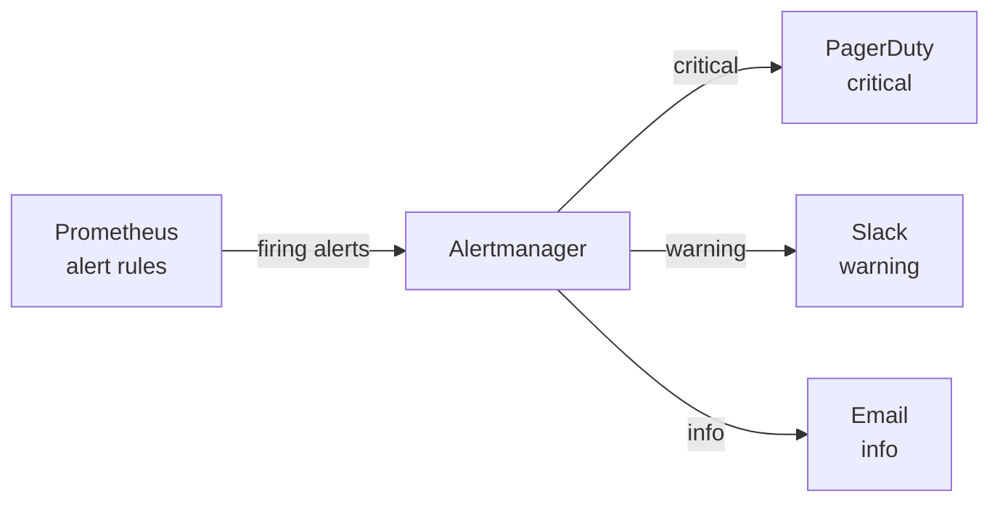

# 17.6 Alerting, SLOs and health checks for GPU clusters

| Field | Value |
|---|---|
| Level | Advanced |
| Priority tier | 2 |
| Lab venue | GCP / GKE |
| Part | Part 17: Observability, performance and operations |
| Primary sources | NVIDIA Zero-to-Hero Volume 16 (`chapter-09-alerting-slos-and-health-checks.md`); NVIDIA Zero-to-Hero Volume 10 (`chapter-09-on-call-and-runbooks.md`); *Production Kubernetes* (`production-kubernetes`, Chapters 9, 14) |
| Cross-references | Chapter 17.2 (Prometheus and Grafana); Chapter 17.4 (DCGM exporter); Chapter 17.5 (Distributed observability and profiling); Chapter 16.14 (Platform design: SLOs) |
| Coverage file | `planning/coverage/chapters/17-06.md` |
| Claim & number ledger | `planning/ledgers/17-06.md` |

## Why this matters for AI infrastructure

Every chapter in this part so far has been about collecting signal. This chapter is about acting on that signal. Alerting turns metrics and traces into pages for the on-call engineer. SLOs turn the same metrics into commitments the business can read. Health checks let Kubernetes decide whether a workload is alive and able to serve traffic.

Imagine each piece is missing. Without alerting, the on-call learns about an outage from a customer. Without SLOs, nobody can say which alerts the business cares about most. Without health checks, Kubernetes keeps sending requests to a pod that cannot answer them.

```text
Why alerting + SLOs + health checks is on the critical path (background reading: NVIDIA Zero-to-Hero volume 16; Production Kubernetes; the figures below are examples, not quotations):
- A typical mature AI platform emits 50-200 alerts per day. Without SLO-based
  routing, the on-call ignores all of them. With SLO-based routing, the on-call
  responds to the 5-10 alerts that matter.
- A typical GPU cluster has 8-16 health checks per workload. Without the
  health checks, Kubernetes cannot tell whether the workload is alive; the
  readiness probe fails; the workload is removed from the load balancer.
- The error budget is the bridge between the engineering team and the business.
  The error budget says "we can afford 43 minutes of downtime per month". The
  error budget is what the SLO alert burns against.
```

The counts in that block are examples, not measurements from a real platform. Use them as a rough picture, then measure your own alert volume before you set any target.

Three operating realities make this a platform-team concern rather than only a data-science one.

1. Alert routing is a platform decision. Every alert has a severity, every severity has a route, and every route ends at an on-call rotation. The platform team owns that chain.
2. SLOs are the contract between engineering and the business. The business may agree that 99.9% availability is acceptable, while engineering confirms that the target is achievable. The platform team owns the SLOs.
3. Health checks decide whether a pod receives traffic at all. A failing readiness probe takes the pod out of the load balancer, and a failing liveness probe restarts it. The platform team owns the health check templates.

Without alerting, the on-call reacts to failures after they happen. With it, the on-call can act first. **Before a team runs an AI workload on a GPU cluster, the workload needs health checks, the cluster needs SLOs, and the platform needs alert routing.**

## Prerequisites and outcomes

### Prerequisites

Read these chapters first. The rest of this chapter assumes their tools are running.

- Chapter 17.2 (Prometheus and Grafana) for the metrics stack and Alertmanager.
- Chapter 17.4 (DCGM exporter) for the GPU-specific alerts.
- Chapter 16.14 (Platform design) for the SLO-based platform design.

### Outcomes

After this chapter, you will be able to do the following. Each outcome maps to one of the sections below.

1. Specify the SLOs for an AI factory: availability, latency, throughput, and model quality.
2. Configure Alertmanager routing: severity-based routing, on-call rotation, and escalation policy.
3. Implement Kubernetes health checks for AI workloads: readiness, liveness, and startup probes.
4. Define the error budget, and explain how alerts burn against it.
5. Build an on-call runbook that says what to do when each alert fires.
6. Operate the alerting and SLO stack on GKE with reliable alerting, sensible escalation, and a runbook.

---

## 1. The SLOs

### 1.1 What an SLO is

Picture a customer who asks, "Is your service reliable?" If the team has no shared definition, every engineer answers differently. A Service Level Objective (SLO) gives that answer a measurable form. An SLO has three parts: a Service Level Indicator (SLI), a target, and a time window.

| Component | Example |
|---|---|
| **SLI** | The metric that measures the SLO |
| **Target** | The threshold that the SLI must meet |
| **Time window** | The period over which the SLI is measured |


### 1.2 The SLOs for an AI factory

An AI factory makes promises at three layers. The cluster team promises that the infrastructure stays up. The team that runs a model promises latency and availability for its endpoint. The customer feels only the end-to-end result, and that is the layer the business cares about most.

Every target in the table below is an example starting point for your team to choose, not a figure from a source.

| Layer | SLO | SLI | Target | Window |
|---|---|---|---|---|
| **Cluster** | Cluster availability | Uptime of the cluster | 99.9% | Monthly |
| **Cluster** | GPU pool availability | Uptime of the GPU pool | 99.5% | Monthly |
| **Cluster** | Registry availability | Uptime of the model registry | 99.95% | Monthly |
| **Team** | Inference latency p99 | p99 inference latency | < 300 ms | Monthly |
| **Team** | Inference availability | Uptime of the InferenceService | 99.9% | Monthly |
| **Team** | Training throughput | Training samples per second | > 1000 samples/sec | Per run |
| **Customer** | End-to-end latency p99 | p99 latency from request to response | < 500 ms | Monthly |
| **Customer** | End-to-end availability | Uptime of the customer-facing service | 99.9% | Monthly |

A chain of services can never be more reliable than its weakest link. When a customer request passes through several services, the combined availability ends up below any single target. Check the dependencies before you promise a customer-facing number.

### 1.3 The error budget

Suppose your SLO promises 99.9% availability for the month. That promise leaves a small amount of allowed downtime, and the allowance is the error budget. Teams spend it on work that carries risk, such as canary releases, chaos experiments, and rolling upgrades.

When the budget runs out, a common policy is to pause new deployments until the next window begins. That policy is a team choice, not something an SLO imposes on you.

```text
Error budget at 99.9% monthly availability:
- Total time per month: 30 days * 24 hours * 60 minutes = 43,200 minutes
- Budget: 0.1% * 43,200 = 43.2 minutes of downtime per month
- Burn rate at 1x: 43.2 minutes / 30 days = 1.44 minutes per day
- Burn rate at 2x: 2.88 minutes per day (alert)
- Burn rate at 10x: 14.4 minutes per day (page on-call)
```

The arithmetic above assumes a 30-day month. If your window is different, recalculate the 43.2 minutes before you publish the number. The 2x and 10x burn rates are example alert thresholds, where 2x is a warning and 10x is a page. Choose thresholds that match how fast your team can respond.

Before you publish an SLO, do the budget arithmetic for its window, so the team knows how much room it really has.

---

## 2. Alertmanager

### 2.1 The Alertmanager architecture

A single network fault can make many alerts fire in the same minute, and the on-call should not receive them one by one. Alertmanager is the router that stands between Prometheus and the on-call. It receives the alerts, removes duplicates, groups related ones, and sends each group to the right receiver.



### 2.2 The alert routing

Routing lives in one YAML file. It names which alerts go to which receiver, and how often each one repeats. When you read the file, start with the critical route, since that is the one that wakes someone up.

```yaml
# code/part17/alertmanager.yaml
route:
  receiver: 'default-receiver'
  group_by: ['alertname', 'cluster', 'service']
  group_wait: 30s
  group_interval: 5m
  repeat_interval: 4h
  routes:
    - matchers:
        - severity="critical"
      receiver: 'pagerduty-critical'
      group_wait: 10s
      repeat_interval: 1h
    - matchers:
        - severity="warning"
      receiver: 'slack-warnings'
      repeat_interval: 12h
    - matchers:
        - severity="info"
      receiver: 'email-info'
      repeat_interval: 24h

receivers:
  - name: 'default-receiver'
    webhook_configs:
      - url: 'http://alertmanager-webhook/health'
  - name: 'pagerduty-critical'
    pagerduty_configs:
      - service_key: 'REPLACE_WITH_PAGERDUTY_INTEGRATION_KEY'
        description: '{{ .CommonAnnotations.summary }}'
  - name: 'slack-warnings'
    slack_configs:
      - api_url: 'https://hooks.slack.com/services/REPLACE/WITH/WEBHOOK'
        channel: '#ai-factory-warnings'
  - name: 'email-info'
    email_configs:
      - to: 'platform-team@example.com'
        from: 'alertmanager@example.com'
        smarthost: 'smtp.example.com:587'
```

In this config, critical alerts go to PagerDuty and repeat every hour. Warnings go to Slack and repeat every 12 hours, and info alerts go to email and repeat daily. The repeat interval keeps one unchanged alert from re-notifying too often, and the group interval keeps related alerts together. Production Kubernetes, chapter 9, warns that excessive critical alerts burn out on-call engineers and bury the real ones, so tune each route until a page means someone must act now.

### 2.3 The alert inhibition

Inhibition tackles a different kind of noise. When a whole cluster is down, its many lower-severity alerts add little new information. An inhibit rule can mute them, so the on-call sees the root cause first.

```yaml
# code/part17/inhibit_rules.yaml
inhibit_rules:
  - source_matchers:
      - alertname="ClusterDown"
    target_matchers:
      - severity!="critical"
    equal: ['cluster']
  - source_matchers:
      - alertname="GPUNodeDown"
    target_matchers:
      - alertname="GPUXidError"
    equal: ['gpu', 'node']
```

The first rule mutes any alert below critical severity that shares a cluster label with a firing ClusterDown alert. The second rule mutes GPUXidError alerts that share the gpu and node labels with a firing GPUNodeDown alert. Both rules cut noise, so the on-call sees the most important alert first. Before you rely on them, check that your exporters really set the labels the rules match on.

---

## 3. Health checks

### 3.1 The Kubernetes health check primitives

A running pod can still fail to serve a single request. Kubernetes uses three probes to tell those states apart: the readiness probe, the liveness probe, and the startup probe.

| Probe | What it does | When it fires |
|---|---|---|
| **Readiness probe** | Is the workload ready to serve traffic? | Removes the workload from the load balancer |
| **Liveness probe** | Is the workload alive? | Restarts the workload |
| **Startup probe** | Is the workload starting up? | Disables the liveness probe until the startup is complete |

### 3.2 Health checks for AI workloads

A process can be alive and still useless. Picture a model server that is running but still loading weights from disk. A check that only asks whether the process exists would send it traffic too early, so the check has to ask whether the workload can serve.

```yaml
# code/part17/health_checks.yaml
livenessProbe:
  httpGet:
    path: /health/live
    port: 8080
  initialDelaySeconds: 30
  periodSeconds: 10
  timeoutSeconds: 3
  failureThreshold: 3

readinessProbe:
  httpGet:
    path: /health/ready
    port: 8080
  initialDelaySeconds: 10
  periodSeconds: 5
  timeoutSeconds: 3
  failureThreshold: 3

startupProbe:
  httpGet:
    path: /health/startup
    port: 8080
  periodSeconds: 5
  timeoutSeconds: 3
  failureThreshold: 30

lifecycle:
  preStop:
    exec:
      command: ["/bin/sh", "-c", "sleep 10"]
```

Each probe asks a different question. The liveness probe asks whether the process is alive, the readiness probe asks whether the model is loaded and the inference engine is ready, and the startup probe asks whether the model is still loading. Keep the liveness check local. Kubernetes restarts a pod when liveness fails, so a liveness check that calls a database would restart healthy pods during a database outage. Production Kubernetes, chapter 14, makes the same point and suggests failing the readiness probe instead. The preStop hook gives in-flight requests time to finish before Kubernetes sends SIGTERM. That sleep counts against the pod's graceful shutdown period, which defaults to 30 seconds and can be tuned with terminationGracePeriodSeconds. The timing values in the manifest are examples, so set them from how long your model takes to load and drain.

### 3.3 Health checks for GPU nodes

A probe inside a pod cannot see a broken GPU stack on the host. The script below checks the node itself. It asks whether the DCGM service and the DCGM exporter are active, and whether nvidia-smi returns utilization output.

```bash
# Health check script for a GPU node
#!/bin/bash
# Check that DCGM is running
systemctl is-active nvidia-dcgm || exit 1
# Check that the GPU is responsive
nvidia-smi -q -d UTILIZATION | grep -q "GPU" || exit 1
# Check that the DCGM exporter is running
systemctl is-active dcgm-exporter || exit 1
exit 0
```

Be careful with the third check. The grep only tests that the word GPU appears in the output. It does not read a utilization value, so treat it as a weak signal and add a real query if you need certainty.

---

## 4. The on-call runbook

### 4.1 What the runbook contains

At night, an on-call engineer needs one question answered fast: what do I do now? A runbook answers that question for each alert. Every runbook has six sections, and each section answers one question, from what the alert means to what to write in the post-mortem.

| Section | What it contains |
|---|---|
| **What the alert means** | A one-paragraph explanation of the alert |
| **Symptoms** | The user-facing symptoms that the alert detects |
| **Diagnostic steps** | The commands to run to confirm the alert |
| **Mitigation steps** | The commands to run to fix the alert |
| **Escalation path** | Who to page if the mitigation fails |
| **Post-mortem template** | The template for the post-mortem document |

### 4.2 The runbook template

The template below is a complete example for one alert. The 90 percent threshold, the 5-minute wait, and the 30-minute escalation window are example values. Set each one from your own incident history and your team's response time.

```markdown
# Alert: GPUMemoryPressure

## What the alert means
The GPU's HBM utilisation has exceeded 90% for more than 5 minutes. The workload is at risk of CUDA OOM; the next training step may crash.

## Symptoms
- The GPU's HBM utilisation is above 90%
- The workload's training step is taking longer than expected
- The CUDA OOM error appears in the workload's logs

## Diagnostic steps
1. Verify the GPU's HBM utilisation: `kubectl exec -it <pod> -- nvidia-smi`
2. Check the workload's memory usage: `kubectl top pod <pod>`
3. Check the workload's logs for CUDA OOM: `kubectl logs <pod> | grep OOM`

## Mitigation steps
1. Reduce the model size
2. Enable gradient checkpointing
3. Increase the GPU's HBM by moving to a larger GPU
4. Reduce the batch size

## Escalation path
If the mitigation fails within 30 minutes, page the ML platform team.

## Post-mortem template
- What was the alert?
- What was the root cause?
- What was the impact (downtime, customer-facing)?
- What was the mitigation?
- What is the prevention (alert tuning, code change, hardware change)?
```

### 4.3 The runbook integration with Alertmanager

The runbook is integrated with Alertmanager via the `runbook_url` annotation.

```yaml
- alert: GPUMemoryPressure
  expr: DCGM_FI_DEV_FB_USED / DCGM_FI_DEV_FB_TOTAL > 0.9
  for: 5m
  labels:
    severity: warning
  annotations:
    summary: "GPU {{ $labels.gpu }} on {{ $labels.node }} is under memory pressure"
    runbook_url: "https://wiki.example.com/runbooks/gpu-memory-pressure"
```

> **dcgm-exporter 4.9.0 version note.** dcgm-exporter 4.9.0 (2026-11-06) renamed many default metrics and changed some units. For example `DCGM_FI_DEV_GPU_UTIL` (percent) became `DCGM_FI_DEV_GPU_UTIL_RATIO` (0 to 1), and `DCGM_FI_DEV_FB_USED` (MiB) became `DCGM_FI_DEV_FB_USED_BYTES`. The metric names in this chapter are the 4.8.x names. On a 4.9.0 exporter use the [full mapping in 17.4](04-dcgm-exporter-and-interpreting-gpu-metrics.md#14-what-dcgm-exporter-490-renamed), and change thresholds together with the unit.

Every alert should carry a runbook_url annotation, so the page links straight to its steps. The on-call opens the link and follows the runbook from there. Production Kubernetes, chapter 9, makes the same point: alert annotations should give enough context to act on, including links to runbooks.

---

## 5. Operating the alerting and SLO stack on GKE

### 5.1 The components

The alerting stack is a production service in its own right. If Alertmanager stops, pages stop with it, and nobody notices until a customer does. Each component below therefore needs its own target and its own owner.

| Component | Where it runs | Backing store | SLO |
|---|---|---|---|
| Alertmanager | Kubernetes Deployment, 2 replicas (HA) | (sends to PagerDuty) | Alert latency p99 < 10 s |
| Prometheus alert rules | (in Prometheus server) | TSDB | Alert evaluation latency p99 < 30 s |
| PagerDuty integration | Managed service | (PagerDuty) | Page latency p99 < 30 s |
| Runbook repository | Git repo | Git history | Runbook freshness p99 < 1 day |

The targets in the table above are example values. Measure your own stack before you commit to any of them.

### 5.2 IAM and the alert routing

Give the alerting stack its own permissions, so each group can do only its job. The role names below are illustrative. Check them against your identity system before you copy them.

| Role | Who | What they can do |
|---|---|---|
| `alertmanager.reader` | Every team's on-call | View alerts; view runbooks |
| `alertmanager.writer` | Prometheus | Fire alerts to Alertmanager |
| `alertmanager.admin` | The platform team | Manage the alert routing; manage the inhibit rules |

Routing is the platform team's job. Each alert needs a severity, each severity needs a route, and each route needs a named on-call owner.

### 5.3 Observability

| Metric | Why it matters | Alert |
|---|---|---|
| Alertmanager latency p99 | Hot path for every alert | > 30 s |
| Alert firing rate | Alert volume | > 200 per day |
| Page delivery latency p99 | Hot path for every critical alert | > 60 s |
| Runbook freshness | Runbook accuracy | > 30 days since last update |
| SLO compliance per service | Customer-facing contract | < target for 1 hour |

The thresholds in this table are example values, so tune them to your alert volume and response time. The per-service SLO compliance alert matters most, because it tracks the promise made to customers. A team that stays below target for the example window of one hour should discuss pausing deployments, using the error budget that remains as the basis for that decision.

---

## 6. How it fails

Most alerting and health-check problems fall into six patterns. When something misbehaves, you can match the symptom to one of these patterns and go straight to its fix. Each pattern has a telltale symptom, and each one points to a different fix.

### 6.1 "The on-call is paged for every alert"

**Symptom:** The on-call receives 200 pages a day, which is an example volume, and cannot respond to all of them. Soon the pages are ignored.

**Diagnosis:** The routing is too aggressive. Alerts are not grouped or inhibited, and the severity labels are wrong.

**Fix:** Tune the routing, and group alerts by cluster and service. Add inhibit rules, review the severity labels, and page only for alerts the on-call can act on.

### 6.2 "The critical alert is not paged"

**Symptom:** The cluster is down, but the on-call does not know. The customer reports the outage first.

**Diagnosis:** The critical alert may be misconfigured, inhibited by another alert, sent to the wrong route, or blocked by a broken PagerDuty integration.

**Fix:** Simulate a cluster failure and confirm that you see the critical alert fire and reach PagerDuty. Then add an integration test, so the path is checked again after every change.

### 6.3 "The SLO is breached but the alert does not fire"

**Symptom:** The dashboard shows the SLO breach, but no alert fires. If you see this, the alert rule is the first thing to check.

**Diagnosis:** The alert rule may contain a PromQL typo, track the wrong SLI, or use the wrong time window.

**Fix:** Compare the alert rule with the SLO, field by field. Confirm that the SLI and the window both match the SLO, and add a test that catches any mismatch.

### 6.4 "The readiness probe fails and Kubernetes restarts the pod in a loop"

**Symptom:** The readiness probe fails again and again, so Kubernetes restarts the pod. The workload never serves traffic.

**Diagnosis:** The probe may be too aggressive, check a dependency that is not ready yet, or use a timeout that is too short.

**Fix:** Increase the initial delay and the timeout. Use a startup probe for slow starts, since it holds off the other probes until it passes. Production Kubernetes, chapter 14, adds a useful rule here: let the readiness check reflect a dependency, and keep the liveness check local, because restarting a pod rarely fixes a dependency that is down.

### 6.5 "The error budget is exhausted but the team does not know"

**Symptom:** The budget is spent, but the team keeps deploying. Customers feel an outage the team did not expect.

**Diagnosis:** No budget alert exists, nobody tracks the budget on a dashboard, and nothing pauses releases when the budget runs out.

**Fix:** Add a budget alert that fires early, before the budget is gone. An early trigger such as 75 percent spent is an example value. Show the remaining budget on the team dashboard, and pause new deployments when it runs out.

### 6.6 "The runbook is out of date"

**Symptom:** The on-call follows the runbook, but the mitigation no longer works, so the incident grows.

**Diagnosis:** Nobody updated the runbook after the last incident. The mitigation or the escalation path changed after it was written.

**Fix:** Before you trust a runbook, check its last update date. Update the runbook after every incident, and review it on a fixed schedule, such as each quarter. Automate a freshness check, so a stale runbook gets flagged before an incident exposes it.

---

## 7. Hands-on lab

Reading about alert routing is not the same as running it. This lab installs Alertmanager on GKE, configures the routing, and checks the runbook integration. The lab is **untested** in this repository.

### 7.1 Prerequisites

- A GKE Autopilot or Standard cluster (1.27+).
- Helm 3 for installing Alertmanager.
- Prometheus installed (Chapter 17.2).

### 7.2 Step 1: install Alertmanager

```bash
helm repo add prometheus-community https://prometheus-community.github.io/helm-charts
helm install alertmanager prometheus-community/alertmanager \
  --namespace monitoring --create-namespace \
  --set alertmanager.config.global.resolve_timeout=5m
# expected: Alertmanager pods are running
```

### 7.3 Step 2: configure the alert routing

```bash
kubectl -n monitoring create secret generic alertmanager-config \
  --from-file=configs/alertmanager.yaml

kubectl -n monitoring create configmap alertmanager-routes \
  --from-file=configs/inhibit_rules.yaml

# Reload Alertmanager
kubectl -n monitoring rollout restart deployment alertmanager
# expected: Alertmanager picks up the new configuration
```

### 7.4 Step 3: configure the runbook URLs

```bash
# Add the runbook URL to the alert rule
kubectl -n monitoring create configmap alert-rules \
  --from-file=configs/gpu_alerts.yaml

# Reload Prometheus
curl -X POST http://prometheus.monitoring:9090/-/reload
# expected: the alert rules are updated with runbook URLs
```

### 7.5 Step 4: simulate a critical alert

```bash
# Inject a synthetic critical alert
curl -X POST http://alertmanager.monitoring:9093/api/v2/alerts \
  -H "Content-Type: application/json" \
  -d '[{"labels": {"alertname": "alert_test", "severity": "critical"}}]'
# expected: the alert fires; Alertmanager routes the alert
```

### 7.6 Step 5: verify the alert routing

```bash
# Query Alertmanager
kubectl -n monitoring port-forward svc/alertmanager-operated 9093:9093 &
curl -s http://localhost:9093/api/v2/alerts | jq .
# expected: the critical alert is routed to the pagerduty-critical receiver
```

### 7.7 Step 6: verify the error budget

```bash
# Query the error budget
curl -s 'http://prometheus.monitoring:9090/api/v1/query?query=cluster_availability_budget_remaining' | jq .
# expected: the remaining error budget for the current month
```

### 7.8 What to record

After the lab, you should be able to answer five questions quickly. The five-second bar is an example, so set your own:

1. What is the current Alertmanager latency p99?
2. What is the current alert firing rate?
3. What is the current error budget remaining?
4. What is the current SLO compliance per service?
5. What is the most recent critical alert, and what was the runbook URL?

The 30-second limit is also an example value. If an answer takes longer than your limit, the stack is not yet ready for production. The lab itself is **untested** against a live GKE cluster.

---

## Exercises

Work through these on a lab cluster, not on production. Try to explain each result to a teammate before you move on. If you get stuck, reread the runbook section first.

1. **Add a new alert for a GPU Xid error.** Configure an alert that fires when a GPU Xid error is detected, add the runbook URL, and verify that the alert fires. *Solution sketch:* a Prometheus alert rule on the DCGM_FI_DEV_XID_ERRORS metric, with a runbook URL annotation.
2. **Add an inhibit rule for cluster down.** Add an inhibit rule that mutes per-workload alerts while the cluster is down. *Solution sketch:* an Alertmanager inhibit rule whose source matches ClusterDown and whose targets are the per-workload alerts.
3. **Add an error budget dashboard.** Build a Grafana dashboard that shows the remaining error budget for each service. *Solution sketch:* a Prometheus recording rule that computes the remaining budget, then a Grafana dashboard that plots it.
4. **Add a runbook freshness check.** Configure a Prometheus alert that fires when a runbook has not changed in 30 days. *Solution sketch:* a CI step that records each runbook's last update time, and a Prometheus alert that compares that time with the current time. The 30 days is an example threshold.
5. **Add a readiness probe template.** Build a Kubernetes template with readiness, liveness, and startup probes for an AI workload. *Solution sketch:* a Helm template or Kustomize patch that holds the three probes and the preStop hook.
6. **Add an SLO-based alert routing.** Configure Alertmanager to route alerts by the SLO they affect. *Solution sketch:* Alertmanager matchers on an SLO label, followed by the routes and receivers they lead to.

---

## Checkpoint questions

<details><summary>1. The on-call receives 200 pages a day and has started ignoring them. What is wrong and what do you change?</summary>
The routing is too aggressive. Alerts are not grouped or inhibited, and the severity labels are wrong. Tune the routing, group alerts by cluster and service, add inhibit rules, and review the severity labels. Page only for alerts the on-call can act on, so a page means someone must act now.
</details>

<details><summary>2. The cluster is down and the customer reports it before the on-call knows. What do you check?</summary>
The critical alert may be misconfigured, inhibited by another alert, sent to the wrong route, or blocked by a broken PagerDuty integration. Simulate a cluster failure and confirm the critical alert fires and reaches PagerDuty. Then add an integration test so the path is checked again after every change.
</details>

<details><summary>3. The dashboard shows an SLO breach, but no alert fires. Where do you look?</summary>
Look at the alert rule first. It may contain a PromQL typo, track the wrong SLI, or use the wrong time window. Compare the rule with the SLO field by field, confirm the SLI and window match, and add a test that catches any mismatch.
</details>

<details><summary>4. A database outage restarts healthy model pods across the cluster. What mistake in the probes would explain this?</summary>
The liveness probe probably calls the database. Kubernetes restarts a pod when liveness fails, so every healthy pod restarts when the database goes down. Keep the liveness check local. Let the readiness check reflect the dependency, so the pod leaves the load balancer instead of restarting.
</details>

<details><summary>5. The team spent its whole error budget but keeps deploying, and customers hit an outage nobody expected. What was missing?</summary>
There was no budget alert, nobody tracked the budget on a dashboard, and nothing paused releases when the budget ran out. Add a budget alert that fires early, such as at 75 percent spent. Show the remaining budget on the team dashboard and pause new deployments when it is gone.
</details>

<details><summary>6. A GPUMemoryPressure alert fires for a training pod. What do you do, in what order?</summary>
The alert means HBM use has been above 90 percent for more than 5 minutes, so a CUDA OOM may be next. Confirm with `nvidia-smi` in the pod, check `kubectl top pod`, and search the logs for OOM. Then mitigate by reducing batch size or model size, or by enabling gradient checkpointing. Page the ML platform team if that fails within 30 minutes.
</details>

<details><summary>7. Why is the end-to-end availability of a request below every single service's target?</summary>
A chain of services can never be more reliable than its weakest link. When a request passes through several services, each one can fail, so the combined availability ends up below any single target. Check the dependencies before you promise a customer-facing number.
</details>

<details><summary>8. Why does the ClusterDown inhibit rule use `equal: ['cluster']`?</summary>
The rule mutes only alerts that share the same cluster label as the firing ClusterDown alert. Without that match, it would mute alerts from healthy clusters too. If your exporters do not set the label, the rule never matches, so check the labels before you rely on it.
</details>

<details><summary>9. Why does adding a startup probe stop a slow-loading model from being restarted in a loop?</summary>
The startup probe disables the liveness probe until startup completes. A model that needs a long time to load can therefore fail early liveness checks without being killed. Without it, the other probes run too early and restart the pod before the weights are loaded.
</details>

<details><summary>10. Why does the pod spec have a preStop hook that sleeps 10 seconds?</summary>
The hook gives in-flight requests time to finish before Kubernetes sends SIGTERM. The sleep counts against the pod's graceful shutdown period, which defaults to 30 seconds and can be tuned with `terminationGracePeriodSeconds`. Set the timing from how long your model takes to drain.
</details>

<details><summary>11. Why does the chapter add a node-level health script when pods already have probes?</summary>
A probe inside a pod cannot see a broken GPU stack on the host. The script checks that the DCGM service and the DCGM exporter are active and that nvidia-smi answers. The third check only greps for the word GPU, so it is a weak signal and needs a real utilization query if you want certainty.
</details>

<details><summary>12. When would you mark an alert critical rather than warning, and what do you give up?</summary>
Mark it critical only when someone must act now. Critical alerts go to PagerDuty and repeat every hour, while warnings go to Slack and repeat every 12 hours. You give up fast attention on warnings, because Slack may be read later. Excess critical alerts burn out the on-call and bury the real ones.
</details>

<details><summary>13. You can alert at a 2x burn rate or only page at 10x. When do you choose each, and what do you give up?</summary>
A 2x alert is a warning that shows a slow burn early but fires more often. A 10x page is rare and urgent. Choose thresholds that match how fast your team can respond. Both values are examples. Using only 10x gives less noise but a slower warning.
</details>

<details><summary>14. Should a readiness probe check the database the model depends on, and what do you give up?</summary>
Yes, let the readiness check reflect a dependency and keep the liveness check local. A failing readiness probe only removes the pod from the load balancer, while a failing liveness probe restarts it. You give up an automatic restart, but restarting a pod rarely fixes a dependency that is down.
</details>

<details><summary>15. When the error budget runs out, would you pause deployments, and what do you give up?</summary>
Pausing new deployments until the next window is a common policy, but it is a team choice that the SLO does not impose. You give up release speed and protect customers while the budget is spent. A team below target for the example hour should discuss it using the remaining budget.
</details>

<details><summary>16. A 99.95 percent monthly SLO for the model registry, on a 30-day month. What is the error budget?</summary>
A 30-day month has 30 times 24 times 60, which is 43,200 minutes. The budget is 0.05 percent of that, which is 21.6 minutes. This is half the 43.2 minutes at 99.9 percent. The targets are examples.
</details>

<details><summary>17. At 99.9 percent monthly availability, a 10x burn starts. How many days until the budget is gone?</summary>
The budget is 43.2 minutes. A 10x burn spends 14.4 minutes per day, which is 10 times the 1.44 minutes per day at 1x. So 43.2 divided by 14.4 gives 3 days.
</details>

<details><summary>18. The startup probe has `periodSeconds: 5` and `failureThreshold: 30`. How long can the model take to start?</summary>
The pod can fail the probe 30 times, 5 seconds apart. That is 30 times 5, or 150 seconds. If the model takes longer to load, the pod will be restarted. The timing values are examples, so set them from your own load time.
</details>

<details><summary>19. A pod fails its probe repeatedly and never serves traffic. What do you check first, second and third?</summary>
First check whether the probe is too aggressive for a slow start. Second check whether it tests a dependency that is not ready yet. Third check the timeout, which may be too short. The fixes are a longer initial delay and timeout and a startup probe for slow starts.
</details>

<details><summary>20. You injected a synthetic critical alert in the lab. In what order do you confirm the page path works?</summary>
First post the alert to the Alertmanager API with severity critical. Second port-forward to Alertmanager and list the alerts to confirm it arrived. Third confirm it was routed to the `pagerduty-critical` receiver. This follows the lab steps and shows where the path breaks.
</details>

## Sources and review notes

- NVIDIA Zero-to-Hero Volume 16 (`chapter-09-alerting-slos-and-health-checks.md`). Source for the Alertmanager configuration, the SLO patterns, the health check templates, and the runbook integration. The wording has been rewritten in the handbook's voice.
- *Practical MLOps* (`practical-mlops`, Chapter 6, Monitoring and Logging). Source for the monitoring and logging patterns that bridge MLOps and operations, and for the framing of monitoring as a first-class MLOps discipline.
- NVIDIA Zero-to-Hero Volume 10 (`chapter-09-on-call-and-runbooks.md`). Source for the on-call runbook patterns, the escalation policy, and the post-mortem template.
- *Production Kubernetes* (`production-kubernetes`, Chapters 9, 14). Source for the Alertmanager patterns, the probe primitives, and the operational discipline.

### Cross-references to other handbook chapters

- Chapter 17.2 for the Prometheus and Alertmanager integration.
- Chapter 17.4 for the GPU-specific alerts.
- Chapter 17.5 for the profiling integration.
- Chapter 16.14 for the SLO-based platform design.

### Migrated from `nvidia-devops`

The alerting and SLO operational patterns draw on Volume 16 chapter 9 and Volume 10 chapter 9. The wording has been rewritten in the handbook's voice.

### Explicitly labelled inferences

- The SLO targets in Section 1.2 are starting points; specific targets depend on the use case and the business's tolerance.
- The burn rate thresholds in Section 1.3 are starting points; specific thresholds depend on the workload.
- The alert routing in Section 2.2 is a starting point; specific routing depends on the on-call rotation and the escalation policy.

### Not verified on live hardware

- The lab in Section 7 is **untested** against a live GKE cluster in this repository.
- The Alertmanager and Prometheus versions assumed in the lab should be pinned against the current releases before production use.
- The PagerDuty and Slack integrations in the lab require production credentials that are not provided in the lab.
