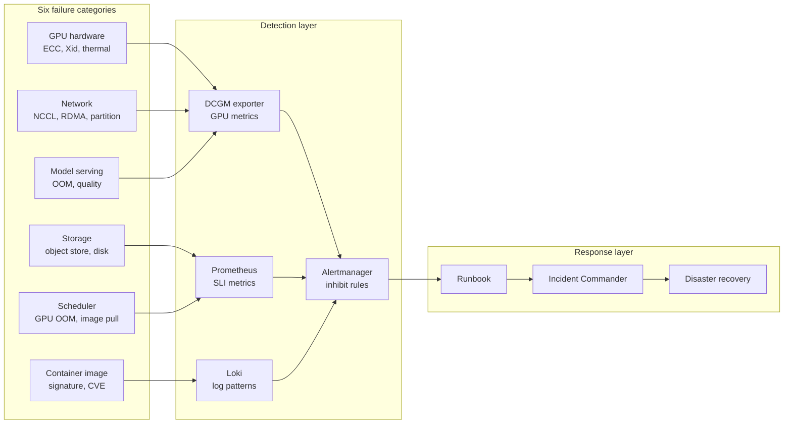

# 17.7 Failure modes and detection

| Field | Value |
|---|---|
| Level | Advanced |
| Priority tier | 2 |
| Lab venue | GCP / GKE |
| Part | Part 17: Observability, performance and operations |
| Primary sources | NVIDIA Zero-to-Hero Volume 16 (`chapter-08-failure-modes-and-detection.md`); NVIDIA Zero-to-Hero Volume 20 (`chapter-XX-failure-modes.md`); *Production Kubernetes* (`production-kubernetes`, Chapter 14) |
| Cross-references | Chapter 17.4 (DCGM exporter); Chapter 17.6 (Alerting and SLOs); Chapter 11 (GPU Kubernetes); Chapter 16.10 (Monitoring and drift) |
| Coverage file | `planning/coverage/chapters/17-07.md` |
| Claim & number ledger | `planning/ledgers/17-07.md` |

## Failure mode catalogue at a glance



Read the diagram from left to right. Each failure category points at the signal that should catch it. The signals feed Alertmanager, which leads to a runbook, then to the Incident Commander, and finally to disaster recovery. When you meet a new symptom, find its category first, then follow the arrows to the signal that should have caught it.

## Why this matters for AI infrastructure

It is the middle of the night, and a page arrives. A training job stopped making progress a while ago, and the GPU dashboard shows nothing obvious. An on-call engineer who knows the failure modes can name the cause from the symptom and start the right fix. An engineer who does not know them spends the first minutes searching the wiki while the cluster stays stuck.

The earlier chapters in this part teach you how to detect failures. This chapter is the catalogue of the failures themselves. An AI infrastructure failure mode is a specific way the cluster can stop meeting its service-level objectives. The range is wide. At one end, a single GPU reports a memory error that the DCGM exporter picks up. At the other, a network partition splits the cluster, and the Prometheus blackbox exporter is the detector.

Every failure mode needs three things. It needs a detection signal, an alert built on that signal, and a runbook the alert links to. Without all three, the failure is either invisible or unhandled.

```text
Why failure modes are on the critical path (background reading: NVIDIA Zero-to-Hero volume 16; NVIDIA Zero-to-Hero volume 20; Production Kubernetes; the figures below are examples, not quotations):
- A typical mature AI platform has 30-50 distinct failure modes. Each failure
  mode has a name, a symptom, a root cause, a detection signal, an alert, and a
  runbook. The on-call engineer who has the catalogue is the on-call engineer
  who resolves the incident in minutes; the on-call who does not is the on-call
  who resolves the incident in hours.
- The most common AI infrastructure failure modes are GPU hardware failures
  (ECC errors, Xid events), network failures (NCCL timeouts, RDMA errors),
  storage failures (object storage 5xx), scheduler failures (GPU OOM, queue
  exhaustion), and container image failures (pull rate limit, image
  corruption).
- The failure mode catalogue is the on-call engineer's first responder tool.
  The catalogue is updated after every incident; the catalogue is the on-call
  engineer's institutional knowledge.
```

The count of 30 to 50 in that block is an example, not a measured figure. Count the failure modes on your own platform before you plan around any number.

This chapter belongs to the platform team as much as to the data scientists. Three things make it a platform concern.

1. The failure modes are platform-level. A data scientist sees a model that gives bad results. The platform team sees a cluster that stops working, and this chapter catalogues those cluster failures.

2. The detection signals are platform-level. The DCGM exporter catches GPU failures, Prometheus catches metric failures, Loki catches log failures, and Tempo catches trace failures. The platform team owns that detection.

3. The runbooks are platform-level. Each alert should carry a runbook link, so the on-call engineer finds the next step from the alert itself. Production Kubernetes, chapter 9, makes the same point. It recommends a description and a runbook link in each alert's annotations, so the responder has context right away. The platform team owns those runbooks.

**Build the failure mode catalogue before the first AI workload runs on the cluster.** Without it, every incident starts from scratch. With it, the on-call engineer recognises the symptom and moves straight to the fix.

## Prerequisites and outcomes

### Prerequisites

- Chapter 17.4 (DCGM exporter) for the GPU-specific failures.
- Chapter 17.6 (Alerting and SLOs) for the alert routing.
- Chapter 11 (GPU Kubernetes) for the GPU node operations.

Work through these first, because the rest of the chapter assumes you already know them.

### Outcomes

After completing this chapter, you will be able to:

1. Name the main AI infrastructure failure modes, which fall into six groups: GPU hardware, network, storage, scheduler, container image, and model serving.
2. Identify the detection signal for each failure mode, meaning the metric, log, trace, or probe that catches it when the failure happens.
3. Write the alert for each failure mode, with its threshold, its routing, and the runbook URL that the on-call engineer will open.
4. Build the failure mode catalogue, a structured document the on-call engineer can search quickly during an incident.
5. Operate the catalogue. Update it after every incident, review it quarterly, and automate the freshness check so stale entries get noticed.
6. Operate the failure mode stack on GKE with reliable detection, sensible alerting, and a runbook that someone has actually tested.

---

## 1. GPU hardware failures

### 1.1 The GPU failure catalogue

GPU hardware causes a large share of training interruptions. In Meta's record of 54 days of Llama 3 405B pretraining, faulty GPUs caused 30.1 percent of the interruptions, and GPU HBM3 memory caused another 17.2 percent. AI Systems Performance Engineering, chapter 4, reports those figures. NVIDIA Zero-to-Hero Volume 16 chapter 8 and Volume 20 catalogue the same kinds of failure in more detail.

The table gives each failure a symptom, a likely root cause, a detection signal, and an alert level. Treat it as a starting list.

| Failure mode | Symptom | Root cause | Detection signal | Alert |
|---|---|---|---|---|
| **ECC single-bit error** | Increased error rate | GPU memory degradation | `DCGM_FI_DEV_ECC_SBE_VOL_TOTAL` rate | Warning |
| **ECC double-bit error** | Data corruption | GPU memory failure | `DCGM_FI_DEV_ECC_DBE_VOL_TOTAL` count | Critical |
| **GPU Xid error** | Driver-level error | Hardware or driver bug | `DCGM_FI_DEV_XID_ERRORS` count | Critical |
| **Thermal throttling** | Reduced clock | Insufficient cooling | `DCGM_FI_DEV_GPU_TEMP > 85` | Warning |
| **Power throttling** | Reduced clock | Insufficient power | `DCGM_FI_DEV_POWER_USAGE > TDP` | Warning |
| **GPU OOM** | Training step crash | Model too large for HBM | `CUDA_OUT_OF_MEMORY` in logs | Warning |
| **GPU hang** | No kernel progress | Driver or hardware hang | `DCGM_FI_DEV_SM_CLOCK > 0` for > 10s with no kernel | Critical |
| **Retired pages** | Reduced HBM | Memory cell failure | `DCGM_FI_DEV_RETIRED_PENDING` count | Warning |
| **NVLink CRC error** | Reduced bandwidth | Cable or port failure | `DCGM_FI_DEV_NVLINK_CRC_DATA_ERROR_TOTAL` count | Warning |
| **PCIe replay** | Reduced PCIe bandwidth | Cable or slot failure | `DCGM_FI_DEV_PCIE_REPLAY_COUNTER` count | Warning |

The 85 degree warning in the thermal row matches the example warning in AI Systems Performance Engineering, chapter 16. That chapter's example table also sets a critical level at 95 degrees and treats any uncorrectable ECC error as critical. Use these as starting points, then tune them to your own cooling and hardware.

### 1.2 The ECC error storm

Memory errors often come before a GPU fails. ECC, the error-correcting code built into the GPU's memory, fixes a single-bit error on the fly, so the job keeps running. A double-bit error cannot be corrected, but the hardware detects it and raises it to the program that caused it. AI Systems Performance Engineering, chapter 3, describes this behaviour, and it notes that ECC is on by default on NVIDIA data center GPUs.

The timeline below shows how a storm can unfold. It is an illustration, not a measured log from a real GPU. Use it to understand the order of events, not the exact times or rates.

```text
The ECC error storm:
- T+0: SBE rate increases from 0 to 10/hour
- T+1h: SBE rate increases to 50/hour
- T+2h: First DBE appears
- T+2h+1m: DBE rate increases to 5/hour
- T+3h: GPU is corrupting data; workload must be moved
- T+4h: GPU is replaced
```

One example policy warns at 100 single-bit errors per hour, pages on any double-bit error, and drains the node at once. These numbers are examples. Measure the normal error rate on your own fleet before you choose yours.

### 1.3 The GPU hang

A GPU hang is the quietest failure in this chapter. The workload still runs, kernels sit in the queue, and the GPU makes no progress. Nothing crashes, so nothing forces anyone to look until the job stalls.

The detection signal in this section is the SM clock. If the clock stays above zero for more than 10 seconds with no kernel progress, the check treats the GPU as hung. The 10 seconds is an example threshold, and the check itself needs a second signal to be reliable.

```bash
# Detect a GPU hang
nvidia-smi --query-gpu=clocks.sm,clocks.mem --format=csv
# expected: SM clock > 0 with no recent kernel activity -> hung
```

AI Systems Performance Engineering, chapter 16, argues for failing fast. Put timeouts around inference calls, so a hung call raises an error instead of holding GPU time. Apply the same idea to training jobs wherever you can.

A reasonable response, in order, is to alert, restart the workload, drain the node, and replace the GPU if the hang returns.

---

## 2. Network failures

### 2.1 The network failure catalogue

Network problems hit distributed training because every GPU depends on its neighbours. In the same Meta record, network switches and cables caused 8.4 percent of the interruptions. AI Systems Performance Engineering, chapter 4, reports that figure. The table lists the network failures this chapter covers. Start from the symptom column.

| Failure mode | Symptom | Root cause | Detection signal | Alert |
|---|---|---|---|---|
| **NCCL timeout** | Training step hangs | Network congestion or failure | NCCL timeout in logs | Critical |
| **NCCL error** | Training step fails | Network or NCCL bug | `NCCL ERROR` in logs | Critical |
| **RDMA error** | Reduced bandwidth | Cable or HCA failure | `RDMA ERROR` in logs | Warning |
| **Network partition** | Multi-node training fails | Network split | `ping` failure between nodes | Critical |
| **DNS failure** | Service discovery fails | DNS resolver error | `NXDOMAIN` in logs | Warning |
| **Load balancer failure** | Traffic not routed | LB configuration error | 5xx rate spike | Critical |
| **Ingress failure** | External traffic not routed | Ingress controller error | 5xx rate spike | Critical |
| **Service mesh failure** | mTLS handshake fails | Istio/Linkerd error | `mTLS ERROR` in logs | Warning |

### 2.2 The NCCL timeout

An NCCL timeout happens when one collective operation, such as an all-reduce, runs past its time limit. Every GPU in the job waits on that operation, so the whole training step stalls. The timeout is the symptom you see first. The cause can be the network, or it can be a single rank that crashed, so check your peer ranks before you blame the fabric.

That second case matters. AI Systems Performance Engineering, chapter 4, warns that when one GPU rank hits an error, the other ranks can hang waiting for it. Meta's record lists NCCL watchdog timeouts at 1.7 percent of interruptions, a small share, but each one stalls the whole job.

```python
# code/part17/snippets/nccl_timeout.py
"""Collective timeouts in PyTorch are set on the process group, not through an NCCL_TIMEOUT environment variable
(PyTorch ignores that name). Requires GPUs and torchrun, so this file is syntax-checked only."""
import os
from datetime import timedelta

import torch
import torch.distributed as dist
from opentelemetry import trace

os.environ.setdefault("TORCH_NCCL_ASYNC_ERROR_HANDLING", "1")   # abort the job instead of hanging on a timed-out collective
dist.init_process_group(backend="nccl", timeout=timedelta(minutes=10))
tracer = trace.get_tracer(__name__)

tensor = torch.ones(1024, device="cuda")
with tracer.start_as_current_span("all-reduce"):
    dist.all_reduce(tensor)       # raises (and the watchdog aborts the job) if the collective does not finish in 10 minutes
```

The snippet sets the timeout to 10 minutes, which is the 600 seconds used in the policy below. Its error-handling setting makes the job abort instead of hang, as the comments explain.

A simple policy sets the NCCL timeout to 600 seconds, alerts on any NCCL timeout in the logs, and investigates the network first. Restart the workload only if the timeout keeps coming back.

### 2.3 The network partition

A network partition splits the cluster into two halves that cannot reach each other. Multi-node training stops, because the ranks on one side wait for peers they can no longer reach. The detection signal is a failed ping between nodes, and the alert is critical.

The check in this section is an Ansible ping across all hosts. A host that does not answer is either on the other side of the split or simply down, so you need to tell those cases apart. Run it from a host you trust.

```bash
# Check which hosts this machine can reach. Run it from a host on each side of the suspected split.
ansible all -m ping
# expected: the set of unreachable hosts differs depending on where you run it
```

AI Systems Performance Engineering, chapter 16, notes that a GPU which shows much lower utilization than its peers may have dropped out of the NCCL group. The book suggests searching the logs for `WARN NCCL_COMM_FAILURE`, and setting `NCCL_DEBUG=WARN` so silent errors become visible.

When the ping fails, alert, investigate the fabric, restart the affected workloads, and drain the affected nodes.

---

## 3. Storage failures

### 3.1 The storage failure catalogue

Storage failures either stop a job from starting or slow it down while it runs. Training reads its data from object storage or a shared filesystem, so an outage there starves the GPUs. A read error and a slow read need different alerts, which is why the table separates them.

| Failure mode | Symptom | Root cause | Detection signal | Alert |
|---|---|---|---|---|
| **Object storage 5xx** | Training fails to read data | Object storage outage | `s3_errors_total` rate | Critical |
| **Object storage 4xx** | Training fails to read data | Permission or key issue | `s3_errors_total{status="4xx"}` rate | Warning |
| **Object storage latency** | Training slow | Object storage degradation | `s3_request_duration_seconds` p99 | Warning |
| **Distributed filesystem failure** | Training fails to read data | NFS/Lustre outage | `nfs_errors_total` rate | Critical |
| **Local disk full** | Workload fails to start | Disk full | `node_filesystem_avail_bytes` < 10% | Warning |
| **Disk I/O error** | Training slow | Disk failure | `node_disk_io_now` high | Warning |
| **PVC mount failure** | Workload fails to start | PVC not bound | `kube_persistentvolumeclaim_status_phase{phase!="Bound"}` | Critical |
| **Object lock failure** | Audit log cannot be deleted | Object storage misconfigured | Audit log bucket size | Critical |

### 3.2 The object storage 5xx

A 5xx error means the object storage service failed to answer. The training job asks for the next batch of data and gets an error back instead. The detection signal is the `s3_errors_total` metric, and the query below counts the 5xx rate over five minutes.

```promql
# The S3 5xx rate
sum(rate(s3_errors_total{status=~"5.."}[5m]))

# Alert: 5xx rate > 0
sum(rate(s3_errors_total{status=~"5.."}[5m])) > 0
```

The alert in that example fires on any 5xx at all. That is a deliberately sensitive starting point, so tune the threshold to the normal error rate of your traffic. When the outage lasts, switch to a backup region if you have one, and otherwise wait for the service to recover.

### 3.3 The local disk full

A full disk stops a workload in an ordinary way. Logs, caches, and checkpoints all grow on the node's disk, and once the disk fills, new work cannot start. The detection signal is the `node_filesystem_avail_bytes` metric, which tells you how much space is left.

```promql
# The available disk space per node
node_filesystem_avail_bytes{mountpoint="/"}

# Alert: disk space < 10%
node_filesystem_avail_bytes{mountpoint="/"} / node_filesystem_size_bytes{mountpoint="/"} < 0.1
```

The example alert fires below 10 percent free space, which is a starting point. A node that writes large checkpoints may need more margin. When the alert fires, find the workload that is filling the disk, clean up its logs, resize the disk, and drain the node only if you cannot free enough space safely.

---

## 4. Scheduler failures

### 4.1 The scheduler failure catalogue

Scheduler failures leave a pod waiting or kill it before it does useful work. Your first question is whether the pod is waiting for capacity, or whether it started and then died. The table below groups the failures by symptom, so you can start from what the pod shows.

| Failure mode | Symptom | Root cause | Detection signal | Alert |
|---|---|---|---|---|
| **GPU OOM** | Workload fails to start | Insufficient GPU memory | `kube_pod_container_status_terminated_reason{reason="OOMKilled"}` | Critical |
| **GPU not available** | Workload pending | All GPUs allocated | `kube_pod_status_phase{phase="Pending"}` | Warning |
| **Pod scheduling timeout** | Workload pending | Scheduler misconfigured | `kube_pod_status_phase{phase="Pending"}` for > 5m | Warning |
| **Image pull failure** | Workload fails to start | Image not found or pull rate limit | `kube_pod_container_status_waiting_reason{reason="ImagePullBackOff"}` | Critical |
| **Node not ready** | Workload pending | Node down | `kube_node_status_condition{condition="Ready",status="false"}` | Critical |
| **Scheduler hang** | Workload pending | Scheduler crash | Pod pending for > 10m | Critical |
| **Preemption loop** | Workload repeatedly preempted | Quota exhausted | Pod preempted events | Warning |
| **Quota exhausted** | Workload pending | Team quota exhausted | Kueue LocalQueue depth | Warning |

### 4.2 The GPU OOM

In this failure, the job asks for more GPU memory than the node can give, and Kubernetes kills the workload. The detection signal is the `OOMKilled` reason in the pod status. The query below finds those pods and counts them over the last hour.

```promql
# The pods that were OOMKilled
kube_pod_container_status_terminated_reason{reason="OOMKilled"}

# Alert: any OOMKilled in the last hour
sum(increase(kube_pod_container_status_terminated_reason{reason="OOMKilled"}[1h])) > 0
```

AI Systems Performance Engineering, chapter 3, describes the Linux OOM killer as the cgroup enforcement that ends a container which exceeds its memory allocation. That is a system-memory limit, so check it when you suspect a host-memory problem. Confirm the GPU side from the CUDA out-of-memory error in the workload's own logs.

A reasonable response is to alert on any OOMKilled in the last hour, check the workload's memory request, then raise the request or shrink the model, and redeploy.

### 4.3 The image pull failure

An image pull failure leaves a pod stuck before its container starts. Three causes are common. The image name may be wrong, with a typo or a missing tag. The registry may be rate limiting you, as Docker Hub does for anonymous pulls. Or the pull may time out on the network. The detection signal is the `ImagePullBackOff` reason in the pod status.

```promql
# The pods that are ImagePullBackOff
kube_pod_container_status_waiting_reason{reason="ImagePullBackOff"}

# Alert: any ImagePullBackOff for > 5 minutes
count by (pod, namespace) (kube_pod_container_status_waiting_reason{reason="ImagePullBackOff"}) > 0
```

Start by checking the image name and tag, because that is the cheapest fix. Then check the pull rate limit, and configure an image pull secret if the registry requires authentication. The five-minute window is an example, so choose the wait that suits your deploys.

---

## 5. Container image failures

### 5.1 The container image failure catalogue

A container image can fail at the registry, at the admission check, or during a security scan. Each failure leaves a different trace, so read the event or log that names the stage first. The table lists the failures this chapter covers, along with the signal for each.

| Failure mode | Symptom | Root cause | Detection signal | Alert |
|---|---|---|---|---|
| **Image not signed** | Pod fails to start | Image not signed by cosign | Admission controller log | Critical |
| **Image signature mismatch** | Pod fails to start | Signature does not verify | Admission controller log | Critical |
| **Image pull rate limit** | ImagePullBackOff | Docker Hub rate limit | Pull error in logs | Warning |
| **Image corruption** | Pod fails to start | Image digest mismatch | Admission controller log | Critical |
| **Image CVE** | Workload runs with vulnerability | Image has known CVE | Trivy scan | Warning |
| **Image out of date** | Workload runs with old base | Image not updated | Trivy scan | Warning |
| **Image storage full** | Image push fails | Registry storage full | Registry metrics | Warning |

### 5.2 The image signature mismatch

A signature mismatch is the failure you should treat with the most care. The image was signed, but the signature no longer matches the image. The admission controller then refuses to start the pod, which is the behaviour you want. Production Kubernetes, chapter 15, notes that admission webhooks can check for signed images before a pod runs, so this check fits into the cluster itself.

```bash
# Detect an image signature mismatch
kubectl get events -n mlops --field-selector reason=Failed
# expected: "Failed to verify signature" event
```

The exact event text depends on your admission controller, so confirm the wording in your own cluster before you write an alert on it. Alert on any mismatch, investigate the signing pipeline, and rotate the signing key if you think it was exposed. Never bypass the admission controller to get a pod running.

### 5.3 The image CVE

An image CVE means the image carries a known vulnerability. The workload keeps running with that weakness until the image is rebuilt. Scanning is the way you find these, and the Trivy command below scans one image.

```bash
# Run Trivy on the image
trivy image my-image:v1
# expected: list of CVEs with severity
```

Production Kubernetes, chapter 15, makes a point you should keep in mind. An image that passed its scan at pull time can gain new CVEs later, so scans must repeat on a schedule. The chapter's policy is to run Trivy on every image in CI, alert on any CVE at HIGH severity or above, and rebuild on an updated base image. The severity cut-off is an example you can adjust.

---

## 6. Model serving failures

### 6.1 The model serving failure catalogue

Model serving failures reach users in two ways. Some crash the request, so the user gets an error. Others return a wrong answer with no error at all, and you will not see those in your error logs. The table separates the two kinds, and the second kind is the one that needs the most attention.

| Failure mode | Symptom | Root cause | Detection signal | Alert |
|---|---|---|---|---|
| **Model OOM** | Inference request fails | Model too large for GPU | `inference_oom_total` rate | Critical |
| **Model timeout** | Inference request hangs | Model too slow | `inference_request_duration_seconds` p99 > SLO | Warning |
| **Model version mismatch** | Inference request returns wrong output | Stale model loaded | Model hash mismatch | Critical |
| **Tokenizer failure** | Inference request fails | Tokenizer error | `tokenizer_errors_total` rate | Warning |
| **Feature store failure** | Inference request fails | Feature store unavailable | `feature_store_errors_total` rate | Critical |
| **Vector store failure** | RAG inference fails | Vector store unavailable | `vector_store_errors_total` rate | Critical |
| **Model quality regression** | Inference succeeds but wrong | Model degradation | `model_quality_score` drop | Warning |
| **Prompt injection** | Inference returns harmful content | Adversarial prompt | Guardrail trigger | Critical |

### 6.2 The model OOM

An OOM in serving happens when the model and its working memory no longer fit on the GPU. The model is too large for the GPU's memory, the inference engine's KV cache fills up, and a CUDA out-of-memory crash follows. The detection signal is the `inference_oom_total` rate, and the query below counts it over five minutes.

```promql
# The inference OOM rate
sum(rate(inference_oom_total[5m]))

# Alert: any inference OOM in the last 5 minutes
sum(rate(inference_oom_total[5m])) > 0
```

AI Systems Performance Engineering, chapter 16, recommends backpressure when errors spike. You reject new requests or reduce the batch size for a while, which gives the system room to recover. An alert on any inference OOM is a good first step, and the fixes are to shrink the KV cache budget, move to a larger GPU, or lower the number of concurrent requests.

### 6.3 The model quality regression

A quality regression is the hardest serving failure to see. The request succeeds, the model returns an answer, and the answer is wrong. Nothing in the error logs points to the problem, so the detection signal has to measure quality itself. In this chapter that signal is the `model_quality_score` metric from Chapter 16.10.

```promql
# The model quality score
model_quality_score{model="churn-model"}

# Alert: model quality score < threshold
model_quality_score{model="churn-model"} < 0.85
```

The 0.85 in that alert is an example threshold, so choose the value your own model needs. Set yours from the score your model reached when it was approved. When the score drops below it, retrain with recent data, check the drift detector, and roll back to the previous model version if the retrain does not recover the score.

---

## 7. Operating the failure mode catalogue

### 7.1 The catalogue structure

The catalogue only helps if the on-call engineer can search it quickly during an incident. Give every failure mode the same fields, so each entry reads the same way. The list below shows the fields this chapter uses.

```text
Failure mode catalogue fields:
- ID (FM-001, FM-002, ...)
- Name
- Symptom
- Root cause
- Detection signal (metric, log, trace, probe)
- Alert (rule, severity, routing)
- Runbook URL
- Last updated
- Last incident
```

### 7.2 The catalogue update

Update the catalogue at the end of every incident. Add a new failure mode if the incident did not match one. Change the runbook if the fix changed, and record the date of the last incident. The script below does this from the command line.

```bash
# Update the failure mode catalogue after an incident
python code/part17/update_catalogue.py \
  --incident-id INC-2024-03-15-001 \
  --failure-mode FM-001 \
  --runbook-url https://wiki.example.com/runbooks/gpu-memory-pressure \
  --last-incident 2024-03-15
```

Keep the catalogue in Git. The script writes its change as a commit, and a reviewer approves that commit in a pull request. That gives you a history of how the catalogue changed over time.

### 7.3 The catalogue review

A stale catalogue sends people to runbooks that no longer work. Review it on a schedule, and this chapter suggests quarterly. The review flags failure modes that have not appeared in the last 90 days, failure modes that keep coming back, and new failure modes from the latest vendor releases. The 90-day window is an example, so set it to match how often your incidents happen.

```bash
# Review the failure mode catalogue
python code/part17/review_catalogue.py \
  --catalogue planning/failure_modes/catalogue.yaml \
  --staleness-threshold-days 90
# expected: a list of stale failure modes; a list of repeated failure modes; a list of new failure modes
```

---

## 8. How it fails

Six patterns come back again and again when the catalogue or its alerts stop helping. Each pattern below has a symptom, a diagnosis, and a fix.

### 8.1 "The on-call cannot find the failure mode in the catalogue"

**Symptom:** The on-call is paged and searches the catalogue. The failure mode is not there, so the engineer starts debugging from scratch.

**Diagnosis:** The catalogue is incomplete. Either the team never added this failure mode, or the discovery step missed it.

**Fix:** After the post-mortem, add the failure mode. Give it a detection signal, an alert, and a runbook, so the next on-call finds it. When you write the entry, use the words an on-call engineer would search for.

### 8.2 "The detection signal is wrong"

**Symptom:** The alert fires on every small variation. The on-call starts ignoring it, and the real failure slips past.

**Diagnosis:** The signal is too sensitive, the threshold is too low, or the alert is misconfigured.

**Fix:** Tune the signal, raise the threshold, add hysteresis, and measure the alert's precision and recall. Production Kubernetes, chapter 9, warns that too many critical alerts burn out on-call engineers and let false positives hide real events. Tune each alert until it is worth a page.

### 8.3 "The runbook is missing the recovery step"

**Symptom:** The on-call follows the runbook. The recovery step fails, and the incident escalates.

**Diagnosis:** The runbook was not updated after the last incident, so the recovery step has since changed.

**Fix:** Update the runbook after every incident, review it quarterly, and automate a freshness check. Before you trust a runbook during an incident, check when someone last changed it.

### 8.4 "The failure mode cascades"

**Symptom:** A GPU failure spreads to its node, the node failure spreads to the cluster, and the cluster SLO is breached.

**Diagnosis:** Failure isolation is missing, so the failure travels along the dependency chain.

**Fix:** Drain the node when its GPU fails. Add circuit breakers, so a workload stops calling a failing service. Add bulkheads, so one team's failure does not reach another team. Production Kubernetes, chapter 14, notes that anti-affinity rules spread pods across failure domains and limit the damage from one disturbance, though they cannot remove the disturbance itself.

### 8.5 "The alert is inhibited at the wrong moment"

**Symptom:** A less important alert hides a critical one, and the on-call never sees the critical alert.

**Diagnosis:** The inhibit rule is too broad, or it matches the wrong alerts.

**Fix:** Review the inhibit rules and check that each one matches only the alerts it should. If you cannot explain why an alert was hidden, read the inhibit rules first. Add an integration test. Production Kubernetes, chapter 9, also suggests an alert that always fires under normal conditions and pages when it goes quiet. That alert tells you when the alerting path itself has failed.

### 8.6 "The catalogue is stale"

**Symptom:** The catalogue links to runbooks that are gone, metrics that no longer exist, and vendors that have changed.

**Diagnosis:** Nobody updated the catalogue after the last incident, and nobody reviewed it on schedule.

**Fix:** Update the catalogue after every incident, review it quarterly, and automate the freshness check.

---

## 9. Hands-on lab

Work through this lab in order. It builds the failure mode catalogue, configures the detection signals, and checks the on-call integration. The lab is **untested** in this repository, so treat each expected output as something to confirm on your own cluster.

### 9.1 Prerequisites

- A GKE Autopilot or Standard cluster (1.27+).
- Helm 3 for installing the alert routing.
- Prometheus installed (Chapter 17.2).

### 9.2 Step 1: create the failure mode catalogue

Start with one entry, then add the rest as you learn your failures. The first entry below is for an uncorrectable GPU memory error.

```bash
# Create the catalogue
mkdir -p planning/failure_modes
cat > planning/failure_modes/catalogue.yaml <<EOF
- id: FM-001
  name: GPU ECC Double-Bit Error
  symptom: Data corruption
  root_cause: GPU memory failure
  detection_signal: DCGM_FI_DEV_ECC_DBE_VOL_TOTAL
  alert: GPUDoubleBitECCError
  severity: critical
  runbook_url: https://wiki.example.com/runbooks/gpu-ecc-dbe
EOF
```

### 9.3 Step 2: configure the detection signals

Load the alert rules into the cluster, then tell Prometheus to reload them. After the reload, the rules should be active.

```bash
# Apply the alert rules
kubectl -n monitoring create configmap gpu-alerts \
  --from-file=configs/gpu_alerts.yaml

# Reload Prometheus
curl -X POST http://prometheus.monitoring:9090/-/reload
# expected: the alert rules are active
```

### 9.4 Step 3: verify the runbook integration

Check that every alert carries a runbook URL. The command below forwards the Alertmanager port and lists each alert with its runbook link.

```bash
# Query Alertmanager
kubectl -n monitoring port-forward svc/alertmanager-operated 9093:9093 &
curl -s http://localhost:9093/api/v2/alerts | jq '.[] | {alertname, runbookURL}'
# expected: every alert has a runbook URL
```

### 9.5 Step 4: simulate a failure mode

The command below reads the ECC counters on the GPU. It does not create an error, so it checks what the detector sees rather than producing a fault. A non-zero count means ECC errors exist, and in that case the alert should fire.

```bash
# Inject a synthetic ECC error (for testing only - DO NOT run on production)
nvidia-smi -q -d ECC
# expected: the ECC error count is non-zero; the alert fires
```

### 9.6 Step 5: verify the on-call runbook

Open the runbook from the first alert, and check that it loads and gives a clear next step. A runbook that opens to an empty page fails this check.

```bash
# Click the runbook URL in the alert
open "$(curl -s http://localhost:9093/api/v2/alerts | jq -r '.[0].annotations.runbookURL')"
# expected: the runbook opens in the browser
```

### 9.7 Step 6: review the catalogue

Run the review with the 90-day window from Section 7.3. Treat that window as an example, and change it to match your own review cycle.

```bash
python code/part17/review_catalogue.py \
  --catalogue planning/failure_modes/catalogue.yaml \
  --staleness-threshold-days 90
# expected: a list of stale failure modes; a list of repeated failure modes
```

### 9.8 What to record

After the lab, you should be able to answer five questions quickly:

1. What is the current number of failure modes in the catalogue?
2. What is the current number of stale failure modes?
3. What is the most recent failure mode added to the catalogue?
4. What is the current ECC error rate per GPU?
5. What is the current alert firing rate per failure mode?

Aim for five seconds per answer, and treat 30 seconds as the upper limit. Those times are examples, so pick targets that match how fast your on-call engineers need answers. If an answer takes longer than your target, the catalogue is not yet a production service. The lab is **untested** against a live GKE cluster.

---

## Exercises

1. **Add a new failure mode to the catalogue.** Pick the last incident you handled and add it to the catalogue. Then add its detection signal, alert, and runbook. *Solution sketch:* the YAML fields from Section 7.1, the post-mortem, the alert rule, and the runbook.
2. **Add a cascade detection.** Detect when one failure spreads across several failure modes, and alert when that happens. *Solution sketch:* a Prometheus alert that matches several failure modes at once, with critical severity.
3. **Add a failure isolation pattern.** Configure the platform to drain a node when its GPU fails. Then check that the workload reschedules onto a healthy node. *Solution sketch:* a Kubernetes controller that watches GPU health, drains the node when the GPU is unhealthy, and lets the workload reschedule.
4. **Add a runbook freshness check.** Set up a CI step that fails when a runbook has not changed in 30 days. The 30-day window is only an example. *Solution sketch:* the CI step reads the runbook's Git history and fails when the last change is older than the window.
5. **Add a catalogue review report.** Generate a quarterly report that lists stale failure modes, repeated ones, and new ones from the latest vendor releases. You will use the report to plan your next review. *Solution sketch:* a Python script that reads the catalogue and writes the report, which the platform team reviews.
6. **Add a per-team failure mode view.** Build a dashboard that shows each team its own failure modes. The dashboard becomes the team's view of cluster health. *Solution sketch:* a Grafana dashboard that filters alerts by team, with one panel per view and a data source behind each panel.

---

## Checkpoint questions

<details><summary>1. What six categories of failure modes does the chapter walk through?</summary>
The six groups are GPU hardware, network, storage, scheduler, container image, and model serving. GPU hardware covers ECC, Xid, thermal, and power problems. Network covers NCCL timeouts, RDMA errors, and partitions. Storage covers object storage 5xx errors and a full local disk. Scheduler covers GPU OOM, image pull failures, and pending pods. Container image covers signature mismatches, CVEs, and pull rate limits. Model serving covers model OOM, quality regression, and prompt injection. Each group has a detection signal and an alert, and you should be able to name the group from the symptom.
</details>

<details><summary>2. What is the most common GPU hardware failure?</summary>
The ECC error storm. It starts with single-bit errors (SBEs), escalates to double-bit errors (DBEs), and ends with a GPU that must be replaced. An example policy alerts when the SBE rate passes 100 per hour, alerts on any DBE, and drains the node at once on a DBE.
</details>

<details><summary>3. What is the most dangerous GPU failure?</summary>
The GPU hang. Your workload still appears to run, the kernels sit in the queue, and the GPU makes no progress, so nothing crashes to flag it. The detection signal is the SM clock. If it stays non-zero for more than 10 seconds with no kernel progress, the check treats the GPU as hung. An example response is to alert, restart the workload, drain the node, and replace the GPU if the hang repeats.
</details>

<details><summary>4. What is the most common network failure?</summary>
The NCCL timeout. It fires when a collective operation misses the timeout you configured. The detection signal is the NCCL timeout error in the logs. An example policy sets the timeout to 600 seconds, alerts on any timeout, investigates the network, and restarts the workload if the timeout repeats.
</details>

<details><summary>5. What is the most dangerous network failure?</summary>
The network partition. It splits the cluster into two halves, so multi-node training fails and the workload hangs. The detection signal is a failed ping between nodes. An example response is to alert on the ping failure, investigate the network fabric, and restart the affected workloads.
</details>

<details><summary>6. What is the most common storage failure?</summary>
The object storage 5xx. It happens when the service is unavailable to your training job. The detection signal is the s3_errors_total metric. An example response alerts on any 5xx, investigates the storage service, and switches to a backup region if one is available.
</details>

<details><summary>7. What is the most common scheduler failure?</summary>
The GPU OOM. The workload asks for more GPU memory than the node has, and Kubernetes kills the workload. The detection signal is the OOMKilled reason in the pod status. An example response alerts on any OOMKilled, checks the GPU memory request, and raises the request or reduces the model size.
</details>

<details><summary>8. What is the most common container image failure?</summary>
The image pull failure. You will see this when the image name is wrong, when the registry rate limit is hit, or when the pull times out on the network. The detection signal is the ImagePullBackOff reason in the pod status. An example response alerts after 5 minutes of ImagePullBackOff, checks the image name and tag, and checks the pull rate limit.
</details>

<details><summary>9. What is the most dangerous container image failure?</summary>
The image signature mismatch. The image is signed, but the signature does not match it, so the admission controller refuses to start the pod. An example response alerts on any mismatch, investigates the signing pipeline, and never bypasses the admission controller.
</details>

<details><summary>10. What is the most common model serving failure?</summary>
The model OOM. The model is too large for the GPU's memory, the inference engine's KV cache fills up, and a CUDA out-of-memory crash follows. You detect it with the inference_oom_total metric. An example response alerts on any inference OOM, shrinks the KV cache budget, or moves to a larger GPU.
</details>

<details><summary>11. What is the most dangerous model serving failure?</summary>
The model quality regression. The request succeeds and the model returns an answer, but the answer is wrong. The detection signal is the model_quality_score metric. An example response alerts when the score drops below a threshold, retrains the model on recent data, checks the drift detector, and rolls back to the previous version if needed.
</details>

<details><summary>12. What is the failure mode catalogue?</summary>
A structured document that the on-call engineer can search during an incident. Each failure mode has these fields: ID, name, symptom, root cause, detection signal, alert, runbook URL, last updated, and last incident. The catalogue is updated after every incident and reviewed quarterly.
</details>

<details><summary>13. What is the cascade failure mode?</summary>
A failure that spreads across multiple components. A GPU failure leads to a node failure, the node failure leads to a cluster failure, and the cluster SLO is breached. Your usual response is to isolate the failure. Drain the node when its GPU fails, add circuit breakers, and add bulkheads so one failure does not reach other teams.
</details>

<details><summary>14. What is the failure isolation pattern?</summary>
The pattern that stops a failure from spreading. You drain the node when its GPU fails, so the workload reschedules onto a healthy node and other workloads stay unaffected. In practice, a Kubernetes controller watches GPU health and drains the node when the GPU is unhealthy.
</details>

<details><summary>15. What is the circuit breaker pattern?</summary>
A pattern that stops a workload from calling a failing service. The workload tracks the failure rate of that service. When the rate passes a threshold, the workload stops calling the service and returns a default response. The platform team configures the circuit breaker in the service mesh, such as Istio.
</details>

<details><summary>16. What is the bulkhead pattern?</summary>
A pattern that isolates a failure to one part of the workload. Resources are split into partitions, so a failure in one partition does not touch the others. The platform team sets up Kueue LocalQueues per team (Chapter 16.14), so one team's queue failure does not reach the other teams.
</details>

<details><summary>17. What is the failure mode review process?</summary>
A quarterly review that flags failure modes unseen in the last 90 days, failure modes that keep coming back, and new failure modes from the latest vendor releases. The output is a report, and the platform team reviews it. The findings go into the next quarter's roadmap.
</details>

<details><summary>18. What is the difference between detection and alerting?</summary>
Detection is the signal that catches the failure, such as a metric, log, trace, or probe. Alerting is the rule that fires when a detection signal crosses its threshold. If you have a detection signal without an alert, the failure stays silent. An alert without a detection signal is a false alarm.
</details>

<details><summary>19. Why is the failure mode catalogue a platform-team deliverable?</summary>
The platform team owns the cluster, the detection signals, the alerts, and the runbooks. The data scientist consumes the catalogue, and the platform team produces it. The catalogue holds the platform team's institutional knowledge.
</details>

<details><summary>20. What five questions should the failure mode catalogue lab let you answer in five seconds each?</summary>
The five questions cover the failure mode count, the stale count, the newest entry, the ECC error rate per GPU, and the alert firing rate. The five-second and 30-second times are example targets. If any answer takes longer than 30 seconds, the catalogue is not yet a production service.
</details>

---

## Sources and review notes

- NVIDIA Zero-to-Hero Volume 16 (`chapter-08-failure-modes-and-detection.md`). Source for the GPU hardware failures, the network failures, the storage failures, and the detection signals. The wording has been rewritten in the handbook's voice.
- NVIDIA Zero-to-Hero Volume 20. Source for additional failure modes drawn from the broader nvidia-devops corpus.
- *Production Kubernetes* (`production-kubernetes`, Chapter 14). Source for the Kubernetes-level failure modes (scheduler, container image) and the operational patterns.

### Cross-references to other handbook chapters

- Chapter 17.4 for the DCGM exporter and the GPU-specific failures.
- Chapter 17.6 for the alerting and SLOs.
- Chapter 11 for the GPU Kubernetes operations.
- Chapter 16.10 for the monitoring and drift.

### Migrated from `nvidia-devops`

The failure mode catalogue operational patterns draw on Volume 16 chapter 8 and Volume 20. The wording has been rewritten in the handbook's voice.

### Explicitly labelled inferences

- The failure mode catalogue in this chapter is a starting point; specific failure modes depend on the cluster and the workload.
- The detection signals are starting points; specific signals depend on the exporter configuration.
- The alert thresholds are starting points; specific thresholds depend on the production traffic.

### Not verified on live hardware

- The lab in Section 9 is **untested** against a live GKE cluster in this repository.
- The catalogue YAML in the lab is illustrative; production catalogues are larger and more detailed.
- The detection signals in the lab assume the exporters from earlier chapters are installed.
