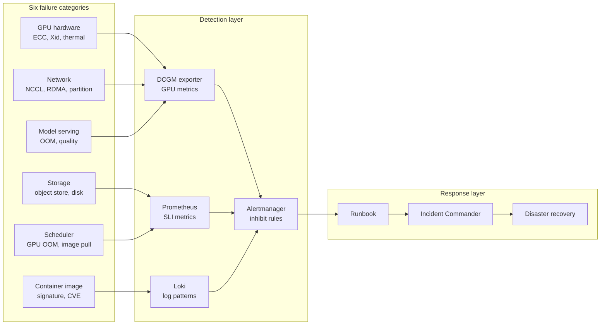

# 17.7 Failure modes and detection

| Field | Value |
|---|---|
| Level | Advanced |
| Priority tier | 2 |
| Lab venue | GCP / GKE |
| Part | Part 17: Observability, performance and operations |
| Primary sources | NVIDIA Zero-to-Hero Volume 16 (`chapter-08-failure-modes-and-detection.md`); NVIDIA Zero-to-Hero Volume 20 (`chapter-XX-failure-modes.md`); *Production Kubernetes* (`production-kubernetes`, Chapter 14) |
| Cross-references | Chapter 17.4 (DCGM exporter); Chapter 17.6 (Alerting and SLOs); Chapter 11 (GPU Kubernetes); Chapter 16.10 (Monitoring and drift) |
| Coverage file | `planning/coverage/chapters/17-07.md` |
| Claim & number ledger | `planning/ledgers/17-07.md` |

## Failure mode catalogue at a glance



The catalogue organises failures by category; the detection layer wires each category to a signal; the response layer wires the signal to an action.

## Why this matters for AI infrastructure

Every other chapter in this part has been about detecting failures. This chapter is a catalogue of the failures themselves. The on-call engineer who has read this chapter can name the failure mode from the symptom in seconds; the on-call engineer who has not is searching the wiki while the cluster burns.

An AI infrastructure failure mode is a way the cluster can stop meeting its SLOs. The failure modes range from a single GPU's ECC error (detected by the DCGM exporter) to a cluster-wide network partition (detected by the Prometheus blackbox exporter). Each failure mode has a detection signal; each detection signal has an alert; each alert has a runbook.

```text
Why failure modes are on the critical path (V16 ch8; V20 chXX; PK Ch 14):
- A typical mature AI platform has 30-50 distinct failure modes. Each failure
  mode has a name, a symptom, a root cause, a detection signal, an alert, and a
  runbook. The on-call engineer who has the catalogue is the on-call engineer
  who resolves the incident in minutes; the on-call who does not is the on-call
  who resolves the incident in hours.
- The most common AI infrastructure failure modes are GPU hardware failures
  (ECC errors, Xid events), network failures (NCCL timeouts, RDMA errors),
  storage failures (object storage 5xx), scheduler failures (GPU OOM, queue
  exhaustion), and container image failures (pull rate limit, image
  corruption).
- The failure mode catalogue is the on-call engineer's first responder tool.
  The catalogue is updated after every incident; the catalogue is the on-call
  engineer's institutional knowledge.
```

Three operational realities make this chapter a platform-team concern rather than a data-science-only concern:

1. **The failure modes are platform-level.** The data scientist encounters a model failure; the platform team encounters a cluster failure. The cluster failures are what this chapter catalogues.
2. **The detection signals are platform-level.** The DCGM exporter detects GPU failures; Prometheus detects metric failures; Loki detects log failures; Tempo detects trace failures. The platform team owns the detection.
3. **The runbook integration is platform-level.** Every failure mode has a runbook; the runbook is integrated with Alertmanager; the runbook is the on-call engineer's guide. The platform team owns the runbook.

**Before a team can run an AI workload on a GPU cluster, the failure mode catalogue must exist. A cluster without a failure mode catalogue is a cluster where the on-call is reactive. A cluster with a failure mode catalogue is a cluster where the on-call is proactive.**

## Prerequisites and outcomes

### Prerequisites

- Chapter 17.4 (DCGM exporter) for the GPU-specific failures.
- Chapter 17.6 (Alerting and SLOs) for the alert routing.
- Chapter 11 (GPU Kubernetes) for the GPU node operations.

### Outcomes

After completing this chapter you will be able to:

1. Name the most common AI infrastructure failure modes: GPU hardware, network, storage, scheduler, container image, and model serving.
2. Identify the detection signal for each failure mode: which metric, log, trace, or probe catches the failure.
3. Write the alert for each failure mode: the threshold, the routing, the runbook URL.
4. Build the failure mode catalogue: a structured document that the on-call engineer can search during an incident.
5. Operate the failure mode catalogue: update after every incident; review quarterly; automate the freshness check.
6. Operate the failure mode stack on GKE with reliable detection, sensible alerting, and a runbook.

---

## 1. GPU hardware failures

### 1.1 The GPU failure catalogue

The GPU hardware failures are the most common AI infrastructure failures. NVIDIA Zero-to-Hero Volume 16 chapter 8 and Volume 20 catalogue the failures.

| Failure mode | Symptom | Root cause | Detection signal | Alert |
|---|---|---|---|---|
| **ECC single-bit error** | Increased error rate | GPU memory degradation | `DCGM_FI_DEV_ECC_SBE_VOL_DEDUP` rate | Warning |
| **ECC double-bit error** | Data corruption | GPU memory failure | `DCGM_FI_DEV_ECC_DBE_VOL_DEDUP` count | Critical |
| **GPU Xid error** | Driver-level error | Hardware or driver bug | `DCGM_FI_DEV_XID_ERRORS` count | Critical |
| **Thermal throttling** | Reduced clock | Insufficient cooling | `DCGM_FI_DEV_GPU_TEMP > 85` | Warning |
| **Power throttling** | Reduced clock | Insufficient power | `DCGM_FI_DEV_POWER_USAGE > TDP` | Warning |
| **GPU OOM** | Training step crash | Model too large for HBM | `CUDA_OUT_OF_MEMORY` in logs | Warning |
| **GPU hang** | No kernel progress | Driver or hardware hang | `DCGM_FI_DEV_SM_CLOCK > 0` for > 10s with no kernel | Critical |
| **Retired pages** | Reduced HBM | Memory cell failure | `DCGM_FI_DEV_RETIRED_PAGES` count | Warning |
| **NVLink CRC error** | Reduced bandwidth | Cable or port failure | `DCGM_FI_DEV_NVLINK_CRC_DATA_ERROR_COUNT_TX` count | Warning |
| **PCIe replay** | Reduced PCIe bandwidth | Cable or slot failure | `DCGM_FI_DEV_PCIE_REPLAY_COUNTER` count | Warning |

The pattern is: every failure mode has a detection signal; the detection signal is a metric from the DCGM exporter; the alert is either warning (degrading) or critical (data corruption or hang).

### 1.2 The ECC error storm

The ECC error storm is the most common GPU hardware failure. The storm starts with single-bit errors (SBEs); the storm escalates to double-bit errors (DBEs); the storm ends with a GPU that must be replaced.

```text
The ECC error storm:
- T+0: SBE rate increases from 0 to 10/hour
- T+1h: SBE rate increases to 50/hour
- T+2h: First DBE appears
- T+2h+1m: DBE rate increases to 5/hour
- T+3h: GPU is corrupting data; workload must be moved
- T+4h: GPU is replaced
```

The platform team's pattern is: alert on SBE rate above 100/hour (warning); alert on any DBE (critical); drain the node immediately on DBE; replace the GPU.

### 1.3 The GPU hang

The GPU hang is the most dangerous GPU failure because it is silent. The workload is running; the kernels are queued; the GPU is not making progress. The detection signal is the GPU's SM clock: if the SM clock is non-zero for more than 10 seconds with no kernel progress, the GPU is hung.

```bash
# Detect a GPU hang
nvidia-smi --query-gpu=clocks.sm,clocks.mem --format=csv
# expected: SM clock > 0 with no recent kernel activity -> hung
```

The platform team's pattern is: alert on the GPU hang detection; restart the workload; drain the node; replace the GPU if the hang repeats.

---

## 2. Network failures

### 2.1 The network failure catalogue

The network failures are the second most common AI infrastructure failures.

| Failure mode | Symptom | Root cause | Detection signal | Alert |
|---|---|---|---|---|
| **NCCL timeout** | Training step hangs | Network congestion or failure | NCCL timeout in logs | Critical |
| **NCCL error** | Training step fails | Network or NCCL bug | `NCCL ERROR` in logs | Critical |
| **RDMA error** | Reduced bandwidth | Cable or HCA failure | `RDMA ERROR` in logs | Warning |
| **Network partition** | Multi-node training fails | Network split | `ping` failure between nodes | Critical |
| **DNS failure** | Service discovery fails | DNS resolver error | `NXDOMAIN` in logs | Warning |
| **Load balancer failure** | Traffic not routed | LB configuration error | 5xx rate spike | Critical |
| **Ingress failure** | External traffic not routed | Ingress controller error | 5xx rate spike | Critical |
| **Service mesh failure** | mTLS handshake fails | Istio/Linkerd error | `mTLS ERROR` in logs | Warning |

The pattern is: every network failure mode has a detection signal; the detection signal is a log entry or a metric; the alert is either warning (degraded performance) or critical (training failure).

### 2.2 The NCCL timeout

The NCCL timeout is the most common network failure. The timeout happens when a collective operation does not complete within the configured timeout. The detection signal is the NCCL timeout error in the logs.

```python
# code/part17/nccl_timeout.py (shape only)
import os
os.environ["NCCL_TIMEOUT"] = "600"  # 10 minutes

import torch
import torch.distributed as dist
from opentelemetry import trace

tracer = trace.get_tracer(__name__)

with tracer.start_as_current_span("all-reduce"):
    # This will raise a RuntimeError if the collective does not complete within 600 seconds
    dist.all_reduce(tensor)
```

The platform team's pattern is: set the NCCL timeout to 600 seconds (10 minutes); alert on any NCCL timeout in the logs; investigate the network; restart the workload if the timeout repeats.

### 2.3 The network partition

The network partition is the most dangerous network failure because it splits the cluster into two halves. The detection signal is the `ping` failure between nodes; the alert is critical.

```bash
# Detect a network partition
ansible all -m ping
# expected: ping fails between nodes in different partitions
```

The platform team's pattern is: alert on ping failure between nodes; investigate the network fabric; restart the affected workloads; drain the affected nodes.

---

## 3. Storage failures

### 3.1 The storage failure catalogue

The storage failures are the third most common AI infrastructure failures.

| Failure mode | Symptom | Root cause | Detection signal | Alert |
|---|---|---|---|---|
| **Object storage 5xx** | Training fails to read data | Object storage outage | `s3_errors_total` rate | Critical |
| **Object storage 4xx** | Training fails to read data | Permission or key issue | `s3_errors_total{status="4xx"}` rate | Warning |
| **Object storage latency** | Training slow | Object storage degradation | `s3_request_duration_seconds` p99 | Warning |
| **Distributed filesystem failure** | Training fails to read data | NFS/Lustre outage | `nfs_errors_total` rate | Critical |
| **Local disk full** | Workload fails to start | Disk full | `node_filesystem_avail_bytes` < 10% | Warning |
| **Disk I/O error** | Training slow | Disk failure | `node_disk_io_now` high | Warning |
| **PVC mount failure** | Workload fails to start | PVC not bound | `kube_persistentvolumeclaim_status_phase{phase!="Bound"}` | Critical |
| **Object lock failure** | Audit log cannot be deleted | Object storage misconfigured | Audit log bucket size | Critical |

The pattern is: every storage failure mode has a detection signal; the detection signal is a metric from the object storage exporter, the node exporter, or the kube-state-metrics; the alert is either warning (degraded) or critical (data unavailable).

### 3.2 The object storage 5xx

The object storage 5xx is the most common storage failure. The 5xx happens when the object storage service is unavailable. The detection signal is the `s3_errors_total` metric.

```promql
# The S3 5xx rate
sum(rate(s3_errors_total{status=~"5.."}[5m]))

# Alert: 5xx rate > 0
sum(rate(s3_errors_total{status=~"5.."}[5m])) > 0
```

The platform team's pattern is: alert on any 5xx; investigate the object storage service; switch to a backup region if available; wait for the service to recover.

### 3.3 The local disk full

The local disk full is the most common Kubernetes-level storage failure. The disk fills up when the workload's logs, the workload's cache, or the workload's checkpoints exceed the disk's capacity. The detection signal is the `node_filesystem_avail_bytes` metric.

```promql
# The available disk space per node
node_filesystem_avail_bytes{mountpoint="/"}

# Alert: disk space < 10%
node_filesystem_avail_bytes{mountpoint="/"} / node_filesystem_size_bytes{mountpoint="/"} < 0.1
```

The platform team's pattern is: alert on disk space below 10%; investigate the workload; clean up the logs; resize the disk; drain the node if necessary.

---

## 4. Scheduler failures

### 4.1 The scheduler failure catalogue

The scheduler failures are the fourth most common AI infrastructure failures.

| Failure mode | Symptom | Root cause | Detection signal | Alert |
|---|---|---|---|---|
| **GPU OOM** | Workload fails to start | Insufficient GPU memory | `kube_pod_container_status_terminated_reason{reason="OOMKilled"}` | Critical |
| **GPU not available** | Workload pending | All GPUs allocated | `kube_pod_status_phase{phase="Pending"}` | Warning |
| **Pod scheduling timeout** | Workload pending | Scheduler misconfigured | `kube_pod_status_phase{phase="Pending"}` for > 5m | Warning |
| **Image pull failure** | Workload fails to start | Image not found or pull rate limit | `kube_pod_container_status_waiting_reason{reason="ImagePullBackOff"}` | Critical |
| **Node not ready** | Workload pending | Node down | `kube_node_status_condition{condition="Ready",status="false"}` | Critical |
| **Scheduler hang** | Workload pending | Scheduler crash | Pod pending for > 10m | Critical |
| **Preemption loop** | Workload repeatedly preempted | Quota exhausted | Pod preempted events | Warning |
| **Quota exhausted** | Workload pending | Team quota exhausted | Kueue LocalQueue depth | Warning |

The pattern is: every scheduler failure mode has a detection signal; the detection signal is a Kubernetes metric or a log entry; the alert is either warning (workload pending) or critical (workload failed).

### 4.2 The GPU OOM

The GPU OOM is the most common scheduler failure. The workload requests more GPU memory than the node has; Kubernetes kills the workload. The detection signal is the `OOMKilled` reason in the pod status.

```promql
# The pods that were OOMKilled
kube_pod_container_status_terminated_reason{reason="OOMKilled"}

# Alert: any OOMKilled in the last hour
sum(increase(kube_pod_container_status_terminated_reason{reason="OOMKilled"}[1h])) > 0
```

The platform team's pattern is: alert on any OOMKilled in the last hour; investigate the workload's GPU memory request; increase the GPU memory request or reduce the model size; redeploy the workload.

### 4.3 The image pull failure

The image pull failure is the most common container-level failure. The image is not found (typo, missing tag), the pull rate limit is hit (Docker Hub limits anonymous pulls), or the image pull times out (network issue). The detection signal is the `ImagePullBackOff` reason in the pod status.

```promql
# The pods that are ImagePullBackOff
kube_pod_container_status_waiting_reason{reason="ImagePullBackOff"}

# Alert: any ImagePullBackOff for > 5 minutes
count by (pod, namespace) (kube_pod_container_status_waiting_reason{reason="ImagePullBackOff"}) > 0
```

The platform team's pattern is: alert on any ImagePullBackOff for > 5 minutes; investigate the image name and tag; check the pull rate limit; configure the image pull secret.

---

## 5. Container image failures

### 5.1 The container image failure catalogue

The container image failures are the fifth most common AI infrastructure failures.

| Failure mode | Symptom | Root cause | Detection signal | Alert |
|---|---|---|---|---|
| **Image not signed** | Pod fails to start | Image not signed by cosign | Admission controller log | Critical |
| **Image signature mismatch** | Pod fails to start | Signature does not verify | Admission controller log | Critical |
| **Image pull rate limit** | ImagePullBackOff | Docker Hub rate limit | Pull error in logs | Warning |
| **Image corruption** | Pod fails to start | Image digest mismatch | Admission controller log | Critical |
| **Image CVE** | Workload runs with vulnerability | Image has known CVE | Trivy scan | Warning |
| **Image out of date** | Workload runs with old base | Image not updated | Trivy scan | Warning |
| **Image storage full** | Image push fails | Registry storage full | Registry metrics | Warning |

The pattern is: every container image failure mode has a detection signal; the detection signal is an admission controller log, a Trivy scan, or a registry metric; the alert is either warning (degraded security) or critical (workload cannot start).

### 5.2 The image signature mismatch

The image signature mismatch is the most dangerous container image failure. The image is signed; the signature does not match the image; the admission controller refuses to start the pod. The detection signal is the admission controller log.

```bash
# Detect an image signature mismatch
kubectl get events -n mlops --field-selector reason=Failed
# expected: "Failed to verify signature" event
```

The platform team's pattern is: alert on any signature mismatch; investigate the signing pipeline; rotate the signing key if compromised; do not bypass the admission controller.

### 5.3 The image CVE

The image CVE is the most common security failure. The image has a known CVE; the workload runs with the vulnerability; the security team flags the image. The detection signal is the Trivy scan.

```bash
# Run Trivy on the image
trivy image my-image:v1
# expected: list of CVEs with severity
```

The platform team's pattern is: run Trivy on every image in the CI; alert on any CVE with severity >= HIGH; update the image base; rebuild the image.

---

## 6. Model serving failures

### 6.1 The model serving failure catalogue

The model serving failures are the sixth most common AI infrastructure failures.

| Failure mode | Symptom | Root cause | Detection signal | Alert |
|---|---|---|---|---|
| **Model OOM** | Inference request fails | Model too large for GPU | `inference_oom_total` rate | Critical |
| **Model timeout** | Inference request hangs | Model too slow | `inference_request_duration_seconds` p99 > SLO | Warning |
| **Model version mismatch** | Inference request returns wrong output | Stale model loaded | Model hash mismatch | Critical |
| **Tokenizer failure** | Inference request fails | Tokenizer error | `tokenizer_errors_total` rate | Warning |
| **Feature store failure** | Inference request fails | Feature store unavailable | `feature_store_errors_total` rate | Critical |
| **Vector store failure** | RAG inference fails | Vector store unavailable | `vector_store_errors_total` rate | Critical |
| **Model quality regression** | Inference succeeds but wrong | Model degradation | `model_quality_score` drop | Warning |
| **Prompt injection** | Inference returns harmful content | Adversarial prompt | Guardrail trigger | Critical |

The pattern is: every model serving failure mode has a detection signal; the detection signal is a metric from the inference exporter or a log entry; the alert is either warning (degraded performance) or critical (inference failure).

### 6.2 The model OOM

The model OOM is the most common model serving failure. The model is too large for the GPU's HBM; the inference engine's KV cache fills up; the CUDA OOM crash occurs. The detection signal is the `inference_oom_total` rate.

```promql
# The inference OOM rate
sum(rate(inference_oom_total[5m]))

# Alert: any inference OOM in the last 5 minutes
sum(rate(inference_oom_total[5m])) > 0
```

The platform team's pattern is: alert on any inference OOM; reduce the model's KV cache budget; move to a larger GPU; reduce the concurrent request count.

### 6.3 The model quality regression

The model quality regression is the most dangerous model serving failure because it is silent. The inference succeeds; the model returns a prediction; the prediction is wrong. The detection signal is the `model_quality_score` metric from Chapter 16.10.

```promql
# The model quality score
model_quality_score{model="churn-model"}

# Alert: model quality score < threshold
model_quality_score{model="churn-model"} < 0.85
```

The platform team's pattern is: alert on model quality score below the threshold; retrain the model with the latest data; investigate the drift detector; rollback to the previous model version.

---

## 7. Operating the failure mode catalogue

### 7.1 The catalogue structure

The failure mode catalogue is a structured document that the on-call engineer can search during an incident. The catalogue has the following fields per failure mode.

```text
Failure mode catalogue fields:
- ID (FM-001, FM-002, ...)
- Name
- Symptom
- Root cause
- Detection signal (metric, log, trace, probe)
- Alert (rule, severity, routing)
- Runbook URL
- Last updated
- Last incident
```

The pattern is: every failure mode has a unique ID; every failure mode has a structured record; the catalogue is searchable by ID, name, symptom, or detection signal.

### 7.2 The catalogue update

The catalogue is updated after every incident. The update adds the new failure mode (if any); updates the runbook (if the mitigation changed); records the last incident.

```bash
# Update the failure mode catalogue after an incident
python code/part17/update_catalogue.py \
  --incident-id INC-2024-03-15-001 \
  --failure-mode FM-001 \
  --runbook-url https://wiki.example.com/runbooks/gpu-memory-pressure \
  --last-incident 2024-03-15
```

The pattern is: the catalogue is a version-controlled document (in Git); the catalogue is updated via a script; the script's output is a commit; the commit is reviewed in a pull request.

### 7.3 The catalogue review

The catalogue is reviewed quarterly. The review identifies failure modes that have not been seen in the last 90 days; the review identifies failure modes that have been seen multiple times; the review identifies new failure modes from the latest vendor releases.

```bash
# Review the failure mode catalogue
python code/part17/review_catalogue.py \
  --catalogue planning/failure_modes/catalogue.yaml \
  --staleness-threshold-days 90
# expected: a list of stale failure modes; a list of repeated failure modes; a list of new failure modes
```

The pattern is: the review is automated; the review's output is a report; the report is reviewed by the platform team; the report's findings are added to the next quarter's roadmap.

---

## 8. How it fails

Six failure modes recur.

### 8.1 "The on-call cannot find the failure mode in the catalogue"

**Symptom:** The on-call is paged; the on-call searches the catalogue; the failure mode is not in the catalogue; the on-call debugs from scratch.

**Diagnosis:** The catalogue is incomplete; the team has not added a new failure mode; the team's discovery process has missed a failure mode.

**Fix:** Add the new failure mode to the catalogue; review the incident post-mortem; identify the failure mode; add the detection signal; add the alert; add the runbook.

### 8.2 "The detection signal is wrong"

**Symptom:** The alert fires for every minor variation; the on-call ignores the alerts; the real failure is missed.

**Diagnosis:** The detection signal is too sensitive; the threshold is too low; the alert is misconfigured.

**Fix:** Tune the detection signal; raise the threshold; add a hysteresis; review the alert's precision and recall.

### 8.3 "The runbook is missing the recovery step"

**Symptom:** The on-call follows the runbook; the recovery step fails; the incident escalates.

**Diagnosis:** The runbook was not updated after the last incident; the recovery step has changed.

**Fix:** Update the runbook after every incident; review the runbook quarterly; automate the runbook freshness check.

### 8.4 "The failure mode cascades"

**Symptom:** A GPU failure cascades to a node failure; a node failure cascades to a cluster failure; the cluster SLO is breached.

**Diagnosis:** The failure isolation is missing; the failure cascades through the dependency chain.

**Fix:** Add failure isolation (drain the node on GPU failure); add circuit breakers (the workload stops calling the failing service); add bulkheads (the failure does not affect other teams).

### 8.5 "The alert is inhibited at the wrong moment"

**Symptom:** A critical alert is inhibited by a less critical alert; the on-call does not see the critical alert.

**Diagnosis:** The inhibit rule is too aggressive; the inhibit rule matches the wrong alerts.

**Fix:** Review the inhibit rules; verify the inhibit rules match the right alerts; add an integration test.

### 8.6 "The catalogue is stale"

**Symptom:** The catalogue references runbooks that no longer exist; the catalogue references metrics that no longer exist; the catalogue references vendors that have changed.

**Diagnosis:** The catalogue was not updated after the last incident; the catalogue was not reviewed quarterly.

**Fix:** Update the catalogue after every incident; review the catalogue quarterly; automate the catalogue freshness check.

---

## 9. Hands-on lab

This lab builds the failure mode catalogue, configures the detection signals, and verifies the on-call integration. The lab is **untested** in this repository.

### 9.1 Prerequisites

- A GKE Autopilot or Standard cluster (1.27+).
- Helm 3 for installing the alert routing.
- Prometheus installed (Chapter 17.2).

### 9.2 Step 1: create the failure mode catalogue

```bash
# Create the catalogue
mkdir -p planning/failure_modes
cat > planning/failure_modes/catalogue.yaml <<EOF
- id: FM-001
  name: GPU ECC Double-Bit Error
  symptom: Data corruption
  root_cause: GPU memory failure
  detection_signal: DCGM_FI_DEV_ECC_DBE_VOL_DEDUP
  alert: GPUDoubleBitECCError
  severity: critical
  runbook_url: https://wiki.example.com/runbooks/gpu-ecc-dbe
EOF
```

### 9.3 Step 2: configure the detection signals

```bash
# Apply the alert rules
kubectl -n monitoring create configmap gpu-alerts \
  --from-file=configs/gpu_alerts.yaml

# Reload Prometheus
curl -X POST http://prometheus.monitoring:9090/-/reload
# expected: the alert rules are active
```

### 9.4 Step 3: verify the runbook integration

```bash
# Query Alertmanager
kubectl -n monitoring port-forward svc/alertmanager-operated 9093:9093 &
curl -s http://localhost:9093/api/v2/alerts | jq '.[] | {alertname, runbookURL}'
# expected: every alert has a runbook URL
```

### 9.5 Step 4: simulate a failure mode

```bash
# Inject a synthetic ECC error (for testing only - DO NOT run on production)
nvidia-smi -q -d ECC
# expected: the ECC error count is non-zero; the alert fires
```

### 9.6 Step 5: verify the on-call runbook

```bash
# Click the runbook URL in the alert
open "$(curl -s http://localhost:9093/api/v2/alerts | jq -r '.[0].annotations.runbookURL')"
# expected: the runbook opens in the browser
```

### 9.7 Step 6: review the catalogue

```bash
python code/part17/review_catalogue.py \
  --catalogue planning/failure_modes/catalogue.yaml \
  --staleness-threshold-days 90
# expected: a list of stale failure modes; a list of repeated failure modes
```

### 9.8 What to record

After the lab, you should be able to answer five questions in five seconds each:

1. What is the current number of failure modes in the catalogue?
2. What is the current number of stale failure modes?
3. What is the most recent failure mode added to the catalogue?
4. What is the current ECC error rate per GPU?
5. What is the current alert firing rate per failure mode?

If any takes more than 30 seconds, the failure mode catalogue is not yet a production service. The lab is **untested** against a live GKE cluster.

---

## Exercises

1. **Add a new failure mode to the catalogue.** Identify a recent incident; add the failure mode to the catalogue; add the detection signal; add the alert; add the runbook. *Solution sketch:* the YAML schema in Section 7.1; the incident post-mortem; the alert rule; the runbook.
2. **Add a cascade detection.** Detect when a failure is cascading across multiple failure modes; alert when the cascade is detected. *Solution sketch:* a Prometheus alert that matches multiple failure modes; the alert severity is critical.
3. **Add a failure isolation pattern.** Configure the platform to drain a node when the GPU is failing; verify the workload is rescheduled to a healthy node. *Solution sketch:* a Kubernetes controller that watches the GPU health; the controller drains the node when the GPU is unhealthy; the workload is rescheduled.
4. **Add a runbook freshness check.** Configure a CI step that fails when a runbook has not been updated in 30 days. *Solution sketch:* the CI step reads the runbook's git log; the CI step fails when the last update is > 30 days ago.
5. **Add a catalogue review report.** Generate a quarterly report that lists stale failure modes, repeated failure modes, and new failure modes from the latest vendor releases. *Solution sketch:* a Python script that reads the catalogue; the script generates the report; the report is reviewed by the platform team.
6. **Add a per-team failure mode view.** Build a dashboard that shows the failure modes per team; the dashboard is the team's view of the cluster's health. *Solution sketch:* a Grafana dashboard that filters the alerts by team; the panels; the data source.

---

## Checkpoint questions

<details><summary>1. What six categories of failure modes does the chapter walk through?</summary>
GPU hardware failures (ECC, Xid, thermal, power), network failures (NCCL timeout, RDMA error, partition), storage failures (object storage 5xx, local disk full), scheduler failures (GPU OOM, image pull failure, pod pending), container image failures (signature mismatch, CVE, pull rate limit), model serving failures (model OOM, quality regression, prompt injection). Each category has a detection signal and an alert.
</details>

<details><summary>2. What is the most common GPU hardware failure?</summary>
The ECC error storm. The storm starts with single-bit errors (SBEs); the storm escalates to double-bit errors (DBEs); the storm ends with a GPU that must be replaced. The platform team's pattern is: alert on SBE rate above 100/hour; alert on any DBE; drain the node immediately on DBE.
</details>

<details><summary>3. What is the most dangerous GPU failure?</summary>
The GPU hang. The hang is silent: the workload is running; the kernels are queued; the GPU is not making progress. The detection signal is the SM clock: if the SM clock is non-zero for more than 10 seconds with no kernel progress, the GPU is hung. The platform team's pattern is: alert on the hang detection; restart the workload; drain the node; replace the GPU if the hang repeats.
</details>

<details><summary>4. What is the most common network failure?</summary>
The NCCL timeout. The timeout happens when a collective operation does not complete within the configured timeout. The detection signal is the NCCL timeout error in the logs. The platform team's pattern is: set the NCCL timeout to 600 seconds; alert on any timeout; investigate the network; restart the workload if the timeout repeats.
</details>

<details><summary>5. What is the most dangerous network failure?</summary>
The network partition. The partition splits the cluster into two halves; the multi-node training fails; the workload hangs. The detection signal is the ping failure between nodes. The platform team's pattern is: alert on ping failure; investigate the network fabric; restart the affected workloads.
</details>

<details><summary>6. What is the most common storage failure?</summary>
The object storage 5xx. The 5xx happens when the object storage service is unavailable. The detection signal is the s3_errors_total metric. The platform team's pattern is: alert on any 5xx; investigate the object storage service; switch to a backup region if available.
</details>

<details><summary>7. What is the most common scheduler failure?</summary>
The GPU OOM. The workload requests more GPU memory than the node has; Kubernetes kills the workload. The detection signal is the OOMKilled reason in the pod status. The platform team's pattern is: alert on any OOMKilled; investigate the workload's GPU memory request; increase the request or reduce the model size.
</details>

<details><summary>8. What is the most common container image failure?</summary>
The image pull failure. The image is not found (typo, missing tag), the pull rate limit is hit (Docker Hub limits), or the image pull times out (network issue). The detection signal is the ImagePullBackOff reason in the pod status. The platform team's pattern is: alert on any ImagePullBackOff for > 5 minutes; investigate the image name and tag; check the pull rate limit.
</details>

<details><summary>9. What is the most dangerous container image failure?</summary>
The image signature mismatch. The image is signed; the signature does not match the image; the admission controller refuses to start the pod. The platform team's pattern is: alert on any signature mismatch; investigate the signing pipeline; do not bypass the admission controller.
</details>

<details><summary>10. What is the most common model serving failure?</summary>
The model OOM. The model is too large for the GPU's HBM; the inference engine's KV cache fills up; the CUDA OOM crash occurs. The detection signal is the inference_oom_total metric. The platform team's pattern is: alert on any inference OOM; reduce the KV cache budget; move to a larger GPU.
</details>

<details><summary>11. What is the most dangerous model serving failure?</summary>
The model quality regression. The inference succeeds; the model returns a prediction; the prediction is wrong. The detection signal is the model_quality_score metric. The platform team's pattern is: alert on quality score below the threshold; retrain the model; investigate the drift detector; rollback to the previous version.
</details>

<details><summary>12. What is the failure mode catalogue?</summary>
A structured document that the on-call engineer can search during an incident. The catalogue has the following fields per failure mode: ID, name, symptom, root cause, detection signal, alert, runbook URL, last updated, last incident. The catalogue is updated after every incident; the catalogue is reviewed quarterly.
</details>

<details><summary>13. What is the cascade failure mode?</summary>
A failure that spreads across multiple components. A GPU failure cascades to a node failure; a node failure cascades to a cluster failure; the cluster SLO is breached. The platform team's pattern is: add failure isolation (drain the node on GPU failure); add circuit breakers (the workload stops calling the failing service); add bulkheads (the failure does not affect other teams).
</details>

<details><summary>14. What is the failure isolation pattern?</summary>
The pattern that prevents a failure from cascading. The pattern is: drain the node on GPU failure; the workload is rescheduled to a healthy node; the failure does not affect other workloads. The platform team's pattern is: a Kubernetes controller that watches the GPU health; the controller drains the node when the GPU is unhealthy.
</details>

<details><summary>15. What is the circuit breaker pattern?</summary>
A pattern that stops a workload from calling a failing service. The pattern is: the workload tracks the failure rate of the service; when the failure rate exceeds a threshold, the workload stops calling the service; the workload returns a default response. The platform team's pattern is: configure the circuit breaker in the service mesh (Istio, Linkerd).
</details>

<details><summary>16. What is the bulkhead pattern?</summary>
A pattern that isolates the failure to a subset of the workload. The pattern is: the workload's resources are partitioned; a failure in one partition does not affect the other partitions. The platform team's pattern is: configure the Kueue LocalQueues per team (Chapter 16.14); a failure in one team's queue does not affect the other teams.
</details>

<details><summary>17. What is the failure mode review process?</summary>
A quarterly review that identifies failure modes that have not been seen in the last 90 days; failure modes that have been seen multiple times; new failure modes from the latest vendor releases. The review's output is a report; the report is reviewed by the platform team; the report's findings are added to the next quarter's roadmap.
</details>

<details><summary>18. What is the difference between detection and alerting?</summary>
Detection is the signal that catches the failure (the metric, log, trace, or probe). Alerting is the rule that fires when the detection signal breaches the threshold. The detection signal without the alert is a silent failure; the alert without the detection signal is a false alarm.
</details>

<details><summary>19. Why is the failure mode catalogue a platform-team deliverable?</summary>
Because the platform team owns the cluster; the platform team owns the detection signals; the platform team owns the alerts; the platform team owns the runbooks. The data scientist consumes the catalogue; the platform team produces the catalogue. The catalogue is the platform team's institutional knowledge.
</details>

<details><summary>20. What five questions should the failure mode catalogue lab let you answer in five seconds each?</summary>
What is the current number of failure modes in the catalogue. What is the current number of stale failure modes. What is the most recent failure mode added to the catalogue. What is the current ECC error rate per GPU. What is the current alert firing rate per failure mode. If any takes more than 30 seconds, the failure mode catalogue is not yet a production service.
</details>

---

## Sources and review notes

- NVIDIA Zero-to-Hero Volume 16 (`chapter-08-failure-modes-and-detection.md`). Source for the GPU hardware failures, the network failures, the storage failures, and the detection signals. The wording has been rewritten in the handbook's voice.
- NVIDIA Zero-to-Hero Volume 20. Source for additional failure modes drawn from the broader nvidia-devops corpus.
- *Production Kubernetes* (`production-kubernetes`, Chapter 14). Source for the Kubernetes-level failure modes (scheduler, container image) and the operational patterns.

### Cross-references to other handbook chapters

- Chapter 17.4 for the DCGM exporter and the GPU-specific failures.
- Chapter 17.6 for the alerting and SLOs.
- Chapter 11 for the GPU Kubernetes operations.
- Chapter 16.10 for the monitoring and drift.

### Migrated from `nvidia-devops`

The failure mode catalogue operational patterns draw on Volume 16 chapter 8 and Volume 20. The wording has been rewritten in the handbook's voice.

### Explicitly labelled inferences

- The failure mode catalogue in this chapter is a starting point; specific failure modes depend on the cluster and the workload.
- The detection signals are starting points; specific signals depend on the exporter configuration.
- The alert thresholds are starting points; specific thresholds depend on the production traffic.

### Not verified on live hardware

- The lab in Section 9 is **untested** against a live GKE cluster in this repository.
- The catalogue YAML in the lab is illustrative; production catalogues are larger and more detailed.
- The detection signals in the lab assume the exporters from earlier chapters are installed.
