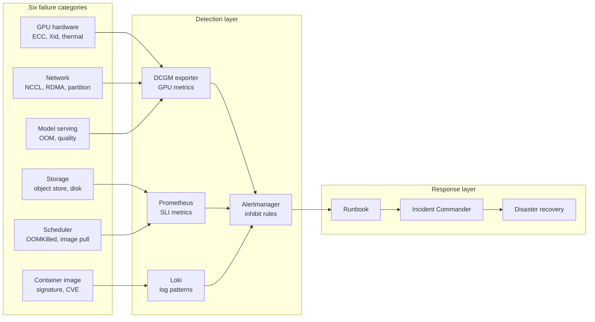

# 17.7 Failure modes and detection

| Field | Value |
|---|---|
| Level | Advanced |
| Priority tier | 2 |
| Lab venue | GCP / GKE |
| Part | Part 17: Observability, performance and operations |
| Primary sources | NVIDIA Zero-to-Hero Volume 16 (`chapter-08-failure-modes-and-detection.md`); NVIDIA Zero-to-Hero Volume 20 (`chapter-XX-failure-modes.md`); *Production Kubernetes* (`production-kubernetes`, Chapter 14) |
| Cross-references | Chapter 17.4 (DCGM exporter); Chapter 17.6 (Alerting and SLOs); Chapter 11 (GPU Kubernetes); Chapter 16.10 (Monitoring and drift) |
| Coverage file | `planning/coverage/chapters/17-07.md` |
| Claim & number ledger | `planning/ledgers/17-07.md` |

## The six failure families

A failure mode is a specific way the cluster stops meeting its objectives. Each one below is a short entry: the symptom you see first, the signal that detects it, and the first action. The diagram shows where each family is caught.



## Why this matters for AI infrastructure

It is the middle of the night, and a page arrives. A training job stopped making progress a while ago, and the GPU dashboard shows nothing obvious. An on-call engineer who knows the failure modes can name the cause from the symptom and start the right fix. An engineer who does not know them spends the first minutes searching the wiki while the cluster stays stuck.

The earlier chapters in this part teach you how to detect failures. This chapter is the catalogue of the failures themselves. An AI infrastructure failure mode is a specific way the cluster can stop meeting its service-level objectives. The range is wide. At one end, a single GPU reports a memory error that the DCGM exporter picks up. At the other, a network partition splits the cluster, and the Prometheus blackbox exporter is the detector.

Every failure mode needs three things. It needs a detection signal, an alert built on that signal, and a runbook the alert links to. Without all three, the failure is either invisible or unhandled. The tables in this chapter use the symptom, detect and first action columns for that reason.

Before the entries, one point about ownership. This chapter belongs to the platform team as much as to the data scientists. Three things make it a platform concern.

1. The failure modes are platform-level. A data scientist sees a model that gives bad results. The platform team sees a cluster that stops working, and this chapter catalogues those cluster failures.

2. The detection signals are platform-level. The DCGM exporter catches GPU failures, Prometheus catches metric failures, Loki catches log failures, and Tempo catches trace failures. The platform team owns that detection.

3. The runbooks are platform-level. Each alert should carry a runbook link, so the on-call engineer finds the next step from the alert itself. Put a description and a runbook link in each alert's annotations, so the responder has context right away. The platform team owns those runbooks.

**Build the failure mode catalogue before the first AI workload runs on the cluster.** Without it, every incident starts from scratch. With it, the on-call engineer recognises the symptom and moves straight to the fix.

## Prerequisites and outcomes

### Prerequisites

- Chapter 17.4 (DCGM exporter) for the GPU-specific failures.
- Chapter 17.6 (Alerting and SLOs) for the alert routing.
- Chapter 11 (GPU Kubernetes) for the GPU node operations.

Work through these first, because the rest of the chapter assumes you already know them.

### Outcomes

After completing this chapter, you will be able to:

1. Name the main AI infrastructure failure modes, which fall into six groups: GPU hardware, network, storage, scheduler, container image, and model serving.
2. Identify the detection signal for each failure mode, meaning the metric, log, trace, or probe that catches it when the failure happens.
3. Write the alert for each failure mode, with its threshold, its routing, and the runbook URL that the on-call engineer will open.
4. Build the failure mode catalogue, a structured document the on-call engineer can search quickly during an incident.
5. Operate the catalogue. Update it after every incident, review it quarterly, and automate the freshness check so stale entries get noticed.
6. Operate the failure mode stack on GKE with reliable detection, sensible alerting, and a runbook that someone has actually tested.

---

## 1. GPU hardware failures

### 1.1 The GPU failure catalogue

GPU hardware causes a large share of training interruptions. Meta recorded 419 unexpected interruptions in 54 days of Llama 3 405B pretraining. Faulty GPUs caused 148 of them, which is 35.3 percent, and GPU HBM3 memory caused 72 more, which is 17.2 percent. Together that is more than half. Chapter 17.13 uses the full table for fleet reliability numbers.

The table gives each failure a symptom, the signal that detects it and the first action. The metric names are the dcgm-exporter 4.9.0 names, and chapter 17.4 maps them to the 4.8.x names and holds the tested alert rules.

| Failure mode | Symptom | Detect | First action |
|---|---|---|---|
| Uncorrectable ECC error | Job crash or corrupted output | `increase(DCGM_FI_DEV_ECC_DBE_VOL_TOTAL[1h]) > 0`, Xid 48 in the kernel log | Cordon and drain, flag checkpoints from the fault window |
| Failed row remap | Spare rows exhausted | `DCGM_FI_DEV_ROW_REMAP_FAILED == 1`, Xid 64 | Cordon, drain, RMA |
| Single-bit error growth | None yet | Weekly `increase` of `DCGM_FI_DEV_ECC_SBE_AGG_TOTAL` more than triples | Ticket, drain at the next window |
| GPU fell off the bus | Job dies, GPU missing | Xid 79, node reports fewer GPUs than it advertises | Cordon, drain, PCIe rescan, `dcgmi diag -r 3` |
| Thermal throttling | Jobs run slower, no error | `rate(DCGM_FI_DEV_GPU_THERMAL_THROTTLE_SECONDS_TOTAL[10m])` above 0.1 | Check fans and inlet temperature, then the rack |
| Power throttling | Jobs run slower | Rate of `DCGM_FI_DEV_GPU_POWER_THROTTLE_SECONDS_TOTAL` | Compare with the site power cap |
| CUDA out of memory | Step crashes with a CUDA error | `CUDA out of memory` in the application log | Shrink batch or model, see section 4.2 |
| GPU hang | No progress, no error | Step counter flat while the GPU reports work, NCCL watchdog timeout in the log | Restart the job, drain the node if it repeats |
| NVLink errors | Slow collectives | `increase(DCGM_FI_DEV_NVLINK_CRC_DATA_ERROR_TOTAL[1h])` | Compare both link ends, reseat or replace |
| PCIe replays | Slow host transfers | `increase(DCGM_FI_DEV_PCIE_REPLAY_TOTAL[1h])` | Check link width and generation, reseat |

Thermal and power throttle counters, ECC counters and NVLink counters are optional fields in the default counters file, so enable them before you rely on these rows.

### 1.2 The ECC error storm

Memory errors often come before a GPU fails. ECC, the error-correcting code built into GPU memory, fixes a single-bit error on the fly, so the job keeps running. A double-bit error cannot be corrected, but the hardware detects it and raises it to the program that caused it. ECC is on by default on NVIDIA data center GPUs.

The timeline below shows how a storm can unfold. It is an illustration, not a measured log. Use it for the order of events, not the times or rates.

```text
The ECC error storm:
- T+0: SBE rate increases from 0 to 10/hour
- T+1h: SBE rate increases to 50/hour
- T+2h: First DBE appears
- T+2h+1m: DBE rate increases to 5/hour
- T+3h: GPU is corrupting data; workload must be moved
- T+4h: GPU is replaced
```

Alerting on a fixed single-bit rate would miss this storm, because the rate never reaches a round number like 100 per hour before the first double-bit error. The policy in chapter 17.4 watches the week-over-week growth of single-bit errors instead and pages on any double-bit error, then drains the node at once. Measure the normal error rate on your own fleet before you set thresholds.

### 1.3 The GPU hang

A GPU hang is the quietest failure in this chapter. The workload still runs, kernels sit in the queue, and the GPU makes no progress. Nothing crashes, so nothing forces anyone to look until the job stalls.

The SM clock does not show a hang, because a powered GPU has a non-zero clock whether it is working or stuck. The signal that does show it is a mismatch. The GPU reports high utilisation, but the job's own progress counter, such as steps or tokens per second, stays flat for several step times. Set the wait from your own step time, because a legitimate step can take seconds or minutes.

```bash
# Detect a GPU hang
nvidia-smi --query-gpu=utilization.gpu,clocks.sm --format=csv -l 5
# expected: utilisation stays high while the job's step counter does not advance, which means hung
```

Fail fast. Put timeouts around inference calls, so a hung call raises an error instead of holding GPU time, and apply the same idea to training jobs wherever you can.

A reasonable response, in order, is to alert, restart the workload, drain the node, and replace the GPU if the hang returns.

---

## 2. Network failures

### 2.1 The network failure catalogue

Network problems hit distributed training because every GPU depends on its neighbours. In the same Meta record, network switches and cables caused 35 of the 419 interruptions, which is 8.4 percent. The table lists the network failures this chapter covers. Start from the symptom column.

| Failure mode | Symptom | Detect | First action |
|---|---|---|---|
| NCCL timeout | Training step hangs | PyTorch watchdog line "Watchdog caught collective operation timeout" in the rank logs | Find the first rank that logged an error, see section 2.2 |
| NCCL error | Training step fails | `NCCL WARN` lines in the rank logs, with `NCCL_DEBUG=WARN` | Read the first error, not the last |
| InfiniBand or RoCE port errors | Slow collectives | Port error counters from the fabric manager or the node exporter InfiniBand collector | Compare both ends of the link, replace the cable or transceiver |
| Network partition | Multi-node training fails | Probe failures between node groups, for example `probe_success == 0` from the blackbox exporter | Locate the failed switch or uplink |
| DNS failure | Service discovery fails | CoreDNS `SERVFAIL` or `NXDOMAIN` response rates | Check the CoreDNS pods and upstream resolver |
| Load balancer or ingress failure | External traffic not routed | 5xx rate spike at the gateway | Check the controller and backend health |
| Mesh mTLS failure | Handshake errors between services | Proxy logs and the mesh's handshake failure counters | Check certificate expiry first |

### 2.2 The NCCL timeout

An NCCL timeout happens when one collective operation, such as an all-reduce, runs past its time limit. Every GPU in the job waits on that operation, so the whole training step stalls. The timeout is the symptom you see first. The cause can be the network, or it can be a single rank that crashed, so check your peer ranks before you blame the fabric.

That second case matters. When one GPU rank hits an error, the other ranks can hang waiting for it, so the ranks that print the timeout are often the healthy ones. Meta's record lists 7 NCCL watchdog timeouts, 1.7 percent of the unexpected interruptions, a small share, but each one stalls the whole job.

```python
# code/part17/snippets/nccl_timeout.py
"""Collective timeouts in PyTorch are set on the process group, not through an NCCL_TIMEOUT environment variable
(PyTorch ignores that name). Requires GPUs and torchrun, so this file is syntax-checked only."""
import os
from datetime import timedelta

import torch
import torch.distributed as dist
from opentelemetry import trace

os.environ.setdefault("TORCH_NCCL_ASYNC_ERROR_HANDLING", "1")   # PyTorch 2.15 default is 3 (tear down only); 1 also aborts the communicator
dist.init_process_group(backend="nccl", timeout=timedelta(minutes=10))
tracer = trace.get_tracer(__name__)

tensor = torch.ones(1024, device="cuda")
with tracer.start_as_current_span("all-reduce"):
    dist.all_reduce(tensor)       # raises (and the watchdog aborts the job) if the collective does not finish in 10 minutes
```

The snippet sets the timeout to 10 minutes, which is the 600 seconds used in the policy below. Its error-handling setting makes the job abort instead of hang, as the comments explain.

A simple policy sets the NCCL timeout to 600 seconds, alerts on any NCCL timeout in the logs, and investigates the network first. Restart the workload only if the timeout keeps coming back.

### 2.3 The network partition

A network partition splits the cluster into two halves that cannot reach each other. Multi-node training stops, because the ranks on one side wait for peers they can no longer reach. The detection signal is a failed ping between nodes, and the alert is critical.

One quick check is an Ansible ping across all hosts. A host that does not answer is either on the other side of the split or simply down, so you need to tell those cases apart. Run it from a host you trust.

```bash
# Check which hosts this machine can reach. Run it from a host on each side of the suspected split.
ansible all -m ping
# expected: the set of unreachable hosts differs depending on where you run it
```

A GPU that shows much lower utilisation than its peers may have dropped out of the NCCL group. Search the logs for `WARN NCCL_COMM_FAILURE`, and set `NCCL_DEBUG=WARN` so silent errors become visible.

When the ping fails, alert, investigate the fabric, restart the affected workloads, and drain the affected nodes.

---

## 3. Storage failures

### 3.1 The storage failure catalogue

Storage failures either stop a job from starting or slow it down while it runs. Training reads its data from object storage or a shared filesystem, so an outage there starves the GPUs. A read error and a slow read need different alerts, which is why the table separates them. The object storage metric names in this section are illustrative, because every client library names its counters differently.

| Failure mode | Symptom | Detect | First action |
|---|---|---|---|
| Object storage 5xx | Training cannot read data | Your object store client's error counter by status class (the metric name depends on the client) | Switch to a replica region if you have one |
| Object storage 4xx | Reads fail for one job | Same counter, 4xx class, plus the 403 in the job log | Check the job's credentials and bucket policy |
| Object storage latency | Training is slow, GPUs wait | p99 of the client's request duration | Check regional status, then the egress path |
| Shared filesystem failure | Mounts hang, reads fail | Mount errors in the kernel log, stalled processes in D state | Check the filesystem servers, then remount |
| Local disk full | Pods evicted or fail to start | `node_filesystem_avail_bytes` below 10 percent of size | Find the writer, clean up, resize |
| Disk I/O error | Slow or failing writes | `I/O error` lines in the kernel log, SMART status | Drain the node and replace the disk |
| PVC not bound | Pod stays Pending | `kube_persistentvolumeclaim_status_phase{phase="Pending"} == 1` | Check the storage class and provisioner events |

### 3.2 The object storage 5xx

A 5xx error means the object storage service failed to answer. The training job asks for the next batch of data and gets an error back instead. The detection signal is the `s3_errors_total` metric, and the query below counts the 5xx rate over five minutes.

```promql
# The S3 5xx rate
sum(rate(s3_errors_total{status=~"5.."}[5m]))

# Alert: 5xx rate > 0
sum(rate(s3_errors_total{status=~"5.."}[5m])) > 0
```

The alert in that example fires on any 5xx at all. That is a deliberately sensitive starting point, so tune the threshold to the normal error rate of your traffic. When the outage lasts, switch to a backup region if you have one, and otherwise wait for the service to recover.

### 3.3 The local disk full

A full disk stops a workload in an ordinary way. Logs, caches, and checkpoints all grow on the node's disk, and once the disk fills, new work cannot start. The detection signal is the `node_filesystem_avail_bytes` metric, which tells you how much space is left.

```promql
# The available disk space per node
node_filesystem_avail_bytes{mountpoint="/"}

# Alert: disk space < 10%
node_filesystem_avail_bytes{mountpoint="/"} / node_filesystem_size_bytes{mountpoint="/"} < 0.1
```

The example alert fires below 10 percent free space, which is a starting point. A node that writes large checkpoints may need more margin. When the alert fires, find the workload that is filling the disk, clean up its logs, resize the disk, and drain the node only if you cannot free enough space safely.

---

## 4. Scheduler failures

### 4.1 The scheduler failure catalogue

Scheduler failures leave a pod waiting or kill it before it does useful work. Your first question is whether the pod is waiting for capacity, or whether it started and then died. The table below groups the failures by symptom, so you can start from what the pod shows.

| Failure mode | Symptom | Detect | First action |
|---|---|---|---|
| Container OOMKilled | Pod restarts, exit code 137 | `kube_pod_container_status_last_terminated_reason{reason="OOMKilled"} == 1` | Raise the memory limit or reduce host memory use |
| GPUs all allocated | Pod Pending | `kube_pod_status_phase{phase="Pending"}` for more than 5 minutes, scheduler event "Insufficient nvidia.com/gpu" | Check queue position and quota |
| Image pull failure | Pod stuck before start | `kube_pod_container_status_waiting_reason{reason="ImagePullBackOff"}` | Check name, tag, rate limit, pull secret |
| Node not ready | Pods Pending or evicted | `kube_node_status_condition{condition="Ready",status="false"} == 1` | Check the kubelet and the node, drain if needed |
| Preemption loop | Job restarts repeatedly | Preemption events in the job's namespace | Check priority classes and queue quota |
| Quota exhausted | Job waits in the queue | Kueue pending workloads per ClusterQueue | Check team quota and borrowing |

### 4.2 OOMKilled is host memory, not GPU memory

Two different out-of-memory failures look alike in a ticket. When the container uses more host memory than its limit, the kernel's cgroup memory controller kills it, and Kubernetes records the reason `OOMKilled` with exit code 137. When a kernel asks the GPU for more memory than it has, the CUDA runtime raises an error such as `CUDA out of memory` inside the application, and the pod usually exits with an ordinary error. The first one shows up in pod status. The second one shows up only in the application log.

```promql
# Containers whose last termination was an OOM kill
kube_pod_container_status_last_terminated_reason{reason="OOMKilled"} == 1
```

For an OOMKilled pod, check the memory limit against what the workload really uses, for example the dataloader workers and pinned host buffers, and raise the limit or reduce the use. For a CUDA error, shrink the batch or the model, or use a larger GPU. Do not raise the container memory limit to fix a CUDA out-of-memory error, because it cannot help.

### 4.3 The image pull failure

An image pull failure leaves a pod stuck before its container starts. Three causes are common. The image name may be wrong, with a typo or a missing tag. The registry may be rate limiting you, as Docker Hub does for anonymous pulls. Or the pull may time out on the network. The detection signal is the `ImagePullBackOff` reason in the pod status.

```promql
# The pods that are ImagePullBackOff
kube_pod_container_status_waiting_reason{reason="ImagePullBackOff"}

# Alert expression; set `for: 5m` on the rule
count by (pod, namespace) (kube_pod_container_status_waiting_reason{reason="ImagePullBackOff"}) > 0
```

Start by checking the image name and tag, because that is the cheapest fix. Then check the pull rate limit, and configure an image pull secret if the registry requires authentication. The five-minute window is an example, so choose the wait that suits your deploys.

---

## 5. Container image failures

### 5.1 The container image failure catalogue

A container image can fail at the registry, at the admission check, or during a security scan. Each failure leaves a different trace, so read the event or log that names the stage first. The table lists the failures this chapter covers, along with the signal for each.

| Failure mode | Symptom | Detect | First action |
|---|---|---|---|
| Image not signed | Pod rejected | Admission controller deny event | Fix the signing step in CI |
| Signature mismatch | Pod rejected | Admission controller deny event | Investigate the pipeline, see section 5.2 |
| Pull rate limit | ImagePullBackOff | Pull error text in the pod events | Use a mirror or authenticated pulls |
| Digest mismatch | Pod fails to start | Pull error naming the digest | Re-push from CI, never edit the registry by hand |
| Known CVE | Runs with a vulnerability | Scanner report, for example Trivy | Rebuild on an updated base image |
| Registry storage full | Pushes fail | Registry metrics and push errors | Prune old tags |

### 5.2 The image signature mismatch

A signature mismatch is the failure you should treat with the most care. The image was signed, but the signature no longer matches the image. The admission controller then refuses to start the pod, which is the behaviour you want. Admission webhooks can check for signed images before a pod runs, so this check fits into the cluster itself.

```bash
# Detect an image signature mismatch
kubectl get events -n mlops --field-selector reason=Failed
# expected: "Failed to verify signature" event
```

The exact event text depends on your admission controller, so confirm the wording in your own cluster before you write an alert on it. Alert on any mismatch, investigate the signing pipeline, and rotate the signing key if you think it was exposed. Never bypass the admission controller to get a pod running.

### 5.3 The image CVE

An image CVE means the image carries a known vulnerability. The workload keeps running with that weakness until the image is rebuilt. Scanning is the way you find these, and the Trivy command below scans one image.

```bash
# Run Trivy on the image
trivy image my-image:v1
# expected: list of CVEs with severity
```

Keep one point in mind. An image that passed its scan at pull time can gain new CVEs later, so scans must repeat on a schedule. A reasonable policy is to run Trivy on every image in CI, alert on any CVE at HIGH severity or above, and rebuild on an updated base image. The severity cut-off is an example you can adjust.

---

## 6. Model serving failures

### 6.1 The model serving failure catalogue

Model serving failures reach users in two ways. Some crash the request, so the user gets an error. Others return a wrong answer with no error at all, and you will not see those in your error logs. The table separates the two kinds, and the second kind is the one that needs the most attention.

| Failure mode | Symptom | Detect | First action |
|---|---|---|---|
| CUDA out of memory in serving | Requests fail, engine restarts | `CUDA out of memory` in the engine log, restart count | Lower concurrency or the KV cache budget, see section 6.2 |
| Slow requests | Users see long waits | p99 time to first token and inter-token latency against the SLO, see chapter 20.19 | Check queue depth and cache usage first |
| Wrong model version | Output differs from the approved model | Loaded model hash differs from the registry entry | Redeploy the approved version |
| Tokenizer failure | Requests fail on some inputs | Error rate by error type at the gateway | Compare tokenizer files with the model |
| Feature or vector store down | Requests fail or answers degrade | Dependency error rate and its own health check | Fail open or closed by design, then fix the dependency |
| Quality regression | Requests succeed, answers are worse | Quality score from chapter 16.10 below its baseline | Roll back, then retrain |
| Prompt injection | Harmful or leaked output | Guardrail trigger counts | Block, log and review the prompt |

The signal names in this table are generic on purpose. Name the counters after your own engine and gateway, and see chapters 15.3 and 20.18 for vLLM metrics.

### 6.2 The model OOM

An OOM in serving happens when the model and its working memory no longer fit on the GPU. The model is too large for the GPU's memory, the inference engine's KV cache fills up, and a CUDA out-of-memory crash follows. The detection signal is a counter your engine or gateway exposes for these crashes. The counter name below is illustrative, and the query counts it over five minutes.

```promql
# The inference OOM rate
sum(rate(inference_oom_total[5m]))

# Alert: any inference OOM in the last 5 minutes
sum(rate(inference_oom_total[5m])) > 0
```

Apply backpressure when errors spike. Reject new requests or reduce the batch size for a while, which gives the system room to recover. An alert on any inference OOM is a good first step, and the fixes are to shrink the KV cache budget, move to a larger GPU, or lower the number of concurrent requests.

### 6.3 The model quality regression

A quality regression is the hardest serving failure to see. The request succeeds, the model returns an answer, and the answer is wrong. Nothing in the error logs points to the problem, so the detection signal has to measure quality itself. In this chapter that signal is the `model_quality_score` metric from Chapter 16.10.

```promql
# The model quality score
model_quality_score{model="churn-model"}

# Alert: model quality score < threshold
model_quality_score{model="churn-model"} < 0.85
```

The 0.85 in that alert is an example threshold, so choose the value your own model needs. Set yours from the score your model reached when it was approved. When the score drops below it, retrain with recent data, check the drift detector, and roll back to the previous model version if the retrain does not recover the score.

---

## 7. Operating the failure mode catalogue

### 7.1 The catalogue structure

The catalogue only helps if the on-call engineer can search it quickly during an incident. Give every failure mode the same fields, so each entry reads the same way. The list below shows the fields this chapter uses.

```text
Failure mode catalogue fields:
- ID (FM-001, FM-002, ...)
- Name
- Symptom
- Root cause
- Detection signal (metric, log, trace, probe)
- Alert (rule, severity, routing)
- Runbook URL
- Last updated
- Last incident
```

### 7.2 The catalogue update

Update the catalogue at the end of every incident. Add a new failure mode if the incident did not match one. Change the runbook if the fix changed, and record the date of the last incident. The script below does this from the command line.

```bash
# Update the failure mode catalogue after an incident
python code/part17/update_catalogue.py \
  --incident-id INC-2024-03-15-001 \
  --failure-mode FM-001 \
  --runbook-url https://wiki.example.com/runbooks/gpu-memory-pressure \
  --last-incident 2024-03-15
```

Keep the catalogue in Git. The script writes its change as a commit, and a reviewer approves that commit in a pull request. That gives you a history of how the catalogue changed over time.

### 7.3 The catalogue review

A stale catalogue sends people to runbooks that no longer work. Review it on a schedule, and this chapter suggests quarterly. The review flags failure modes that have not appeared in the last 90 days, failure modes that keep coming back, and new failure modes from the latest vendor releases. The 90-day window is an example, so set it to match how often your incidents happen.

```bash
# Review the failure mode catalogue
python code/part17/review_catalogue.py \
  --catalogue planning/failure_modes/catalogue.yaml \
  --staleness-threshold-days 90
# expected: a list of stale failure modes; a list of repeated failure modes; a list of new failure modes
```

---

## 8. How it fails

Six patterns come back again and again when the catalogue or its alerts stop helping. Each pattern below has a symptom, a diagnosis, and a fix.

### 8.1 "The on-call cannot find the failure mode in the catalogue"

**Symptom:** The on-call is paged and searches the catalogue. The failure mode is not there, so the engineer starts debugging from scratch.

**Diagnosis:** The catalogue is incomplete. Either the team never added this failure mode, or the discovery step missed it.

**Fix:** After the post-mortem, add the failure mode. Give it a detection signal, an alert, and a runbook, so the next on-call finds it. When you write the entry, use the words an on-call engineer would search for.

### 8.2 "The detection signal is wrong"

**Symptom:** The alert fires on every small variation. The on-call starts ignoring it, and the real failure slips past.

**Diagnosis:** The signal is too sensitive, the threshold is too low, or the alert is misconfigured.

**Fix:** Tune the signal, raise the threshold, add hysteresis, and measure the alert's precision and recall. Too many critical alerts burn out on-call engineers and let false positives hide real events. Tune each alert until it is worth a page.

### 8.3 "The runbook is missing the recovery step"

**Symptom:** The on-call follows the runbook. The recovery step fails, and the incident escalates.

**Diagnosis:** The runbook was not updated after the last incident, so the recovery step has since changed.

**Fix:** Update the runbook after every incident, review it quarterly, and automate a freshness check. Before you trust a runbook during an incident, check when someone last changed it.

### 8.4 "The failure mode cascades"

**Symptom:** A GPU failure spreads to its node, the node failure spreads to the cluster, and the cluster SLO is breached.

**Diagnosis:** Failure isolation is missing, so the failure travels along the dependency chain.

**Fix:** Drain the node when its GPU fails. Add circuit breakers, so a workload stops calling a failing service. Add bulkheads, so one team's failure does not reach another team. Anti-affinity rules spread pods across failure domains and limit the damage from one disturbance, though they cannot remove the disturbance itself.

### 8.5 "The alert is inhibited at the wrong moment"

**Symptom:** A less important alert hides a critical one, and the on-call never sees the critical alert.

**Diagnosis:** The inhibit rule is too broad, or it matches the wrong alerts.

**Fix:** Review the inhibit rules and check that each one matches only the alerts it should. If you cannot explain why an alert was hidden, read the inhibit rules first. Add an integration test. Also keep an alert that always fires under normal conditions and pages when it goes quiet. That alert tells you when the alerting path itself has failed.

### 8.6 "The catalogue is stale"

**Symptom:** The catalogue links to runbooks that are gone, metrics that no longer exist, and vendors that have changed.

**Diagnosis:** Nobody updated the catalogue after the last incident, and nobody reviewed it on schedule.

**Fix:** Update the catalogue after every incident, review it quarterly, and automate the freshness check.

---

## 9. Hands-on lab

Work through this lab in order. It builds the failure mode catalogue, configures the detection signals, and checks the on-call integration. The commands were not run on hardware for this book, so treat each expected output as something to confirm on your own cluster.

### 9.1 Prerequisites

- A GKE Autopilot or Standard cluster (1.27+).
- Helm 3 for installing the alert routing.
- Prometheus installed (Chapter 17.2).

### 9.2 Step 1: create the failure mode catalogue

Start with one entry, then add the rest as you learn your failures. The first entry below is for an uncorrectable GPU memory error.

```bash
# Create the catalogue
mkdir -p planning/failure_modes
cat > planning/failure_modes/catalogue.yaml <<EOF
- id: FM-001
  name: GPU ECC Double-Bit Error
  symptom: Data corruption
  root_cause: GPU memory failure
  detection_signal: DCGM_FI_DEV_ECC_DBE_VOL_TOTAL
  alert: GPUDoubleBitECCError
  severity: critical
  runbook_url: https://wiki.example.com/runbooks/gpu-ecc-dbe
EOF
```

### 9.3 Step 2: configure the detection signals

Load the GPU fault-signal rules from chapter 17.4 as a PrometheusRule, as that chapter's lab shows. After Prometheus reloads, the rules should be active.

```bash
promtool check rules code/part17/gpu_alerts.yaml
# expected: SUCCESS: 13 rules found
```

### 9.4 Step 3: verify the runbook integration

Check that every alert carries a runbook URL. The command below forwards the Alertmanager port and lists each alert with its runbook link.

```bash
# Query Alertmanager
kubectl -n monitoring port-forward svc/alertmanager-operated 9093:9093 &
curl -s http://localhost:9093/api/v2/alerts | jq '.[] | {alertname, runbookURL}'
# expected: every alert has a runbook URL
```

### 9.5 Step 4: simulate a failure mode

Inject a fault on a test node with DCGM, as chapter 17.4 does, and watch the matching row of the catalogue come alive. Never inject faults on a production GPU.

```bash
dcgmi test --inject --gpuid 0 -f 202 -v 99999
# expected: Successfully injected field info. The PCIe replay alert fires once the exporter reads the same host engine.
```

### 9.6 Step 5: verify the on-call runbook

Open the runbook from the first alert, and check that it loads and gives a clear next step. A runbook that opens to an empty page fails this check.

```bash
# Click the runbook URL in the alert
open "$(curl -s http://localhost:9093/api/v2/alerts | jq -r '.[0].annotations.runbookURL')"
# expected: the runbook opens in the browser
```

### 9.7 Step 6: review the catalogue

Run the review with the 90-day window from Section 7.3. Treat that window as an example, and change it to match your own review cycle.

```bash
python code/part17/review_catalogue.py \
  --catalogue planning/failure_modes/catalogue.yaml \
  --staleness-threshold-days 90
# expected: a list of stale failure modes; a list of repeated failure modes
```

### 9.8 What to record

After the lab, you should be able to answer five questions quickly:

1. What is the current number of failure modes in the catalogue?
2. What is the current number of stale failure modes?
3. What is the most recent failure mode added to the catalogue?
4. What is the current ECC error rate per GPU?
5. What is the current alert firing rate per failure mode?

If an answer takes longer than your on-call engineers can afford, the catalogue is not yet a production service. The lab was not run against a live GKE cluster.

---

## Exercises

1. **Add a new failure mode to the catalogue.** Pick the last incident you handled and add it to the catalogue. Then add its detection signal, alert, and runbook. *Solution sketch:* the YAML fields from Section 7.1, the post-mortem, the alert rule, and the runbook.
2. **Add a cascade detection.** Detect when one failure spreads across several failure modes, and alert when that happens. *Solution sketch:* a Prometheus alert that matches several failure modes at once, with critical severity.
3. **Add a failure isolation pattern.** Configure the platform to drain a node when its GPU fails. Then check that the workload reschedules onto a healthy node. *Solution sketch:* a Kubernetes controller that watches GPU health, drains the node when the GPU is unhealthy, and lets the workload reschedule.
4. **Add a runbook freshness check.** Set up a CI step that fails when a runbook has not changed in 30 days. The 30-day window is only an example. *Solution sketch:* the CI step reads the runbook's Git history and fails when the last change is older than the window.
5. **Add a catalogue review report.** Generate a quarterly report that lists stale failure modes, repeated ones, and new ones from the latest vendor releases. You will use the report to plan your next review. *Solution sketch:* a Python script that reads the catalogue and writes the report, which the platform team reviews.
6. **Add a per-team failure mode view.** Build a dashboard that shows each team its own failure modes. The dashboard becomes the team's view of cluster health. *Solution sketch:* a Grafana dashboard that filters alerts by team, with one panel per view and a data source behind each panel.

---

## Checkpoint questions

<details><summary>1. A training step hangs and the logs show an NCCL timeout. The network team says the fabric looks fine. What do you check before blaming the network?</summary>
Check the peer ranks. When one GPU rank hits an error, the other ranks can hang waiting for it, so a crashed rank looks like a network timeout. Search the logs for `WARN NCCL_COMM_FAILURE` and set `NCCL_DEBUG=WARN` so silent errors show. If every rank is healthy, investigate the network.
</details>

<details><summary>2. A GPU's single-bit ECC error rate climbs, and two hours later the first double-bit error appears. What do you do?</summary>
A double-bit error cannot be corrected, so the GPU may be corrupting data. Cordon and drain the node, flag the outputs of jobs that ran there, and replace the GPU. The rising single-bit rate was the earlier warning, which is why chapter 17.4 alerts on its week-over-week growth.
</details>

<details><summary>3. A multi-node job fails, and a ping between two nodes fails. How do you tell a network partition from a dead host?</summary>
Run `ansible all -m ping` from a host on each side of the suspected split. In a partition, the set of unreachable hosts differs depending on where you run the check. A host that is simply down is unreachable from everywhere. Run it from a host you trust.
</details>

<details><summary>4. A churn model returns answers all day, no errors appear in the logs, and `model_quality_score` has fallen below 0.85. What do you do?</summary>
This is a quality regression, which error logs cannot show. Retrain with recent data and check the drift detector. If the retrain does not recover the score, roll back to the previous model version. The 0.85 is an example, so set your own from the score the model had when it was approved.
</details>

<details><summary>5. A pod is killed with the reason `OOMKilled`. Does that prove the GPU ran out of memory?</summary>
No. `OOMKilled` means the container exceeded its host memory limit and the kernel killed it, usually with exit code 137. A GPU out-of-memory error is raised by the CUDA runtime inside the application and shows in the application log. Check the host memory limit and the dataloader and pinned-buffer use, and do not raise the container limit to fix a CUDA error.
</details>

<details><summary>6. A pod will not start and the events show "Failed to verify signature". What do you do and what must you never do?</summary>
Alert on any mismatch, investigate the signing pipeline, and rotate the signing key if you think it was exposed. Confirm the exact event text in your own cluster first. Never bypass the admission controller to get the pod running, because refusing the pod is the behaviour you want.
</details>

<details><summary>7. Why does one crashed rank stall the whole training job, and what does the timeout setting change?</summary>
Every GPU waits on each collective, so one missing rank blocks them all. The timeout is set on the process group, here 10 minutes, and PyTorch ignores an `NCCL_TIMEOUT` environment variable. With async error handling on, the job aborts after the timeout instead of hanging forever.
</details>

<details><summary>8. Why does a GPU hang go unnoticed until the job stalls?</summary>
Nothing crashes. The workload still runs, kernels sit in the queue, and the GPU makes no progress. The check needs two signals, one from the GPU and one from the job: utilisation stays high while the step counter stays flat for several step times. The SM clock alone cannot show a hang. Timeouts around calls make a hang fail fast.
</details>

<details><summary>9. Why must image scans repeat on a schedule?</summary>
An image that passed its scan at pull time can gain new CVEs later, because new vulnerabilities are found after the image was built. A single scan at pull time cannot catch those. Run Trivy on every image in CI, repeat the scans, alert on HIGH severity or above, and rebuild on an updated base image.
</details>

<details><summary>10. Why does a GPU failure turn into a cluster SLO breach, and what stops it?</summary>
Without failure isolation, the failure travels along the dependency chain from the GPU to the node and then to the cluster. Drain the node when its GPU fails, add circuit breakers so workloads stop calling a failing service, and add bulkheads between teams. Anti-affinity limits the damage but cannot remove the disturbance.
</details>

<details><summary>11. Why is a model quality regression the hardest serving failure to detect?</summary>
The request succeeds and the model returns an answer, so nothing appears in the error logs. The detection signal has to measure quality itself, which is the `model_quality_score` metric from Chapter 16.10. Without that metric the failure is invisible.
</details>

<details><summary>12. An alert fires on every small variation and the on-call ignores it. How far do you loosen it, and what do you give up?</summary>
Tune the signal, raise the threshold, and add hysteresis. Then measure the alert's precision and recall. You give up some sensitivity, so a real failure could fire later. That is acceptable when too many alerts hide real events. Tune each alert until it is worth a page.
</details>

<details><summary>13. A GPU hang returns after a restart. When do you restart, drain or replace, and what does each cost?</summary>
The suggested order is to alert, restart the workload, drain the node, and replace the GPU if the hang returns. A restart is cheap but does not fix hardware. Draining removes capacity until the repair. Replacing the GPU costs the most but is the only fix for a bad part.
</details>

<details><summary>14. A model server hits OOM errors. When do you use backpressure and when do you change the deployment?</summary>
Backpressure rejects new requests or reduces the batch size for a while, which gives the system room to recover during a spike. You give up some requests. The lasting fixes are to shrink the KV cache budget, move to a larger GPU, or lower the number of concurrent requests.
</details>

<details><summary>15. The disk alert fires below 10 percent free space. When would you set a higher margin, and what do you give up?</summary>
A node that writes large checkpoints may need more margin, because the disk can fill before anyone reacts. A higher margin gives earlier warning but fires more often and wastes usable space. The 10 percent is a starting point, so tune it to your workload.
</details>

<details><summary>16. In Meta's 54 days of Llama 3 405B pretraining, 419 interruptions were unexpected. Faulty GPUs caused 148 and HBM3 memory 72. What share is that together?</summary>
Add the counts, 148 plus 72, which is 220. Divide by 419 to get 52.5 percent, with 35.3 percent from faulty GPUs and 17.2 percent from HBM3. More than half of all unexpected interruptions came from those two causes. Network switches and cables added 35, which is 8.4 percent.
</details>

<details><summary>17. The disk alert is `node_filesystem_avail_bytes / node_filesystem_size_bytes < 0.1`. At what free space does it fire on a 2 TB disk?</summary>
The ratio is below 0.1 when free space is under 10 percent of 2 TB. Ten percent of 2,000 GB is 200 GB. So the alert fires when less than about 200 GB is free.
</details>

<details><summary>18. In the example storm, why would an alert on 100 single-bit errors per hour miss the warning?</summary>
The single-bit rate reaches only 50 per hour in the first hour, and the first double-bit error appears at two hours. The rate never reaches 100 before the double-bit page, so the fixed threshold adds nothing. Alerting on week-over-week growth of the single-bit count, as chapter 17.4 does, catches the climb earlier.
</details>

<details><summary>19. Pods are stuck in `ImagePullBackOff`. What do you check first, second and third?</summary>
First check the image name and tag, because that is the cheapest fix. Second check whether the registry is applying a pull rate limit, as Docker Hub does for anonymous pulls. Third configure an image pull secret if the registry requires authentication. A network timeout is the other common cause.
</details>

<details><summary>20. A real critical failure happened and the on-call never saw the alert. What do you check, in order?</summary>
First read the inhibit rules, since a less important alert may be hiding the critical one. Second check that each rule matches only the alerts it should. Third add an integration test, and add an always-firing alert that pages when it goes quiet, so a failure of the alerting path becomes visible.
</details>

## Sources and review notes

- NVIDIA Zero-to-Hero Volume 16 (`chapter-08-failure-modes-and-detection.md`). Source for the GPU hardware failures, the network failures, the storage failures, and the detection signals. The wording has been rewritten in the handbook's voice.
- NVIDIA Zero-to-Hero Volume 20. Source for additional failure modes drawn from the broader nvidia-devops corpus.
- *AI Systems Performance Engineering*, Table 4-4 (Meta's Llama 3 405B interruptions). The book prints 30.1 percent for the 148 faulty-GPU interruptions, but 148 of 419 is 35.3 percent, and the other rows use 419 as the base, so this chapter uses 35.3.
- Chapter 10.21 and chapter 17.4 for the Xid tiers, row remapping and the alert rules.
- *Production Kubernetes* (`production-kubernetes`, Chapter 14). Source for the Kubernetes-level failure modes (scheduler, container image) and the operational patterns.

### Cross-references to other handbook chapters

- Chapter 17.4 for the DCGM exporter and the GPU-specific failures.
- Chapter 17.6 for the alerting and SLOs.
- Chapter 11 for the GPU Kubernetes operations.
- Chapter 16.10 for the monitoring and drift.

### Migrated from `nvidia-devops`

The failure mode catalogue operational patterns draw on Volume 16 chapter 8 and Volume 20. The wording has been rewritten in the handbook's voice.

### Explicitly labelled inferences

- The failure mode catalogue in this chapter is a starting point; specific failure modes depend on the cluster and the workload.
- The detection signals are starting points; specific signals depend on the exporter configuration.
- The alert thresholds are starting points; specific thresholds depend on the production traffic.

### Not verified on live hardware

- The lab in Section 9 is **untested** against a live GKE cluster in this repository.
- The catalogue YAML in the lab is illustrative; production catalogues are larger and more detailed.
- The detection signals in the lab assume the exporters from earlier chapters are installed.

corrected 2026-11-11: TORCH_NCCL_ASYNC_ERROR_HANDLING defaults to 3 in PyTorch 2.15 and 1 is a deliberate non-default choice; source PyTorch 2.15 docs, ProcessGroupNCCL environment variables.

corrected 2026-11-11: Meta Llama 3 paper (arXiv 2407.21783, Table 5) counts sum to 419, so shares are computed as count over 419: faulty GPU 148 is 35.3 percent and faulty GPU plus HBM3 is 220 or 52.5 percent. The paper prints 30.1 percent for the faulty-GPU row and 58.7 percent for all GPU issues, and neither matches its own counts; the 64.0 percent for 268 GPU-category interruptions does match.
