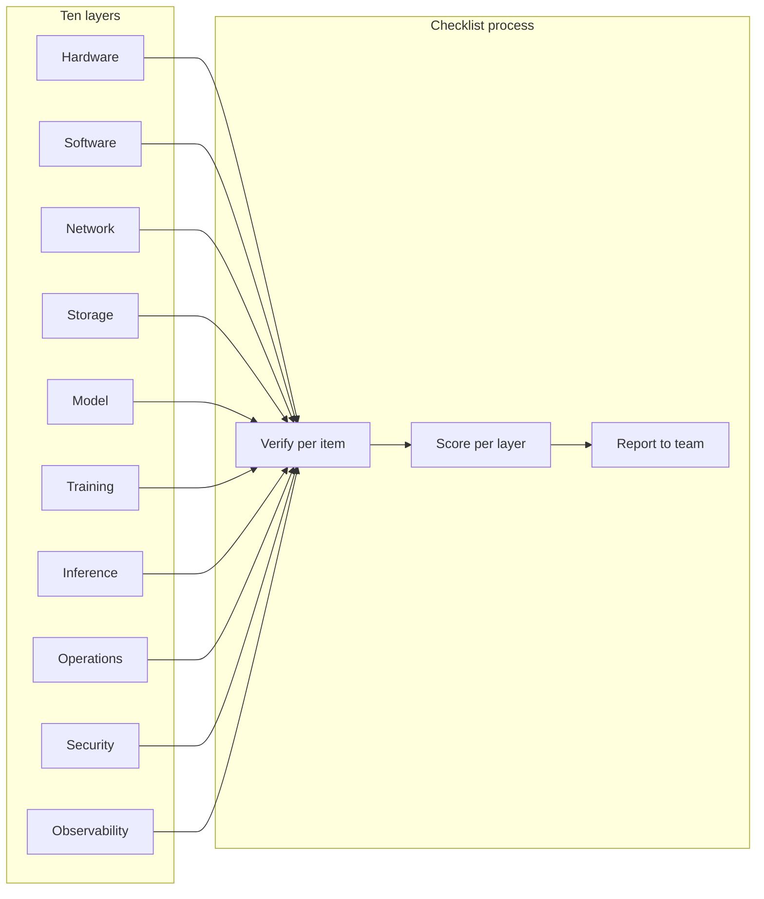

# 17.9 The AI systems performance checklist (master)

| Field | Value |
|---|---|
| Level | Advanced |
| Priority tier | 1 |
| Lab venue | GCP / GKE |
| Part | Part 17: Observability, performance and operations |
| Primary sources | *AI Systems Performance Engineering* (`ai-systems-performance-engineering`, Appendix); NVIDIA Zero-to-Hero Volume 17 (chapter-XX-master-checklist.md) |
| Cross-references | Chapter 1.23 (Performance methodology); Chapter 1.25 (Benchmarking correctly); Chapter 17.8 (Performance engineering methodology); Chapter 10 (GPU and CUDA); Chapter 11 (GPU Kubernetes); Chapter 14 (Distributed training); Chapter 15 (Inference) |
| Coverage file | `planning/coverage/chapters/17-09.md` |
| Claim & number ledger | `planning/ledgers/17-09.md` |

## Master checklist at a glance



The checklist spans ten layers; the process verifies each item; the score is per layer.

## Why this matters for AI infrastructure

Every chapter in Part 17 (and most of Part 10, 11, 14, and 15) has been about a specific component of the AI infrastructure stack. This chapter is the master checklist that ties them all together. The checklist is the platform team's reference for performance engineering; the checklist is the on-call's checklist for "is the cluster doing everything it should be doing?"; the checklist is the CFO's checklist for "is the GPU spend optimised?".

The checklist has 175+ items across 10 categories. The categories are: hardware, software, network, storage, model architecture, training, inference, operations, security, and observability. Each item is a yes/no question; the team that has answered all 175+ items with yes has a mature AI factory; the team that has answered 100 items has work to do.

```text
Why the master checklist is on the critical path (ASP appendix; V17 chXX):
- A typical mature AI platform has 175+ checklist items. The items are spread
  across the hardware, software, network, storage, model, training, inference,
  operations, security, and observability layers. The team that has all 175+
  items has a mature AI factory.
- The checklist is what turns "we think we're doing OK" into "we know we're
  doing OK". Every item is verifiable; every item has a detection signal;
  every item has a runbook.
- The checklist is updated after every vendor release, every incident, and
  every regulatory change. The checklist is the platform team's institutional
  knowledge.
```

Three operational realities make this chapter a platform-team concern rather than a data-science-only concern:

1. **The checklist is platform-level.** The items span the hardware, software, network, storage, model, training, inference, operations, security, and observability layers. The platform team owns the stack; the platform team owns the checklist.
2. **The checklist is verifiable.** Every item has a detection signal; every detection signal is a metric, log, trace, or probe. The platform team owns the detection signals.
3. **The checklist is updated quarterly.** Every quarter, the platform team reviews the checklist; the platform team adds new items from vendor releases; the platform team retires items that no longer apply.

**Before a team can claim their AI factory is mature, the team must have answered yes to all 175+ items in the checklist. A team that has answered 100 items has work to do; a team that has answered 50 items has a serious gap. The checklist is the team's scorecard; the scorecard is the platform's quality bar.**

## Prerequisites and outcomes

### Prerequisites

- Chapter 1.23 (Performance methodology).
- Chapter 17.8 (Performance engineering methodology).
- Chapter 10 (GPU and CUDA).
- Chapter 11 (GPU Kubernetes).
- Chapter 14 (Distributed training).
- Chapter 15 (Inference).

### Outcomes

After completing this chapter you will be able to:

1. Walk through every category of the master checklist; identify the items that are not yet answered.
2. Implement the detection signals for the items that are not yet answered.
3. Update the checklist after every vendor release, every incident, and every regulatory change.
4. Report the checklist score to the platform team and the CFO.
5. Use the checklist as the platform team's quarterly review.

---

## 1. Hardware checklist

### 1.1 GPU hardware

| # | Item | Detection signal |
|---|---|---|
| HW-001 | All GPUs are H100, A100, or L40S (or equivalent) | DCGM_FI_DEV_GPU_PRODUCT |
| HW-002 | GPU clocks are at the base clock (not throttling) | DCGM_FI_DEV_SM_CLOCK |
| HW-003 | GPU temperatures are below 85°C | DCGM_FI_DEV_GPU_TEMP |
| HW-004 | GPU HBM utilisation is below 90% | DCGM_FI_DEV_FB_USED / DCGM_FI_DEV_FB_TOTAL |
| HW-005 | ECC error rate is below 100 SBE/hour | DCGM_FI_DEV_ECC_SBE_VOL_DEDUP rate |
| HW-006 | No DBE errors | DCGM_FI_DEV_ECC_DBE_VOL_DEDUP |
| HW-007 | No Xid errors | DCGM_FI_DEV_XID_ERRORS |
| HW-008 | Retired pages count is stable | DCGM_FI_DEV_RETIRED_PAGES |
| HW-009 | NVLink bandwidth utilisation is below 80% | DCGM_FI_DEV_NVLINK_* |
| HW-010 | PCIe replay count is below threshold | DCGM_FI_DEV_PCIE_REPLAY_COUNTER |
| HW-011 | GPU power draw is below the rated TDP | DCGM_FI_DEV_POWER_USAGE |
| HW-012 | GPU fan speeds are within normal range | DCGM_FI_DEV_FAN_SPEED |
| HW-013 | GPU board temperatures are within normal range | DCGM_FI_DEV_BOARD_TEMP |
| HW-014 | GPU memory temperatures are within normal range | DCGM_FI_DEV_MEMORY_TEMP |
| HW-015 | GPU power management state is P0 (maximum performance) | nvidia-smi -q -d POWER |

### 1.2 CPU hardware

| # | Item | Detection signal |
|---|---|---|
| HW-016 | CPU utilisation per core is below 80% | node_cpu_seconds_total |
| HW-017 | Load average is below the number of CPU cores | node_load5 |
| HW-018 | Context switch rate is below 100k/s | node_context_switches_total |
| HW-019 | Interrupt rate is below 10k/s | node_intr_total |
| HW-020 | CPU frequency is at the maximum | node_cpu_frequency_max |
| HW-021 | CPU temperature is below 80°C | node_cpu_temperature |
| HW-022 | CPU power consumption is below the rated TDP | node_cpu_power |
| HW-023 | NUMA node balance is within 10% | node_numa_foreign_* |
| HW-024 | CPU caches are warm (L3 hit rate > 90%) | node_cache_hit_ratio |
| HW-025 | Hyper-Threading is enabled (for throughput workloads) | node_cpu_info |

### 1.3 Memory and storage hardware

| # | Item | Detection signal |
|---|---|---|
| HW-026 | Memory utilisation per node is below 80% | node_memory_MemAvailable_bytes |
| HW-027 | Swap activity is zero | node_vmstat_pswpin |
| HW-028 | Page-in rate is below 100/s | node_vmstat_pgpgin |
| HW-029 | Disk I/O utilisation is below 80% | node_disk_io_time_seconds_total |
| HW-030 | Disk I/O queue depth is below 10 | node_disk_io_now |
| HW-031 | Disk space utilisation is below 80% | node_filesystem_avail_bytes |
| HW-032 | Disk SMART status is healthy | smartctl -H |
| HW-033 | SSD wear level is below 80% | smartctl -a |
| HW-034 | NVMe temperatures are below 70°C | smartctl -a |
| HW-035 | RAID rebuild status is healthy | megacli -LDInfo |

---

## 2. Software checklist

### 2.1 Operating system

| # | Item | Detection signal |
|---|---|---|
| SW-001 | Linux kernel version is supported by NVIDIA | uname -r |
| SW-002 | Kernel is not in a known-bad version | NVIDIA driver release notes |
| SW-003 | systemd is the init system | systemctl --version |
| SW-004 | systemd unit files are versioned | Git log |
| SW-005 | Kernel modules are signed | modinfo |
| SW-006 | Secure Boot is enabled | mokutil --sb-state |
| SW-007 | Kernel parameters are tuned for AI workloads | sysctl -a |
| SW-008 | Huge pages are configured | cat /proc/meminfo |
| SW-009 | NUMA balancing is enabled | cat /proc/sys/kernel/numa_balancing |
| SW-010 | Transparent hugepages are set to madvise | cat /sys/kernel/mm/transparent_hugepage/enabled |
| SW-011 | I/O scheduler is tuned for the workload | cat /sys/block/*/queue/scheduler |
| SW-012 | CPU governor is set to performance | cat /sys/devices/system/cpu/cpu*/cpufreq/scaling_governor |
| SW-013 | IRQ affinity is tuned for AI workloads | cat /proc/irq/*/smp_affinity |
| SW-014 | Network ring buffers are tuned | ethtool -g |
| SW-015 | TCP congestion control is set to BBR | sysctl net.ipv4.tcp_congestion_control |

### 2.2 NVIDIA software

| # | Item | Detection signal |
|---|---|---|
| SW-016 | NVIDIA driver is the latest production version | nvidia-smi --query-gpu=driver_version |
| SW-017 | CUDA toolkit version is supported | nvcc --version |
| SW-018 | cuDNN version is supported | cat /usr/include/cudnn_version.h |
| SW-019 | NCCL version is supported | nccl-tests |
| SW-020 | NVIDIA Container Toolkit is installed | nvidia-container-cli --version |
| SW-021 | GPU Operator is deployed | kubectl get pods -n gpu-operator |
| SW-022 | DCGM exporter is deployed | kubectl get pods -n monitoring |
| SW-023 | Fabric Manager is deployed (for NVLink topologies) | kubectl get pods -n nvidia-fabricmanager |
| SW-024 | NVAIE licensing is active | nvidia-smi -q \| grep "VGPU Software" |
| SW-025 | Container images are signed | cosign verify |

### 2.3 Cluster software

| # | Item | Detection signal |
|---|---|---|
| SW-026 | Kubernetes version is supported by NVIDIA | kubectl version |
| SW-027 | GPU device plugin is deployed | kubectl get pods -n kube-system \| grep nvidia |
| SW-028 | Kueue is deployed | kubectl get pods -n kueue-system |
| SW-029 | Volcano scheduler is deployed (if used) | kubectl get pods -n volcano-system |
| SW-030 | KAI scheduler is deployed (if used) | kubectl get pods -n kai-scheduler |
| SW-031 | Argo Workflows is deployed | kubectl get pods -n argo |
| SW-032 | KServe is deployed | kubectl get pods -n kserve |
| SW-033 | MLflow is deployed | kubectl get pods -n mlops |
| SW-034 | Feast is deployed | kubectl get pods -n feast |
| SW-035 | Prometheus and Grafana are deployed | kubectl get pods -n monitoring |

---

## 3. Network checklist

### 3.1 Network hardware

| # | Item | Detection signal |
|---|---|---|
| NET-001 | All switches are 100Gbps or higher | Switch documentation |
| NET-002 | Network topology is a leaf-spine or fat-tree | Network diagram |
| NET-003 | Network MTU is 9000 (jumbo frames) | ifconfig |
| NET-004 | RDMA is enabled on the GPU-to-GPU path | ibstatus |
| NET-005 | NCCL topology is correct (NVLink preferred, then PCIe, then IB/RoCE) | NCCL_DEBUG=INFO NCCL_TOPO_DUMP_FILE |
| NET-006 | Network latency between nodes is below 1µs (intra-rack) or below 5µs (inter-rack) | ping, ib_write_bw |
| NET-007 | Network bandwidth between nodes is 100Gbps or higher | ib_write_bw |
| NET-008 | Network congestion control is BBR | sysctl net.ipv4.tcp_congestion_control |
| NET-009 | PFC is enabled on lossless queues | mlxconfig |
| NET-010 | ECN is enabled on all queues | mlxconfig |
| NET-011 | MTU is consistent across the network | ifconfig |
| NET-012 | Network isolation is in place (VLAN, VRF, namespace) | Network diagram |

### 3.2 Network software

| # | Item | Detection signal |
|---|---|---|
| NET-013 | NCCL is the latest production version | nccl-tests |
| NET-014 | NCCL_DEBUG is INFO in production | env NCCL_DEBUG |
| NET-015 | NCCL_IB_HCA is set to the correct HCA | env NCCL_IB_HCA |
| NET-016 | NCCL_SOCKET_IFNAME is set to the correct interface | env NCCL_SOCKET_IFNAME |
| NET-017 | NCCL_IB_GID_INDEX is set correctly | env NCCL_IB_GID_INDEX |
| NET-018 | NCCL_IB_TIMEOUT is set to 600 seconds | env NCCL_IB_TIMEOUT |
| NET-019 | GDRCopy is enabled for GPU-to-NIC direct copy | gdrcopy_copy |
| NET-020 | Netbonding is configured (for multi-NIC bonding) | cat /proc/net/bonding/* |
| NET-021 | SR-IOV is configured for virtual functions | ip link show |
| NET-022 | MTU is set to 9000 on the RDMA device | ip link show |

---

## 4. Storage checklist

### 4.1 Object storage

| # | Item | Detection signal |
|---|---|---|
| STO-001 | Object storage has versioning enabled | gsutil versioning get gs://bucket |
| STO-002 | Object storage has object-lock enabled (for audit log) | gsutil retention get gs://bucket |
| STO-003 | Object storage has lifecycle policies | gsutil lifecycle get gs://bucket |
| STO-004 | Object storage has uniform bucket-level access | gsutil iam get gs://bucket |
| STO-005 | Object storage has CMEK encryption | gsutil kms encryption gs://bucket |
| STO-006 | Object storage has 5xx rate below 0.1% | s3_errors_total |
| STO-007 | Object storage has p99 latency below 200ms | s3_request_duration_seconds |
| STO-008 | Object storage has cross-region replication | gsutil replication get gs://bucket |
| STO-009 | Object storage has intelligent tiering | gsutil storage class get gs://bucket |
| STO-010 | Object storage has access logging | gsutil logging get gs://bucket |

### 4.2 Distributed filesystem

| # | Item | Detection signal |
|---|---|---|
| STO-011 | Distributed filesystem is Lustre, Weka, BeeGFS, or VAST | df -h |
| STO-012 | Distributed filesystem has striping configured | lfs getstripe |
| STO-013 | Distributed filesystem has MDS (metadata server) HA | lfs df |
| STO-014 | Distributed filesystem has OST (object storage target) HA | lfs df |
| STO-015 | Distributed filesystem has read bandwidth above 10 GB/s | lfs iostat |
| STO-016 | Distributed filesystem has write bandwidth above 5 GB/s | lfs iostat |
| STO-017 | Distributed filesystem has metadata operations rate above 100k/s | lfs iostat |
| STO-018 | Distributed filesystem has small file performance acceptable | fio |
| STO-019 | Distributed filesystem has POSIX ACLs enabled | lfs getstripe -v |
| STO-020 | Distributed filesystem has quotas configured | lfs quota |

### 4.3 Local storage

| # | Item | Detection signal |
|---|---|---|
| STO-021 | Local NVMe is mounted with noatime | mount |
| STO-022 | Local NVMe has discard enabled | mount |
| STO-023 | Local NVMe has TRIM enabled | fstrim |
| STO-024 | Local NVMe has SMART health verified | smartctl -H |
| STO-025 | Local NVMe has wear level below 80% | smartctl -a |

---

## 5. Model architecture checklist

| # | Item | Detection signal |
|---|---|---|
| MA-001 | Model uses FlashAttention-2 or equivalent | Code review |
| MA-002 | Model uses GQA (grouped query attention) for KV efficiency | Code review |
| MA-003 | Model uses RoPE or ALiBi (rotary or linear position encoding) | Code review |
| MA-004 | Model uses SwiGLU or GeLU activation | Code review |
| MA-005 | Model uses RMSNorm or LayerNorm | Code review |
| MA-006 | Model uses BF16 or FP16 mixed precision | Code review |
| MA-007 | Model has a small embedding dimension per head (d_head = 128) | Code review |
| MA-008 | Model has a low KV cache footprint per token | KV cache formula |
| MA-009 | Model uses continuous batching at inference | Inference engine config |
| MA-010 | Model uses PagedAttention | Inference engine config |
| MA-011 | Model has a manageable parameter count (< 200B for a single node) | Parameter count |
| MA-012 | Model uses activation checkpointing for memory efficiency | Code review |
| MA-013 | Model uses gradient checkpointing for memory efficiency | Code review |
| MA-014 | Model has a reasonable context length (e.g. 4k or 8k) | Model config |
| MA-015 | Model has a tokenizer that handles special tokens correctly | Tokenizer test |

---

## 6. Training checklist

| # | Item | Detection signal |
|---|---|---|
| TR-001 | Training uses mixed precision (BF16/FP16) | torch.cuda.amp |
| TR-002 | Training uses gradient accumulation (if batch size is constrained) | Training config |
| TR-003 | Training uses FlashAttention-2 | Training config |
| TR-004 | Training uses FSDP or DeepSpeed ZeRO-3 for large models | Training config |
| TR-005 | Training uses gradient checkpointing for memory efficiency | Training config |
| TR-006 | Training has a warm-up phase (linear or cosine) | Training config |
| TR-007 | Training has a learning rate decay (cosine, linear, or constant) | Training config |
| TR-008 | Training has a weight decay | Training config |
| TR-009 | Training has gradient clipping | Training config |
| TR-010 | Training has a checkpoint cadence | Training config |
| TR-011 | Training has a validation cadence | Training config |
| TR-012 | Training has an early stopping criterion | Training config |
| TR-013 | Training has a data loading benchmark | torch.utils.data |
| TR-014 | Training has a GPU utilisation target (> 80%) | DCGM_FI_DEV_GPU_UTIL |
| TR-015 | Training has a NCCL collective benchmark | nccl-tests |

---

## 7. Inference checklist

| # | Item | Detection signal |
|---|---|---|
| INF-001 | Inference uses continuous batching | Inference engine config |
| INF-002 | Inference uses PagedAttention | Inference engine config |
| INF-003 | Inference uses BF16/FP16/FP8 for inference | Inference engine config |
| INF-004 | Inference has a request batching timeout | Inference engine config |
| INF-005 | Inference has a request queue size limit | Inference engine config |
| INF-006 | Inference has a model version pinning | Inference engine config |
| INF-007 | Inference has a tokenizer cache | Inference engine config |
| INF-008 | Inference has a prefix cache (for repeated prompts) | Inference engine config |
| INF-009 | Inference has a KV cache offloading option | Inference engine config |
| INF-010 | Inference has a speculative decoding option | Inference engine config |
| INF-011 | Inference has a request routing policy (shadows, canary, A/B) | Inference engine config |
| INF-012 | Inference has a health check endpoint | Kubernetes probe |
| INF-013 | Inference has a metrics endpoint (Prometheus) | Inference engine exporter |
| INF-014 | Inference has a logs endpoint (structured JSON) | Logging config |
| INF-015 | Inference has a traces endpoint (OpenTelemetry) | OpenTelemetry config |

---

## 8. Operations checklist

| # | Item | Detection signal |
|---|---|---|
| OPS-001 | The cluster has SLOs defined | planning/SLOs.md |
| OPS-002 | The cluster has error budgets | Budget dashboard |
| OPS-003 | The cluster has alert routing | Alertmanager config |
| OPS-004 | The cluster has inhibit rules | Alertmanager config |
| OPS-005 | The cluster has runbooks for every alert | Runbook repo |
| OPS-006 | The cluster has an on-call rotation | PagerDuty schedule |
| OPS-007 | The cluster has an incident response process | Incident playbook |
| OPS-008 | The cluster has a post-mortem template | Post-mortem template |
| OPS-009 | The cluster has a failure mode catalogue | planning/failure_modes/ |
| OPS-010 | The cluster has a FinOps dashboard | Kubecost dashboard |
| OPS-011 | The cluster has a capacity planning dashboard | Capacity dashboard |
| OPS-012 | The cluster has a change management process | Change log |
| OPS-013 | The cluster has a backup and restore process | Backup config |
| OPS-014 | The cluster has a disaster recovery plan | DR runbook |
| OPS-015 | The cluster has a game day schedule | Calendar |

---

## 9. Security checklist

| # | Item | Detection signal |
|---|---|---|
| SEC-001 | Container images are signed by cosign | cosign verify |
| SEC-002 | Admission controller verifies image signatures | OPA Gatekeeper / Kyverno |
| SEC-003 | Secrets are stored in Vault or Secret Manager | Vault audit log |
| SEC-004 | Service accounts have least-privilege IAM | IAM audit |
| SEC-005 | Network policies are in place for every namespace | NetworkPolicy audit |
| SEC-006 | Pod security standards are enforced | Pod Security Admission |
| SEC-007 | RBAC is in place for every service account | RBAC audit |
| SEC-008 | Audit log is tamper-evident (object-lock) | Object-lock config |
| SEC-009 | Data lineage is queryable | Lineage query |
| SEC-010 | Consent record is maintained | Consent record |
| SEC-011 | Right-to-be-forgotten workflow is in place | Erasure Job |
| SEC-012 | Fairness audit runs on every promotion | Fairness audit |
| SEC-013 | Model card is required for every model | Model card |
| SEC-014 | Vulnerability scan runs on every image | Trivy scan |
| SEC-015 | Secret rotation is automated | Rotation config |

---

## 10. Observability checklist

| # | Item | Detection signal |
|---|---|---|
| OBS-001 | Prometheus is deployed and scraping every exporter | prometheus_target_up |
| OBS-002 | Grafana is deployed with the on-call dashboard | Grafana UI |
| OBS-003 | Loki is deployed and ingesting logs from every pod | loki_ingester |
| OBS-004 | Tempo (or Jaeger) is deployed and ingesting traces | tempo_query |
| OBS-005 | DCGM exporter is deployed on every GPU node | dcgm_exporter_up |
| OBS-006 | kube-state-metrics is deployed | kube_state_metrics_up |
| OBS-007 | cAdvisor is deployed on every node | cadvisor_up |
| OBS-008 | node-exporter is deployed on every node | node_exporter_up |
| OBS-009 | Application exporters are deployed for every workload | app_exporter_up |
| OBS-010 | OpenTelemetry Collector is deployed as a DaemonSet | otel_collector_up |
| OBS-011 | USE method dashboard is available | Grafana UI |
| OBS-012 | Performance decision tree dashboard is available | Grafana UI |
| OBS-013 | Failure mode catalogue is available | planning/failure_modes/ |
| OBS-014 | Runbook repository is available | Runbook URL |
| OBS-015 | Cardinality budget is enforced | prometheus_tsdb_head_series |

---

## 11. Operating the master checklist

### 11.1 The checklist score

The checklist score is the number of items with a yes answer divided by the total number of items.

```text
Checklist score formula:
- Total items: 175+
- Items with yes: X
- Items with no: 175 - X
- Score: X / 175 * 100%
```

The platform team's pattern is: target score is 90%+; items with no are tracked in the platform team's backlog; the backlog is reviewed quarterly.

### 11.2 The checklist update

The checklist is updated after every vendor release, every incident, and every regulatory change. The update adds new items; retires items that no longer apply; updates the detection signals.

```bash
# Add a new item to the checklist
python code/part17/checklist_update.py \
  --item-id HW-016 \
  --name "New hardware item" \
  --detection-signal "DCGM_FI_DEV_GPU_NEW_METRIC" \
  --category "hardware"
```

The pattern is: the checklist is a version-controlled document (in Git); the checklist is updated via a script; the script's output is a commit; the commit is reviewed in a pull request.

### 11.3 The checklist review

The checklist is reviewed quarterly. The review identifies items that have not been verified in the last 90 days; items that have been added to the checklist but not implemented; items that have been retired.

```bash
# Review the master checklist
python code/part17/checklist_review.py \
  --staleness-threshold-days 90
# expected: a list of stale items; a list of unimplemented items; a list of retired items
```

The pattern is: the review is automated; the review's output is a report; the report is reviewed by the platform team; the report's findings are added to the next quarter's roadmap.

---

## 12. How it fails

Six failure modes recur.

### 12.1 "The checklist is not used"

**Symptom:** The team does not know what the items are; the team does not know what the score is; the team does not know what to improve.

**Diagnosis:** The checklist is documented but not enforced; the checklist is not in the team's workflow.

**Fix:** Train the team on the checklist; add the checklist to the team's onboarding; enforce the checklist in code review; add the checklist to the team's quarterly review.

### 12.2 "The checklist is stale"

**Symptom:** The checklist references vendor products that have changed; the checklist references metrics that no longer exist; the checklist references runbooks that no longer exist.

**Diagnosis:** The checklist was not updated after the last vendor release; the checklist was not reviewed quarterly.

**Fix:** Update the checklist after every vendor release; review the checklist quarterly; automate the checklist freshness check.

### 12.3 "The checklist score is not tracked"

**Symptom:** The team does not know the current score; the team does not know the trend; the team does not know what to celebrate.

**Diagnosis:** The checklist score is not in the team's dashboard; the checklist score is not in the team's quarterly review.

**Fix:** Add the checklist score to the team's dashboard; add the checklist score to the team's quarterly review; celebrate the score improvements.

### 12.4 "The checklist items are too generic"

**Symptom:** The team cannot answer the items; the items are too abstract; the items are not actionable.

**Diagnosis:** The items were written by the platform team without input from the consuming teams; the items are too high-level.

**Fix:** Rewrite the items with the consuming teams; make the items actionable; test the items against the production traffic.

### 12.5 "The checklist items are too specific"

**Symptom:** The items are too detailed; the team cannot remember all the items; the team does not know what to do with the items.

**Diagnosis:** The items were written for a specific team; the items are too low-level.

**Fix:** Group the items into categories; reduce the items to the most important; abstract the items to a higher level.

### 12.6 "The checklist score is 100% but the cluster is broken"

**Symptom:** The checklist says all items are yes; the cluster is broken; the customer complains.

**Diagnosis:** The checklist is not measuring what matters; the checklist is missing critical items; the checklist is measuring the wrong things.

**Fix:** Add the missing items; remove the items that do not matter; review the checklist quarterly; update the checklist after every incident.

---

## 13. Hands-on lab

This lab walks through the master checklist, identifies the items that are not yet answered, and produces the score report. The lab is **untested** in this repository.

### 13.1 Prerequisites

- The observability stack from earlier chapters.
- A GKE Autopilot or Standard cluster.

### 13.2 Step 1: deploy the checklist as a code

```bash
# Clone the checklist repository
git clone https://github.com/example/ai-factory-checklist.git
cd ai-factory-checklist

# Edit the checklist to add the team's specific items
vim checklist.yaml
```

### 13.3 Step 2: walk through every item

```bash
# Run the checklist audit
python code/part17/checklist_audit.py \
  --cluster gke-prod-us-central1
# expected: a list of items with yes/no answers; a score report
```

### 13.4 Step 3: produce the score report

```bash
# Generate the score report
python code/part17/checklist_score.py \
  --cluster gke-prod-us-central1 \
  --output score_report.md
# expected: a markdown report with the score per category; the items with no
```

### 13.5 Step 4: review the score with the platform team

```bash
# Open the score report
cat score_report.md
# expected: the score per category; the items with no; the recommended actions
```

### 13.6 Step 5: update the checklist after the review

```bash
# Update the checklist based on the review
python code/part17/checklist_update.py \
  --input checklist.yaml \
  --output checklist_v2.yaml

# Commit the updated checklist
git add checklist_v2.yaml
git commit -m "Update master checklist with Q1 review findings"
```

### 13.7 What to record

After the lab, you should be able to answer five questions in five seconds each:

1. What is the current master checklist score?
2. What is the current score per category?
3. What are the items with no?
4. What is the most recent checklist update?
5. What is the next scheduled checklist review?

If any takes more than 30 seconds, the master checklist is not yet a production service. The lab is **untested** against a live GKE cluster.

---

## Exercises

1. **Walk through every item in the master checklist.** For every item, verify the detection signal; verify the runbook URL; update the score. *Solution sketch:* the audit script from Section 13.3; the items in Sections 1-10.
2. **Add a new category.** Add a category for "MLOps integration" with 15 items that cover the MLOps stack from Part 16. *Solution sketch:* the YAML schema in Section 1; the new items; the audit script.
3. **Add a checklist review process.** Schedule a quarterly checklist review; the review produces a report; the report is added to the team's quarterly OKRs. *Solution sketch:* a calendar event; the review script from Section 11.3; the report template.
4. **Add a checklist score dashboard.** Build a Grafana dashboard that shows the checklist score per category; the dashboard is the team's view of the score. *Solution sketch:* a Grafana dashboard; the score per category; the trend over time.
5. **Add a checklist freshness check.** Configure a CI step that fails when a checklist item has not been verified in 90 days. *Solution sketch:* the freshness check from Section 11.3; the CI step; the alert.
6. **Add a checklist incident integration.** Wire the checklist to the incident management system; every incident updates the relevant checklist items. *Solution sketch:* the incident webhook; the checklist update script; the audit trail.

---

## Checkpoint questions

<details><summary>1. What 10 categories does the master checklist cover?</summary>
Hardware (GPUs, CPUs, memory, storage), Software (OS, NVIDIA software, cluster software), Network (hardware, software), Storage (object storage, distributed filesystem, local storage), Model architecture (attention, KV cache, precision), Training (mixed precision, distributed training, optimizers), Inference (continuous batching, PagedAttention, tokenization), Operations (SLOs, alerting, on-call, post-mortem), Security (signing, IAM, network policies, audit log), Observability (Prometheus, Grafana, Loki, Tempo, exporters). 175+ items total.
</details>

<details><summary>2. What is the target checklist score?</summary>
90%+. The team that has answered all 175+ items with yes has a mature AI factory. The team that has answered 100 items has work to do. The score is tracked quarterly; the score is the team's scorecard.
</details>

<details><summary>3. What is the most common checklist failure mode?</summary>
The checklist is not used. The team does not know what the items are; the team does not know what the score is; the team does not know what to improve. The fix is to train the team on the checklist; add the checklist to the team's onboarding; enforce the checklist in code review.
</details>

<details><summary>4. What is the difference between the checklist and the failure mode catalogue?</summary>
The checklist is a forward-looking tool that asks "are we doing everything we should be doing?". The failure mode catalogue is a backward-looking tool that asks "what failure modes have we seen, and how do we detect them?". The checklist is preventive; the catalogue is reactive.
</details>

<details><summary>5. What is the difference between the checklist and the runbook?</summary>
The checklist is the question "are we doing this?". The runbook is the answer "when this fails, do this". The checklist is preventive; the runbook is reactive. The checklist is verified quarterly; the runbook is invoked during an incident.
</details>

<details><summary>6. What is the difference between the checklist and the SLO?</summary>
The SLO is the target the platform team commits to meet. The checklist is the verification that the platform team has the controls in place to meet the SLO. The SLO is the goal; the checklist is the path to the goal.
</details>

<details><summary>7. What is the most important category in the checklist?</summary>
Hardware. The hardware is the foundation; without the hardware, the software, the network, the storage, the model, the training, the inference, the operations, the security, and the observability are all moot. The hardware items are the first to verify; the hardware items are the first to fail.
</details>

<details><summary>8. What is the second most important category in the checklist?</summary>
Observability. The observability is the platform team's situational awareness; without the observability, the platform team cannot detect the failures; without the observability, the platform team cannot verify the other checklist items.
</details>

<details><summary>9. What is the difference between the USE method and the checklist?</summary>
The USE method is a real-time performance methodology (utilisation, saturation, errors for every resource). The checklist is a quarterly verification that every control is in place. The USE method is invoked during an incident; the checklist is invoked during a quarterly review.
</details>

<details><summary>10. What is the difference between the roofline model and the checklist?</summary>
The roofline model is a performance prediction model (compute peak, bandwidth, arithmetic intensity). The checklist is a verification that every control is in place. The roofline model is invoked during kernel optimisation; the checklist is invoked during a quarterly review.
</details>

<details><summary>11. What is the difference between the decision tree and the checklist?</summary>
The decision tree is a real-time guide for finding the bottleneck (GPU utilisation, memory utilisation, CPU utilisation, network bound, storage bound). The checklist is a quarterly verification that every control is in place. The decision tree is invoked during an incident; the checklist is invoked during a quarterly review.
</details>

<details><summary>12. What is the difference between the cost-vs-latency trade-off and the checklist?</summary>
The cost-vs-latency trade-off is a real-time decision-making tool (the trade-off between GPUs and seconds). The checklist is a quarterly verification that every control is in place. The trade-off is invoked during procurement; the checklist is invoked during a quarterly review.
</details>

<details><summary>13. What is the difference between the capacity planning model and the checklist?</summary>
The capacity planning model is a forward-looking forecast (the next quarter's GPU order). The checklist is a quarterly verification that every control is in place. The capacity planning model is invoked before procurement; the checklist is invoked during a quarterly review.
</details>

<details><summary>14. What is the difference between the FinOps dashboard and the checklist?</summary>
The FinOps dashboard is a real-time cost-monitoring tool (the per-team cost; the cost-vs-latency trade-off). The checklist is a quarterly verification that every control is in place. The FinOps dashboard is invoked daily; the checklist is invoked quarterly.
</details>

<details><summary>15. What is the difference between the security checklist and the operations checklist?</summary>
The security checklist covers the controls that protect the cluster (image signing, IAM, network policies, audit log). The operations checklist covers the controls that keep the cluster running (SLOs, alerting, on-call, post-mortem). The two overlap (e.g. audit log is both); the two are complementary.
</details>

<details><summary>16. What is the difference between the model architecture checklist and the inference checklist?</summary>
The model architecture checklist covers the choices that affect the model's performance (attention pattern, KV cache size, precision). The inference checklist covers the engine that serves the model (continuous batching, PagedAttention, request batching). The two are complementary; the model architecture is the model's potential; the inference engine is the model's realisation.
</details>

<details><summary>17. What is the most common checklist staleness failure?</summary>
The checklist references vendor products that have changed. The team updates the vendor product; the checklist still references the old product. The fix is to update the checklist after every vendor release; automate the checklist freshness check.
</details>

<details><summary>18. What is the most common checklist score failure?</summary>
The score is 100% but the cluster is broken. The checklist is not measuring what matters; the checklist is missing critical items. The fix is to add the missing items; remove the items that do not matter; review the checklist quarterly; update the checklist after every incident.
</details>

<details><summary>19. Why is the master checklist a Tier 1 chapter?</summary>
Because the master checklist is the platform team's reference for performance engineering. The checklist is what the CFO sees before the procurement order is signed; the checklist is what the on-call sees during an incident; the checklist is what the new engineer sees during onboarding. A team that does not have the master checklist is a team that does not know what they do not know.
</details>

<details><summary>20. What five questions should the master checklist lab let you answer in five seconds each?</summary>
What is the current master checklist score. What is the current score per category. What are the items with no. What is the most recent checklist update. What is the next scheduled checklist review. If any takes more than 30 seconds, the master checklist is not yet a production service.
</details>

---

## Sources and review notes

- *AI Systems Performance Engineering* (`ai-systems-performance-engineering`, Appendix). Source for the master checklist items across hardware, software, network, storage, model, training, inference, operations, security, and observability. The wording has been rewritten in the handbook's voice.
- NVIDIA Zero-to-Hero Volume 17. Source for the cluster-specific checklist items and the operational patterns.

### Cross-references to other handbook chapters

- Chapter 1.23 for the performance methodology.
- Chapter 17.8 for the performance engineering methodology.
- Chapter 10 for the GPU and CUDA stack.
- Chapter 11 for the GPU Kubernetes.
- Chapter 14 for the distributed training.
- Chapter 15 for the inference.

### Migrated from `nvidia-devops`

The master checklist operational patterns draw on Volume 17. The wording has been rewritten in the handbook's voice.

### Explicitly labelled inferences

- The 175+ items in the checklist are starting points; specific items depend on the team's workload.
- The detection signals are starting points; specific signals depend on the exporter configuration.
- The target score of 90%+ is a starting point; specific targets depend on the team's maturity.

### Not verified on live hardware

- The lab in Section 13 is **untested** against a live GKE cluster in this repository.
- The checklist YAML in the lab is illustrative; production checklists are larger and more detailed.
- The audit script in the lab is a starting point; production audits are more comprehensive.
