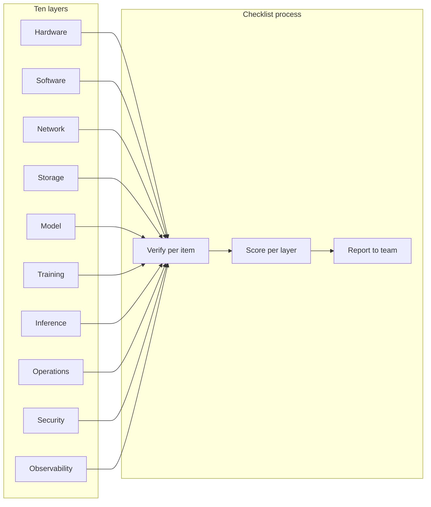

# 17.9 The AI systems performance checklist (master)

| Field | Value |
|---|---|
| Level | Advanced |
| Priority tier | 1 |
| Lab venue | GCP / GKE |
| Part | Part 17: Observability, performance and operations |
| Primary sources | *AI Systems Performance Engineering* (`ai-systems-performance-engineering`, Appendix); NVIDIA Zero-to-Hero Volume 17 (chapter-XX-master-checklist.md) |
| Cross-references | Chapter 1.23 (Performance methodology); Chapter 1.25 (Benchmarking correctly); Chapter 17.8 (Performance engineering methodology); Chapter 10 (GPU and CUDA); Chapter 11 (GPU Kubernetes); Chapter 14 (Distributed training); Chapter 15 (Inference) |
| Coverage file | `planning/coverage/chapters/17-09.md` |
| Claim & number ledger | `planning/ledgers/17-09.md` |

## Master checklist at a glance

Picture a platform team that reviews the GPU fleet each quarter. Each layer has its own owner, so nobody sees the whole stack at once. The diagram gives every layer the same check.



Read the diagram from left to right. Before a review, name an owner for each layer, since an unowned score rarely gets fixed.

## Why this matters for AI infrastructure

Suppose you are the on-call engineer. The cluster looks busy, but a training run is slower than it was last week. You need one list of questions to work through, not a new guess each time. This master checklist is that list. It ties together the components covered in Part 17 and in most of Parts 10, 11, 14, and 15.

The checklist serves three readers in three ways. The platform team uses it as the reference for performance engineering. The on-call engineer uses it to ask whether the cluster is doing everything it should. The finance owner uses it to ask whether GPU spending is well used.

The checklist covers ten categories: hardware, software, network, storage, model architecture, training, inference, operations, security, and observability. Each item is a yes or no question, and the tables in this chapter hold 207 items, more than the 175 used as a round number in the score example below. The appendix of *AI Systems Performance Engineering* carries a similar 175-plus title, but its text is written as tips rather than numbered questions. Treat the count as the size of your own list, not as proof that a team is mature.

```text
Why the master checklist is on the critical path (ASP appendix; V17 chXX):
- A typical mature AI platform has 175+ checklist items. The items are spread
  across the hardware, software, network, storage, model, training, inference,
  operations, security, and observability layers. The team that has all 175+
  items has a mature AI factory.
- The checklist is what turns "we think we're doing OK" into "we know we're
  doing OK". Every item is verifiable; every item has a detection signal;
  every item has a runbook.
- The checklist is updated after every vendor release, every incident, and
  every regulatory change. The checklist is the platform team's institutional
  knowledge.
```

Three things make this a platform concern rather than a data science concern:

1. **The platform team owns the checklist.** The items span hardware, software, network, storage, model, training, inference, operations, security, and observability. Someone on the platform team has to own both the stack and the list.
2. **Every item must be verifiable.** Each item needs a detection signal, which is a metric, a log, a trace, or a probe. The platform team owns those signals as well.
3. **The checklist changes every quarter.** The team reviews it each quarter, adds items from vendor releases, and retires items that no longer apply.

**Before you call your AI factory mature, answer every item in the checklist, and write down each item you cannot yet answer.**

## Prerequisites and outcomes

### Prerequisites

Read Chapter 1.23 and Chapter 17.8 first, since they cover performance methodology. Then review Chapter 10 on GPUs and CUDA, Chapter 11 on GPU Kubernetes, Chapter 14 on distributed training, and Chapter 15 on inference. The checklist assumes you already know what each row measures.

### Outcomes

After this chapter, you will be able to:

1. Walk through every category of the master checklist, and find the items nobody has answered yet.
2. Build the detection signals for those unanswered items.
3. Update the checklist after each vendor release, incident, and regulatory change.
4. Report the score to the platform team and the CFO.
5. Use the checklist as the agenda for the platform team's quarterly review.

---

## 1. Hardware checklist

Suppose a training job slows down overnight, and nothing in the code has changed. Check the hardware first, because a throttling card or a failing disk can slow the whole job. The tables below name each check and the metric that shows it. Start with the GPUs, since one weak card holds back every other card in a distributed job.

### 1.1 GPU hardware

| # | Item | Detection signal |
|---|---|---|
| HW-001 | All GPUs are H100, A100, or L40S (or equivalent) | the modelName label on any DCGM metric |
| HW-002 | GPU clocks are at the base clock (not throttling) | DCGM_FI_DEV_SM_CLOCK |
| HW-003 | GPU temperatures are below 85°C | DCGM_FI_DEV_GPU_TEMP |
| HW-004 | GPU HBM utilisation is below 90% | DCGM_FI_DEV_FB_USED / DCGM_FI_DEV_FB_TOTAL |
| HW-005 | ECC error rate is below 100 SBE/hour | DCGM_FI_DEV_ECC_SBE_VOL_TOTAL rate |
| HW-006 | No DBE errors | DCGM_FI_DEV_ECC_DBE_VOL_TOTAL |
| HW-007 | No Xid errors | DCGM_FI_DEV_XID_ERRORS |
| HW-008 | Retired pages count is stable | DCGM_FI_DEV_RETIRED_PENDING |
| HW-009 | NVLink bandwidth utilisation is below 80% | DCGM_FI_DEV_NVLINK_* |
| HW-010 | PCIe replay count is below threshold | DCGM_FI_DEV_PCIE_REPLAY_COUNTER |
| HW-011 | GPU power draw is below the rated TDP | DCGM_FI_DEV_POWER_USAGE |
| HW-012 | GPU fan speeds are within normal range | DCGM_FI_DEV_FAN_SPEED |
| HW-013 | GPU board temperatures are within normal range | DCGM_FI_DEV_GPU_TEMP |
| HW-014 | GPU memory temperatures are within normal range | DCGM_FI_DEV_MEMORY_TEMP |
| HW-015 | GPU power management state is P0 (maximum performance) | nvidia-smi -q -d POWER |

> **dcgm-exporter 4.9.0 version note.** dcgm-exporter 4.9.0 (2026-11-06) renamed many default metrics and changed some units. For example `DCGM_FI_DEV_GPU_UTIL` (percent) became `DCGM_FI_DEV_GPU_UTIL_RATIO` (0 to 1), and `DCGM_FI_DEV_FB_USED` (MiB) became `DCGM_FI_DEV_FB_USED_BYTES`. The metric names in this chapter are the 4.8.x names. On a 4.9.0 exporter use the [full mapping in 17.4](04-dcgm-exporter-and-interpreting-gpu-metrics.md#14-what-dcgm-exporter-490-renamed), and change thresholds together with the unit.

The limits in these tables are example values, not standards. Choose your own limits for your hardware, and write down why you chose them. The appendix of *AI Systems Performance Engineering* mentions 85°C as a thermal limit that GPUs can reach in some cases, so it is a reasonable place to start. The same appendix advises keeping ECC enabled on data center GPUs. ECC costs only a few percent of bandwidth and memory, and it catches memory errors that could otherwise corrupt results.

### 1.2 CPU hardware

| # | Item | Detection signal |
|---|---|---|
| HW-016 | CPU utilisation per core is below 80% | node_cpu_seconds_total |
| HW-017 | Load average is below the number of CPU cores | node_load5 |
| HW-018 | Context switch rate is below 100k/s | node_context_switches_total |
| HW-019 | Interrupt rate is below 10k/s | node_intr_total |
| HW-020 | CPU frequency is at the maximum | node_cpu_frequency_max |
| HW-021 | CPU temperature is below 80°C | node_cpu_temperature |
| HW-022 | CPU power consumption is below the rated TDP | node_cpu_power |
| HW-023 | NUMA node balance is within 10% | node_numa_foreign_* |
| HW-024 | CPU caches are warm (L3 hit rate > 90%) | node_cache_hit_ratio |
| HW-025 | Hyper-Threading is enabled (for throughput workloads) | node_cpu_info |

### 1.3 Memory and storage hardware

| # | Item | Detection signal |
|---|---|---|
| HW-026 | Memory utilisation per node is below 80% | node_memory_MemAvailable_bytes |
| HW-027 | Swap activity is zero | node_vmstat_pswpin |
| HW-028 | Page-in rate is below 100/s | node_vmstat_pgpgin |
| HW-029 | Disk I/O utilisation is below 80% | node_disk_io_time_seconds_total |
| HW-030 | Disk I/O queue depth is below 10 | node_disk_io_now |
| HW-031 | Disk space utilisation is below 80% | node_filesystem_avail_bytes |
| HW-032 | Disk SMART status is healthy | smartctl -H |
| HW-033 | SSD wear level is below 80% | smartctl -a |
| HW-034 | NVMe temperatures are below 70°C | smartctl -a |
| HW-035 | RAID rebuild status is healthy | megacli -LDInfo |

### 1.4 Planning for goodput and scale

Hardware sets the ceiling for speed and cost. No software change can make a starved GPU run faster than the data and links that feed it. Plan for goodput, which means useful work per dollar and per watt, instead of raw peak math throughput.

Match the accelerator to the job. Modern GPUs give better performance per watt and more memory than older ones. Newer generations also add native FP8 and FP4 precision and faster interconnects, and those features bring large speedups for many workloads.

Interconnect matters as much as the GPU itself. For multi-GPU work, use systems with NVLink and NVSwitch, such as GB200 or GB300 NVL72 racks, instead of PCIe-only connections. NVLink 5 provides up to 1.8 TB/s of bidirectional bandwidth between GPUs. That is more than 14 times the bandwidth of PCIe Gen5.

Keep CPU, memory, and storage in proportion to the GPUs. A useful starting point is about one fast CPU core per GPU for data loading and networking. Each GPU also needs system RAM and I/O that can supply data at hundreds of MB/s. Without that supply, the GPU waits and its utilization falls.

Keep tightly coupled work close together. A multi-node job should stay inside one NVLink domain when it can. Use NVLink within a node and a rack, and reserve InfiniBand for traffic between racks.

Find the slowest link first. If GPU utilization is low because of I/O, invest in faster storage or caching before buying more GPUs. A design where every component is matched to the others avoids wasted GPU cycles.

Be careful about cluster size. Overheads grow as you add GPUs, so the speedup must justify the cost. Reaching about 95 percent utilization on N GPUs is usually a better step than scaling to 2N GPUs at lower utilization. Measure scaling efficiency on a few nodes before you buy more.

Check that the data center can handle the power and cooling. Systems such as GB200 and GB300 have a very high thermal design power (TDP). They often need liquid cooling and careful power provisioning, so the GPUs can hold boost clocks without throttling.

### 1.5 Superchip memory tiers

Grace Blackwell superchips join CPU and GPU memory into one large pool. That lets you fit models that GPU memory alone cannot hold. The memory tiers differ in speed, so data placement decides whether the design performs well.

Each superchip pairs two Blackwell GPUs with one 72-core Grace CPU. All three see a single coherent memory pool. The NVLink-C2C link between them runs at 900 GB/s. The Grace CPU can add 480 GB of LPDDR5X memory as an extension for oversized models.

Place data by how often it is used. Keep weights, activations, and other hot data in GPU HBM3e, which has much higher local bandwidth. Let overflow and infrequently used data sit in CPU RAM. This keeps the NVLink-C2C link from becoming the bottleneck for critical data.

GPUs can read and write Grace LPDDR coherently over NVLink-C2C, without staging through host PCIe. Bandwidth and latency remain lower than HBM, though. Hot activations and the KV cache belong in HBM. CPU memory works better as a cache for colder data, but only when you prefetch that data explicitly.

Use the 72 Grace cores. Move data preprocessing, augmentation, and other CPU-friendly tasks to them. They can feed the GPUs quickly over NVLink-C2C, so they act as a fast I/O and compute partner for the GPU.

For trillion-parameter training, CPU memory can join the model's memory pool. Prefer the framework's caching allocator. In custom code, use `cudaMallocAsync` to limit fragmentation and enable graph capture. Use CUDA managed memory for overflow, and prefetch upcoming layers from CPU to GPU with `cudaMemPrefetchAsync`, so each transfer finishes before the layer needs it.

SuperOffload is an example of an algorithm set built for superchips such as Grace Hopper, Grace Blackwell, and Vera Rubin. It improves offload and tensor cast and copy steps. Its methods include speculation-then-validation, heterogeneous optimizer computation, and an ARM-based CPU optimizer. Compared with traditional offload, it raises token throughput and chip utilization.

### 1.6 Clocks, power, and thermals

Auto boost is the default, and it is usually the best setting. For run-to-run consistency, lock the clocks to a fixed high frequency with `nvidia-smi -lgc` for the GPU clock and `-lmc` for memory. Fixed clocks remove transient downclocking, which can quietly slow a long job.

Under a tight power budget, set a power limit with `nvidia-smi -pl`. A slightly lower limit keeps the GPU inside a stable thermal and power envelope. Test a few limits and compare throughput per watt. For some models, an 80 percent power limit gives nearly the same speed as 100 percent, with 20 percent less power.

Monitor power draw with `nvidia-smi`, which shows instantaneous draw. Spikes often match workload phases. A dense layer draws heavy power, while an all-reduce draws less. Sequence jobs so the draw stays smooth on a constrained circuit, and avoid running several spiky jobs on one node at once.

Watch temperatures and clocks during long runs. As a GPU approaches its thermal limit, which is 85°C in some cases, it may throttle. Use `nvidia-smi dmon` to see whether clocks fall below their maximum. If they do, improve cooling or raise fan speed, or lower the power limit slightly.

---

## 2. Software checklist

A node can pass every hardware check and still fail because of its software. Kernel versions, driver branches, and cluster add-ons each need a check of their own. Start with the rows that match the software on your nodes, then work through the three groups below in order, and mark each row yes or no before you move on. Keep a note of the rows you checked and the date. If you cannot answer a row, write it down as a gap for the team.

### 2.1 Operating system

| # | Item | Detection signal |
|---|---|---|
| SW-001 | Linux kernel version is supported by NVIDIA | uname -r |
| SW-002 | Kernel is not in a known-bad version | NVIDIA driver release notes |
| SW-003 | systemd is the init system | systemctl --version |
| SW-004 | systemd unit files are versioned | Git log |
| SW-005 | Kernel modules are signed | modinfo |
| SW-006 | Secure Boot is enabled | mokutil --sb-state |
| SW-007 | Kernel parameters are tuned for AI workloads | sysctl -a |
| SW-008 | Huge pages are configured | cat /proc/meminfo |
| SW-009 | NUMA balancing is enabled | cat /proc/sys/kernel/numa_balancing |
| SW-010 | Transparent hugepages are set to madvise | cat /sys/kernel/mm/transparent_hugepage/enabled |
| SW-011 | I/O scheduler is tuned for the workload | cat /sys/block/*/queue/scheduler |
| SW-012 | CPU governor is set to performance | cat /sys/devices/system/cpu/cpu*/cpufreq/scaling_governor |
| SW-013 | IRQ affinity is tuned for AI workloads | cat /proc/irq/*/smp_affinity |
| SW-014 | Network ring buffers are tuned | ethtool -g |
| SW-015 | TCP congestion control is set to BBR | sysctl net.ipv4.tcp_congestion_control |

### 2.2 NVIDIA software

| # | Item | Detection signal |
|---|---|---|
| SW-016 | NVIDIA driver is the latest production version | nvidia-smi --query-gpu=driver_version |
| SW-017 | CUDA toolkit version is supported | nvcc --version |
| SW-018 | cuDNN version is supported | cat /usr/include/cudnn_version.h |
| SW-019 | NCCL version is supported | nccl-tests |
| SW-020 | NVIDIA Container Toolkit is installed | nvidia-container-cli --version |
| SW-021 | GPU Operator is deployed | kubectl get pods -n gpu-operator |
| SW-022 | DCGM exporter is deployed | kubectl get pods -n monitoring |
| SW-023 | Fabric Manager is deployed (for NVLink topologies) | kubectl get pods -n nvidia-fabricmanager |
| SW-024 | NVAIE licensing is active | nvidia-smi -q \| grep "VGPU Software" |
| SW-025 | Container images are signed | cosign verify |

### 2.3 Cluster software

| # | Item | Detection signal |
|---|---|---|
| SW-026 | Kubernetes version is supported by NVIDIA | kubectl version |
| SW-027 | GPU device plugin is deployed | kubectl get pods -n kube-system \| grep nvidia |
| SW-028 | Kueue is deployed | kubectl get pods -n kueue-system |
| SW-029 | Volcano scheduler is deployed (if used) | kubectl get pods -n volcano-system |
| SW-030 | KAI scheduler is deployed (if used) | kubectl get pods -n kai-scheduler |
| SW-031 | Argo Workflows is deployed | kubectl get pods -n argo |
| SW-032 | KServe is deployed | kubectl get pods -n kserve |
| SW-033 | MLflow is deployed | kubectl get pods -n mlops |
| SW-034 | Feast is deployed | kubectl get pods -n feast |
| SW-035 | Prometheus and Grafana are deployed | kubectl get pods -n monitoring |

### 2.4 Operating system tuning

Run a lean, HPC-tuned Linux on GPU servers. Use a recent, stable kernel, and turn off background services that use CPU or I/O. Set the CPU governor to `performance`, not `on-demand` or `power-save`, so the cores that feed the GPUs stay at high clock speed.

Disable swap on training servers, since paging can thrash a job. If swap has to stay on, lock critical buffers with `mlock` or `cudaHostAlloc` so they remain in RAM.

Preallocate large, contiguous blocks for the tensors you use often. This cuts runtime allocation overhead and memory fragmentation during long runs.

Tune the CPU library thread counts. `OMP_NUM_THREADS` and `MKL_NUM_THREADS` should match the hardware. The right values reduce thread contention and improve parallel efficiency for CPU-bound work.

On multi-NUMA servers, pin each GPU process to the CPU cores of the NUMA node nearest its GPU. Use `numactl` or `taskset`. Bind memory with `numactl --membind` so host buffers for DMA come from nearby RAM. Cross-NUMA traffic can halve effective PCIe or NVLink bandwidth.

Bind NIC interrupts to cores on the NIC's own NUMA node. Pin GPU driver threads, including the `nvidia-persistence` daemon, to dedicated cores. This cuts cross-NUMA traffic under heavy load.

Isolate system tasks. Dedicate one or a few cores on each server to interrupts and background daemons. Use CPU isolation or cgroup pinning, so the threads that feed the GPUs are not interrupted. Removing OS jitter gives steadier throughput.

Enable transparent hugepages (THP) in `always` or `madvise` mode. Large allocations then use 2 MB pages, which reduces TLB thrashing when a framework allocates tens or hundreds of GB of host memory. Check `/sys/kernel/mm/transparent_hugepage/enabled`. If a latency-critical service shows jitter, prefer `madvise`.

### 2.5 Drivers, memory limits, and containers

Keep NVIDIA drivers and the CUDA runtime current within a tested, stable version. New drivers bring speedups and are required for new compute capabilities. Run the same driver and CUDA versions on every node, since a mismatch can break multi-node jobs.

Enable persistence mode at boot with `nvidia-smi -pm 1`. The driver stays loaded, so GPUs skip re-initialization delay. Persistence also matters for MIG, because without it the partitions reset with each job.

Raise the max locked memory so pinned allocations succeed. Set `ulimit -l unlimited`, or a high value. Otherwise the data loaders cannot allocate pinned buffers, and transfers fall back to slower pageable memory.

In containers, add `--ipc=host` for shared memory, and set `--ulimit memlock=-1` so memory locking is not capped by the container runtime. This keeps containerized processes from hitting limits the host does not impose.

Keep BIOS, firmware, and NIC firmware current. Some BIOS updates improve PCIe bandwidth or fix IOMMU problems for GPUs. Minor firmware fixes can clear obscure bottlenecks or reliability issues, so schedule regular maintenance windows.

### 2.6 Memory access on the GPU

GPU memory forms a hierarchy. Each thread has registers, each block has shared memory and L1, the SMs share L2, and HBM serves as global memory. Keep reuse in the faster tiers. A good kernel serves most reads from registers or from coalesced, cached HBM loads.

Coalesce global loads. Threads in the same warp should touch contiguous addresses, so the hardware serves them in few transactions. Strided or scattered access multiplies transactions and wastes bandwidth. Change the data layout or index math so each warp load becomes one wide transaction.

Shared memory works like a manually managed cache with very high bandwidth. Load tiles of a matrix into it, and let threads reuse each tile several times before moving on. This tiling cuts global memory traffic. Watch for bank conflicts, and pad the data or reorder accesses so threads do not contend for one bank.

Align data structures to 128 bytes when possible, especially for bulk copies and vectorized loads. A misaligned pointer can force extra transactions even when access is coalesced. Vector types such as `float2` and `float4` load several values per instruction, but the pointer must match the vector size.

Send data to the GPU only when it is needed, and in large chunks. Pack many small arrays into one buffer and send it once. Small, frequent `cudaMemcpy` calls can become a bottleneck. With Unified Memory, prefetch with `cudaMemPrefetchAsync` before a critical section, so the GPU avoids page faults mid-compute.

Frequent allocation and freeing hurt performance. Repeated `cudaMalloc` and `cudaFree` calls add overhead. Reuse buffers, or use the GPU caching allocator in frameworks such as PyTorch. In custom CUDA code, use `cudaMallocAsync` with a memory pool, or manage your own scratch pool.

Overlap transfers with compute. Issue `cudaMemcpyAsync` on several CUDA streams to prefetch while kernels run. Use the Tensor Memory Accelerator for bulk moves into shared memory, and `cp.async` for fine-grained staged copies. These approaches hide global memory latency behind useful work.

When the access pattern is predictable, issue an L2 prefetch in PTX. The bulk tensor form comes in one- to five-dimensional variants, and a simpler `prefetch.global.L2` form also exists. Use TMA with `cp.async.bulk.tensor` to stage blocks into shared memory. Loading registers ahead of use also helps. These steps make data ready when the kernel needs it.

### 2.7 Warps, threads, and occupancy

Threads in a warp should follow the same execution path. If half the warp takes one branch and half takes another, the warp can take twice as long. When a rare branch fires for some data, sort or group the data so each warp sees uniform cases. Ballot and shuffle primitives can replace some branches with branch-free code.

Warp intrinsics let threads share values without shared memory. `__shfl_sync` broadcasts a value to every thread in a warp. Warp-level reductions sum register values across the warp. These avoid slower memory and block-wide syncs in reductions and scans.

Cooperative groups synchronize only the threads that need coordination, not the whole block. This cuts waiting when a subset of threads shares data.

Occupancy is a balance. More threads hide memory latency, but too many registers or too much shared memory per thread cuts occupancy. In kernels with high instruction-level parallelism, using fewer registers to chase occupancy can hurt speed. If occupancy falls below 25 percent in Nsight Compute, raise the threads per block, then check for register spilling.

Thread block clusters keep data close and cut relaunch overhead. On Blackwell, up to 16 thread blocks can form a cluster, after you raise the non-portable limit. Use cluster-aware synchronization and shared-memory residency for persistent designs. Profile the trade-off between occupancy and residency before you adopt them.

Use Tensor Cores for matrix math in custom kernels when you can. CUTLASS templates can make this simpler. Tensor Cores and TMA together can approach peak FLOPS for GEMM and convolution. Keep data in FP16, BF16, or TF32, and align tiles to multiples of 8 or 16.

Mark constants and lookup tables as read-only. In CUDA C++, `const __restrict__` pointers tell the compiler the data is immutable, so loads can use the cached read-only path. Keep static weights and lookup tables on the device and treat them as constant. This cuts global memory traffic for those values.

Check scalability as well. A kernel that looks fast on a small input may thrash L2 on a large one. Use roofline analysis to compare achieved FLOPS and bandwidth with the hardware limits, so no performance is left unused.

Inspect PTX and SASS for critical custom kernels only. Nsight Compute shows the generated code. This can reveal memory bank conflicts or redundant work, which guide low-level changes. Skip this step for ordinary kernels, since it takes time.

### 2.8 Kernel launch and scheduling

Idle gaps crush throughput. Excessive `cudaDeviceSynchronize()` calls and blocking copies stop both the CPU and the GPU from doing useful work. Synchronize only when you need final results or are debugging. Let asynchronous work queue up, so the GPU stays busy.

Each kernel launch costs tens of microseconds. If you launch many tiny kernels back to back, fuse them. Options include manual CUDA fusion, XLA fusion, and CUTLASS or Triton for custom operations. Try `torch.compile(mode="reduce-overhead")` first. It fuses operation chains and wraps steady regions in CUDA Graphs.

Use persistent kernels for repeated workloads, such as a queue of identical batches. A persistent kernel launches once, stays alive, and loops over work units. This trades a more complex kernel for much lower scheduling overhead. Many distributed training and inference systems use this pattern.

GPU dynamic parallelism lets a kernel launch child kernels without going back to the CPU. It suits iterative work that spawns tasks from intermediate results. It adds overhead of its own, so use it judiciously.

For a static loop that runs thousands of times, capture its operations as a CUDA Graph and launch the graph. This cuts CPU launch overhead on each iteration. The benefit grows in multi-GPU runs, where many kernel and memcpy launches load the CPU.

Use CUDA streams for concurrency. Launch independent kernels in different streams so they overlap when resources are free. For example, one stream can compute part of a model while another runs a preprocessing kernel. Use CUDA events to order work when dependencies exist.

### 2.9 Libraries, compilers, and autotuning

Prefer NVIDIA's optimized libraries for core math and collectives. cuBLAS, cuDNN, Thrust, and NCCL track each GPU architecture closely. For point-to-point GPU transfers in distributed inference, use NIXL where it is available. Use NVSHMEM when you need fine-grained, GPU-initiated transfers. Choose cuBLAS GEMM over a custom kernel unless your pattern is unusual.

PyTorch's compiler fuses Python-level operations into kernels through TorchInductor. It can also use CUDA Graphs to reduce launch overhead. Typical gains are 10 to 40 percent once warm-up ends. Some models gain 20 to 50 percent. Always test compiled mode for correctness before you deploy it.

Plan for dynamic shapes. Use `torch._dynamo.mark_dynamic()` to mark changing dimensions, or export shape-polymorphic graphs with `torch.export()` and compile them. In testing and CI, set `torch.compiler.set_stance()` to "fail_on_recompile" and enable `torch._dynamo.error_on_graph_break()`. These surface shape churn early. Use static shapes wherever possible, so CUDA Graphs can run.

When PyTorch fuses an operation poorly, write a Triton kernel and register it with `torch.library.triton_op`. Triton exposes knobs such as `num_warps` and `num_stages`. You can also turn on automatic warp specialization and try asynchronous TMA layouts.

Autotune custom kernels for the target GPU. Block size, tile size, and unroll factors all change speed, and the best values differ between Ampere, Hopper, and Blackwell. Use Triton autotuning or a brute-force search during preprocessing. Tuned settings can gain 20 to 30 percent over static defaults.

Set `torch.backends.cudnn.benchmark=True` when input sizes are fixed. cuDNN then tries several convolution algorithms and keeps the fastest. The one-time cost pays off in training and inference. If exact reproducibility is not required, turn off `torch.backends.cudnn.deterministic` to allow faster algorithms.

### 2.10 GPU sharing and scheduling

Enable NVIDIA MPS when several processes share one GPU. MPS lets kernels from different processes run concurrently, instead of time-slicing. It helps when each job alone cannot fill the GPU. For example, four training tasks on one GPU can overlap their work and raise total throughput.

Use MIG to split a high-end GPU into up to seven smaller instances. Each slice gives a light job, such as a small-model inference service or a batch of experiments, guaranteed resources. Do not use MIG for tightly coupled parallel jobs, since they need the full GPU. Use it for isolation when jobs are smaller than one GPU.

Keep persistence mode on so MIG partitions survive between jobs. Changing the MIG layout on the fly resets the GPU, which can disrupt running work. Configure MIG at cluster boot, and plan maintenance windows for changes. The GPU does not keep partitions across reboots, so NVIDIA's MIG Manager can recreate the layout at boot.

Make the scheduler aware of topology. Kubernetes and SLURM should place containers on nodes that respect NUMA and NVLink boundaries. Use Kubernetes device plugins or SLURM Gres to hand out MIG slices for smaller jobs. A GPU-aware scheduler stops one job from spanning distant GPUs.

Count the CPU needs of each GPU task, including data loader threads. Do not pack more GPU jobs on a node than its CPUs can feed. An idle GPU costs less than a node full of underfed GPUs. Monitor CPU use per GPU job to guide placement.

On NVSwitch systems such as GB200 and GB300 NVL72, NVIDIA Fabric Manager manages the NVSwitch topology and routing. Without it, multi-GPU communication may be suboptimal or fail for large jobs. The service usually runs by default, but confirm it is running after each driver update.

Pack jobs deliberately. On a 4-GPU node, two 2-GPU jobs that use little CPU can share the node. If both sit on GPUs that share an NVLink connection, they can use NVLink for communication. Avoid placing jobs together when they exceed the node's memory or I/O capacity. The goal is high utilization without contention.

---

## 3. Network checklist

A distributed job is only as fast as its slowest network hop. The appendix of *AI Systems Performance Engineering* notes that 100 Gbps equals 12.5 GB/s, so a fully used 100 Gbps link should show about that rate. It also describes NVLink 5 as giving up to 1.8 TB/s of bidirectional GPU-to-GPU bandwidth. Use those figures as a reference, and measure your own fabric with the tools named in the table. The latency and bandwidth limits below are example values that you should set for yourself. If you measure less than expected, check the NCCL settings in the table first.

### 3.1 Network hardware

| # | Item | Detection signal |
|---|---|---|
| NET-001 | All switches are 100Gbps or higher | Switch documentation |
| NET-002 | Network topology is a leaf-spine or fat-tree | Network diagram |
| NET-003 | Network MTU is 9000 (jumbo frames) | ifconfig |
| NET-004 | RDMA is enabled on the GPU-to-GPU path | ibstatus |
| NET-005 | NCCL topology is correct (NVLink preferred, then PCIe, then IB/RoCE) | NCCL_DEBUG=INFO NCCL_TOPO_DUMP_FILE |
| NET-006 | Network latency between nodes is below 1µs (intra-rack) or below 5µs (inter-rack) | ping, ib_write_bw |
| NET-007 | Network bandwidth between nodes is 100Gbps or higher | ib_write_bw |
| NET-008 | Network congestion control is BBR | sysctl net.ipv4.tcp_congestion_control |
| NET-009 | PFC is enabled on lossless queues | mlxconfig |
| NET-010 | ECN is enabled on all queues | mlxconfig |
| NET-011 | MTU is consistent across the network | ifconfig |
| NET-012 | Network isolation is in place (VLAN, VRF, namespace) | Network diagram |

### 3.2 Network software

| # | Item | Detection signal |
|---|---|---|
| NET-013 | NCCL is the latest production version | nccl-tests |
| NET-014 | NCCL_DEBUG is WARN in production (INFO only while diagnosing) | env NCCL_DEBUG |
| NET-015 | NCCL_IB_HCA is set to the correct HCA | env NCCL_IB_HCA |
| NET-016 | NCCL_SOCKET_IFNAME is set to the correct interface | env NCCL_SOCKET_IFNAME |
| NET-017 | NCCL_IB_GID_INDEX is set correctly | env NCCL_IB_GID_INDEX |
| NET-018 | NCCL_IB_TIMEOUT is set on purpose; the value is an exponent, 4.096 microseconds times 2 to the power of the value, so 20 is about 4.3 seconds | env NCCL_IB_TIMEOUT |
| NET-019 | GDRCopy is enabled for GPU-to-NIC direct copy | gdrcopy_copy |
| NET-020 | Netbonding is configured (for multi-NIC bonding) | cat /proc/net/bonding/* |
| NET-021 | SR-IOV is configured for virtual functions | ip link show |
| NET-022 | MTU is set to 9000 on the RDMA device | ip link show |

### 3.3 Multi-GPU scaling and NVLink topology

Scaling pays off only when communication is fast and topology-aware. Otherwise, added GPUs spend their time waiting on one another. Use NVLink and NVSwitch domains, such as NVL72, to approach linear scaling. Choose the parallelism strategy that fits the fabric.

NVL72 connects 72 GPUs with full all-to-all bandwidth. Any GPU can reach any other at full NVLink 5 speed. The NVLink Switch domain is nonblocking at the fabric level. Real throughput still depends on concurrent traffic and path scheduling, so check DCGM NVLink counters and Nsight Systems traces before you assume per-pair saturation.

That topology makes data, tensor, and pipeline parallelism practical. Strategies that would choke on slower links become reasonable. Still, colocate every multi-GPU job inside one NVLink Switch domain when you can. Mixing GPUs across domains or onto standard networks adds bottlenecks to tightly coupled work.

NVLink 5 gives 900 GB/s per GPU in each direction, double the previous generation. An NVL72 rack offers about 130 TB/s of aggregate intra-rack bandwidth. At 1.8 TB/s, even tens of gigabytes of gradients can all-reduce in a few milliseconds. Design gradient synchronization and parameter sharding to use that budget.

Use the latest NCCL, and enable the parallel aggregated tree (PAT) algorithm. PAT was introduced for NVLink Switch topologies. It cuts synchronization time by doing reductions more efficiently than standard tree or ring algorithms on the NVL72 layout.

Fine-grained model parallelism becomes practical with full all-to-all links. Layer-wise or tensor parallelism across many GPUs can be efficient, because each GPU reaches every other at high bandwidth. Earlier designs avoided that split to save network capacity.

Watch link utilization in profiles. If extreme all-to-all traffic saturates the NVSwitch, throttle communication by aggregating gradients or staggering exchanges. DCGM NVLink counters show link balance and hotspots during collectives.

Beyond one rack, NVLink Switch can span up to 576 GPUs in one domain, using second-level switches. At that scale, run collectives inside each NVL72 rack first. Use inter-rack InfiniBand only when the job needs it. This keeps most traffic on the fastest links.

### 3.4 Distributed training network

At cluster scale, the network becomes the limit. A slow network breaks linear scaling and inflates cost. Protect bandwidth with RDMA, jumbo frames, hierarchical collectives, NIC affinity, and compression.

Equip multi-node clusters with InfiniBand or RoCE. Make sure NCCL and MPI use RDMA. NCCL autodetects InfiniBand and uses GPUDirect RDMA when it is available. RDMA bypasses the kernel networking stack, which lowers latency compared with TCP. If you only have Ethernet, enable RoCE on RDMA-capable NICs.

On NVLink domain systems, keep collectives on the fabric when possible. Reserve host networking for links between islands. Align NCCL topology hints with the NVLink and NVSwitch domains.

For TCP-based clusters, increase the maximum buffer sizes in `/proc/sys/net/core/{r,w}mem_max`, and widen the TCP autotuning ranges set by `net.ipv4.tcp_{r,w}mem`. Larger buffers help saturate 10, 40, or 100 GbE links. Enable jumbo frames with MTU 9000 on all nodes and switches. This cuts per-packet overhead and CPU use. For congested or wide-area links, consider BBR congestion control.

Pin network interrupts and threads to cores on the same NUMA node as the NIC. This avoids cross-NUMA penalties and keeps the stack's memory accesses local. Check `/proc/interrupts`, and use `irqaffinity` settings so a NIC on NUMA node 0 is served by a core on node 0.

Tune NCCL for large multi-node jobs. Increase `NCCL_NTHREADS` from the default of 4 to 8 or 16, for more bandwidth at the cost of CPU use. Raise `NCCL_BUFFSIZE` from the default 1 MB to 4 MB or more, for large messages. These changes help only when reductions are large and the network can carry them.

With SHARP-capable switches, install the NCCL SHARP plugin and set `NCCL_COLLNET_ENABLE=1`. Then configure the plugin's SHARP settings, following its documentation. One setting to check is `SHARP_COLL_LOCK_ON_COMM_INIT=1`. Another is `SHARP_COLL_NUM_COLL_GROUP_RESOURCE_ALLOC_THRESHOLD=0`. Expect gains only when the fabric supports SHARP offload.

For slow interconnects, accumulate gradients over several minibatches. Synchronize once every N batches instead of every batch. You trade a little memory and some tuning effort for much less network overhead. This helps most when adding GPUs brings diminishing returns from communication.

NCCL chooses ring or tree algorithms automatically. On mixed links, such as NVLink inside each node and InfiniBand between nodes, hierarchical all-reduce helps. It reduces within each node first, then across nodes. Most frameworks do this by default, so verify it in a profile. With plain MPI, you can run the same two-level reduction by hand.

Avoid oversubscribing the NIC. Eight GPUs can generate more than 200 Gbps of traffic during all-reduce, so one 100 Gbps NIC becomes the limit. Use several NICs per node, and 200 or 400 Gbps InfiniBand at scale. Watch PCIe limits too, since NICs and GPUs that share a root complex compete for bandwidth.

Compress communication when the network is the slowest part. Options include 16-bit or 8-bit gradient compression, quantized activations for pipeline transfers, and sketching methods. NCCL does not compress natively, so add compression in the framework. Horovod gradient compression and custom PyTorch all-reduce hooks are common routes.

Monitor for silent network faults. Packet loss shows up as retries or timeouts. On InfiniBand, read the resend counters. On Ethernet, check TCP retransmits. Even small loss can slow throughput, since congestion control backs off. Run iPerf or NCCL tests to confirm that bandwidth and latency match expectations.

---

## 4. Storage checklist

Storage problems often look like GPU problems. The GPUs sit idle waiting for data, and utilization drops without a clear error. Check object storage, the shared filesystem, and local disks separately, because your workloads may use all three, because each one fails in its own way. The appendix advises measuring data pipeline throughput whenever GPUs fall short of full utilization. The bandwidth, latency, and error limits below are example values, so replace them with targets you measure yourself. If the GPUs wait on storage, you can test the rows one at a time.

### 4.1 Object storage

| # | Item | Detection signal |
|---|---|---|
| STO-001 | Object storage has versioning enabled | gsutil versioning get gs://bucket |
| STO-002 | Object storage has object-lock enabled (for audit log) | gsutil retention get gs://bucket |
| STO-003 | Object storage has lifecycle policies | gsutil lifecycle get gs://bucket |
| STO-004 | Object storage has uniform bucket-level access | gsutil iam get gs://bucket |
| STO-005 | Object storage has CMEK encryption | gsutil kms encryption gs://bucket |
| STO-006 | Object storage has 5xx rate below 0.1% | s3_errors_total |
| STO-007 | Object storage has p99 latency below 200ms | s3_request_duration_seconds |
| STO-008 | Object storage has cross-region replication | gsutil replication get gs://bucket |
| STO-009 | Object storage has intelligent tiering | gsutil storage class get gs://bucket |
| STO-010 | Object storage has access logging | gsutil logging get gs://bucket |

### 4.2 Distributed filesystem

| # | Item | Detection signal |
|---|---|---|
| STO-011 | Distributed filesystem is Lustre, Weka, BeeGFS, or VAST | df -h |
| STO-012 | Distributed filesystem has striping configured | lfs getstripe |
| STO-013 | Distributed filesystem has MDS (metadata server) HA | lfs df |
| STO-014 | Distributed filesystem has OST (object storage target) HA | lfs df |
| STO-015 | Distributed filesystem has read bandwidth above 10 GB/s | lfs iostat |
| STO-016 | Distributed filesystem has write bandwidth above 5 GB/s | lfs iostat |
| STO-017 | Distributed filesystem has metadata operations rate above 100k/s | lfs iostat |
| STO-018 | Distributed filesystem has small file performance acceptable | fio |
| STO-019 | Distributed filesystem has POSIX ACLs enabled | lfs getstripe -v |
| STO-020 | Distributed filesystem has quotas configured | lfs quota |

### 4.3 Local storage

| # | Item | Detection signal |
|---|---|---|
| STO-021 | Local NVMe is mounted with noatime | mount |
| STO-022 | Local NVMe has discard enabled | mount |
| STO-023 | Local NVMe has TRIM enabled | fstrim |
| STO-024 | Local NVMe has SMART health verified | smartctl -H |
| STO-025 | Local NVMe has wear level below 80% | smartctl -a |

### 4.4 Feeding the GPUs

Data that arrives late leaves GPUs idle. The cheapest speedup often comes from fixing the input, not from faster math. Parallel loaders, pinned memory, asynchronous transfers, and fast storage keep the model supplied with data.

Start with the loader workers. The default of one or two may be too few for a busy GPU. Raise `DataLoader(num_workers=N)` in PyTorch, and profile until input stops being the bottleneck. High core-count CPUs exist to feed GPUs, so use them.

Pin host memory for transfer buffers with `pin_memory=True`. The GPU can then copy directly from those buffers, which speeds host-to-device copies. Combine pinned memory with asynchronous transfers, so loading overlaps computation.

Overlap the next batch with the current one. While the GPU computes batch N, prepare batch N+1 on the CPU and copy it in the background with CUDA streams and `cudaMemcpyAsync`. In PyTorch, `non_blocking=True` does the same job. This double buffering hides most of the transfer latency.

Store training data on local NVMe SSDs or a high-performance parallel filesystem. Spinning disks cap throughput far below what GPUs consume. Where available, enable GPUDirect Storage, so GPUs stream data without passing through the CPU. That lowers both I/O latency and CPU load.

Avoid single-file bottlenecks. If every worker reads one large file, stripe it across storage targets or split it into chunks. Let each loader worker read a different file at the same time. This raises aggregate bandwidth from the storage system.

Millions of small files overwhelm the metadata server. Pack them into `tar` or RecordIO files, use data ingestion libraries that batch reads, or enable metadata caching on clients. This cuts per-file overhead and shortens epoch startup.

Use every caching layer you have. For NFS, increase the client cache size and duration. For distributed filesystems, run a caching daemon, or copy part of the dataset to local disk. A local cache removes repeated reads when each node processes the same files.

Measure end-to-end throughput. If GPUs are not near 100 percent utilization, check how many MB/s you read and how busy the loader cores are. `dstat` or DCGM shows whether GPUs wait on data. Tune prefetch buffers, network buffers, and disk RAID settings until input keeps pace. These fixes often lift utilization from about 70 percent to over 95 percent on the same hardware.

Scale I/O with the cluster. Eight GPUs each consuming 200 MB/s need 1.6 GB/s per node. A hundred such nodes need 160 GB/s, which few central filesystems can sustain. Shard data across storage servers, add per-node caches, or preload data onto local disks. Extra copies of data are often worth the space.

### 4.5 Data formats and processing pipelines

The format, layout, and location of data decide how smoothly a pipeline runs at scale. Packing data into binary files, sharding it, caching it, and giving threads priority turn slow I/O into a steady stream.

Switch to a binary layout such as TFRecords, LMDB, or memory-mapped arrays. That removes the cost of opening millions of small files and speeds up ingestion.

Mount data filesystems with `noatime`, and raise read-ahead for streaming reads. Spread data across several storage nodes so one server does not carry all the I/O. For NVMe SSDs, set the scheduler to `mq-deadline` or `noop` to reduce latency variation.

For CPU-bound pipelines, disabling hyperthreading can reduce resource contention and make timings steadier. The benefit is largest where single-thread speed matters. Test the change on your own workload before you keep it.

Raise the scheduling priority of loader and preprocessing threads with `chrt` or `pthread_setschedparam`. Higher priority lets data reach the GPU with less delay, which reduces the chance of pipeline stalls.

Keep frequently used data in memory. The OS page cache or a RAM disk works well. This is especially useful in NLP, where certain tokens and phrases repeat. Caching cuts both redundant processing and I/O.

Load data before the iteration that needs it. Background loader threads or processes help, such as PyTorch's DataLoader with `prefetch_factor`. In distributed training, use `DistributedSampler` so each process gets unique data and avoids duplicate reads.

If CPU preprocessing is heavy, spread it across workers. Image augmentation and text tokenization are typical examples. Profile to confirm that the CPU is not the bottleneck while GPUs wait. If it is, add workers, or move transforms to the GPU with NVIDIA DALI, which runs image operations asynchronously.

Simple augmentation on large data can run on the GPU instead. Adding noise or normalizing the data are good examples. A small CUDA kernel can do the work right after loading. Use streams so the augmentation of batch N+1 overlaps training on batch N, and avoid serializing the pipeline.

For LLM inference, cache embeddings and the V cache for tokens that repeat. For training that runs several epochs over one dataset, keep the hot data in the OS page cache or in RAM. Each reuse then skips a slow read.

Give each node its own subset of the data, so the whole dataset is not read from a single source. Use a distributed filesystem, or assign shards by hand. DeepSeek's Fire-Flyer File System (3FS) is one example. It reaches multi-terabyte-per-second throughput by spreading shards across the NVMe SSDs in each node, with little traditional caching.

Batch size also affects I/O. A larger batch puts more work on each GPU and reduces I/O frequency. That helps only up to the point where convergence suffers. If GPUs wait on data often and you cannot speed up I/O, a smaller batch shortens idle time. Gradient accumulation over small batches keeps reads steady. Aim for GPUs that are almost always busy.

Speeding up the model does not help if the pipeline halves throughput. Profile end to end with Nsight Systems and Nsight Compute, or with the PyTorch profiler. Compare iteration time on synthetic data with iteration time on real data. Aim for less than 10 percent overhead from the ideal. If the gap is larger, fix the pipeline first, since that often gives large free speedups.

Compress the dataset when I/O is the bottleneck. Use lightweight compression such as LZ4 or Zstd fast mode. Compression trades some CPU for less I/O. If decompression becomes the bottleneck, use multithreaded decompression or move it to an accelerator. Read and decompress on separate threads so the two overlap. With GPUDirect Storage and the `cuFile` stack, GPUs can decompress data on the fly.

### 4.6 Checkpoints and logging overhead

Checkpoints can stall training if they write to slow storage. Write them asynchronously, or write to local disk first and copy to network storage later. Compress checkpoints or use sparse formats to shrink them.

Logging costs I/O on every step. Aggregate the iteration statistics, and log only every Nth iteration instead of each one. This removes most of the logging overhead.

Use `cuda-checkpoint` with Checkpoint/Restore in Userspace (CRIU) to suspend a running GPU process and persist its process image. When the job resumes, the CUDA driver restores device memory and CUDA state. It can restore onto other GPUs of the same device type. Treat this as a complement to state-dict or sharded checkpoints, not a replacement.

---

## 5. Model architecture checklist

Model choices set limits that no later tuning can remove. Ask these questions while the model is being designed, not after it reaches production. The parameter limit and the context length in the table are example values. Your hardware and your product should decide the real numbers.

| # | Item | Detection signal |
|---|---|---|
| MA-001 | Model uses FlashAttention-2 or equivalent | Code review |
| MA-002 | Model uses GQA (grouped query attention) for KV efficiency | Code review |
| MA-003 | Model uses RoPE or ALiBi (rotary or linear position encoding) | Code review |
| MA-004 | Model uses SwiGLU or GeLU activation | Code review |
| MA-005 | Model uses RMSNorm or LayerNorm | Code review |
| MA-006 | Model uses BF16 or FP16 mixed precision | Code review |
| MA-007 | Model has a small embedding dimension per head (d_head = 128) | Code review |
| MA-008 | Model has a low KV cache footprint per token | KV cache formula |
| MA-009 | Model uses continuous batching at inference | Inference engine config |
| MA-010 | Model uses PagedAttention | Inference engine config |
| MA-011 | Model has a manageable parameter count (< 200B for a single node) | Parameter count |
| MA-012 | Model uses activation checkpointing for memory efficiency | Code review |
| MA-013 | Model uses gradient checkpointing for memory efficiency | Code review |
| MA-014 | Model has a reasonable context length (e.g. 4k or 8k) | Model config |
| MA-015 | Model has a tokenizer that handles special tokens correctly | Tokenizer test |

### 5.1 Attention and fused operations

FlashAttention is the standard choice for transformer attention. It computes attention in a tiled, streaming way and never builds the large intermediate matrices. That cuts memory use and speeds up long sequences. The same memory savings let you run larger batches or longer contexts on the same hardware.

Fused kernels cut launch overhead and memory round trips. Turn on fused optimizers, which merge the weight update and momentum steps into one pass. Fused multi-head attention and fused normalization kernels do the same for model layers. Transformer Engine and FasterTransformer offer fused patterns, such as a LayerNorm with dropout.

Check the framework's flags before you write custom kernels. Most common fused paths already exist in the libraries. Use them first.

---

## 6. Training checklist

Training speed depends on settings you choose before a long run starts. The appendix calls mixed precision and data prefetching low-hanging fruit, and says they might give about 2x. It also says harder custom kernels usually give smaller gains, so start with the easy changes. The 80 percent utilization target in the table is an example value. Set your own target after you measure a baseline.

| # | Item | Detection signal |
|---|---|---|
| TR-001 | Training uses mixed precision (BF16/FP16) | torch.cuda.amp |
| TR-002 | Training uses gradient accumulation (if batch size is constrained) | Training config |
| TR-003 | Training uses FlashAttention-2 | Training config |
| TR-004 | Training uses FSDP or DeepSpeed ZeRO-3 for large models | Training config |
| TR-005 | Training uses gradient checkpointing for memory efficiency | Training config |
| TR-006 | Training has a warm-up phase (linear or cosine) | Training config |
| TR-007 | Training has a learning rate decay (cosine, linear, or constant) | Training config |
| TR-008 | Training has a weight decay | Training config |
| TR-009 | Training has gradient clipping | Training config |
| TR-010 | Training has a checkpoint cadence | Training config |
| TR-011 | Training has a validation cadence | Training config |
| TR-012 | Training has an early stopping criterion | Training config |
| TR-013 | Training has a data loading benchmark | torch.utils.data |
| TR-014 | Training has a GPU utilisation target (> 80%) | DCGM_FI_DEV_GPU_UTIL |
| TR-015 | Training has a NCCL collective benchmark | nccl-tests |

### 6.1 Mixed precision and low-precision math

Mixed precision runs bulk math in FP16 or BF16 and keeps a copy of the weights, or the final accumulation, in FP32. Tensor Cores make half-precision matrix work much faster. Depending on the kernel mix, the speedup is about 1.5 to 3.5 times, with larger gains on matmul-heavy models. Automatic mixed precision (AMP) makes this standard in most frameworks.

Prefer BF16 on newer hardware. BF16 has a larger exponent range, so it avoids most overflow and underflow problems without loss scaling. Newer GPUs run BF16 Tensor Cores as fast as FP16.

For FP32 matrix multiplies, set `torch.set_float32_matmul_precision("high")`. This enables TF32, a fast FP32 format, for operations that stay numerically safe. The setting "highest" keeps full FP32, which costs speed. Understand that cost before you choose it.

FP8 Tensor Cores give roughly double the math throughput of FP16 or BF16 on compute-bound kernels. They also reduce activation and weight bandwidth. For training, use FP8 through NVIDIA Transformer Engine, and keep FP16 or FP32 accumulators when needed. FP4 (NVFP4) doubles FP8 throughput again for inference, with micro tensor scaling to protect accuracy.

Hybrid FP8 uses E4M3 for forward activations and weights, and E5M2 for gradients. A delayed scaling window of 256 to 1024 steps often works well. For inference, test FP8 first, and adopt NVFP4 only after calibration shows acceptable quality. The end-to-end speedup depends on the kernel mix and calibration, so measure it on your own model.

Reduce precision where it is safe. Gradient all-reduce can run in FP16 or BF16. Storing activations for checkpointing in 16-bit instead of FP32 saves memory. Research on FP8 and FP4 optimizers and quantized gradients continues. In bandwidth-limited settings, gradient compression can be a game changer, as DeepSeek showed when training on constrained GPUs.

Gradient accumulation raises the effective batch size without extra memory. Activation checkpointing trades compute for memory in very deep networks. Both matter when a model nears the memory limit. Checkpointing adds compute, though, so it can slow a job that is not memory bound. Test it before you enable it.

Modern NVIDIA GPUs support 2:4 structured sparsity in matrix multiply. The pattern zeroes 50 percent of the weights, and the hardware doubles throughput for those layers. Prune the model to that pattern, and use NVIDIA's libraries to reach the sparse Tensor Core path. The model often needs retraining with a sparsity regularizer.

### 6.2 Overlap, pipelines, and sharding

In distributed training, overlap communication with computation. Launch each layer's gradient all-reduce as soon as its gradients are ready, while the next layer still runs its backward pass. PyTorch's Distributed Data Parallel (DDP) does this out of the box. It can hide all-reduce latency when it is done right.

Pipeline parallelism needs enough microbatches to keep every stage busy. An interleaved schedule shrinks the pipeline bubbles, and some frameworks automate it. NVLink and NVSwitch move activations quickly between stages. On NVL72, even communication-heavy stages exchange data at multi-terabyte speeds.

Zero Redundancy Optimizer (ZeRO) shards optimizer states and gradients across GPUs instead of replicating them. This makes very large models possible. It reduces per-GPU memory pressure, avoids swapping to CPU, and can cut communication volume when done in chunks. DeepSpeed and Megatron-LM provide this kind of sharding.

Asynchronous updates can raise throughput. Stale stochastic gradient descent (SGD) lets workers skip waiting for one another. Convergence needs careful tuning, so start with a small experiment before you scale up.

Prune during training to add sparsity, then exploit it at inference. A smaller model runs faster and uses less memory, even if training stayed dense. Explore the lottery ticket hypothesis, distillation, and structured pruning to keep accuracy while trimming size.

### 6.3 Hyperparameters for throughput

Some hyperparameters can be tuned for speed without hurting accuracy. Batch size, sequence length, and the number of active experts in a mixture-of-experts model are examples. Larger batches give better throughput, but they may need a retuned learning-rate schedule to keep accuracy. Adjust the schedule whenever you change these values.

Procedure changes help too. Activation checkpointing, or extra steps of compute, can keep the same effective batch. Tune the learning-rate schedule to compensate for those changes.

---

## 7. Inference checklist

Inference users notice slow responses first, and the slowest responses hurt most. The appendix points out that both the average latency and the 99th percentile tail matter for real-time services. This table checks the serving engine and the endpoints around it. Each row is a yes or no question you can answer from the engine configuration or the cluster. If you see slow tail latency, start with the rows about batching and queues.

| # | Item | Detection signal |
|---|---|---|
| INF-001 | Inference uses continuous batching | Inference engine config |
| INF-002 | Inference uses PagedAttention | Inference engine config |
| INF-003 | Inference uses BF16/FP16/FP8 for inference | Inference engine config |
| INF-004 | Inference has a request batching timeout | Inference engine config |
| INF-005 | Inference has a request queue size limit | Inference engine config |
| INF-006 | Inference has a model version pinning | Inference engine config |
| INF-007 | Inference has a tokenizer cache | Inference engine config |
| INF-008 | Inference has a prefix cache (for repeated prompts) | Inference engine config |
| INF-009 | Inference has a KV cache offloading option | Inference engine config |
| INF-010 | Inference has a speculative decoding option | Inference engine config |
| INF-011 | Inference has a request routing policy (shadows, canary, A/B) | Inference engine config |
| INF-012 | Inference has a health check endpoint | Kubernetes probe |
| INF-013 | Inference has a metrics endpoint (Prometheus) | Inference engine exporter |
| INF-014 | Inference has a logs endpoint (structured JSON) | Logging config |
| INF-015 | Inference has a traces endpoint (OpenTelemetry) | OpenTelemetry config |

### 7.1 Batching and concurrency

Dynamic batching groups incoming requests and processes them together. Continuous batching goes further. It merges and splits token sequences across requests in real time. In vLLM, a sequence joins the next batch as soon as it is ready for its next token. This keeps the GPU at high occupancy and reduces idle time.

Continuous batching raises token throughput and steadies latency. It helps most when many users send requests of different lengths. Favor dynamic or continuous batching for inference, and test a batch size that keeps the GPU busy without adding too much latency.

Larger batches raise throughput but can add latency. If one inference stream does not use all of the GPU, run two concurrent batches. Together they can fill both the SMs and the Tensor Cores.

### 7.2 Serving runtimes and KV cache

Use optimized inference systems for large models. vLLM, SGLang, NVIDIA Dynamo, and TensorRT-LLM provide quantization, fused kernels, optimized attention, and tensor, pipeline, and expert parallelism. They also support speculative decoding, chunked prefill, disaggregated prefill and decode, and dynamic batching.

Separate prefill from decode. Prefill processes the whole prompt through every layer. Decode generates output tokens one at a time. Give each phase its own resources, so each can scale on its own. This avoids head-of-line blocking, where one long generation stalls the requests behind it.

Shard models that do not fit on one GPU. Tensor parallelism splits each layer across devices. Pipeline parallelism splits the model into layer segments that stream data in order. Sharding adds communication and some latency, so use NVLink or InfiniBand between shards and overlap communication with computation. Balance the load so no stage becomes the bottleneck.

NIXL streams the KV cache from a prefill GPU to a decode GPU over RDMA. It uses GPUDirect RDMA and the best available path, and the CPU stays out of the transfer. This cuts tail latency in disaggregated serving across nodes.

If the KV cache grows past GPU memory, offload the less-used pages. NVIDIA Dynamo's Distributed KV Cache Manager moves them to CPU memory, SSD, or networked storage. TensorRT-LLM and vLLM support paged and quantized caches as well. Offloaded misses add I/O latency, so measure the end-to-end impact. Offloading to disk still beats failing the request.

Move rarely used weights or old KV entries to CPU RAM or NVMe when GPU memory gets tight. Frameworks can bring tensors back on demand. Each miss adds latency, but the alternative is an out-of-memory error. Plan for this with very long prompts and long chats.

Orchestrate for demand. Kubernetes can scale on custom performance metrics that reflect live usage and throughput targets. Serverless and microservice designs handle bursty traffic well, and they scale down when demand is low.

### 7.3 Quantization for serving

For deployment, use INT8 wherever possible. INT8 inference is fast and memory efficient on GPUs. Quantize and calibrate the model with TensorRT or NVIDIA's quantization tools. Many transformers lose very little accuracy in INT8. The speedup can reach 2 to 4 times over FP16.

On the newest GPUs, evaluate FP8 or INT4 for some models, since they can raise throughput further. Check accuracy on your own task before you adopt them.

With low precision, fuse the scaling and the compute into one pass. Separate passes can lose precision. Blackwell's FP4 microscaling keeps one scale per group of values. Most of this is handled by existing libraries, so use them instead of writing it yourself.

### 7.4 Tail latency, warm-up, and isolation

Real-time services care about the average latency and the long tail, meaning the 99th percentile. Profile the latency distribution, not only the mean. If the tail is high, look for unexpected CPU work, garbage-collection pauses, and excessive context switches.

Pin the inference server process to specific cores, and isolate it from noisy neighbors. Use real-time scheduling if the tail still shows jitter. These steps give more consistent response times.

Warm up before traffic arrives. Load the model onto the GPU and run a few dummy inferences. This removes the one-time cold-start delay from the first real request.

On mixed infrastructure, partition resources so inference keeps priority. Dedicate some GPUs to inference, or use MIG to give the service a guaranteed slice. Keep inference off the nodes that run training, since training bursts of I/O and communication cause jitter.

On Grace Blackwell systems, the Grace CPU can handle tokenization and batch collation in the same memory space as the GPU. Prepare the data in shared memory, so the GPU spends its time on neural-network compute. For edge deployments, use specialized edge accelerators, and optimize the transfer protocols between central servers and edge devices. That helps time-sensitive applications reach ultralow latency.

---

## 8. Operations checklist

A cluster can be technically healthy and still leave the on-call engineer guessing. This group checks whether the process and the paperwork exist for your team, including objectives, alerts, runbooks, rotations, and reviews. The table asks whether each item exists in writing. Make sure someone has tested each one at least once. When you find a missing item, add it to the backlog right away.

| # | Item | Detection signal |
|---|---|---|
| OPS-001 | The cluster has SLOs defined | planning/SLOs.md |
| OPS-002 | The cluster has error budgets | Budget dashboard |
| OPS-003 | The cluster has alert routing | Alertmanager config |
| OPS-004 | The cluster has inhibit rules | Alertmanager config |
| OPS-005 | The cluster has runbooks for every alert | Runbook repo |
| OPS-006 | The cluster has an on-call rotation | PagerDuty schedule |
| OPS-007 | The cluster has an incident response process | Incident playbook |
| OPS-008 | The cluster has a post-mortem template | Post-mortem template |
| OPS-009 | The cluster has a failure mode catalogue | planning/failure_modes/ |
| OPS-010 | The cluster has a FinOps dashboard | Kubecost dashboard |
| OPS-011 | The cluster has a capacity planning dashboard | Capacity dashboard |
| OPS-012 | The cluster has a change management process | Change log |
| OPS-013 | The cluster has a backup and restore process | Backup config |
| OPS-014 | The cluster has a disaster recovery plan | DR runbook |
| OPS-015 | The cluster has a game day schedule | Calendar |

### 8.1 Performance tuning mindset

A pragmatic loop turns engineering time into measurable return. Start with quick wins, then move to deeper work. Target the biggest runtime and cost drivers first, and profile before and after each change.

Use the 80/20 rule. If most of the time sits in a few kernels or a communication phase, optimize those deeply. Microtuning a step that takes 1 percent of runtime rarely pays. For example, a training run that spends 40 percent on data loading, 50 percent on GPU compute, and 10 percent on communication should fix data loading first. That fix may halve its overhead.

Measure every change, because theory can mislead. Turning on activation checkpointing for a job that is not memory limited may slow it down, since the extra compute costs more than the memory it saves. Compare throughput, latency, and utilization before and after. Average iteration time over 100 iterations is a simple test.

Budget optimization time against the gain. Performance work has diminishing returns. Pick the low-hanging fruit first, such as AMP and data prefetch, which may give about 2 times easily. Custom kernels usually give smaller steps. For a flagship model, even a 5 percent gain can justify weeks of tuning, because it saves a lot of money. For small jobs, go after the bigger wins.

Choose the least intrusive fix that meets the goal. If `torch.compile` meets the speed target, skip custom CUDA kernels. Heavy custom code can make a system brittle and costly to maintain. Escalate to deeper changes only when the simpler ones fall short.

Upgrade frameworks regularly. Newer PyTorch and TensorFlow releases often add fused ops and better heuristics, and those gains come free. Read the release notes for performance changes.

Use cloud pricing levers carefully. Spot instances cut cost sharply, but the provider can reclaim them with a few minutes' notice. Reserved instances suit steady workloads. An older GPU at a fraction of the cost can beat the newest one on price performance. Benchmark instance types on CPUs, memory, GPUs, interconnects, and local disks, and compare throughput per dollar.

Track utilization on dashboards. DCGM exporter and Prometheus can chart GPU utilization, SM efficiency, memory bandwidth, and network use. If GPUs sit near 50 percent, find out why. The usual causes are data waits and slow synchronization.

Document each optimization and its measured impact, in code or in a shared wiki. Many tips are reusable, such as overlap patterns and cluster environment variables. This history saves time on new projects and helps onboard new engineers.

Machine learning can also help. Models trained on historical telemetry can predict bottlenecks and adjust parameters in real time. That allocates resources and raises throughput without manual retuning.

### 8.2 Reproducibility and regression control

Performance wins fade unless they can be reproduced. Keep configurations, framework and driver versions, OS settings, optimization scripts, and benchmarks in Git, and tag each release. Then experiments can be repeated exactly, and a regression can be traced to the change that caused it.

Put performance checks into CI/CD. Each change, from code to configuration, should run benchmarks against agreed metrics. That catches regressions early. Industry benchmarks such as MLPerf give a reliable baseline for tracking improvements over time.

Keep a standard benchmark set, and run it after every change to drivers, CUDA, framework versions, or training code. A driver update can quietly cut throughput. A kernel might stop using Tensor Cores, for example. A short profiling run on a standard workload exposes that quickly.

Tune across the whole pipeline. Data ingestion, preprocessing, training, and inference deployment all affect one another. Coordinated tuning across these systems can reveal gains that isolated changes miss.

Collect metrics across the hardware, network, and application layers. Feed them to Prometheus and Grafana dashboards. Set alerts for sudden drops in GPU utilization or spikes in network latency, so anomalies get caught fast.

Build fault tolerance into the design. Distributed checkpointing, redundant hardware, and dynamic job rescheduling reduce downtime. They also keep performance steady through hardware and network failures.

Compiler and build settings matter too. Use aggressive compiler flags and profile-guided optimization in the build. Re-tune the build configuration when things change, and benchmark each change before you accept it.

### 8.3 Vendor codesign and adaptive tuning

Stay close to hardware vendors and the performance community. Codesign lets your software use the newest architectural features. Read vendor documentation, join forums, and test beta drivers and frameworks. These steps often reveal new optimizations, and driver or library updates can bring large gains.

Adaptive autotuning uses real-time performance feedback. Reinforcement learning or Bayesian optimization can adjust system parameters as workloads and conditions change. The system then fine-tunes itself instead of waiting for a manual retune.

Federated and distributed setups need different tactics. For multicloud or edge-to-cloud deployments, use adaptive communication protocols and dynamic load balancing. This lowers latency and keeps throughput high when resources differ in capacity.

Plan for future hardware. Build modular architectures that can absorb new accelerators and software. Re-check scalability needs as workloads grow, and update the optimization strategy so performance stays competitive.

### 8.4 Energy-aware operations

Power efficiency counts as much as speed. Throttling from heat or power limits can cancel every tuning gain, and it wears hardware faster. Caps, sensible packing, and early cooling keep clocks steady while lowering the energy bill.

Track energy use alongside speed. Monitor energy metrics, and consider dynamic power capping. Shifting flexible workloads toward periods of renewable availability can lower operating cost and carbon footprint.

Schedule with energy in mind. Some sites run nonurgent jobs at night, when power is cheaper. Heavy jobs can run when cooling works best, or when renewable supply is high. This does not change single-job speed, but it cuts costs.

Consolidate work onto busy GPUs. A GPU at high utilization does more work per watt, because its baseline power is spread over more output. One job at 90 percent on one GPU can beat two jobs at 45 percent each. Turn off or idle whole nodes that are not in use, instead of leaving many lightly used machines running.

Cool the hardware well. For air-cooled systems, set GPU fans to a higher fixed speed during heavy runs. Keep data center inlet temperatures within specification. Check for dust and clogged fins, since they reduce cooling efficiency. For water-cooled systems, keep the flow rate optimal and the water temperature controlled.

Watch the power circuit. Full-load jobs have spikes, such as dense layers, and quieter phases, such as all-reduce. Knowing the pattern lets you sequence jobs to smooth the draw. On a constrained circuit, avoid running several spiky jobs on one node at once.

Protect hardware life on long runs. Running at the full power and thermal limit all the time raises failure risk slightly. A 90 percent power target reduces that stress with little slowdown. Weigh faster runs against wear, especially when the hardware will serve several projects.

---

## 9. Security checklist

Security controls are easy to skip when a cluster is busy. This group lists the controls that protect images, secrets, access, and audit records. Each row names the signal that shows the control is working, and you can check it in your own monitoring. Check the audit records and admission logs, not only the policy documents. You should be able to show the evidence for every row.

| # | Item | Detection signal |
|---|---|---|
| SEC-001 | Container images are signed by cosign | cosign verify |
| SEC-002 | Admission controller verifies image signatures | OPA Gatekeeper / Kyverno |
| SEC-003 | Secrets are stored in Vault or Secret Manager | Vault audit log |
| SEC-004 | Service accounts have least-privilege IAM | IAM audit |
| SEC-005 | Network policies are in place for every namespace | NetworkPolicy audit |
| SEC-006 | Pod security standards are enforced | Pod Security Admission |
| SEC-007 | RBAC is in place for every service account | RBAC audit |
| SEC-008 | Audit log is tamper-evident (object-lock) | Object-lock config |
| SEC-009 | Data lineage is queryable | Lineage query |
| SEC-010 | Consent record is maintained | Consent record |
| SEC-011 | Right-to-be-forgotten workflow is in place | Erasure Job |
| SEC-012 | Fairness audit runs on every promotion | Fairness audit |
| SEC-013 | Model card is required for every model | Model card |
| SEC-014 | Vulnerability scan runs on every image | Trivy scan |
| SEC-015 | Secret rotation is automated | Rotation config |

### 9.1 Performance and security together

Build security and performance together from the start. Audit configurations often, enforce access controls, and keep the usual safeguards in place. These include encryption, protected data channels, zero-trust networking, key storage in hardware security modules (HSMs), and secure enclaves. Tuning must never weaken security. Security must not add needless overhead either. Measure the cost of encryption and enclaves in the same benchmark runs you use for speed.

---

## 10. Observability checklist

You cannot check a row you cannot see. This group confirms that the monitoring stack collects data from every part of the platform. Start with the scrape targets, because a missing exporter hides a whole class of failures. Keep the cardinality budget in view, since every new series adds load to Prometheus.

| # | Item | Detection signal |
|---|---|---|
| OBS-001 | Prometheus is deployed and scraping every exporter | prometheus_target_up |
| OBS-002 | Grafana is deployed with the on-call dashboard | Grafana UI |
| OBS-003 | Loki is deployed and ingesting logs from every pod | loki_ingester |
| OBS-004 | Tempo (or Jaeger) is deployed and ingesting traces | tempo_query |
| OBS-005 | DCGM exporter is deployed on every GPU node | dcgm_exporter_up |
| OBS-006 | kube-state-metrics is deployed | kube_state_metrics_up |
| OBS-007 | cAdvisor is deployed on every node | cadvisor_up |
| OBS-008 | node-exporter is deployed on every node | node_exporter_up |
| OBS-009 | Application exporters are deployed for every workload | app_exporter_up |
| OBS-010 | OpenTelemetry Collector is deployed as a DaemonSet | otel_collector_up |
| OBS-011 | USE method dashboard is available | Grafana UI |
| OBS-012 | Performance decision tree dashboard is available | Grafana UI |
| OBS-013 | Failure mode catalogue is available | planning/failure_modes/ |
| OBS-014 | Runbook repository is available | Runbook URL |
| OBS-015 | Cardinality budget is enforced | prometheus_tsdb_head_series |

### 10.1 Profiling to find bottlenecks

You cannot optimize what you do not measure. Profiling shows whether a job is compute bound, memory bound, I/O bound, or network bound. That tells you which fix to try. Run profilers on training and inference jobs regularly.

Nsight Systems gives a timeline of CPU and GPU activity. Nsight Compute and the PyTorch profiler drill into kernel efficiency. Check whether the job waits on I/O or communication. If it is memory bound, cut memory traffic, because compute tricks will not help much.

Label phases with NVTX ranges or framework APIs. Labels for data loading, the forward pass, and the backward pass show up in Nsight Systems or Perfetto timelines. They reveal where GPU idle time comes from. For PyTorch, `torch.profiler.record_function()` adds these labels.

For critical kernels, use Nsight Compute to check occupancy, memory throughput, and instruction throughput. Memory throughput near the hardware maximum points to a memory-bound kernel. The profiler's Issues section often states the cause. If global load efficiency is low, improve memory coalescing.

Check branch efficiency and divergent branch metrics to find warp divergence. If divergence is significant, restructure conditionals or data assignments so each warp does uniform work.

Profile scripts for Python overhead. Excessive loops and logging can keep the CPU busy while the GPUs wait. Replace them with vectorized operations or optimized library calls, so the CPU does not become a hidden bottleneck.

In multi-GPU jobs, profile every rank. Rank 0 often does extra work, such as gathering stats, and becomes the slowest GPU. Move that work to the other ranks, such as sharing I/O and logging duties. Equal work stops the slowest rank from dragging the rest.

Enable GDS tracing when you use GPUDirect Storage. It correlates `cuFile` activity with kernel gaps, which shows whether storage causes the stalls.

### 10.2 Utilization, memory, network, and alerts

Watch GPU utilization, SM efficiency, and memory bandwidth continuously. A utilization drop at regular intervals usually has a cause. A dip every five minutes may match checkpoint saves. Stagger the checkpoints and use asynchronous flushes to fix it. Log these metrics over time with DCGM or `nvidia-smi` in daemon mode.

Track GPU memory over time. Stay away from out-of-memory conditions, since the framework may silently move tensors to host memory and slow everything down. Steady growth from one iteration to the next points to a leak. Use `torch.cuda.memory_summary()` and the GPU memory trace in Nsight Systems to find it.

On the CPU side, watch for paging. Resident memory should not exceed physical RAM by much. If paging appears, reduce the dataset preload or add RAM.

For distributed jobs, confirm that actual network and disk throughput match expectations. A 100 Gbps link should show 12.5 GB/s when fully used, since 100 Gb/s divided by 8 bits per byte gives 12.5 GB/s. If it does not, the network may be the bottleneck or misconfigured. If disks show 100 percent utilization while GPUs sit idle, buffer or cache the data better.

In production, alert on GPU errors such as ECC errors and overheating. DCGM can watch health metrics and trigger action when a GPU starts to throttle. Catching a cooling failure during the run is far better than discovering it after the job ends.

---

## 11. Operating the master checklist

### 11.1 The checklist score

Your score is the number of items you can answer yes, divided by the total. The formula below makes that calculation explicit, so every team counts the same way.

```text
Checklist score formula:
- Total items: 175+
- Items with yes: X
- Items with no: 175 - X
- Score: X / 175 * 100%
```

The tables in this chapter hold 207 items, but the formula above uses the 175 total from the chapter's title. Replace 175 with the real count before you report a score. The 90 percent target in the platform team's pattern is an example value, not a published standard. Keep the items you answer no in a backlog, and review that backlog every quarter.

### 11.2 The checklist update

The checklist changes after each vendor release, incident, or regulatory change. Each update adds new items, retires items that no longer apply, and refreshes the detection signals. The example below shows the update script with an item ID, a name, a signal, and a category.

```bash
# Add a new item to the checklist
python code/part17/checklist_update.py \
  --item-id HW-016 \
  --name "New hardware item" \
  --detection-signal "DCGM_FI_DEV_GPU_NEW_METRIC" \
  --category "hardware"
```

Keep the checklist in Git. The update script writes its output as a commit, and a pull request reviews that commit before it merges.

### 11.3 The checklist review

Review the checklist every quarter. The review looks for three kinds of problems: items nobody has verified in the last 90 days, items that were added but never built, and items that have been retired. The 90-day window is an example value, so pick the window that fits how often your platform changes.

```bash
# Review the master checklist
python code/part17/checklist_review.py \
  --staleness-threshold-days 90
# expected: a list of stale items; a list of unimplemented items; a list of retired items
```

Run the review before each quarterly planning meeting, so the gaps reach the backlog in time.

### 11.4 Work through the categories in order

Use this chapter as a playbook. Go through each category and its items in turn. Confirm the OS is tuned, GPU kernels are efficient, libraries are used correctly, the data pipeline is monitored, the training loop is optimized, the inference strategy is tuned, and scale-out is graceful. Mark each item yes or no, and write down any gap.

Profile on a small number of nodes before you scale up. If an all-reduce already takes 20 percent of an iteration on 8 GPUs, it will get worse at larger scale. The cost of communication grows when a job crosses a node boundary or a rack boundary. This applies to systems such as GB200 and GB300 NVL72, and to Vera Rubin VR200 and VR300 NVL systems.

The rule to finish with is simple. Profile first, tune the right bottleneck at the right layer, and verify each gain before you scale out. Applying these practices from the OS and kernels up to distributed communication and serving keeps the system fast, cost efficient, and reliable at any size.

---

## 12. How it fails

Six failure modes show up again and again. Each one has a symptom you can see, a cause you can check, and a fix you can apply. Learn the pattern, so you can spot the failure early.

### 12.1 "The checklist is not used"

**Symptom:** Nobody on the team knows what the items are, what the score is, or what to improve first.

**Diagnosis:** The checklist exists, but nobody enforces it. It is not part of the team's daily workflow.

**Fix:** Train the team on the checklist during onboarding. Enforce it in code review, and bring it into every quarterly review.

### 12.2 "The checklist is stale"

**Symptom:** The checklist names vendor products that have changed, metrics that no longer exist, and runbooks that have been removed.

**Diagnosis:** Nobody updated the checklist after the last vendor release, or the quarterly review was skipped.

**Fix:** Update the checklist after every vendor release. Review it every quarter, and automate a freshness check so stale items get flagged.

### 12.3 "The checklist score is not tracked"

**Symptom:** The team does not know the current score, the trend, or what to celebrate.

**Diagnosis:** The score is missing from the team dashboard and from the quarterly review.

**Fix:** Put the score on the team dashboard and in the quarterly review. Celebrate improvements when they happen, so people see the value of the work.

### 12.4 "The checklist items are too generic"

**Symptom:** The team cannot answer the items, because they are too abstract to act on.

**Diagnosis:** The platform team wrote the items without asking the teams that use them, so the items sit too high to be useful.

**Fix:** Rewrite the items with the consuming teams. Make each item actionable, and test it against real production traffic.

### 12.5 "The checklist items are too specific"

**Symptom:** The items are so detailed that nobody can remember them, and nobody knows what to do with them.

**Diagnosis:** The items were written for one team, at a level too low for the rest of the organization.

**Fix:** Group the items into categories, keep the most important ones, and raise the rest to a higher level.

### 12.6 "The checklist score is 100% but the cluster is broken"

**Symptom:** Every item says yes, yet the cluster is broken and customers complain.

**Diagnosis:** The checklist does not measure what matters. It is missing critical items, or it measures the wrong things.

**Fix:** Add the missing items and remove the ones that do not matter. Review the list each quarter, and update it after every incident.

When the score looks perfect but customers still complain, check the checklist before you check the cluster.

## 13. Hands-on lab

This lab walks you through the master checklist. You will find the items nobody has answered, and you will produce a score report. The lab is **untested** in this repository, so treat each command as a starting point.

### 13.1 Prerequisites

- The observability stack from earlier chapters is running.
- You have a GKE Autopilot or Standard cluster.

### 13.2 Step 1: deploy the checklist as a code

Put the checklist in a repository, so every change is visible and reviewed. The clone address below is a placeholder, so replace it with your own repository before you run it. Then add your team's items to the file before you audit anything.

```bash
# Clone the checklist repository
git clone https://github.com/example/ai-factory-checklist.git
cd ai-factory-checklist

# Edit the checklist to add the team's specific items
vim checklist.yaml
```

### 13.3 Step 2: walk through every item

Run the audit against your cluster. The expected output is a list of yes and no answers, plus a score report.

```bash
# Run the checklist audit
python code/part17/checklist_audit.py \
  --cluster gke-prod-us-central1
# expected: a list of items with yes/no answers; a score report
```

### 13.4 Step 3: produce the score report

The score report is markdown, so anyone on the team can read it in an editor or a wiki. It shows the score for each category and lists the items marked no.

```bash
# Generate the score report
python code/part17/checklist_score.py \
  --cluster gke-prod-us-central1 \
  --output score_report.md
# expected: a markdown report with the score per category; the items with no
```

### 13.5 Step 4: review the score with the platform team

Open the report with the platform team, and walk through the items marked no. Agree on the recommended actions before the meeting ends.

```bash
# Open the score report
cat score_report.md
# expected: the score per category; the items with no; the recommended actions
```

### 13.6 Step 5: update the checklist after the review

Turn the review findings into a new version of the checklist, and then commit it. The commit message below is an example.

```bash
# Update the checklist based on the review
python code/part17/checklist_update.py \
  --input checklist.yaml \
  --output checklist_v2.yaml

# Commit the updated checklist
git add checklist_v2.yaml
git commit -m "Update master checklist with Q1 review findings"
```

### 13.7 What to record

After the lab, you should be able to answer five questions quickly:

1. What is the current master checklist score?
2. What is the current score per category?
3. What are the items with no?
4. What is the most recent checklist update?
5. What is the next scheduled checklist review?

The five-second and thirty-second limits are example targets that you can change. If any question takes more than 30 seconds to answer, the master checklist is not yet a production service. The lab is **untested** against a live GKE cluster.

---

## Exercises

Try these on your own cluster, or on a lab cluster if you do not have one yet.

1. **Walk through every item in the master checklist.** For each item, check the detection signal and the runbook URL, then update the score. *Solution sketch:* the audit script from Section 13.3, and the items in Sections 1-10.
2. **Add a new category.** Add a category for MLOps integration with fifteen items that cover the MLOps stack from Part 16. *Solution sketch:* the YAML schema in Section 1, the new items, and the audit script.
3. **Add a checklist review process.** Schedule a quarterly review that produces a report, and add that report to the team's quarterly OKRs. *Solution sketch:* a calendar event, the review script from Section 11.3, and the report template.
4. **Add a checklist score dashboard.** Build a Grafana dashboard that shows the score for each category, so the whole team can see it. *Solution sketch:* a Grafana dashboard, the score per category, and the trend over time.
5. **Add a checklist freshness check.** Configure a CI step that fails when an item has not been verified in 90 days. *Solution sketch:* the freshness check from Section 11.3, the CI step, and the alert.
6. **Add a checklist incident integration.** Connect the checklist to your incident system, so each incident updates the related items. *Solution sketch:* the incident webhook, the checklist update script, and the audit trail.

---

## Checkpoint questions

<details><summary>1. A training job slows overnight with no code change. DCGM shows a GPU at 86 degrees C and its clocks below maximum. What is happening and what do you do?</summary>
The GPU is probably throttling from heat, since the checklist uses 85 degrees C as the limit and one weak card holds back every card in a distributed job. Run `nvidia-smi dmon` to confirm the clocks fall below their maximum. Then improve cooling, raise the fan speed, or lower the power limit slightly.
</details>

<details><summary>2. GPU utilisation sits near 70 percent with no errors anywhere. What do you suspect and how far can the fix go?</summary>
Suspect the data pipeline, because storage problems often look like GPU problems. Check the loader workers, pinned memory, prefetching and storage speed. Fixes like these often lift utilisation from about 70 percent to over 95 percent on the same hardware. Fix input before buying more GPUs.
</details>

<details><summary>3. In a multi-GPU job, rank 0 is the slowest GPU. Why, and what do you change?</summary>
Rank 0 often does extra work, such as gathering stats, so it becomes the slowest GPU and drags the rest. Profile every rank to see it. Move that work to the other ranks, for example by sharing I/O and logging duties, so equal work stops the slowest rank from holding back the others.
</details>

<details><summary>4. GPU utilisation drops every five minutes like clockwork. What is the likely cause and fix?</summary>
A dip at regular intervals usually has a cause, and a dip every five minutes may match checkpoint saves. Stagger the checkpoints and use asynchronous flushes. Write checkpoints asynchronously or to local disk first, then copy to network storage later.
</details>

<details><summary>5. All-reduce on an 8-GPU node is slow and the node has one 100 Gbps NIC. What is wrong?</summary>
Eight GPUs can generate more than 200 Gbps during all-reduce, so one 100 Gbps NIC becomes the limit. Use several NICs per node, and 200 or 400 Gbps InfiniBand at scale. Also watch PCIe limits, because NICs and GPUs that share a root complex compete for bandwidth.
</details>

<details><summary>6. The checklist score is 100 percent, yet customers complain and the cluster is broken. Where do you look first?</summary>
Look at the checklist before the cluster. It is missing critical items or measures the wrong things. Add the missing items, remove the ones that do not matter, review the list each quarter, and update it after every incident.
</details>

<details><summary>7. Why do hot activations and the KV cache belong in HBM and not in Grace CPU memory?</summary>
GPUs can read Grace LPDDR coherently over NVLink-C2C, which runs at 900 GB/s, but bandwidth and latency stay lower than HBM. Hot data in CPU memory could make the link the bottleneck. CPU memory works better as a cache for colder data, and only if you prefetch that data explicitly.
</details>

<details><summary>8. Why must persistence mode stay on when you use MIG?</summary>
Without persistence mode the MIG partitions reset with each job. Changing the layout on the fly also resets the GPU and can disrupt running work. So configure MIG at cluster boot, plan maintenance windows for changes, and use MIG Manager to recreate the layout after reboot.
</details>

<details><summary>9. Why do many tiny kernels slow a job, and what do you do about it?</summary>
Each kernel launch costs tens of microseconds, so many tiny back-to-back kernels leave the GPU idle between them. Fuse them, and try `torch.compile(mode="reduce-overhead")` first. For a static loop that runs thousands of times, capture it as a CUDA Graph and launch the graph.
</details>

<details><summary>10. Why does a GPU process on the wrong NUMA node run slower?</summary>
Cross-NUMA traffic can halve the effective PCIe or NVLink bandwidth. Pin each GPU process to the CPU cores of the NUMA node nearest its GPU with `numactl` or `taskset`. Bind memory with `numactl --membind` so DMA buffers come from nearby RAM, and bind NIC interrupts to the NIC's own node.
</details>

<details><summary>11. Why do millions of small training files hurt, and what is the fix?</summary>
They overwhelm the metadata server, since every file costs an open and a check. Pack them into tar or RecordIO files, use ingestion libraries that batch reads, or enable metadata caching on clients. This cuts per-file overhead and shortens epoch startup.
</details>

<details><summary>12. `torch.compile` meets your speed target. Do you still write a custom CUDA kernel?</summary>
No. Choose the least intrusive fix that meets the goal. Heavy custom code can make a system brittle and costly to maintain. You give up the extra speed a custom kernel might bring, and escalate to deeper changes only when the simpler ones fall short.
</details>

<details><summary>13. When would you set a power limit with `nvidia-smi -pl`, and what do you give up?</summary>
Use it under a tight power budget. A slightly lower limit keeps the GPU in a stable thermal and power envelope. For some models an 80 percent limit gives nearly the same speed with 20 percent less power. You may give up some speed, so test several limits and compare throughput per watt.
</details>

<details><summary>14. Should you scale from N to 2N GPUs if utilisation will fall?</summary>
Overheads grow as you add GPUs, so the speedup must justify the cost. Reaching about 95 percent utilisation on N GPUs is usually a better step than scaling to 2N at lower utilisation. Measure scaling efficiency on a few nodes before buying more.
</details>

<details><summary>15. When do you choose MPS and when MIG for sharing one GPU, and what does each cost you?</summary>
Use MPS when several processes each cannot fill the GPU, so their kernels overlap and total throughput rises. Use MIG to split a GPU into up to seven slices with guaranteed resources for jobs smaller than one GPU. MIG is wrong for tightly coupled parallel jobs, and changing its layout resets the GPU.
</details>

<details><summary>16. Eight GPUs each consume 200 MB per second. What do one node and a hundred nodes need from storage?</summary>
One node needs 8 times 200 MB per second, which is 1.6 GB per second. A hundred nodes need 100 times 1.6, which is 160 GB per second. Few central filesystems can sustain that, so shard data, add per-node caches, or preload to local disks.
</details>

<details><summary>17. A 100 Gbps link is fully used. What rate in GB per second should it show, and how many such NICs does 200 Gbps of traffic need?</summary>
Divide 100 Gb per second by 8 bits per byte, which gives 12.5 GB per second. The traffic is more than 200 Gbps, which is more than 25 GB per second. So you need more than two 100 Gbps NICs, and the chapter suggests several per node.
</details>

<details><summary>18. A team answers yes to 150 items. What is its score using all 207 items in the tables, and what would the 175 in the formula wrongly give?</summary>
The correct score is 150 divided by 207, which is 72.5 percent. Using 175 gives 150 divided by 175, which is 85.7 percent. That overstates the score by about 13 points. Replace 175 with the real count before you report a score.
</details>

<details><summary>19. Inference tail latency is high. What do you check first, second and third?</summary>
First profile the latency distribution, not only the mean. Second look for unexpected CPU work, garbage-collection pauses and excessive context switches. Third pin the server to specific cores and isolate it from noisy neighbours, then try real-time scheduling if jitter remains.
</details>

<details><summary>20. GPUs are not near 100 percent utilisation and you suspect input. What do you do, in order?</summary>
First confirm with `dstat` or DCGM that the GPUs wait on data. Second check how many MB per second you read and how busy the loader cores are. Third tune workers, prefetch buffers, network buffers and disk settings. If I/O is the limit, invest in faster storage or caching before more GPUs.
</details>

## Sources and review notes

- NVIDIA NCCL user guide, environment variables page. Source for the NCCL_IB_TIMEOUT formula (4.096 microseconds times 2 to the power of the value, default 20) used in NET-018, and for the warning not to leave debug variables set in production; checked 2026-11-12.
- *AI Systems Performance Engineering* (`ai-systems-performance-engineering`, Appendix: AI Systems Performance Checklist (175+ Items)). Source for the master checklist items across hardware, software, network, storage, model, training, inference, operations, security, and observability. The wording has been rewritten in the handbook's voice.
- NVIDIA Zero-to-Hero Volume 17. Source for the cluster-specific checklist items and the operational patterns.

### Cross-references to other handbook chapters

- Chapter 1.23 for the performance methodology.
- Chapter 17.8 for the performance engineering methodology.
- Chapter 10 for the GPU and CUDA stack.
- Chapter 11 for the GPU Kubernetes.
- Chapter 14 for the distributed training.
- Chapter 15 for the inference.

### Migrated from `nvidia-devops`

The master checklist operational patterns draw on Volume 17. The wording has been rewritten in the handbook's voice.

### Explicitly labelled inferences

- The 175+ items in the checklist are starting points; specific items depend on the team's workload.
- The detection signals are starting points; specific signals depend on the exporter configuration.
- The target score of 90%+ is a starting point; specific targets depend on the team's maturity.

### Not verified on live hardware

- The lab in Section 13 is **untested** against a live GKE cluster in this repository.
- The checklist YAML in the lab is illustrative; production checklists are larger and more detailed.
- The audit script in the lab is a starting point; production audits are more comprehensive.
