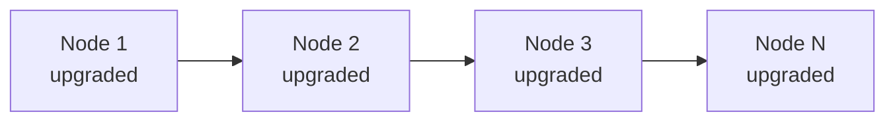
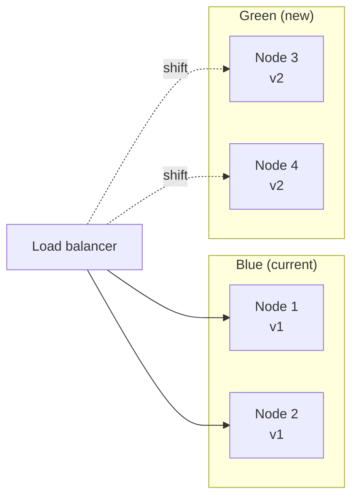
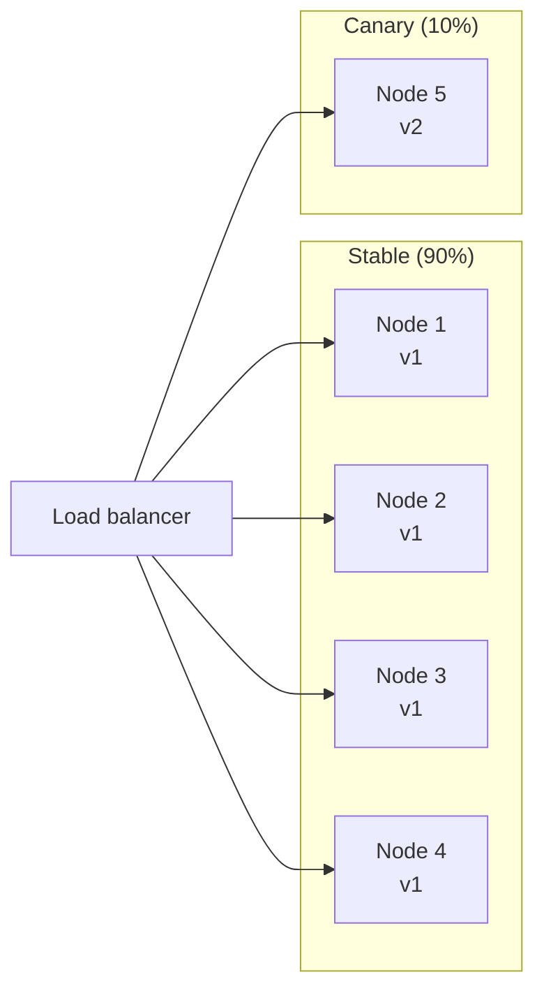

# 17.10 Cluster lifecycle, upgrades and change management

| Field | Value |
|---|---|
| Level | Advanced |
| Priority tier | 2 |
| Lab venue | GCP / GKE |
| Part | Part 17: Observability, performance and operations |
| Primary sources | NVIDIA Zero-to-Hero Volume 19 (`chapter-01-cluster-lifecycle.md`); *Engineering AI Systems* (`engineering-ai-systems-architecture-and-devops-essentials`, Chapter 6); *AI Factory* (`ai-factory`, Chapter 8); NVIDIA Zero-to-Hero Volume 10 (`chapter-16-cluster-upgrades.md`, `chapter-10-cluster-lifecycle.md`) |
| Cross-references | Chapter 16.11 (Cloud MLOps platforms); Chapter 17.6 (Alerting and SLOs); Chapter 17.7 (Failure modes); Chapter 5.26 (How Kubernetes uses the Linux kernel) |
| Coverage file | `planning/coverage/chapters/17-10.md` |
| Claim & number ledger | `planning/ledgers/17-10.md` |

## Why this matters for AI infrastructure

A GPU driver upgrade starts on Saturday night. Half the nodes come back with the new driver, a few never leave the draining state, and a training run that had been healthy for nine days loses everything since its last checkpoint. Nobody can say which change caused it, because three changes went out together. A driver upgrade is risky for a specific reason: it is a kernel module that every GPU job on the node depends on, and the node cannot take new work until it is replaced.

This chapter is about changing a GPU cluster without breaking the work that runs on it. The cluster has more moving parts than a CPU cluster: the GPU driver, the NVIDIA GPU Operator that manages it, the container toolkit, the Kubernetes version, and the CUDA and NCCL libraries inside the images. Each upgrade can break the service-level objectives (SLOs) the business depends on.

The method is the same each time. Write the change down, test it on a small canary pool, roll it out in stages with a drain policy that protects running jobs, collect evidence at every stage, and keep a rollback you have already tried. **Before you upgrade a GPU fleet, decide the canary pool, the pass conditions for each stage and the rollback command, and write them in the change request.**

Three operational realities make this a platform-team concern.

1. The platform team owns the lifecycle. Every upgrade is a platform change with its own risk and its own rollback.
2. Change management is a team habit. Each change gets a peer review, a staging test and a rollback plan.
3. The upgrade window is a planning constraint. A rolling driver upgrade takes hours on a big fleet, so the window decides how many nodes you can change at once.

## Prerequisites and outcomes

### Prerequisites

- Chapter 17.6, Alerting, SLOs and health checks, defines the SLOs and burn-rate alerts that gate an upgrade.
- Chapter 17.4, the DCGM exporter, holds the GPU fault-signal alerts used as pass conditions.
- Chapter 10.21, GPU health, explains `dcgmi diag` and the Xid tiers.
- Chapter 17.7, Failure modes, lists the failures an upgrade must not introduce.

### Outcomes

By the end of this chapter, you should be able to:

- Choose an upgrade type (in-place, rolling, blue/green or canary) for a given workload.
- Plan a GPU driver upgrade with the GPU Operator: canary pool, stages, drain policy and pass conditions.
- Write a change request, get it reviewed, and test it in staging.
- Decide the rollback triggers in advance, roll back, and keep the evidence.
- Pick an upgrade window by doing the arithmetic on node count and parallelism.

---

## 1. The upgrade types

Production Kubernetes sorts upgrade strategies into cluster replacement, node replacement and in-place upgrades. Cluster replacement costs the most and carries the least risk, because you build a new cluster and move workloads across. In-place upgrades sit at the other end, with the lowest cost and the highest risk. For a GPU fleet the same trade-off shows up at node level.

### 1.1 In-place upgrade

Picture a development cluster that nobody depends on. You stop a workload, replace its software and start it again. That is an in-place upgrade. It is simple and fast, but the old software is gone once it is replaced, so going back usually means restoring from backup.

| Pros | Cons |
|---|---|
| Simple | Downtime during the restart |
| Atomic | Rollback is hard (must restore from backup) |
| Fast | Risky for stateful workloads |

Use it for dev environments and for non-critical workloads where a short outage is acceptable.

### 1.2 Rolling upgrade

Consider a pool of GPU nodes that serves one model. A rolling upgrade takes the nodes one at a time. While one node is upgraded, the rest of the pool keeps serving the old version. The rollback is to stop the rollout and reverse the nodes already done.



For each node, drain it, upgrade it, check it, uncordon it, and then move to the next. The GPU Operator's driver upgrade controller does exactly this, and section 3 shows its settings.

### 1.3 Blue/green upgrade

Suppose your service runs on the blue environment, the current version. You build the green environment beside it, running the new version. Once green passes your checks, you shift traffic from blue to green. If green misbehaves, you shift traffic back to blue, which is still running. For GPU fleets this costs a second set of GPUs, which is why it is used for critical or stateful services and not for the whole fleet.



Deploy green first and test it thoroughly. Shift the traffic only after the tests pass, and retire blue only after green has run long enough that you trust it.

### 1.4 Canary upgrade

A canary sends the new version a small share of traffic first. You watch the SLO while only a small group of users sees the new version. If the SLO holds, you widen the share step by step. If it does not, you stop while the damage is small.



For a driver, the canary is a node pool, not a traffic split, and section 3 describes it.

## 2. What a GPU upgrade touches

A GPU upgrade is several changes with different blast radii. Change them one layer at a time, so a failure points at one cause.

| Layer | What changes | What can break | How you find out |
|---|---|---|---|
| GPU driver | Kernel module on every GPU node | Node never becomes ready, Xid errors, slower collectives | Operator upgrade state, `dcgmi diag`, nccl-tests |
| GPU Operator | The controller and its operands | Operand pods crash, validation fails | `operator-validator` pod, Operator logs |
| Container toolkit | How containers see GPUs | Pods start with no GPU | Smoke test pod running `nvidia-smi` |
| Kubernetes version | Kubelet, API, device plugin compatibility | Pending pods, plugin errors | Staging rollout, node conditions |
| CUDA and NCCL in images | Application libraries | Wrong results or hangs | Staging training and serving tests |

Do not combine the first and last rows in one window. A driver change and an image change together are the Saturday-night story from the opening.

## 3. The GPU driver upgrade with canary pools

### 3.1 Who runs the upgrade

The GPU Operator runs the driver as a container on each node and ships a driver upgrade controller. On a managed service such as GKE, the provider installs the driver with the node image, and you control it through the node pool settings, so check your provider's documentation. The rest of this section describes the Operator, which is the common case on clusters you run yourself.

You change the driver version in one place, the `ClusterPolicy`. The controller then walks the nodes and labels each one with its state in `nvidia.com/gpu-driver-upgrade-state`. The states in order are upgrade-required, cordon-required, wait-for-jobs-required, pod-deletion-required, drain-required, pod-restart-required, validation-required, uncordon-required and upgrade-done. A node that fails ends in upgrade-failed. The validation step runs in the `operator-validator` pod.

### 3.2 The drain policy

The drain policy decides what happens to running jobs. It is the part of the upgrade that matters most for training. These are the settings under `spec.driver.upgradePolicy`.

```yaml
# ClusterPolicy fragment: settings worth choosing on purpose
spec:
  driver:
    version: "580.95.05"          # the new driver, changed one stage at a time
    upgradePolicy:
      autoUpgrade: true
      maxParallelUpgrades: 1      # nodes upgraded at once; 0 means no limit
      maxUnavailable: 25%         # ceiling on nodes out of service
      waitForCompletion:
        timeoutSeconds: 0         # 0 waits indefinitely for matching jobs
        podSelector: "app=training"
      gpuPodDeletion:
        force: false
        timeoutSeconds: 300
        deleteEmptyDir: false
      drain:
        enable: false
```

Read it as three decisions. First, `waitForCompletion` lets the matching training jobs finish before the node is touched, so a nine-day run is not evicted. The cost is that the upgrade can wait for as long as the job runs, so combine it with a rule that long jobs checkpoint and are released before the window. Second, `gpuPodDeletion` evicts the pods that hold GPUs after a timeout, which suits inference pods that have a replica elsewhere. Third, `drain` is a fallback that drains the whole node and is off unless you enable it. NVIDIA's page lists these fields and the example values shown here. Defaults are stated only for the NVIDIADriver resource, so check the ones that apply to your Operator version.

For inference, protect availability with a PodDisruptionBudget on each serving deployment, and a `preStop` hook that lets in-flight requests finish. For training, checkpoint before the window, because an eviction loses all work since the last checkpoint. The checkpoint interval is therefore the cost of a forced eviction.

### 3.3 The canary pool and the stages

A canary pool is a small group of nodes that takes the new driver first. Label it so you can target it, and run real but tolerant workloads there, such as a staging copy of an inference service or short training jobs. Move to the next stage only when every pass condition holds for the soak time.

| Stage | Nodes (for 200) | Soak before the next stage | Pass conditions |
|---|---|---|---|
| Canary | 1 to 2 nodes | 24 hours | All of the conditions below |
| Early | 10 percent, 20 nodes | 24 hours | Same conditions, under real load |
| Wide | Remaining 180 nodes | 7 days of heightened monitoring | Same conditions, plus no rising rollback rate |

The pass conditions use signals you already have.

- `dcgmi diag -r 3` passes on the canary nodes. Level 3 takes about 15 minutes and stresses memory, tensor cores, PCIe, power and cooling, as chapter 10.21 explains.
- An nccl-tests all-reduce run reaches a bus bandwidth within 5 percent of the pre-upgrade baseline. The 5 percent matches the benchmark threshold in `upgrade_tests.yaml`, and chapter 12.17 explains how to read bus bandwidth.
- No tier 3 Xid, no failed row remap, no GPU count mismatch and no missing exporter, using the alerts in chapter 17.4.
- No fast burn on the SLOs in chapter 17.6, meaning the one-hour and five-minute error ratios stay under 14.4 times the budget.
- No node in the `upgrade-failed` state.

To skip a node deliberately, for example one that runs a job you cannot interrupt, label it `nvidia.com/gpu-driver-upgrade.skip=true`. To stop the whole upgrade, set `autoUpgrade` to false, which makes the Operator remove the upgrade-state labels. Nodes already upgraded stay upgraded.

### 3.4 Window arithmetic

The window has to hold the work. Suppose each node takes 15 minutes from cordon to uncordon, which is an example and not a measurement. With `maxParallelUpgrades` at 1, the 180 remaining nodes need 45 hours. With ten at a time, they need 4.5 hours, but ten out of 200 nodes is 5 percent of capacity gone for the whole window, so check that the cluster can spare it. Measure your real per-node time on the canary and compute the window from it.

## 4. The change management process

### 4.1 The change request

Before anyone touches a node, the change needs a written record: what changes, why, how to undo it and how to test it. The example below is a sketch. The new version is the example NVIDIA's documentation uses, and the old version and the downtime estimate are placeholders to replace from your own notes.

```markdown
# Change Request: GPU Driver Upgrade to 580.95.05

## What
Upgrade the NVIDIA GPU driver from DRIVER_OLD to 580.95.05 on every GPU node, using the GPU Operator upgrade controller.

## Why
State the vendor release note or bug that this driver fixes, and link it.

## Risk
Each node is cordoned and its driver pod restarted. Jobs matching the waitForCompletion selector finish first; other GPU pods are evicted after 300 seconds. Estimated time per node: measured on the canary.

## Rollback plan
Patch spec.driver.version back to DRIVER_OLD. The same controller reverses the nodes already upgraded. Tested in staging on DATE.

## Test plan
1. Upgrade the canary pool and run dcgmi diag -r 3 and nccl-tests
2. Soak 24 hours and check the pass conditions
3. Upgrade 10 percent of the cluster and soak 24 hours
4. Upgrade the remaining nodes
5. Monitor the SLOs for 7 days
```

### 4.2 The peer review

A peer reads the change before anything runs. In a Git-based workflow, the change request becomes a pull request. The reviewer checks the change for correctness, reads the rollback plan closely, and approves or rejects it.

```bash
# Request peer review on the change request
gh pr create \
  --title "Change Request: GPU Driver Upgrade to 580.95.05" \
  --body-file change_request.md \
  --reviewer platform-team-lead

# The peer reviews the change
gh pr review --approve 1234
# or
gh pr review --request-changes --body "Rollback plan is too vague" 1234
```

This human check catches gaps that automated tests cannot see, such as a rollback plan that says too little.

### 4.3 The automated tests

Automated tests run against staging. They check the upgrade and the rollback. A rollback that has never been tested is only a hope, so it gets a stage of its own.

```yaml
# code/part17/upgrade_tests.yaml
stages:
  - name: lint
    image: my-lint:v1
    command: [python, lint.py]
    args: ["--change-request", "change_request.md"]

  - name: unit-tests
    image: my-tests:v1
    command: [python, -m, pytest]
    args: ["--test-path", "tests/"]

  - name: integration-tests
    image: my-tests:v1
    command: [python, -m, pytest]
    args: ["--test-path", "tests/integration/", "--env", "staging"]

  - name: benchmark
    image: my-benchmarks:v1
    command: [python, benchmark.py]
    args: ["--workload", "nccl-tests", "--threshold", "0.05"]

  - name: rollback-test
    image: my-tests:v1
    command: [python, rollback_test.py]
    args: ["--change-request", "change_request.md"]
```

### 4.4 The staging rollout

Every change goes to staging before production. Staging is where you check the change in an environment that looks like production, including at least one node of each GPU model. Use the same upgrade method everywhere, so the method you run in production has already been tested in development and staging.

```bash
# Deploy to staging
kubectl --context=staging apply -f upgrade_manifests/

# Run the integration tests in staging
python -m pytest --test-path tests/integration/ --env staging

# Verify the staging SLO
curl -s 'http://prometheus.staging:9090/api/v1/query?query=histogram_quantile(0.99,%20rate(inference_request_duration_seconds_bucket[5m]))'
# expected: the staging SLO is met
```

Check the staging SLO before you move on. If the query misses the target, stop and fix the change.

## 5. The upgrade window

### 5.1 The window selection

Picture a Saturday at 2 AM, when the model API is nearly silent, and a Tuesday afternoon, when the same API is busy. The window decides how much an upgrade can hurt. The table gives example risk levels. Replace them with your own traffic data.

| Day | Time (UTC) | Traffic | Risk |
|---|---|---|---|
| Saturday | 2-6 AM | Low | Low |
| Sunday | 2-6 AM | Low | Low |
| Wednesday | 2-4 AM | Medium | Medium |
| Tuesday | 2-4 AM | Medium | Medium |
| Weekday | 2-4 AM | High | High |

The traffic pattern matters more than the calendar. Check a forecast before you choose a slot, because a quiet hour for one product can be the peak for another.

### 5.2 The window announcement

Tell people before the window opens. An announcement with the date, the time, the change and the rollback plan lets every team plan around it.

```bash
# Announce the upgrade window
python code/part17/announce_upgrade.py \
  --date "2024-04-13" \
  --time "02:00-06:00 UTC" \
  --change "GPU Driver Upgrade to 580.95.05" \
  --rollback "Rollback to DRIVER_OLD if SLO breach"
# expected: the announcement is sent to Slack; the announcement is sent to email
```

### 5.3 The window verification

Verify the upgrade when it finishes, not only when it starts. The check confirms that the SLO held through the window. Use an SLO window long enough to cover a full day of traffic, so a problem that appears only at the daily peak does not slip past.

```bash
# Verify the upgrade
python code/part17/verify_upgrade.py \
  --change "GPU Driver Upgrade to 580.95.05" \
  --slo-window "24h"
# expected: the SLO is met; the rollback plan works; the upgrade is complete
```

## 6. The rollback plan

### 6.1 The rollback triggers

Decide when you will roll back before the change starts, not in the middle of an outage. Each trigger below is a signal from the earlier chapters, and each should already feed an alert.

| Trigger | Detection signal |
|---|---|
| Tier 3 Xid or failed row remap on an upgraded node | `GPUXidTier3` and `GPURowRemapFailed` from chapter 17.4 |
| GPUs missing after the upgrade | `GPUCountMismatch` and `DCGMExporterMissingOnGPUNode` |
| Collectives slower than the baseline | nccl-tests bus bandwidth more than 5 percent below baseline on the canary |
| Fast SLO burn | One-hour and five-minute error ratios above 14.4 times the budget, chapter 17.6 |
| Upgrade stuck | A node in the `upgrade-failed` state, or no state change for longer than the node time you measured |

Two more rules help. Find the points of no return before you start and write them into the plan, because once an upgrade is far enough along, rolling back every earlier change can be worse than fixing forward. And take backups before the change begins, including etcd snapshots and backups of persistent data.

### 6.2 The rollback procedure

With the GPU Operator, a rollback is the same upgrade in the other direction. NVIDIA's page does not describe rollback, so the steps here are an inference from how the controller works, and they must be tested in staging before you rely on them.

```bash
# 1. Pause: stop the controller from moving more nodes
kubectl patch clusterpolicies.nvidia.com/cluster-policy --type='json' \
  -p='[{"op":"replace","path":"/spec/driver/upgradePolicy/autoUpgrade","value":false}]'

# 2. Point the policy back at the old driver, then re-enable the controller
kubectl patch clusterpolicies.nvidia.com/cluster-policy --type='json' \
  -p='[{"op":"replace","path":"/spec/driver/version","value":"DRIVER_OLD"}]'
kubectl patch clusterpolicies.nvidia.com/cluster-policy --type='json' \
  -p='[{"op":"replace","path":"/spec/driver/upgradePolicy/autoUpgrade","value":true}]'

# 3. Watch the nodes move, and retry a failed one
kubectl get nodes -L nvidia.com/gpu-driver-upgrade-state
kubectl label node NODE nvidia.com/gpu-driver-upgrade-state=upgrade-required --overwrite
```

Never roll back by installing packages inside a running node container, because the driver is part of an image the Operator manages, and a manual change is lost on the next restart.

### 6.3 Rollback evidence

A rollback is not finished until you can prove the node is healthy again. Keep this evidence in the change ticket for each stage.

| Evidence | Command or source |
|---|---|
| Driver version before and after | `nvidia-smi --query-gpu=driver_version --format=csv,noheader` |
| Node upgrade state history | `nvidia.com/gpu-driver-upgrade-state` label and the Operator events |
| Hardware validation | `dcgmi diag -r 3` result |
| Collective performance | nccl-tests bus bandwidth against the baseline |
| Fault signals | Xid and row-remap alerts over the soak, from Prometheus |
| SLO effect | Burn rate over the window, chapter 17.6 |

### 6.4 The rollback communication

Tell the team as soon as you roll back. A good message names the change, the reason, the impact and the next step, and tells people the rollback is done.

```bash
# Communicate the rollback
python code/part17/announce_rollback.py \
  --change "GPU Driver Upgrade to 580.95.05" \
  --reason "SLO breach: inference latency p99 > 1000ms for 10 minutes" \
  --impact "Increased latency; no data loss" \
  --next-steps "Investigate driver 580.95.05; revert to DRIVER_OLD"
# expected: the announcement is sent to Slack; the announcement is sent to email
```

## 7. Operating the lifecycle on GKE

Track the process itself, not only the cluster. The table lists lifecycle metrics with example alert thresholds, which you should tune to your history. The change failure rate and the rollback rate matter most, because they tell you whether changes are well tested and safe to ship.

| Metric | Why it matters | Alert |
|---|---|---|
| Kubernetes version | Upgrade status | More than 1 minor version behind |
| GPU driver version | Upgrade status | More than 1 minor version behind |
| Days since last upgrade | Upgrade frequency | More than 30 days |
| Change request failure rate | Change quality | More than 10% |
| Rollback rate | Change quality | More than 5% |
| Upgrade duration | Upgrade efficiency | More than 8 hours |

On GKE the control plane and node pools are upgraded by the service, and GKE does not offer a control plane downgrade after an upgrade. Treat that step as a point of no return, and plan the rollback around the node pools by recreating the pool from the previous image. GPU capacity is often scarce, so check whether your pool can add surge nodes before you plan a surge upgrade.

## 8. How it fails

The six failures below are the ones to rehearse before your first real upgrade.

### 8.1 "The upgrade breaks the SLO"

**Symptom:** The upgrade finishes, the SLO breaks, and a customer complains.

**Diagnosis:** The change skipped the canary, was rushed, or went out with no ready rollback.

**Fix:** Roll back, find the cause, add the regression to the staging tests, and try again.

### 8.2 "The rollback does not work"

**Symptom:** The on-call rolls back, but the rollback fails and the SLO keeps breaching.

**Diagnosis:** Nobody tested the rollback in staging, and it needs a manual step the on-call did not know about.

**Fix:** Roll forward with a different fix if that is safer. Add the rollback test to the staging suite and automate the steps people forget.

### 8.3 "Nodes stick in a drain state"

**Symptom:** A node stays in wait-for-jobs-required or drain-required for hours and the window runs out.

**Diagnosis:** `waitForCompletion` matches a job that runs for days, or a PodDisruptionBudget blocks eviction.

**Fix:** Skip the node with the skip label, checkpoint and release the job, or set a finite `timeoutSeconds`. Decide the policy before the window.

### 8.4 "The upgrade window is wrong"

**Symptom:** The upgrade starts at 2 AM and customer traffic spikes at the same time.

**Diagnosis:** The window did not match the traffic pattern, and nobody checked the forecast.

**Fix:** Reschedule, align the window with real traffic, and check the forecast before you book the slot.

### 8.5 "A mixed fleet behaves differently"

**Symptom:** The same job is fast on upgraded nodes and slow on old ones, or a multi-node job hangs.

**Diagnosis:** Collectives across nodes with different drivers may behave differently, which also makes a slowdown harder to attribute, and the canary never ran a multi-node test.

**Fix:** Include a multi-node nccl-tests run in the pass conditions, and keep jobs from spanning upgraded and old nodes during the soak.

### 8.6 "The process is not followed"

**Symptom:** The team skips the change request, the peer review and the canary, and the upgrade breaks the SLO.

**Diagnosis:** The process exists on paper, but nothing enforces it.

**Fix:** Enforce it with CI and a required pull request review, and add it to onboarding.

## 9. Hands-on lab

This lab walks the lifecycle once for a driver upgrade on a staging cluster that runs the GPU Operator. The commands were not run on hardware for this book, so expect to adjust details for your cluster.

### 9.1 Prerequisites

- A staging Kubernetes cluster with at least three GPU nodes and the GPU Operator installed.
- A Git repository for the cluster manifests.
- Prometheus with the chapter 17.4 alerts loaded.

### 9.2 Step 1: submit and review the change request

Write the change request from section 4.1 and open it as a pull request, as in section 4.2. A reviewer who finds the rollback plan vague should request changes.

### 9.3 Step 2: run the automated tests

```bash
gh pr checks 1234
# expected: all checks pass
```

### 9.4 Step 3: upgrade the canary node

Label one GPU node as the canary, set `spec.driver.version` and watch it move.

```bash
kubectl get nodes -L nvidia.com/gpu-driver-upgrade-state
# expected: the canary node passes through the states and ends in upgrade-done
```

### 9.5 Step 4: check the pass conditions

Run `dcgmi diag -r 3` and an nccl-tests all-reduce on the canary node, and compare bus bandwidth with the baseline you recorded before the upgrade. Check that the chapter 17.4 alerts are quiet.

### 9.6 Step 5: roll back and keep the evidence

Use the commands in section 6.2 to roll the canary back, and fill in the evidence table from section 6.3.

### 9.7 Step 6: verify the upgrade

```bash
python code/part17/verify_upgrade.py \
  --change "GPU Driver Upgrade to 580.95.05" \
  --slo-window "24h"
# expected: the SLO is met; the rollback plan works; the upgrade is complete
```

### 9.8 What to record

Write down the per-node time you measured, the bus bandwidth before and after, and the time the rollback took. These three numbers decide your real window and your real rollback cost.

## Exercises

1. **Write a canary policy.** For a fleet of 400 GPU nodes, decide the canary size, the stage sizes and the soak times. *Solution sketch:* use 1 to 2 nodes, then 10 percent, then the rest, and justify each soak from your longest job and your traffic cycle.
2. **Add an automated rollback test.** Add a CI step that runs the rollback in staging and checks that the SLO recovers. *Solution sketch:* the step patches the driver version forward and back, then runs the staging SLO query.
3. **Choose a drain policy.** Pick `waitForCompletion`, `gpuPodDeletion` and `drain` settings for a cluster that runs both multi-day training and replicated inference. *Solution sketch:* wait for pods labelled as training, evict inference pods after a timeout, and keep drain off until you need it.
4. **Compute the window.** Given 180 nodes, 15 minutes per node and a ceiling of 25 percent unavailable, find the shortest safe window. *Solution sketch:* divide 180 by the parallelism, multiply by 15 minutes, and check that the parallel nodes stay below the ceiling.
5. **Build the evidence sheet.** Write a script that collects the evidence table from section 6.3 for one node. *Solution sketch:* run the driver, diag and Prometheus queries, and write the results to one file for the ticket.
6. **Add a post-upgrade report.** Generate a report that compares the SLO before and after the upgrade. *Solution sketch:* a Python script queries Prometheus for both periods and writes the report for the platform team.

---

## Checkpoint questions

<details><summary>1. A Saturday night driver upgrade leaves nodes stuck and nobody knows which change caused it. What was missing?</summary>
The upgrade had no staged plan. Three changes went out together, so no single cause could be named. A canary pool, one layer changed at a time, and a change request with pass conditions would have narrowed the cause to one change.
</details>

<details><summary>2. An upgrade breaks the SLO, the on-call rolls back, and the rollback fails. Why, and what do you do now?</summary>
Nobody tested the rollback in staging, and it needed a manual step the on-call did not know about. Roll forward with a different fix if that is safer. Then add the rollback test to the staging suite and automate the forgotten steps.
</details>

<details><summary>3. A node sits in `wait-for-jobs-required` for hours. What are the likely causes and options?</summary>
The `waitForCompletion` selector matches a job that runs for days, or a PodDisruptionBudget blocks eviction. Skip the node with the skip label, checkpoint and release the job, or set a finite timeout. Decide the policy before the window.
</details>

<details><summary>4. Why is the driver upgrade run on a canary pool and not as a traffic split?</summary>
A driver is a kernel module on the node, so you cannot send a share of requests to it. The unit of exposure is the node. A small canary pool takes the driver first, and you widen the pool only after the pass conditions hold for the soak time.
</details>

<details><summary>5. A change reached production with no review and paged the on-call. How do you stop it happening again?</summary>
Roll back first. Then make peer review a required step, and automate the staging rollout so it cannot be skipped. A pull request gives the review a home and keeps a history.
</details>

<details><summary>6. After a GKE upgrade the node pools misbehave, but the control plane was already upgraded. What are your options?</summary>
GKE does not offer a control plane downgrade after an upgrade, so that step is a point of no return. Plan the rollback around the node pools by recreating the pool from the previous image. Rolling back everything late in an upgrade can be worse than fixing forward.
</details>

<details><summary>7. Why does a rolling upgrade avoid a full outage?</summary>
It takes nodes one at a time, with drain, upgrade and uncordon for each. While one node is upgraded the rest of the pool keeps serving the old version. A pod that can move to another node loses no state.
</details>

<details><summary>8. Why is a blue/green rollback fast, and why is it not used for a whole GPU fleet?</summary>
Blue, the old version, keeps running while green takes traffic, so you shift back at the load balancer. It needs a second set of GPUs, which is too expensive for a whole fleet, so it is kept for critical or stateful services.
</details>

<details><summary>9. Which pass conditions must a canary meet before the next stage?</summary>
`dcgmi diag -r 3` passes, nccl-tests bus bandwidth is within 5 percent of the baseline, there is no tier 3 Xid, failed row remap, GPU count mismatch or missing exporter, there is no fast SLO burn, and no node is in the `upgrade-failed` state. The soak time must also pass.
</details>

<details><summary>10. Why does the pipeline include a separate rollback-test stage?</summary>
A rollback that has never been tested is only a hope. The stage runs the rollback against staging and checks that the SLO recovers. Without it, the first real test of the rollback happens during an outage.
</details>

<details><summary>11. Why verify an upgrade over 24 hours and not a few minutes?</summary>
A 24 hour window covers a full day of traffic, so a problem that appears only at a daily peak does not slip past. Verify when the upgrade finishes, not only when it starts.
</details>

<details><summary>12. When would you pick an in-place upgrade over a canary, and what do you give up?</summary>
Use in-place for dev environments and non-critical workloads where a short outage is acceptable. It is simple and fast. You give up an easy rollback, because the old software is gone, and you accept downtime during the restart.
</details>

<details><summary>13. A long training job runs on a node that must be upgraded. What are your drain policy options and what does each cost?</summary>
Use `waitForCompletion` to let it finish, which costs time and can stall the window. Checkpoint and release the job before the window, which costs a restart. Evicting it loses all work since the last checkpoint, so the checkpoint interval is the cost. The skip label leaves the node on the old driver for now.
</details>

<details><summary>14. How do you pause the driver upgrade, and what happens to nodes already done?</summary>
Set `autoUpgrade` to false in the ClusterPolicy. The Operator removes the upgrade-state labels from the driver nodes and stops moving more nodes. Nodes already upgraded stay on the new driver.
</details>

<details><summary>15. How do you decide between rolling back and fixing forward late in an upgrade, and what do you prepare in advance?</summary>
Find the points of no return before you start and write them in the plan. After such a point, rolling back every earlier change can be worse than fixing forward. Take backups first, including etcd snapshots and persistent data.
</details>

<details><summary>16. Each node takes 15 minutes. How long do 180 nodes take one at a time, and ten at a time?</summary>
One at a time is 180 times 15, which is 2,700 minutes, or 45 hours. Ten at a time is 18 batches of 15 minutes, which is 270 minutes, or 4.5 hours. Ten of 200 nodes is 5 percent of capacity out for the window. The 15 minutes is an example.
</details>

<details><summary>17. The plan upgrades a canary, then 10 percent of 200 nodes, then the rest. How many nodes are in each stage and how long is monitoring?</summary>
Ten percent of 200 is 20 nodes, and the remaining stage has 180 nodes, with a canary of one or two nodes taken from the first stage. Monitoring is 24 hours after the canary, 24 hours after the 10 percent stage and 7 days after the final stage.
</details>

<details><summary>18. In a quarter there were 40 changes, 5 failed and 3 were rolled back. Which lifecycle alerts fire?</summary>
The failure rate is 5 divided by 40, which is 12.5 percent, above the 10 percent alert. The rollback rate is 3 divided by 40, which is 7.5 percent, above the 5 percent alert. Both fire. The thresholds are examples.
</details>

<details><summary>19. After an upgrade the canary's all-reduce bus bandwidth is 8 percent below the baseline. What do you do?</summary>
That is outside the 5 percent pass condition, so do not move to the next stage. Roll the canary back, then compare driver, firmware and fabric settings between the canary and the baseline before you try again. Keep the nccl-tests output as evidence.
</details>

<details><summary>20. Why can a peer review not be replaced by automated tests, and in what order does a change move?</summary>
A human reviewer catches gaps tests cannot see, such as a rollback plan that says too little. The order is change request, peer review, automated tests including the rollback test, staging, canary, early stage, wide stage, then verification.
</details>

## Sources and review notes

- NVIDIA GPU Operator documentation, GPU driver upgrades (fetched 2026-11-12). Source for the `driver.upgradePolicy` fields, the `nvidia.com/gpu-driver-upgrade-state` states, the skip label, the `autoUpgrade` switch and the `kubectl patch` of `spec.driver.version`. The page does not describe rollback, so section 6.2 is an inference from the controller's behaviour and needs a staging test.
- *Production Kubernetes*, Chapter 2. Source for the upgrade strategies, points of no return and backups before an upgrade.
- NVIDIA Zero-to-Hero Volume 19 (`chapter-01-cluster-lifecycle.md`) and Volume 10 (`chapter-16-cluster-upgrades.md`, `chapter-10-cluster-lifecycle.md`). Source for the change request, window and rollback patterns. The wording is the handbook's own.
- Chapters 10.21, 17.4 and 17.6 for the pass conditions. The software engineering material that earlier versions of this chapter took from the *AI Factory* chapter on software engineering was removed as off topic.

### Cross-references to other handbook chapters

- Chapter 17.6 for the alerting and SLOs.
- Chapter 17.7 for the failure modes.
- Chapter 10.21 for `dcgmi diag` and the Xid tiers.
- Chapter 12.17 for nccl-tests.

### Explicitly labelled inferences

- The stage sizes, soak times and the 15 minute per-node time are starting values, not measurements.
- The rollback commands in section 6.2 follow from how the controller reconciles `spec.driver.version`.
- The upgrade window recommendations are starting points; specific windows depend on the traffic pattern.

### Not verified on live hardware

- The commands and the lab in section 9 were not run against a live cluster.
- Defaults for `upgradePolicy` fields depend on the Operator version; check yours.
