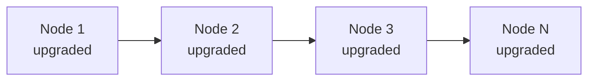
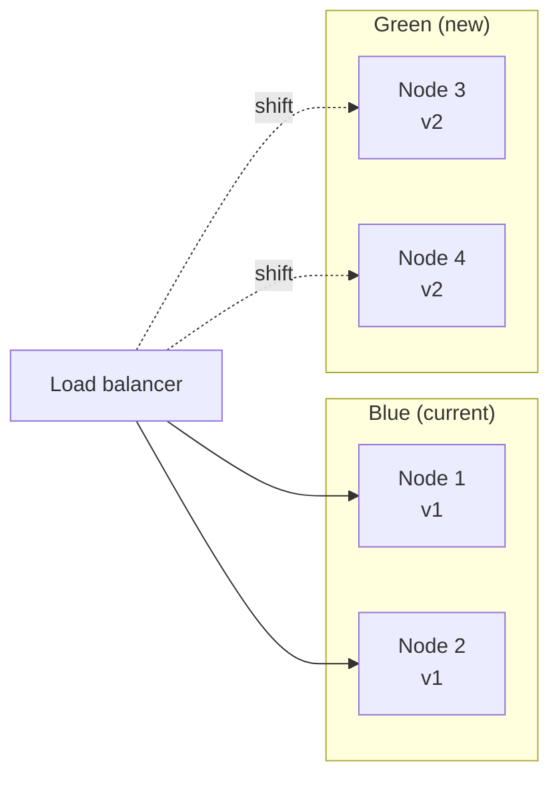
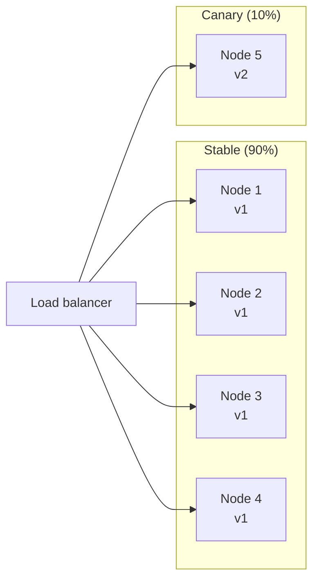

# 17.10 Cluster lifecycle, upgrades and change management

| Field | Value |
|---|---|
| Level | Advanced |
| Priority tier | 2 |
| Lab venue | GCP / GKE |
| Part | Part 17: Observability, performance and operations |
| Primary sources | NVIDIA Zero-to-Hero Volume 19 (`chapter-01-cluster-lifecycle.md`); *Engineering AI Systems* (`engineering-ai-systems-architecture-and-devops-essentials`, Chapter 6); *AI Factory* (`ai-factory`, Chapter 8); NVIDIA Zero-to-Hero Volume 10 (`chapter-16-cluster-upgrades.md`, `chapter-10-cluster-lifecycle.md`) |
| Cross-references | Chapter 16.11 (Cloud MLOps platforms); Chapter 17.6 (Alerting and SLOs); Chapter 17.7 (Failure modes); Chapter 5.26 (How Kubernetes uses the Linux kernel) |
| Coverage file | `planning/coverage/chapters/17-10.md` |
| Claim & number ledger | `planning/ledgers/17-10.md` |

## Why this matters for AI infrastructure

Every chapter in Part 17 so far has been about observing the cluster and acting on observations. This chapter is about changing the cluster without breaking it. Cluster upgrades are the highest-risk activity a platform team performs; cluster upgrades are the most common cause of multi-hour outages; cluster upgrades are what the on-call fears.

An AI factory without a cluster lifecycle process is an AI factory where upgrades are ad-hoc; upgrades are tested in production; upgrades break the SLOs. An AI factory with a cluster lifecycle process is an AI factory where upgrades are planned; upgrades are tested in staging; upgrades are rolled out with rollback; upgrades preserve the SLOs.

```text
Why cluster lifecycle is on the critical path (V19 ch1; EAS Ch 6; V10 ch10):
- A typical mature AI platform upgrades every 2-4 weeks (Kubernetes minor
  versions, GPU driver updates, security patches). Each upgrade is a chance
  to introduce a regression; each upgrade is a chance to break an SLO.
- A typical cluster upgrade takes 4-8 hours (rolling restart of every node).
  A typical failed upgrade takes 24-48 hours to roll back. The cost of a failed
  upgrade is 24-48 hours of downtime plus the customer-facing SLO breach.
- The cluster lifecycle process is what turns ad-hoc upgrades into planned
  upgrades. The process is: change request; peer review; automated tests;
  staging rollout; production rollout; rollback plan. The process is the
  difference between a successful upgrade and a failed upgrade.
```

Three operational realities make this chapter a platform-team concern rather than a data-science-only concern:

1. **The cluster lifecycle is a platform-team decision.** Every upgrade is a platform-team change; every upgrade has a risk; every upgrade needs a rollback plan. The platform team owns the lifecycle.
2. **The change management is a platform-team discipline.** Every change request is reviewed by a peer; every change is tested in staging; every change has a rollback plan. The platform team's discipline is what makes the change safe.
3. **The upgrade window is a platform-team constraint.** The team picks the upgrade window (Saturday 2-6 AM UTC is common); the team respects the SLOs (no upgrade during peak hours); the team balances the upgrade risk against the SLO risk.

**Before a team can upgrade the cluster, the team must have a cluster lifecycle process. Upgrades without a process are ad-hoc; upgrades with a process are planned. The process is the change request; the process is the peer review; the process is the staging rollout; the process is the rollback plan.**

## Prerequisites and outcomes

### Prerequisites

- Chapter 16.11 (Cloud MLOps platforms) for the upgrade paths on the managed stacks.
- Chapter 17.6 (Alerting and SLOs) for the SLOs that the upgrade must preserve.
- Chapter 17.7 (Failure modes) for the failure modes that the upgrade must not introduce.
- Chapter 5.26 (How Kubernetes uses the Linux kernel) for the kernel-side upgrade.

### Outcomes

After completing this chapter you will be able to:

1. Specify the upgrade types (in-place, rolling, blue/green, canary) and when to use each.
2. Build the change management process: change request, peer review, automated tests, staging rollout, production rollout, rollback plan.
3. Define the upgrade window: when to upgrade; how to balance the upgrade risk against the SLO risk.
4. Implement the rollback plan: how to roll back; how to verify the rollback; how to communicate the rollback.
5. Operate the cluster lifecycle process on GKE with reliable upgrades, sensible windows, and tested rollbacks.

---

## 1. The upgrade types

### 1.1 In-place upgrade

An in-place upgrade replaces the software in place. The workload is restarted; the upgrade is atomic; the rollback is to revert the change.

| Pros | Cons |
|---|---|
| Simple | Downtime during the restart |
| Atomic | Rollback is hard (must restore from backup) |
| Fast | Risky for stateful workloads |

The pattern is: stop the workload; replace the software; start the workload. The pattern is suitable for dev environments and non-critical workloads.

### 1.2 Rolling upgrade

A rolling upgrade replaces the software on one node at a time. The workload is restarted on the upgraded node; the remaining nodes continue to serve the previous version. The upgrade is gradual; the rollback is to stop the rollout.



The pattern is: drain one node; upgrade the node; uncordon the node; repeat. The pattern is suitable for stateless workloads and Kubernetes-managed clusters.

### 1.3 Blue/green upgrade

A blue/green upgrade runs two parallel environments: the blue environment (current) and the green environment (new). The traffic is shifted from blue to green; the rollback is to shift the traffic back to blue.



The pattern is: deploy the green environment; test the green environment; shift the traffic; retire the blue environment. The pattern is suitable for stateful workloads and database upgrades.

### 1.4 Canary upgrade

A canary upgrade runs the new version on a small fraction of the cluster; the rollout is gradual. The rollback is to stop the rollout.



The pattern is: deploy the canary; observe the SLO; expand the canary; observe the SLO; complete the rollout. The pattern is suitable for production AI workloads where the SLO is critical.

---

## 2. The change management process

### 2.1 The change request

Every change is preceded by a change request. The change request describes what is changing, why it is changing, what the rollback plan is, and what the test plan is.

```markdown
# Change Request: GPU Driver Upgrade to 550.54.15

## What
Upgrade the NVIDIA GPU driver from 550.54.14 to 550.54.15 on every GPU node.

## Why
The new driver fixes a known issue with NCCL collective timeouts on H100 GPUs (NV Bug 4123456). The fix is critical for multi-node training reliability.

## Risk
The upgrade requires a node restart; the workload will be evicted; the workload will resume on a different node. The estimated downtime is 5 minutes per node.

## Rollback plan
The driver can be rolled back by downgrading to 550.54.14. The rollback requires a node restart; the estimated downtime is 5 minutes per node.

## Test plan
1. Deploy the new driver on a single canary node
2. Run the NCCL benchmark (nccl-tests) on the canary node
3. Verify the canary node passes the benchmark
4. Deploy the new driver on 10% of the cluster
5. Monitor the SLO for 24 hours
6. Deploy the new driver on the remaining 90% of the cluster
7. Monitor the SLO for 7 days
```

The pattern is: every change has a what, why, risk, rollback plan, and test plan. The change request is the audit trail; the change request is the on-call's guide.

### 2.2 The peer review

Every change request is reviewed by a peer. The peer reviews the change for correctness; the peer reviews the rollback plan; the peer approves or rejects the change.

```bash
# Request peer review on the change request
gh pr create \
  --title "Change Request: GPU Driver Upgrade to 550.54.15" \
  --body-file change_request.md \
  --reviewer platform-team-lead

# The peer reviews the change
gh pr review --approve 1234
# or
gh pr review --request-changes --body "Rollback plan is too vague" 1234
```

The pattern is: every change request is a pull request; the pull request is reviewed by a peer; the pull request is approved or rejected. The peer review is the human-in-the-loop check.

### 2.3 The automated tests

Every change is tested by automated tests. The tests run in a staging environment; the tests verify the upgrade's correctness; the tests verify the rollback plan.

```yaml
# code/part17/upgrade_tests.yaml (shape only)
stages:
  - name: lint
    image: my-lint:v1
    command: [python, lint.py]
    args: ["--change-request", "change_request.md"]

  - name: unit-tests
    image: my-tests:v1
    command: [python, -m, pytest]
    args: ["--test-path", "tests/"]

  - name: integration-tests
    image: my-tests:v1
    command: [python, -m, pytest]
    args: ["--test-path", "tests/integration/", "--env", "staging"]

  - name: benchmark
    image: my-benchmarks:v1
    command: [python, benchmark.py]
    args: ["--workload", "nccl-tests", "--threshold", "0.05"]

  - name: rollback-test
    image: my-tests:v1
    command: [python, rollback_test.py]
    args: ["--change-request", "change_request.md"]
```

The pattern is: every change runs through lint, unit tests, integration tests, benchmark, and rollback test. The tests are the safety net; the tests are the audit trail.

### 2.4 The staging rollout

Every change is rolled out to staging before production. The staging rollout verifies the change in a production-like environment.

```bash
# Deploy to staging
kubectl --context=staging apply -f upgrade_manifests/

# Run the integration tests in staging
python -m pytest --test-path tests/integration/ --env staging

# Verify the staging SLO
curl -s 'http://prometheus.staging:9090/api/v1/query?query=histogram_quantile(0.99,%20rate(inference_request_duration_seconds_bucket[5m]))'
# expected: the staging SLO is met
```

The pattern is: the staging rollout is a full deployment to a production-like environment; the staging rollout is the last line of defence before production.

---

## 3. The upgrade window

### 3.1 The window selection

The upgrade window is the time when the cluster is upgraded. The window balances the upgrade risk against the SLO risk.

| Day | Time (UTC) | Traffic | Risk |
|---|---|---|---|
| Saturday | 2-6 AM | Low | Low |
| Sunday | 2-6 AM | Low | Low |
| Wednesday | 2-4 AM | Medium | Medium |
| Tuesday | 2-4 AM | Medium | Medium |
| Weekday | 2-4 AM | High | High |

The pattern is: upgrade during low-traffic windows; avoid upgrades during peak hours; upgrade on weekends for non-critical workloads; upgrade on weekdays for critical workloads with canary rollouts.

### 3.2 The window announcement

The upgrade window is announced in advance. The announcement names the date, the time, the change, and the rollback plan.

```bash
# Announce the upgrade window
python code/part17/announce_upgrade.py \
  --date "2024-04-13" \
  --time "02:00-06:00 UTC" \
  --change "GPU Driver Upgrade to 550.54.15" \
  --rollback "Rollback to 550.54.14 if SLO breach"
# expected: the announcement is sent to Slack; the announcement is sent to email
```

The pattern is: the announcement is sent to Slack; the announcement is sent to email; the announcement is sent to PagerDuty. The on-call is aware of the upgrade before it starts.

### 3.3 The window verification

The upgrade window is verified after the upgrade. The verification confirms the SLO is met; the verification confirms the rollback plan works; the verification confirms the upgrade is complete.

```bash
# Verify the upgrade
python code/part17/verify_upgrade.py \
  --change "GPU Driver Upgrade to 550.54.15" \
  --slo-window "24h"
# expected: the SLO is met; the rollback plan works; the upgrade is complete
```

The pattern is: the verification is automated; the verification's output is a report; the report is reviewed by the platform team.

---

## 4. The rollback plan

### 4.1 The rollback triggers

The rollback is triggered when the SLO is breached; the SLO breach is detected by the alerting stack; the alerting stack pages the on-call.

| Trigger | Detection signal |
|---|---|
| **SLO breach** | inference_latency_p99 > SLO for 10 minutes |
| **Error rate spike** | inference_error_rate > 0.1% for 5 minutes |
| **Workload failure** | inference_pod_oom_killed > 0 for 5 minutes |
| **GPU failure** | dcgm_ecc_dbe_total > 0 |

The pattern is: every rollback trigger has a detection signal; the detection signal is an alert; the alert pages the on-call; the on-call decides to roll back.

### 4.2 The rollback procedure

The rollback procedure is the steps to revert the change. The procedure is documented in the change request; the procedure is tested in staging; the procedure is executed by the on-call.

```bash
# Rollback the GPU driver upgrade
kubectl --context=production drain gpu-node-1 --ignore-daemonsets --delete-emptydir-data
kubectl --context=production exec gpu-node-1 -- nvidia-smi --query-gpu=driver_version
# expected: the driver version is 550.54.15; we need to downgrade to 550.54.14
kubectl --context=production exec gpu-node-1 -- apt-get install nvidia-driver-550.54.14
kubectl --context=production uncordon gpu-node-1
```

The pattern is: drain the node; revert the change; uncordon the node; verify the workload resumes. The procedure is repeatable; the procedure is tested.

### 4.3 The rollback communication

The rollback is communicated to the team. The communication names the rollback; the communication names the impact; the communication names the next steps.

```bash
# Communicate the rollback
python code/part17/announce_rollback.py \
  --change "GPU Driver Upgrade to 550.54.15" \
  --reason "SLO breach: inference latency p99 > 1000ms for 10 minutes" \
  --impact "Increased latency; no data loss" \
  --next-steps "Investigate driver 550.54.15; revert to 550.54.14"
# expected: the announcement is sent to Slack; the announcement is sent to email
```

The pattern is: the rollback is communicated; the team knows the impact; the team knows the next steps.

---

## 5. Operating the cluster lifecycle on GKE

### 5.1 The components

| Component | Where it runs | Backing store | SLO |
|---|---|---|---|
| GKE control plane | Managed (GCP) | (GCP) | Control plane availability 99.95% |
| GKE node pools | GPU node pools | (GCP) | Node pool availability 99.5% |
| Kubernetes version | Cluster config | (GKE) | Kubernetes version supported for 12 months |
| GPU driver | Node config | (NVIDIA) | Driver version current with NVIDIA LTS |
| Argo CD | Kubernetes Deployment | Git | Reconciliation latency p99 < 5 minutes |

### 5.2 IAM and the change management

The cluster lifecycle stack has its own IAM. The pattern is:

| Role | Who | What they can do |
|---|---|---|
| `lifecycle.reader` | Every team | View the change log; view the upgrade schedule |
| `lifecycle.writer` | The platform team | Submit change requests; trigger upgrades |
| `lifecycle.approver` | The platform team lead | Approve or reject change requests |
| `lifecycle.admin` | The platform team | Manage the upgrade window; manage the rollback plan |

The change management is the platform team's discipline. Every change has a peer review; every change has a rollback plan; every change has a test plan.

### 5.3 Observability

| Metric | Why it matters | Alert |
|---|---|---|
| Cluster Kubernetes version | Upgrade status | > 1 minor version behind |
| GPU driver version | Upgrade status | > 1 minor version behind |
| Days since last upgrade | Upgrade frequency | > 30 days |
| Change request failure rate | Change quality | > 10% |
| Rollback rate | Change quality | > 5% |
| Upgrade duration | Upgrade efficiency | > 8 hours |

The change request failure rate and rollback rate are the most important metrics. A high failure rate means the changes are not well-tested; a high rollback rate means the changes are not safe. The platform team tracks the metrics; the metrics drive the process improvement.

---

## 6. How it fails

Six failure modes recur.

### 6.1 "The upgrade breaks the SLO"

**Symptom:** The upgrade completes; the SLO is breached; the customer complains.

**Diagnosis:** The upgrade was not tested in staging; the upgrade was rushed; the rollback was not ready.

**Fix:** Roll back; investigate; add the regression to the staging test suite; re-attempt the upgrade.

### 6.2 "The rollback does not work"

**Symptom:** The upgrade breaks the SLO; the on-call attempts to roll back; the rollback fails; the SLO continues to breach.

**Diagnosis:** The rollback plan was not tested in staging; the rollback requires a manual step that the on-call forgot.

**Fix:** Roll forward with a different fix; add the rollback test to the staging test suite; automate the rollback.

### 6.3 "The upgrade window is wrong"

**Symptom:** The upgrade is scheduled for 2 AM Saturday; the customer traffic spikes at 2 AM Saturday; the upgrade breaks the customer.

**Diagnosis:** The upgrade window was not aligned with the traffic pattern; the team did not check the traffic forecast.

**Fix:** Reschedule the upgrade; align the upgrade window with the traffic pattern; check the traffic forecast before scheduling.

### 6.4 "The change request is approved without review"

**Symptom:** The change is rushed to production; the change breaks the SLO; the on-call is paged.

**Diagnosis:** The change request was approved without peer review; the change was not tested in staging.

**Fix:** Roll back; add the peer review enforcement to the change request process; automate the staging rollout.

### 6.5 "The upgrade introduces a security vulnerability"

**Symptom:** The upgrade is applied; the new version has a known CVE; the security team flags the upgrade.

**Diagnosis:** The CVE scan did not include the new version; the upgrade was rushed.

**Fix:** Roll back; update the CVE scan to include the new version; re-attempt the upgrade after the CVE is fixed.

### 6.6 "The upgrade process is not followed"

**Symptom:** The team skips the change request; the team skips the peer review; the team skips the staging rollout; the upgrade breaks the SLO.

**Diagnosis:** The process is documented but not enforced; the team is not trained on the process.

**Fix:** Train the team on the process; enforce the process with CI; add the process to the team's onboarding.

---

## 7. Hands-on lab

This lab walks through the cluster lifecycle process: submit a change request, review it, test it, roll out to staging, roll out to production, and verify. The lab is **untested** in this repository.

### 7.1 Prerequisites

- A GKE Autopilot or Standard cluster (1.27+) with a staging and a production environment.
- A Git repository for the cluster manifests.
- Argo CD installed.

### 7.2 Step 1: submit a change request

```bash
# Create the change request
cat > change_request.md <<EOF
# Change Request: Upgrade Kubernetes Version

## What
Upgrade the Kubernetes version from 1.27 to 1.28 on the production cluster.

## Why
The 1.28 release includes critical security patches and bug fixes.

## Risk
The upgrade requires a control plane upgrade and a node pool upgrade. The estimated downtime is 30 minutes.

## Rollback plan
The control plane can be rolled back to 1.27 via the GKE console. The node pool can be rolled back by recreating the node pool with the previous image.

## Test plan
1. Deploy the 1.28 cluster in staging
2. Run the integration tests in staging
3. Verify the SLO is met in staging
4. Roll out to production with a canary strategy
EOF

# Submit the change request as a pull request
gh pr create \
  --title "Change Request: Upgrade Kubernetes Version" \
  --body-file change_request.md \
  --reviewer platform-team-lead
```

### 7.3 Step 2: review the change request

```bash
# The peer reviews the change
gh pr review --approve 1234
# or
gh pr review --request-changes --body "Rollback plan is too vague" 1234
```

### 7.4 Step 3: run the automated tests

```bash
# Run the tests in CI
gh pr checks 1234
# expected: all checks pass
```

### 7.5 Step 4: roll out to staging

```bash
# Deploy to staging
kubectl --context=staging apply -f upgrade_manifests/

# Run the integration tests in staging
python -m pytest --test-path tests/integration/ --env staging

# Verify the staging SLO
curl -s 'http://prometheus.staging:9090/api/v1/query?query=histogram_quantile(0.99,%20rate(inference_request_duration_seconds_bucket[5m]))'
# expected: the staging SLO is met
```

### 7.6 Step 5: roll out to production

```bash
# Deploy to production with a canary strategy
kubectl --context=production apply -f upgrade_manifests/

# Monitor the production SLO
watch -n 10 'curl -s http://prometheus.production:9090/api/v1/query?query=histogram_quantile(0.99,%20rate(inference_request_duration_seconds_bucket[5m]))'
# expected: the production SLO is met
```

### 7.7 Step 6: verify the upgrade

```bash
# Verify the upgrade
python code/part17/verify_upgrade.py \
  --change "Upgrade Kubernetes Version" \
  --slo-window "24h"
# expected: the SLO is met; the rollback plan works; the upgrade is complete
```

### 7.8 What to record

After the lab, you should be able to answer five questions in five seconds each:

1. What is the current Kubernetes version?
2. What is the most recent change request?
3. What is the current change request failure rate?
4. What is the current rollback rate?
5. What is the next scheduled upgrade?

If any takes more than 30 seconds, the cluster lifecycle process is not yet a production service. The lab is **untested** against a live GKE cluster.

---

## Exercises

1. **Add a change request template.** Build a template that includes the what, why, risk, rollback plan, and test plan. *Solution sketch:* a Markdown template; the template is the default for every change request.
2. **Add an automated rollback test.** Add a CI step that simulates a rollback and verifies the rollback works. *Solution sketch:* a CI step that runs the rollback; the CI step verifies the SLO is met after the rollback.
3. **Add a traffic forecast integration.** Add a step in the change request that checks the traffic forecast for the proposed upgrade window. *Solution sketch:* a Python script that queries the traffic forecast; the script warns if the forecast exceeds the threshold.
4. **Add a CVE scan integration.** Add a step in the change request that runs Trivy on the new version. *Solution sketch:* a CI step that runs Trivy; the CI step fails if any CVE is detected.
5. **Add a per-team upgrade schedule.** Build a calendar where each team can see its scheduled upgrades. *Solution sketch:* a calendar event; the event is visible to the team; the event includes the change request URL.
6. **Add a post-upgrade report.** Generate a report that compares the SLO before and after the upgrade. *Solution sketch:* a Python script that queries Prometheus; the script generates the report; the report is reviewed by the platform team.

---

## Checkpoint questions

<details><summary>1. What four upgrade types does the chapter walk through?</summary>
In-place upgrade (replace the software in place; atomic; suitable for dev), rolling upgrade (replace the software on one node at a time; gradual; suitable for stateless workloads), blue/green upgrade (run two parallel environments; shift the traffic; suitable for stateful workloads), canary upgrade (run the new version on a small fraction; gradual; suitable for production AI workloads). Each upgrade type has different trade-offs.
</details>

<details><summary>2. What is the change management process?</summary>
The process that makes every change safe. The process is: change request (describes what, why, risk, rollback plan, test plan), peer review (human-in-the-loop check), automated tests (CI runs lint, unit, integration, benchmark, rollback test), staging rollout (deploy to production-like environment), production rollout (deploy with canary or blue/green), verification (confirm SLO is met), communication (announce the change to the team).
</details>

<details><summary>3. What is the upgrade window?</summary>
The time when the cluster is upgraded. The window balances the upgrade risk against the SLO risk. Common windows are Saturday 2-6 AM UTC (low traffic; low risk) and Wednesday 2-4 AM UTC (medium traffic; medium risk). The window is announced in advance; the window is verified after the upgrade.
</details>

<details><summary>4. What are the rollback triggers?</summary>
SLO breach (inference latency p99 > SLO for 10 minutes), error rate spike (inference error rate > 0.1% for 5 minutes), workload failure (inference pod OOM killed > 0 for 5 minutes), GPU failure (DCGM ECC DBE > 0). Every trigger has a detection signal; the detection signal is an alert; the alert pages the on-call.
</details>

<details><summary>5. What is the difference between in-place and rolling upgrade?</summary>
In-place upgrade replaces the software on a single node; the workload is restarted; the upgrade is atomic; the rollback is to revert the change. Rolling upgrade replaces the software on one node at a time; the workload is restarted on the upgraded node; the remaining nodes continue to serve the previous version; the upgrade is gradual; the rollback is to stop the rollout.
</details>

<details><summary>6. What is the difference between blue/green and canary upgrade?</summary>
Blue/green runs two parallel environments (blue is current; green is new) and shifts the traffic from blue to green. Canary runs the new version on a small fraction of the cluster and gradually expands the rollout. Blue/green is suitable for stateful workloads; canary is suitable for production AI workloads where the SLO is critical.
</details>

<details><summary>7. What is the most common upgrade failure?</summary>
The upgrade breaks the SLO. The upgrade completes; the SLO is breached; the customer complains. The diagnosis is that the upgrade was not tested in staging; the upgrade was rushed; the rollback was not ready. The fix is to roll back; investigate; add the regression to the staging test suite; re-attempt the upgrade.
</details>

<details><summary>8. What is the most common rollback failure?</summary>
The rollback does not work. The upgrade breaks the SLO; the on-call attempts to roll back; the rollback fails; the SLO continues to breach. The diagnosis is that the rollback plan was not tested in staging; the rollback requires a manual step that the on-call forgot. The fix is to roll forward with a different fix; add the rollback test to the staging test suite; automate the rollback.
</details>

<details><summary>9. What is the most common change request failure?</summary>
The change request is approved without review. The change is rushed to production; the change breaks the SLO; the on-call is paged. The diagnosis is that the change request was approved without peer review; the change was not tested in staging. The fix is to roll back; add the peer review enforcement to the change request process; automate the staging rollout.
</details>

<details><summary>10. What is the most common upgrade window failure?</summary>
The upgrade window is wrong. The upgrade is scheduled for 2 AM Saturday; the customer traffic spikes at 2 AM Saturday; the upgrade breaks the customer. The diagnosis is that the upgrade window was not aligned with the traffic pattern. The fix is to reschedule the upgrade; align the upgrade window with the traffic pattern; check the traffic forecast.
</details>

<details><summary>11. What is the most common security failure?</summary>
The upgrade introduces a security vulnerability. The upgrade is applied; the new version has a known CVE; the security team flags the upgrade. The diagnosis is that the CVE scan did not include the new version; the upgrade was rushed. The fix is to roll back; update the CVE scan; re-attempt the upgrade after the CVE is fixed.
</details>

<details><summary>12. What is the most common process failure?</summary>
The upgrade process is not followed. The team skips the change request; the team skips the peer review; the team skips the staging rollout; the upgrade breaks the SLO. The diagnosis is that the process is documented but not enforced; the team is not trained. The fix is to train the team; enforce the process with CI; add the process to onboarding.
</details>

<details><summary>13. What is the difference between a rollback plan and a rollback test?</summary>
A rollback plan is the documented steps to revert the change. A rollback test is the CI step that verifies the rollback plan works in staging. The rollback plan is the what; the rollback test is the verification that the what works.
</details>

<details><summary>14. What is the difference between a peer review and an automated test?</summary>
A peer review is a human-in-the-loop check; the peer reviews the change for correctness; the peer reviews the rollback plan. An automated test is a CI step that runs lint, unit, integration, benchmark, and rollback test. The peer review is the human check; the automated test is the machine check.
</details>

<details><summary>15. Why is the staging rollout the last line of defence?</summary>
Because the staging rollout is a full deployment to a production-like environment; the staging rollout verifies the change in conditions that match production; the staging rollout is the last chance to catch the regression before production. The staging rollout is what makes the production rollout safe.
</details>

<details><summary>16. What is the difference between the upgrade window and the upgrade cadence?</summary>
The upgrade window is the time when the upgrade is performed (e.g. Saturday 2-6 AM UTC). The upgrade cadence is how often the upgrade is performed (e.g. every 2-4 weeks). The window is the when; the cadence is the how often.
</details>

<details><summary>17. What is the relationship between the change request and the audit log?</summary>
The change request is the human-readable record of the change (what, why, risk, rollback plan, test plan). The audit log is the machine-readable record of the change (who, when, what changed, the SLO before/after). The change request is the request; the audit log is the result.
</details>

<details><summary>18. What is the difference between the change management process and the cluster lifecycle process?</summary>
The change management process is the process for individual changes (change request, peer review, tests, staging, production, verification). The cluster lifecycle process is the process for the cluster's overall evolution (upgrade cadence, upgrade window, change cadence, rollback strategy). The change management is for one change; the cluster lifecycle is for all changes.
</details>

<details><summary>19. Why is the cluster lifecycle a Tier 2 chapter?</summary>
Because the cluster lifecycle process is what keeps the cluster current without breaking the SLOs. The lifecycle process is what the platform team owns; the lifecycle process is what the on-call fears; the lifecycle process is what the CFO sees as the GPU spend justification. A team that does not have the lifecycle process is a team that is afraid to upgrade.
</details>

<details><summary>20. What five questions should the cluster lifecycle lab let you answer in five seconds each?</summary>
What is the current Kubernetes version. What is the most recent change request. What is the current change request failure rate. What is the current rollback rate. What is the next scheduled upgrade. If any takes more than 30 seconds, the cluster lifecycle process is not yet a production service.
</details>

---

## Sources and review notes

- NVIDIA Zero-to-Hero Volume 19 (`chapter-01-cluster-lifecycle.md`). Source for the cluster lifecycle, the upgrade types, and the change management process. The wording has been rewritten in the handbook's voice.
- *Engineering AI Systems* (`engineering-ai-systems-architecture-and-devops-essentials`, Chapter 6). Source for the operational patterns and the lifecycle discipline.
- *AI Factory* (`ai-factory`, Chapter 8). Source for the AI factory lifecycle and the upgrade cadence.
- NVIDIA Zero-to-Hero Volume 10 (`chapter-16-cluster-upgrades.md`, `chapter-10-cluster-lifecycle.md`). Source for the operational upgrade patterns and the rollback discipline.

### Cross-references to other handbook chapters

- Chapter 16.11 for the cloud MLOps platforms' upgrade paths.
- Chapter 17.6 for the alerting and SLOs.
- Chapter 17.7 for the failure modes.
- Chapter 5.26 for the kernel-side upgrade.

### Migrated from `nvidia-devops`

The cluster lifecycle operational patterns draw on Volume 19 chapter 1 and Volume 10 chapters 10 and 16. The wording has been rewritten in the handbook's voice.

### Explicitly labelled inferences

- The upgrade window recommendations (Saturday 2-6 AM UTC) are starting points; specific windows depend on the traffic pattern.
- The change management process (change request, peer review, tests, staging, production, verification) is a starting point; specific steps depend on the team's discipline.
- The rollback trigger thresholds (SLO breach for 10 minutes, error rate > 0.1% for 5 minutes) are starting points; specific thresholds depend on the SLO.

### Not verified on live hardware

- The lab in Section 7 is **untested** against a live GKE cluster in this repository.
- The change request template in the lab is illustrative; production templates are more detailed.
- The staging rollout in the lab assumes a staging cluster is available; production deployments may not have a staging cluster.
