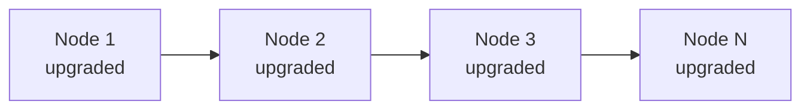
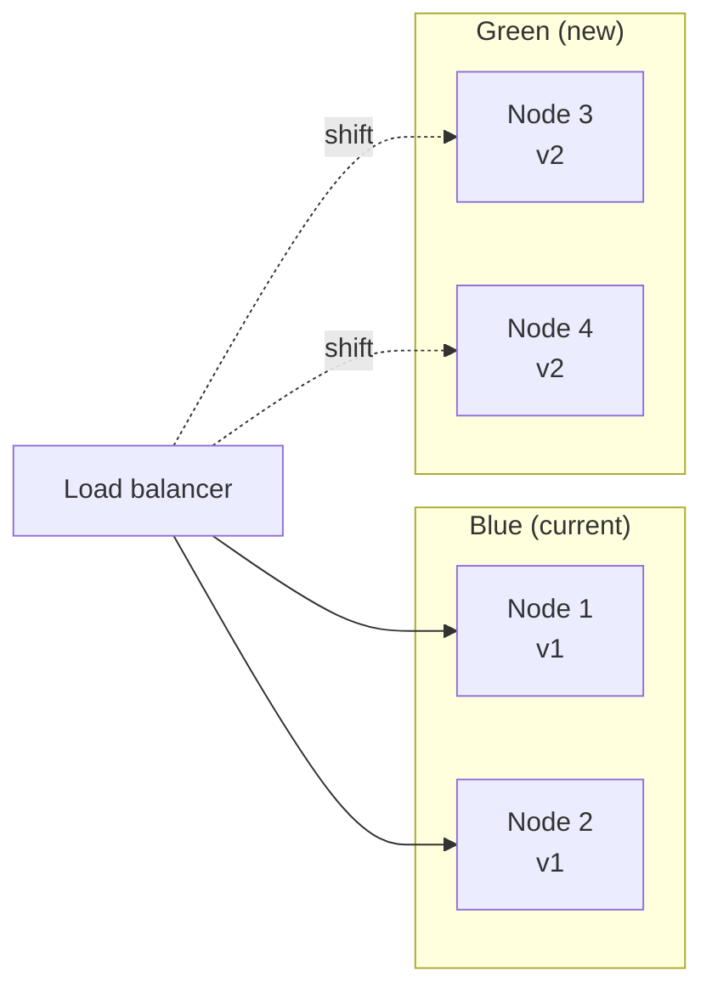
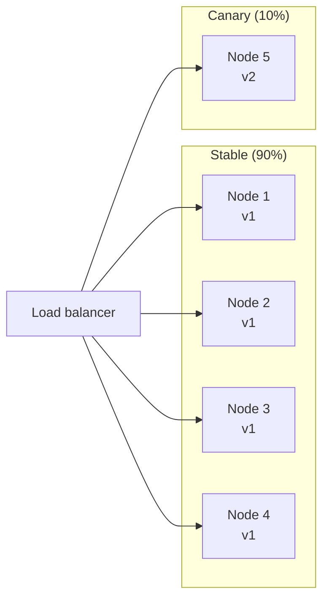

# 17.10 Cluster lifecycle, upgrades and change management

| Field | Value |
|---|---|
| Level | Advanced |
| Priority tier | 2 |
| Lab venue | GCP / GKE |
| Part | Part 17: Observability, performance and operations |
| Primary sources | NVIDIA Zero-to-Hero Volume 19 (`chapter-01-cluster-lifecycle.md`); *Engineering AI Systems* (`engineering-ai-systems-architecture-and-devops-essentials`, Chapter 6); *AI Factory* (`ai-factory`, Chapter 8); NVIDIA Zero-to-Hero Volume 10 (`chapter-16-cluster-upgrades.md`, `chapter-10-cluster-lifecycle.md`) |
| Cross-references | Chapter 16.11 (Cloud MLOps platforms); Chapter 17.6 (Alerting and SLOs); Chapter 17.7 (Failure modes); Chapter 5.26 (How Kubernetes uses the Linux kernel) |
| Coverage file | `planning/coverage/chapters/17-10.md` |
| Claim & number ledger | `planning/ledgers/17-10.md` |

## Why this matters for AI infrastructure

Imagine a Saturday night upgrade that leaves the GPU nodes stuck halfway through. Training jobs stop, the on-call engineer gets paged, and nobody knows which change caused it. The chapters in Part 17 so far have been about watching the cluster and acting on what you see. This chapter is about changing a cluster without breaking the work that runs on it. Upgrades are among the riskiest things a platform team does, because each one can break the service-level objectives (SLOs) the business depends on.

Without a lifecycle process, upgrades happen whenever someone finds time, and the first real test often happens in production. With one, every upgrade follows the same path. It is planned, tested in staging, rolled out with a way back, and checked against the SLOs.

Treat the numbers in the block below as example values, not measurements. Your own upgrade history is the better source for them.

```text
Why cluster lifecycle is on the critical path (background reading: NVIDIA Zero-to-Hero volume 19; Engineering AI Systems; NVIDIA Zero-to-Hero volume 10; the figures below are examples, not quotations):
- A typical mature AI platform upgrades every 2-4 weeks (Kubernetes minor
  versions, GPU driver updates, security patches). Each upgrade is a chance
  to introduce a regression; each upgrade is a chance to break an SLO.
- A typical cluster upgrade takes 4-8 hours (rolling restart of every node).
  A typical failed upgrade takes 24-48 hours to roll back. The cost of a failed
  upgrade is 24-48 hours of downtime plus the customer-facing SLO breach.
- The cluster lifecycle process is what turns ad-hoc upgrades into planned
  upgrades. The process is: change request; peer review; automated tests;
  staging rollout; production rollout; rollback plan. The process is the
  difference between a successful upgrade and a failed upgrade.
```

Three operational realities make this a platform-team concern rather than a data-science concern.

1. The platform team owns the lifecycle. Every upgrade is a platform change, every upgrade carries risk, and every upgrade needs a rollback plan.
2. Change management is a team habit. Each change gets a peer review, a staging test, and a rollback plan, and that discipline is what makes a change safe.
3. The upgrade window is a planning constraint. The team chooses a window, such as Saturday 2-6 AM UTC in the example plan, avoids peak hours, and weighs upgrade risk against SLO risk.

**Before you upgrade anything, write the process down: the change request, the peer review, the staging rollout, and the rollback plan.**

### Software needs more than code

A program is executable code that serves one purpose. Software is a larger thing. It includes the libraries, operating manuals, data structures, and documentation that make a program work in practice. A GPU cluster is software in this sense, because its manifests, images, runbooks, and upgrade scripts all change together.

Software engineering applies scientific methods to build software in an organised, disciplined way. The goal is quality software, delivered within a reasonable time and at an affordable cost. An upgrade serves the same goal. A lifecycle process is how the platform team keeps quality, time, and cost in view for every change.

Software is engineered rather than manufactured, so most of its cost lies in engineering, not in production runs. Software now matters to commerce, medicine, engineering, science, and entertainment. When software fails, people can be financially ruined and, in safety-critical systems, even killed. Quality has to be engineered into software on purpose, because it does not arrive by accident. IEEE Standard 610.12-1990 defines software engineering as a systematic, disciplined, and quantifiable approach to the development, operation, and maintenance of software.

A software system is more than its code. It has six components. Users add information, request it, and perform some of the processing. Procedures are the tasks the human parts of the system perform. Information is the meaningful data the system stores and processes.

Documents include the manuals, and sometimes data files that should not be stored electronically. Hardware covers the computers, the networks, and the input and output devices. Software is the set of applications that record, process, and control access to the information. Software also includes documentation for its users, and for the developers and maintainers who will change it.

### Software degrades when it changes

Hardware wears out with use, but software does not wear out in the same way. Software still degrades over its life. Each change can add a bug, and frequent changes can slowly reduce the performance and usefulness of the whole system. Once quality slips, there are no spare parts to swap in.

The lesson for a platform team is an inference from this point, not a quotation. Every upgrade adds risk, even when nothing looks broken, so each change should be deliberate and tested.

### Software keeps evolving after release

Software changes after release because technology and user needs keep changing. Starting over from the beginning is rarely feasible or economical, so the existing software has to be updated instead. The work starts with users' requirements. A prototype goes to users, who suggest changes, and the loop repeats until the product meets its needs.

Belady and Lehman published their laws of software evolution in 1976 and 1985. The laws describe a balance between the forces that drive new development and the forces that slow progress. Lehman also divided software into three types, and each one evolves differently.

- **Static-type software** works strictly to predefined specifications, and it changes least. A calculator program is an example.
- **Practical-type software** is defined by what its procedures can do, but its solution is not obvious at the start. Gaming software is an example.
- **Embedded-type software** works closely with the real world, so it is very likely to evolve. Online trading software is an example.

A platform that serves live AI traffic resembles embedded-type software, because the world it serves keeps changing. Lehman's laws for embedded-type software describe what to expect:

- The software undergoes continuous change.
- The software becomes increasingly complex.
- Its developers must remember how and why it was built, for continuity.
- The software keeps growing.
- Quality declines unless the software is maintained and adapted.
- The software is a multi-loop, multi-level feedback system, and it must be treated as one when you modify it.
- The software is capable of self-regulation.
- The software shows organisational stability over time.

Read these laws as a warning. Quality falls unless someone maintains the system, and the cluster is no exception.

### A lifecycle model is a guide, not a script

Software process, software lifecycle, and system lifecycle all describe the same idea. A process model gives the best practices for carrying out development. Teams often treat that model as a script to follow exactly, and that is a mistake. Tailor the model to the needs of the project and the people on it.

Software engineers care about complexity, scalability, quality, and cost, and software must adapt to a changing environment. A good process produces software that is correct, reliable, usable, and maintainable. It also helps a team predict cost and time more accurately, monitor progress, and re-plan when a project drifts off budget or schedule.

Several basic points hold for almost every project, whatever model it uses:

- Some development activities are common to all successful projects.
- Some activities must happen before others.
- Requirements change, so the team must expect that change and manage it.
- An existing system must be understood before you design its replacement.
- Delay the decisions that would lock in the final system. Start with an implementation-independent logical design, and commit to the detailed hardware and software design later.

Software engineering can be pictured as four layers. Quality is the first layer. The process sits on top of it and defines the input and output products, the milestones, and how quality is ensured. Methods describe how each part of the process is carried out, such as testing or gathering requirements. Tools support the process, and they are called computer-aided software engineering tools.

## Prerequisites and outcomes

### Prerequisites

- Chapter 16.11, Cloud MLOps platforms, covers the upgrade paths on the managed stacks.
- Chapter 17.6, Alerting and SLOs, defines the SLOs that an upgrade must preserve.
- Chapter 17.7, Failure modes, lists the failures an upgrade must not introduce.
- Chapter 5.26, How Kubernetes uses the Linux kernel, explains the kernel side of an upgrade.

### Outcomes

By the end of this chapter, you should be able to:

- Choose an upgrade type (in-place, rolling, blue/green, or canary) for a given workload.
- Run a change through the full process: change request, peer review, automated tests, staging rollout, production rollout, and rollback plan.
- Pick an upgrade window that balances upgrade risk against SLO risk.
- Carry out a rollback, verify that it worked, and tell the team what happened.
- Run this lifecycle process on GKE, with reliable upgrades, sensible windows, and rollbacks you have tested.

---

## 1. The upgrade types

Production Kubernetes, chapter 2, sorts upgrade strategies into cluster replacement, node replacement, and in-place upgrades. Cluster replacement costs the most and carries the least risk, because you build a new cluster and move workloads across. Its example replaces a 300-node cluster with a new cluster that starts at, say, 20 nodes and grows as workloads move. In-place upgrades sit at the other end, with the lowest cost and the highest risk.

### 1.1 In-place upgrade

Picture a development cluster that nobody depends on. You can stop a workload, replace its software, and start it again, and the change is over in one step. That is an in-place upgrade. It is simple and fast, but rollback is hard, because the old software is gone once it is replaced. Going back usually means restoring from backup, so this is a poor choice for stateful workloads.

| Pros | Cons |
|---|---|
| Simple | Downtime during the restart |
| Atomic | Rollback is hard (must restore from backup) |
| Fast | Risky for stateful workloads |

Use it for dev environments and for non-critical workloads where a short outage is acceptable.

### 1.2 Rolling upgrade

Consider a pool of GPU nodes that serves one model. A rolling upgrade takes these nodes one at a time. While one node is upgraded, the rest of the pool keeps serving the old version, so users do not see a full outage. The rollback is to stop the rollout.



For each node, drain it, upgrade it, uncordon it, and then move to the next. Use this pattern for stateless workloads, where a Pod can move to another node without losing its state.

### 1.3 Blue/green upgrade

Suppose your service runs on the blue environment, which is the current version. You build the green environment beside it, running the new version. Once green passes your checks, you shift traffic from blue to green at the load balancer. If green misbehaves, you shift traffic back to blue, which is still running. The pattern is suitable for stateful workloads and database upgrades.



Deploy green first and test it thoroughly. Shift the traffic only after the tests pass, and retire blue only after green has run long enough that you trust it.

### 1.4 Canary upgrade

A canary sends the new version a small share of traffic first. You watch the SLO while only a small group of users sees the new version. If the SLO holds, you widen the share step by step. If it does not, you stop the rollout while the damage is still small.



Deploy the canary, watch the SLO, expand the canary, watch again, and then complete the rollout. Give each step a clear pass condition before you move on. This pattern suits production AI workloads where the SLO is critical.

### 1.5 Independent units make upgrades safer

Some architectures split a system into parts that deploy on their own. In a microservices design, each component is a separate unit with its own delivery path. A change to one unit does not force a release of the whole system. Applications built this way are generally more robust, scale better, and support continuous delivery more easily.

A microkernel design takes a similar approach with a different shape. A small core system holds only the minimal functions needed to keep the system running. Plug-in modules add features and custom rules around it. Many operating systems use this pattern, which is where its name comes from.

Keep communication between plug-ins to a minimum, because every link is a possible dependency problem. An upgrade to one plug-in then touches far less of the system than an upgrade to the whole. When you choose an upgrade type, ask how many parts of the system the change touches.

## 2. The change management process

### 2.1 The change request

Picture a driver upgrade across a GPU fleet. Before anyone touches a node, the change needs a written record that says what changes, why, how to undo it, and how to test it. That record is the change request. The example below is a sketch. Its bug ID, driver versions, and downtime figure are illustrative, so check each one against your own vendor notes before you reuse the template.

```markdown
# Change Request: GPU Driver Upgrade to 550.54.15

## What
Upgrade the NVIDIA GPU driver from 550.54.14 to 550.54.15 on every GPU node.

## Why
The new driver fixes a known issue with NCCL collective timeouts on H100 GPUs (NV Bug 4123456). The fix is critical for multi-node training reliability.

## Risk
The upgrade requires a node restart; the workload will be evicted; the workload will resume on a different node. The estimated downtime is 5 minutes per node.

## Rollback plan
The driver can be rolled back by downgrading to 550.54.14. The rollback requires a node restart; the estimated downtime is 5 minutes per node.

## Test plan
1. Deploy the new driver on a single canary node
2. Run the NCCL benchmark (nccl-tests) on the canary node
3. Verify the canary node passes the benchmark
4. Deploy the new driver on 10% of the cluster
5. Monitor the SLO for 24 hours
6. Deploy the new driver on the remaining 90% of the cluster
7. Monitor the SLO for 7 days
```

### 2.2 The peer review

Next, a peer reads the change before anything runs. In a Git-based workflow, the change request becomes a pull request, which gives the review a natural home. The reviewer checks the change for correctness, reads the rollback plan closely, and then approves or rejects it.

```bash
# Request peer review on the change request
gh pr create \
  --title "Change Request: GPU Driver Upgrade to 550.54.15" \
  --body-file change_request.md \
  --reviewer platform-team-lead

# The peer reviews the change
gh pr review --approve 1234
# or
gh pr review --request-changes --body "Rollback plan is too vague" 1234
```

Every change request is a pull request, and a peer approves or rejects it. This human check catches gaps that automated tests cannot see, such as a rollback plan that says too little.

### 2.3 The automated tests

Automated tests come next, and they run against staging. They check the upgrade's correctness, and they check the rollback plan too. A rollback that has never been tested is only a hope, so give it a stage of its own.

```yaml
# code/part17/upgrade_tests.yaml
stages:
  - name: lint
    image: my-lint:v1
    command: [python, lint.py]
    args: ["--change-request", "change_request.md"]

  - name: unit-tests
    image: my-tests:v1
    command: [python, -m, pytest]
    args: ["--test-path", "tests/"]

  - name: integration-tests
    image: my-tests:v1
    command: [python, -m, pytest]
    args: ["--test-path", "tests/integration/", "--env", "staging"]

  - name: benchmark
    image: my-benchmarks:v1
    command: [python, benchmark.py]
    args: ["--workload", "nccl-tests", "--threshold", "0.05"]

  - name: rollback-test
    image: my-tests:v1
    command: [python, rollback_test.py]
    args: ["--change-request", "change_request.md"]
```

### 2.4 The staging rollout

Every change goes to staging before production. Staging is where you check the change in an environment that looks like production. Production Kubernetes, chapter 2, makes the same point: use one upgrade strategy everywhere, so that the method you run in production has already been tested in development and staging.

```bash
# Deploy to staging
kubectl --context=staging apply -f upgrade_manifests/

# Run the integration tests in staging
python -m pytest --test-path tests/integration/ --env staging

# Verify the staging SLO
curl -s 'http://prometheus.staging:9090/api/v1/query?query=histogram_quantile(0.99,%20rate(inference_request_duration_seconds_bucket[5m]))'
# expected: the staging SLO is met
```

Check the staging SLO before you move on. If the query misses the target, stop and fix the change before it goes anywhere near production.

### 2.5 Why changes happen

Software changes after delivery for four main reasons. Market conditions shift, and new rules, such as changes to tax or bookkeeping, can force a change. Clients ask for new features over time. The host platform, such as the operating system or the hardware, can also change, and the software has to keep up.

Business changes are the fourth reason. The organisation evolves, and those changes can call for software changes too. Maintenance is the work that answers all four reasons. The book names four types of maintenance, and each type has a different trigger.

| Type | What triggers it | What the change does |
|---|---|---|
| Corrective | A problem found by a user or in a user error report | Fixes the problem |
| Adaptive | A change in technology | Keeps the software current with that technology |
| Perfective | New user requirements, or a need to improve reliability and performance | Keeps the software usable and improves it over time |
| Preventive | A problem that is small today but could become serious later | Prevents the future problem |

Label each change request with its type. A team that tracks the mix can see whether it spends its time fixing problems or preventing them.

### 2.6 The cost of maintenance

Maintenance is necessary, but it is expensive. It can take as much as two-thirds of the whole software process cost. Two factors explain much of that cost, and both show up on a platform.

The first factor is the real world. Maintainers often work by trial and error, and their changes can damage the original structure, which makes later changes harder. Those changes are also often left undocumented, which makes future problems worse.

The second factor is age. Software is expected to last only 10–15 years, and older software cannot compete with new software on modern hardware. Its structure and programming language can go out of date, which makes it costlier to keep running. Document every change and test it before you apply it, so the next change does not start from guesswork.

### 2.7 The maintenance activities

The software process has five generic activities: communication, planning, modelling, construction, and deployment. Umbrella activities run through the whole life of the project. A maintenance change moves through its own sequence of steps. The sequence can run in cycles, and a team can extend it with its own steps.

The five generic activities each have a job. Communication gathers the requirements from the customer. Planning sets out the work, manages risk, lists the outputs, and produces a schedule. Modelling captures the requirements and the design, so developers and customers can see the same picture. Construction builds the software, including its tests. Deployment delivers the software, and the customer gives feedback on it.

- **Identification and tracing:** a user, or the system through its logs and error messages, shows the need for a change.
- **Analysis:** study the change's impact on the system, including its safety and security. If the impact looks severe, look for other options, then set the cost.
- **Design:** design the new modules from the analysis, and write the test cases that verify them.
- **Implementation:** write the code for the new modules.
- **System testing:** test the new modules together, then test the whole system with regression testing. This testing is internal.
- **Acceptance testing:** users test the system, and their complaints are fixed now or in the next iteration.
- **Delivery:** deploy the change to the organisation. Delivery can be a small update or a full reinstall, and it is the final test.
- **Maintenance management:** configuration management is essential, and maintainers use version control tools.

In this handbook's process, the change request covers identification and analysis. The peer review and the staging rollout cover design and testing. The pull request gives the change its version history.

## 3. The upgrade window

### 3.1 The window selection

Picture a Saturday at 2 AM, when the model API is nearly silent, and a Tuesday afternoon, when the same API is busy. The upgrade window is the time you choose for the change, and that choice decides how much an upgrade can hurt. The table gives example risk levels for common times. Replace those values with your own traffic data before you rely on them.

| Day | Time (UTC) | Traffic | Risk |
|---|---|---|---|
| Saturday | 2-6 AM | Low | Low |
| Sunday | 2-6 AM | Low | Low |
| Wednesday | 2-4 AM | Medium | Medium |
| Tuesday | 2-4 AM | Medium | Medium |
| Weekday | 2-4 AM | High | High |

The traffic pattern matters more than the calendar. Check a forecast before you choose a slot, because a quiet hour for one product can be the peak for another.

### 3.2 The window announcement

Tell people before the window opens. An announcement with the date, the time, the change, and the rollback plan lets every team plan around it. The script below sends that announcement to Slack and to email.

```bash
# Announce the upgrade window
python code/part17/announce_upgrade.py \
  --date "2024-04-13" \
  --time "02:00-06:00 UTC" \
  --change "GPU Driver Upgrade to 550.54.15" \
  --rollback "Rollback to 550.54.14 if SLO breach"
# expected: the announcement is sent to Slack; the announcement is sent to email
```

### 3.3 The window verification

Verify the upgrade when it finishes, not only when it starts. The check confirms that the SLO held through the window, that the rollback path still works, and that the upgrade is complete. Use an SLO window long enough to cover a full day of traffic, so a problem that appears only at a daily peak does not slip past.

```bash
# Verify the upgrade
python code/part17/verify_upgrade.py \
  --change "GPU Driver Upgrade to 550.54.15" \
  --slo-window "24h"
# expected: the SLO is met; the rollback plan works; the upgrade is complete
```

### 3.4 Scheduling the window with optimisation

Choosing a window is a scheduling problem with many factors, such as traffic and risk. Conventional scheduling models face a very broad search space. They usually make simplifying assumptions to produce reproducible results. Search-based software engineering treats targets such as cost, duration, and quality as an optimisation problem under constraints.

Optimisation can help in three ways. Duration and cost pull against each other, and planners struggle to balance them. Task and time allocation often exceeds what a person can work out by hand. Self-optimising algorithms, such as ant colony optimisation, can reduce decision complexity by iterating. Even so, a person must still choose a suitable algorithm for the problem, so treat the output as a proposal to review.

## 4. The rollback plan

### 4.1 The rollback triggers

Decide when you will roll back before the change starts, not in the middle of an outage. The table lists example signals and thresholds that could trigger the decision. The thresholds are example values, not standards, so set your own from the SLO you agreed on. Each signal should already feed an alert that reaches the on-call.

| Trigger | Detection signal |
|---|---|
| **SLO breach** | inference_latency_p99 > SLO for 10 minutes |
| **Error rate spike** | inference_error_rate > 0.1% for 5 minutes |
| **Workload failure** | inference_pod_oom_killed > 0 for 5 minutes |
| **GPU failure** | dcgm_ecc_dbe_total > 0 |

Production Kubernetes, chapter 2, adds a warning about timing. Once an upgrade is far enough along, rolling back every earlier change can be a worse choice than fixing forward. Find those points of no return before you start, and write them into the plan. The same chapter also recommends taking backups before the change begins, including etcd snapshots and Velero backups taken through the API, plus backups of your applications' persistent data.

### 4.2 The rollback procedure

The rollback procedure lists the steps that undo a change. It belongs in the change request, it must be tested in staging, and the on-call engineer should be able to follow it without guessing. The commands below sketch a driver rollback. Treat them as a starting point, and test each step in staging before you rely on it.

```bash
# Rollback the GPU driver upgrade
kubectl --context=production drain gpu-node-1 --ignore-daemonsets --delete-emptydir-data
kubectl --context=production exec gpu-node-1 -- nvidia-smi --query-gpu=driver_version
# expected: the driver version is 550.54.15; we need to downgrade to 550.54.14
kubectl --context=production exec gpu-node-1 -- apt-get install nvidia-driver-550.54.14
kubectl --context=production uncordon gpu-node-1
```

### 4.3 The rollback communication

Tell the team as soon as you roll back. A good message names the change, the reason, the impact, and the next step. It also tells people the rollback is done, so nobody keeps working on the broken version.

```bash
# Communicate the rollback
python code/part17/announce_rollback.py \
  --change "GPU Driver Upgrade to 550.54.15" \
  --reason "SLO breach: inference latency p99 > 1000ms for 10 minutes" \
  --impact "Increased latency; no data loss" \
  --next-steps "Investigate driver 550.54.15; revert to 550.54.14"
# expected: the announcement is sent to Slack; the announcement is sent to email
```

## 5. Operating the cluster lifecycle on GKE

### 5.1 The components

Every part of the lifecycle stack has an owner and a target. The table lists each part, where it runs, and the target you would track. The SLO column holds example values, not guarantees. Check your provider's current service terms before you rely on any percentage in the table.

| Component | Where it runs | Backing store | SLO |
|---|---|---|---|
| GKE control plane | Managed (GCP) | (GCP) | Control plane availability 99.95% |
| GKE node pools | GPU node pools | (GCP) | Node pool availability 99.5% |
| Kubernetes version | Cluster config | (GKE) | Kubernetes version supported for 12 months |
| GPU driver | Node config | (NVIDIA) | Driver version current with NVIDIA LTS |
| Argo CD | Kubernetes Deployment | Git | Reconciliation latency p99 < 5 minutes |

### 5.2 IAM and the change management

The lifecycle stack needs its own access rules, because not everyone should be able to start an upgrade. The table shows one possible split of duties. These role names are a design sketch for your platform. They are not built-in GKE roles.

| Role | Who | What they can do |
|---|---|---|
| `lifecycle.reader` | Every team | View the change log; view the upgrade schedule |
| `lifecycle.writer` | The platform team | Submit change requests; trigger upgrades |
| `lifecycle.approver` | The platform team lead | Approve or reject change requests |
| `lifecycle.admin` | The platform team | Manage the upgrade window; manage the rollback plan |

Change management is the platform team's discipline. Every change needs a peer review, a rollback plan, and a test plan. A split of duties like this one makes sure no single person can skip those steps alone.

### 5.3 Observability

Track the process itself, not only the cluster. The table lists lifecycle metrics with example alert thresholds, so tune those thresholds to your own history. The change request failure rate and the rollback rate matter most. A high failure rate suggests the changes are not well tested, and a high rollback rate suggests they are not safe to ship.

| Metric | Why it matters | Alert |
|---|---|---|
| Cluster Kubernetes version | Upgrade status | > 1 minor version behind |
| GPU driver version | Upgrade status | > 1 minor version behind |
| Days since last upgrade | Upgrade frequency | > 30 days |
| Change request failure rate | Change quality | > 10% |
| Rollback rate | Change quality | > 5% |
| Upgrade duration | Upgrade efficiency | > 8 hours |

The platform team reviews these numbers over time, and the numbers should drive changes to the process itself.

### 5.4 Re-engineering a legacy platform

Sometimes an upgrade cannot fix the problem, because the platform itself is too old. Updating software to keep it current, without changing what it does, is called re-engineering. The design can change, and programs can be rewritten. Legacy software cannot keep up with the latest technology, and that is when re-engineering becomes necessary.

Re-engineering has three parts. Reverse engineering recovers the specifications of an existing system by studying its code and design. Restructuring rearranges the code or the data, in the same language or a new one, without changing the functions. Forward engineering then builds the desired software from the specifications that reverse engineering produced.

Restructuring can improve reliability and maintainability, because the components that caused frequent errors can be updated. It can also remove the dependence on obsolete hardware platforms. The Unix operating system is a classic example. It was first written in assembly language, then re-engineered in C, because assembly had become too difficult to work with. Parts of a system that need more maintenance than others are the first candidates for re-engineering.

### 5.5 Reuse and component-based delivery

Reuse is the other side of change management. A component is a part of the code that performs an independent task, such as a login procedure or a printing system. Components provide interfaces, so they can communicate with each other. Component-based software engineering assembles large systems from components that already exist, which shortens the development cycle.

Reusing pre-tested components reduces time to market and increases the reliability of the whole application. Components can be added, updated, removed, or replaced without rewriting the other parts. Errors then stay inside a component, which makes them easier to find and fix.

Reuse follows five steps:

- **Requirement specification:** state the functional and non-functional requirements, using the existing system, user input, or both.
- **Design:** define the requirements in software terms, including the architecture of the system and its subsystems.
- **Specify components:** divide the system into smaller components that work together.
- **Search for suitable components:** look for existing components in a component repository that match the functions you need.
- **Incorporate components:** integrate the components into a complete software system.

Componentisation has a cost curve. Many components with small functions raise the cost of integration, the testing effort, and the number of interactions. The goal is a minimum cost region, where cost and effort balance against the number of components. Use only as many components as the requirements need.

Concurrent component development runs four parallel processes: developing new components, selecting existing ones, integrating components, and control and management. Each of the first three needs a feedback path for problems, errors, and side effects. The control and management process assesses the development and manages the quality of components that are likely to be reused.

Reuse also looks different across programming styles. In object-oriented programming, components are designed for one purpose and are unlikely to be reused elsewhere. In modular programming, components are coded for specific tasks across many programs, so they are more likely to be reused.

### 5.6 What the system software does

System software services and supports other programs. It includes operating systems, drivers, and utilities, and it runs at the lowest level of the computer. Its three major functions are allocating system resources, monitoring system activities, and managing disks and files.

Resources include time, memory, input, and output. CPU time is divided into time slices, which are measured in milliseconds, and the slices are assigned by task priority. Monitoring covers security and performance. Performance measures include response time and CPU utilisation, which are the same signals a platform team watches around an upgrade.

## 6. How it fails

The six failures below are the ones to rehearse before your first real upgrade. Each has a symptom you will actually see, a likely cause, and a fix.

### 6.1 "The upgrade breaks the SLO"

**Symptom:** The upgrade finishes, the SLO breaks, and a customer complains.

**Diagnosis:** The change skipped staging, was rushed, or went out with no ready rollback.

**Fix:** Roll back, find the cause, add the regression to the staging tests, and try again.

### 6.2 "The rollback does not work"

**Symptom:** The upgrade breaks the SLO. The on-call rolls back, but the rollback fails, and the SLO keeps breaching.

**Diagnosis:** Nobody tested the rollback in staging, and it needs a manual step the on-call did not know about.

**Fix:** Roll forward with a different fix if that is safer. Add the rollback test to the staging suite, and automate the steps people keep forgetting.

### 6.3 "The upgrade window is wrong"

**Symptom:** The upgrade starts at 2 AM Saturday, customer traffic spikes at the same time, and the upgrade hurts customers.

**Diagnosis:** The window did not match the traffic pattern, and nobody checked the forecast.

**Fix:** Reschedule. Align the window with real traffic, and check the forecast before you book the slot.

### 6.4 "The change request is approved without review"

**Symptom:** The change reaches production without review, breaks the SLO, and pages the on-call.

**Diagnosis:** Someone approved the change without a peer review, and the change never went through staging.

**Fix:** Roll back. Make peer review a required step in the change request process, and automate the staging rollout so it cannot be skipped.

### 6.5 "The upgrade introduces a security vulnerability"

**Symptom:** After the upgrade, the security team flags a known CVE in the new version.

**Diagnosis:** The CVE scan did not cover the new version, and the upgrade was rushed.

**Fix:** Roll back. Extend the CVE scan to the new version, and retry once the CVE is fixed.

### 6.6 "The upgrade process is not followed"

**Symptom:** The team skips the change request, the peer review, and the staging rollout, and the upgrade breaks the SLO.

**Diagnosis:** The process exists on paper, but nothing enforces it, and the team was never trained on it.

**Fix:** Train the team, enforce the process with CI, and add it to onboarding.

## 7. Hands-on lab

This lab walks you through the lifecycle process once, from change request to verification. You submit a change, review it, test it, roll it out to staging and then to production, and verify the result. The lab is **untested** in this repository, so expect to adjust a few details for your own cluster.

### 7.1 Prerequisites

You need the following before you start.

- A GKE Autopilot or Standard cluster (1.27+) with a staging and a production environment.
- A Git repository for the cluster manifests.
- Argo CD installed.

### 7.2 Step 1: submit a change request

Start with the change request. This example upgrades the cluster from 1.27 to 1.28, and it names the risk, the rollback plan, and the test plan. Then open it as a pull request so a peer can review it.

```bash
# Create the change request
cat > change_request.md <<EOF
# Change Request: Upgrade Kubernetes Version

## What
Upgrade the Kubernetes version from 1.27 to 1.28 on the production cluster.

## Why
The 1.28 release includes critical security patches and bug fixes.

## Risk
The upgrade requires a control plane upgrade and a node pool upgrade. The estimated downtime is 30 minutes.

## Rollback plan
GKE does not offer a control plane downgrade after an upgrade, so plan the rollback around the node pools. Recreate the node pool from the previous image, and treat the control plane upgrade as a point of no return. Production Kubernetes, chapter 2, makes the same point about points of no return.

## Test plan
1. Deploy the 1.28 cluster in staging
2. Run the integration tests in staging
3. Verify the SLO is met in staging
4. Roll out to production with a canary strategy
EOF

# Submit the change request as a pull request
gh pr create \
  --title "Change Request: Upgrade Kubernetes Version" \
  --body-file change_request.md \
  --reviewer platform-team-lead
```

### 7.3 Step 2: review the change request

The reviewer reads the change, and especially the rollback plan. A vague rollback plan is a reason to request changes, not to approve.

```bash
# The peer reviews the change
gh pr review --approve 1234
# or
gh pr review --request-changes --body "Rollback plan is too vague" 1234
```

### 7.4 Step 3: run the automated tests

Wait for CI to finish before you deploy anything. A failed check means the change is not ready.

```bash
# Run the tests in CI
gh pr checks 1234
# expected: all checks pass
```

### 7.5 Step 4: roll out to staging

Apply the manifests to staging first, run the integration tests, and check the SLO query. Do not move to production until all three pass.

```bash
# Deploy to staging
kubectl --context=staging apply -f upgrade_manifests/

# Run the integration tests in staging
python -m pytest --test-path tests/integration/ --env staging

# Verify the staging SLO
curl -s 'http://prometheus.staging:9090/api/v1/query?query=histogram_quantile(0.99,%20rate(inference_request_duration_seconds_bucket[5m]))'
# expected: the staging SLO is met
```

### 7.6 Step 5: roll out to production

Apply the change to production, then watch the SLO query for as long as your window allows. The change request calls for a canary, but the commands below apply the manifests directly. Add a canary step before you use this path in production.

```bash
# Deploy to production with a canary strategy
kubectl --context=production apply -f upgrade_manifests/

# Monitor the production SLO
watch -n 10 'curl -s http://prometheus.production:9090/api/v1/query?query=histogram_quantile(0.99,%20rate(inference_request_duration_seconds_bucket[5m]))'
# expected: the production SLO is met
```

### 7.7 Step 6: verify the upgrade

Run the verification script after the window closes, using the same change name and SLO window as the change request. If it reports a missed SLO, follow the rollback plan from the change request.

```bash
# Verify the upgrade
python code/part17/verify_upgrade.py \
  --change "Upgrade Kubernetes Version" \
  --slo-window "24h"
# expected: the SLO is met; the rollback plan works; the upgrade is complete
```

### 7.8 What to record

After the lab, you should be able to answer five questions quickly. The answers come from your change log and your metrics, so they show whether the process works.

1. What is the current Kubernetes version?
2. What is the most recent change request?
3. What is the current change request failure rate?
4. What is the current rollback rate?
5. What is the next scheduled upgrade?

Treat the 30-second limit as an example target that your team sets for itself. If any answer takes longer, the cluster lifecycle process is not yet a production service. The lab is **untested** against a live GKE cluster.

## Exercises

1. **Add a change request template.** Build a template with sections for what, why, risk, rollback plan, and test plan. *Solution sketch:* a Markdown template that becomes the default for every change request you open.
2. **Add an automated rollback test.** Add a CI step that runs the rollback and checks that the SLO recovers afterward. *Solution sketch:* a CI step runs the rollback, then verifies the SLO is met.
3. **Add a traffic forecast integration.** Add a step to the change request that checks the forecast for the proposed window. *Solution sketch:* a Python script queries the forecast and warns when it exceeds your threshold.
4. **Add a CVE scan integration.** Add a step that runs Trivy on the new version. *Solution sketch:* a CI step runs Trivy and fails if it finds any CVE.
5. **Add a per-team upgrade schedule.** Build a calendar that shows each team its scheduled upgrades. *Solution sketch:* a calendar event for each upgrade, visible to the team, with the change request URL in it.
6. **Add a post-upgrade report.** Generate a report that compares the SLO before and after the upgrade. *Solution sketch:* a Python script queries Prometheus and writes the report, which the platform team reviews.

## Checkpoint questions

<details><summary>1. What four upgrade types does the chapter walk through?</summary>
In-place replaces software where it runs, so it is atomic but hard to undo, and it suits dev environments. Rolling replaces one node at a time for stateless work, blue/green shifts traffic between two environments for stateful work, and canary sends a small share to the new version first.
</details>

<details><summary>2. What is the change management process?</summary>
It is the routine that turns each change into a checked step with a way back. The routine runs a change request with what, why, risk, rollback, and test plans, then a peer review, automated tests, a staging rollout, a production rollout, verification, and an announcement.
</details>

<details><summary>3. What is the upgrade window?</summary>
The upgrade window is the time you choose for the change, and it balances upgrade risk against SLO risk. The example windows are Saturday 2-6 AM UTC, with low traffic, and Wednesday 2-4 AM UTC, with medium traffic. You announce the window in advance and verify the result after the upgrade.
</details>

<details><summary>4. What are the rollback triggers?</summary>
The four signals are an SLO breach, an error rate spike, a workload failure, and a GPU failure. The example thresholds are inference latency p99 above the SLO for 10 minutes, an error rate above 0.1% for 5 minutes, OOM-killed pods above zero for 5 minutes, and dcgm_ecc_dbe_total above 0. Each signal feeds an alert that pages the on-call.
</details>

<details><summary>5. What is the difference between in-place and rolling upgrade?</summary>
In-place replaces the software where the workload runs, restarts it, and rolls back by reverting the change. Rolling replaces the software one node at a time while the other nodes serve the old version, and it rolls back by stopping the rollout.
</details>

<details><summary>6. What is the difference between blue/green and canary upgrade?</summary>
Blue/green runs two environments, blue for the current version and green for the new one, and it suits stateful workloads. Canary runs the new version on a small share of the cluster and widens it gradually, which suits production AI workloads where the SLO is critical.
</details>

<details><summary>7. What is the most common upgrade failure?</summary>
A common upgrade failure is that the upgrade breaks the SLO. The change completes, the SLO is breached, and the customer complains. The usual cause is an upgrade that skipped staging, was rushed, or had no ready rollback. If you see it, roll back, investigate, add the regression to the staging suite, and try again.
</details>

<details><summary>8. What is the most common rollback failure?</summary>
A common rollback failure is that the rollback itself does not work. The upgrade breaks the SLO, the on-call rolls back, and the rollback fails while the SLO keeps breaching. The cause is a rollback plan that was never tested in staging, or a manual step the on-call forgot. The fix is to roll forward with a different fix, add a rollback test to staging, and automate the rollback.
</details>

<details><summary>9. What is the most common change request failure?</summary>
A common change request failure is approval without review. The change reaches production, breaks the SLO, and pages the on-call. The cause is an approval that skipped peer review and never went through staging. The fix is to roll back, enforce peer review in the change request process, and automate the staging rollout.
</details>

<details><summary>10. What is the most common upgrade window failure?</summary>
A common window failure is a window that clashes with traffic. For example, an upgrade set for 2 AM Saturday breaks customers when their traffic spikes at 2 AM Saturday. The cause is a window chosen without checking the traffic pattern. The fix is to reschedule, align the window with real traffic, and check the forecast first.
</details>

<details><summary>11. What is the most common security failure?</summary>
A common security failure is an upgrade that introduces a known vulnerability. The security team flags a known CVE in the new version after the upgrade is applied. The cause is a CVE scan that did not cover the new version, combined with a rushed upgrade. The fix is to roll back, update the scan, and retry after the CVE is fixed.
</details>

<details><summary>12. What is the most common process failure?</summary>
A common process failure is that the team skips the process. People skip the change request, the peer review, and the staging rollout, and the upgrade breaks the SLO. The cause is a process that is written down but not enforced, and a team that was never trained on it. The fix is to train the team, enforce the steps with CI, and add the process to onboarding.
</details>

<details><summary>13. What is the difference between a rollback plan and a rollback test?</summary>
A rollback plan is the documented steps that revert the change. A rollback test is the CI step that checks, in staging, that those steps work. One tells you what to do, and the other shows you that it works.
</details>

<details><summary>14. What is the difference between a peer review and an automated test?</summary>
A peer review is a human check of the change's correctness and its rollback plan. An automated test is a CI step that runs lint, unit, integration, benchmark, and rollback tests. The peer review catches judgement errors, and the automated test catches the errors a machine can check.
</details>

<details><summary>15. Why is the staging rollout the last line of defence?</summary>
Staging is a full deployment in a production-like environment, so it shows problems that smaller checks miss. It is the last check before production, which means its results decide whether the production rollout is safe. A weak staging environment turns every production rollout into a gamble.
</details>

<details><summary>16. What is the difference between the upgrade window and the upgrade cadence?</summary>
The upgrade window is the time when an upgrade happens, for example Saturday 2-6 AM UTC. The upgrade cadence is how often you upgrade, for example every 2-4 weeks. The window answers when, and the cadence answers how often.
</details>

<details><summary>17. What is the relationship between the change request and the audit log?</summary>
The change request is the human-readable record of what changes, why, the risk, the rollback plan, and the test plan. The audit log is the machine-readable record of who changed what, when, and the SLO before and after. The request asks for the change, and the audit log shows you what happened.
</details>

<details><summary>18. What is the difference between the change management process and the cluster lifecycle process?</summary>
The change management process governs one change, from request through verification. The cluster lifecycle process governs how the cluster evolves over time, including upgrade cadence, upgrade windows, and rollback strategy. One is for a single change, and the other covers all of them.
</details>

<details><summary>19. Why is the cluster lifecycle a Tier 2 chapter?</summary>
The tier is a planning label, and this chapter does not cite a source for why it has that tier. The lifecycle process itself keeps the cluster current without breaking SLOs, and the platform team owns it. Without that process, you will find upgrades easy to postpone.
</details>

<details><summary>20. What five questions should the cluster lifecycle lab let you answer in five seconds each?</summary>
The five questions are the current Kubernetes version, the most recent change request, the current change request failure rate, the current rollback rate, and the next scheduled upgrade. The 30-second limit is an example target that your team should set for itself. If answers take longer, the process is not yet ready to run as a production service.
</details>

---

## Sources and review notes

- NVIDIA Zero-to-Hero Volume 19 (`chapter-01-cluster-lifecycle.md`). Source for the cluster lifecycle, the upgrade types, and the change management process. The wording has been rewritten in the handbook's voice.
- *Engineering AI Systems* (`engineering-ai-systems-architecture-and-devops-essentials`, Chapter 6). Source for the operational patterns and the lifecycle discipline.
- *AI Factory* (`ai-factory`, Chapter 8). Source for the AI factory lifecycle and the upgrade cadence. Chapter 8 of that book is titled Software Engineering, and it supplied the material on software evolution, maintenance types and activities, re-engineering, component reuse, development paradigms, and the role of AI tools in testing and review.
- NVIDIA Zero-to-Hero Volume 10 (`chapter-16-cluster-upgrades.md`, `chapter-10-cluster-lifecycle.md`). Source for the operational upgrade patterns and the rollback discipline.

### Cross-references to other handbook chapters

- Chapter 16.11 for the cloud MLOps platforms' upgrade paths.
- Chapter 17.6 for the alerting and SLOs.
- Chapter 17.7 for the failure modes.
- Chapter 5.26 for the kernel-side upgrade.

### Migrated from `nvidia-devops`

The cluster lifecycle operational patterns draw on Volume 19 chapter 1 and Volume 10 chapters 10 and 16. The wording has been rewritten in the handbook's voice.

### Explicitly labelled inferences

- The upgrade window recommendations (Saturday 2-6 AM UTC) are starting points; specific windows depend on the traffic pattern.
- The change management process (change request, peer review, tests, staging, production, verification) is a starting point; specific steps depend on the team's discipline.
- The rollback trigger thresholds (SLO breach for 10 minutes, error rate > 0.1% for 5 minutes) are starting points; specific thresholds depend on the SLO.
- The lessons on software degradation and on human review of AI-generated changes are inferences from the Software Engineering chapter, not quotations.

### Not verified on live hardware

- The lab in Section 7 is **untested** against a live GKE cluster in this repository.
- The change request template in the lab is illustrative; production templates are more detailed.
- The staging rollout in the lab assumes a staging cluster is available; production deployments may not have a staging cluster.
