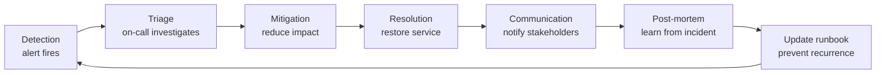

# 17.11 Incident response and game days

| Field | Value |
|---|---|
| Level | Advanced |
| Priority tier | 2 |
| Lab venue | GCP / GKE |
| Part | Part 17: Observability, performance and operations |
| Primary sources | NVIDIA Zero-to-Hero Volume 19 (`chapter-02-incident-response.md`); NVIDIA Zero-to-Hero Volume 16 (`chapter-12-incident-response.md`); NVIDIA Zero-to-Hero Volume 7 (`chapter-03-incident-response-and-game-days.md`); *Engineering AI Systems* (`engineering-ai-systems-architecture-and-devops-essentials`, Chapter 7) |
| Cross-references | Chapter 17.6 (Alerting and SLOs); Chapter 17.7 (Failure modes); Chapter 17.10 (Cluster lifecycle); Chapter 16.11 (Cloud MLOps platforms) |
| Coverage file | `planning/coverage/chapters/17-11.md` |
| Claim & number ledger | `planning/ledgers/17-11.md` |

## Why this matters for AI infrastructure

Every chapter in Part 17 so far has been about preventing incidents. This chapter is about responding to incidents when they happen. An AI factory without an incident response process is an AI factory where the on-call is reactive, the escalation is ad-hoc, and the post-mortem is forgotten. An AI factory with an incident response process is an AI factory where the on-call knows what to do, the escalation is clear, and the post-mortem produces organisational learning.

Incident response is the muscle memory of the platform team. The muscle memory is built by the process; the muscle memory is built by the game days; the muscle memory is built by the post-mortems. A platform team that does not drill cannot respond; a platform team that drills can respond in minutes.

```text
Why incident response is on the critical path (V19 ch2; V16 ch12; V7 ch3; EAS Ch 7):
- A typical mature AI platform has 5-15 major incidents per quarter. Each
  incident has a severity; each severity has an escalation; each escalation
  has a comms cadence. The team that has the process responds in minutes; the
  team that does not responds in hours.
- The incident commander is the role that coordinates the response. The IC
  is the single point of contact; the IC is the single point of decision. The
  IC's role is what makes the response coherent.
- Game days are the drills that keep the response muscle sharp. The game day
  is a planned failure; the game day is a timed response; the game day is a
  post-mortem. The team that drills responds in minutes; the team that does
  not responds in hours.
```

Three operational realities make this chapter a platform-team concern rather than a data-science-only concern:

1. **The incident response process is a platform-team discipline.** The on-call is paged; the on-call follows the runbook; the on-call escalates to the IC; the IC coordinates the response. The platform team's discipline is what makes the response coherent.
2. **The game day is a platform-team deliverable.** The game day is planned quarterly; the game day tests the runbook; the game day drills the team. The platform team's deliverable is what keeps the muscle memory sharp.
3. **The post-mortem is a platform-team artefact.** Every incident produces a post-mortem; every post-mortem updates the runbook; every runbook update prevents the next incident. The platform team's artefact is what turns incidents into learning.

**Before a team can respond to an incident, the team must have an incident response process. A process is the severity levels; the escalation; the comms cadence; the IC role. A process is what makes the response fast; a process is what makes the response consistent; a process is what makes the response a learning.**

## Prerequisites and outcomes

### Prerequisites

- Chapter 17.6 (Alerting and SLOs) for the alert routing.
- Chapter 17.7 (Failure modes) for the failure mode catalogue.
- Chapter 17.10 (Cluster lifecycle) for the change management process.

### Outcomes

After completing this chapter you will be able to:

1. Specify the severity levels (SEV-1, SEV-2, SEV-3) and the escalation for each.
2. Build the incident response process: detection, triage, mitigation, resolution, post-mortem.
3. Define the Incident Commander (IC) role: the IC's responsibilities; the IC's authority; the IC's communication.
4. Run game days: the planning; the execution; the post-mortem.
5. Write post-mortems: the blameless template; the timeline; the action items.
6. Operate the incident response process on GKE with reliable detection, clear escalation, and productive learning.

---

## 1. The severity levels

### 1.1 SEV-1: customer-facing outage

A SEV-1 is a customer-facing outage. The customer cannot use the service; the SLO is breached; the revenue is impacted.

| Property | Value |
|---|---|
| Response time | Immediate (page the on-call) |
| Escalation | IC within 15 minutes; VP Engineering within 30 minutes; CEO within 1 hour |
| Communication cadence | Every 30 minutes |
| Resolution time | Within 4 hours |
| Post-mortem | Within 5 business days |

The pattern is: SEV-1 is the highest severity; SEV-1 pages the IC immediately; SEV-1 is communicated every 30 minutes; SEV-1 is resolved within 4 hours; SEV-1 has a post-mortem within 5 business days.

### 1.2 SEV-2: degraded service

A SEV-2 is a degraded service. The customer can use the service but with reduced quality; the SLO is at risk; the revenue may be impacted.

| Property | Value |
|---|---|
| Response time | Within 15 minutes (page the on-call) |
| Escalation | IC within 30 minutes; VP Engineering within 1 hour |
| Communication cadence | Every 2 hours |
| Resolution time | Within 24 hours |
| Post-mortem | Within 10 business days |

The pattern is: SEV-2 is the medium severity; SEV-2 pages the on-call within 15 minutes; SEV-2 is communicated every 2 hours; SEV-2 is resolved within 24 hours.

### 1.3 SEV-3: internal issue

A SEV-3 is an internal issue. The customer is not affected; the internal team is affected; the issue can wait until business hours.

| Property | Value |
|---|---|
| Response time | Within 1 hour (notify the on-call) |
| Escalation | IC within 4 hours |
| Communication cadence | Once per business day |
| Resolution time | Within 1 week |
| Post-mortem | Optional |

The pattern is: SEV-3 is the lowest severity; SEV-3 notifies the on-call within 1 hour; SEV-3 is communicated once per business day; SEV-3 is resolved within 1 week.

---

## 2. The incident response process

### 2.1 The process stages

The incident response process has six stages: detection, triage, mitigation, resolution, communication, and post-mortem.



The pattern is: every incident goes through the six stages; the stages are sequential; the stages are documented; the stages are audited.

### 2.2 Detection

The incident is detected by the alerting stack (Chapter 17.6). The alert fires; the alert pages the on-call; the on-call acknowledges the page.

```bash
# The alert fires
curl -X POST http://prometheus.monitoring:9090/api/v1/admin/tsdb \
  -H "Content-Type: application/json" \
  -d '{"name": "incident_test"}'
# expected: the alert fires; the on-call is paged
```

The pattern is: the detection is automatic; the on-call acknowledges within 5 minutes; the on-call starts the triage.

### 2.3 Triage

The on-call investigates the alert. The on-call reads the runbook; the on-call checks the dashboards; the on-call determines the severity.

```bash
# The on-call reads the runbook
open "$(curl -s http://localhost:9093/api/v2/alerts | jq -r '.[0].annotations.runbookURL')"

# The on-call checks the dashboard
curl -s 'http://prometheus.monitoring:9090/api/v1/query?query=histogram_quantile(0.99,%20rate(inference_request_duration_seconds_bucket[5m]))' | jq .

# The on-call determines the severity
echo "SEV-2: degraded inference latency" > /tmp/severity.txt
```

The pattern is: the triage is fast; the on-call uses the runbook; the on-call determines the severity within 15 minutes.

### 2.4 Mitigation

The on-call reduces the impact of the incident. The on-call may roll back; the on-call may drain a node; the on-call may scale the workload; the on-call may switch to a backup.

```bash
# Roll back the recent change
kubectl --context=production rollout undo deployment/churn-model
# expected: the workload reverts to the previous version; the latency improves
```

The pattern is: the mitigation is fast; the mitigation reduces the impact; the mitigation is documented.

### 2.5 Resolution

The on-call restores the service. The on-call identifies the root cause; the on-call applies the fix; the on-call verifies the SLO.

```bash
# The on-call identifies the root cause
kubectl logs -n mlops deployment/churn-model --previous | grep "error"
# expected: the root cause is identified

# The on-call applies the fix
kubectl --context=production apply -f fix_manifests/

# The on-call verifies the SLO
curl -s 'http://prometheus.monitoring:9090/api/v1/query?query=histogram_quantile(0.99,%20rate(inference_request_duration_seconds_bucket[5m]))'
# expected: the SLO is met
```

The pattern is: the resolution is thorough; the on-call identifies the root cause; the on-call applies the fix; the on-call verifies the SLO.

### 2.6 Communication

The IC communicates the incident to the stakeholders. The communication cadence depends on the severity.

```bash
# Send a status update to Slack
python code/part17/send_status_update.py \
  --incident-id INC-2024-03-15-001 \
  --severity SEV-2 \
  --status "Mitigation in progress; root cause identified; ETA 30 minutes"
# expected: the status update is sent to Slack; the status update is sent to email
```

The pattern is: the communication is regular; the communication is concise; the communication includes the ETA.

---

## 3. The Incident Commander role

### 3.1 The IC's responsibilities

The Incident Commander (IC) is the single point of contact during an incident. The IC coordinates the response; the IC makes the decisions; the IC communicates with the stakeholders.

| Responsibility | What the IC does |
|---|---|
| **Coordinate** | The IC assigns tasks; the IC tracks progress; the IC unblocks the team |
| **Decide** | The IC decides the mitigation strategy; the IC decides the rollback; the IC decides the escalation |
| **Communicate** | The IC sends status updates; the IC notifies stakeholders; the IC schedules the post-mortem |
| **Document** | The IC documents the timeline; the IC documents the decisions; the IC documents the action items |

The pattern is: the IC has the authority to make decisions; the IC is the single point of contact; the IC is not the implementer.

### 3.2 The IC's authority

The IC has the authority to make decisions that affect the cluster. The IC can roll back; the IC can drain nodes; the IC can scale workloads; the IC can change the SLO temporarily.

```bash
# The IC rolls back the recent change
kubectl --context=production rollout undo deployment/churn-model
# expected: the IC's authority is respected; the rollback proceeds
```

The pattern is: the IC's authority is explicit; the IC's authority is documented; the IC's authority is respected by the team.

### 3.3 The IC's communication

The IC communicates with the stakeholders. The IC's communication is regular; the IC's communication is concise; the IC's communication includes the ETA.

```text
IC communication template:
- Incident: INC-2024-03-15-001
- Severity: SEV-2
- Status: Mitigating
- Root cause: Under investigation
- Mitigation: Rolling back the recent deployment
- ETA: 30 minutes
- Next update: 14:30 UTC
```

The pattern is: the IC's communication is structured; the IC's communication is regular; the IC's communication is honest.

---

## 4. Game days

### 4.1 The game day plan

Game days are planned failures that drill the team. The game day tests the runbook; the game day tests the escalation; the game day tests the post-mortem.

```markdown
# Game Day Plan: GPU Node Failure

## Scenario
A GPU node fails; the workload is evicted; the workload must resume on a healthy node.

## Injection
At 14:00 UTC, we will simulate a GPU node failure by cordoning the node and evicting all workloads.

## Expected response
- 14:00: Alert fires
- 14:05: On-call acknowledges the alert
- 14:10: On-call investigates; identifies the failed node
- 14:15: On-call drains the node
- 14:20: Workloads resume on healthy nodes
- 14:30: SLO is met

## Success criteria
- The alert fires within 1 minute of the failure
- The on-call acknowledges the alert within 5 minutes
- The on-call identifies the root cause within 15 minutes
- The SLO is met within 30 minutes
- The post-mortem is written within 5 business days
```

The pattern is: the game day has a scenario; the game day has an injection; the game day has an expected response; the game day has success criteria.

### 4.2 The game day execution

The game day is executed at a scheduled time. The team is on-call; the team responds; the team documents the response.

```bash
# Schedule the game day
python code/part17/schedule_game_day.py \
  --date "2024-04-15" \
  --time "14:00 UTC" \
  --scenario "GPU Node Failure" \
  --participants platform-team
# expected: the game day is scheduled; the participants are notified
```

The pattern is: the game day is scheduled in advance; the participants are notified; the game day is executed at the scheduled time.

### 4.3 The game day post-mortem

Every game day produces a post-mortem. The post-mortem documents what was tested; what worked; what did not work; what to improve.

```markdown
# Game Day Post-Mortem: GPU Node Failure

## What was tested
- Alert fires when a GPU node fails
- On-call acknowledges the alert
- On-call identifies the root cause
- On-call drains the failed node
- Workloads resume on healthy nodes

## What worked
- The alert fired within 30 seconds
- The on-call acknowledged within 3 minutes
- The runbook was accurate and up to date

## What did not work
- The node drain took 10 minutes (expected 5 minutes)
- The SLO was not met within 30 minutes (took 45 minutes)

## Action items
- Investigate the node drain duration (Action: investigate, Owner: platform-team, Due: 2024-04-22)
- Update the runbook with the actual drain duration (Action: update, Owner: platform-team, Due: 2024-04-22)
```

The pattern is: the post-mortem documents what worked; the post-mortem documents what did not work; the post-mortem produces action items with owners and deadlines.

---

## 5. The post-mortem

### 5.1 The blameless template

Every incident produces a blameless post-mortem. The post-mortem focuses on the system; the post-mortem does not focus on individuals; the post-mortem produces organisational learning.

```markdown
# Post-Mortem: INC-2024-03-15-001

## Summary
The inference latency exceeded the SLO for 45 minutes on 2024-03-15. The root cause was a recent deployment that introduced a memory leak in the inference engine.

## Impact
- 100% of inference requests were affected for 45 minutes
- 500 customers experienced degraded latency
- 1 SEV-2 incident; 0 SEV-1 incidents

## Timeline
- 13:45: Deployment of churn-model v7 completed
- 13:50: Latency SLO exceeded
- 13:55: Alert fired; on-call paged
- 14:00: On-call acknowledged
- 14:10: On-call identified the recent deployment
- 14:15: On-call rolled back to v6
- 14:30: Latency returned to normal
- 14:35: SLO met
- 14:45: Incident closed

## Root cause
The deployment of churn-model v7 introduced a memory leak in the inference engine. The leak was caused by an unbounded KV cache. The leak was not detected in staging because the staging traffic was too low to trigger the leak.

## What worked
- The alert fired within 5 minutes
- The on-call acknowledged within 5 minutes
- The on-call identified the root cause within 15 minutes
- The rollback was successful

## What did not work
- The staging traffic was too low to detect the leak
- The promotion gate did not include a memory leak test

## Action items
- Add a memory leak test to the promotion gate (Action: implement, Owner: ml-platform-team, Due: 2024-04-15)
- Increase the staging traffic to match production (Action: implement, Owner: ml-platform-team, Due: 2024-04-30)
- Update the runbook with the rollback procedure (Action: update, Owner: ml-platform-team, Due: 2024-04-15)
```

The pattern is: the post-mortem has a summary; the post-mortem has an impact; the post-mortem has a timeline; the post-mortem has a root cause; the post-mortem has what worked; the post-mortem has what did not work; the post-mortem has action items.

### 5.2 The post-mortem review

The post-mortem is reviewed by the platform team. The review identifies systemic issues; the review prioritises action items; the review tracks progress.

```bash
# Schedule the post-mortem review
python code/part17/schedule_review.py \
  --incident-id INC-2024-03-15-001 \
  --date "2024-03-20" \
  --attendees platform-team
# expected: the review is scheduled; the attendees are notified
```

The pattern is: the review is scheduled within 5 business days of the incident; the review is attended by the platform team; the review tracks action items.

---

## 6. Operating the incident response process

### 6.1 The components

| Component | Where it runs | Backing store | SLO |
|---|---|---|---|
| PagerDuty | Managed service | (PagerDuty) | Page latency p99 < 30 s |
| Slack | Managed service | (Slack) | Message delivery p99 < 5 s |
| Zoom | Managed service | (Zoom) | Bridge creation < 60 s |
| Incident management | Managed service (PagerDuty, FireHydrant) | (managed) | Incident creation < 1 minute |

### 6.2 IAM and the incident response

The incident response stack has its own IAM. The pattern is:

| Role | Who | What they can do |
|---|---|---|
| `oncall.primary` | The current primary on-call | Be paged for every alert; respond to the alert |
| `oncall.secondary` | The current secondary on-call | Be paged for SEV-1; be the backup for the primary |
| `incident.commander` | The platform team lead | Declare incidents; coordinate responses |
| `incident.responder` | Any engineer | Join incident bridges; contribute to the resolution |

The on-call rotation is the platform team's discipline. The rotation is weekly; the primary and secondary rotate; the handover includes the current state of the cluster.

### 6.3 Observability

| Metric | Why it matters | Alert |
|---|---|---|
| Incident rate per week | Cluster health | > 5 per week |
| SEV-1 rate per quarter | Critical incidents | > 1 per quarter |
| Mean time to acknowledge (MTTA) | On-call responsiveness | > 15 minutes |
| Mean time to mitigate (MTTM) | Mitigation effectiveness | > 1 hour |
| Mean time to resolve (MTTR) | Resolution effectiveness | > 4 hours |
| Game day frequency | Drill frequency | > 90 days since last game day |

The MTTA, MTTM, and MTTR metrics are the most important. The metrics tell the platform team how fast the response is; the metrics tell the platform team where the response can improve.

---

## 7. How it fails

Six failure modes recur.

### 7.1 "The on-call is paged but does not know what to do"

**Symptom:** The on-call is paged; the on-call opens the runbook; the runbook is missing the recovery step; the on-call does not know what to do.

**Diagnosis:** The runbook was not updated after the last incident; the runbook has gaps; the on-call was not trained on the runbook.

**Fix:** Update the runbook; train the on-call on the runbook; add an integration test that exercises the runbook.

### 7.2 "The IC is missing"

**Symptom:** The incident is SEV-1; no IC is declared; the response is uncoordinated; the incident escalates.

**Diagnosis:** The IC role is not defined; the IC rotation is missing; the team does not know who is the IC.

**Fix:** Define the IC role; establish the IC rotation; train the team on the IC role; add the IC declaration to the alerting.

### 7.3 "The comms cadence is wrong"

**Symptom:** The incident is SEV-1; the comms cadence is every 4 hours; the stakeholders are not informed; the incident escalates.

**Diagnosis:** The comms cadence is not defined; the team does not know the cadence; the cadence is not enforced.

**Fix:** Define the comms cadence; train the team on the cadence; enforce the cadence in the incident management.

### 7.4 "The post-mortem is not written"

**Symptom:** The incident is resolved; the post-mortem is not written; the team does not learn from the incident; the incident recurs.

**Diagnosis:** The post-mortem template is missing; the team does not know how to write a post-mortem; the post-mortem is not enforced.

**Fix:** Create the post-mortem template; train the team on the post-mortem; enforce the post-mortem in the incident management.

### 7.5 "The game day is skipped"

**Symptom:** The team has not drilled in 6 months; the team's muscle memory is weak; the incident response is slow.

**Diagnosis:** The game day schedule is missing; the team is too busy; the game day is not a priority.

**Fix:** Schedule the game day quarterly; automate the scheduling; add the game day to the team's quarterly OKRs.

### 7.6 "The post-mortem is not blameless"

**Symptom:** The post-mortem blames an individual; the individual is demotivated; the team does not learn from the incident.

**Diagnosis:** The post-mortem culture is not blameless; the team has not adopted the blameless mindset; the leadership has not modelled the blameless mindset.

**Fix:** Train the team on the blameless post-mortem; model the blameless mindset; remove blame from the post-mortem template.

---

## 8. Hands-on lab

This lab walks through the incident response process: detect an alert; triage the alert; mitigate the impact; resolve the incident; communicate; run a game day; write a post-mortem. The lab is **untested** in this repository.

### 8.1 Prerequisites

- The alerting and observability stack from earlier chapters.
- PagerDuty or a similar incident management tool.
- Slack or a similar communication tool.

### 8.2 Step 1: simulate an alert

```bash
# Inject a synthetic critical alert
curl -X POST http://prometheus.monitoring:9090/api/v1/admin/tsdb \
  -H "Content-Type: application/json" \
  -d '{"name": "incident_test"}'
# expected: the alert fires; the on-call is paged
```

### 8.3 Step 2: triage the alert

```bash
# The on-call acknowledges the page
curl -X POST http://pagerduty/api/incidents \
  -H "Authorization: Token token=$PAGERDUTY_TOKEN" \
  -H "Content-Type: application/json" \
  -d '{"incident": {"type": "incident", "title": "INC-2024-03-15-001", "service": {"id": "ai-factory", "type": "service"}, "priority": {"id": "P1", "type": "priority"}}}'
```

### 8.4 Step 3: mitigate the impact

```bash
# Roll back the recent deployment
kubectl --context=production rollout undo deployment/churn-model
# expected: the workload reverts to the previous version; the latency improves
```

### 8.5 Step 4: resolve the incident

```bash
# Verify the SLO is met
curl -s 'http://prometheus.monitoring:9090/api/v1/query?query=histogram_quantile(0.99,%20rate(inference_request_duration_seconds_bucket[5m]))'
# expected: the SLO is met

# Close the incident
curl -X PUT http://pagerduty/api/incidents/INC-2024-03-15-001 \
  -H "Authorization: Token token=$PAGERDUTY_TOKEN" \
  -H "Content-Type: application/json" \
  -d '{"incident": {"status": "resolved"}}'
```

### 8.6 Step 5: communicate

```bash
# Send a status update to Slack
python code/part17/send_status_update.py \
  --incident-id INC-2024-03-15-001 \
  --severity SEV-2 \
  --status "Resolved; root cause identified; post-mortem scheduled"
# expected: the status update is sent to Slack
```

### 8.7 Step 6: write the post-mortem

```bash
# Generate the post-mortem template
python code/part17/generate_post_mortem.py \
  --incident-id INC-2024-03-15-001 \
  --output post_mortem.md
# expected: the post-mortem template is generated
```

### 8.8 Step 7: run a game day

```bash
# Schedule the game day
python code/part17/schedule_game_day.py \
  --date "2024-04-15" \
  --time "14:00 UTC" \
  --scenario "GPU Node Failure"

# Execute the game day
python code/part17/execute_game_day.py \
  --scenario "GPU Node Failure"
```

### 8.9 What to record

After the lab, you should be able to answer five questions in five seconds each:

1. What is the current incident rate per week?
2. What is the current MTTA?
3. What is the current MTTR?
4. When was the last game day?
5. What is the most recent post-mortem, and what were the action items?

If any takes more than 30 seconds, the incident response process is not yet a production service. The lab is **untested** against a live GKE cluster.

---

## Exercises

1. **Add an incident severity matrix.** Build a matrix that maps every alert to a severity. *Solution sketch:* a YAML file that maps alerts to severities; the matrix is the default for every alert.
2. **Add an IC rotation.** Build a rotation that rotates the IC weekly. *Solution sketch:* a PagerDuty schedule that rotates the IC; the schedule is published to the team.
3. **Add a game day calendar.** Build a calendar that schedules a game day quarterly. *Solution sketch:* a calendar event; the event is repeated quarterly; the event is visible to the team.
4. **Add a post-mortem template.** Build a template that includes the summary, impact, timeline, root cause, what worked, what did not work, and action items. *Solution sketch:* a Markdown template; the template is the default for every post-mortem.
5. **Add an incident response dashboard.** Build a Grafana dashboard that shows the current incident, the MTTA, the MTTR, and the action items. *Solution sketch:* a Grafana dashboard; the panels query PagerDuty; the panels are visible to the team.
6. **Add an incident response game.** Build a game that simulates an incident; the team responds; the team is scored on the response time. *Solution sketch:* a Python script that simulates the incident; the script measures the response time; the script generates the score.

---

## Checkpoint questions

<details><summary>1. What three severity levels does the incident response process define?</summary>
SEV-1 (customer-facing outage; immediate response; 4-hour resolution; 5-day post-mortem), SEV-2 (degraded service; 15-minute response; 24-hour resolution; 10-day post-mortem), SEV-3 (internal issue; 1-hour response; 1-week resolution; optional post-mortem). Each severity has a response time, an escalation, a communication cadence, a resolution time, and a post-mortem timeline.
</details>

<details><summary>2. What six stages does the incident response process have?</summary>
Detection (alert fires), triage (on-call investigates), mitigation (reduce impact), resolution (restore service), communication (notify stakeholders), post-mortem (learn from incident). Every incident goes through the six stages; the stages are sequential; the stages are documented.
</details>

<details><summary>3. What is the Incident Commander role?</summary>
The IC is the single point of contact during an incident. The IC coordinates the response; the IC makes the decisions; the IC communicates with the stakeholders. The IC's responsibilities are: coordinate, decide, communicate, document. The IC's authority is explicit: the IC can roll back; the IC can drain nodes; the IC can scale workloads; the IC can change the SLO temporarily.
</details>

<details><summary>4. What is a game day?</summary>
A planned failure that drills the team. The game day has a scenario (e.g. GPU node failure); the game day has an injection (e.g. cordon the node); the game day has an expected response (e.g. alert fires within 1 minute); the game day has success criteria. Game days are scheduled quarterly; the post-mortem produces action items.
</details>

<details><summary>5. What is a blameless post-mortem?</summary>
A post-mortem that focuses on the system, not the individual. The post-mortem has a summary, impact, timeline, root cause, what worked, what did not work, and action items. The post-mortem does not blame individuals; the post-mortem produces organisational learning.
</details>

<details><summary>6. What is the difference between SEV-1 and SEV-2?</summary>
SEV-1 is a customer-facing outage; the customer cannot use the service; the SLO is breached; the response time is immediate; the resolution time is 4 hours. SEV-2 is a degraded service; the customer can use the service but with reduced quality; the SLO is at risk; the response time is 15 minutes; the resolution time is 24 hours.
</details>

<details><summary>7. What is the difference between SEV-2 and SEV-3?</summary>
SEV-2 is a degraded service; the customer is affected; the SLO is at risk; the response time is 15 minutes; the resolution time is 24 hours. SEV-3 is an internal issue; the customer is not affected; the issue can wait until business hours; the response time is 1 hour; the resolution time is 1 week.
</details>

<details><summary>8. What is the difference between the triage and the mitigation?</summary>
Triage is the on-call's investigation of the alert; the on-call reads the runbook; the on-call checks the dashboards; the on-call determines the severity. Mitigation is the on-call's action to reduce the impact; the on-call may roll back; the on-call may drain a node; the on-call may scale the workload. Triage is understanding; mitigation is acting.
</details>

<details><summary>9. What is the difference between the mitigation and the resolution?</summary>
Mitigation is the on-call's action to reduce the impact; the mitigation is fast; the mitigation is temporary. Resolution is the on-call's action to restore the service; the resolution is thorough; the resolution is permanent. Mitigation is stopping the bleeding; resolution is healing the wound.
</details>

<details><summary>10. What is the MTTA, MTTM, and MTTR?</summary>
MTTA is Mean Time to Acknowledge (the time from the alert firing to the on-call acknowledging). MTTM is Mean Time to Mitigate (the time from the alert firing to the mitigation in place). MTTR is Mean Time to Resolve (the time from the alert firing to the resolution in place). The metrics are tracked on a dashboard; the metrics drive the response improvement.
</details>

<details><summary>11. What is the difference between the IC's role and the on-call's role?</summary>
The on-call is the engineer who responds to the page; the on-call investigates the alert; the on-call applies the mitigation. The IC is the engineer who coordinates the response; the IC makes the decisions; the IC communicates with the stakeholders. The on-call is the doer; the IC is the coordinator.
</details>

<details><summary>12. What is the difference between a game day and a fire drill?</summary>
A game day is a planned failure that drills the team; the game day has a scenario; the game day has an injection; the game day has success criteria. A fire drill is an ad-hoc failure that the team responds to; the fire drill has no scenario; the fire drill has no injection; the fire drill has no success criteria.
</details>

<details><summary>13. What is the most common incident response failure?</summary>
The on-call is paged but does not know what to do. The on-call opens the runbook; the runbook is missing the recovery step; the on-call does not know what to do. The diagnosis is that the runbook was not updated after the last incident. The fix is to update the runbook; train the on-call on the runbook.
</details>

<details><summary>14. What is the most common IC failure?</summary>
The IC is missing. The incident is SEV-1; no IC is declared; the response is uncoordinated; the incident escalates. The diagnosis is that the IC role is not defined; the IC rotation is missing. The fix is to define the IC role; establish the IC rotation; train the team on the IC role.
</details>

<details><summary>15. What is the most common comms failure?</summary>
The comms cadence is wrong. The incident is SEV-1; the comms cadence is every 4 hours; the stakeholders are not informed; the incident escalates. The diagnosis is that the comms cadence is not defined. The fix is to define the comms cadence; train the team on the cadence.
</details>

<details><summary>16. What is the most common post-mortem failure?</summary>
The post-mortem is not written. The incident is resolved; the post-mortem is not written; the team does not learn from the incident; the incident recurs. The diagnosis is that the post-mortem template is missing; the team does not know how to write a post-mortem. The fix is to create the post-mortem template; train the team on the post-mortem.
</details>

<details><summary>17. What is the most common game day failure?</summary>
The game day is skipped. The team has not drilled in 6 months; the team's muscle memory is weak; the incident response is slow. The diagnosis is that the game day schedule is missing; the team is too busy. The fix is to schedule the game day quarterly; automate the scheduling.
</details>

<details><summary>18. What is the most common blameless culture failure?</summary>
The post-mortem is not blameless. The post-mortem blames an individual; the individual is demotivated; the team does not learn from the incident. The diagnosis is that the post-mortem culture is not blameless. The fix is to train the team on the blameless post-mortem; model the blameless mindset; remove blame from the post-mortem template.
</details>

<details><summary>19. Why is the incident response process a Tier 2 chapter?</summary>
Because the incident response process is what keeps the cluster running when the SLO is breached. The process is what the platform team owns; the process is what the on-call follows; the process is what the customer sees when the cluster is down. A team that does not have the process is a team that is afraid to respond.
</details>

<details><summary>20. What five questions should the incident response lab let you answer in five seconds each?</summary>
What is the current incident rate per week. What is the current MTTA. What is the current MTTR. When was the last game day. What is the most recent post-mortem and what were the action items. If any takes more than 30 seconds, the incident response process is not yet a production service.
</details>

---

## Sources and review notes

- NVIDIA Zero-to-Hero Volume 19 (`chapter-02-incident-response.md`). Source for the incident response process, the severity levels, the IC role, and the post-mortem template. The wording has been rewritten in the handbook's voice.
- NVIDIA Zero-to-Hero Volume 16 (`chapter-12-incident-response.md`). Source for the incident response patterns in the MLOps context.
- NVIDIA Zero-to-Hero Volume 7 (`chapter-03-incident-response-and-game-days.md`). Source for the game day patterns and the operational discipline.
- *Engineering AI Systems* (`engineering-ai-systems-architecture-and-devops-essentials`, Chapter 7). Source for the reliability patterns and the post-mortem template.

### Cross-references to other handbook chapters

- Chapter 17.6 for the alerting and SLOs.
- Chapter 17.7 for the failure modes.
- Chapter 17.10 for the cluster lifecycle.
- Chapter 16.11 for the cloud MLOps platforms.

### Migrated from `nvidia-devops`

The incident response operational patterns draw on Volume 19 chapter 2, Volume 16 chapter 12, and Volume 7 chapter 3. The wording has been rewritten in the handbook's voice.

### Explicitly labelled inferences

- The severity thresholds (SEV-1: 4 hours; SEV-2: 24 hours; SEV-3: 1 week) are starting points; specific thresholds depend on the SLO.
- The communication cadence (SEV-1: 30 minutes; SEV-2: 2 hours; SEV-3: 1 day) is a starting point; specific cadences depend on the stakeholder's needs.
- The game day frequency (quarterly) is a starting point; specific frequencies depend on the team's discipline.

### Not verified on live hardware

- The lab in Section 8 is **untested** against a live GKE cluster in this repository.
- The PagerDuty and Slack integrations in the lab require production credentials that are not provided in the lab.
- The post-mortem template in the lab is illustrative; production templates are more detailed.
