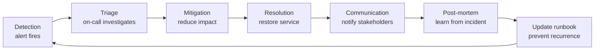

# 17.11 Incident response and game days

| Field | Value |
|---|---|
| Level | Advanced |
| Priority tier | 2 |
| Lab venue | GCP / GKE |
| Part | Part 17: Observability, performance and operations |
| Primary sources | NVIDIA Zero-to-Hero Volume 19 (`chapter-02-incident-response.md`); NVIDIA Zero-to-Hero Volume 16 (`chapter-12-incident-response.md`); NVIDIA Zero-to-Hero Volume 7 (`chapter-03-incident-response-and-game-days.md`); *Engineering AI Systems* (`engineering-ai-systems-architecture-and-devops-essentials`, Chapter 7) |
| Cross-references | Chapter 17.6 (Alerting and SLOs); Chapter 17.7 (Failure modes); Chapter 17.10 (Cluster lifecycle); Chapter 16.11 (Cloud MLOps platforms) |
| Coverage file | `planning/coverage/chapters/17-11.md` |
| Claim & number ledger | `planning/ledgers/17-11.md` |

## Why this matters for AI infrastructure

Imagine a GPU training cluster that starts failing at two in the morning. Nobody knows who is in charge, so three engineers change things at the same time. The outage runs longer, and the post-mortem never gets written. An incident response process prevents that. It decides ahead of time who responds, how fast they act, and what the team records afterwards.

The earlier chapters in Part 17 were about stopping incidents from starting. Alerting, failure modes, and cluster lifecycle all lower how often things break. They cannot bring the number to zero. This chapter covers what you do once prevention has failed.

Incident response is a skill you build by repetition. The process gives the team its steps, game days give it practice, and post-mortems turn each real incident into a change. A team that has drilled usually recovers faster, because nobody has to invent the steps during the outage.

```text
Why incident response is on the critical path (background reading: NVIDIA Zero-to-Hero volume 19; NVIDIA Zero-to-Hero volume 16; NVIDIA Zero-to-Hero volume 7; Engineering AI Systems; the figures below are examples, not quotations):
- A typical mature AI platform has 5-15 major incidents per quarter. Each
  incident has a severity; each severity has an escalation; each escalation
  has a comms cadence. The team that has the process responds in minutes; the
  team that does not responds in hours.
- The incident commander is the role that coordinates the response. The IC
  is the single point of contact; the IC is the single point of decision. The
  IC's role is what makes the response coherent.
- Game days are the drills that keep the response muscle sharp. The game day
  is a planned failure; the game day is a timed response; the game day is a
  post-mortem. The team that drills responds in minutes; the team that does
  not responds in hours.
```

The figures in that block, such as 5-15 incidents per quarter, are example values. They are not measured data from a source. Treat them as a starting guess until your own incident history gives you real numbers.

Three operational realities make this a platform-team concern, not only a data-science concern.

1. Incident response is owned by the platform team. When an alert pages someone, the on-call follows the runbook and escalates to the Incident Commander, who keeps the response coordinated.
2. Game days are a platform-team deliverable. Someone has to plan the failure, schedule the drill, and check that the runbook still matches the cluster.
3. Post-mortems are a platform-team artefact. Each one should end with a runbook or alert change. Otherwise the same incident will come back.

**A response process is what makes the response fast, consistent, and a source of learning.** Before you write any runbook, decide who the Incident Commander is for your next SEV-1, and who backs them up.

## Prerequisites and outcomes

Before you start, you need the alerting, failure-mode, and change-management chapters. Think of this chapter as the response half of the prevention work you have already done. The outcomes below tell you what you should be able to do when you finish.

### Prerequisites

- Chapter 17.6 (Alerting and SLOs) for the alert routing.
- Chapter 17.7 (Failure modes) for the failure mode catalogue.
- Chapter 17.10 (Cluster lifecycle) for the change management process.

### Outcomes

After completing this chapter you will be able to:

1. Specify the severity levels (SEV-1, SEV-2, SEV-3) and the escalation for each.
2. Build the incident response process: detection, triage, mitigation, resolution, post-mortem.
3. Define the Incident Commander (IC) role, including its responsibilities, its authority, and how it communicates.
4. Run game days: plan them, execute them, and write up the results.
5. Write blameless post-mortems with a clear timeline and action items.
6. Operate the incident response process on GKE with reliable detection, clear escalation, and productive learning.

---

## 1. The severity levels

Severity tells the on-call engineer how fast to move and who to wake up. Pick the level from customer impact, not from how hard the bug looks to fix. The response times, deadlines, and cadences in the tables below are example values. Your team should choose its own, based on its SLOs and its staffing.

### 1.1 SEV-1: customer-facing outage

A SEV-1 means customers cannot use the service. The SLO is breached, and revenue stops or drops. Treat it as the top priority. The on-call is paged at once, and the escalation clock starts.

| Property | Value |
|---|---|
| Response time | Immediate (page the on-call) |
| Escalation | IC within 15 minutes; VP Engineering within 30 minutes; CEO within 1 hour |
| Communication cadence | Every 30 minutes |
| Resolution time | Within 4 hours |
| Post-mortem | Within 5 business days |

### 1.2 SEV-2: degraded service

A SEV-2 means the service still works, but customers get a worse experience. The SLO is at risk, and revenue may suffer. The on-call responds quickly, but most of the company does not need to drop everything.

| Property | Value |
|---|---|
| Response time | Within 15 minutes (page the on-call) |
| Escalation | IC within 30 minutes; VP Engineering within 1 hour |
| Communication cadence | Every 2 hours |
| Resolution time | Within 24 hours |
| Post-mortem | Within 10 business days |

### 1.3 SEV-3: internal issue

A SEV-3 is a problem inside your team. Customers do not notice it. It can wait for business hours, so the on-call notifies the team and the work goes into the normal queue. When you rank a new alert, ask first whether a customer would ever notice it.

| Property | Value |
|---|---|
| Response time | Within 1 hour (notify the on-call) |
| Escalation | IC within 4 hours |
| Communication cadence | Once per business day |
| Resolution time | Within 1 week |
| Post-mortem | Optional |

Before your next incident, write down your team's three severity levels, with one real example of each.

---

## 2. The incident response process

### 2.1 The process stages

Picture a page at night. An alert fires, and within minutes someone has to decide what to do next. The process gives every incident the same path, so the on-call does not have to invent one. It has six stages, shown in the diagram: detection, triage, mitigation, resolution, communication, and post-mortem. The diagram adds one final step: updating the runbook.



### 2.2 Detection

Detection should happen before a customer tells you about the problem. The alerting stack from Chapter 17.6 watches the metrics and fires an alert. The alert pages the on-call, who acknowledges it so the rest of the team knows someone is looking.

```bash
# Fire a synthetic alert through Alertmanager's API
curl -X POST http://alertmanager.monitoring:9093/api/v2/alerts \
  -H "Content-Type: application/json" \
  -d '[{"labels": {"alertname": "incident_test", "severity": "critical"}}]'
# expected: the alert fires; the on-call is paged
```

The example above assumes the on-call acknowledges within 5 minutes. That is a target to set for your team, not a standard. Too many critical alerts burn out the on-call and bury the real ones. Put a description and a runbook link in each alert's annotations, so the engineer knows what to check first. Production Kubernetes, chapter 9, also suggests a dead man's switch: an alert that always fires and pages you when it stops.

### 2.3 Triage

Triage answers one question: what is actually broken? Start with the runbook, then open the dashboard. Decide the severity only after you have seen what is failing.

```bash
# The on-call reads the runbook
open "$(curl -s http://localhost:9093/api/v2/alerts | jq -r '.[0].annotations.runbookURL')"

# The on-call checks the dashboard
curl -s 'http://prometheus.monitoring:9090/api/v1/query?query=histogram_quantile(0.99,%20rate(inference_request_duration_seconds_bucket[5m]))' | jq .

# The on-call determines the severity
echo "SEV-2: degraded inference latency" > /tmp/severity.txt
```

### 2.4 Mitigation

Mitigation buys time. The goal is to reduce customer impact now, even before you know the root cause. A rollback is often the fastest option, because it returns the workload to the version that was running before the change. Other options are draining a node, scaling out, or switching to a backup. Each trades some risk for speed, so write down your choice.

```bash
# Roll back the recent change
kubectl --context=production rollout undo deployment/churn-model
# expected: the workload reverts to the previous version; the latency improves
```

### 2.5 Resolution

Resolution means the service is healthy and will stay that way. Find the root cause first, then apply a fix that addresses it. Check the SLO with the triage query, so you know the fix worked. The appendix of AI Systems Performance Engineering adds one habit: measure throughput, latency, and utilization before and after each change.

```bash
# The on-call identifies the root cause
kubectl logs -n mlops deployment/churn-model --previous | grep "error"
# expected: the root cause is identified

# The on-call applies the fix
kubectl --context=production apply -f fix_manifests/

# The on-call verifies the SLO
curl -s 'http://prometheus.monitoring:9090/api/v1/query?query=histogram_quantile(0.99,%20rate(inference_request_duration_seconds_bucket[5m]))'
# expected: the SLO is met
```

### 2.6 Communication

Communication runs alongside the fix, not after it. The IC posts updates on the cadence set for the severity. Each update should say what is known, what is not known yet, and when the next update arrives. Keep updates regular, even when nothing has changed.

```bash
# Send a status update to Slack
python code/part17/send_status_update.py \
  --incident-id INC-2024-03-15-001 \
  --severity SEV-2 \
  --status "Mitigation in progress; root cause identified; ETA 30 minutes"
# expected: the status update is sent to Slack; the status update is sent to email
```

Before your first drill, write the status-update template and the cadence for each severity. Then the first update will not wait for a decision.

---

## 3. The Incident Commander role

In a real incident, several engineers work at once. Without one person coordinating, they duplicate work, contradict each other, and forget to tell anyone outside the room. The Incident Commander (IC) is that person. The IC does not have to fix the problem personally. The job is to keep the response organised and the decisions clear.

### 3.1 The IC's responsibilities

The IC is the single point of contact during an incident. Everyone else reports to the IC, and the IC decides what happens next. The table below lists the four duties.

| Responsibility | What the IC does |
|---|---|
| **Coordinate** | The IC assigns tasks; the IC tracks progress; the IC unblocks the team |
| **Decide** | The IC decides the mitigation strategy; the IC decides the rollback; the IC decides the escalation |
| **Communicate** | The IC sends status updates; the IC notifies stakeholders; the IC schedules the post-mortem |
| **Document** | The IC documents the timeline; the IC documents the decisions; the IC documents the action items |

### 3.2 The IC's authority

The IC needs authority to act without waiting for a committee. In practice, the IC can roll back a change, drain a node, scale a workload, or change an SLO for the length of the incident. Agree on these powers before the incident starts. Nobody wants to debate who may roll back production at three in the morning.

```bash
# The IC rolls back the recent change
kubectl --context=production rollout undo deployment/churn-model
# expected: the IC's authority is respected; the rollback proceeds
```

### 3.3 The IC's communication

The IC's messages should be short, regular, and easy to scan. The template below gives every update the same shape. Fill in every field each time you post, even the fields that have not changed, so readers never have to guess. The ETA is an example; give your own.

```text
IC communication template:
- Incident: INC-2024-03-15-001
- Severity: SEV-2
- Status: Mitigating
- Root cause: Under investigation
- Mitigation: Rolling back the recent deployment
- ETA: 30 minutes
- Next update: 14:30 UTC
```

Before you name your first IC, put this template in the runbook. The next person on call can then use it without help.

---

## 4. Game days

A game day is a drill. You plan a failure, inject it in a controlled way, and watch how the team responds. A good game day tests the runbook, the escalation path, and the post-mortem, not only the software. You learn the most from the places where the response stalls.

### 4.1 The game day plan

The plan below describes one drill: a GPU node fails, and its workload has to move. Read it as a template. The times and targets in it, such as the one-minute alert window and the 30-minute window to meet the SLO, are example values for a practice run. They are not requirements.

```markdown
# Game Day Plan: GPU Node Failure

## Scenario
A GPU node fails; the workload is evicted; the workload must resume on a healthy node.

## Injection
At 14:00 UTC, we will simulate a GPU node failure by cordoning the node and evicting all workloads.

## Expected response
- 14:00: Alert fires
- 14:05: On-call acknowledges the alert
- 14:10: On-call investigates; identifies the failed node
- 14:15: On-call drains the node
- 14:20: Workloads resume on healthy nodes
- 14:30: SLO is met

## Success criteria
- The alert fires within 1 minute of the failure
- The on-call acknowledges the alert within 5 minutes
- The on-call identifies the root cause within 15 minutes
- The SLO is met within 30 minutes
- The post-mortem is written within 5 business days
```

### 4.2 The game day execution

Schedule the game day ahead of time, so the participants can clear their calendars. On the day, the team stays on call and responds as it would to a real page. Someone should record the timeline as it happens, because timings are hard to recall accurately afterwards.

```bash
# Schedule the game day
python code/part17/schedule_game_day.py \
  --date "2024-04-15" \
  --time "14:00 UTC" \
  --scenario "GPU Node Failure" \
  --participants platform-team
# expected: the game day is scheduled; the participants are notified
```

### 4.3 The game day post-mortem

Write up every game day the same way you write up a real incident. Record what was tested, what worked, what did not, and who owns each fix. The numbers in the example below are illustrative, not measurements from a real drill. Use the example to see the shape of a good write-up, then replace its numbers with your own.

```markdown
# Game Day Post-Mortem: GPU Node Failure

## What was tested
- Alert fires when a GPU node fails
- On-call acknowledges the alert
- On-call identifies the root cause
- On-call drains the failed node
- Workloads resume on healthy nodes

## What worked
- The alert fired within 30 seconds
- The on-call acknowledged within 3 minutes
- The runbook was accurate and up to date

## What did not work
- The node drain took 10 minutes (expected 5 minutes)
- The SLO was not met within 30 minutes (took 45 minutes)

## Action items
- Investigate the node drain duration (Action: investigate, Owner: platform-team, Due: 2024-04-22)
- Update the runbook with the actual drain duration (Action: update, Owner: platform-team, Due: 2024-04-22)
```

Before you schedule the next drill, check that last quarter's action items are closed or have a new owner.

---

## 5. The post-mortem

A post-mortem is how an incident turns into something the team learns from. The most useful ones describe the system, not the person who was on call when things went wrong. Ask what allowed the failure and what would have caught it sooner. If people fear blame, they hide details, and hidden details make the next incident harder to understand.

### 5.1 The blameless template

Every incident gets a blameless post-mortem. The template below shows the sections you need. The incident in it is illustrative. Its times, customer counts, and severity are example values, not a record from a real outage. Notice how each action item has an owner and a due date, so the review can track it.

```markdown
# Post-Mortem: INC-2024-03-15-001

## Summary
The inference latency exceeded the SLO for 45 minutes on 2024-03-15. The root cause was a recent deployment that introduced a memory leak in the inference engine.

## Impact
- 100% of inference requests were affected for 45 minutes
- 500 customers experienced degraded latency
- 1 SEV-2 incident; 0 SEV-1 incidents

## Timeline
- 13:45: Deployment of churn-model v7 completed
- 13:50: Latency SLO exceeded
- 13:55: Alert fired; on-call paged
- 14:00: On-call acknowledged
- 14:10: On-call identified the recent deployment
- 14:15: On-call rolled back to v6
- 14:30: Latency returned to normal
- 14:35: SLO met
- 14:45: Incident closed

## Root cause
The deployment of churn-model v7 introduced a memory leak in the inference engine. The leak was caused by an unbounded KV cache. The leak was not detected in staging because the staging traffic was too low to trigger the leak.

## What worked
- The alert fired within 5 minutes
- The on-call acknowledged within 5 minutes
- The on-call identified the root cause within 15 minutes
- The rollback was successful

## What did not work
- The staging traffic was too low to detect the leak
- The promotion gate did not include a memory leak test

## Action items
- Add a memory leak test to the promotion gate (Action: implement, Owner: ml-platform-team, Due: 2024-04-15)
- Increase the staging traffic to match production (Action: implement, Owner: ml-platform-team, Due: 2024-04-30)
- Update the runbook with the rollback procedure (Action: update, Owner: ml-platform-team, Due: 2024-04-15)
```

Keep configurations and benchmarks in source control, so you can trace a regression back to the change that caused it. Run the performance checks inside your CI/CD pipeline, not only by hand. The appendix checklist of AI Systems Performance Engineering recommends both. In the example above, that is the difference between a memory leak test that runs on every release and one that depends on someone remembering it.

### 5.2 The post-mortem review

The platform team reviews each post-mortem and looks for patterns across incidents. The review ranks the action items and tracks each one until it closes. Hold the review soon after the write-up, while people still remember the details. Check that every action item has an owner and a due date before the meeting ends.

```bash
# Schedule the post-mortem review
python code/part17/schedule_review.py \
  --incident-id INC-2024-03-15-001 \
  --date "2024-03-20" \
  --attendees platform-team
# expected: the review is scheduled; the attendees are notified
```

---

## 6. Operating the incident response process

A process is only as good as the tools behind it. Paging, chat, and the bridge call all need to work when an incident starts. This section lists those components, the roles that use them, and the signals that show whether the process is healthy.

### 6.1 The components

The table lists the services that carry an incident. The latency targets in it are example values. Check each one against the vendor's documentation, and set the targets your own team needs.

| Component | Where it runs | Backing store | SLO |
|---|---|---|---|
| PagerDuty | Managed service | (PagerDuty) | Page latency p99 < 30 s |
| Slack | Managed service | (Slack) | Message delivery p99 < 5 s |
| Zoom | Managed service | (Zoom) | Bridge creation < 60 s |
| Incident management | Managed service (PagerDuty, FireHydrant) | (managed) | Incident creation < 1 minute |

### 6.2 IAM and the incident response

Access during an incident should follow the role, not the person. The roles below decide who can be paged, who can declare an incident, and who can join the response. Keep the roles narrow, so a single engineer cannot change everything alone.

| Role | Who | What they can do |
|---|---|---|
| `oncall.primary` | The current primary on-call | Be paged for every alert; respond to the alert |
| `oncall.secondary` | The current secondary on-call | Be paged for SEV-1; be the backup for the primary |
| `incident.commander` | The platform team lead | Declare incidents; coordinate responses |
| `incident.responder` | Any engineer | Join incident bridges; contribute to the resolution |

The on-call rotation is a platform-team discipline. The example rotation is weekly, with a primary and a secondary who swap over. Your team may choose a different length, but every handover should include the current state of the cluster.

### 6.3 Observability

Track the response itself, not only the cluster. The table lists the measures to watch and the thresholds that should raise a flag. The thresholds are example values, so tune them against your team's own history. MTTA, MTTM, and MTTR matter most. They show how fast the team responds, and their trend shows where it can improve.

| Metric | Why it matters | Alert |
|---|---|---|
| Incident rate per week | Cluster health | > 5 per week |
| SEV-1 rate per quarter | Critical incidents | > 1 per quarter |
| Mean time to acknowledge (MTTA) | On-call responsiveness | > 15 minutes |
| Mean time to mitigate (MTTM) | Mitigation effectiveness | > 1 hour |
| Mean time to resolve (MTTR) | Resolution effectiveness | > 4 hours |
| Game day frequency | Drill frequency | > 90 days since last game day |

Pick one of these measures and check it against your last three incidents. That one check will show you whether the dashboard can answer the question you care about.

---

## 7. How it fails

Six failure modes recur. Each one below has a symptom you can see, a likely diagnosis, and a fix. Read them as warning signs for your own process.

### 7.1 "The on-call is paged but does not know what to do"

**Symptom:** The on-call is paged and opens the runbook. The runbook is missing the recovery step, so the on-call is stuck.

**Diagnosis:** The runbook was not updated after the last incident. It has gaps, and the on-call was never trained on it.

**Fix:** Update the runbook, train the on-call on it, and add an integration test that follows the runbook.

### 7.2 "The IC is missing"

**Symptom:** A SEV-1 is open with no IC. The response is uncoordinated, and the incident escalates.

**Diagnosis:** The IC role is not defined. There is no IC rotation, so the team does not know who the IC is.

**Fix:** Define the role, set up the rotation, train the team on it, and add the IC declaration to your alerting.

### 7.3 "The comms cadence is wrong"

**Symptom:** A SEV-1 gets an update only every 4 hours. Stakeholders hear nothing, and the incident escalates.

**Diagnosis:** The cadence is not defined, so nobody knows it, and nobody enforces it.

**Fix:** Define the cadence for each severity, train the team on it, and enforce it in your incident management tool.

### 7.4 "The post-mortem is not written"

**Symptom:** The incident is resolved, but no post-mortem exists. The team does not learn from the incident, and it recurs.

**Diagnosis:** There is no template, so people do not know how to start one. Nobody enforces the step either.

**Fix:** Create the template, train the team to use it, and make it a required step in the incident management tool.

### 7.5 "The game day is skipped"

**Symptom:** The team has not drilled in 6 months. Its muscle memory is weak, and the response is slow.

**Diagnosis:** The schedule is missing, the team is busy, and nobody has made the drill a priority.

**Fix:** Schedule a game day each quarter, automate the booking, and add the drill to the team's quarterly goals.

### 7.6 "The post-mortem is not blameless"

**Symptom:** The post-mortem names one engineer as the cause. The team does not learn from the incident, because people stop being candid.

**Diagnosis:** The team has not adopted a blameless culture, and its leaders have not modelled one.

**Fix:** Train the team on blameless reviews, model the approach in your own write-ups, and remove blame language from the template.

Pick the failure mode that matches your last incident, and fix it before the next drill.

---

## 8. Hands-on lab

In this lab you walk through one full incident. You detect an alert, triage it, mitigate it, resolve it, communicate, run a drill, and write a post-mortem. The lab is **untested** in this repository, so check each command before you run it. Run them on a non-production cluster first.

### 8.1 Prerequisites

- The alerting and observability stack from earlier chapters.
- PagerDuty or a similar incident management tool.
- Slack or a similar communication tool.

### 8.2 Step 1: simulate an alert

Start by creating a test alert. Fire it on a non-production cluster, where a page does no harm to customers.

```bash
# Inject a synthetic critical alert through Alertmanager's API
curl -X POST http://alertmanager.monitoring:9093/api/v2/alerts \
  -H "Content-Type: application/json" \
  -d '[{"labels": {"alertname": "incident_test", "severity": "critical"}}]'
# expected: the alert fires; the on-call is paged
```

### 8.3 Step 2: triage the alert

The request below opens an incident record in PagerDuty and sets its priority. Use the record as the single place where the timeline lives.

```bash
# Open the incident record (acknowledging the page itself is done in the PagerDuty app or its API)
curl -X POST http://pagerduty/api/incidents \
  -H "Authorization: Token token=$PAGERDUTY_TOKEN" \
  -H "Content-Type: application/json" \
  -d '{"incident": {"type": "incident", "title": "INC-2024-03-15-001", "service": {"id": "ai-factory", "type": "service"}, "priority": {"id": "P1", "type": "priority"}}}'
```

### 8.4 Step 3: mitigate the impact

Roll back the recent deployment first. It is usually the quickest way to reduce the impact.

```bash
# Roll back the recent deployment
kubectl --context=production rollout undo deployment/churn-model
# expected: the workload reverts to the previous version; the latency improves
```

### 8.5 Step 4: resolve the incident

Confirm the SLO is met with the same query you used during triage. Then close the incident record.

```bash
# Verify the SLO is met
curl -s 'http://prometheus.monitoring:9090/api/v1/query?query=histogram_quantile(0.99,%20rate(inference_request_duration_seconds_bucket[5m]))'
# expected: the SLO is met

# Close the incident
curl -X PUT http://pagerduty/api/incidents/INC-2024-03-15-001 \
  -H "Authorization: Token token=$PAGERDUTY_TOKEN" \
  -H "Content-Type: application/json" \
  -d '{"incident": {"status": "resolved"}}'
```

### 8.6 Step 5: communicate

Send the status update so the stakeholders know the incident is over and the post-mortem is coming.

```bash
# Send a status update to Slack
python code/part17/send_status_update.py \
  --incident-id INC-2024-03-15-001 \
  --severity SEV-2 \
  --status "Resolved; root cause identified; post-mortem scheduled"
# expected: the status update is sent to Slack
```

### 8.7 Step 6: write the post-mortem

Generate the template, then fill it in using the timeline you recorded during the incident.

```bash
# Generate the post-mortem template
python code/part17/generate_post_mortem.py \
  --incident-id INC-2024-03-15-001 \
  --output post_mortem.md
# expected: the post-mortem template is generated
```

### 8.8 Step 7: run a game day

Schedule the drill, then execute it using the same scenario you practised during the lab.

```bash
# Schedule the game day
python code/part17/schedule_game_day.py \
  --date "2024-04-15" \
  --time "14:00 UTC" \
  --scenario "GPU Node Failure"

# Execute the game day
python code/part17/execute_game_day.py \
  --scenario "GPU Node Failure"
```

### 8.9 What to record

When the lab is done, you should be able to answer five questions quickly:

1. What is the current incident rate per week?
2. What is the current MTTA?
3. What is the current MTTR?
4. When was the last game day?
5. What is the most recent post-mortem, and what were the action items?

The target is five seconds per question. Any answer that takes more than 30 seconds means the process is not yet a production service. These two limits are this chapter's own rule of thumb. The lab is **untested** against a live GKE cluster.

---

## Exercises

Try these after you finish the lab. Each one turns a step in this chapter into a tool you can keep and improve.

1. **Add an incident severity matrix.** Build a matrix that maps every alert to a severity. *Solution sketch:* Use a YAML file that maps each alert to its severity, and make it the default for every alert.
2. **Add an IC rotation.** Build a rotation that changes the IC each week. *Solution sketch:* Create a PagerDuty schedule for the IC, and publish it to the team.
3. **Add a game day calendar.** Build a calendar that schedules a game day each quarter. *Solution sketch:* Create a recurring calendar event that repeats quarterly and is visible to the whole team.
4. **Add a post-mortem template.** Build a template with a summary, impact, timeline, root cause, what worked, what did not work, and action items. *Solution sketch:* Write it as a Markdown template and make it the default for every post-mortem.
5. **Add an incident response dashboard.** Build a Grafana dashboard that shows the current incident, MTTA, MTTR, and open action items. *Solution sketch:* The panels query PagerDuty and should be visible to the whole team.
6. **Add an incident response game.** Build a game that simulates an incident. The team responds, and is scored on response time. *Solution sketch:* A Python script simulates the incident, measures the response time, and generates the score.

---

## Checkpoint questions

Answer each question in your head before you open it. If you cannot, reread the section it comes from.

<details><summary>1. What three severity levels does the incident response process define?</summary>
SEV-1 is a customer-facing outage. Its response is immediate, its resolution time is 4 hours, and its post-mortem is due within 5 business days. SEV-2 is a degraded service. Its response takes 15 minutes, its resolution time is 24 hours, and its post-mortem is due within 10 business days. SEV-3 is an internal issue. Its response takes 1 hour, its resolution time is 1 week, and its post-mortem is optional. Each level sets a response time, an escalation, a communication cadence, a resolution time, and a post-mortem timeline.
</details>

<details><summary>2. What six stages does the incident response process have?</summary>
Detection (the alert fires), triage (the on-call investigates), mitigation (the impact is reduced), resolution (the service is restored), communication (stakeholders are notified), and post-mortem (the team learns from the incident). Every incident passes through these stages in order, and each stage is documented.
</details>

<details><summary>3. What is the Incident Commander role?</summary>
The IC is the single point of contact during an incident. The IC coordinates the response, makes the decisions, and communicates with the stakeholders. The IC's four responsibilities are to coordinate, decide, communicate, and document. The IC can roll back a change, drain nodes, scale workloads, and change the SLO temporarily.
</details>

<details><summary>4. What is a game day?</summary>
A game day is a planned failure that drills the team. It has a scenario, such as a GPU node failure. It has an injection, such as cordoning the node. It has an expected response, such as an alert within 1 minute. It has success criteria. Game days are scheduled quarterly, and each one ends with a post-mortem that produces action items.
</details>

<details><summary>5. What is a blameless post-mortem?</summary>
A blameless post-mortem focuses on the system, not the individual. It has a summary, an impact section, a timeline, a root cause, what worked, what did not work, and action items. It does not blame anyone, so the team can learn from it.
</details>

<details><summary>6. What is the difference between SEV-1 and SEV-2?</summary>
SEV-1 is a customer-facing outage. Customers cannot use the service, and the SLO is breached. The response is immediate, and the resolution time is 4 hours. SEV-2 is a degraded service. Customers can still use it, with reduced quality, and the SLO is at risk. The response takes 15 minutes, and the resolution time is 24 hours.
</details>

<details><summary>7. What is the difference between SEV-2 and SEV-3?</summary>
SEV-2 affects customers. The service is degraded, the SLO is at risk, the response takes 15 minutes, and the resolution time is 24 hours. SEV-3 does not affect customers. It is an internal issue that can wait for business hours, with a 1-hour response and a 1-week resolution time.
</details>

<details><summary>8. What is the difference between the triage and the mitigation?</summary>
Triage is the on-call's investigation of the alert. The on-call reads the runbook, checks the dashboards, and determines the severity. Mitigation is the action that reduces the impact, such as a rollback, a node drain, or a scale-out. Triage helps you understand the problem. Mitigation is about acting on it.
</details>

<details><summary>9. What is the difference between the mitigation and the resolution?</summary>
Mitigation reduces the impact quickly, but only temporarily. Resolution restores the service for good, and it takes longer. Mitigation stops the bleeding, and resolution heals the wound.
</details>

<details><summary>10. What is the MTTA, MTTM, and MTTR?</summary>
MTTA is the mean time from the alert firing to the on-call acknowledging it. MTTM is the mean time from the alert firing to a mitigation in place. MTTR is the mean time from the alert firing to the resolution in place. The team tracks all three on a dashboard, and uses them to decide where to improve.
</details>

<details><summary>11. What is the difference between the IC's role and the on-call's role?</summary>
The on-call responds to the page, investigates the alert, and applies the mitigation. The on-call does the work. The IC coordinates the response, makes the decisions, and communicates with the stakeholders. When you are on call, you are the doer; the IC coordinates.
</details>

<details><summary>12. What is the difference between a game day and a fire drill?</summary>
A game day is planned. It has a scenario, an injection, and success criteria. A fire drill is ad hoc. The team responds to a failure that has no scenario, no injection, and no success criteria.
</details>

<details><summary>13. What is the most common incident response failure?</summary>
The on-call is paged but does not know what to do. The runbook is missing the recovery step, so the on-call is stuck. The diagnosis is that the runbook was not updated after the last incident. The fix is to update the runbook and train the on-call on it.
</details>

<details><summary>14. What is the most common IC failure?</summary>
The IC is missing. A SEV-1 has no declared IC, so the response is uncoordinated and the incident escalates. The diagnosis is that the IC role is not defined and there is no IC rotation. The fix is to define the role, set up the rotation, and train the team on it.
</details>

<details><summary>15. What is the most common comms failure?</summary>
The comms cadence is wrong. A SEV-1 gets updates only every 4 hours, so the stakeholders are not informed and the incident escalates. The diagnosis is that the cadence is not defined. The fix is to define the cadence and train the team on it.
</details>

<details><summary>16. What is the most common post-mortem failure?</summary>
The post-mortem is not written. The incident is resolved, the team does not learn from it, and it recurs. The diagnosis is that the template is missing, and people do not know how to write a post-mortem. The fix is to create the template and train the team on it.
</details>

<details><summary>17. What is the most common game day failure?</summary>
The game day is skipped. The team has not drilled in 6 months, its muscle memory is weak, and its response is slow. The diagnosis is that the schedule is missing and the team is too busy. The fix is to schedule the game day quarterly and automate the scheduling.
</details>

<details><summary>18. What is the most common blameless culture failure?</summary>
The post-mortem is not blameless. It blames one individual, who loses motivation, and the team does not learn from the incident. The diagnosis is that the culture is not blameless. The fix is to train the team on blameless reviews, model the approach, and remove blame from the template.
</details>

<details><summary>19. Why is the incident response process a Tier 2 chapter?</summary>
Because the process is what keeps the cluster running when the SLO is breached. The platform team owns it, the on-call follows it, and it shapes what customers see when the cluster is down. Without the process, you have a team that is afraid to respond.
</details>

<details><summary>20. What five questions should the incident response lab let you answer in five seconds each?</summary>
What is the current incident rate per week? What is the current MTTA? What is the current MTTR? When was the last game day? What is the most recent post-mortem, and what were its action items? If any answer takes you more than 30 seconds, the incident response process is not yet a production service.
</details>

---

## Sources and review notes

- NVIDIA Zero-to-Hero Volume 19 (`chapter-02-incident-response.md`). Source for the incident response process, the severity levels, the IC role, and the post-mortem template. The wording has been rewritten in the handbook's voice.
- NVIDIA Zero-to-Hero Volume 16 (`chapter-12-incident-response.md`). Source for the incident response patterns in the MLOps context.
- NVIDIA Zero-to-Hero Volume 7 (`chapter-03-incident-response-and-game-days.md`). Source for the game day patterns and the operational discipline.
- *Engineering AI Systems* (`engineering-ai-systems-architecture-and-devops-essentials`, Chapter 7). Source for the reliability patterns and the post-mortem template.

### Cross-references to other handbook chapters

- Chapter 17.6 for the alerting and SLOs.
- Chapter 17.7 for the failure modes.
- Chapter 17.10 for the cluster lifecycle.
- Chapter 16.11 for the cloud MLOps platforms.

### Migrated from `nvidia-devops`

The incident response operational patterns draw on Volume 19 chapter 2, Volume 16 chapter 12, and Volume 7 chapter 3. The wording has been rewritten in the handbook's voice.

### Explicitly labelled inferences

- The severity thresholds (SEV-1: 4 hours; SEV-2: 24 hours; SEV-3: 1 week) are starting points; specific thresholds depend on the SLO.
- The communication cadence (SEV-1: 30 minutes; SEV-2: 2 hours; SEV-3: 1 day) is a starting point; specific cadences depend on the stakeholder's needs.
- The game day frequency (quarterly) is a starting point; specific frequencies depend on the team's discipline.

### Not verified on live hardware

- The lab in Section 8 is **untested** against a live GKE cluster in this repository.
- The PagerDuty and Slack integrations in the lab require production credentials that are not provided in the lab.
- The post-mortem template in the lab is illustrative; production templates are more detailed.
