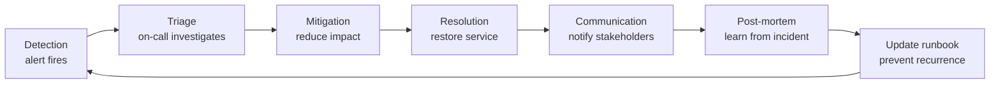

# 17.11 Incident response and game days

| Field | Value |
|---|---|
| Level | Advanced |
| Priority tier | 2 |
| Lab venue | GCP / GKE |
| Part | Part 17: Observability, performance and operations |
| Cross-references | Chapter 17.6 (Alerting and SLOs); Chapter 17.7 (Failure modes); Chapter 17.10 (Cluster lifecycle); Chapter 16.11 (Cloud MLOps platforms) |
| Coverage file | `planning/coverage/chapters/17-11.md` |
| Claim & number ledger | `planning/ledgers/17-11.md` |

## Why this matters for AI infrastructure

Imagine a GPU training cluster that starts failing at two in the morning. Nobody knows who is in charge, so three engineers change things at the same time. Each of them is doing something reasonable on their own, and that is exactly the problem. Their changes collide, the outage runs longer, and the post-mortem never gets written. An incident response process prevents that. It decides ahead of time who responds, how fast they act, and what the team records afterwards.

The earlier chapters in Part 17 were about stopping incidents from starting. Alerting, failure modes, and cluster lifecycle all lower how often things break. They cannot bring the number to zero, because a GPU fleet is large and complicated enough that something will fail eventually. This chapter covers what you do once prevention has failed.

Incident response is a skill you build by repetition. The process gives the team its steps, game days give it practice, and post-mortems turn each real incident into a change. A team that has drilled usually recovers faster, because nobody has to invent the steps during the outage. The steps have already been practised, so the energy goes into the problem instead of the procedure.

```text
Why incident response is on the critical path (background reading: NVIDIA Zero-to-Hero volume 19; NVIDIA Zero-to-Hero volume 16; NVIDIA Zero-to-Hero volume 7; Engineering AI Systems; the figures below are examples, not quotations):
- A typical mature AI platform has 5-15 major incidents per quarter. Each
  incident has a severity; each severity has an escalation; each escalation
  has a comms cadence. The team that has the process responds in minutes; the
  team that does not responds in hours.
- The incident commander is the role that coordinates the response. The IC
  is the single point of contact; the IC is the single point of decision. The
  IC's role is what makes the response coherent.
- Game days are the drills that keep the response muscle sharp. The game day
  is a planned failure; the game day is a timed response; the game day is a
  post-mortem. The team that drills responds in minutes; the team that does
  not responds in hours.
```

The figures in that block, such as 5-15 incidents per quarter, are example values. They are not measured data from a source. Treat them as a starting guess until your own incident history gives you real numbers. Your own history is better evidence than any example, so pull last quarter's pages and count them before you plan staffing around a number.

Three operational realities make this a platform-team concern, not only a data-science concern.

1. Incident response is owned by the platform team. When an alert pages someone, the on-call follows the runbook and escalates to the Incident Commander, who keeps the response coordinated.
2. Game days are a platform-team deliverable. Someone has to plan the failure, schedule the drill, and check that the runbook still matches the cluster.
3. Post-mortems are a platform-team artefact. Each one should end with a runbook or alert change. Otherwise the same incident will come back.

The platform team is the right owner because it sees the whole cluster. A data scientist who is paged about one training run may not know which alerts are shared, which dashboards are trusted, or who can roll back a release. The platform team holds that knowledge and keeps it current.

**A response process is what makes the response fast, consistent, and a source of learning.** Before you write any runbook, decide who the Incident Commander is for your next SEV-1, and who backs them up. A name written down in advance is worth more than a good plan that nobody knows how to start.

## Prerequisites and outcomes

Before you start, you need the alerting, failure-mode, and change-management chapters. Think of this chapter as the response half of the prevention work you have already done. The next part of this section lists what the chapter covers, so you can see whether you are ready.

### Prerequisites

- Chapter 17.6 (Alerting and SLOs) for the alert routing.
- Chapter 17.7 (Failure modes) for the failure mode catalogue.
- Chapter 17.10 (Cluster lifecycle) for the change management process.

### Outcomes

A page at night is the moment this chapter is written for. The chapter starts with the severity levels, SEV-1, SEV-2 and SEV-3, and the escalation for each one. It then walks through the response in stages, from detection to post-mortem, and explains the Incident Commander role and how that person communicates. Next it covers how to plan, run and write up a game day, and how to write a blameless post-mortem with a clear timeline and action items. It closes with how to run the whole process on GKE, so that detection, escalation and learning all work together.

---

## 1. The severity levels

Picture an alert that fires on a Friday evening. Somebody has to decide whether it can wait until Monday or whether it needs the whole team now. Severity is the answer to that question. Severity tells the on-call engineer how fast to move and who to wake up. Pick the level from customer impact, not from how hard the bug looks to fix. A bug that is hard to fix but touches nothing a customer sees is usually a low severity. The response times, deadlines, and cadences in the tables below are example values. Your team should choose its own, based on its SLOs and its staffing.

### 1.1 SEV-1: customer-facing outage

A SEV-1 means customers cannot use the service. Think of the inference API that your product team sells, which has gone dark for every user at once. The SLO is breached, and revenue stops or drops. Treat it as the top priority. The on-call is paged at once, and the escalation clock starts. Every other piece of work waits behind it. A SEV-1 is the one case where normal planning stops for the people involved, because the cost of waiting is paid by customers in real time.

| Property | Value |
|---|---|
| Response time | Immediate (page the on-call) |
| Escalation | IC within 15 minutes; VP Engineering within 30 minutes; CEO within 1 hour |
| Communication cadence | Every 30 minutes |
| Resolution time | Within 4 hours |
| Post-mortem | Within 5 business days |

### 1.2 SEV-2: degraded service

A SEV-2 means the service still works, but customers get a worse experience. Answers arrive, but they are slow enough that some users give up. The SLO is at risk, and revenue may suffer. The on-call responds quickly, but most of the company does not need to drop everything. The difference between a SEV-1 and a SEV-2 is whether customers can use the service at all. When you are unsure between the two, ask whether customers can still use the service at all. If they cannot, the incident is a SEV-1.

| Property | Value |
|---|---|
| Response time | Within 15 minutes (page the on-call) |
| Escalation | IC within 30 minutes; VP Engineering within 1 hour |
| Communication cadence | Every 2 hours |
| Resolution time | Within 24 hours |
| Post-mortem | Within 10 business days |

### 1.3 SEV-3: internal issue

A SEV-3 is a problem inside your team. A failing dashboard that only the platform team reads is a good example. Customers do not notice it. It can wait for business hours, so the on-call notifies the team and the work goes into the normal queue. When you rank a new alert, ask first whether a customer would ever notice it. If the answer is no, the alert is probably a SEV-3, however annoying it is.

| Property | Value |
|---|---|
| Response time | Within 1 hour (notify the on-call) |
| Escalation | IC within 4 hours |
| Communication cadence | Once per business day |
| Resolution time | Within 1 week |
| Post-mortem | Optional |

Before your next incident, write down your team's three severity levels, with one real example of each. Examples from your own history make the levels easier to apply under pressure than the definitions do on their own.

---

## 2. The incident response process

### 2.1 The process stages

Picture a page at night. An alert fires, and within minutes someone has to decide what to do next. The process gives every incident the same path, so the on-call does not have to invent one. It has six stages, shown in the diagram: detection, triage, mitigation, resolution, communication, and post-mortem. The diagram adds one final step: updating the runbook. A runbook is the written set of steps for handling a known kind of problem, and updating it at the end is what stops the same surprise from happening twice.



The stages are not a strict line. Communication runs alongside the others, and the post-mortem happens after the service is back. What matters is that each stage has an owner and a result, so nothing is skipped by accident. Each handoff between stages is a moment when information can get lost. The triage notes should reach the IC before mitigation starts, not after, and the handoff points are worth writing down for that reason.

### 2.2 Detection

Picture a customer emailing to ask why answers are slow, before anyone on your team has seen an alert. That is a detection failure. Detection should happen before a customer tells you about the problem. The alerting stack from Chapter 17.6 watches the metrics and fires an alert. The alert pages the on-call, who acknowledges it so the rest of the team knows someone is looking. An acknowledgement tells everyone that the page has been seen, which stops two people from starting the same investigation.

```bash
# Fire a synthetic alert through Alertmanager's API
curl -X POST http://alertmanager.monitoring:9093/api/v2/alerts \
  -H "Content-Type: application/json" \
  -d '[{"labels": {"alertname": "incident_test", "severity": "critical"}}]'
# expected: the alert fires; the on-call is paged
```

The example above assumes the on-call acknowledges within 5 minutes. That is a target to set for your team, not a standard. Too many critical alerts burn out the on-call and bury the real ones. Put a description and a runbook link in each alert's annotations, so the engineer knows what to check first. Production Kubernetes, chapter 9, also suggests a dead man's switch: an alert that always fires and pages you when it stops. The point of the switch is that silence becomes the signal, so a broken alerting pipeline cannot hide itself.

### 2.3 Triage

Picture an alert waking you up while the dashboard is a wall of colour and nobody has said what is wrong. Triage answers one question: what is actually broken? Start with the runbook, then open the dashboard. Decide the severity only after you have seen what is failing. A severity picked from the alert name alone is often wrong in one direction or the other. Ask these questions at this stage. What changed recently, who is affected, and is the problem getting worse? Those answers usually point at the right runbook section and the right severity.

```bash
# The on-call reads the runbook
open "$(curl -s http://localhost:9093/api/v2/alerts | jq -r '.[0].annotations.runbookURL')"

# The on-call checks the dashboard
curl -s 'http://prometheus.monitoring:9090/api/v1/query?query=histogram_quantile(0.99,%20rate(inference_request_duration_seconds_bucket[5m]))' | jq .

# The on-call determines the severity
echo "SEV-2: degraded inference latency" > /tmp/severity.txt
```

### 2.4 Mitigation

Picture a bad release that is hurting customers right now, while the cause will take an hour to find. Mitigation buys time. The goal is to reduce customer impact now, even before you know the root cause. A rollback is often the fastest option, because it returns the workload to the version that was running before the change. A rollback does not need you to understand the bug first, which is why it is so useful during an outage. Other options are draining a node, scaling out, or switching to a backup. Each trades some risk for speed, so write down your choice. Put it in the incident record with the time it was made. A later reader can then see why the team acted as it did, even if the choice turns out to be wrong.

```bash
# Roll back the recent change
kubectl --context=production rollout undo deployment/churn-model
# expected: the workload reverts to the previous version; the latency improves
```

### 2.5 Resolution

Picture the latency graph coming back down after a fix, and the on-call wanting to say the incident is over. Resolution means the service is healthy and will stay that way. Find the root cause first, then apply a fix that addresses it. Check the SLO with the triage query, so you know the fix worked. A graph that dropped for a moment is not yet proof. The appendix of AI Systems Performance Engineering adds one habit: measure throughput, latency, and utilization before and after each change. Those before and after numbers are what let you say the fix worked, and not just that the graph moved.

```bash
# The on-call identifies the root cause
kubectl logs -n mlops deployment/churn-model --previous | grep "error"
# expected: the root cause is identified

# The on-call applies the fix
kubectl --context=production apply -f fix_manifests/

# The on-call verifies the SLO
curl -s 'http://prometheus.monitoring:9090/api/v1/query?query=histogram_quantile(0.99,%20rate(inference_request_duration_seconds_bucket[5m]))'
# expected: the SLO is met
```

### 2.6 Communication

Picture an executive typing in the chat, asking what is happening, while the on-call is still halfway through a command. Communication runs alongside the fix, not after it. The people waiting for news should not have to interrupt the people fixing the problem. The IC posts updates on the cadence set for the severity. Each update should say what is known, what is not known yet, and when the next update arrives. Keep updates regular, even when nothing has changed, because a quiet channel makes people assume the worst.

```bash
# Send a status update to Slack
python code/part17/send_status_update.py \
  --incident-id INC-2024-03-15-001 \
  --severity SEV-2 \
  --status "Mitigation in progress; root cause identified; ETA 30 minutes"
# expected: the status update is sent to Slack; the status update is sent to email
```

Before your first drill, write the status-update template and the cadence for each severity. Then the first update will not wait for a decision.

---

## 3. The Incident Commander role

In a real incident, several engineers work at once. Without one person coordinating, they duplicate work, contradict each other, and forget to tell anyone outside the room. Picture two engineers rolling back the same service in different ways while a third is changing the alert thresholds. The Incident Commander (IC) is the person who stops that. The IC does not have to fix the problem personally. The job is to keep the response organised and the decisions clear. A good IC is calm, asks short questions, and says out loud who is doing what.

### 3.1 The IC's responsibilities

The IC is the single point of contact during an incident. Everyone else reports to the IC, and the IC decides what happens next. The table below lists the four duties. Each duty is a separate job, and a person who tries to fix the problem and run the response at the same time usually does neither well.

| Responsibility | What the IC does |
|---|---|
| **Coordinate** | The IC assigns tasks; the IC tracks progress; the IC unblocks the team |
| **Decide** | The IC decides the mitigation strategy; the IC decides the rollback; the IC decides the escalation |
| **Communicate** | The IC sends status updates; the IC notifies stakeholders; the IC schedules the post-mortem |
| **Document** | The IC documents the timeline; the IC documents the decisions; the IC documents the action items |

### 3.2 The IC's authority

The IC needs authority to act without waiting for a committee. Picture a rollback that is clearly right, while the person who must approve it is asleep. In practice, the IC can roll back a change, drain a node, scale a workload, or change an SLO for the length of the incident. Agree on these powers before the incident starts. Nobody wants to debate who may roll back production at three in the morning. A debate in the moment costs minutes, and those minutes are paid by the customers. The list of powers should be short and written down. A longer list invites hesitation, because nobody can tell whether a given action is covered.

```bash
# The IC rolls back the recent change
kubectl --context=production rollout undo deployment/churn-model
# expected: the IC's authority is respected; the rollback proceeds
```

### 3.3 The IC's communication

The IC's messages should be short, regular, and easy to scan. Someone reading the channel for the first time should understand the state in a few seconds. The template below gives every update the same shape. Fill in every field each time you post, even the fields that have not changed, so readers never have to guess. The ETA is an example; give your own.

```text
IC communication template:
- Incident: INC-2024-03-15-001
- Severity: SEV-2
- Status: Mitigating
- Root cause: Under investigation
- Mitigation: Rolling back the recent deployment
- ETA: 30 minutes
- Next update: 14:30 UTC
```

Before you name your first IC, put this template in the runbook. The next person on call can then use it without help.

---

## 4. Game days

Picture a Thursday afternoon when the team deliberately loses a GPU node, so it can see what happens before a real node fails at night. A game day is a drill. You plan a failure, inject it in a controlled way, and watch how the team responds. A good game day tests the runbook, the escalation path, and the post-mortem, not only the software. You learn the most from the places where the response stalls, because those are the places where the real outage would stall too. Write the stalls down as findings about the process, not as failures of the people involved.

### 4.1 The game day plan

Picture the plan sitting in a shared document for a week before anyone runs it, so that everyone can read the scenario and the expected timings. The plan below describes one drill: a GPU node fails, and its workload has to move. Read it as a template. The times and targets in it, such as the one-minute alert window and the 30-minute window to meet the SLO, are example values for a practice run. They are not requirements.

```markdown
# Game Day Plan: GPU Node Failure

## Scenario
A GPU node fails; the workload is evicted; the workload must resume on a healthy node.

## Injection
At 14:00 UTC, we will simulate a GPU node failure by cordoning the node and evicting all workloads.

## Expected response
- 14:00: Alert fires
- 14:05: On-call acknowledges the alert
- 14:10: On-call investigates; identifies the failed node
- 14:15: On-call drains the node
- 14:20: Workloads resume on healthy nodes
- 14:30: SLO is met

## Success criteria
- The alert fires within 1 minute of the failure
- The on-call acknowledges the alert within 5 minutes
- The on-call identifies the root cause within 15 minutes
- The SLO is met within 30 minutes
- The post-mortem is written within 5 business days
```

Writing the expected response down before the drill is the key habit. Without it, you cannot tell afterwards whether the team was slow or whether the plan was never realistic.

### 4.2 The game day execution

Schedule the game day ahead of time, so the participants can clear their calendars. On the day, the team stays on call and responds as it would to a real page. A drill that everyone knows is coming tests less than one that feels real, so keep the scenario close to a real failure. Someone should record the timeline as it happens, because timings are hard to recall accurately afterwards. Many teams give each person a role for the drill. One person injects the failure, one person runs the response, and one person keeps the timeline. Splitting the roles means the person keeping the timeline is not also trying to fix the cluster.

```bash
# Schedule the game day
python code/part17/schedule_game_day.py \
  --date "2024-04-15" \
  --time "14:00 UTC" \
  --scenario "GPU Node Failure" \
  --participants platform-team
# expected: the game day is scheduled; the participants are notified
```

### 4.3 The game day post-mortem

Write up every game day the same way you write up a real incident. Record what was tested, what worked, what did not, and who owns each fix. A game day that is not written up teaches the team for one afternoon and then fades. The numbers in the example below are illustrative, not measurements from a real drill. Use the example to see the shape of a good write-up, then replace its numbers with your own.

```markdown
# Game Day Post-Mortem: GPU Node Failure

## What was tested
- Alert fires when a GPU node fails
- On-call acknowledges the alert
- On-call identifies the root cause
- On-call drains the failed node
- Workloads resume on healthy nodes

## What worked
- The alert fired within 30 seconds
- The on-call acknowledged within 3 minutes
- The runbook was accurate and up to date

## What did not work
- The node drain took 10 minutes (expected 5 minutes)
- The SLO was not met within 30 minutes (took 45 minutes)

## Action items
- Investigate the node drain duration (Action: investigate, Owner: platform-team, Due: 2024-04-22)
- Update the runbook with the actual drain duration (Action: update, Owner: platform-team, Due: 2024-04-22)
```

Before you schedule the next drill, check that last quarter's action items are closed or have a new owner. An action item that nobody has picked up is the most common reason the same stall shows up again.

---

## 5. The post-mortem

Picture the team sitting down a few days after an outage, with the timeline on the screen and nobody sure who should speak first. A post-mortem is how an incident turns into something the team learns from. The most useful ones describe the system, not the person who was on call when things went wrong. Ask what allowed the failure and what would have caught it sooner. If people fear blame, they hide details, and hidden details make the next incident harder to understand. A post-mortem is also a record for people who were not there, such as the engineer who joins the team next year and has to learn from the failure without having lived through it.

### 5.1 The blameless template

Every incident gets a blameless post-mortem. Blameless does not mean nobody made a mistake. It means the write-up asks why the system let the mistake reach customers. The template below shows the sections you need. The incident in it is illustrative. Its times, customer counts, and severity are example values, not a record from a real outage. Notice how each action item has an owner and a due date, so the review can track it.

```markdown
# Post-Mortem: INC-2024-03-15-001

## Summary
The inference latency exceeded the SLO for 45 minutes on 2024-03-15. The root cause was a recent deployment that introduced a memory leak in the inference engine.

## Impact
- 100% of inference requests were affected for 45 minutes
- 500 customers experienced degraded latency
- 1 SEV-2 incident; 0 SEV-1 incidents

## Timeline
- 13:45: Deployment of churn-model v7 completed
- 13:50: Latency SLO exceeded
- 13:55: Alert fired; on-call paged
- 14:00: On-call acknowledged
- 14:10: On-call identified the recent deployment
- 14:15: On-call rolled back to v6
- 14:30: Latency returned to normal
- 14:35: SLO met
- 14:45: Incident closed

## Root cause
The deployment of churn-model v7 introduced a memory leak in the inference engine. The leak was caused by an unbounded KV cache. The leak was not detected in staging because the staging traffic was too low to trigger the leak.

## What worked
- The alert fired within 5 minutes
- The on-call acknowledged within 5 minutes
- The on-call identified the root cause within 15 minutes
- The rollback was successful

## What did not work
- The staging traffic was too low to detect the leak
- The promotion gate did not include a memory leak test

## Action items
- Add a memory leak test to the promotion gate (Action: implement, Owner: ml-platform-team, Due: 2024-04-15)
- Increase the staging traffic to match production (Action: implement, Owner: ml-platform-team, Due: 2024-04-30)
- Update the runbook with the rollback procedure (Action: update, Owner: ml-platform-team, Due: 2024-04-15)
```

Read the timeline first, because it shows where the minutes went. The gap between the SLO breach and the alert is detection time, and the gap between the alert and the rollback is response time. Both gaps are things the team can improve, and the action items should aim at the larger one.

Keep configurations and benchmarks in source control, so you can trace a regression back to the change that caused it. Run the performance checks inside your CI/CD pipeline, not only by hand. The appendix checklist of AI Systems Performance Engineering recommends both. In the example above, that is the difference between a memory leak test that runs on every release and one that depends on someone remembering it.

### 5.2 The post-mortem review

The platform team reviews each post-mortem and looks for patterns across incidents. One incident is an accident. The same kind of incident three times in a row is a gap in the system. The review ranks the action items and tracks each one until it closes. Hold the review soon after the write-up, while people still remember the details. Check that every action item has an owner and a due date before the meeting ends. The review should also ask whether any action item repeats an old one. A repeated item means the earlier fix did not stick, and that is a finding in its own right.

```bash
# Schedule the post-mortem review
python code/part17/schedule_review.py \
  --incident-id INC-2024-03-15-001 \
  --date "2024-03-20" \
  --attendees platform-team
# expected: the review is scheduled; the attendees are notified
```

---

## 6. Operating the incident response process

Picture a SEV-1 declared in the middle of the night, and the paging service that should wake the team is itself down. A process is only as good as the tools behind it. Paging, chat, and the bridge call all need to work when an incident starts. This section lists those components, the roles that use them, and the signals that show whether the process is healthy.

### 6.1 The components

The table lists the services that carry an incident. The latency targets in it are example values. Check each one against the vendor's documentation, and set the targets your own team needs. Each row is a service the response depends on, so each row is also a single point of failure to think about.

| Component | Where it runs | Backing store | SLO |
|---|---|---|---|
| PagerDuty | Managed service | (PagerDuty) | Page latency p99 < 30 s |
| Slack | Managed service | (Slack) | Message delivery p99 < 5 s |
| Zoom | Managed service | (Zoom) | Bridge creation < 60 s |
| Incident management | Managed service (PagerDuty, FireHydrant) | (managed) | Incident creation < 1 minute |

Ask one question about each row. If this service fails during an incident, what is the fallback? A team that cannot answer for the paging tool has found its first gap. A fallback can be as simple as a phone tree or a shared status page. The point is that a person knows where to go when the usual channel is down.

### 6.2 IAM and the incident response

Access during an incident should follow the role, not the person. The roles below decide who can be paged, who can declare an incident, and who can join the response. Keep the roles narrow, so a single engineer cannot change everything alone. IAM stands for identity and access management, which is the system that decides who may do what. Narrow roles limit the damage that one tired or mistaken action can cause.

| Role | Who | What they can do |
|---|---|---|
| `oncall.primary` | The current primary on-call | Be paged for every alert; respond to the alert |
| `oncall.secondary` | The current secondary on-call | Be paged for SEV-1; be the backup for the primary |
| `incident.commander` | The platform team lead | Declare incidents; coordinate responses |
| `incident.responder` | Any engineer | Join incident bridges; contribute to the resolution |

The on-call rotation is a platform-team discipline. The example rotation is weekly, with a primary and a secondary who swap over. Your team may choose a different length, but every handover should include the current state of the cluster. A handover that says only who is on call leaves the next person to rediscover what is already broken.

### 6.3 Observability

Track the response itself, not only the cluster. The table lists the measures to watch and the thresholds that should raise a flag. The thresholds are example values, so tune them against your team's own history. MTTA, MTTM, and MTTR matter most. They show how fast the team responds, and their trend shows where it can improve. MTTA is mean time to acknowledge, MTTM is mean time to mitigate, and MTTR is mean time to resolve. The average of each one over your incidents is the number to track.

| Metric | Why it matters | Alert |
|---|---|---|
| Incident rate per week | Cluster health | > 5 per week |
| SEV-1 rate per quarter | Critical incidents | > 1 per quarter |
| Mean time to acknowledge (MTTA) | On-call responsiveness | > 15 minutes |
| Mean time to mitigate (MTTM) | Mitigation effectiveness | > 1 hour |
| Mean time to resolve (MTTR) | Resolution effectiveness | > 4 hours |
| Game day frequency | Drill frequency | > 90 days since last game day |

Pick one of these measures and check it against your last three incidents. That one check will show you whether the dashboard can answer the question you care about. Averages can hide a bad week, so look at the individual incidents behind any average that moves.

---

## 7. How it fails

Six failure modes recur. Each one below has a symptom you can see, a likely diagnosis, and a fix. Read them as warning signs for your own process. Each failure is a process gap rather than a tool gap, which is why the fixes are mostly about training, templates and enforcement. Read each one against the last incident you had, and ask which failure it resembles.

### 7.1 "The on-call is paged but does not know what to do"

The on-call is paged and opens the runbook, but the recovery step is missing, so the on-call is stuck. The runbook was not updated after the last incident. It has gaps, and the on-call was never trained on it. Update the runbook, train the on-call on it, and add an integration test that follows the runbook. A runbook that nobody has opened since the last reorganisation is unlikely to match the cluster as it is today.

### 7.2 "The IC is missing"

A SEV-1 is open with no IC. The response is uncoordinated, and the incident escalates. The IC role is not defined. There is no IC rotation, so the team does not know who the IC is. Define the role, set up the rotation, train the team on it, and add the IC declaration to your alerting. A rotation that is written down, with names and handover times, turns the question of who is IC into a lookup rather than a debate.

### 7.3 "The comms cadence is wrong"

A SEV-1 gets an update only every 4 hours. Stakeholders hear nothing, and the incident escalates. The cadence is not defined, so nobody knows it, and nobody enforces it. Define the cadence for each severity, train the team on it, and enforce it in your incident management tool. A cadence is a promise to stakeholders, so a missed update should be sent late with a reason rather than skipped quietly.

### 7.4 "The post-mortem is not written"

The incident is resolved, but no post-mortem exists. The team does not learn from the incident, and it recurs. There is no template, so people do not know how to start one. Nobody enforces the step either. Create the template, train the team to use it, and make it a required step in the incident management tool. Without a template, the first draft is a blank page, and a blank page is easy to put off.

### 7.5 "The game day is skipped"

The team has not drilled in 6 months. Its muscle memory is weak, and the response is slow. The schedule is missing, the team is busy, and nobody has made the drill a priority. Schedule a game day each quarter, automate the booking, and add the drill to the team's quarterly goals. A drill on the calendar with a named owner is far more likely to happen than one that depends on someone remembering it.

### 7.6 "The post-mortem is not blameless"

The post-mortem names one engineer as the cause. The team does not learn from the incident, because people stop being candid. The team has not adopted a blameless culture, and its leaders have not modelled one. Train the team on blameless reviews, model the approach in your own write-ups, and remove blame language from the template. A post-mortem that names a person should go back for rewriting rather than being published as it stands.

Pick the failure mode that matches your last incident, and fix it before the next drill.

---

## 8. Hands-on lab

Picture a quiet afternoon on a non-production cluster, when you run one full incident from the first alert to the post-mortem. In this lab you walk through one full incident. You detect an alert, triage it, mitigate it, resolve it, communicate, run a drill, and write a post-mortem. The lab is **untested** in this repository, so check each command before you run it. Run them on a non-production cluster first.

### 8.1 Prerequisites

Check these items before you start. The steps assume each one already works.

- The alerting and observability stack from earlier chapters.
- PagerDuty or a similar incident management tool.
- Slack or a similar communication tool.

### 8.2 Step 1: simulate an alert

Start by creating a test alert. Fire it on a non-production cluster, where a page does no harm to customers. A test alert shows you whether the page reaches a real person before you need it to.

```bash
# Inject a synthetic critical alert through Alertmanager's API
curl -X POST http://alertmanager.monitoring:9093/api/v2/alerts \
  -H "Content-Type: application/json" \
  -d '[{"labels": {"alertname": "incident_test", "severity": "critical"}}]'
# expected: the alert fires; the on-call is paged
```

### 8.3 Step 2: triage the alert

The request below opens an incident record in PagerDuty and sets its priority. Open the record before you start investigating, so the timeline has a single home from the first minute. Use the record as the single place where the timeline lives.

```bash
# Open the incident record (acknowledging the page itself is done in the PagerDuty app or its API)
curl -X POST http://pagerduty/api/incidents \
  -H "Authorization: Token token=$PAGERDUTY_TOKEN" \
  -H "Content-Type: application/json" \
  -d '{"incident": {"type": "incident", "title": "INC-2024-03-15-001", "service": {"id": "ai-factory", "type": "service"}, "priority": {"id": "P1", "type": "priority"}}}'
```

### 8.4 Step 3: mitigate the impact

Next, reduce the impact before you chase the cause. Roll back the recent deployment first. It is usually the quickest way to reduce the impact. Watch the latency after the rollback, because that is the signal that tells you the mitigation worked. If the latency does not improve, stop and reconsider before you apply another change.

```bash
# Roll back the recent deployment
kubectl --context=production rollout undo deployment/churn-model
# expected: the workload reverts to the previous version; the latency improves
```

### 8.5 Step 4: resolve the incident

Confirm the SLO is met with the same query you used during triage. Then close the incident record. Use the same query on purpose, so you compare like with like.

```bash
# Verify the SLO is met
curl -s 'http://prometheus.monitoring:9090/api/v1/query?query=histogram_quantile(0.99,%20rate(inference_request_duration_seconds_bucket[5m]))'
# expected: the SLO is met

# Close the incident
curl -X PUT http://pagerduty/api/incidents/INC-2024-03-15-001 \
  -H "Authorization: Token token=$PAGERDUTY_TOKEN" \
  -H "Content-Type: application/json" \
  -d '{"incident": {"status": "resolved"}}'
```

### 8.6 Step 5: communicate

Send the status update so the stakeholders know the incident is over and the post-mortem is coming. A closing message with no next step leaves people unsure whether the problem is really gone. Keep the message short, and name the next step, so readers know what they are waiting for.

```bash
# Send a status update to Slack
python code/part17/send_status_update.py \
  --incident-id INC-2024-03-15-001 \
  --severity SEV-2 \
  --status "Resolved; root cause identified; post-mortem scheduled"
# expected: the status update is sent to Slack
```

### 8.7 Step 6: write the post-mortem

Generate the template, then fill it in using the timeline you recorded during the incident. Do this while the timeline is still fresh. Memory of the order of events fades fast, and the timeline is the most useful part of the write-up.

```bash
# Generate the post-mortem template
python code/part17/generate_post_mortem.py \
  --incident-id INC-2024-03-15-001 \
  --output post_mortem.md
# expected: the post-mortem template is generated
```

### 8.8 Step 7: run a game day

Schedule the drill, then execute it using the same scenario you practised during the lab. Running the scenario again shows whether the first run taught the team anything.

```bash
# Schedule the game day
python code/part17/schedule_game_day.py \
  --date "2024-04-15" \
  --time "14:00 UTC" \
  --scenario "GPU Node Failure"

# Execute the game day
python code/part17/execute_game_day.py \
  --scenario "GPU Node Failure"
```

### 8.9 What to record

When the lab is done, try to answer these five questions quickly, from the dashboards and the records alone.

1. What is the current incident rate per week?
2. What is the current MTTA?
3. What is the current MTTR?
4. When was the last game day?
5. What is the most recent post-mortem, and what were the action items?

The target is five seconds per question. Any answer that takes more than 30 seconds means the process is not yet a production service. These two limits are this chapter's own rule of thumb. Treat them as a starting point, and set your own limits from how quickly your team needs to answer. If you cannot answer one of the five questions at all, that gap is itself the first thing to fix.

---

## Exercises

Try these after you finish the lab. Each one turns a step in this chapter into a tool you can keep and improve. Each one starts from a gap that a real team runs into.

1. **Add an incident severity matrix.** Your team keeps arguing about the severity of each alert. Build a matrix that maps every alert to a severity. *Solution sketch:* Use a YAML file that maps each alert to its severity, and make it the default for every alert.
2. **Add an IC rotation.** Nobody is sure who should lead the next incident. Build a rotation that changes the IC each week. *Solution sketch:* Create a PagerDuty schedule for the IC, and publish it to the team.
3. **Add a game day calendar.** Game days keep getting pushed back. Build a calendar that schedules a game day each quarter. *Solution sketch:* Create a recurring calendar event that repeats quarterly and is visible to the whole team.
4. **Add a post-mortem template.** Post-mortems come out in different shapes. Build a template with a summary, impact, timeline, root cause, what worked, what did not work, and action items. *Solution sketch:* Write it as a Markdown template and make it the default for every post-mortem.
5. **Add an incident response dashboard.** Leaders ask for the state of the response, and nobody can answer quickly. Build a Grafana dashboard that shows the current incident, MTTA, MTTR, and open action items. *Solution sketch:* The panels query PagerDuty and should be visible to the whole team.
6. **Add an incident response game.** New engineers have never handled an incident. Build a game that simulates an incident. The team responds, and is scored on response time. *Solution sketch:* A Python script simulates the incident, measures the response time, and generates the score.

---

## Checkpoint questions

Answer each question in your head before you open it. If you cannot, reread the section it comes from.

<details><summary>1. A page arrives at 02:00. Customers cannot run inference at all and revenue has stopped. Which severity is it, and what clock starts?</summary>
It is a SEV-1, because customers cannot use the service. The on-call is paged at once. The Incident Commander must be involved within 15 minutes, the VP Engineering within 30 minutes, and the CEO within 1 hour. Updates go out every 30 minutes.
</details>

<details><summary>2. Inference latency is slow but every request still succeeds. The SLO is at risk. Which severity do you declare, and what cadence do you follow?</summary>
It is a SEV-2, a degraded service. The on-call responds within 15 minutes and the IC joins within 30 minutes. Status updates go out every 2 hours. Resolution is expected within 24 hours and the post-mortem is due within 10 business days.
</details>

<details><summary>3. Three engineers are all changing settings on a failing cluster at once, and the outage is getting longer. What is missing, and what should it do?</summary>
There is no Incident Commander. The IC is the single point of contact and the single point of decision. They assign tasks, track progress, and decide the mitigation, rollback, and escalation. Everyone else reports to the IC so that changes stop colliding.
</details>

<details><summary>4. A SEV-1 has been open for four hours and stakeholders have heard nothing since the first page. What process gap is this, and how do you fix it?</summary>
The communication cadence was never defined, so nobody knew it and nobody enforced it. Define a cadence per severity, train the team on it, and enforce it in the incident management tool. For a SEV-1 the cadence is every 30 minutes, and each update says what is known, what is not known, and when the next update arrives.
</details>

<details><summary>5. The on-call opens the runbook during a page and finds the recovery step missing. What does the chapter say went wrong earlier, and what three changes does it recommend?</summary>
The runbook was not updated after the last incident, so it has gaps, and the on-call was never trained on it. The fix is to update the runbook, train the on-call, and add an integration test that follows the runbook. The aim is that the next person on call can act without improvising.
</details>

<details><summary>6. A post-mortem draft says "engineer A pushed a bad config and caused the outage." What is wrong with it, and what happens to the next incident if it stands?</summary>
It is not blameless. It names a person instead of describing what the system allowed and what would have caught the failure sooner. When people fear blame they hide details, and hidden details make the next incident harder to understand. Remove the blame language and ask what let the config reach production.
</details>

<details><summary>7. Why does the incident commander need authority to roll back or drain a node without a committee?</summary>
During an incident every minute of debate extends customer impact. If the IC must ask permission, the response waits on whoever answers the page. The chapter says to agree the IC's powers before the incident starts. Then nobody has to argue about who may roll back production at three in the morning.
</details>

<details><summary>8. Why does the process put mitigation before the root cause is known?</summary>
Mitigation buys time by reducing customer impact now. A rollback returns the workload to the version that was running before the change, so it often works without understanding the bug. Resolution comes after, once the root cause is found and a fix is applied and checked against the SLO.
</details>

<details><summary>9. Why does a team that drills with game days usually recover faster than one that does not?</summary>
Nobody has to invent the steps during the outage. A game day tests the runbook, the escalation path, and the post-mortem, and it shows where the response stalls. Skipping drills for six months weakens muscle memory and slows the response.
</details>

<details><summary>10. Why did a memory leak in the example post-mortem reach production even though staging looked fine?</summary>
The staging traffic was too low to trigger the leak, and the promotion gate had no memory leak test. The cause was an unbounded KV cache in churn-model v7. The action items raise staging traffic to match production and add the leak test to the gate.
</details>

<details><summary>11. Why does the chapter require every post-mortem action item to have an owner and a due date?</summary>
An item with no owner has nobody who will do it, and an item with no date has no point at which it can be checked. The review ranks items and tracks each one until it closes. Without that, the same incident comes back.
</details>

<details><summary>12. You must choose a severity for a new alert. A hard-to-fix bug affects only an internal dashboard. Do you pick the severity from how hard the fix is or from customer impact, and what do you give up?</summary>
Pick it from customer impact. Customers do not notice an internal dashboard problem, so it is a SEV-3 with a response within 1 hour and resolution within 1 week. You give up fast attention on a bug that feels serious to engineers. In return the SEV-1 and SEV-2 paths stay reserved for problems customers feel.
</details>

<details><summary>13. A rollback is available but the root cause is unknown. Do you roll back first or investigate first, and what do you give up?</summary>
Roll back first, because it is often the fastest way to cut impact. You give up some evidence of the broken state, and each mitigation option trades some risk for speed. That is why the chapter says to write down the choice. Then investigate the cause with the logs and the previous version.
</details>

<details><summary>14. When would you run a game day for a failure you have already handled in production, and what does it cost?</summary>
Run it when the runbook may have drifted from the cluster, or when the team has not drilled for a long time. The chapter asks for a game day each quarter and flags more than 90 days since the last one. The cost is calendar time and a planned failure, and the gain is finding stale steps while nothing real is at stake.
</details>

<details><summary>15. A page tool shows many critical alerts every week. Do you keep every alert critical or reduce them, and what is the trade-off?</summary>
Reduce them. Too many critical alerts burn out the on-call and bury the real ones. You give up some early warning on lower-risk signals. Each alert should carry a description and runbook link so the engineer knows what to check first.
</details>

<details><summary>16. In the example post-mortem the latency SLO was exceeded at 13:50 and the alert fired at 13:55. How long was the detection delay, and how long after the first SLO breach was the service healthy again?</summary>
The delay was 5 minutes, from 13:50 to 13:55. The SLO was met again at 14:35. That is 45 minutes after the breach, matching the post-mortem's statement of 45 minutes.
</details>

<details><summary>17. In the example game day the drain was expected to take 5 minutes and took 10, and the SLO target of 30 minutes was met at 45. By how much did each miss?</summary>
The drain missed by 5 minutes, since 10 minus 5 is 5. The SLO missed by 15 minutes, since 45 minus 30 is 15. The drain delay is only part of the gap, so the action items also investigate the drain duration and update the runbook with the real figure.
</details>

<details><summary>18. A SEV-1 has a 4-hour resolution target and a 30-minute update cadence. How many updates fit if the incident lasts the full 4 hours, and how many for a SEV-2 at 2-hour cadence over its 24-hour target?</summary>
For the SEV-1, 4 hours is 240 minutes, and 240 divided by 30 is 8 updates. For the SEV-2, 24 divided by 2 is 12 updates. The figures are example targets from the chapter, so set your own from your SLOs and staffing.
</details>

<details><summary>19. An alert fires and the on-call is not sure how bad it is. What do you check first, second, and third?</summary>
First open the runbook linked in the alert annotations. Second check the dashboard, for example the p99 latency query, to see what is actually failing. Third decide the severity, because the chapter says to set it only after you have seen what is broken.
</details>

<details><summary>20. After a rollback, how do you decide the incident is resolved, and in what order do you check?</summary>
First confirm the root cause is identified, for example in the previous container logs. Second apply the fix that addresses it. Third rerun the same triage query and confirm the SLO is met. Only then close the incident record and send the final update.
</details>

---

## Sources and review notes

- NVIDIA Zero-to-Hero Volume 19 (`chapter-02-incident-response.md`). Source for the incident response process, the severity levels, the IC role, and the post-mortem template. The wording has been rewritten in the handbook's voice.
- NVIDIA Zero-to-Hero Volume 16 (`chapter-12-incident-response.md`). Source for the incident response patterns in the MLOps context.
- NVIDIA Zero-to-Hero Volume 7 (`chapter-03-incident-response-and-game-days.md`). Source for the game day patterns and the operational discipline.
- *Engineering AI Systems* (`engineering-ai-systems-architecture-and-devops-essentials`, Chapter 7). Source for the reliability patterns and the post-mortem template.

### Cross-references to other handbook chapters

- Chapter 17.6 for the alerting and SLOs.
- Chapter 17.7 for the failure modes.
- Chapter 17.10 for the cluster lifecycle.
- Chapter 16.11 for the cloud MLOps platforms.

### Migrated from `nvidia-devops`

The incident response operational patterns draw on Volume 19 chapter 2, Volume 16 chapter 12, and Volume 7 chapter 3. The wording has been rewritten in the handbook's voice.

### Explicitly labelled inferences

- The severity thresholds (SEV-1: 4 hours; SEV-2: 24 hours; SEV-3: 1 week) are starting points; specific thresholds depend on the SLO.
- The communication cadence (SEV-1: 30 minutes; SEV-2: 2 hours; SEV-3: 1 day) is a starting point; specific cadences depend on the stakeholder's needs.
- The game day frequency (quarterly) is a starting point; specific frequencies depend on the team's discipline.

### Not verified on live hardware

- The lab in Section 8 is **untested** against a live GKE cluster in this repository.
- The PagerDuty and Slack integrations in the lab require production credentials that are not provided in the lab.
- The post-mortem template in the lab is illustrative; production templates are more detailed.
