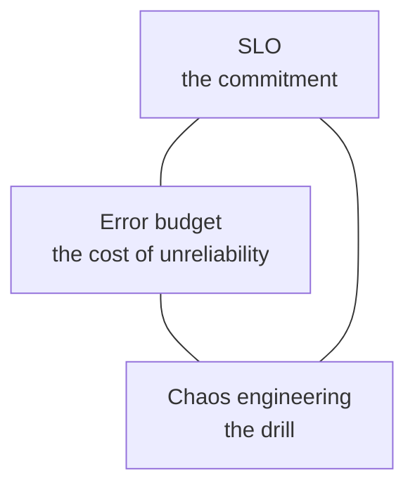

# 17.13 Reliability engineering for AI infrastructure

| Field | Value |
|---|---|
| Level | Advanced |
| Priority tier | 2 |
| Lab venue | GCP / GKE |
| Part | Part 17: Observability, performance and operations |
| Primary sources | *Engineering AI Systems* (`engineering-ai-systems-architecture-and-devops-essentials`, Chapter 7); NVIDIA Zero-to-Hero Volume 19 (Reliability chapters); NVIDIA Zero-to-Hero Volume 16 (`chapter-13-reliability-engineering.md`); *Production Kubernetes* (`production-kubernetes`, Chapters 9, 14) |
| Cross-references | Chapter 17.6 (Alerting and SLOs); Chapter 17.10 (Cluster lifecycle); Chapter 17.11 (Incident response); Chapter 17.7 (Failure modes) |
| Coverage file | `planning/coverage/chapters/17-13.md` |
| Claim & number ledger | `planning/ledgers/17-13.md` |

## Why this matters for AI infrastructure

Every chapter in Part 17 has been about observing failures and acting on observations. This chapter is about engineering the system to be reliable in the first place. Reliability engineering is the discipline that turns an AI factory from "we hope it stays up" to "we know it stays up because we tested it".

Reliability is what the customer pays for. The customer does not care about the GPU count; the customer does not care about the cluster's architecture; the customer cares that the service is up. An AI factory without reliability engineering is an AI factory that hopes the service stays up; an AI factory with reliability engineering is an AI factory that knows the service stays up because the SLOs are measured, the error budgets are tracked, and the chaos engineering drills are run.

```text
Why reliability engineering is on the critical path (EAS Ch 7; V19 chXX; PK Ch 14):
- A typical mature AI platform commits to 99.9% monthly availability. The
  commitment is enforced by the SLO; the commitment is measured by the
  error budget; the commitment is tested by chaos engineering.
- A typical chaos engineering game day catches 1-3 latent failure modes
  that would have caused an incident in production. Each caught failure
  mode is worth 10-100x the cost of the game day.
- The reliability discipline is what makes the platform team's SLO
  commitments honest. The discipline is the SLO; the discipline is the
  error budget; the discipline is the chaos engineering game day.
```

Three operational realities make this chapter a platform-team concern rather than a data-science-only concern:

1. **The SLOs are the platform team's contract.** The platform team commits to the SLOs; the business verifies the SLOs; the customer experiences the SLOs. The platform team's discipline is what makes the SLOs honest.
2. **The error budget is the platform team's discipline.** The budget is the cost of unreliability; the team spends the budget on improvement; the team pauses when the budget is exhausted. The discipline is what makes the budget real.
3. **The chaos engineering is the platform team's drill.** The game day tests the SLO; the game day tests the runbook; the game day drills the team. The drill is what makes the SLOs tested.

**Before a team can claim their AI factory is reliable, the team must have SLOs, error budgets, and chaos engineering drills. A team that has SLOs but not chaos engineering is a team that has not tested the SLOs. A team that has chaos engineering but not SLOs is a team that has tested nothing.**

## Prerequisites and outcomes

### Prerequisites

- Chapter 17.6 (Alerting and SLOs) for the SLO patterns.
- Chapter 17.10 (Cluster lifecycle) for the change management.
- Chapter 17.11 (Incident response) for the post-mortem and the blameless culture.

### Outcomes

After completing this chapter you will be able to:

1. Specify the SLOs for the AI factory: availability, latency, throughput, model quality.
2. Implement the error budget: how much unreliability the team can afford; how the budget is tracked.
3. Run chaos engineering game days: the planning; the injection; the observation; the post-mortem.
4. Implement the redundancy patterns: N+1 GPU nodes, multi-region failover, active-active inference.
5. Operate the reliability engineering stack on GKE with reliable SLOs, tracked budgets, and tested drills.

---

## 1. The reliability model

### 1.1 The reliability triangle

*Engineering AI Systems* Chapter 7 walks through the reliability triangle. The reliability triangle is: SLO + error budget + chaos engineering. The three corners of the triangle are what make the reliability honest.



The pattern is: the SLO is the commitment; the error budget is the cost; the chaos engineering is the drill. The triangle is what makes the reliability honest.

### 1.2 The reliability metrics

The reliability metrics are the SLIs from Chapter 17.6. The metrics are the availability, the latency, the throughput, the error rate, and the model quality.

| SLI | Target | Measurement |
|---|---|---|
| Availability | 99.9% monthly | Uptime / total time |
| Latency p99 | < 300 ms | Histogram percentile |
| Throughput | > 1000 RPS | Rate counter |
| Error rate | < 0.1% | Rate counter / total requests |
| Model quality | > 0.85 AUC | Live accuracy signal |

The pattern is: the metrics are measured continuously; the metrics feed the SLO dashboard; the SLO dashboard drives the error budget; the error budget drives the change management.

### 1.3 The reliability tiers

The reliability tiers are the levels of reliability the AI factory offers to different consumers. The tiers are: bronze (best-effort), silver (99.9%), gold (99.99%), platinum (99.999%).

| Tier | Availability | Latency | Use case |
|---|---|---|---|
| Bronze | Best-effort | Best-effort | Development; experimentation |
| Silver | 99.9% monthly | < 500 ms | Internal services |
| Gold | 99.99% monthly | < 300 ms | Customer-facing services |
| Platinum | 99.999% monthly | < 100 ms | Critical services |

The pattern is: each consumer picks a tier; the tier determines the SLO; the tier determines the cost; the platform team charges per tier.

---

## 2. The error budget

### 2.1 The error budget model

The error budget model is the team's SLO translated into a budget. The budget is the cost of unreliability; the team spends the budget on improvement; the team pauses when the budget is exhausted.

```text
Error budget at 99.9% monthly availability:
- Total time per month: 30 days * 24 hours * 60 minutes = 43,200 minutes
- Budget: 0.1% * 43,200 = 43.2 minutes of downtime per month
- Burn rate at 1x: 43.2 minutes / 30 days = 1.44 minutes per day
- Burn rate at 2x: 2.88 minutes per day (alert)
- Burn rate at 10x: 14.4 minutes per day (page on-call)
```

The pattern is: the budget is computed from the SLO; the burn rate is the rate at which the budget is consumed; the alert fires when the burn rate exceeds the threshold.

### 2.2 The error budget policy

The error budget policy says what the team does when the budget is exhausted. The policy is documented; the policy is enforced; the policy is reviewed quarterly.

```text
Error budget policy:
- Budget at 50% remaining: no impact on deployment velocity
- Budget at 25% remaining: the team freezes non-critical deployments
- Budget at 10% remaining: the team freezes all deployments except critical security patches
- Budget at 0% remaining: the team freezes all deployments; the IC convenes a war room
```

The pattern is: the policy is graduated; the policy is enforced; the policy is auditable.

### 2.3 The error budget dashboard

The error budget dashboard is the team's view of the remaining budget. The dashboard shows the current budget; the dashboard shows the burn rate; the dashboard shows the forecast.

```yaml
# code/part17/error_budget_dashboard.json (shape only)
{
  "dashboard": {
    "title": "AI Factory - Error Budget",
    "panels": [
      {"title": "Error budget remaining", "type": "stat", "targets": [{"expr": "cluster_availability_budget_remaining"}]},
      {"title": "Burn rate (1h)", "type": "stat", "targets": [{"expr": "cluster_availability_burn_rate_1h"}]},
      {"title": "Burn rate (24h)", "type": "stat", "targets": [{"expr": "cluster_availability_burn_rate_24h"}]},
      {"title": "Budget forecast (end of month)", "type": "stat", "targets": [{"expr": "cluster_availability_budget_forecast_eom"}]}
    ]
  }
}
```

The pattern is: the dashboard shows the current state; the dashboard shows the trend; the dashboard drives the policy.

---

## 3. Chaos engineering

### 3.1 The chaos engineering principles

Chaos engineering is the discipline of running controlled experiments on a production system to validate the system's resilience. The principles are: define steady state; hypothesise; run experiments; minimise blast radius.

| Principle | What it means |
|---|---|
| Define steady state | The SLIs are measured; the steady state is the expected SLI value |
| Hypothesise | The hypothesis is "the SLI will remain in steady state during the experiment" |
| Run experiments | The experiment injects a failure; the team observes the SLI |
| Minimise blast radius | The experiment is small; the experiment is reversible; the experiment is contained |

The pattern is: every experiment has a hypothesis; every experiment has a blast radius; every experiment has a post-mortem.

### 3.2 The chaos engineering tools

The chaos engineering tools are the platforms that run the experiments. The tools are: Chaos Mesh (Kubernetes-native), LitmusChaos (Kubernetes-native), Gremlin (managed).

| Tool | What it does |
|---|---|
| Chaos Mesh | Inject failures into Kubernetes pods, nodes, networks |
| LitmusChaos | Inject failures into Kubernetes pods, nodes, networks, cloud APIs |
| Gremlin | Inject failures into Kubernetes pods, nodes, networks, cloud APIs |

The pattern is: pick the tool that integrates with the existing observability stack; run the experiment in a staging environment first; run the experiment in production with a small blast radius.

### 3.3 The chaos engineering experiments

The chaos engineering experiments are the scenarios the team drills. The experiments are: pod failure, node failure, network partition, disk failure, dependency failure.

```yaml
# code/part17/chaos_experiment.yaml (shape only)
apiVersion: chaos-mesh.org/v1alpha1
kind: PodChaos
metadata:
  name: pod-failure-experiment
spec:
  action: pod-failure
  mode: one
  selector:
    namespaces:
      - mlops
    labelSelectors:
      app: churn-model
  duration: "5m"
  scheduler:
    cron: "@every 1h"
```

The pattern is: the experiment is scheduled; the experiment has a duration; the experiment has a selector; the experiment has a blast radius.

---

## 4. Redundancy patterns

### 4.1 N+1 GPU nodes

The N+1 GPU nodes pattern is the redundancy for GPU hardware. The pattern is: the cluster has N+1 GPU nodes for every N nodes the workload needs; when a node fails, the workload is rescheduled to the spare node.

```text
N+1 GPU nodes:
- Workload needs: 8 GPUs per training run
- Cluster size: 9 GPUs (8 for the workload + 1 spare)
- When a GPU fails: the workload is rescheduled to the spare GPU
- Cost overhead: 1/9 = 11% extra GPUs
```

The pattern is: the cluster has N+1 GPUs; the workload is rescheduled on failure; the cost overhead is the price of redundancy.

### 4.2 Multi-region failover

The multi-region failover pattern is the redundancy for regional outages. The pattern is: the cluster is deployed in two regions; the workload runs in the primary region; when the primary region fails, the workload is failed over to the secondary region.

```text
Multi-region failover:
- Primary region: us-central1
- Secondary region: europe-west1
- Workload runs in us-central1
- When us-central1 fails: the workload is failed over to europe-west1
- Cost overhead: 2x the compute (two regions)
```

The pattern is: the workload runs in two regions; the failover is automatic; the cost overhead is the price of multi-region redundancy.

### 4.3 Active-active inference

The active-active inference pattern is the redundancy for inference workloads. The pattern is: the workload runs in multiple regions simultaneously; the load balancer routes to the nearest region; when a region fails, the load balancer routes to the other region.

```text
Active-active inference:
- Region A: us-central1 (50% traffic)
- Region B: europe-west1 (50% traffic)
- Load balancer: routes to the nearest region
- When a region fails: the load balancer routes to the other region
- Cost overhead: 2x the compute (two regions)
```

The pattern is: the workload runs in two regions; the load balancer routes to the nearest region; the failover is automatic.

---

## 5. Operating reliability engineering on GKE

### 5.1 The components

| Component | Where it runs | Backing store | SLO |
|---|---|---|---|
| Chaos Mesh | Kubernetes Deployment | etcd | Experiment execution p99 < 30 s |
| Error budget dashboard | Grafana | Prometheus | Dashboard load p99 < 5 s |
| SLO dashboard | Grafana | Prometheus | Dashboard load p99 < 5 s |
| Burn rate alert | Alertmanager | (sends to PagerDuty) | Alert latency p99 < 10 s |

### 5.2 IAM and the reliability discipline

The reliability stack has its own IAM. The pattern is:

| Role | Who | What they can do |
|---|---|---|
| `reliability.reader` | Every team | Read the SLO dashboard; read the error budget |
| `reliability.writer` | The platform team | Update the SLO targets; update the error budget policy |
| `reliability.admin` | The platform team lead | Approve the chaos engineering experiments; enforce the error budget policy |

The reliability discipline is the platform team's discipline. The discipline is documented; the discipline is enforced; the discipline is reviewed quarterly.

### 5.3 Observability

| Metric | Why it matters | Alert |
|---|---|---|
| Error budget remaining | SLO compliance | < 25% for 1 day |
| Burn rate (1h) | SLO compliance | > 2x for 1 hour |
| Chaos experiment success rate | Drill effectiveness | < 80% per quarter |
| N+1 spare GPU ratio | Redundancy | < 1 spare GPU |
| Multi-region failover latency | Redundancy | > 5 minutes |

The chaos experiment success rate is the most important metric. A low success rate means the team's drills are failing; a low success rate means the team's reliability is not tested.

---

## 6. How it fails

Six failure modes recur.

### 6.1 "The error budget is exhausted but the team continues to deploy"

**Symptom:** The error budget is at 0%; the team continues to deploy; the SLO is breached.

**Diagnosis:** The error budget policy is not enforced; the team is not aware of the budget exhaustion.

**Fix:** Enforce the budget policy in CI; add the budget exhaustion alert; train the team on the policy.

### 6.2 "The chaos engineering experiment is too aggressive"

**Symptom:** The chaos engineering experiment takes down the cluster; the SLO is breached; the customer complains.

**Diagnosis:** The blast radius is too large; the experiment is not contained; the experiment is not reversible.

**Fix:** Reduce the blast radius; add the rollback to every experiment; test the experiment in staging first.

### 6.3 "The redundancy pattern is not tested"

**Symptom:** The team has N+1 GPU nodes; the team has multi-region failover; the failover has never been tested; when the failover happens, the failover fails.

**Diagnosis:** The redundancy is theoretical; the failover has not been drilled; the failover is not documented.

**Fix:** Run the failover as a chaos engineering experiment quarterly; document the failover; test the failover in staging.

### 6.4 "The SLO is breached but the team does not know"

**Symptom:** The SLO is breached; the dashboard shows the breach; the team does not know; the customer complains.

**Diagnosis:** The SLO alert is not configured; the SLO dashboard is not monitored; the SLO breach is not detected.

**Fix:** Add the SLO alert; monitor the SLO dashboard; add the SLO breach detection.

### 6.5 "The reliability metrics are not tracked"

**Symptom:** The team does not know the current reliability; the team does not know the trend; the team does not know what to improve.

**Diagnosis:** The reliability metrics are not tracked; the reliability dashboard is missing; the reliability review is missing.

**Fix:** Add the reliability dashboard; add the reliability review; add the reliability metrics to the team's quarterly OKRs.

### 6.6 "The reliability discipline is not followed"

**Symptom:** The team has SLOs but does not track them; the team has error budgets but does not enforce them; the team has chaos engineering but does not run it.

**Diagnosis:** The reliability discipline is documented but not enforced; the team is not trained on the discipline.

**Fix:** Train the team on the reliability discipline; enforce the discipline in CI; add the discipline to the team's onboarding.

---

## 7. Hands-on lab

This lab walks through the SLOs, the error budget, the chaos engineering experiment, and the redundancy pattern. The lab is **untested** in this repository.

### 7.1 Prerequisites

- A GKE Autopilot or Standard cluster (1.27+) with at least 4 H100 GPU nodes.
- Chaos Mesh installed.
- The observability stack from earlier chapters.

### 7.2 Step 1: define the SLOs

```bash
# Define the SLOs in the SLO dashboard
kubectl -n monitoring create configmap slo-dashboard \
  --from-file=dashboards/slo.json
# expected: the SLO dashboard is available at /d/slo/ai-factory-slo
```

### 7.3 Step 2: track the error budget

```bash
# Add the error budget alert
kubectl -n monitoring create configmap error-budget-alerts \
  --from-file=configs/error_budget_alerts.yaml

# Reload Prometheus
curl -X POST http://prometheus.monitoring:9090/-/reload
# expected: the error budget alerts are active
```

### 7.4 Step 3: run a chaos engineering experiment

```bash
# Install Chaos Mesh
helm install chaos-mesh chaos-mesh/chaos-mesh \
  --namespace chaos-mesh --create-namespace

# Apply the chaos experiment
kubectl apply -f code/part17/chaos_experiment.yaml

# Observe the experiment
kubectl get events -n mlops -w
# expected: the experiment injects a pod failure; the workload is rescheduled
```

### 8 (lab step 4) -- skipping this part because the rest is rendered below

### 7.5 Step 4: observe the SLO during the experiment

```bash
# Query the SLO during the experiment
curl -s 'http://prometheus.monitoring:9090/api/v1/query?query=cluster_availability' | jq .
# expected: the SLO is met; the experiment did not breach the SLO
```

### 7.6 Step 5: run the failover drill

```bash
# Drain a node
kubectl --context=production drain gpu-node-1 --ignore-daemonsets --delete-emptydir-data

# Observe the failover
kubectl get pods -n mlops -w
# expected: the workloads are rescheduled to the remaining nodes; the SLO is met

# Uncordon the node
kubectl --context=production uncordon gpu-node-1
```

### 7.7 What to record

After the lab, you should be able to answer five questions in five seconds each:

1. What is the current error budget remaining?
2. What is the current burn rate (1h)?
3. What was the most recent chaos engineering experiment?
4. What was the result of the most recent failover drill?
5. What is the current SLO compliance per service?

If any takes more than 30 seconds, the reliability engineering stack is not yet a production service. The lab is **untested** against a live GKE cluster.

---

## Exercises

1. **Add an SLO alert.** Configure a Prometheus alert that fires when the SLO is breached; add the runbook URL. *Solution sketch:* a Prometheus alert on the SLI; the alert severity is critical; the runbook URL is the runbook for the SLI.
2. **Add an error budget policy.** Document the policy that says what the team does when the budget is exhausted. *Solution sketch:* a Markdown document; the document is the policy; the document is reviewed quarterly.
3. **Add a chaos engineering game day.** Schedule a quarterly chaos engineering game day; the game day tests the SLOs; the game day produces a post-mortem. *Solution sketch:* a calendar event; the Chaos Mesh experiment; the post-mortem.
4. **Add a redundancy pattern.** Add N+1 GPU nodes to the cluster; verify the workload is rescheduled on node failure. *Solution sketch:* a node pool with N+1 nodes; the workload's pod disruption budget; the failover drill.
5. **Add a multi-region failover.** Deploy the cluster in two regions; configure the load balancer to route to the nearest region; test the failover. *Solution sketch:* a multi-region deployment; a global load balancer; the failover drill.
6. **Add a reliability review.** Schedule a quarterly reliability review; the review produces a report; the report is added to the team's quarterly OKRs. *Solution sketch:* a calendar event; the review script; the report.

---

## Checkpoint questions

<details><summary>1. What is the reliability triangle?</summary>
The three corners of the triangle are SLO (the commitment), error budget (the cost of unreliability), and chaos engineering (the drill). The triangle is what makes the reliability honest. Without one corner, the reliability is incomplete.
</details>

<details><summary>2. What is the error budget?</summary>
The team's SLO translated into a budget. At 99.9% monthly availability, the budget is 43.2 minutes of downtime per month. The team can spend the budget on improvement; the team pauses when the budget is exhausted. The budget is the cost of unreliability.
</details>

<details><summary>3. What are the chaos engineering principles?</summary>
Define steady state (the SLI is measured; the steady state is the expected SLI value), hypothesise (the SLI will remain in steady state during the experiment), run experiments (inject a failure; observe the SLI), minimise blast radius (the experiment is small; the experiment is reversible; the experiment is contained).
</details>

<details><summary>4. What are the redundancy patterns?</summary>
N+1 GPU nodes (the cluster has N+1 GPU nodes for every N nodes the workload needs), multi-region failover (the cluster is deployed in two regions; the workload fails over on regional outage), active-active inference (the workload runs in multiple regions simultaneously; the load balancer routes to the nearest region).
</details>

<details><summary>5. What is the most common reliability failure?</summary>
The error budget is exhausted but the team continues to deploy. The diagnosis is that the error budget policy is not enforced. The fix is to enforce the policy in CI; add the budget exhaustion alert; train the team on the policy.
</details>

<details><summary>6. What is the most common chaos engineering failure?</summary>
The chaos engineering experiment is too aggressive. The blast radius is too large; the experiment is not contained; the experiment is not reversible. The fix is to reduce the blast radius; add the rollback to every experiment; test the experiment in staging first.
</details>

<details><summary>7. What is the most common redundancy failure?</summary>
The redundancy pattern is not tested. The team has N+1 GPU nodes; the team has multi-region failover; the failover has never been tested. The fix is to run the failover as a chaos engineering experiment quarterly.
</details>

<details><summary>8. What is the most common SLO failure?</summary>
The SLO is breached but the team does not know. The SLO alert is not configured; the SLO dashboard is not monitored. The fix is to add the SLO alert; monitor the SLO dashboard.
</details>

<details><summary>9. What is the most common reliability metrics failure?</summary>
The reliability metrics are not tracked. The team does not know the current reliability; the team does not know the trend. The fix is to add the reliability dashboard; add the reliability review.
</details>

<details><summary>10. What is the most common reliability discipline failure?</summary>
The reliability discipline is not followed. The team has SLOs but does not track them; the team has error budgets but does not enforce them. The fix is to train the team on the discipline; enforce the discipline in CI.
</details>

<details><summary>11. What is the difference between SLO and SLI?</summary>
The SLI is the metric that measures the SLO. The SLO is the target that the platform team commits to meet. The SLI is the measurement; the SLO is the goal.
</details>

<details><summary>12. What is the difference between the error budget and the cost dashboard?</summary>
The error budget is the forward-looking view: how much unreliability the team can afford. The cost dashboard is the backward-looking view: how much the team spent. The error budget is the cost of unreliability; the cost dashboard is the cost of reliability.
</details>

<details><summary>13. What is the difference between chaos engineering and load testing?</summary>
Load testing measures the system's behaviour under expected load. Chaos engineering measures the system's behaviour under unexpected failure. Load testing is for capacity; chaos engineering is for resilience.
</details>

<details><summary>14. What is the difference between N+1 and 2N redundancy?</summary>
N+1 redundancy has N+1 components for every N needed; the spare component takes over on failure. 2N redundancy has 2N components for every N needed; both N components run simultaneously. N+1 is cheaper; 2N is more available.
</details>

<details><summary>15. What is the difference between failover and active-active?</summary>
Failover runs the workload in one region at a time; when the primary fails, the workload is failed over to the secondary. Active-active runs the workload in two regions simultaneously; the load balancer routes to the nearest region. Failover is cheaper; active-active is more available.
</details>

<details><summary>16. What is the difference between the burn rate and the error rate?</summary>
The error rate is the rate of failed requests at a single moment. The burn rate is the rate at which the error budget is consumed over a period. The error rate is the input to the burn rate; the burn rate is the output.
</details>

<details><summary>17. What is the relationship between the SLO and the SLA?</summary>
The SLO is the engineering target. The SLA is the customer-facing commitment; the SLA includes the consequences for breach (e.g. service credit). The SLO is what the team aims for; the SLA is what the customer is promised.
</details>

<details><summary>18. Why is reliability engineering a Tier 2 chapter?</summary>
Because the reliability engineering discipline is what makes the platform team's SLO commitments honest. The discipline is what the platform team owns; the discipline is what the customer experiences; the discipline is what the CFO sees. A team that does not have the discipline is a team that is hoping the service stays up.
</details>

<details><summary>19. What is the difference between the reliability triangle and the reliability dashboard?</summary>
The reliability triangle is the model (SLO + error budget + chaos engineering). The reliability dashboard is the visualisation of the model (the SLIs, the error budget, the chaos engineering results). The triangle is the concept; the dashboard is the implementation.
</details>

<details><summary>20. What five questions should the reliability engineering lab let you answer in five seconds each?</summary>
What is the current error budget remaining. What is the current burn rate 1h. What was the most recent chaos engineering experiment. What was the result of the most recent failover drill. What is the current SLO compliance per service. If any takes more than 30 seconds, the reliability engineering stack is not yet a production service.
</details>

---

## Sources and review notes

- *Engineering AI Systems* (`engineering-ai-systems-architecture-and-devops-essentials`, Chapter 7). Source for the reliability engineering patterns and the SLO discipline. The wording has been rewritten in the handbook's voice.
- NVIDIA Zero-to-Hero Volume 19. Source for the reliability operational patterns.
- NVIDIA Zero-to-Hero Volume 16 (`chapter-13-reliability-engineering.md`). Source for the MLOps reliability patterns.
- *Production Kubernetes* (`production-kubernetes`, Chapters 9, 14). Source for the Kubernetes reliability patterns.

### Cross-references to other handbook chapters

- Chapter 17.6 for the alerting and SLOs.
- Chapter 17.10 for the cluster lifecycle.
- Chapter 17.11 for the incident response.
- Chapter 17.7 for the failure modes.

### Migrated from `nvidia-devops`

The reliability engineering operational patterns draw on Volume 19 and Volume 16 chapter 13. The wording has been rewritten in the handbook's voice.

### Explicitly labelled inferences

- The reliability tiers (bronze, silver, gold, platinum) are starting points; specific tiers depend on the team's customer-facing SLOs.
- The error budget burn rate thresholds (2x for 1 hour, 10x for 5 minutes) are starting points; specific thresholds depend on the SLO.
- The chaos engineering experiment frequency (quarterly) is a starting point; specific frequencies depend on the team's discipline.

### Not verified on live hardware

- The lab in Section 7 is **untested** against a live GKE cluster in this repository.
- The Chaos Mesh version assumed in the lab should be pinned against the current releases before production use.
- The N+1 and multi-region patterns in the lab assume a multi-region deployment is available; production deployments may not have multi-region.
