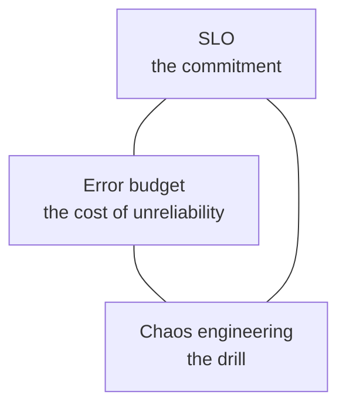

# 17.13 Reliability engineering for AI infrastructure

| Field | Value |
|---|---|
| Level | Advanced |
| Priority tier | 2 |
| Lab venue | GCP / GKE |
| Part | Part 17: Observability, performance and operations |
| Primary sources | *Engineering AI Systems* (`engineering-ai-systems-architecture-and-devops-essentials`, Chapter 7); NVIDIA Zero-to-Hero Volume 19 (Reliability chapters); NVIDIA Zero-to-Hero Volume 16 (`chapter-13-reliability-engineering.md`); *Production Kubernetes* (`production-kubernetes`, Chapters 9, 14) |
| Cross-references | Chapter 17.6 (Alerting and SLOs); Chapter 17.10 (Cluster lifecycle); Chapter 17.11 (Incident response); Chapter 17.7 (Failure modes) |
| Coverage file | `planning/coverage/chapters/17-13.md` |
| Claim & number ledger | `planning/ledgers/17-13.md` |

## Why this matters for AI infrastructure

Suppose a platform team is asked how reliable its AI factory is. The honest answer is often "we hope it stays up." Reliability engineering replaces that hope with measurements, budgets and drills that show the service really does stay up. This chapter explains how to build that discipline on top of the observability work from Part 17.

Customers do not care how many GPUs your cluster has or how it is wired. They care whether the service answers when they call it. An AI factory without reliability engineering depends on luck. An AI factory with it knows its uptime, because the targets are measured, the budget is tracked and the failure drills are run.

```text
Why reliability engineering is on the critical path (background reading: Engineering AI Systems; NVIDIA Zero-to-Hero volume 19; Production Kubernetes; the figures below are examples, not quotations):
- A typical mature AI platform commits to 99.9% monthly availability. The
  commitment is enforced by the SLO; the commitment is measured by the
  error budget; the commitment is tested by chaos engineering.
- A typical chaos engineering game day catches 1-3 latent failure modes
  that would have caused an incident in production. Each caught failure
  mode is worth 10-100x the cost of the game day.
- The reliability discipline is what makes the platform team's SLO
  commitments honest. The discipline is the SLO; the discipline is the
  error budget; the discipline is the chaos engineering game day.
```

Three realities make this a platform-team concern, not only a data-science concern. Each one changes who has to act.

1. The SLOs are the platform team's contract. The team commits to them, the business checks them, and customers feel them. A contract means something only when the team can show it is being kept.
2. The error budget keeps that contract honest. It is the amount of unreliability the team is allowed, and the team spends it on change. When the budget runs out, the team stops changing things and works on stability.
3. Chaos engineering is the drill. A game day tests the SLO, tests the runbook and trains the people who respond to an incident.

**A team that has SLOs but no chaos engineering has never tested its SLOs. A team that has chaos engineering but no SLOs has tested nothing it can measure.**

## Prerequisites and outcomes

This chapter builds on three earlier chapters. Read them first if their ideas are new to you.

### Prerequisites

- Chapter 17.6 (Alerting and SLOs) for the SLO patterns.
- Chapter 17.10 (Cluster lifecycle) for the change management.
- Chapter 17.11 (Incident response) for the post-mortem and the blameless culture.

### Outcomes

After completing this chapter you will be able to do the following. Each outcome is something you can check on your own platform.

1. Specify the SLOs for the AI factory: availability, latency, throughput and model quality.
2. Implement an error budget that shows how much unreliability the team can afford, and track it.
3. Run chaos engineering game days, from planning through injection and observation to the post-mortem.
4. Implement the redundancy patterns: N+1 GPU nodes, multi-region failover and active-active inference.
5. Operate the stack on GKE with measured SLOs, tracked budgets and tested drills.

---

## 1. The reliability model

### 1.1 The reliability triangle

Reliability needs three parts that check one another. The *Engineering AI Systems* book, Chapter 7, calls this the reliability triangle. It joins an SLO (the commitment), an error budget (the allowed unreliability) and chaos engineering (the drill). If one corner is missing, the other two cannot prove much.



### 1.2 The reliability metrics

You cannot set a target until you can measure the service. The measurements are the SLIs from Chapter 17.6, and this chapter uses five of them: availability, latency, throughput, error rate and model quality. Each one answers a question a user would ask, such as "Is it up?" or "Is it fast?"

The targets in the table below are example values. Your team should choose its own numbers after it measures what users actually see.

| SLI | Target | Measurement |
|---|---|---|
| Availability | 99.9% monthly | Uptime / total time |
| Latency p99 | < 300 ms | Histogram percentile |
| Throughput | > 1000 RPS | Rate counter |
| Error rate | < 0.1% | Rate counter / total requests |
| Model quality | > 0.85 AUC | Live accuracy signal |

Measure these continuously. The measurements feed the SLO dashboard. That dashboard drives the error budget, and the budget decides how fast the team can change the system.

### 1.3 The reliability tiers

Not every consumer needs the same reliability, and higher reliability costs more to run. Tiers let each consumer pick a level that matches its job. Bronze suits experiments, and platinum suits critical services.

| Tier | Availability | Latency | Use case |
|---|---|---|---|
| Bronze | Best-effort | Best-effort | Development; experimentation |
| Silver | 99.9% monthly | < 500 ms | Internal services |
| Gold | 99.99% monthly | < 300 ms | Customer-facing services |
| Platinum | 99.999% monthly | < 100 ms | Critical services |

The numbers in this table are example values, not industry standards. Each consumer picks a tier, the tier sets the SLO, and the tier sets the cost. The platform team can then charge each consumer for the level it chooses.

---

## 2. The error budget

### 2.1 The error budget model

Suppose your team promises 99.9% availability for a month. That promise leaves a small amount of room for failure. The error budget turns the promise into minutes of allowed downtime, and the team can spend those minutes on risky changes.

```text
Error budget at 99.9% monthly availability:
- Total time per month: 30 days * 24 hours * 60 minutes = 43,200 minutes
- Budget: 0.1% * 43,200 = 43.2 minutes of downtime per month
- Burn rate at 1x: 43.2 minutes / 30 days = 1.44 minutes per day
- Burn rate at 2x: 2.88 minutes per day (alert)
- Burn rate at 10x: 14.4 minutes per day (page on-call)
```

The arithmetic is simple. A 30-day month has 43,200 minutes, and the 0.1% allowance is 43.2 minutes of that. The burn rate measures how fast you spend that allowance. At 1x you spend it evenly across the month, while 10x spends it ten times faster.

Before you set an alert, decide how much budget you are willing to lose before someone must act.

### 2.2 The error budget policy

A budget helps only when the team agrees in advance what happens when it runs low. That agreement is the policy. The steps in the block below are example values. Your team chooses the percentages and the freezes, writes them down and reviews them on a fixed schedule, such as every quarter.

```text
Error budget policy:
- Budget at 50% remaining: no impact on deployment velocity
- Budget at 25% remaining: the team freezes non-critical deployments
- Budget at 10% remaining: the team freezes all deployments except critical security patches
- Budget at 0% remaining: the team freezes all deployments; the IC convenes a war room
```

### 2.3 The error budget dashboard

The dashboard lets the team see the budget before a problem forces the question. Show the remaining budget, the burn rate and the forecast for the end of the month together. The JSON below is a starting point for a Grafana dashboard.

```yaml
# code/part17/error_budget_dashboard.json
{
  "dashboard": {
    "title": "AI Factory - Error Budget",
    "panels": [
      {"title": "Error budget remaining", "type": "stat", "targets": [{"expr": "cluster_availability_budget_remaining"}]},
      {"title": "Burn rate (1h)", "type": "stat", "targets": [{"expr": "cluster_availability_burn_rate_1h"}]},
      {"title": "Burn rate (24h)", "type": "stat", "targets": [{"expr": "cluster_availability_burn_rate_24h"}]},
      {"title": "Budget forecast (end of month)", "type": "stat", "targets": [{"expr": "cluster_availability_budget_forecast_eom"}]}
    ]
  }
}
```

---

## 3. Chaos engineering

### 3.1 The chaos engineering principles

Chaos engineering means breaking things on purpose, in a controlled way, to learn whether the system holds. A team that never breaks anything learns its weak spots during a real outage. The principles below keep each experiment safe and useful.

Every experiment starts by measuring the steady state, which is the normal value of the SLI. You then state a hypothesis that the SLI stays in that state. Next you inject the failure and watch the SLI, keeping the blast radius small enough to reverse quickly.

| Principle | What it means |
|---|---|
| Define steady state | The SLIs are measured, and the steady state is the expected SLI value |
| Hypothesise | The hypothesis is "the SLI will remain in steady state during the experiment" |
| Run experiments | The experiment injects a failure, and the team observes the SLI |
| Minimise blast radius | The experiment is small, reversible and contained |

### 3.2 The chaos engineering tools

Tools run the experiments so your team does not have to script each failure by hand. Chaos Mesh and LitmusChaos run inside Kubernetes. Gremlin is a managed service. Choose one your team can operate, and check each tool's current documentation before you depend on it.

| Tool | What it does |
|---|---|
| Chaos Mesh | Inject failures into Kubernetes pods, nodes, networks |
| LitmusChaos | Inject failures into Kubernetes pods, nodes, networks, cloud APIs |
| Gremlin | Inject failures into Kubernetes pods, nodes, networks, cloud APIs |

### 3.3 The chaos engineering experiments

Start with the failures your platform is most likely to meet. Pod failure, node failure, network partition, disk failure and dependency failure are common first choices. The example below runs a pod-failure experiment every hour in the mlops namespace, for five minutes each time.

```yaml
# Chaos Mesh runs a recurring experiment through a Schedule resource
apiVersion: chaos-mesh.org/v1alpha1
kind: Schedule
metadata:
  name: pod-failure-hourly
spec:
  schedule: "@every 1h"
  type: PodChaos
  historyLimit: 5
  concurrencyPolicy: Forbid
  podChaos:
    action: pod-failure
    mode: one
    duration: "5m"
    selector:
      namespaces:
        - mlops
      labelSelectors:
        app: churn-model
```

The Chaos Mesh version changes what the manifest may contain. The current PodChaos CRD has no scheduler field, which was checked against the CRD in the upstream repository. Recurring runs therefore use the Schedule kind shown here. Pin the version you install and check the manifest against it, because the experiment itself has not been run on a live cluster.

---

## 4. Redundancy patterns

### 4.1 N+1 GPU nodes

GPU hardware fails, and a spare node is the cheapest way to keep a training run going. N+1 redundancy keeps one spare for every group of nodes a workload needs. When a node fails, the scheduler moves the work to the spare. The AI Factory book, Chapter 9, makes the same point at the level of cloud services: the goal is no single point of failure, so one failed server does not stop the service.

```text
N+1 GPU nodes:
- Workload needs: 8 GPUs per training run
- Cluster size: 9 GPUs (8 for the workload + 1 spare)
- When a GPU fails: the workload is rescheduled to the spare GPU
- Cost overhead: 1/9 = 11% extra GPUs
```

In this example the spare adds about 11 percent to the GPU bill. You pay that price for faster recovery. Before you buy the spare, confirm that the scheduler can really move the workload onto it.

### 4.2 Multi-region failover

Some failures are bigger than one node. A whole region can go down because of a power, network or provider problem. Multi-region failover keeps a second region ready. The workload runs in the primary region until that region fails, and then it moves to the secondary.

```text
Multi-region failover:
- Primary region: us-central1
- Secondary region: europe-west1
- Workload runs in us-central1
- When us-central1 fails: the workload is failed over to europe-west1
- Cost overhead: 2x the compute (two regions)
```

A second region doubles the compute cost, which is the price of surviving a regional outage. A failover that has never been run is a guess, so treat the first drill as part of the design.

### 4.3 Active-active inference

Failover takes time, because the secondary region has to start and then take traffic. Active-active avoids that delay by serving inference from two regions at the same time. A load balancer sends each request to the nearest region, and if one region fails, the other already handles the traffic.

```text
Active-active inference:
- Region A: us-central1 (50% traffic)
- Region B: europe-west1 (50% traffic)
- Load balancer: routes to the nearest region
- When a region fails: the load balancer routes to the other region
- Cost overhead: 2x the compute (two regions)
```

The block shows the cost. Both regions run at once, so compute is doubled. Choose active-active only when even a short outage costs the service too much.

---

## 5. Operating reliability engineering on GKE

### 5.1 The components

Four components make up the stack on GKE. Chaos Mesh runs the experiments. Grafana shows the error budget and the SLO. Alertmanager sends the burn-rate alert to PagerDuty. The table lists where each one runs and what stores its data.

The latency figures in the table are example targets. Set your own after you measure the stack.

| Component | Where it runs | Backing store | SLO |
|---|---|---|---|
| Chaos Mesh | Kubernetes Deployment | etcd | Experiment execution p99 < 30 s |
| Error budget dashboard | Grafana | Prometheus | Dashboard load p99 < 5 s |
| SLO dashboard | Grafana | Prometheus | Dashboard load p99 < 5 s |
| Burn rate alert | Alertmanager | (sends to PagerDuty) | Alert latency p99 < 10 s |

### 5.2 IAM and the reliability discipline

The reliability stack needs its own access rules. Readers should see the dashboards, the platform team should change targets and policy, and only the platform lead should approve experiments. The table shows one way to split those rights.

| Role | Who | What they can do |
|---|---|---|
| `reliability.reader` | Every team | Read the SLO dashboard; read the error budget |
| `reliability.writer` | The platform team | Update the SLO targets; update the error budget policy |
| `reliability.admin` | The platform team lead | Approve the chaos engineering experiments; enforce the error budget policy |

The platform team owns this discipline. It works only when the rules are written down, enforced and reviewed on a regular schedule.

### 5.3 Observability

A dashboard alone is not enough. You need alerts that fire before the budget is gone, and you need to know when the monitoring itself fails. The table lists the metrics to watch and the thresholds to start with. Treat the thresholds as example values to tune for your service.

| Metric | Why it matters | Alert |
|---|---|---|
| Error budget remaining | SLO compliance | < 25% for 1 day |
| Burn rate (1h) | SLO compliance | > 2x for 1 hour |
| Chaos experiment success rate | Drill effectiveness | < 80% per quarter |
| N+1 spare GPU ratio | Redundancy | < 1 spare GPU |
| Multi-region failover latency | Redundancy | > 5 minutes |

Production Kubernetes, Chapter 9, adds one alert that teams often forget. Set an alert that fires on a regular schedule while everything is healthy. If that alert stops arriving, send a critical notice, because your alerting may be down without anyone knowing.

Of the metrics above, the chaos experiment success rate says the most about whether your drills work. A falling rate means the drills keep failing, and the reliability claims are not yet tested.

---

## 6. How it fails

Six failure modes come up again and again. You may recognise one of them from your own team. Each one below starts with a symptom, names the likely cause and gives a fix. Most of them share one root: the practice exists on paper only.

### 6.1 "The error budget is exhausted but the team continues to deploy"

**Symptom:** The budget is at 0%, yet deployments keep going out, and the SLO stays breached.

**Diagnosis:** The policy exists on paper, but nobody enforces it. The team may not even know the budget is gone.

**Fix:** Enforce the policy in CI, alert when the budget runs out, and train the team on what the policy requires. Consider which of these you can add this week.

### 6.2 "The chaos engineering experiment is too aggressive"

**Symptom:** The experiment takes down the cluster, the SLO is breached, and a customer complains.

**Diagnosis:** The blast radius was too large. Nothing contained the experiment, and nothing let the team reverse it quickly.

**Fix:** Shrink the blast radius, add a rollback to every experiment, and rehearse first in staging.

### 6.3 "The redundancy pattern is not tested"

**Symptom:** The team has N+1 GPU nodes and a second region, but the failover has never run. When a real failure arrives, the failover fails too.

**Diagnosis:** The redundancy exists only on paper. Nobody has drilled it, and nobody has written down the steps.

**Fix:** Run the failover as a chaos experiment every quarter, document each step, and test in staging first.

### 6.4 "The SLO is breached but the team does not know"

**Symptom:** The dashboard shows the breach, but nobody acts on it, and the customer raises the problem first.

**Diagnosis:** The SLO alert is missing, or nobody watches the dashboard. The breach goes undetected.

**Fix:** Add an SLO alert, name an owner for the dashboard, and add breach checks to the on-call routine.

Hardware signals belong on the same alert list. AI Systems Performance Engineering, Chapter 16, treats any uncorrectable ECC memory error as a critical alert, because it corrupts data and requires a reset.

### 6.5 "The reliability metrics are not tracked"

**Symptom:** The team cannot say whether reliability is improving or getting worse, and it cannot name its weakest service.

**Diagnosis:** No reliability dashboard or review exists, so the numbers never get looked at.

**Fix:** Build the reliability dashboard, hold a regular review, and add reliability goals to the team's planning cycle.

### 6.6 "The reliability discipline is not followed"

**Symptom:** The team writes SLOs but does not track them, sets budgets but does not enforce them, and plans drills but never runs them.

**Diagnosis:** The discipline is written down but not enforced, and the team never learned how to use it.

**Fix:** Train the team, enforce the rules in CI, and include the discipline in onboarding for new engineers.

---

## 7. Hands-on lab

This lab walks through the SLOs, the error budget, a chaos experiment and a redundancy drill. No one has run it against a live cluster yet, so treat each step as a plan to test, not a proven procedure.

### 7.1 Prerequisites

- A GKE Autopilot or Standard cluster (1.27+) with at least 4 H100 GPU nodes.
- Chaos Mesh installed.
- The observability stack from earlier chapters.

### 7.2 Step 1: define the SLOs

Start by putting the SLO definitions where the whole team can see them. The command below loads the dashboard file into a ConfigMap, and the comment after it shows where to find the dashboard.

```bash
# Define the SLOs in the SLO dashboard
kubectl -n monitoring create configmap slo-dashboard \
  --from-file=dashboards/slo.json
# expected: the SLO dashboard is available at /d/slo/ai-factory-slo
```

### 7.3 Step 2: track the error budget

Next, load the error budget alerts and reload Prometheus so the rules take effect. The reload call goes to the Prometheus endpoint in the monitoring namespace. The expected line tells you the alerts are live.

```bash
# Add the error budget alert
kubectl -n monitoring create configmap error-budget-alerts \
  --from-file=configs/error_budget_alerts.yaml

# Reload Prometheus
curl -X POST http://prometheus.monitoring:9090/-/reload
# expected: the error budget alerts are active
```

### 7.4 Step 3: run a chaos engineering experiment

Install Chaos Mesh, apply the experiment, and watch the events. You should see a pod fail and the workload come back on another node.

```bash
# Install Chaos Mesh
helm install chaos-mesh chaos-mesh/chaos-mesh \
  --namespace chaos-mesh --create-namespace

# Apply the chaos experiment
kubectl apply -f code/part17/chaos_experiment.yaml

# Observe the experiment
kubectl get events -n mlops -w
# expected: the experiment injects a pod failure; the workload is rescheduled
```

### 8 (lab step 4) -- skipping this part because the rest is rendered below

### 7.5 Step 4: observe the SLO during the experiment

While the experiment runs, query the availability metric. The result shows whether the SLO held through the failure.

```bash
# Query the SLO during the experiment
curl -s 'http://prometheus.monitoring:9090/api/v1/query?query=cluster_availability' | jq .
# expected: the SLO is met; the experiment did not breach the SLO
```

### 7.6 Step 5: run the failover drill

Drain one node to simulate a failure, watch the pods move, and then bring the node back. The drain runs against the production context, so schedule it in a window your team has agreed on.

```bash
# Drain a node
kubectl --context=production drain gpu-node-1 --ignore-daemonsets --delete-emptydir-data

# Observe the failover
kubectl get pods -n mlops -w
# expected: the workloads are rescheduled to the remaining nodes; the SLO is met

# Uncordon the node
kubectl --context=production uncordon gpu-node-1
```

### 7.7 What to record

After the lab, check that you can answer five questions quickly. Each answer should come from the dashboard in a few seconds.

1. What is the current error budget remaining?
2. What is the current burn rate (1h)?
3. What was the most recent chaos engineering experiment?
4. What was the result of the most recent failover drill?
5. What is the current SLO compliance per service?

The five-second and 30-second limits in this section are example values. Pick limits that match your own on-call needs. If the answers take longer, the stack still needs work before it can carry production traffic. The lab has not yet been run against a live GKE cluster.

---

## Exercises

Work through these on your own cluster or in a sandbox, and write down what you find.

1. **Add an SLO alert.** Write a Prometheus alert that fires when the SLO is breached, and link it to a runbook. *Solution sketch:* the alert watches the SLI, carries critical severity and points to the runbook for that SLI.
2. **Add an error budget policy.** Write down what the team does when the budget runs out. *Solution sketch:* a short Markdown document that states the policy and gets reviewed on a schedule.
3. **Add a chaos game day.** Schedule a game day each quarter that tests the SLOs and ends in a post-mortem. *Solution sketch:* a calendar event, a Chaos Mesh experiment and a written post-mortem.
4. **Add N+1 GPU nodes.** Add a spare node to the cluster and check that the workload moves when a node fails. *Solution sketch:* a node pool with one spare node, a pod disruption budget for the workload and a failover drill.
5. **Add multi-region failover.** Deploy the cluster in two regions, route traffic to the nearest one and test the switch. *Solution sketch:* a second-region deployment, a global load balancer and a failover drill.
6. **Add a reliability review.** Hold a quarterly review that produces a short report and feeds the team's goals. *Solution sketch:* a calendar event, a review script that gathers the numbers and the report itself.

---

## Checkpoint questions

<details><summary>1. The error budget is at 0 percent, yet deployments keep going out and the SLO stays breached. What went wrong and how do you fix it?</summary>
The policy exists on paper but nobody enforces it, and the team may not even know the budget is gone. At 0 percent remaining the policy says all deployments freeze and the IC convenes a war room. Enforce the policy in CI, alert when the budget runs out, and train the team on what it requires.
</details>

<details><summary>2. A chaos experiment takes down the cluster, the SLO is breached, and a customer complains. What does the chapter say went wrong?</summary>
The blast radius was too large. Nothing contained the experiment, and nothing let the team reverse it quickly. Shrink the blast radius, add a rollback to every experiment, and rehearse in staging first.
</details>

<details><summary>3. A region fails and the failover to the second region fails too. The team had a spare region for a year. Why?</summary>
The failover had never been run, so the redundancy existed only on paper. Nobody had drilled it or written down the steps. Run the failover as a chaos experiment every quarter, document each step, and test in staging first.
</details>

<details><summary>4. The dashboard shows an SLO breach, but nobody acts and the customer reports the problem first. What is missing?</summary>
The SLO alert is missing, or nobody watches the dashboard, so the breach goes undetected. Add an SLO alert, name an owner for the dashboard, and add breach checks to the on-call routine.
</details>

<details><summary>5. With the example policy, the error budget has 20 percent left. What happens to deployments?</summary>
The remaining budget is below the 25 percent step, so the team freezes non-critical deployments. It has not yet reached 10 percent, where all deployments except critical security patches freeze. The percentages are example values that your team chooses and reviews.
</details>

<details><summary>6. The regular always-firing alert stops arriving while everything looks healthy. What should you do?</summary>
Treat it as a critical notice, because your alerting may be down without anyone knowing. Production Kubernetes, Chapter 9, describes this alert. It fires on a schedule while the system is healthy, so its silence is the signal.
</details>

<details><summary>7. Why does the error budget make the SLO commitment honest?</summary>
The budget is the amount of unreliability the team is allowed, and the team spends it on change. When the budget runs out, the team stops changing things and works on stability. Without it, the SLO is a number nobody has to act on.
</details>

<details><summary>8. Why does the chapter say a team with SLOs but no chaos engineering has never tested its SLOs?</summary>
An SLO only describes what the team commits to. Chaos engineering injects a failure and watches whether the SLI stays in steady state. Without that drill, the commitment has never been put under stress.
</details>

<details><summary>9. Why must you measure steady state before you inject a failure?</summary>
The experiment's hypothesis is that the SLI will remain in steady state. You cannot say whether the SLI stayed there unless you measured its normal value first. The SLIs are measured continuously so that the baseline already exists.
</details>

<details><summary>10. Why does active-active inference avoid the delay that failover has?</summary>
With failover, the secondary region has to start and then take traffic. With active-active, both regions already serve traffic, each with about half. If one fails, the load balancer routes to the other, which already handles requests.
</details>

<details><summary>11. Why does the chapter treat an uncorrectable ECC memory error as a critical alert?</summary>
AI Systems Performance Engineering, Chapter 16, says such an error corrupts data and requires a reset. It is a hardware signal, so it belongs on the same alert list as the SLO signals. Waiting for a customer to notice would be too late.
</details>

<details><summary>12. A service is customer-facing and another is an internal tool. Which tier do you give each, and what do you give up?</summary>
Give the customer-facing service Gold at 99.99 percent monthly and under 300 ms, and the internal tool Silver at 99.9 percent and under 500 ms. Higher tiers cost more to run, so you give up spend for the stronger commitment. The tier sets the SLO and the cost, so the platform team can charge accordingly.
</details>

<details><summary>13. When would you choose N+1 nodes, multi-region failover, or active-active, and what do you give up with each?</summary>
N+1 covers a single GPU node failure and costs about 11 percent in the 8-GPU example. Multi-region failover covers a whole region outage but doubles compute and takes time to switch. Active-active has no switch delay but also doubles compute, so choose it only when even a short outage costs too much.
</details>

<details><summary>14. Would you start chaos experiments in production or in staging, and what is the trade-off?</summary>
Rehearse in staging first, with a small reversible blast radius. You give up the realism of production. In return a mistake does not breach the SLO or reach a customer, which is exactly what happened in the too-aggressive experiment.
</details>

<details><summary>15. Do you freeze deployments at 25 percent budget left, or wait until 10 percent, and what do you give up?</summary>
Freezing early protects the SLO but slows delivery. Waiting keeps velocity high but leaves little room if something breaks. The example policy freezes non-critical work at 25 percent and nearly everything at 10 percent. Your team chooses its own steps and reviews them each quarter.
</details>

<details><summary>16. What is the error budget for a 99.9 percent monthly SLO in a 30-day month, and how much is that per day?</summary>
A month has 30 times 24 times 60, which is 43,200 minutes. The allowance of 0.1 percent is 43.2 minutes. At a burn rate of 1x that is 43.2 divided by 30, or 1.44 minutes per day.
</details>

<details><summary>17. At a 10x burn rate, how fast is the 43.2-minute budget gone?</summary>
At 10x the team loses 14.4 minutes per day, since 1.44 times 10 is 14.4. The budget lasts 43.2 divided by 14.4, which is 3 days. That is why a 10x burn pages the on-call.
</details>

<details><summary>18. A workload needs 8 GPUs, and you add one spare. What is the overhead, and what does the second region add?</summary>
The cluster is 9 GPUs. The spare is 1 out of 9, which is about 11 percent. A second region doubles the compute, so 9 GPUs becomes 18 in the example.
</details>

<details><summary>19. The burn rate alert fires. What do you look at first, second, and third?</summary>
First check the error budget remaining, to see how much room is left. Second compare the 1-hour and 24-hour burn rates, to see whether the spend is a spike or a steady drain. Third read the end-of-month forecast, to decide whether to freeze deployments under the policy.
</details>

<details><summary>20. A chaos experiment starts and the SLI leaves steady state. What do you do, in order?</summary>
First watch the SLI against the steady state you measured. Second reverse the experiment, which is why each one needs a rollback and a small blast radius. Third write up what failed and shrink the blast radius before running it again.
</details>

---

## Sources and review notes

- *Engineering AI Systems* (`engineering-ai-systems-architecture-and-devops-essentials`, Chapter 7). Source for the reliability engineering patterns and the SLO discipline. The wording has been rewritten in the handbook's voice.
- NVIDIA Zero-to-Hero Volume 19. Source for the reliability operational patterns.
- NVIDIA Zero-to-Hero Volume 16 (`chapter-13-reliability-engineering.md`). Source for the MLOps reliability patterns.
- *Production Kubernetes* (`production-kubernetes`, Chapters 9, 14). Source for the Kubernetes reliability patterns.

### Cross-references to other handbook chapters

- Chapter 17.6 for the alerting and SLOs.
- Chapter 17.10 for the cluster lifecycle.
- Chapter 17.11 for the incident response.
- Chapter 17.7 for the failure modes.

### Migrated from `nvidia-devops`

The reliability engineering operational patterns draw on Volume 19 and Volume 16 chapter 13. The wording has been rewritten in the handbook's voice.

### Explicitly labelled inferences

- The reliability tiers (bronze, silver, gold, platinum) are starting points; specific tiers depend on the team's customer-facing SLOs.
- The error budget burn rate thresholds (2x for 1 hour, 10x for 5 minutes) are starting points; specific thresholds depend on the SLO.
- The chaos engineering experiment frequency (quarterly) is a starting point; specific frequencies depend on the team's discipline.

### Not verified on live hardware

- The lab in Section 7 is **untested** against a live GKE cluster in this repository.
- The Chaos Mesh version assumed in the lab should be pinned against the current releases before production use.
- The N+1 and multi-region patterns in the lab assume a multi-region deployment is available; production deployments may not have multi-region.
