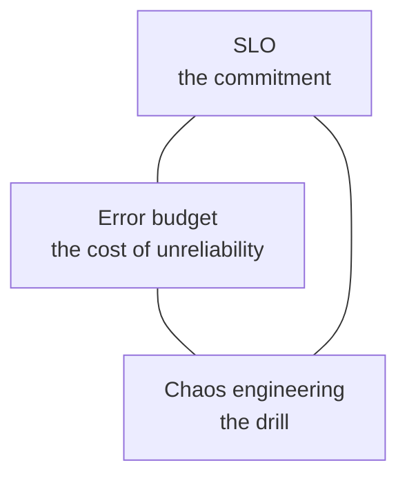

# 17.13 Reliability engineering for AI infrastructure

| Field | Value |
|---|---|
| Level | Advanced |
| Priority tier | 2 |
| Lab venue | GCP / GKE |
| Part | Part 17: Observability, performance and operations |
| Cross-references | Chapter 17.6 (Alerting and SLOs); Chapter 17.10 (Cluster lifecycle); Chapter 17.11 (Incident response); Chapter 17.7 (Failure modes) |
| Coverage file | `planning/coverage/chapters/17-13.md` |
| Claim & number ledger | `planning/ledgers/17-13.md` |

## Why this matters for AI infrastructure

Suppose a platform team is asked how reliable its AI factory is. The honest answer is often "we hope it stays up." That answer is not a lie, but it is not a plan either. Reliability engineering replaces the hope with measurements, budgets and drills that show the service really does stay up. This chapter builds that discipline on top of the observability work from Part 17.
Customers do not care how many GPUs your cluster has or how it is wired. They care whether the service answers when they call it. Picture someone at night sending a prompt from a phone and waiting for a reply that never comes. For that person, the GPU count is invisible, and only the wait and the failure are real. An AI factory without reliability engineering depends on luck when a night like that arrives. An AI factory with it knows its uptime in advance, because the targets are measured, the budget is tracked and the failure drills are run before the bad night happens.

A large GPU fleet fails on a schedule you can compute. In 54 days of Llama 3 405B pretraining on up to 16,000 H100 GPUs, Meta recorded 419 unexpected interruptions, about one every three hours. Most were hardware. A team that knows those numbers can size its spare nodes, price its repair time and set a budget it can actually keep. A team that does not know them promises 99.9 percent and finds out in the first month. The numbers matter because they change what a team builds. One interruption does not just stop one GPU. It stops the whole job for every GPU in the run, so the cost of a single failure is measured in lost hours across the fleet. Section 1.4 works through the numbers.

Three realities make this a platform-team concern, not only a data-science concern. Each one changes who has to act, and each one points at a different part of the platform.

1. The SLOs are the platform team's contract. The team commits to them, the business checks them, and customers feel them. A contract means something only when the team can show it is being kept, so the team has to keep the receipts.
2. The error budget keeps that contract honest. It is the amount of unreliability the team is allowed, and the team spends it on change. When the budget runs out, the team stops changing things and works on stability.
3. Chaos engineering is the drill. A game day tests the SLO, tests the runbook and trains the people who respond to an incident.

**A team that has SLOs but no chaos engineering has never tested its SLOs. A team that has chaos engineering but no SLOs has tested nothing it can measure.**

## Prerequisites and outcomes

Picture a reader who skips the SLO chapter and then gets lost at the first error budget table. This chapter builds on three earlier chapters. Read them first if their ideas are new to you, because the words SLO, error budget and post-mortem are used here without a fresh introduction each time.

### Prerequisites

Each prerequisite covers one piece of the ground this chapter stands on.

- Chapter 17.6 (Alerting and SLOs) for the SLO patterns.
- Chapter 17.10 (Cluster lifecycle) for the change management.
- Chapter 17.11 (Incident response) for the post-mortem and the blameless culture.

### Outcomes

Picture the Monday after a bad weekend, when the platform lead is asked whether the AI factory met its promise. This chapter walks through the answer to that question, one layer at a time. It starts with the SLOs that define the promise, moves to the error budget that says how much risk the team may take, and then covers the chaos experiments that test the promise before a real failure does. It shows the redundancy patterns that keep the service up when hardware fails, and it ends with the way these pieces run on GKE, with measured SLOs, tracked budgets and drills that have been run.

---

## 1. The reliability model

A new manager asks why the team spends so much time on targets when the service looks fine. This section builds the model that answers that question.

### 1.1 The reliability triangle

Picture a platform team that wrote a clear promise on a slide, then was asked in a review what happens when a node dies on a Friday evening. The slide had no answer. Reliability needs three parts that check one another, and the reliability triangle is a simple picture of those parts. It joins an SLO (the commitment), an error budget (the allowed unreliability) and chaos engineering (the drill). If one corner is missing, the other two cannot prove much.

Each corner answers a different question. The SLO answers what the team promised. The error budget answers how much the team may miss in the meantime. Chaos engineering answers whether the promise holds when something breaks.


### 1.2 The reliability metrics

Start with a user who types a question and waits for the answer. Two feelings decide whether that user is happy. Did the answer come back quickly, and did it come back at all? The measurements that capture those feelings are called service level indicators, or SLIs, and they are the raw material for every SLO. You cannot set a target until you can measure the service, so the measurements come first. The SLIs are described in Chapter 17.6, and this chapter uses five of them: availability, latency, throughput, error rate and model quality. Each one answers a question a user would ask, such as "Is it up?" or "Is it fast?"

The targets in the table below are example values. Your team should choose its own numbers after it measures what users actually see, because a target set from a guess is only a wish.

| SLI | Target | Measurement |
|---|---|---|
| Availability | 99.9% monthly | Uptime / total time |
| Latency p99 | < 300 ms | Histogram percentile |
| Throughput | > 1000 RPS | Rate counter |
| Error rate | < 0.1% | Rate counter / total requests |
| Model quality | > 0.85 AUC | Live accuracy signal |

Read the table as five questions. Availability asks whether the service is up at all. Latency asks how long a request waits, and the p99 entry describes the slowest tail of requests, the ones that most users will rarely see but that the unlucky few always do. Throughput asks how much work the service handles per second. Error rate asks how often a request fails. Model quality asks whether the answers are still good, which matters because a model can stay fast and up while its answers drift.

Measure these continuously. The measurements feed the SLO dashboard. That dashboard drives the error budget, and the budget decides how fast the team can change the system. A measurement taken once a quarter cannot steer anything, so the value of the SLI comes from its steady, always-on stream.

### 1.3 The reliability tiers

Consider two requests that land on the same platform on the same day. A data scientist wants a notebook server that is always there for her experiments. Another team wants a fast chatbot for paying customers. Should both get the same promise? Probably not, because a promise costs money to keep, and the customer-facing service needs a stronger one than the experiment does.

Not every consumer needs the same reliability, and higher reliability costs more to run. Tiers let each consumer pick a level that matches its job. Bronze suits experiments, and platinum suits critical services. The tier is a shared language, so a team can say "we need gold" and everyone knows what that means in availability and latency.

| Tier | Availability | Latency | Use case |
|---|---|---|---|
| Bronze | Best-effort | Best-effort | Development; experimentation |
| Silver | 99.9% monthly | < 500 ms | Internal services |
| Gold | 99.99% monthly | < 300 ms | Customer-facing services |
| Platinum | 99.999% monthly | < 100 ms | Critical services |

The numbers in this table are example values, not industry standards. Each consumer picks a tier, the tier sets the SLO, and the tier sets the cost. The platform team can then charge each consumer for the level it chooses.
### 1.4 What a large GPU fleet really experiences

On a quiet afternoon a GPU fails, the training job stops, and the on-call engineer asks whether this is bad luck or normal life for a large fleet. The honest answer comes from data, and the best public record of GPU fleet failures is Meta's account of 54 days of Llama 3 405B pretraining. The run used up to 16,000 H100 GPUs, and Meta reported 466 job interruptions, of which 47 were planned and 419 were unexpected. The table lists the unexpected ones by root cause, with each share computed against the 419.

| Root cause | Count | Share of 419 |
|---|---|---|
| Faulty GPU | 148 | 35.3% |
| GPU HBM3 memory | 72 | 17.2% |
| Software bug | 54 | 12.9% |
| Network switch or cable | 35 | 8.4% |
| Host maintenance (unplanned) | 32 | 7.6% |
| GPU SRAM memory | 19 | 4.5% |
| GPU system processor | 17 | 4.1% |
| NIC | 7 | 1.7% |
| NCCL watchdog timeouts | 7 | 1.7% |
| Silent data corruption | 6 | 1.4% |
| GPU thermal interface and sensor | 6 | 1.4% |
| Other host parts, dependency and CPU | 16 | 3.8% |

Five numbers come out of the table, and each one feeds a decision. Ask each question in turn, and the answer will tell you what to buy, what to repair and what to promise.

- How often does the job stop? 54 days is 1,296 hours, and 1,296 divided by 419 is 3.1 hours. A job that spans the whole fleet is interrupted about every three hours.
- Which parts fail most? The six GPU rows add up to 268 of 419, which is 64 percent. Plan spares and repair around GPU and node hardware first.
- How often does one GPU fail? The 268 GPU-caused interruptions over at most 16,000 GPUs is about 1.7 percent of GPUs in 54 days, or roughly 11 percent a year. The real GPU count in the snapshot is not stated, so treat this as a lower bound.
- How much training time survives? Meta reports that despite the interruptions it kept more than 90 percent effective training time, which depends on fast detection, automatic restart and checkpoints, covered in chapter 14.11.
- What does this mean for a smaller fleet? Scale the rate by GPU count. A 1,024-GPU cluster sees about 0.5 interruptions a day, one every two days. That assumes your hardware and software behave like Meta's, so replace the rate with your own after one quarter of data.

Spare pool sizing comes next. A failed node is out of service until it is repaired or replaced. If failures arrive at a rate of r per day and repair takes d days, the average number of nodes in repair is r times d. For 1,024 GPUs the rate is 0.5 a day. With a one-day repair, 0.5 nodes are out on average. The spare pool has to cover the bad days, not the average. Treat the arrivals as random, which gives these odds that the spare pool is enough.

| Repair time | Mean nodes out | Spares for 98% cover | Spares for 99.5% cover |
|---|---|---|---|
| 1 day | 0.5 | 2 | 3 |
| 2 days | 1.0 | 3 | 4 |

Doubling repair time doubles the average nodes out, and the spare pool grows with it. Imagine a bank that keeps a few spare tellers for busy hours. If the sick tellers stay sick twice as long, the bank needs more spares, even though the number of illnesses has not changed. The cheapest reliability work on a GPU fleet is often a faster repair loop, not more spares: automatic cordon and drain from chapter 17.4, a quick vendor RMA path and a validation run with `dcgmi diag -r 3` before the node returns.

Pool availability follows from the same numbers. A 128-node pool with 0.5 nodes out on average is 99.6 percent available. At a two-day repair time it is 99.2 percent. A 99.5 percent GPU pool SLO therefore holds with a one-day repair and fails with a two-day repair, with no change in hardware quality. Set the SLO from the repair loop you can sustain, not from the hope you have about the hardware.

---

## 2. The error budget

Picture a team that has just shipped a risky change and now has to explain how much room is left. The error budget is the number that answers that question. This section explains how to compute it, how to write its policy and how to show it on a dashboard, because most teams find the budget hardest at first.

### 2.1 The error budget model

Suppose your team promises 99.9% availability for a month. That promise leaves a small amount of room for failure. A team that hears "99.9%" for the first time often pictures a promise that the service never goes down. The promise actually allows a little downtime, and the error budget turns that allowance into minutes. The team can then spend those minutes on risky changes, such as a new model version or a risky network change, and know exactly how much room is left.

```text
Error budget at 99.9% monthly availability:
- Total time per month: 30 days * 24 hours * 60 minutes = 43,200 minutes
- Budget: 0.1% * 43,200 = 43.2 minutes of downtime per month
- Burn rate 1 spends it evenly: 43.2 minutes / 30 days = 1.44 minutes per day
- Burn rate 10 spends it in 3 days: 14.4 minutes per day
```

The arithmetic is simple. A 30-day month has 43,200 minutes, and the 0.1% allowance is 43.2 minutes of that. The burn rate measures how fast you spend that allowance. At a burn rate of 1 you spend it evenly across the month, while a burn rate of 10 spends it ten times faster. Think of the budget as a fuel tank. A steady drive uses the fuel slowly, while a race uses it up in a few laps. Chapter 17.6 turns burn rate into paging rules with two windows, so that a fast burn wakes someone up and a slow leak waits for the morning.

Before you set an alert, decide how much budget you are willing to lose before someone must act. That decision is a team choice, and it should be written down before the first bad week arrives.

### 2.2 The error budget policy

Picture a Thursday when a release is ready, the budget is nearly gone, and nobody agrees on what happens next. A budget helps only when the team agrees in advance what happens when it runs low. Without that agreement, every low-budget week turns into a debate, and the debate usually goes the way of whoever is most senior in the room. That agreement is the policy. The steps in the block below are example values. Your team chooses the percentages and the freezes, writes them down and reviews them on a fixed schedule, such as every quarter.

```text
Error budget policy:
- Budget at 50% remaining: no impact on deployment velocity
- Budget at 25% remaining: the team freezes non-critical deployments
- Budget at 10% remaining: the team freezes all deployments except critical security patches
- Budget at 0% remaining: the team freezes all deployments; the IC convenes a war room
```

The IC in the last line is the incident commander, the person who runs a response while the rest of the team works the problem. Writing the steps down means the person on call never has to invent the rules while the budget is already gone.

A GPU fleet adds two budget rules of its own. First, count the repair backlog as budget spend. A pool that is 99.2 percent available against a 99.5 percent target is out of budget even if every service SLO is green, so freeze non-critical changes and draining upgrades, as in chapter 17.10, until spares are back. Second, spend budget on purpose. A planned driver upgrade takes nodes out of service, and the budget should say how many node-hours per month planned work may use, so planned work does not eat the margin that failures need. Planned work is a deliberate withdrawal, and an unplanned failure is a surprise charge. Both draw from the same account.

### 2.3 The error budget dashboard

Picture the Thursday meeting where a product manager asks whether the next release can go out. The dashboard lets the team see the budget before a problem forces the question. If the answer lives in a dashboard that everyone already reads, the meeting takes a minute. Show the remaining budget, the burn rate and the forecast for the end of the month together. The JSON below is a starting point for a Grafana dashboard, which is the open dashboard tool many teams use to draw charts from their metrics.

```yaml
# code/part17/error_budget_dashboard.json
{
  "dashboard": {
    "title": "AI Factory - Error Budget",
    "panels": [
      {"title": "Error budget remaining", "type": "stat", "targets": [{"expr": "cluster_availability_budget_remaining"}]},
      {"title": "Burn rate (1h)", "type": "stat", "targets": [{"expr": "cluster_availability_burn_rate_1h"}]},
      {"title": "Burn rate (24h)", "type": "stat", "targets": [{"expr": "cluster_availability_burn_rate_24h"}]},
      {"title": "Budget forecast (end of month)", "type": "stat", "targets": [{"expr": "cluster_availability_budget_forecast_eom"}]}
    ]
  }
}
```

Each panel answers one question. The remaining budget asks how much room is left. The two burn rates ask whether the spending is a spike or a steady drain. The forecast asks where the month will end if nothing changes. Together they tell the team whether to freeze, slow down or keep shipping.

---

## 3. Chaos engineering

Picture a team that learns its weakest spot during a real outage, in front of customers and at the worst possible moment. Chaos engineering sounds reckless until you see that alternative. It moves that learning to a calm afternoon, with a plan and a way to stop.

### 3.1 The chaos engineering principles

Consider a new engineer who asks, on her first week, what happens if one pod in the inference service disappears. Nobody in the room is sure. Chaos engineering exists to replace that uncertainty with a test. It means breaking things on purpose, in a controlled way, to learn whether the system holds. The principles below keep each experiment safe and useful.

Every experiment starts by measuring the steady state, which is the normal value of the SLI. You then state a hypothesis that the SLI stays in that state. Next you inject the failure and watch the SLI, keeping the blast radius small enough to reverse quickly. The blast radius is the set of users and systems that the experiment could touch, and a good experiment keeps that set small.

| Principle | What it means |
|---|---|
| Define steady state | The SLIs are measured, and the steady state is the expected SLI value |
| Hypothesise | The hypothesis is "the SLI will remain in steady state during the experiment" |
| Run experiments | The experiment injects a failure, and the team observes the SLI |
| Minimise blast radius | The experiment is small, reversible and contained |

Notice the order. The team measures first, predicts second and breaks things third. Skipping the first step leaves the team with no baseline, so the result cannot be read. Skipping the last step turns an experiment into an outage.

### 3.2 The chaos engineering tools

Picture a new engineer who must break a pod for the first time and does not know which tool to trust. Tools run the experiments so your team does not have to script each failure by hand. A tool also keeps a record of what was injected and when, which the post-mortem later needs. Chaos Mesh and LitmusChaos run inside Kubernetes. Gremlin is a managed service. Choose one your team can operate, and check each tool's current documentation before you depend on it. The best tool is the one your on-call engineers already know how to stop in a hurry.

| Tool | What it does |
|---|---|
| Chaos Mesh | Inject failures into Kubernetes pods, nodes, networks |
| LitmusChaos | Inject failures into Kubernetes pods, nodes, networks, cloud APIs |
| Gremlin | Inject failures into Kubernetes pods, nodes, networks, cloud APIs |

The table is a lookup of what each tool can touch. Chaos Mesh stays close to Kubernetes objects. LitmusChaos and Gremlin also reach cloud APIs, which matters when the failure you want to test lives outside the cluster.

### 3.3 The chaos engineering experiments

Picture a team that wants one drill on the calendar this month and cannot agree on what to break first. A first experiment should be boring to predict and easy to undo. Start with the failures your platform is most likely to meet. Pod failure, node failure, network partition, disk failure and dependency failure are common first choices. The example below runs a pod-failure experiment every hour in the mlops namespace, for five minutes each time. The namespace is the Kubernetes folder where the churn model lives, and the label selector picks out only that model's pods.

```yaml
# Chaos Mesh runs a recurring experiment through a Schedule resource
apiVersion: chaos-mesh.org/v1alpha1
kind: Schedule
metadata:
  name: pod-failure-hourly
spec:
  schedule: "@every 1h"
  type: PodChaos
  historyLimit: 5
  concurrencyPolicy: Forbid
  podChaos:
    action: pod-failure
    mode: one
    duration: "5m"
    selector:
      namespaces:
        - mlops
      labelSelectors:
        app: churn-model
```

Walk through the manifest from the top. The schedule field says how often the experiment fires. The podChaos block says what to break, which is one pod at a time, for five minutes, among the pods that match the label. The concurrency setting forbids a second run while the first is still going, so two experiments never stack on each other.

The Chaos Mesh version changes what the manifest may contain. The current PodChaos CRD has no scheduler field, which was checked against the CRD in the upstream repository. Recurring runs therefore use the Schedule kind shown here. Pin the version you install and check the manifest against it before you trust the experiment on a live cluster.

---

## 4. Redundancy patterns

Picture a single rack switch that fails on a busy afternoon and takes a whole training job with it. Redundancy means keeping a spare of something important, so that losing one piece does not stop the service. This section covers three levels of spare, from a spare node inside a cluster to a whole second region.

### 4.1 N+1 GPU nodes

A training run that has been going for a long stretch can lose its progress in a moment if the wrong node fails. A spare node is the cheapest way to keep that from happening. GPU hardware fails, and a spare node is the cheapest way to keep a training run going. The unit of replacement is the node, not the single GPU, because the eight GPUs of a node share one NVLink domain and one host. NVLink is NVIDIA's high-speed link between GPUs inside one server, and a job that spans those GPUs expects them all to be present. N+1 redundancy keeps at least one spare node for each group of nodes a workload needs. Section 1.4 shows how to size the pool from the failure rate and the repair time, and the result is usually more than one spare for a large fleet.

```text
Spare nodes for a 128-node pool (1,024 GPUs):
- Failure rate: about 0.5 node failures per day
- Repair time: 1 day, so about 0.5 nodes are in repair on average
- Spare pool: 2 nodes for 98 percent cover, 3 nodes for 99.5 percent
- Cost overhead: 2/128 = 1.6 percent to 3/128 = 2.3 percent extra nodes
```

Read the block as a chain of reasoning. The failure rate and the repair time give the average number of nodes out. The spare count then covers that average with a safety margin for the bad days. The cost line shows what the margin costs as a share of the pool.

The spare pool is cheap next to the cost of a stalled run, but only if the scheduler can use it. A spare that sits in a rack and cannot be reached by the job is only a cost. Confirm that a failed node's job restarts on a spare from its last checkpoint, which is a saved copy of the training state, and drill it. The drill is the only proof that the restart works on a Tuesday morning as well as on paper.

### 4.2 Multi-region failover

Picture a regional power problem that takes every node in one region offline at once. Some failures are bigger than one node. A whole region can go down because of a power, network or provider problem, and no number of spare nodes inside that region will help. Multi-region failover keeps a second region ready. The workload runs in the primary region until that region fails, and then it moves to the secondary. The second region sits warm and waiting, so the move does not have to build anything from scratch.

```text
Multi-region failover:
- Primary region: us-central1
- Secondary region: europe-west1
- Workload runs in us-central1
- When us-central1 fails: the workload is failed over to europe-west1
- Cost overhead: 2x the compute (two regions)
```

Think of this as a spare house with the power on. The family lives in the first house. If a storm takes the first house offline, they move to the second, which is already furnished. A second region doubles the compute cost, which is the price of surviving a regional outage. A failover that has never been run is a guess, so treat the first drill as part of the design.

### 4.3 Active-active inference

Picture a customer on the far side of the world who waits while a secondary region starts up. Failover takes time, because the secondary region has to start and then take traffic. That customer may give up before the new region is ready. Active-active avoids that delay by serving inference from two regions at the same time. A load balancer sends each request to the nearest region, and if one region fails, the other already handles the traffic. Inference means running a trained model to answer a request, so this pattern keeps the answers coming without a switch.

```text
Active-active inference:
- Region A: us-central1 (50% traffic)
- Region B: europe-west1 (50% traffic)
- Load balancer: routes to the nearest region
- When a region fails: the load balancer routes to the other region
- Cost overhead: 2x the compute (two regions)
```

The block shows the cost. Both regions run at once, so compute is doubled. The trade is clear. Failover is cheaper and slower, while active-active is faster and always busy. Choose active-active only when even a short outage costs the service too much.

---

## 5. Operating reliability engineering on GKE

Picture a platform lead who must show on one page which tools run the reliability loop and who may touch each one. Google Kubernetes Engine (GKE) is the managed Kubernetes service in this chapter's lab, and this section shows how the reliability pieces fit together on it.

### 5.1 The components

Imagine a new on-call engineer on her first shift. She opens the dashboard, sees a burn-rate alert and wants to know which system raised it and where its data lives. Four components make up the stack on GKE. Chaos Mesh runs the experiments. Grafana shows the error budget and the SLO. Alertmanager sends the burn-rate alert to PagerDuty, the paging service that calls the person on duty. The table lists where each one runs and what stores its data.

The latency figures in the table are example targets. Set your own after you measure the stack. The point of the table is to show that every component has a home and a store, so nothing is a mystery during an incident.

| Component | Where it runs | Backing store | SLO |
|---|---|---|---|
| Chaos Mesh | Kubernetes Deployment | etcd | Experiment execution p99 < 30 s |
| Error budget dashboard | Grafana | Prometheus | Dashboard load p99 < 5 s |
| SLO dashboard | Grafana | Prometheus | Dashboard load p99 < 5 s |
| Burn rate alert | Alertmanager | (sends to PagerDuty) | Alert latency p99 < 10 s |

### 5.2 IAM and the reliability discipline

Picture a junior analyst who wants to approve an experiment that would stop a production service. The reliability stack needs its own access rules, because not everyone may change a target or approve a chaos experiment. IAM, which means identity and access management, is the set of rules that decides who may do which action. The rules should say no, and they should say it without anyone needing to remember a policy. Readers should see the dashboards, the platform team should change targets and policy, and only the platform lead should approve experiments. The table shows one way to split those rights.

| Role | Who | What they can do |
|---|---|---|
| `reliability.reader` | Every team | Read the SLO dashboard; read the error budget |
| `reliability.writer` | The platform team | Update the SLO targets; update the error budget policy |
| `reliability.admin` | The platform team lead | Approve the chaos engineering experiments; enforce the error budget policy |

The platform team owns this discipline. It works only when the rules are written down, enforced and reviewed on a regular schedule. A rule that exists only in a wiki page will be bent on the first hard day.

### 5.3 Observability

Picture a dashboard that looks healthy for weeks, then fails to load on the night the budget runs out. A dashboard alone is not enough. You need alerts that fire before the budget is gone, and you need to know when the monitoring itself fails. The table lists the metrics to watch and the thresholds to start with. Treat the thresholds as example values to tune for your service.

| Metric | Why it matters | Alert |
|---|---|---|
| Error budget remaining | SLO compliance | < 25% for 1 day |
| Burn rate | SLO compliance | Multi-window rules from chapter 17.6 |
| GPU pool availability | Spare and repair health | Below the pool SLO for 1 day |
| Nodes in repair | Spare pool pressure | More than the spares you hold |
| Chaos experiment success rate | Drill effectiveness | < 80% per quarter |
| N+1 spare GPU ratio | Redundancy | < 1 spare GPU |
| Multi-region failover latency | Redundancy | > 5 minutes |

Add one alert that teams often forget. Set an alert that fires on a regular schedule while everything is healthy. If that alert stops arriving, send a critical notice, because your alerting may be down without anyone knowing. A silent pager is ambiguous. It might mean all is well, or it might mean the pager is broken, and this heartbeat-style alert is how you tell the two apart.

Of the metrics above, the chaos experiment success rate says the most about whether your drills work. A falling rate means the drills keep failing, and the reliability claims are not yet tested. Read it as a signal about the platform, not about the people who run the drills.

---

## 6. How it fails

Picture a Monday review where the budget reads zero, yet the deploy log shows three releases went out on Friday. Six failure modes come up again and again. You may recognise one of them from your own team. Each one below names what you see, what usually sits underneath it and what to do about it. Most of them share one root: the practice exists on paper only.

### 6.1 "The error budget is exhausted but the team continues to deploy"

The budget dashboard reads 0%, yet new deployments keep going out and the SLO stays breached. That is the symptom. The likely cause is that the policy exists on paper, but nobody enforces it. The team may not even know the budget is gone, because the number lives in a tool nobody opens. The fix is to enforce the policy in CI, which is the automated build and release system, to alert when the budget runs out, and to train the team on what the policy requires. Consider which of these you can add this week.

### 6.2 "The chaos engineering experiment is too aggressive"

The experiment takes down the cluster, the SLO is breached, and a customer complains. The likely cause is that the blast radius was too large. Nothing contained the experiment, and nothing let the team reverse it quickly. The fix is to shrink the blast radius, add a rollback to every experiment, and rehearse first in staging, which is a copy of production used for testing.

### 6.3 "The redundancy pattern is not tested"

The team has N+1 GPU nodes and a second region, but the failover has never run. When a real failure arrives, the failover fails too, and the team learns that its backup was only a diagram. The likely cause is that the redundancy exists only on paper. Nobody has drilled it, and nobody has written down the steps. The fix is to run the failover as a chaos experiment every quarter, document each step, and test in staging first.

### 6.4 "The SLO is breached but the team does not know"

The dashboard shows the breach, but nobody acts on it, and the customer raises the problem first. The likely cause is that the SLO alert is missing, or nobody watches the dashboard. The breach goes undetected, which is the worst way to learn about it. The fix is to add an SLO alert, name an owner for the dashboard, and add breach checks to the on-call routine.

Hardware signals belong on the same alert list. Treat any uncorrectable ECC memory error as a critical alert, because it corrupts data and requires a reset. ECC is the error-correcting code memory that GPUs use, and an uncorrectable error is one it cannot repair on its own. Chapter 17.4 holds the rule.

### 6.5 "The reliability metrics are not tracked"

The team cannot say whether reliability is improving or getting worse, and it cannot name its weakest service. Ask a team lead which service breaks most often, and you may get three different answers. The likely cause is that no reliability dashboard or review exists, so the numbers never get looked at. The fix is to build the reliability dashboard, hold a regular review, and add reliability goals to the team's planning cycle.

### 6.6 "The reliability discipline is not followed"

The team writes SLOs but does not track them, sets budgets but does not enforce them, and plans drills but never runs them. This is the most common failure, and it looks busy from the outside. The likely cause is that the discipline is written down but not enforced, and the team never learned how to use it. The fix is to train the team, enforce the rules in CI, and include the discipline in onboarding for new engineers.

---

## 7. Hands-on lab

On a Monday morning a lab group wants to see the whole reliability loop in one sitting. They define the promise, watch the budget, break one pod on purpose and drain a node to test the failover. This lab walks through the SLOs, the error budget, a chaos experiment and a redundancy drill. The commands were not run on hardware for this book, so treat each step as a plan to test.

### 7.1 Prerequisites

Picture a lab partner who starts typing commands before the cluster even exists. Check these three things before you start, because each later step leans on them.

- A GKE Autopilot or Standard cluster (1.27+) with at least 4 H100 GPU nodes.
- Chaos Mesh installed.
- The observability stack from earlier chapters.

### 7.2 Step 1: define the SLOs

Picture a teammate who asks where the SLO is written down, and nobody can point to a page. Start by putting the SLO definitions where the whole team can see them. A promise hidden in a file on one laptop is no promise at all. The command below loads the dashboard file into a ConfigMap, which is a Kubernetes object that holds plain configuration, and the comment after it shows where to find the dashboard.

```bash
# Define the SLOs in the SLO dashboard
kubectl -n monitoring create configmap slo-dashboard \
  --from-file=dashboards/slo.json
# expected: the SLO dashboard is available at /d/slo/ai-factory-slo
```

### 7.3 Step 2: track the error budget

Picture an alert rule that you wrote yesterday and that never fires. Next, load the error budget alerts and reload Prometheus so the rules take effect. Without the reload, Prometheus keeps running with its old rules, and the new alert never fires. The reload call goes to the Prometheus endpoint in the monitoring namespace. The expected line tells you the alerts are live.

```bash
# Add the error budget alert
kubectl -n monitoring create configmap error-budget-alerts \
  --from-file=configs/error_budget_alerts.yaml

# Reload Prometheus
curl -X POST http://prometheus.monitoring:9090/-/reload
# expected: the error budget alerts are active
```

### 7.4 Step 3: run a chaos engineering experiment

Picture a pod that disappears while the team watches the dashboard. Install Chaos Mesh, apply the experiment, and watch the events. Keep your eyes on the mlops namespace while the experiment runs. You should see a pod fail and the workload come back on another node. If the pod does not come back, stop the experiment and look at the scheduler before you go on.

```bash
# Install Chaos Mesh
helm install chaos-mesh chaos-mesh/chaos-mesh \
  --namespace chaos-mesh --create-namespace

# Apply the chaos experiment
kubectl apply -f code/part17/chaos_experiment.yaml

# Observe the experiment
kubectl get events -n mlops -w
# expected: the experiment injects a pod failure; the workload is rescheduled
```

### 7.5 Step 4: observe the SLO during the experiment

Picture the minute after the failure starts, when the first question is whether users notice. While the experiment runs, query the availability metric. The result shows whether the SLO held through the failure. A quick look at one number can tell you whether the promise survived the test, so run the query while the failure is still active, not after it has ended.

```bash
# Query the SLO during the experiment
curl -s 'http://prometheus.monitoring:9090/api/v1/query?query=cluster_availability' | jq .
# expected: the SLO is met; the experiment did not breach the SLO
```

### 7.6 Step 5: run the failover drill

Picture a node that must leave service for repair on a weekday afternoon. Drain one node to simulate a failure, watch the pods move, and then bring the node back. Draining means moving the workloads off a node and marking it unavailable for new work. The drain runs against the production context, so schedule it in a window your team has agreed on. Someone should be watching the dashboard when it starts, and someone should be ready to uncordon the node if the move goes wrong.

```bash
# Drain a node
kubectl --context=production drain gpu-node-1 --ignore-daemonsets --delete-emptydir-data

# Observe the failover
kubectl get pods -n mlops -w
# expected: the workloads are rescheduled to the remaining nodes; the SLO is met

# Uncordon the node
kubectl --context=production uncordon gpu-node-1
```

### 7.7 What to record

Picture the next on-call engineer who asks for the state of the platform while you are on a call. After the lab, check that you can answer five questions quickly. Write the answers in your own notes, because the next person on call will ask the same things. Each answer should come from the dashboard in a few seconds.

1. What is the current error budget remaining?
2. What is the current burn rate (1h)?
3. What was the most recent chaos engineering experiment?
4. What was the result of the most recent failover drill?
5. What is the current SLO compliance per service?

The five-second and 30-second limits in this section are example values. Pick limits that match your own on-call needs. If the answers take longer, the stack still needs work before it can carry production traffic. A slow answer during an incident is a reliability problem in its own right.

---

## Exercises

Imagine your team has the dashboard and the budget but no drill on the calendar yet. Work through these on your own cluster or in a sandbox, and write down what you find. Each exercise starts from a gap that a real team often has, and each one ends with a result you can show someone else.

1. **Add an SLO alert.** Write a Prometheus alert that fires when the SLO is breached, and link it to a runbook. *Solution sketch:* the alert watches the SLI, carries critical severity and points to the runbook for that SLI.
2. **Add an error budget policy.** Write down what the team does when the budget runs out. *Solution sketch:* a short Markdown document that states the policy and gets reviewed on a schedule.
3. **Add a chaos game day.** Schedule a game day each quarter that tests the SLOs and ends in a post-mortem. *Solution sketch:* a calendar event, a Chaos Mesh experiment and a written post-mortem.
4. **Add N+1 GPU nodes.** Add a spare node to the cluster and check that the workload moves when a node fails. *Solution sketch:* a node pool with one spare node, a pod disruption budget for the workload and a failover drill.
5. **Add multi-region failover.** Deploy the cluster in two regions, route traffic to the nearest one and test the switch. *Solution sketch:* a second-region deployment, a global load balancer and a failover drill.
6. **Add a reliability review.** Hold a quarterly review that produces a short report and feeds the team's goals. *Solution sketch:* a calendar event, a review script that gathers the numbers and the report itself.

---

## Checkpoint questions

<details><summary>1. The error budget is at 0 percent, yet deployments keep going out and the SLO stays breached. What went wrong and how do you fix it?</summary>
The policy exists on paper but nobody enforces it, and the team may not even know the budget is gone. At 0 percent remaining the policy says all deployments freeze and the IC convenes a war room. Enforce the policy in CI, alert when the budget runs out, and train the team on what it requires.
</details>

<details><summary>2. A chaos experiment takes down the cluster, the SLO is breached, and a customer complains. What does the chapter say went wrong?</summary>
The blast radius was too large. Nothing contained the experiment, and nothing let the team reverse it quickly. Shrink the blast radius, add a rollback to every experiment, and rehearse in staging first.
</details>

<details><summary>3. A region fails and the failover to the second region fails too. The team had a spare region for a year. Why?</summary>
The failover had never been run, so the redundancy existed only on paper. Nobody had drilled it or written down the steps. Run the failover as a chaos experiment every quarter, document each step, and test in staging first.
</details>

<details><summary>4. The dashboard shows an SLO breach, but nobody acts and the customer reports the problem first. What is missing?</summary>
The SLO alert is missing, or nobody watches the dashboard, so the breach goes undetected. Add an SLO alert, name an owner for the dashboard, and add breach checks to the on-call routine.
</details>

<details><summary>5. With the example policy, the error budget has 20 percent left. What happens to deployments?</summary>
The remaining budget is below the 25 percent step, so the team freezes non-critical deployments. It has not yet reached 10 percent, where all deployments except critical security patches freeze. The percentages are example values that your team chooses and reviews.
</details>

<details><summary>6. The regular always-firing alert stops arriving while everything looks healthy. What should you do?</summary>
Treat it as a critical notice, because your alerting may be down without anyone knowing. The alert fires on a schedule while the system is healthy, so its silence is the signal.
</details>

<details><summary>7. Why does the error budget make the SLO commitment honest?</summary>
The budget is the amount of unreliability the team is allowed, and the team spends it on change. When the budget runs out, the team stops changing things and works on stability. Without it, the SLO is a number nobody has to act on.
</details>

<details><summary>8. Why does the chapter say a team with SLOs but no chaos engineering has never tested its SLOs?</summary>
An SLO only describes what the team commits to. Chaos engineering injects a failure and watches whether the SLI stays in steady state. Without that drill, the commitment has never been put under stress.
</details>

<details><summary>9. Why must you measure steady state before you inject a failure?</summary>
The experiment's hypothesis is that the SLI will remain in steady state. You cannot say whether the SLI stayed there unless you measured its normal value first. The SLIs are measured continuously so that the baseline already exists.
</details>

<details><summary>10. Why does active-active inference avoid the delay that failover has?</summary>
With failover, the secondary region has to start and then take traffic. With active-active, both regions already serve traffic, each with about half. If one fails, the load balancer routes to the other, which already handles requests.
</details>

<details><summary>11. Why does the chapter treat an uncorrectable ECC memory error as a critical alert?</summary>
Such an error corrupts data and requires a reset. It is a hardware signal, so it belongs on the same alert list as the SLO signals. Waiting for a customer to notice would be too late.
</details>

<details><summary>12. A service is customer-facing and another is an internal tool. Which tier do you give each, and what do you give up?</summary>
Give the customer-facing service Gold at 99.99 percent monthly and under 300 ms, and the internal tool Silver at 99.9 percent and under 500 ms. Higher tiers cost more to run, so you give up spend for the stronger commitment. The tier sets the SLO and the cost, so the platform team can charge accordingly.
</details>

<details><summary>13. When would you choose spare nodes, multi-region failover, or active-active, and what do you give up with each?</summary>
Spare nodes cover single node failures and cost a few percent of nodes in the 128-node example. Multi-region failover covers a whole region outage but doubles compute and takes time to switch. Active-active has no switch delay but also doubles compute, so choose it only when even a short outage costs too much.
</details>

<details><summary>14. Would you start chaos experiments in production or in staging, and what is the trade-off?</summary>
Rehearse in staging first, with a small reversible blast radius. You give up the realism of production. In return a mistake does not breach the SLO or reach a customer, which is exactly what happened in the too-aggressive experiment.
</details>

<details><summary>15. Do you freeze deployments at 25 percent budget left, or wait until 10 percent, and what do you give up?</summary>
Freezing early protects the SLO but slows delivery. Waiting keeps velocity high but leaves little room if something breaks. The example policy freezes non-critical work at 25 percent and nearly everything at 10 percent. Your team chooses its own steps and reviews them each quarter.
</details>

<details><summary>16. What is the error budget for a 99.9 percent monthly SLO in a 30-day month, and how much is that per day?</summary>
A month has 30 times 24 times 60, which is 43,200 minutes. The allowance of 0.1 percent is 43.2 minutes. At a burn rate of 1x that is 43.2 divided by 30, or 1.44 minutes per day.
</details>

<details><summary>17. In Meta's 54-day Llama 3 405B run, 148 of 419 unexpected interruptions were faulty GPUs. What share is that, and how often did the fleet restart?</summary>
148 divided by 419 is 35.3 percent. The 54 days are 1,296 hours, and 1,296 divided by 419 is 3.1 hours, so the job was interrupted about every three hours.
</details>

<details><summary>18. A 1,024-GPU pool fails at 0.5 nodes a day and repairs take 2 days. How many nodes are out on average, and what does that do to a 128-node pool's availability?</summary>
The average number out is 0.5 times 2, which is 1 node. One node out of 128 is 0.8 percent, so the pool is about 99.2 percent available. That misses a 99.5 percent pool SLO that a one-day repair time would have met.
</details>

<details><summary>19. The fast burn-rate page fires. What do you look at first, second, and third?</summary>
First check the error budget remaining, to see how much room is left. Second compare the one-hour and six-hour burn rates, to see whether the spend is a spike or a steady drain. Third read the end-of-month forecast, to decide whether to freeze deployments under the policy.
</details>

<details><summary>20. A chaos experiment starts and the SLI leaves steady state. What do you do, in order?</summary>
First watch the SLI against the steady state you measured. Second reverse the experiment, which is why each one needs a rollback and a small blast radius. Third write up what failed and shrink the blast radius before running it again.
</details>

---

## Sources and review notes

- *Engineering AI Systems* (`engineering-ai-systems-architecture-and-devops-essentials`, Chapter 7). Source for the reliability engineering patterns and the SLO discipline. The wording has been rewritten in the handbook's voice.
- NVIDIA Zero-to-Hero Volume 19. Source for the reliability operational patterns.
- NVIDIA Zero-to-Hero Volume 16 (`chapter-13-reliability-engineering.md`). Source for the MLOps reliability patterns.
- *Production Kubernetes* (`production-kubernetes`, Chapters 9, 14). Source for the Kubernetes reliability patterns.
- *AI Systems Performance Engineering*, Table 4-4, and Meta's Llama 3 paper (arXiv 2407.21783, section on reliability, fetched 2026-11-12). Source for the 466 interruptions (47 planned, 419 unexpected), the root-cause counts, up to 16,000 H100 GPUs and more than 90 percent effective training time. The book's 30.1 percent for faulty GPUs is corrected to 35.3 percent (148 of 419). The rates, spare-pool odds and pool availability in section 1.4 are this chapter's own arithmetic, with Poisson arrivals assumed.

### Cross-references to other handbook chapters

- Chapter 17.6 for the alerting and SLOs.
- Chapter 17.10 for the cluster lifecycle.
- Chapter 17.11 for the incident response.
- Chapter 17.7 for the failure modes.

### Migrated from `nvidia-devops`

The reliability engineering operational patterns draw on Volume 19 and Volume 16 chapter 13. The wording has been rewritten in the handbook's voice.

### Explicitly labelled inferences

- The reliability tiers (bronze, silver, gold, platinum) are starting points; specific tiers depend on the team's customer-facing SLOs.
- The scaled failure rate for other fleet sizes assumes your hardware and software behave like Meta's; replace it with your own data.
- Burn-rate thresholds are in chapter 17.6.
- The chaos engineering experiment frequency (quarterly) is a starting point; specific frequencies depend on the team's discipline.

### Not verified on live hardware

- The lab in Section 7 was not run against a live GKE cluster.
- The Chaos Mesh version assumed in the lab should be pinned against the current releases before production use.
- The N+1 and multi-region patterns in the lab assume a multi-region deployment is available; production deployments may not have multi-region.
