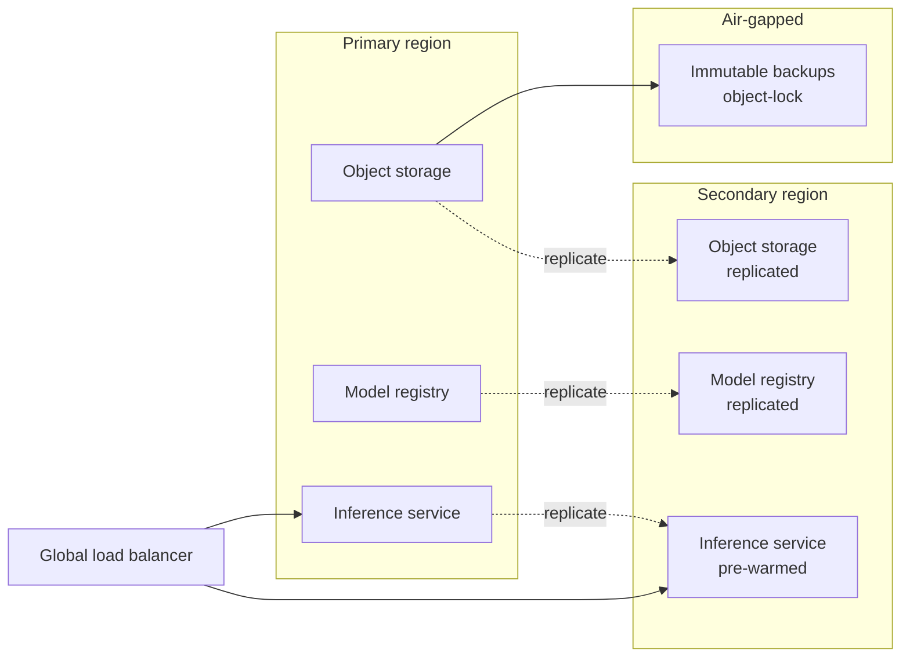

# 17.14 Disaster recovery and data resilience

| Field | Value |
|---|---|
| Level | Advanced |
| Priority tier | 2 |
| Lab venue | GCP / GKE |
| Part | Part 17: Observability, performance and operations |
| Cross-references | Chapter 17.11 (Incident response); Chapter 17.13 (Reliability engineering); Chapter 17.6 (Alerting and SLOs); Chapter 13 (AI storage) |
| Coverage file | `planning/coverage/chapters/17-14.md` |
| Claim & number ledger | `planning/ledgers/17-14.md` |

## Disaster recovery at a glance

Imagine the primary region goes dark on a Tuesday afternoon. Your inference service still has to answer requests. Disaster recovery is the set of copies, spares and written steps that make that possible. The diagram shows the three places those pieces live.



Normally the primary region serves all traffic. The secondary region stays pre-warmed, ready to take over, and the air-gapped backup is the last resort. Pre-warmed means the service is already running and loaded, so it only has to start taking traffic. The air-gapped backup sits outside the reach of the normal cluster, so a problem that spreads through the cluster cannot also reach it. Read the diagram from left to right, and each arrow tells you where a copy goes.

## Why this matters for AI infrastructure

Chapter 17.13 teaches you how to prevent incidents. This chapter starts where that work stops, when prevention fails and something has to be brought back. Picture the morning after a storm when prevention has already failed. The team has to know which service comes back first, how far back its data goes and who runs each step. Disaster recovery is the discipline that lets a team restore service within a time it agreed on in advance, with a known amount of lost data. For example, a team might aim to be back within 1 hour and lose at most 1 minute of data. Those figures are examples you choose for your own platform, not industry standards.

A disaster is any event that takes the cluster down beyond what the normal recovery steps can handle. It might be a regional outage, a ransomware attack, or a hardware failure that takes out a whole zone. A zone is one data center building inside a region, so losing a zone is smaller than losing a region but still bigger than one broken node. When that happens, the disaster recovery plan is what your team follows, because the usual playbook no longer works. The plan is written for the moment when the usual steps have already failed.

```text
Why disaster recovery is on the critical path (background reading: NVIDIA Zero-to-Hero volume 19; Production Kubernetes; the figures below are examples, not quotations):
- A typical mature AI platform commits to a 1-hour RTO and a 1-minute RPO for
  critical workloads, and a 4-hour RTO and a 1-hour RPO for standard workloads. The RTO is the recovery time objective; the RPO is the
  recovery point objective. The RTO/RPO are what the business commits to.
- A typical disaster recovery drill catches 1-3 latent failures that would
  have caused an extended outage. Each caught failure is worth 10-100x the
  cost of the drill.
- The data resilience is the foundation of the disaster recovery. Without
  immutable, replicated, encrypted data, the disaster recovery is impossible.
  The data resilience is what makes the recovery possible.
```

The figures in that block are example values too. The claim that a drill catches failures worth 10 to 100 times its cost has no source in this chapter's references. Treat it as a guess until your own drills measure it. The block is still useful for its structure, because it shows the chain that runs from a committed time, to a drill, to the data that the drill depends on.

Three things make this a platform-team concern, not only a data-science concern. Each one is work that someone has to own, and each one can slip if nobody is named for it.

1. The disaster recovery plan is a platform-team deliverable. The plan sets the time and data targets, names the backup and replication design, and writes the recovery steps. If the platform team does not own it, the plan goes stale.
2. Data resilience is a platform-team discipline. Each data store in the cluster needs a backup, a second copy in another place, and encryption. Without all three, the recovery plan has nothing reliable to restore from.
3. The disaster recovery drill is a platform-team drill. A drill tests the plan, the backups, and the recovery steps together. Until a drill has run, the plan is only a hypothesis.

Before a team can claim its AI factory is disaster-resilient, it needs a plan, data resilience, and drills. A plan without drills is only a hope. Drills without resilient data have nothing to recover.

## Prerequisites and outcomes

Picture a crew that reaches the site without the right tools. Before you start, make sure the foundations from earlier chapters are in place. Picture the crew discovering a missing tool halfway through the job. This chapter builds directly on them. Each prerequisite supplies a piece you will use in the drills and failover sections, so read any unfamiliar one first.

### Prerequisites

Each of these earlier chapters supplies one piece of the foundation.

- Chapter 17.11, Incident response, covers the post-mortem and the blameless culture.
- Chapter 17.13, Reliability engineering, covers SLOs and the error budget patterns.
- Chapter 17.6, Alerting and SLOs, covers the alerting stack.
- Chapter 13, AI storage, covers the storage primitives.

### Outcomes

Picture a platform lead who must answer one question after a bad week: could the team have brought the service back in time, with the data it promised to keep? This chapter walks through that question from the targets to the proof. It starts with the RTO and RPO targets, the two numbers that define what "in time" and "enough data" mean. It then covers the backup strategy, the replication that copies data to a second region, and the ransomware defences that keep backups safe from an attacker. It ends with the drills that prove the plan works and with the way these pieces run on GKE, with reliable backups, tested replication and drills that have been run.

---

## 1. The RTO/RPO targets

Picture a meeting the week before an outage, when the business and the platform team have to agree on two numbers. Every recovery plan starts with those two numbers, which someone has to agree on before a disaster. The first number is about time, and the second is about data. This section explains both and shows how they fit together.

### 1.1 The recovery time objective (RTO)

Picture an inference service that stops answering at 2 p.m. on a weekday. Every minute it stays down, customers see errors. The RTO answers one question: how long is the team allowed to take to bring the service back? A team that never wrote this number down will argue about it during the outage, and that argument always takes longer than the fix.

The recovery time objective is the longest the service may stay down after a disaster. It is a commitment between the platform team and the business, and it should be written down before a disaster happens. The business says how much downtime it can absorb, and the platform team says what it can build to meet that limit. The number that comes out of that conversation is the RTO.

| Workload tier | RTO | Use case |
|---|---|---|
| Critical (customer-facing) | 1 hour | Inference serving; online learning |
| Standard (internal) | 4 hours | Training pipelines; batch inference |
| Development (experimentation) | 24 hours | Notebooks; experimental workloads |

The table gives example values, not fixed rules. Each tier gets the tightest target its business value justifies. A short RTO costs more, because critical workloads usually need a second region that is already running. A notebook server can wait a day without much harm, so it gets a loose target and a cheap recovery path.

### 1.2 The recovery point objective (RPO)

Think of a student who saves a document only once an hour. A computer crash costs that student the last hour of typing. The RTO is about time. The RPO is about data: how much recent work can you afford to lose? If your newest good copy is an hour old, the data you lost is that hour of writes, and the RPO is the agreed size of that loss.

The recovery point objective is the longest window of data that may be lost. Like the RTO, it is a commitment, and it sets how often you must back up or replicate. A tight RPO forces frequent copies, and frequent copies cost more to make and to store.

| Workload tier | RPO | Use case |
|---|---|---|
| Critical (customer-facing) | 1 minute | Transactional data; inference logs |
| Standard (internal) | 1 hour | Training data; experiment results |
| Development (experimentation) | 24 hours | Notebooks; experimental data |

These values are examples too. An RPO of 1 minute means the copy has to be refreshed about every minute, which a nightly job cannot do. The RPO and the backup schedule are two sides of the same promise, so you should never set one without checking the other.

### 1.3 The RTO/RPO matrix

Picture a planning meeting where each workload gets a row and a column, and the cell tells the team what kind of setup it needs. Put the two targets side by side, and the deployment pattern usually becomes clear. A tight RTO with a tight RPO points toward a multi-region setup. A loose RTO and a loose RPO can often run from a single region with cold backups.

| | RPO 1 minute | RPO 1 hour | RPO 24 hours |
|---|---|---|---|
| **RTO 1 hour** | Critical (multi-region) | Critical (single-region) | N/A |
| **RTO 4 hours** | Critical (warm standby) | Standard (warm backup) | N/A |
| **RTO 24 hours** | Critical (cold standby) | Standard (cold backup) | Development (best effort) |

The N/A cells mark combinations the matrix does not support. Use the matrix to decide which deployment pattern each workload gets, and show the result to the business before you build anything. A warm standby is a second copy that is running but not yet serving traffic, and a cold standby is a copy that has to be started before it can serve. The matrix shows which of those two a given target can afford.

---

## 2. The backup strategy

Picture a Friday night backup job that finishes, and a Monday morning restore that fails. A backup strategy answers three practical questions. What kind of copy do you make, how often do you make it, and how do you know it works? This section takes them in that order.

### 2.1 The backup types

Picture a photo library. You might copy the whole library once a week, copy only the new photos each day, and keep a way to rewind to last Tuesday if someone deletes a folder by mistake. A backup you have never restored is only a hope, so start by choosing which kind of backup each dataset needs.

The strategy uses three types. A full backup copies everything, an incremental backup copies only what changed since the last backup, and point-in-time recovery rewinds the data to one chosen moment. Each type is cheap in a different way. A full backup is simple to restore but large to store, while an incremental backup is small but needs the earlier copies to make sense.

| Backup type | What it captures | When to use |
|---|---|---|
| **Full backup** | The entire dataset | Weekly. The foundation for other backups |
| **Incremental backup** | The changes since the last backup | Daily. The supplement to the full backup |
| **Point-in-time recovery** | The state at a specific timestamp | As needed. The recovery from accidental deletion |

The cadence in this table is an example. Choose your own from the RPO you committed to, because a daily backup cannot protect data you need back within an hour. Point-in-time recovery depends on a log of changes, so the log has to be kept for as long as you want to rewind.

### 2.2 The backup targets

Think about what the cluster stores. Model files and datasets live in object storage, the cluster's own state lives in etcd and Kubernetes secrets, and MLflow and Feast keep their records in PostgreSQL. Each target needs a backup method that fits it. A model file is a large blob that never changes after upload, so a copy is simple. A database changes all day, so its copy needs the database's own tools to be consistent.

Production Kubernetes, chapter 2, takes the same view of cluster state. It recommends direct etcd snapshots together with Velero backups taken through the Kubernetes API. Production Kubernetes, chapter 4, adds that Velero supports backup and restore hooks, such as flushing a database before a backup runs. A hook makes sure the database writes its pending changes to disk, so the copy is not a half-finished picture.

| Target | Backup method | Retention |
|---|---|---|
| Object storage | Object versioning + cross-region replication | 90 days |
| Distributed filesystem | Snapshot + cross-region replication | 30 days |
| Kubernetes etcd | etcd snapshot | 30 days |
| Kubernetes secrets | Backup + encryption | 30 days |
| MLflow database | PostgreSQL backup | 30 days |
| Feast database | PostgreSQL backup | 30 days |

The retention periods are starting points. Retention means how long a copy is kept before it is deleted. Regulators and your own audit rules decide the real numbers, so check them before you copy these values.

### 2.3 The backup verification

Picture a backup job that reports success every night while nobody has ever opened one of its files. Verification is what proves a backup works. A backup that copies bytes but cannot be restored is only a pile of files. Restore it into staging, compare the result with the original, and measure how long the restore took. Staging is a separate environment that behaves like production, so a restore there can fail without hurting anyone.

```bash
# Restore the backup to staging
python code/part17/restore_backup.py \
  --backup backup-2024-03-15 \
  --target staging

# Verify the backup
python code/part17/verify_backup.py \
  --backup backup-2024-03-15 \
  --expected-rto 4h \
  --expected-rpo 1h
# expected: the backup restores within the RTO; the backup's data loss is within the RPO
```

The expected line is a pass condition, not a report. After each restore, ask whether the team could meet the RTO with this exact procedure. A restore that worked once with a senior engineer at the keyboard does not prove that the procedure works for the person on call at night.

---

## 3. Multi-region replication

Picture a region that goes dark with the only copy of last week's models inside it. Replication keeps a second copy of data in another region, so a regional failure does not take the data with it. This section covers object storage, the distributed filesystem and the Kubernetes state.

### 3.1 Object storage replication

Suppose a bucket in the primary region receives new model artifacts every hour. A bucket is a container for files in object storage, and an artifact is any file a training run produces, such as a checkpoint or a trained model. If that region fails, those artifacts are stranded. Replication copies each new object to a second region without anyone starting a job, so the second copy is ready when it is needed.

The copy runs asynchronously, so it can trail the original. Asynchronous means the copy happens after the write is confirmed, not during it. That delay is the replication lag, and it counts against your RPO. Everything written during the lag is at risk if the primary fails at that moment.

```bash
# Copy the primary bucket to a second region every hour with Storage Transfer Service
# (gsutil has no replication command; a dual-region or multi-region bucket replicates by itself)
gcloud transfer jobs create gs://primary-bucket gs://secondary-bucket --schedule-repeats-every=1h
# expected: a transfer job that copies new objects each hour; the interval sets the worst-case lag
```

The lag here is bounded by the schedule you choose. A dual-region bucket replicates continuously instead, so measure the lag you actually get and compare it with your RPO. The schedule is a promise about the worst case, and the measured lag is what really happens on a normal day.

### 3.2 Distributed filesystem replication

Picture a team choosing between two ways to copy a write. Synchronous replication waits for the second copy before it confirms a write. Asynchronous replication confirms first and copies later. Asynchronous mode is faster, but it can lose the newest writes if the primary fails. Think of sending a letter by registered post, where you wait for the receipt, against dropping it in a box and trusting that it arrives. The first is slower and certain, and the second is quick and hopes for the best.

```bash
# Lustre has no single replication command. Common options are changelog-driven copy
# (the lustre_rsync tool) or an HSM archive tier. Check your Lustre version's manual for the exact syntax.
# expected: the secondary filesystem trails the primary; measure that lag against your RPO
```

The expected line says the lag is under five minutes. Measure that on your own filesystem before you rely on it. A distributed filesystem spreads its data across many servers, so the lag you see in a quiet hour can differ from the lag during a heavy training run.

### 3.3 Kubernetes state replication

Picture a control-plane machine that dies in the night. Etcd copies its data between control-plane members, so one failed member is survivable. Etcd is the key-value store that holds the cluster's own state, and the control-plane members are the machines that run it together. A bad command is copied to every member too, so a snapshot is still needed. Replication protects you from hardware loss, but it does not protect you from a mistake that everyone copies faithfully.

Multi-region Kubernetes state needs more setup, such as KubeFed or cluster API federation. Those tools let one control plane manage clusters in several regions. They add moving parts, so only take on that work when a regional outage would cost more than the setup.

```bash
# Configure etcd snapshot
etcdctl snapshot save /backup/etcd-snapshot.db
# expected: the etcd snapshot is saved
```

---

## 4. Ransomware defence

Picture a morning when every file on a team's shared drive shows a ransom note. Ransomware is malicious software that encrypts your data and asks for money to unlock it. An attacker who has reached your cluster often tries to destroy the backups first, so that paying is the only way out. This section covers three defences that make that attack much harder.

### 4.1 Immutable backups

Picture an attacker with admin rights who wants to erase your backups before encrypting the data. An immutable backup defends against exactly that. Once written, it cannot be changed or deleted until its retention period ends. Immutable means it cannot be modified, and the retention period is the window during which the copy is locked.

The storage service enforces that rule, not your scripts. If the rule lived in a script, the attacker could simply run a different script. S3 Object Lock and GCS Bucket Lock are two examples of this mechanism. S3 is the object storage service from Amazon Web Services, and GCS is Google Cloud Storage.

```bash
# Configure object lock on the audit log bucket
gsutil retention set 90d gs://audit-log-bucket
# expected: the bucket has a 90-day retention; the objects cannot be deleted before 90 days
```

The expected line says the bucket keeps objects for 90 days. Choose the period from your recovery needs and retention rules, not from this example. Remember that a locked copy also costs storage for the whole lock period, so the period is a budget decision as well as a safety one.

### 4.2 Air-gapped backups

Picture an attacker who has stolen the cluster's key and wants the backups too. An air gap is a boundary the attacker cannot cross from the cluster. The name comes from a physical gap of air between two networks. In the cloud the gap is made from separate accounts and separate credentials. A bucket that the cluster's own account can write to is not truly air-gapped, because the same credentials may reach it. The example below copies a backup, but that step alone does not create the gap.

```bash
# Copy the backup to an air-gapped bucket
gsutil cp /backup/2024-03-15.tar.gz gs://air-gap-bucket/
# expected: the backup is in the air-gapped bucket; the air-gapped bucket is not connected to the cluster
```

Design the isolation as separate work, with separate accounts or projects and separate credentials. The copy step only moves the data. A copy that a stolen cluster key can reach is only one more folder for the attacker to open.

### 4.3 The audit log as a ransomware defence

Picture the morning after an attack, when someone asks who deleted the backups and when. When an attack happens, you need to know who deleted what, and when. The audit log answers that question, but only if an attacker cannot edit it, so keep it in locked storage. An audit log that the attacker can rewrite will show a clean story, and you will not know the story is false until it is too late.

```bash
# Query the audit log for suspicious activity
bq query --use_legacy_sql=false \
  "SELECT timestamp, user, action, object
   FROM \`${PROJECT_ID}.audit.events\`
   WHERE action = 'delete' AND object LIKE 'backup/%'
   ORDER BY timestamp DESC LIMIT 100"
# expected: a list of recent backup deletions; the audit log proves what happened
```

Run a query like this on a schedule. Alert when it returns deletions you did not expect, because a burst of backup deletions is an early sign of trouble. A burst at an odd hour is the kind of signal a person would miss, but a scheduled query will not miss it.

---

## 5. Disaster recovery drills

Picture a plan that has sat in a shared folder for a year without anyone opening it. A plan that has never been rehearsed is a set of good intentions. Drills turn those intentions into practice, and this section covers how to plan one, run it and record what happened.

### 5.1 The drill plan

Picture a team on the Friday before a planned drill, writing the script down line by line. Think of a drill as a rehearsal with a script. Before anyone starts, you write down the disaster, the event that triggers it, the response you expect, and how you will judge success. A fire drill works the same way. Everyone knows the alarm, the route and the meeting point before the smoke appears.

Drills test the plan itself. Each one needs a scenario, such as a regional outage, a ransomware attack, or a hardware failure, plus an injected fault, an expected response, and success criteria. The injected fault is the thing you break on purpose, and the success criteria are the numbers that decide whether the drill passed.

```markdown
# Disaster Recovery Drill: Regional Outage

## Scenario
The primary region's data center suffers a power outage; all GPUs in the primary region are unavailable.

## Injection
At 14:00 UTC, we will simulate a regional outage by draining all nodes in the primary region.

## Expected response
- 14:00: Alert fires
- 14:05: On-call acknowledges the alert
- 14:10: IC is declared
- 14:15: Failover is initiated
- 14:30: Workloads are running in the secondary region
- 14:45: SLO is met in the secondary region
- 15:00: Drill is complete

## Success criteria
- The RTO is met (1 hour for critical workloads)
- The RPO is met (1 minute for critical workloads)
- The failover is automatic
- The SLO is met in the secondary region
```

The times in this template are examples. Set timings that fit your own on-call rota and change windows. Read the expected response as a timeline with a plan in each row, so that the team can later compare what it planned with what it did.

For the most critical workloads, Production Kubernetes, chapter 2, suggests going further. List the ways things can fail, automate recovery for each one, and then test those recoveries. It also suggests a standby cluster to fail over to, with the failover automated and tested. A standby cluster is a second cluster kept ready to take over the work.

### 5.2 The drill execution

On drill day, the team follows the script, and someone records each action with its time. A timeline written during the drill is more accurate than one rebuilt from memory afterwards. Memory tends to smooth out the awkward moments, and those moments are exactly what the drill is for.

```bash
# Schedule the drill
python code/part17/schedule_drill.py \
  --date "2024-04-15" \
  --time "14:00 UTC" \
  --scenario "Regional Outage"

# Execute the drill
python code/part17/execute_drill.py \
  --scenario "Regional Outage"
```

Keep the drill ID, the scenario name, and the schedule in one place, so the post-mortem can refer to them later. A drill with no ID is hard to find again when someone asks what happened in the spring.

### 5.3 The drill post-mortem

Picture the Monday after a drill, when the team gathers around the written record. Every drill ends with a post-mortem. A post-mortem is a short written review that asks what happened, why it happened and what will change. It records what was tested, what worked, what did not, and what the team will change. The post-mortem is where the value of the drill is kept, because a drill that teaches nothing in writing has to be run again to teach anything at all.

```markdown
# Disaster Recovery Drill Post-Mortem: Regional Outage

## What was tested
- Failover from primary region to secondary region
- RTO compliance
- RPO compliance
- SLO compliance in the secondary region

## What worked
- The failover was automatic
- The RTO was met (45 minutes)

## What did not work
- The RPO was missed: 5 minutes of data were lost against a 1-minute target
- The IC was not declared within 15 minutes
- The runbook was missing the failover procedure for the registry

## Action items
- Add the IC declaration to the alerting (Owner: platform-team, Due: 2024-04-30)
- Update the runbook with the registry failover (Owner: platform-team, Due: 2024-04-22)
- Shorten the backup cadence to meet the 1-minute RPO (Owner: platform-team, Due: 2024-05-15)
```

Give each action item one owner and one due date. Without both, an action item tends to stay open with nobody responsible for it. Read the example as a model of honesty. It admits a missed RPO and a late declaration, and it turns each miss into a line with a name on it.

---

## 6. Operating disaster recovery on GKE

Picture a platform team that must run its recovery plan on GKE, not on paper. This section puts the pieces on Google Kubernetes Engine (GKE), the managed Kubernetes service the lab uses. It shows the components, the access rules and the signals to watch.

### 6.1 The components

Running disaster recovery on GKE means several pieces must work together. Picture a morning when the replication lag alert fires, and the on-call engineer needs to find which piece is late. Object storage, replication, the etcd snapshot job, and the verification and drill schedulers each have a job. The table shows what each piece does and what it is expected to achieve.

| Component | Where it runs | Backing store | SLO |
|---|---|---|---|
| Object storage with versioning | Managed (GCS) | Object storage | Versioning enabled |
| Object lock | Managed (GCS) | Object storage | Lock retention 90 days |
| Cross-region replication | Managed (GCS) | Object storage | Replication lag < 1 minute |
| etcd snapshot | Kubernetes Deployment | Object storage | Snapshot frequency 6 hours |
| Backup verification | CronJob | (verifies the backup) | Verification frequency 30 days |
| DR drill scheduler | CronJob | (schedules the drill) | Drill frequency 90 days |

The SLO column holds example targets. Replace each one with a value you actually measure, and write it down where the team can see it. A CronJob is a Kubernetes object that runs a task on a schedule, and it is the usual way to run a verification or a drill on its own.

### 6.2 IAM and the disaster recovery

Picture a contractor who asks for permission to delete old backups to free up space. That contractor should not be able to erase the copies that protect the company, because backups are only as safe as the people and services that can change them. The recovery stack needs its own access rules. Give each role only the rights it needs.

| Role | Who | What they can do |
|---|---|---|
| `dr.reader` | Every team | Read the backup status; read the RTO/RPO |
| `dr.writer` | The platform team | Create backups; restore backups |
| `dr.admin` | The platform team lead | Approve the DR plan; approve the failover |

Write down who holds each role, and review that list every quarter. A quarterly review is an example cadence, so choose the one your team can keep. A role list that nobody reviews slowly collects people who no longer work on the platform.

### 6.3 Observability

Picture a plan that was true last spring and no longer matches the cluster you run now. Dashboards show whether the plan is still true today. Track the metrics below, and alert when a value leaves its safe range.

| Metric | Why it matters | Alert |
|---|---|---|
| RTO last drill | DR readiness | > RTO target |
| RPO last drill | DR readiness | > RPO target |
| Backup age | DR freshness | > 24 hours |
| Backup verification age | DR readiness | > 30 days |
| Object storage replication lag | DR readiness | > 5 minutes |
| Object lock age | DR readiness | < 30 days remaining |

The two drill metrics matter most. A drill that misses the RTO target has found a gap in the plan. A drill that misses the RPO target has shown data you would have lost. The other four metrics are early warnings that show a problem before the next drill has to find it.

Put the RTO and RPO from your last drill on the team dashboard first. Everything else in this table is easier to act on once those two numbers are visible. A team that sees the last drill result every morning tends to fix the gap before it turns into a real outage.

---

## 7. How it fails

Picture the bad morning, when a restore stalls, a backup will not open or a failover stops partway through. Every disaster recovery plan fails in a few familiar ways, and the six below are the ones teams meet most often. It helps to know their look before the real event arrives.

### 7.1 "The backup is corrupted"

The team tries to restore a backup and finds it corrupted, so recovery stops. A corrupted backup is one where the bytes no longer match what was written. Nobody verified the backup, it lived on a single disk, and its checksum does not match. A checksum is a short fingerprint computed from the data, and a changed fingerprint means the data changed. Verify backups on a schedule, keep copies on more than one disk, and check the checksum before you restore.

### 7.2 "The RTO is exceeded"

A real disaster hits, recovery starts, and it takes longer than the RTO allows. The runbook is out of date, nobody has rehearsed it, and the failover is manual. Each of those causes adds minutes, and the minutes add up past the target. Update the runbook, rehearse it on a schedule, and automate the failover where you can.

### 7.3 "The RPO is exceeded"

Recovery finishes, but the data is older than the RPO allows, so customer records are missing. Backups ran too rarely, or replication lagged too far behind, or the newest backup was too old to help. The team has to explain to a customer why a record from the last hour is gone. Run backups more often, reduce the replication lag, and keep enough history to choose a good restore point.

### 7.4 "The ransomware deletes the backups"

The attack succeeds, the backups are gone, and the team has nothing to restore. This is the failure that the earlier ransomware defences were built to stop. The backups were mutable, they were not air-gapped, and the audit log could be edited, so the attacker had a clear path. Turn on object lock for the backup bucket, air-gap the most critical backups, and make the audit log tamper-evident.

### 7.5 "The failover does not work"

The team starts the failover, it fails partway, and the service stays down. A failover that fails halfway can leave the service in a worse place than before it started. The failover was never tested, a dependency is missing in the secondary region, and the runbook is wrong. Test the failover on a schedule, confirm every dependency exists in the secondary region, and correct the runbook after each test.

### 7.6 "The disaster recovery drill is skipped"

The team has not drilled for 6 months, so nobody is sure what to do first. Each quarter without a drill makes the plan a little less true. No drill schedule exists, the team is busy, and drills are not a priority, so the gap keeps growing. Put drills on a calendar, automate the scheduling, and add drills to the team's objectives.

Pick the failure mode your team is least ready for, and write its runbook step this week. A single step written this week is worth more than a full plan written next year.

---

## 8. Hands-on lab

Picture a training cluster that has never had its backups tested. This lab walks through that test in order, from the backup settings to the drill write-up. Run this lab in a test project, never in production, and run the steps in order. The lab is untested in this repository, so treat each command as a draft until you have run it yourself.

### 8.1 Prerequisites

Check these three things before you start, because each later step depends on them.

- A GKE Autopilot or Standard cluster (1.27+) with at least 4 H100 GPU nodes.
- The observability stack from earlier chapters.
- A second GKE cluster in a different region for multi-region testing.

### 8.2 Step 1: configure the backup strategy

Turn on versioning first, so an overwritten object keeps its earlier copy. Versioning is the setting that keeps older copies of a file when it is replaced. Then lock the backup bucket and set up replication from the cluster's artifact bucket, so that the copy exists before anything goes wrong.

```bash
# Enable object versioning on the cluster's object storage bucket
gsutil versioning set on gs://cluster-artifacts

# Configure object lock on the backup bucket
gsutil retention set 90d gs://backup-bucket

# Enable cross-region copy (Storage Transfer Service; gsutil has no replication command)
gcloud transfer jobs create gs://cluster-artifacts gs://backup-bucket --schedule-repeats-every=1h
```

This is the same Storage Transfer Service approach as in section 3, with the same lag caveat. The copy is only as fresh as its schedule, so check the lag after the first run.

### 8.3 Step 2: schedule regular backups

Scheduling is what turns these commands into a backup strategy. A command you run by hand is a one-time copy, and a backup strategy needs copies that keep arriving. The first command copies the bucket once, into a folder dated today. The etcd CronJob then runs the snapshot on its own schedule.

```bash
# Schedule a daily backup
gsutil cp -r gs://cluster-artifacts gs://backup-bucket/daily/$(date +%Y-%m-%d)/

# Schedule etcd snapshots
kubectl apply -f code/part17/etcd_snapshot_cronjob.yaml
```

Without a scheduler, these commands run only when someone remembers to run them. A scheduler makes the copies arrive on time even when everyone is asleep.

### 8.4 Step 3: verify the backup

Restore the backup to a separate staging bucket, then verify the restored copy. A backup that restores but fails verification cannot be used for recovery. Keep the staging bucket apart from the real one, so a bad restore never overwrites live data.

```bash
# Restore the backup to staging
gsutil -m cp -r gs://backup-bucket/daily/2024-03-15/ gs://staging-restore/

# Verify the backup
python code/part17/verify_backup.py \
  --backup daily-2024-03-15 \
  --expected-rto 4h \
  --expected-rpo 1h
```

### 8.5 Step 4: simulate a regional outage

This step simulates a regional outage by draining all nodes in the primary region. Watch the Pods during the drill, and confirm where the workloads run. Pods are the smallest units Kubernetes runs, and watching them tells you whether the work has really moved.

```bash
# Draining all nodes in the primary region (cordon alone does not move running Pods)
for node in $(kubectl get nodes -l topology.kubernetes.io/region=us-central1 -o name); do
  kubectl drain $node --ignore-daemonsets --delete-emptydir-data
done

# Observing the failover
kubectl get pods -n mlops -w
# expected: the workloads are rescheduled to the secondary region
```

### 8.6 Step 5: measure the RTO and RPO

Measure the RTO and RPO from timestamps, not from memory. A timestamp is a written moment, and memory is too kind to the team. The second command misses its target, and that is the point of the example. Read the two results side by side, because the first one passes and the second one shows where the plan needs work.

```bash
# Measure the RTO
python code/part17/measure_rto.py \
  --incident-start "2024-03-15T14:00:00Z" \
  --incident-end "2024-03-15T14:45:00Z"
# expected: RTO is 45 minutes; RTO is within the 1-hour target

# Measure the RPO
python code/part17/measure_rpo.py \
  --last-backup "2024-03-15T13:55:00Z" \
  --disaster-time "2024-03-15T14:00:00Z"
# expected: RPO is 5m; OUTSIDE the 1m target (exit code 1), so the backup cadence must improve
```

A 5-minute gap is larger than a 1-minute target, so the RPO was missed. The backup cadence has to improve before the target can be met. The post-mortem in Section 5.3 records the miss in the same way.

### 8.7 Step 6: write the drill post-mortem

Turn the timeline into a post-mortem with the generator below. It writes a draft from the drill ID, and you complete the lessons yourself. The generator saves time on the form, but the lessons still need a person who was in the room.

```bash
python code/part17/generate_dr_post_mortem.py \
  --drill-id DR-2024-03-15 \
  --output dr_post_mortem.md
```

### 8.8 What to record

Finish the lab by answering five questions. Write the answers down, so the next person on call does not have to search for them. An answer that lives only in your head is not yet a plan.

1. What is the current RTO target per workload tier?
2. What is the current RPO target per workload tier?
3. When was the last backup verification?
4. What was the RTO and RPO in the last disaster recovery drill?
5. What is the object-lock retention on the backup bucket?

The 30-second limit is a choice for your team, not a standard. Still, an answer that takes longer usually means the information lives in someone's head instead of in a document. The lab has not been checked against a live GKE cluster, so the answers you get from it are a first draft.

---

## Exercises

Imagine the on-call engineer has just found that the backups exist but nobody has checked them. Each exercise below closes a gap of that kind, and each one ends with something you can show to the team.

1. **Add a backup verification cron job.** Configure a CronJob that verifies the backup monthly. *Solution sketch:* Use a Kubernetes CronJob that restores the backup to staging, measures the RTO and RPO, and reports the results.
2. **Add a multi-region failover drill.** Schedule a quarterly drill that tests the multi-region failover. *Solution sketch:* Write a Chaos Mesh experiment that cordons all nodes in the primary region. The drill measures the failover latency and produces a post-mortem.
3. **Add a ransomware defence drill.** Schedule a quarterly drill that tests the ransomware defence. *Solution sketch:* Use a Chaos Mesh experiment that simulates a ransomware attack. The drill checks that the immutable backups are untouched, then produces a post-mortem.
4. **Add an air-gapped backup bucket.** Configure a bucket in a separate network, and copy the most critical backups into it. *Solution sketch:* Create a separate GCP project with its own VPC, then copy the backup into the air-gapped bucket there.
5. **Add a backup age alert.** Configure an alert that fires when the newest backup is older than 24 hours. *Solution sketch:* Write a Prometheus alert on backup age, and route it to the on-call engineer.
6. **Add a disaster recovery runbook.** Build a runbook for the regional outage scenario, and test it quarterly. *Solution sketch:* Write a Markdown document that describes the scenario, and use it as the default for every drill.

Start with exercise 1. A verification job tells you whether the rest of the plan can be trusted. If you have limited time, do exercise 5 next, because you need to know when your backups stop arriving.

---

## Checkpoint questions

<details><summary>1. The primary region goes dark on a Tuesday afternoon and the inference service must still answer. What should already be in place?</summary>
A secondary region with replicated object storage and model registry, and a pre-warmed inference service. A global load balancer can then send traffic to it. An air-gapped copy of immutable backups sits behind as the last resort.
</details>

<details><summary>2. An attacker with admin rights tries to erase your backups before encrypting the data. Which defences stop that, and what do you check afterwards?</summary>
Immutable backups with object lock cannot be changed or deleted until retention ends, and the storage service enforces that rule. An air-gapped copy sits outside what the cluster's credentials can reach. Afterwards query the audit log for backup deletions, and keep that log in locked storage so it cannot be edited.
</details>

<details><summary>3. During a real recovery you find the backup is corrupted. What does the chapter say went wrong, and what is the fix?</summary>
Nobody verified the backup, it lived on a single disk, and its checksum does not match. Verify backups on a schedule, keep copies on more than one disk, and check the checksum before you restore.
</details>

<details><summary>4. A drill post-mortem says "the RPO was met (5 minutes)" for a critical workload whose RPO is 1 minute. Is that statement correct?</summary>
No. Five minutes of lost data is larger than a 1-minute target, so the RPO was missed. The lab's sample output shows the same 5-minute gap as outside the target, so a post-mortem should list it under what did not work and add an action to shorten the backup cadence.
</details>

<details><summary>5. Recovery finishes but customer records are missing because the data is older than the RPO. What do you look at?</summary>
Backups may run too rarely, replication may lag too far behind, or the newest backup may be too old. Run backups more often, reduce the replication lag, and keep enough history to choose a good restore point.
</details>

<details><summary>6. A failover starts, fails partway, and the service stays down. What does the chapter say usually caused it?</summary>
The failover was never tested, a dependency is missing in the secondary region, and the runbook is wrong. In the example drill the runbook was missing the failover procedure for the registry. Test the failover on a schedule, confirm every dependency exists in the secondary region, and correct the runbook after each test.
</details>

<details><summary>7. Why can a nightly job not meet a 1-minute RPO?</summary>
The RPO sets how often you must back up or replicate. A 1-minute RPO means the copy has to be refreshed about every minute. A nightly job leaves up to a day of changes uncopied.
</details>

<details><summary>8. Why does replication lag count against your RPO?</summary>
Replication runs asynchronously, so the copy can trail the original. If the primary fails, everything written during that lag is missing from the copy. The lag is therefore data you would lose.
</details>

<details><summary>9. Why does the lab drain every node instead of only cordoning them?</summary>
Cordon alone does not move running Pods. Drain evicts the workloads so they are rescheduled, which is what a regional outage forces. A drill that only cordoned would not test the failover.
</details>

<details><summary>10. Why is a bucket the cluster's own account can write to not truly air-gapped?</summary>
An air gap is a boundary the attacker cannot cross from the cluster. If the same credentials reach the bucket, an attacker who controls the cluster may reach it too. The isolation has to be designed separately, with separate accounts or projects and separate credentials.
</details>

<details><summary>11. Why do you still need an etcd snapshot when etcd copies data between control-plane members?</summary>
Replication means one failed member is survivable. A bad command is copied to every member as well, so all copies are damaged. A snapshot gives you a point to restore from.
</details>

<details><summary>12. A workload is customer-facing. Do you give it the 1-hour RTO tier or the 4-hour tier, and what do you give up?</summary>
Give a critical customer-facing workload the 1-hour tier. The cost is that a short RTO usually needs a second region that is already running. Internal training pipelines fit the 4-hour tier and cost less. These values are examples.
</details>

<details><summary>13. Would you choose synchronous or asynchronous replication for the distributed filesystem, and what do you give up?</summary>
Synchronous waits for the second copy before confirming a write, so it loses nothing but is slower. Asynchronous confirms first and copies later, so it is faster but can lose the newest writes if the primary fails. Choose from the RPO you committed to, and measure the lag you actually get.
</details>

<details><summary>14. When would you pick a multi-region setup over a cold standby in the RTO and RPO matrix?</summary>
Pick multi-region when you need an RTO of 1 hour and an RPO of 1 minute. A cold standby suits an RTO of 24 hours with a 1-minute RPO. You give up the running cost of a second region in exchange for speed. Show the matrix result to the business before you build.
</details>

<details><summary>15. For copying a bucket to a second region, would you use an hourly Storage Transfer job or a dual-region bucket?</summary>
An hourly job bounds the lag by its schedule, so the worst case is about an hour. A dual-region bucket replicates continuously. Measure the lag you actually get and compare it with your RPO before you decide.
</details>

<details><summary>16. A drill starts at 14:00 and workloads are healthy at 14:45. The critical RTO target is 1 hour. Was it met, and by how much?</summary>
Yes. From 14:00 to 14:45 is 45 minutes. The target is 60 minutes, so the drill finished 15 minutes inside it.
</details>

<details><summary>17. The last backup was at 13:55 and the disaster at 14:00. The RPO target is 1 minute. By how much was it missed?</summary>
The data loss window is 14:00 minus 13:55, which is 5 minutes. The target is 1 minute. It was missed by 4 minutes.
</details>

<details><summary>18. A transfer job copies a bucket every hour and the RPO is 1 minute. How far off is the worst case?</summary>
Data written just after a copy waits a full hour for the next one. That is 60 minutes against a 1-minute RPO, so 60 times too long. A schedule of this kind cannot meet that target.
</details>

<details><summary>19. You restore a backup into staging. What do you do first, second, and third to know it is usable?</summary>
First restore it into staging. Second compare the result with the original and run the verification script against the expected RTO and RPO. Third measure how long the restore took and ask whether the team could meet the RTO with this exact procedure.
</details>

<details><summary>20. You suspect backups are being deleted. In what order do you investigate?</summary>
First query the audit log for delete actions on backup objects. Second check whether object lock still protects the backup bucket and how many days of retention remain. Third confirm the air-gapped copy is intact, since it is the last resort.
</details>

---

## Sources and review notes

- NVIDIA Zero-to-Hero Volume 19, in the file `chapter-10-disaster-recovery.md`, supplied the disaster recovery patterns and the RTO and RPO framework. The handbook rewrote the wording.
- *Production Kubernetes* (`production-kubernetes`, Chapter 14), supplied the Kubernetes-level disaster recovery patterns.
- *Production Kubernetes*, chapters 2 and 4, supplied the points on backing up cluster state, standby clusters, and Velero hooks used in sections 2 and 5.

### Cross-references to other handbook chapters

- Chapter 17.11 for the incident response.
- Chapter 17.13 for the reliability engineering.
- Chapter 17.6 for the alerting and SLOs.
- Chapter 13 for the AI storage.

### Migrated from `nvidia-devops`

The disaster recovery operational patterns draw on Volume 19 chapter 10. The handbook rewrote the wording in its own voice.

### Explicitly labelled inferences

These values are starting points, not sourced facts. Check each one against your own business and your own rules before you use it.

- The RTO and RPO targets (critical: 1h/1m; standard: 4h/1h; development: 24h/24h) are starting points. The real targets depend on the business.
- The backup retention periods (90 days for object storage, 30 days for etcd) are starting points. The real retention depends on the regulatory regime.
- The drill frequency (quarterly) is a starting point. The real frequency depends on how disciplined the team is.

### Not verified on live hardware

- The lab in Section 8 is **untested** against a live GKE cluster in this repository.
- The cross-region replication patterns in the lab assume a multi-region deployment is available.
- The drill post-mortem template in the lab is illustrative. Production templates are more detailed. Keep these caveats in view when you check the lab against your own environment.
