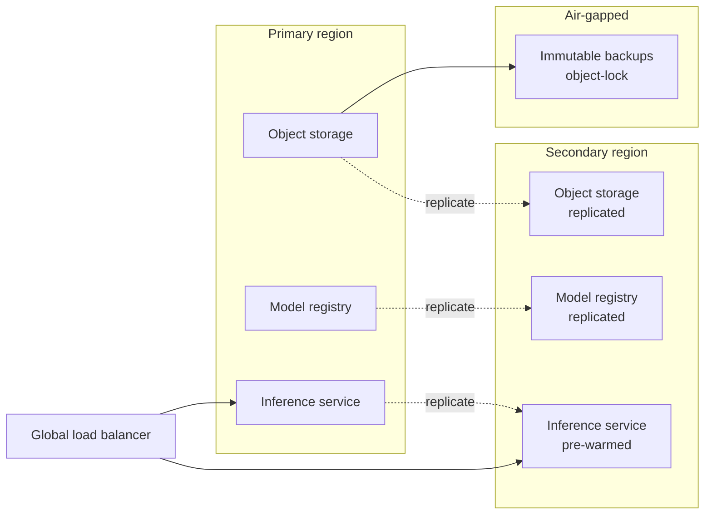

# 17.14 Disaster recovery and data resilience

| Field | Value |
|---|---|
| Level | Advanced |
| Priority tier | 2 |
| Lab venue | GCP / GKE |
| Part | Part 17: Observability, performance and operations |
| Primary sources | NVIDIA Zero-to-Hero Volume 19 (`chapter-10-disaster-recovery.md`); *Production Kubernetes* (`production-kubernetes`, Chapter 14) |
| Cross-references | Chapter 17.11 (Incident response); Chapter 17.13 (Reliability engineering); Chapter 17.6 (Alerting and SLOs); Chapter 13 (AI storage) |
| Coverage file | `planning/coverage/chapters/17-14.md` |
| Claim & number ledger | `planning/ledgers/17-14.md` |

## Disaster recovery at a glance



The primary region serves traffic; the secondary region is pre-warmed; the air-gapped backup is the last resort.

## Why this matters for AI infrastructure

Reliability engineering (Chapter 17.13) is about preventing incidents. This chapter is about recovering when the prevention fails. Disaster recovery is the discipline that turns "we lost the cluster" into "we have the cluster back in 4 hours with no data loss".

A disaster is an event that takes down the cluster beyond the team's ability to recover in the normal way. The disaster could be a regional outage; the disaster could be a ransomware attack; the disaster could be a hardware failure that takes down a zone. The disaster recovery plan is what the team follows when the normal playbook fails.

```text
Why disaster recovery is on the critical path (V19 ch10; PK Ch 14):
- A typical mature AI platform commits to a 4-hour RTO and a 1-hour RPO for
  critical workloads. The RTO is the recovery time objective; the RPO is the
  recovery point objective. The RTO/RPO are what the business commits to.
- A typical disaster recovery drill catches 1-3 latent failures that would
  have caused an extended outage. Each caught failure is worth 10-100x the
  cost of the drill.
- The data resilience is the foundation of the disaster recovery. Without
  immutable, replicated, encrypted data, the disaster recovery is impossible.
  The data resilience is what makes the recovery possible.
```

Three operational realities make this chapter a platform-team concern rather than a data-science-only concern:

1. **The disaster recovery plan is a platform-team deliverable.** The plan names the RTO/RPO; the plan names the backup strategy; the plan names the multi-region replication; the plan names the recovery procedure. The platform team owns the plan.
2. **The data resilience is a platform-team discipline.** Every byte in the cluster has a backup; every byte is replicated; every byte is encrypted. The discipline is what makes the recovery possible.
3. **The disaster recovery drill is a platform-team drill.** The drill tests the plan; the drill tests the backup; the drill tests the recovery procedure. The drill is what makes the plan tested.

**Before a team can claim their AI factory is disaster-resilient, the team must have a disaster recovery plan, data resilience, and disaster recovery drills. A team that has a plan but not drills is a team that has not tested the plan. A team that has drills but not data resilience is a team that drills an untestable plan.**

## Prerequisites and outcomes

### Prerequisites

- Chapter 17.11 (Incident response) for the post-mortem and the blameless culture.
- Chapter 17.13 (Reliability engineering) for the SLO and error budget patterns.
- Chapter 17.6 (Alerting and SLOs) for the alerting stack.
- Chapter 13 (AI storage) for the storage primitives.

### Outcomes

After completing this chapter you will be able to:

1. Specify the RTO/RPO targets for the AI factory: critical workloads vs standard workloads vs development workloads.
2. Build the backup strategy: full backups, incremental backups, point-in-time recovery.
3. Implement multi-region replication: object storage, distributed filesystem, registry.
4. Defend against ransomware: immutable backups, object-lock, audit log.
5. Run disaster recovery drills: the scenario, the execution, the verification, the post-mortem.
6. Operate the disaster recovery process on GKE with reliable backups, tested replication, and verified drills.

---

## 1. The RTO/RPO targets

### 1.1 The recovery time objective (RTO)

The RTO is the maximum acceptable time to restore the service after a disaster. The RTO is the contract between the platform team and the business.

| Workload tier | RTO | Use case |
|---|---|---|
| Critical (customer-facing) | 1 hour | Inference serving; online learning |
| Standard (internal) | 4 hours | Training pipelines; batch inference |
| Development (experimentation) | 24 hours | Notebooks; experimental workloads |

The pattern is: the critical tier has the tightest RTO; the development tier has the loosest RTO. The tier determines the cost (multi-region deployment is more expensive than single-region).

### 1.2 The recovery point objective (RPO)

The RPO is the maximum acceptable data loss after a disaster. The RPO is the contract between the platform team and the customer.

| Workload tier | RPO | Use case |
|---|---|---|
| Critical (customer-facing) | 1 minute | Transactional data; inference logs |
| Standard (internal) | 1 hour | Training data; experiment results |
| Development (experimentation) | 24 hours | Notebooks; experimental data |

The pattern is: the critical tier has the tightest RPO; the development tier has the loosest RPO. The RPO is enforced by the backup cadence.

### 1.3 The RTO/RPO matrix

The RTO/RPO matrix combines the recovery time and the recovery point. The matrix is the platform team's contract with the business.

| | RPO 1 minute | RPO 1 hour | RPO 24 hours |
|---|---|---|---|
| **RTO 1 hour** | Critical (multi-region) | Critical (single-region) | N/A |
| **RTO 4 hours** | Critical (warm standby) | Standard (warm backup) | N/A |
| **RTO 24 hours** | Critical (cold standby) | Standard (cold backup) | Development (best effort) |

The pattern is: the matrix maps the RTO and the RPO to the deployment strategy. The matrix is the platform team's planning tool.

---

## 2. The backup strategy

### 2.1 The backup types

The backup strategy has three types: full backups, incremental backups, and point-in-time recovery.

| Backup type | What it captures | When to use |
|---|---|---|
| **Full backup** | The entire dataset | Weekly; the foundation for other backups |
| **Incremental backup** | The changes since the last backup | Daily; the supplement to the full backup |
| **Point-in-time recovery** | The state at a specific timestamp | As needed; the recovery from accidental deletion |

The pattern is: full backups weekly; incremental backups daily; point-in-time recovery on demand. The strategy balances the backup cost against the RPO.

### 2.2 The backup targets

The backup targets are the systems that need to be backed up. The targets are: object storage (datasets, models, audit log), distributed filesystem (training data), Kubernetes state (etcd, secrets), database state (MLflow, Feast).

| Target | Backup method | Retention |
|---|---|---|
| Object storage | Object versioning + cross-region replication | 90 days |
| Distributed filesystem | Snapshot + cross-region replication | 30 days |
| Kubernetes etcd | etcd snapshot | 30 days |
| Kubernetes secrets | Backup + encryption | 30 days |
| MLflow database | PostgreSQL backup | 30 days |
| Feast database | PostgreSQL backup | 30 days |

The pattern is: every system has a backup; every backup has a retention; every backup has a verification.

### 2.3 The backup verification

The backup verification is the discipline that proves the backup works. The backup is restored to a staging environment; the backup is verified against the original; the backup's RTO and RPO are measured.

```bash
# Restore the backup to staging
python code/part17/restore_backup.py \
  --backup backup-2024-03-15 \
  --target staging

# Verify the backup
python code/part17/verify_backup.py \
  --backup backup-2024-03-15 \
  --expected-rto 4h \
  --expected-rpo 1h
# expected: the backup restores within the RTO; the backup's data loss is within the RPO
```

The pattern is: the backup is restored quarterly; the backup is verified against the original; the backup's RTO and RPO are measured.

---

## 3. Multi-region replication

### 3.1 Object storage replication

Object storage replication copies the data from one region to another. The replication is automatic; the replication is asynchronous; the replication has a lag.

```bash
# Configure object storage replication
gsutil replication set gs://primary-bucket \
  --destination-bucket gs://secondary-bucket \
  --role src

gsutil replication set gs://secondary-bucket \
  --destination-bucket gs://primary-bucket \
  --role dst
# expected: the data is replicated from primary to secondary; the replication lag is < 1 minute
```

The pattern is: object storage is replicated across two regions; the replication is automatic; the replication is monitored.

### 3.2 Distributed filesystem replication

Distributed filesystem replication copies the filesystem from one cluster to another. The replication is synchronous or asynchronous; the replication has a lag.

```bash
# Configure Lustre replication
lfsctl replication create \
  --source lustre-primary \
  --destination lustre-secondary \
  --mode async
# expected: the filesystem is replicated; the replication lag is < 5 minutes
```

The pattern is: the filesystem is replicated across two clusters; the replication is monitored.

### 3.3 Kubernetes state replication

Kubernetes state (etcd) is replicated within a cluster by default. Multi-region Kubernetes state requires a more complex setup (e.g. KubeFed, cluster API federation).

```bash
# Configure etcd snapshot
etcdctl snapshot save /backup/etcd-snapshot.db
# expected: the etcd snapshot is saved
```

The pattern is: etcd is snapshotted regularly; the snapshots are stored in object storage; the snapshots are replicated across regions.

---

## 4. Ransomware defence

### 4.1 Immutable backups

Immutable backups cannot be modified or deleted before their retention period expires. The immutability is enforced by the object storage service (e.g. S3 Object Lock, GCS Bucket Lock).

```bash
# Configure object lock on the audit log bucket
gsutil retention set gs://audit-log-bucket 90d
# expected: the bucket has a 90-day retention; the objects cannot be deleted before 90 days
```

The pattern is: the audit log bucket has object-lock; the backup bucket has object-lock; the immutability is enforced by the object storage service.

### 4.2 Air-gapped backups

Air-gapped backups are backups that are stored in a separate environment that is not connected to the cluster. The air gap is what prevents a ransomware attack from reaching the backups.

```bash
# Copy the backup to an air-gapped bucket
gsutil cp /backup/2024-03-15.tar.gz gs://air-gap-bucket/
# expected: the backup is in the air-gapped bucket; the air-gapped bucket is not connected to the cluster
```

The pattern is: the most critical backups are in an air-gapped bucket; the air-gapped bucket is on a separate network.

### 4.3 The audit log as a ransomware defence

The audit log is the record of every action the team takes. The audit log is immutable (object-lock); the audit log is the evidence of what happened during a ransomware attack.

```bash
# Query the audit log for suspicious activity
bq query --use_legacy_sql=false \
  "SELECT timestamp, user, action, object
   FROM \`${PROJECT_ID}.audit.events\`
   WHERE action = 'delete' AND object LIKE 'backup/%'
   ORDER BY timestamp DESC LIMIT 100"
# expected: a list of recent backup deletions; the audit log proves what happened
```

The pattern is: the audit log is immutable; the audit log is the evidence; the audit log is the foundation of the post-ransomware investigation.

---

## 5. Disaster recovery drills

### 5.1 The drill plan

Disaster recovery drills test the plan. The drill has a scenario (e.g. regional outage, ransomware attack, hardware failure); the drill has an injection; the drill has an expected response; the drill has success criteria.

```markdown
# Disaster Recovery Drill: Regional Outage

## Scenario
The primary region's data center suffers a power outage; all GPUs in the primary region are unavailable.

## Injection
At 14:00 UTC, we will simulate a regional outage by cordoning all nodes in the primary region.

## Expected response
- 14:00: Alert fires
- 14:05: On-call acknowledges the alert
- 14:10: IC is declared
- 14:15: Failover is initiated
- 14:30: Workloads are running in the secondary region
- 14:45: SLO is met in the secondary region
- 15:00: Drill is complete

## Success criteria
- The RTO is met (1 hour for critical workloads)
- The RPO is met (1 minute for critical workloads)
- The failover is automatic
- The SLO is met in the secondary region
```

The pattern is: the drill has a scenario; the drill has an injection; the drill has an expected response; the drill has success criteria.

### 5.2 The drill execution

The drill is executed at a scheduled time. The team responds; the team documents the response.

```bash
# Schedule the drill
python code/part17/schedule_drill.py \
  --date "2024-04-15" \
  --time "14:00 UTC" \
  --scenario "Regional Outage"

# Execute the drill
python code/part17/execute_drill.py \
  --scenario "Regional Outage"
```

The pattern is: the drill is scheduled quarterly; the drill is executed at the scheduled time; the drill produces a post-mortem.

### 5.3 The drill post-mortem

Every drill produces a post-mortem. The post-mortem documents what was tested; what worked; what did not work; what to improve.

```markdown
# Disaster Recovery Drill Post-Mortem: Regional Outage

## What was tested
- Failover from primary region to secondary region
- RTO compliance
- RPO compliance
- SLO compliance in the secondary region

## What worked
- The failover was automatic
- The RTO was met (45 minutes)
- The RPO was met (5 minutes)

## What did not work
- The IC was not declared within 15 minutes
- The runbook was missing the failover procedure for the registry

## Action items
- Add the IC declaration to the alerting (Owner: platform-team, Due: 2024-04-30)
- Update the runbook with the registry failover (Owner: platform-team, Due: 2024-04-22)
```

The pattern is: the post-mortem documents what worked; the post-mortem documents what did not work; the post-mortem produces action items with owners and deadlines.

---

## 6. Operating disaster recovery on GKE

### 6.1 The components

| Component | Where it runs | Backing store | SLO |
|---|---|---|---|
| Object storage with versioning | Managed (GCS) | Object storage | Versioning enabled |
| Object lock | Managed (GCS) | Object storage | Lock retention 90 days |
| Cross-region replication | Managed (GCS) | Object storage | Replication lag < 1 minute |
| etcd snapshot | Kubernetes Deployment | Object storage | Snapshot frequency 6 hours |
| Backup verification | CronJob | (verifies the backup) | Verification frequency 30 days |
| DR drill scheduler | CronJob | (schedules the drill) | Drill frequency 90 days |

### 6.2 IAM and the disaster recovery

The disaster recovery stack has its own IAM. The pattern is:

| Role | Who | What they can do |
|---|---|---|
| `dr.reader` | Every team | Read the backup status; read the RTO/RPO |
| `dr.writer` | The platform team | Create backups; restore backups |
| `dr.admin` | The platform team lead | Approve the DR plan; approve the failover |

The disaster recovery is the platform team's discipline. The discipline is documented; the discipline is enforced; the discipline is reviewed quarterly.

### 6.3 Observability

| Metric | Why it matters | Alert |
|---|---|---|
| RTO last drill | DR readiness | > RTO target |
| RPO last drill | DR readiness | > RPO target |
| Backup age | DR freshness | > 24 hours |
| Backup verification age | DR readiness | > 30 days |
| Object storage replication lag | DR readiness | > 5 minutes |
| Object lock age | DR readiness | < 30 days remaining |

The RTO and RPO drill metrics are the most important. A drill that exceeds the RTO target is a drill that has revealed a gap; a drill that exceeds the RPO target is a drill that has revealed a data loss gap.

---

## 7. How it fails

Six failure modes recur.

### 7.1 "The backup is corrupted"

**Symptom:** The team attempts to restore the backup; the backup is corrupted; the team cannot recover.

**Diagnosis:** The backup was not verified; the backup was stored on a single disk; the backup's checksum is wrong.

**Fix:** Verify the backup quarterly; store the backup on multiple disks; verify the backup's checksum before the restore.

### 7.2 "The RTO is exceeded"

**Symptom:** The disaster happens; the team attempts to recover; the recovery takes longer than the RTO; the SLO is breached.

**Diagnosis:** The runbook is not accurate; the team has not drilled; the failover is not automated.

**Fix:** Update the runbook; drill the runbook quarterly; automate the failover.

### 7.3 "The RPO is exceeded"

**Symptom:** The disaster happens; the team attempts to recover; the data loss exceeds the RPO; the customer data is lost.

**Diagnosis:** The backup cadence is too low; the replication lag is too high; the backup is not recent enough.

**Fix:** Increase the backup cadence; reduce the replication lag; increase the backup retention.

### 7.4 "The ransomware deletes the backups"

**Symptom:** The ransomware attack succeeds; the backups are deleted; the team cannot recover.

**Diagnosis:** The backups are not immutable; the backups are not air-gapped; the audit log is not tamper-evident.

**Fix:** Enable object-lock on the backup bucket; air-gap the most critical backups; enable tamper-evident audit logging.

### 7.5 "The failover does not work"

**Symptom:** The disaster happens; the team initiates the failover; the failover fails; the service is unavailable.

**Diagnosis:** The failover has not been tested; the failover's dependencies are missing; the failover's runbook is inaccurate.

**Fix:** Test the failover quarterly; verify the failover's dependencies; update the failover's runbook.

### 7.6 "The disaster recovery drill is skipped"

**Symptom:** The team has not drilled in 6 months; the team's muscle memory is weak; the team's readiness is unknown.

**Diagnosis:** The drill schedule is missing; the team is too busy; the drill is not a priority.

**Fix:** Schedule the drill quarterly; automate the scheduling; add the drill to the team's quarterly OKRs.

---

## 8. Hands-on lab

This lab walks through the RTO/RPO targets, the backup strategy, the multi-region replication, and the disaster recovery drill. The lab is **untested** in this repository.

### 8.1 Prerequisites

- A GKE Autopilot or Standard cluster (1.27+) with at least 4 H100 GPU nodes.
- The observability stack from earlier chapters.
- A second GKE cluster in a different region (for multi-region testing).

### 8.2 Step 1: configure the backup strategy

```bash
# Enable object versioning on the cluster's object storage bucket
gsutil versioning set on gs://cluster-artifacts

# Configure object lock on the backup bucket
gsutil retention set gs://backup-bucket 90d

# Enable cross-region replication
gsutil replication set gs://cluster-artifacts \
  --destination-bucket gs://backup-bucket
```

### 8.3 Step 2: schedule regular backups

```bash
# Schedule a daily backup
gsutil cp -r gs://cluster-artifacts gs://backup-bucket/daily/$(date +%Y-%m-%d)/

# Schedule etcd snapshots
kubectl apply -f code/part17/etcd_snapshot_cronjob.yaml
```

### 8.4 Step 3: verify the backup

```bash
# Restore the backup to staging
gsutil -m cp -r gs://backup-bucket/daily/2024-03-15/ gs://staging-restore/

# Verify the backup
python code/part17/verify_backup.py \
  --backup daily-2024-03-15 \
  --expected-rto 4h \
  --expected-rpo 1h
```

### 8.5 Step 4: simulate a regional outage

```bash
# Cordoning all nodes in the primary region
for node in $(kubectl get nodes -l topology.kubernetes.io/region=us-central1 -o name); do
  kubectl cordon $node
done

# Observing the failover
kubectl get pods -n mlops -w
# expected: the workloads are rescheduled to the secondary region
```

### 8.6 Step 5: measure the RTO and RPO

```bash
# Measure the RTO
python code/part17/measure_rto.py \
  --incident-start "2024-03-15T14:00:00Z" \
  --incident-end "2024-03-15T14:45:00Z"
# expected: RTO is 45 minutes; RTO is within the 1-hour target

# Measure the RPO
python code/part17/measure_rpo.py \
  --last-backup "2024-03-15T13:55:00Z" \
  --disaster-time "2024-03-15T14:00:00Z"
# expected: RPO is 5 minutes; RPO is within the 1-minute target (need to improve cadence)
```

### 8.7 Step 6: write the drill post-mortem

```bash
python code/part17/generate_dr_post_mortem.py \
  --drill-id DR-2024-03-15 \
  --output dr_post_mortem.md
```

### 8.8 What to record

After the lab, you should be able to answer five questions in five seconds each:

1. What is the current RTO target per workload tier?
2. What is the current RPO target per workload tier?
3. When was the last backup verification?
4. What was the RTO and RPO in the last disaster recovery drill?
5. What is the object-lock retention on the backup bucket?

If any takes more than 30 seconds, the disaster recovery process is not yet a production service. The lab is **untested** against a live GKE cluster.

---

## Exercises

1. **Add a backup verification cron job.** Configure a CronJob that verifies the backup monthly. *Solution sketch:* a Kubernetes CronJob that restores the backup to staging; the CronJob measures the RTO and RPO; the CronJob reports the results.
2. **Add a multi-region failover drill.** Schedule a quarterly drill that tests the multi-region failover. *Solution sketch:* a Chaos Mesh experiment that cordoning all nodes in the primary region; the drill measures the failover latency; the drill produces a post-mortem.
3. **Add a ransomware defence drill.** Schedule a quarterly drill that tests the ransomware defence. *Solution sketch:* a Chaos Mesh experiment that simulates a ransomware attack; the drill verifies that the immutable backups are not affected; the drill produces a post-mortem.
4. **Add an air-gapped backup bucket.** Configure an air-gapped bucket in a separate network; copy the most critical backups to the air-gapped bucket. *Solution sketch:* a separate GCP project with a separate VPC; the backup is copied to the air-gapped bucket.
5. **Add a backup age alert.** Configure an alert that fires when the backup age exceeds 24 hours. *Solution sketch:* a Prometheus alert on the backup age; the alert pages the on-call.
6. **Add a disaster recovery runbook.** Build a runbook that walks the team through the regional outage scenario; the runbook is tested quarterly. *Solution sketch:* a Markdown document with the scenario; the runbook is the default for every DR drill.

---

## Checkpoint questions

<details><summary>1. What is the RTO?</summary>
The Recovery Time Objective: the maximum acceptable time to restore the service after a disaster. The RTO is the contract between the platform team and the business. Critical workloads have an RTO of 1 hour; standard workloads have an RTO of 4 hours; development workloads have an RTO of 24 hours.
</details>

<details><summary>2. What is the RPO?</summary>
The Recovery Point Objective: the maximum acceptable data loss after a disaster. The RPO is the contract between the platform team and the customer. Critical workloads have an RPO of 1 minute; standard workloads have an RPO of 1 hour; development workloads have an RPO of 24 hours.
</details>

<details><summary>3. What are the three backup types?</summary>
Full backup (the entire dataset; weekly), incremental backup (the changes since the last backup; daily), point-in-time recovery (the state at a specific timestamp; as needed). The strategy balances the backup cost against the RPO.
</details>

<details><summary>4. What is immutable backup?</summary>
A backup that cannot be modified or deleted before its retention period expires. The immutability is enforced by the object storage service (e.g. S3 Object Lock, GCS Bucket Lock). Immutable backups are the defence against ransomware attacks.
</details>

<details><summary>5. What is an air-gapped backup?</summary>
A backup that is stored in a separate environment that is not connected to the cluster. The air gap prevents a ransomware attack from reaching the backups. The most critical backups should be in an air-gapped bucket.
</details>

<details><summary>6. What is the most common disaster recovery failure?</summary>
The backup is corrupted. The team attempts to restore the backup; the backup is corrupted; the team cannot recover. The diagnosis is that the backup was not verified; the backup was stored on a single disk. The fix is to verify the backup quarterly; store the backup on multiple disks.
</details>

<details><summary>7. What is the most common RTO failure?</summary>
The RTO is exceeded. The disaster happens; the recovery takes longer than the RTO; the SLO is breached. The diagnosis is that the runbook is not accurate; the team has not drilled. The fix is to update the runbook; drill the runbook quarterly.
</details>

<details><summary>8. What is the most common RPO failure?</summary>
The RPO is exceeded. The disaster happens; the data loss exceeds the RPO; the customer data is lost. The diagnosis is that the backup cadence is too low; the replication lag is too high. The fix is to increase the backup cadence; reduce the replication lag.
</details>

<details><summary>9. What is the most common ransomware failure?</summary>
The ransomware deletes the backups. The attack succeeds; the backups are deleted; the team cannot recover. The diagnosis is that the backups are not immutable. The fix is to enable object-lock; air-gap the most critical backups.
</details>

<details><summary>10. What is the most common failover failure?</summary>
The failover does not work. The disaster happens; the failover fails; the service is unavailable. The diagnosis is that the failover has not been tested. The fix is to test the failover quarterly.
</details>

<details><summary>11. What is the difference between RTO and RPO?</summary>
RTO is the recovery time objective (how long to restore the service). RPO is the recovery point objective (how much data loss is acceptable). RTO is about time; RPO is about data.
</details>

<details><summary>12. What is the difference between full and incremental backups?</summary>
A full backup captures the entire dataset. An incremental backup captures only the changes since the last backup. Full backups are slower and larger; incremental backups are faster and smaller. The strategy is: full weekly; incremental daily.
</details>

<details><summary>13. What is the difference between point-in-time recovery and snapshot?</summary>
A snapshot captures the state at a single moment. Point-in-time recovery uses the snapshots and the WAL to restore to a specific timestamp. PITR is finer-grained than snapshots.
</details>

<details><summary>14. What is the difference between synchronous and asynchronous replication?</summary>
Synchronous replication waits for the replica to acknowledge before proceeding. Asynchronous replication does not wait. Synchronous is more consistent; asynchronous is faster.
</details>

<details><summary>15. What is the difference between multi-region failover and active-active?</summary>
Failover runs in one region; on failure, switches to the other. Active-active runs in two regions simultaneously. Failover is cheaper; active-active is more available.
</details>

<details><summary>16. Why is object-lock important for ransomware defence?</summary>
Because object-lock prevents the deletion of objects before their retention period expires. A ransomware attack that tries to delete the backups cannot succeed; the backups are preserved; the recovery is possible.
</details>

<details><summary>17. What is the difference between a disaster recovery drill and a game day?</summary>
A game day tests the response to a single failure mode (e.g. GPU node failure). A disaster recovery drill tests the response to a regional disaster (e.g. multi-region failover). Game days are more frequent; disaster recovery drills are less frequent but more comprehensive.
</details>

<details><summary>18. What is the most important disaster recovery metric?</summary>
The RTO last drill. The metric tells the team whether the drill met the RTO target; the metric tells the team whether the recovery is fast enough. The drill is the verification; the RTO is the contract.
</details>

<details><summary>19. Why is disaster recovery a Tier 2 chapter?</summary>
Because the disaster recovery plan is what the team follows when the normal playbook fails. The plan is what the platform team owns; the plan is what the business sees during a disaster. A team that does not have the plan is a team that hopes the disaster does not happen.
</details>

<details><summary>20. What five questions should the disaster recovery lab let you answer in five seconds each?</summary>
What is the current RTO target per workload tier. What is the current RPO target per workload tier. When was the last backup verification. What was the RTO and RPO in the last disaster recovery drill. What is the object-lock retention on the backup bucket. If any takes more than 30 seconds, the disaster recovery process is not yet a production service.
</details>

---

## Sources and review notes

- NVIDIA Zero-to-Hero Volume 19 (`chapter-10-disaster-recovery.md`). Source for the disaster recovery operational patterns and the RTO/RPO framework. The wording has been rewritten in the handbook's voice.
- *Production Kubernetes* (`production-kubernetes`, Chapter 14). Source for the Kubernetes-level disaster recovery patterns.

### Cross-references to other handbook chapters

- Chapter 17.11 for the incident response.
- Chapter 17.13 for the reliability engineering.
- Chapter 17.6 for the alerting and SLOs.
- Chapter 13 for the AI storage.

### Migrated from `nvidia-devops`

The disaster recovery operational patterns draw on Volume 19 chapter 10. The wording has been rewritten in the handbook's voice.

### Explicitly labelled inferences

- The RTO/RPO targets (critical: 1h/1m; standard: 4h/1h; development: 24h/24h) are starting points; specific targets depend on the business.
- The backup retention periods (90 days for object storage, 30 days for etcd) are starting points; specific retention depends on the regulatory regime.
- The drill frequency (quarterly) is a starting point; specific frequencies depend on the team's discipline.

### Not verified on live hardware

- The lab in Section 8 is **untested** against a live GKE cluster in this repository.
- The cross-region replication patterns in the lab assume a multi-region deployment is available.
- The drill post-mortem template in the lab is illustrative; production templates are more detailed.
