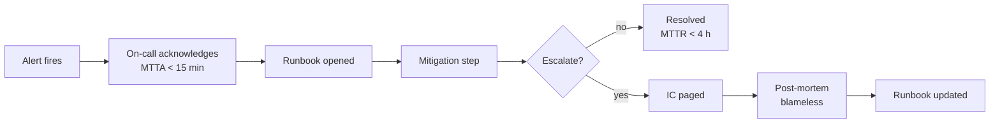

# 17.15 On-call runbooks

| Field | Value |
|---|---|
| Level | Advanced |
| Priority tier | 2 |
| Lab venue | GCP / GKE |
| Part | Part 17: Observability, performance and operations |
| Cross-references | Chapter 17.6 (Alerting and SLOs); Chapter 17.11 (Incident response); Chapter 17.7 (Failure modes); Chapter 17.10 (Cluster lifecycle) |
| Coverage file | `planning/coverage/chapters/17-15.md` |
| Claim & number ledger | `planning/ledgers/17-15.md` |

## On-call at a glance

A page wakes the on-call engineer in the middle of the night. How fast each step happens decides whether the problem stays small.



The times in the boxes are example targets. Choose your own before the first incident.

## Why this matters for AI infrastructure

Picture a GPU training cluster at 2 a.m. An alert fires, and the engineer on call has never seen this failure before. Without a runbook, that engineer searches the wiki and guesses. With one, the engineer opens the page and follows the steps in order.

Part 17 so far has been about preventing failures and detecting them. This chapter covers the person who responds when they happen. The runbook decides how long that response takes, because it tells the on-call engineer what to check first.

The on-call engineer is the human at the end of every alert. That person reads the trace, chooses a mitigation, and calls in an incident commander when the problem grows. The runbook keeps the engineer from working from memory in the middle of the night.

The figures in the block below are example values for your team to choose. They are not measured results, so replace them with your own numbers before you rely on them.

```text
Why on-call runbooks are on the critical path (background reading: NVIDIA Zero-to-Hero volume 19; NVIDIA Zero-to-Hero volume 10; Production Kubernetes; the figures below are examples, not quotations):
- A typical on-call engineer responds to 5-15 pages per week. Each page
  requires reading the runbook; each runbook reduces the response time by
  10-30 minutes. The runbook is the difference between a 30-minute response
  and a 4-hour response.
- A typical runbook has 6 sections (what, symptoms, diagnostic, mitigation,
  escalation, post-mortem). The 6 sections are the minimum viable runbook;
  the 6 sections are the contract between the on-call and the team.
- The on-call rotation is the discipline that keeps the muscle memory sharp.
  The rotation is weekly; the handover includes the current state; the
  handover includes the open incidents.
```

Three operational realities make this a platform-team concern, not only a data-science concern.

1. The runbook is a platform-team deliverable. Every alert needs a runbook, every runbook needs upkeep, and every runbook should be tested. The platform team owns all three.
2. The rotation is a platform-team discipline. It runs weekly, the handover is thorough, and the on-call engineer has the context to respond. The platform team keeps that discipline in place.
3. The on-call engineer is the person who acts on every alert. That engineer reads the runbook, mitigates the incident, and escalates when needed. The platform team's runbook is what makes that engineer effective.

A runbook is the agreement between the on-call engineer and the team. A runbook nobody agreed to is just a wiki page that nobody reads. Before you add someone to the rotation, check that every alert they will receive has a runbook.

## Prerequisites and outcomes

You will get paged eventually. The time to prepare is before the alert, so this chapter starts with what you need to know and what you should be able to do afterwards.

### Prerequisites

- Chapter 17.6 covers alerting and SLOs, which you need for alert routing.
- Chapter 17.11 covers incident response, the process you follow once an alert becomes an incident.
- Chapter 17.7 covers failure modes, the catalogue of things that go wrong.
- Chapter 17.10 covers cluster lifecycle, the change-management context for every rotation.

### Outcomes

By the end of this chapter, you will be able to:

1. Build a runbook with the 6 sections that every runbook needs.
2. Write an escalation policy that says when to escalate, whom to call, and how.
3. Run an on-call rotation with a handover, a schedule, and clear duties for each engineer.
4. Keep runbooks current through a review cycle, an update process, and a freshness check.
5. Run this process on GKE, with runbooks that work, escalations that are clear, and rotations you have tested.

---

## 1. The runbook structure

### 1.1 The 6-section template

It is 3 a.m., and an alert says GPU memory is almost full. The engineer on call needs to know what the alert means, what to check, and what to do, without digging through old chat logs. A runbook answers those questions in a fixed order.

Every runbook uses the same six sections. The fixed order helps a tired engineer find each part quickly, without reading the rest.

| Section | What it contains |
|---|---|
| **What the alert means** | A one-paragraph explanation of the alert |
| **Symptoms** | The user-facing symptoms that the alert detects |
| **Diagnostic steps** | The commands to run to confirm the alert |
| **Mitigation steps** | The commands to run to fix the alert |
| **Escalation path** | Who to page if the mitigation fails |
| **Post-mortem template** | The template for the post-mortem document |

### 1.2 What the alert means

Start with one paragraph that explains what the alert detects and why it matters. Without it, the on-call engineer has to guess whether the page is serious. Production Kubernetes, chapter 9, makes a related point about alerts: add a description and a link to the runbook, so the page itself gives context.

The 90 percent and 5 minute values in the example below are illustrative. Pick thresholds that match your own workloads.

```markdown
## What the alert means
The GPU's HBM utilisation has exceeded 90% for more than 5 minutes. The workload is at risk of CUDA OOM; the next training step may crash.
```

Write this paragraph first. If you cannot explain the alert in one paragraph, the alert is probably not ready to page anyone.

### 1.3 Symptoms

Symptoms describe what users see, not what the metrics show. An alert can be real while users are fine, and the reverse can also happen. The symptom list helps the engineer judge how urgent the page is and how to explain the impact.

```markdown
## Symptoms
- The workload's training step is taking longer than expected
- The CUDA OOM error appears in the workload's logs
- The workload's metrics show high GPU memory pressure
- The customer may experience slow inference or training failures
```

Write each symptom as something a user or a dashboard would show. That way the engineer can confirm it in a minute.

### 1.4 Diagnostic steps

Diagnostic steps confirm that the alert is real before anyone changes anything. Restarting a healthy workload because of a false alarm costs far more than a few minutes of checking. Each step below is a command you can run and read.

```markdown
## Diagnostic steps
1. Verify the GPU's HBM utilisation: `kubectl exec -it <pod> -- nvidia-smi`
2. Check the workload's memory usage: `kubectl top pod <pod>`
3. Check the workload's logs for CUDA OOM: `kubectl logs <pod> | grep OOM`
4. Check the GPU's DCGM metrics: `curl -s http://dcgm-exporter:9400/metrics | grep DCGM_FI_DEV_FB_USED`
```

> **dcgm-exporter 4.9.0 version note.** dcgm-exporter 4.9.0 (2026-11-06) renamed many default metrics and changed some units. For example `DCGM_FI_DEV_GPU_UTIL` (percent) became `DCGM_FI_DEV_GPU_UTIL_RATIO` (0 to 1), and `DCGM_FI_DEV_FB_USED` (MiB) became `DCGM_FI_DEV_FB_USED_BYTES`. The metric names in this chapter are the 4.8.x names. On a 4.9.0 exporter use the [full mapping in 17.4](04-dcgm-exporter-and-interpreting-gpu-metrics.md#14-what-dcgm-exporter-490-renamed), and change thresholds together with the unit.

Run the steps in order. Each one narrows the cause before you touch the workload.

### 1.5 Mitigation steps

Mitigation steps are what you do to make the alert go away. The list runs from the smallest change to the largest, so try the first items before the last. Draining a node is the final option in this example, because it moves every workload on that node.

```markdown
## Mitigation steps
1. Reduce the model size
2. Enable gradient checkpointing
3. Move to a larger GPU (request a node with more HBM)
4. Reduce the batch size
5. If none of the above works, drain the node and restart the workload
```

### 1.6 Escalation path

Escalation is the plan for the moment the mitigation does not work. It names who to call and when. The times in the example are values for your team to choose, not standards.

```markdown
## Escalation path
- If the mitigation fails within 30 minutes: page the secondary on-call
- If the secondary on-call cannot resolve within 1 hour: declare SEV-2; page the IC
- If the IC cannot resolve within 2 hours: declare SEV-1; page the VP Engineering
```

Agree on these times with your team before the first incident, not during it.

### 1.7 Post-mortem template

The post-mortem template lists the questions you answer after the incident. Its purpose is learning. Each answer should lead to a change in the alert, the code, or the hardware.

```markdown
## Post-mortem template
- What was the alert?
- What was the root cause?
- What was the impact (downtime, customer-facing)?
- What was the mitigation?
- What is the prevention (alert tuning, code change, hardware change)?
```

Fill in the prevention question before you close the incident ticket. That is where the learning happens.

---

## 2. The escalation policy

### 2.1 The escalation triggers

Picture a mitigation that has been failing for an hour. The on-call engineer has to decide whether to call for help now. Clear triggers remove that guesswork.

The text names four kinds of trigger: an SLO breach, a failed mitigation, several incidents at once, and a customer escalation. The table gives example rules for three of them. It has no row for an SLO breach, so add one before you rely on the policy.

| Trigger | Escalation level |
|---|---|
| Mitigation fails within 30 minutes | Page secondary on-call |
| Mitigation fails within 1 hour | Declare SEV-2; page IC |
| Mitigation fails within 2 hours | Declare SEV-1; page VP Engineering |
| Customer escalates | Declare SEV-1 regardless of impact |
| Multiple incidents at once | Declare SEV-1; declare IC |

The times in the table are example values. Your team should set them based on its own service levels.

### 2.2 The escalation contacts

The contacts are the people who receive an escalation, from the secondary on-call up to the CEO. Each level has its own paging schedule and an agreed response time. The YAML below is an example, so replace the schedule names with your own.

```yaml
# code/part17/escalation_contacts.yaml
escalation:
  - level: 1
    contact: secondary-oncall
    pagerduty_schedule: secondary-oncall-rotation
    response_time: 15 minutes
  - level: 2
    contact: incident-commander
    pagerduty_schedule: ic-rotation
    response_time: 30 minutes
  - level: 3
    contact: vp-engineering
    pagerduty_schedule: vp-engineering-rotation
    response_time: 1 hour
  - level: 4
    contact: ceo
    pagerduty_schedule: executive-rotation
    response_time: 2 hours
```

### 2.3 The escalation communication

A good escalation message lets the next person act without asking questions. It states the severity, the impact, what you already tried, and what you need from the reader. The numbers in the example message are illustrative.

```markdown
## Escalation: GPU Memory Pressure on churn-model

**Severity:** SEV-2 (degraded inference latency)
**Impact:** 30% of inference requests are affected; p99 latency is 800ms vs. SLO of 300ms
**Mitigation attempted:** Reduced batch size; enabled gradient checkpointing; still failing
**Asking for:** IC to take over; secondary on-call is engaged
**ETA:** 1 hour for IC to take over
```

Before you send a message like this, check that someone who has not seen the alert could understand it.

---

## 3. The on-call rotation

### 3.1 The rotation schedule

A rotation answers one question for every week: who gets paged. Publish it early, so people can plan around it. The YAML below alternates a primary and a secondary each week. A weekly cadence is only an example. A larger or smaller team may choose a different length.

```yaml
# code/part17/oncall_rotation.yaml
rotation:
  - week: 2024-04-01
    primary: alice
    secondary: bob
  - week: 2024-04-08
    primary: bob
    secondary: carol
  - week: 2024-04-15
    primary: carol
    secondary: alice
```

### 3.2 The handover process

A handover moves the context from the outgoing engineer to the incoming one. Without it, the new on-call may not know that an incident is still open. Write the handover in a template, so nothing gets skipped.

```markdown
# On-call Handover: 2024-04-08

## Outgoing on-call
Alice (primary, last week)

## Incoming on-call
Bob (primary, this week); Carol (secondary)

## Current state
- Cluster is healthy
- SLO compliance is 99.99% (above the 99.9% target)
- Error budget remaining is 38 minutes (down from 43.2 minutes)

## Open incidents
- INC-2024-04-07-002: churn-model inference latency degraded (SEV-3; ongoing; monitoring)

## Upcoming changes
- 2024-04-09 14:00 UTC: GPU driver upgrade (CR-2024-04-09)
- 2024-04-10 02:00 UTC: Kubernetes version upgrade (CR-2024-04-10)

## Notes
- Watch the memory pressure on the H100 nodes; the workload is at 85% utilisation
- The on-call training is scheduled for 2024-04-15
```

The numbers in this example are illustrative. Check them against your own error budget before you copy the template. The two figures agree. A 30-day month has 43,200 minutes, so 5.2 minutes of downtime is about 0.012 percent, which gives 99.988 percent, shown here as 99.99.

### 3.3 The on-call responsibilities

The on-call engineer has duties before, during, and after the shift. The table lists them phase by phase. The five-minute response time in the table is an example value, so agree on your own with the team.

| Phase | Responsibility |
|---|---|
| Before | Review the runbooks; review the open incidents; review the upcoming changes |
| During | Respond to pages within 5 minutes; follow the runbook; escalate when needed |
| After | Write the post-mortem; update the runbook; hand over to the next on-call |

Read the table before your first shift. Then confirm with the team that the response time it names is one everyone can meet.

---

## 4. Maintaining the runbooks

### 4.1 The review cycle

A runbook nobody reviews slowly drifts away from the system it describes. A review finds runbooks that are stale, missing, or out of date with new failure modes. The example below uses a 90-day staleness threshold, which is a value you should set for your own team. Run the review yourself once before you rely on it.

```bash
# Review the runbooks
python code/part17/runbook_review.py \
  --staleness-threshold-days 90
# expected: a list of stale runbooks; a list of missing runbooks; a list of new runbooks
```

### 4.2 The update process

Update the runbook right after an incident, while the details are still fresh. The update adds the new failure mode and the mitigation that worked.

```bash
# Update the runbook after the incident
python code/part17/runbook_update.py \
  --runbook-url https://wiki.example.com/runbooks/gpu-memory-pressure \
  --incident-id INC-2024-03-15-001 \
  --new-mitigation "Reduce batch size to 1; enable gradient checkpointing"
```

The runbook lives in Git. The update script writes a commit, and a reviewer checks it in a pull request. Every change to the runbook therefore has an owner and a record.

### 4.3 The freshness check

The freshness check turns the review rule into an automatic test. It fails when a runbook has not changed within the threshold, so a stale runbook fails CI before anyone relies on it.

```bash
# Check the runbook freshness
python code/part17/runbook_freshness.py \
  --staleness-threshold-days 90
# expected: a list of stale runbooks; an exit code that fails the CI if any runbook is stale
```

Add this check to CI first. That way staleness is caught during a normal change, not in the middle of an incident.

---

## 5. Operating the on-call process on GKE

### 5.1 The components

The on-call process has five components, and any one of them can fail on its own. Name the store and an owner for each, so you know where to look during an outage. The table lists the components with their stores and example targets. Choose your own targets.

| Component | Where it runs | Backing store | SLO |
|---|---|---|---|
| Runbook repository | Git repo | Git history | Runbook freshness < 90 days |
| Escalation policy | PagerDuty | (PagerDuty) | Escalation latency p99 < 5 minutes |
| On-call rotation | PagerDuty | (PagerDuty) | Rotation handover < 30 minutes |
| Handover document | Confluence / Notion | (Confluence) | Handover created before rotation |
| Post-mortem template | Git repo | Git history | Post-mortem within 5 business days |

### 5.2 IAM and the on-call process

Access to the on-call tools is a security question as well as a convenience. Each role should be able to do only what its job needs. The table lists four roles and what each one can do.

| Role | Who | What they can do |
|---|---|---|
| `oncall.primary` | The current primary on-call | Be paged for every alert; respond to the alert |
| `oncall.secondary` | The current secondary on-call | Be paged for SEV-1; be the backup for the primary |
| `oncall.writer` | The platform team | Update the runbooks; update the rotation |
| `oncall.admin` | The platform team lead | Approve the rotation; approve the escalations |

The rotation only works when the platform team keeps it running. That takes written rules, clear enforcement, and a review each quarter. When you review the roles, remove any access that nobody uses.

### 5.3 Observability

You need to know how the on-call process itself is doing, not only the systems it watches. Track how quickly people respond, how many pages arrive, and how often they escalate. The table lists the metrics and the alert levels as examples, so treat the levels as a starting point.

| Metric | Why it matters | Alert |
|---|---|---|
| Page response time (MTTA) | On-call responsiveness | > 15 minutes |
| Page frequency per week | On-call load | > 30 per week |
| Escalation rate | On-call load | > 10% of pages |
| Runbook freshness | Documentation accuracy | > 90 days stale |
| Handover completion | On-call continuity | < 100% for 1 week |

Production Kubernetes, chapter 9, adds one alert that every team needs: a dead man's switch. It is an alert that fires on a schedule, and when it stops firing, the on-call hears that metrics or alerting have failed. PagerDuty offers an integration for this, called Dead Man's Snitch.

The page frequency alert is a useful first signal. A high count means the on-call engineer is overloaded, or that the team is paged for things that should not page at all.

---

## 6. How it fails

Six failure modes come back again and again. Each one has a symptom you can see, a likely cause, and a fix you can apply.

### 6.1 "The runbook is missing"

The on-call gets paged, opens the runbook link, and finds nothing there. The likely cause is that nobody wrote a runbook for this alert, or that the link points to the wrong place. Create the runbook, check the link, and make a runbook part of creating every new alert.

### 6.2 "The runbook is out of date"

The engineer follows the runbook, but its mitigation no longer works, and the incident escalates. The runbook was probably not updated after the last incident, or the fix has changed since then. Update the runbook, automate the freshness check, and review every runbook each quarter.

### 6.3 "The on-call does not know the rotation"

The on-call is paged but does not know that the rotation has moved to them, so has little context. Usually the rotation was never published, or nobody told the engineer. Publish the rotation in advance, notify the on-call early, and enforce it in PagerDuty.

### 6.4 "The handover is missing"

The rotation changes hands, and the new engineer has no idea what is still open. The handover was skipped, was never written down, or nobody checked it. Schedule the handover, use a written template, and tie the template to the runbook.

### 6.5 "The escalation is not clear"

The engineer needs to escalate but does not know whom to call or when. The policy is probably not written down, the contacts are out of date, or the triggers are vague. Write the policy down, check the contacts, and state the triggers in the runbook itself.

### 6.6 "The on-call is overwhelmed"

Imagine the on-call is paged 50 times in one week and cannot keep up. Too many alerts bury the ones that matter and wear the engineers down. Production Kubernetes, chapter 9, makes the same warning: excessive critical alerts burn out on-call engineers and drown out real events. Tune the alert routing, improve the runbooks, and add on-call staff. Put the on-call load on the agenda of your quarterly review.

---

## 7. Hands-on lab

This lab puts the pieces together: a runbook template, an escalation policy, a rotation, and a runbook link inside a live alert. It has not been tested in this repository, so treat each command as a starting point.

### 7.1 Prerequisites

- The alerting stack from earlier chapters.
- PagerDuty, or a similar on-call tool.
- A Git repository for the runbooks.

### 7.2 Step 1: write the runbook template

Start with one template, so every runbook has the same six headings.

```bash
# Create the runbook template
mkdir -p runbooks
cat > runbooks/TEMPLATE.md <<EOF
# Alert: <alert-name>

## What the alert means
<one-paragraph explanation>

## Symptoms
- <symptom 1>
- <symptom 2>

## Diagnostic steps
1. <command 1>
2. <command 2>

## Mitigation steps
1. <mitigation 1>
2. <mitigation 2>

## Escalation path
- <escalation 1>
- <escalation 2>

## Post-mortem template
- <question 1>
- <question 2>
EOF
```

### 7.3 Step 2: write the runbook for a specific alert

Copy the template for the GPU memory alert, then fill in each section for that alert.

```bash
# Create the runbook for the GPU memory pressure alert
cp runbooks/TEMPLATE.md runbooks/gpu-memory-pressure.md
vim runbooks/gpu-memory-pressure.md
```

### 7.4 Step 3: configure the escalation policy

Send the escalation policy to PagerDuty through its API. The JSON file holds your levels and contacts.

```bash
# Configure the escalation policy in PagerDuty
curl -X POST -H "Authorization: Token token=$PAGERDUTY_TOKEN" \
  -H "Content-Type: application/json" \
  -d @escalation_policy.json \
  https://api.pagerduty.com/escalation_policies
```

### 7.5 Step 4: schedule the on-call rotation

Create the rotation in PagerDuty from a JSON file. Use the same weekly schedule you wrote in Section 3.

```bash
# Schedule the on-call rotation in PagerDuty
curl -X POST -H "Authorization: Token token=$PAGERDUTY_TOKEN" \
  -H "Content-Type: application/json" \
  -d @oncall_rotation.json \
  https://api.pagerduty.com/schedules
```

### 7.6 Step 5: configure the runbook URL in the alert

Put the runbook link into the alert rule, so the page carries it with the alert. Production Kubernetes, chapter 9, recommends linking runbooks from alert annotations for the same reason.

```bash
# Add the runbook URL to the alert rule
kubectl -n monitoring create configmap alert-rules \
  --from-file=configs/gpu_alerts.yaml
# expected: the alert rule has a runbook_url annotation
```

### 7.7 Step 6: simulate an alert

Fire a test alert, and check that the page reaches you and carries the runbook link. Test this path before you need it in a real incident.

```bash
# Inject a synthetic critical alert
curl -X POST http://alertmanager.monitoring:9093/api/v2/alerts \
  -H "Content-Type: application/json" \
  -d '[{"labels": {"alertname": "incident_test", "severity": "critical"}}]'
# expected: the alert fires; the on-call is paged; the runbook URL is in the page
```

### 7.8 Step 7: follow the runbook

Open the runbook from the alert, and read it the way the on-call engineer would. If the link is broken or a step is unclear, fix it now.

```bash
# Click the runbook URL in the alert
open "$(curl -s http://localhost:9093/api/v2/alerts | jq -r '.[0].annotations.runbookURL')"
# expected: the runbook opens in the browser
```

### 7.9 What to record

After the lab, check that you can answer five questions quickly:

1. What is the current primary on-call?
2. What is the current secondary on-call?
3. What is the current page frequency per week?
4. What is the current MTTA?
5. What is the most recent runbook update?

If any answer takes more than 30 seconds, the on-call process is not yet ready for production. The 30-second bar is an example; pick the limit that suits your team. The lab has not been tested against a live GKE cluster.

---

## Exercises

1. Add a runbook for every alert. Take each alert in your stack and write a runbook with the six sections. A page without a runbook leaves the engineer searching, so start here. *Solution sketch:* start from the template in Section 7.2, and write one runbook per alert.
2. Add an escalation policy. Configure the policy in PagerDuty with four levels. Without it, nobody knows whom to call when a mitigation fails. *Solution sketch:* use the contacts in Section 2.2 and the API call in Section 7.4.
3. Add an on-call rotation. Schedule a weekly rotation in PagerDuty. A rotation nobody can see is the failure described earlier in this chapter. *Solution sketch:* use the schedule in Section 3.1 and the API call in Section 7.5.
4. Add a handover template. Fill in the template before every rotation change. Each handover should leave the next engineer with the open incidents and the upcoming changes. *Solution sketch:* follow the process in Section 3.2, and make the template the default for every handover.
5. Add a runbook freshness check. Configure a CI step that fails when a runbook is stale. A check in CI catches stale runbooks before you need them during an incident. *Solution sketch:* use the check in Section 4.3. The step fails when a runbook is more than 90 days old.
6. Add on-call training. Train every on-call engineer on the runbooks each quarter. Practice with the runbooks before you face a real page. *Solution sketch:* the training uses the runbooks, includes a drill, and is written down.

---

## Checkpoint questions

<details><summary>1. A page arrives and the runbook link opens an empty page. What likely happened, and what do you change?</summary>
Nobody wrote a runbook for this alert, or the link points to the wrong place. Create the runbook and check the link. Then make a runbook part of creating every new alert, so the gap cannot return.
</details>

<details><summary>2. The engineer follows the runbook exactly, but the mitigation no longer works and the incident escalates. What was the cause?</summary>
The runbook was probably not updated after the last incident, or the fix has changed since. Update it, automate the freshness check, and review every runbook each quarter. Updates should happen right after an incident while the details are fresh.
</details>

<details><summary>3. A new primary on-call starts a shift and does not know a SEV-3 is still open. What process was skipped?</summary>
The handover. A handover moves context from the outgoing engineer to the incoming one, including current state, open incidents, and upcoming changes. Schedule it, use a written template, and tie the template to the runbook.
</details>

<details><summary>4. A mitigation on churn-model has failed for an hour. What does the example policy tell you to do, and what goes in the message?</summary>
Declare SEV-2 and page the IC. The message states the severity, the impact, what you already tried, and what you need from the reader. The example reads 30 percent of requests affected and p99 at 800 ms against an SLO of 300 ms.
</details>

<details><summary>5. A customer escalates directly, and the technical impact looks small. What severity does the example table assign?</summary>
SEV-1 regardless of impact. The table says a customer escalation declares SEV-1 no matter how the metrics look. Several incidents at once also declare SEV-1 and an IC.
</details>

<details><summary>6. The on-call has been paged 50 times in one week and cannot keep up. What does the chapter say is happening, and what do you do?</summary>
Too many alerts bury the ones that matter and wear the engineers down. Production Kubernetes, Chapter 9, makes the same warning about burnout. Tune the alert routing, improve the runbooks, add on-call staff, and put the load on the quarterly review agenda.
</details>

<details><summary>7. Why do diagnostic steps come before mitigation steps?</summary>
They confirm the alert is real before anyone changes anything. Restarting a healthy workload because of a false alarm costs far more than a few minutes of checking. Each step also narrows the cause before you touch the workload.
</details>

<details><summary>8. Why should the symptoms section describe what users see rather than what metrics show?</summary>
An alert can be real while users are fine, and the reverse can also happen. A symptom list written in user terms helps the engineer judge urgency and explain the impact. The engineer can also confirm each symptom in a minute.
</details>

<details><summary>9. Why does the example mitigation list put draining the node last?</summary>
The list runs from the smallest change to the largest. Draining a node moves every workload on it, so it is the final option. Smaller steps like reducing the batch size or enabling gradient checkpointing come first.
</details>

<details><summary>10. Why add a runbook freshness check to CI?</summary>
It fails when a runbook has not changed within the threshold, such as 90 days. A stale runbook is then caught during a normal change instead of in the middle of an incident. The check turns the review rule into an automatic test.
</details>

<details><summary>11. Why does the chapter recommend a dead man's switch alert?</summary>
It is an alert that fires on a schedule. When it stops firing, the on-call hears that metrics or alerting have failed. Without it, a broken alerting system looks the same as a quiet, healthy one.
</details>

<details><summary>12. Would you keep a weekly rotation or choose another length, and what do you give up?</summary>
A weekly rotation is only an example. A larger or smaller team may choose a different length. Whatever you pick, publish it early and require a thorough handover, because short shifts mean more handovers and long shifts mean more load on each person.
</details>

<details><summary>13. A new alert is ready but has no runbook. Do you start paging on it or wait, and what do you give up?</summary>
Wait until a runbook exists. Before adding someone to the rotation, every alert they receive needs a runbook. If you cannot explain the alert in one paragraph, it is probably not ready to page anyone. You give up early coverage for a page that someone can act on.
</details>

<details><summary>14. Do you escalate to the secondary on-call early or try longer alone, and what are the costs?</summary>
The example policy pages the secondary after 30 minutes of failed mitigation and the IC after 1 hour. Escalating early costs other people's time. Waiting risks a growing incident. The chapter asks you to agree the times with your team before the first incident.
</details>

<details><summary>15. Should every runbook change go straight into the wiki or through Git with review, and what do you give up?</summary>
The chapter keeps runbooks in Git. The update script writes a commit and a reviewer checks the pull request. You give up the speed of editing a wiki page, but every change gets an owner and a record.
</details>

<details><summary>16. A handover starts with an error budget of 43.2 minutes and ends with 38 minutes left. How much was used?</summary>
The budget used is 43.2 minus 38, which is 5.2 minutes. This matches a month where the target is 99.9 percent. The remaining budget is therefore about 88 percent of the original.
</details>

<details><summary>17. The same handover reports 99.99 percent compliance and 38 minutes left. Do the two figures agree?</summary>
Yes. A 30-day month has 43,200 minutes, and 43.2 minutes is 0.1 percent of it. Using 5.2 minutes of budget is about 0.012 percent downtime, so compliance is about 99.988 percent, which rounds to 99.99.
</details>

<details><summary>18. The alert for page frequency fires above 30 pages per week and the escalation alert above 10 percent of pages. With 50 pages, how many escalations trip the second alert?</summary>
The page count is 50, which is more than 30, so that alert fires. Ten percent of 50 is 5. More than 5 escalations trips the escalation alert.
</details>

<details><summary>19. The GPU memory alert fires. What do you check first, second, third, and fourth?</summary>
First run nvidia-smi inside the pod to verify HBM utilisation. Second check the pod's memory with kubectl top. Third search the logs for CUDA OOM. Fourth look at the DCGM framebuffer metric. Each step narrows the cause before you change anything.
</details>

<details><summary>20. An incident is mitigated. What do you do after, in order?</summary>
First write the post-mortem and fill in the prevention question before closing the ticket. Second update the runbook with the new mitigation. Third hand over to the next on-call with the open items.
</details>

---

## Sources and review notes

- NVIDIA Zero-to-Hero Volume 19 (`chapter-12-on-call-runbooks.md`). Source for the on-call operational patterns, the runbook structure, and the escalation policy. The wording has been rewritten in the handbook's voice.
- NVIDIA Zero-to-Hero Volume 10 (`chapter-12-on-call-and-runbooks.md`). Source for the on-call patterns and the runbook template.
- *Production Kubernetes* (`production-kubernetes`, Chapter 14). Source for the Kubernetes-level on-call patterns.

### Cross-references to other handbook chapters

- Chapter 17.6 for the alerting and SLOs.
- Chapter 17.11 for the incident response.
- Chapter 17.7 for the failure modes.
- Chapter 17.10 for the cluster lifecycle.

### Migrated from `nvidia-devops`

The on-call operational patterns draw on Volume 19 chapter 12 and Volume 10 chapter 12. The wording has been rewritten in the handbook's voice.

### Explicitly labelled inferences

- The runbook template's 6 sections are starting points; specific sections depend on the team's discipline.
- The escalation trigger thresholds (30 minutes, 1 hour, 2 hours) are starting points; specific thresholds depend on the SLO.
- The on-call rotation's weekly cadence is a starting point; specific cadences depend on the team's size.

### Not verified on live hardware

- The lab in Section 7 is **untested** against a live GKE cluster in this repository.
- The PagerDuty integration in the lab requires production credentials that are not provided in the lab.
- The runbook template in the lab is illustrative; production templates are more detailed.
