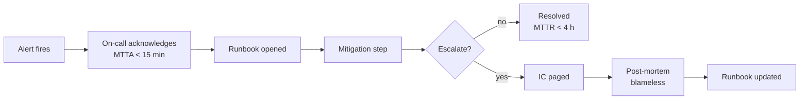

# 17.15 On-call runbooks

| Field | Value |
|---|---|
| Level | Advanced |
| Priority tier | 2 |
| Lab venue | GCP / GKE |
| Part | Part 17: Observability, performance and operations |
| Primary sources | NVIDIA Zero-to-Hero Volume 19 (`chapter-12-on-call-runbooks.md`); NVIDIA Zero-to-Hero Volume 10 (`chapter-12-on-call-and-runbooks.md`); *Production Kubernetes* (`production-kubernetes`, Chapter 14) |
| Cross-references | Chapter 17.6 (Alerting and SLOs); Chapter 17.11 (Incident response); Chapter 17.7 (Failure modes); Chapter 17.10 (Cluster lifecycle) |
| Coverage file | `planning/coverage/chapters/17-15.md` |
| Claim & number ledger | `planning/ledgers/17-15.md` |

## On-call at a glance



The alert-to-post-mortem flow; each box is a measurable latency target.

## Why this matters for AI infrastructure

Every chapter in Part 17 so far has been about preventing failures or detecting failures. This chapter is about the person who responds when the failures happen — the on-call engineer. The on-call engineer has the runbook; the runbook is the difference between a 15-minute incident and a 4-hour incident.

An AI factory without runbooks is an AI factory where the on-call engineer is searching the wiki while the cluster burns. An AI factory with runbooks is an AI factory where the on-call engineer opens the runbook; the on-call engineer follows the steps; the on-call engineer mitigates the incident in minutes.

The on-call is the human at the end of every alert. The on-call is the human who interprets the trace; the on-call is the human who decides the mitigation; the on-call is the human who calls the IC. The runbook is what the on-call reads; the runbook is what the on-call follows; the runbook is what keeps the on-call from being lost.

```text
Why on-call runbooks are on the critical path (V19 ch12; V10 ch12; PK Ch 14):
- A typical on-call engineer responds to 5-15 pages per week. Each page
  requires reading the runbook; each runbook reduces the response time by
  10-30 minutes. The runbook is the difference between a 30-minute response
  and a 4-hour response.
- A typical runbook has 6 sections (what, symptoms, diagnostic, mitigation,
  escalation, post-mortem). The 6 sections are the minimum viable runbook;
  the 6 sections are the contract between the on-call and the team.
- The on-call rotation is the discipline that keeps the muscle memory sharp.
  The rotation is weekly; the handover includes the current state; the
  handover includes the open incidents.
```

Three operational realities make this chapter a platform-team concern rather than a data-science-only concern:

1. **The runbook is a platform-team deliverable.** Every alert has a runbook; every runbook is maintained; every runbook is tested. The platform team owns the runbook.
2. **The on-call rotation is a platform-team discipline.** The rotation is weekly; the handover is thorough; the on-call engineer has the context to respond. The platform team's discipline is what makes the rotation work.
3. **The on-call engineer is the human at the end of every alert.** The on-call engineer is the human who reads the runbook; the on-call engineer is the human who mitigates the incident; the on-call engineer is the human who escalates to the IC. The platform team's runbook is what keeps the on-call engineer effective.

**Before a team can have an on-call rotation, the team must have runbooks. A runbook is the contract between the on-call and the team. A runbook without a contract is a wiki page that nobody reads. A runbook with a contract is the on-call's guide.**

## Prerequisites and outcomes

### Prerequisites

- Chapter 17.6 (Alerting and SLOs) for the alert routing.
- Chapter 17.11 (Incident response) for the incident process.
- Chapter 17.7 (Failure modes) for the failure mode catalogue.
- Chapter 17.10 (Cluster lifecycle) for the change management context.

### Outcomes

After completing this chapter you will be able to:

1. Build the runbook structure: the 6 sections that every runbook must have.
2. Implement the escalation policy: when to escalate; who to escalate to; how to escalate.
3. Run the on-call rotation: the handover; the schedule; the on-call engineer's responsibilities.
4. Maintain the runbooks: the review cycle; the update process; the freshness check.
5. Operate the on-call process on GKE with reliable runbooks, sensible escalations, and tested rotations.

---

## 1. The runbook structure

### 1.1 The 6-section template

Every runbook has 6 sections. The 6 sections are the minimum viable runbook; the 6 sections are the contract between the on-call and the team.

| Section | What it contains |
|---|---|
| **What the alert means** | A one-paragraph explanation of the alert |
| **Symptoms** | The user-facing symptoms that the alert detects |
| **Diagnostic steps** | The commands to run to confirm the alert |
| **Mitigation steps** | The commands to run to fix the alert |
| **Escalation path** | Who to page if the mitigation fails |
| **Post-mortem template** | The template for the post-mortem document |

The pattern is: every alert has a runbook; the runbook has 6 sections; the 6 sections are the contract. The contract is what the on-call reads; the contract is what the team maintains.

### 1.2 What the alert means

The "what the alert means" section is a one-paragraph explanation of the alert. The section explains what the alert is detecting; the section explains why the alert matters; the section sets the context for the on-call.

```markdown
## What the alert means
The GPU's HBM utilisation has exceeded 90% for more than 5 minutes. The workload is at risk of CUDA OOM; the next training step may crash.
```

The pattern is: the explanation is short; the explanation is specific; the explanation names the failure mode.

### 1.3 Symptoms

The "symptoms" section lists the user-facing symptoms that the alert detects. The section helps the on-call verify that the alert is real; the section helps the on-call communicate the impact to the user.

```markdown
## Symptoms
- The workload's training step is taking longer than expected
- The CUDA OOM error appears in the workload's logs
- The workload's metrics show high GPU memory pressure
- The customer may experience slow inference or training failures
```

The pattern is: the symptoms are observable; the symptoms are specific; the symptoms help the on-call verify the alert.

### 1.4 Diagnostic steps

The "diagnostic steps" section lists the commands to run to confirm the alert. The section helps the on-call verify the root cause; the section helps the on-call avoid false positives.

```markdown
## Diagnostic steps
1. Verify the GPU's HBM utilisation: `kubectl exec -it <pod> -- nvidia-smi`
2. Check the workload's memory usage: `kubectl top pod <pod>`
3. Check the workload's logs for CUDA OOM: `kubectl logs <pod> | grep OOM`
4. Check the GPU's DCGM metrics: `curl -s http://dcgm-exporter:9400/metrics | grep DCGM_FI_DEV_FB_USED`
```

The pattern is: the diagnostic steps are commands; the commands are copy-pasteable; the commands produce output the on-call can interpret.

### 1.5 Mitigation steps

The "mitigation steps" section lists the commands to run to fix the alert. The section is the on-call's playbook; the section is the on-call's guide.

```markdown
## Mitigation steps
1. Reduce the model size
2. Enable gradient checkpointing
3. Move to a larger GPU (request a node with more HBM)
4. Reduce the batch size
5. If none of the above works, drain the node and restart the workload
```

The pattern is: the mitigation steps are ordered from least to most disruptive; the mitigation steps are copy-pasteable; the mitigation steps have success criteria.

### 1.6 Escalation path

The "escalation path" section names who to page if the mitigation fails. The section is the on-call's escape hatch; the section is the on-call's guide for when to call for help.

```markdown
## Escalation path
- If the mitigation fails within 30 minutes: page the secondary on-call
- If the secondary on-call cannot resolve within 1 hour: declare SEV-2; page the IC
- If the IC cannot resolve within 2 hours: declare SEV-1; page the VP Engineering
```

The pattern is: the escalation is graduated; the escalation has clear triggers; the escalation has clear timelines.

### 1.7 Post-mortem template

The "post-mortem template" section is the template the team uses after the incident. The section ensures the incident produces organisational learning.

```markdown
## Post-mortem template
- What was the alert?
- What was the root cause?
- What was the impact (downtime, customer-facing)?
- What was the mitigation?
- What is the prevention (alert tuning, code change, hardware change)?
```

The pattern is: the template is short; the template is structured; the template produces action items with owners and deadlines.

---

## 2. The escalation policy

### 2.1 The escalation triggers

The escalation triggers are the conditions that warrant escalation. The triggers are: SLO breach, mitigation failure, multiple incidents, customer escalation.

| Trigger | Escalation level |
|---|---|
| Mitigation fails within 30 minutes | Page secondary on-call |
| Mitigation fails within 1 hour | Declare SEV-2; page IC |
| Mitigation fails within 2 hours | Declare SEV-1; page VP Engineering |
| Customer escalates | Declare SEV-1 regardless of impact |
| Multiple incidents at once | Declare SEV-1; declare IC |

The pattern is: the escalation is graduated; the triggers are clear; the on-call knows when to escalate.

### 2.2 The escalation contacts

The escalation contacts are the people who receive the escalation. The contacts are: secondary on-call, IC, VP Engineering, CEO.

```yaml
# code/part17/escalation_contacts.yaml (shape only)
escalation:
  - level: 1
    contact: secondary-oncall
    pagerduty_schedule: secondary-oncall-rotation
    response_time: 15 minutes
  - level: 2
    contact: incident-commander
    pagerduty_schedule: ic-rotation
    response_time: 30 minutes
  - level: 3
    contact: vp-engineering
    pagerduty_schedule: vp-engineering-rotation
    response_time: 1 hour
  - level: 4
    contact: ceo
    pagerduty_schedule: executive-rotation
    response_time: 2 hours
```

The pattern is: the escalation contacts are documented; the contacts are paged automatically; the contacts have response time commitments.

### 2.3 The escalation communication

The escalation communication is the message sent when an escalation is triggered. The communication is structured; the communication is concise; the communication includes the impact.

```markdown
## Escalation: GPU Memory Pressure on churn-model

**Severity:** SEV-2 (degraded inference latency)
**Impact:** 30% of inference requests are affected; p99 latency is 800ms vs. SLO of 300ms
**Mitigation attempted:** Reduced batch size; enabled gradient checkpointing; still failing
**Asking for:** IC to take over; secondary on-call is engaged
**ETA:** 1 hour for IC to take over
```

The pattern is: the escalation is structured; the escalation is concise; the escalation includes the impact; the escalation includes the ETA.

---

## 3. The on-call rotation

### 3.1 The rotation schedule

The rotation schedule is the weekly schedule of who is on-call. The schedule alternates between primary and secondary; the schedule is published in advance; the schedule is respected.

```yaml
# code/part17/oncall_rotation.yaml (shape only)
rotation:
  - week: 2024-04-01
    primary: alice
    secondary: bob
  - week: 2024-04-08
    primary: bob
    secondary: carol
  - week: 2024-04-15
    primary: carol
    secondary: alice
```

The pattern is: the rotation is weekly; the rotation is published quarterly; the rotation is respected.

### 3.2 The handover process

The handover is the transfer of context from the outgoing on-call to the incoming on-call. The handover includes the current state; the handover includes the open incidents; the handover includes the upcoming changes.

```markdown
# On-call Handover: 2024-04-08

## Outgoing on-call
Alice (primary, last week)

## Incoming on-call
Bob (primary, this week); Carol (secondary)

## Current state
- Cluster is healthy
- SLO compliance is 99.95% (above the 99.9% target)
- Error budget remaining is 38 minutes (down from 43.2 minutes)

## Open incidents
- INC-2024-04-07-002: churn-model inference latency degraded (SEV-3; ongoing; monitoring)

## Upcoming changes
- 2024-04-09 14:00 UTC: GPU driver upgrade (CR-2024-04-09)
- 2024-04-10 02:00 UTC: Kubernetes version upgrade (CR-2024-04-10)

## Notes
- Watch the memory pressure on the H100 nodes; the workload is at 85% utilisation
- The on-call training is scheduled for 2024-04-15
```

The pattern is: the handover is structured; the handover is thorough; the handover is the contract between the outgoing and incoming on-call.

### 3.3 The on-call responsibilities

The on-call engineer has responsibilities before, during, and after the rotation. The responsibilities are documented; the responsibilities are enforced; the responsibilities are reviewed.

| Phase | Responsibility |
|---|---|
| Before | Review the runbooks; review the open incidents; review the upcoming changes |
| During | Respond to pages within 5 minutes; follow the runbook; escalate when needed |
| After | Write the post-mortem; update the runbook; hand over to the next on-call |

The pattern is: the responsibilities are clear; the responsibilities are documented; the responsibilities are reviewed quarterly.

---

## 4. Maintaining the runbooks

### 4.1 The review cycle

The runbooks are reviewed quarterly. The review identifies runbooks that are out of date; the review identifies runbooks that are missing; the review identifies runbooks that have new failure modes.

```bash
# Review the runbooks
python code/part17/runbook_review.py \
  --staleness-threshold-days 90
# expected: a list of stale runbooks; a list of missing runbooks; a list of new runbooks
```

The pattern is: the review is automated; the review's output is a report; the report is reviewed by the platform team.

### 4.2 The update process

The runbooks are updated after every incident. The update adds the new failure mode; updates the mitigation; records the post-mortem.

```bash
# Update the runbook after the incident
python code/part17/runbook_update.py \
  --runbook-url https://wiki.example.com/runbooks/gpu-memory-pressure \
  --incident-id INC-2024-03-15-001 \
  --new-mitigation "Reduce batch size to 1; enable gradient checkpointing"
```

The pattern is: the runbook is a version-controlled document (in Git); the runbook is updated via a script; the script's output is a commit; the commit is reviewed in a pull request.

### 4.3 The freshness check

The runbook freshness check verifies that every runbook has been updated within the staleness threshold. The check fails when a runbook is stale.

```bash
# Check the runbook freshness
python code/part17/runbook_freshness.py \
  --staleness-threshold-days 90
# expected: a list of stale runbooks; an exit code that fails the CI if any runbook is stale
```

The pattern is: the freshness check is automated; the check is part of the CI; the check fails the CI when a runbook is stale.

---

## 5. Operating the on-call process on GKE

### 5.1 The components

| Component | Where it runs | Backing store | SLO |
|---|---|---|---|
| Runbook repository | Git repo | Git history | Runbook freshness < 90 days |
| Escalation policy | PagerDuty | (PagerDuty) | Escalation latency p99 < 5 minutes |
| On-call rotation | PagerDuty | (PagerDuty) | Rotation handover < 30 minutes |
| Handover document | Confluence / Notion | (Confluence) | Handover created before rotation |
| Post-mortem template | Git repo | Git history | Post-mortem within 5 business days |

### 5.2 IAM and the on-call process

The on-call process has its own IAM. The pattern is:

| Role | Who | What they can do |
|---|---|---|
| `oncall.primary` | The current primary on-call | Be paged for every alert; respond to the alert |
| `oncall.secondary` | The current secondary on-call | Be paged for SEV-1; be the backup for the primary |
| `oncall.writer` | The platform team | Update the runbooks; update the rotation |
| `oncall.admin` | The platform team lead | Approve the rotation; approve the escalations |

The on-call rotation is the platform team's discipline. The discipline is documented; the discipline is enforced; the discipline is reviewed quarterly.

### 5.3 Observability

| Metric | Why it matters | Alert |
|---|---|---|
| Page response time (MTTA) | On-call responsiveness | > 15 minutes |
| Page frequency per week | On-call load | > 30 per week |
| Escalation rate | On-call load | > 10% of pages |
| Runbook freshness | Documentation accuracy | > 90 days stale |
| Handover completion | On-call continuity | < 100% for 1 week |

The page frequency per week alert is the most important. A high page frequency means the on-call is overloaded; a high page frequency means the team is being paged for things that should not page.

---

## 6. How it fails

Six failure modes recur.

### 6.1 "The runbook is missing"

**Symptom:** The on-call is paged; the on-call opens the runbook URL; the runbook does not exist.

**Diagnosis:** The runbook was not created for the alert; the runbook was deleted; the runbook URL is wrong.

**Fix:** Create the runbook; verify the runbook URL; add the runbook creation to the alerting workflow.

### 6.2 "The runbook is out of date"

**Symptom:** The on-call follows the runbook; the runbook's mitigation does not work; the incident escalates.

**Diagnosis:** The runbook was not updated after the last incident; the runbook's mitigation has changed.

**Fix:** Update the runbook; automate the runbook freshness check; review the runbook quarterly.

### 6.3 "The on-call does not know the rotation"

**Symptom:** The on-call is paged but does not know they are on-call; the on-call does not have the context to respond.

**Diagnosis:** The rotation is not published; the on-call is not aware; the rotation is not enforced.

**Fix:** Publish the rotation quarterly; notify the on-call in advance; enforce the rotation with PagerDuty.

### 6.4 "The handover is missing"

**Symptom:** The on-call rotation changes; the incoming on-call does not have the context; the on-call cannot respond.

**Diagnosis:** The handover is not scheduled; the handover is not documented; the handover is not enforced.

**Fix:** Schedule the handover; document the handover template; enforce the handover with the runbook.

### 6.5 "The escalation is not clear"

**Symptom:** The on-call needs to escalate; the on-call does not know who to page; the on-call does not know when to escalate.

**Diagnosis:** The escalation policy is not documented; the escalation contacts are not available; the escalation triggers are not clear.

**Fix:** Document the escalation policy; verify the escalation contacts; clarify the escalation triggers in the runbook.

### 6.6 "The on-call is overwhelmed"

**Symptom:** The on-call is paged 50 times per week; the on-call cannot respond to all pages; the on-call burns out.

**Diagnosis:** The alert routing is too aggressive; the runbook is not actionable; the team is understaffed.

**Fix:** Tune the alert routing; improve the runbooks; hire more on-call engineers; add the on-call load to the team's quarterly review.

---

## 7. Hands-on lab

This lab walks through the runbook structure, the escalation policy, the on-call rotation, and the runbook maintenance. The lab is **untested** in this repository.

### 7.1 Prerequisites

- The alerting stack from earlier chapters.
- PagerDuty (or a similar on-call tool).
- A Git repository for the runbooks.

### 7.2 Step 1: write the runbook template

```bash
# Create the runbook template
mkdir -p runbooks
cat > runbooks/TEMPLATE.md <<EOF
# Alert: <alert-name>

## What the alert means
<one-paragraph explanation>

## Symptoms
- <symptom 1>
- <symptom 2>

## Diagnostic steps
1. <command 1>
2. <command 2>

## Mitigation steps
1. <mitigation 1>
2. <mitigation 2>

## Escalation path
- <escalation 1>
- <escalation 2>

## Post-mortem template
- <question 1>
- <question 2>
EOF
```

### 7.3 Step 2: write the runbook for a specific alert

```bash
# Create the runbook for the GPU memory pressure alert
cp runbooks/TEMPLATE.md runbooks/gpu-memory-pressure.md
vim runbooks/gpu-memory-pressure.md
```

### 7.4 Step 3: configure the escalation policy

```bash
# Configure the escalation policy in PagerDuty
curl -X POST -H "Authorization: Token token=$PAGERDUTY_TOKEN" \
  -H "Content-Type: application/json" \
  -d @escalation_policy.json \
  https://api.pagerduty.com/escalation_policies
```

### 7.5 Step 4: schedule the on-call rotation

```bash
# Schedule the on-call rotation in PagerDuty
curl -X POST -H "Authorization: Token token=$PAGERDUTY_TOKEN" \
  -H "Content-Type: application/json" \
  -d @oncall_rotation.json \
  https://api.pagerduty.com/schedules
```

### 7.6 Step 5: configure the runbook URL in the alert

```bash
# Add the runbook URL to the alert rule
kubectl -n monitoring create configmap alert-rules \
  --from-file=configs/gpu_alerts.yaml
# expected: the alert rule has a runbook_url annotation
```

### 7.7 Step 6: simulate an alert

```bash
# Inject a synthetic critical alert
curl -X POST http://prometheus.monitoring:9090/api/v1/admin/tsdb \
  -H "Content-Type: application/json" \
  -d '{"name": "incident_test"}'
# expected: the alert fires; the on-call is paged; the runbook URL is in the page
```

### 7.8 Step 7: follow the runbook

```bash
# Click the runbook URL in the alert
open "$(curl -s http://localhost:9093/api/v2/alerts | jq -r '.[0].annotations.runbookURL')"
# expected: the runbook opens in the browser
```

### 7.9 What to record

After the lab, you should be able to answer five questions in five seconds each:

1. What is the current primary on-call?
2. What is the current secondary on-call?
3. What is the current page frequency per week?
4. What is the current MTTA?
5. What is the most recent runbook update?

If any takes more than 30 seconds, the on-call process is not yet a production service. The lab is **untested** against a live GKE cluster.

---

## Exercises

1. **Add a runbook for every alert.** For every alert in the alerting stack, create a runbook with the 6 sections. *Solution sketch:* the runbook template in Section 7.1; a runbook per alert.
2. **Add an escalation policy.** Configure the escalation policy in PagerDuty; the policy has 4 levels. *Solution sketch:* the escalation policy in Section 2.2; the PagerDuty API call in Section 7.4.
3. **Add an on-call rotation.** Schedule the on-call rotation in PagerDuty; the rotation is weekly. *Solution sketch:* the rotation schedule in Section 3.1; the PagerDuty API call in Section 7.5.
4. **Add a handover template.** Build a handover template; the template is filled before every rotation. *Solution sketch:* the handover process in Section 3.2; the template is the default for every handover.
5. **Add a runbook freshness check.** Configure a CI step that fails when a runbook is stale. *Solution sketch:* the freshness check in Section 4.3; the CI step fails when a runbook is > 90 days stale.
6. **Add an on-call training.** Train every on-call engineer on the runbooks; the training is quarterly. *Solution sketch:* the training uses the runbooks; the training includes a drill; the training is documented.

---

## Checkpoint questions

<details><summary>1. What 6 sections does the runbook template have?</summary>
What the alert means (one-paragraph explanation), symptoms (user-facing symptoms), diagnostic steps (commands to confirm), mitigation steps (commands to fix), escalation path (who to page), post-mortem template (template for the post-mortem). Every runbook has these 6 sections; the 6 sections are the contract between the on-call and the team.
</details>

<details><summary>2. What are the escalation triggers?</summary>
Mitigation fails within 30 minutes (page secondary on-call); mitigation fails within 1 hour (declare SEV-2; page IC); mitigation fails within 2 hours (declare SEV-1; page VP Engineering); customer escalates (declare SEV-1 regardless of impact); multiple incidents at once (declare SEV-1; declare IC). The triggers are clear; the on-call knows when to escalate.
</details>

<details><summary>3. What are the four escalation levels?</summary>
Level 1: secondary on-call (15 minutes); Level 2: incident commander (30 minutes); Level 3: VP Engineering (1 hour); Level 4: CEO (2 hours). The escalation is graduated; the contacts have response time commitments.
</details>

<details><summary>4. What is the on-call rotation schedule?</summary>
Weekly. The primary and secondary alternate; the schedule is published quarterly; the schedule is respected. The rotation includes the handover; the handover includes the current state; the handover includes the open incidents.
</details>

<details><summary>5. What is the handover process?</summary>
The transfer of context from the outgoing on-call to the incoming on-call. The handover includes the current state (cluster is healthy; SLO compliance; error budget remaining), the open incidents (SEV; status), the upcoming changes (date; time; CR ID), and any notes. The handover is the contract between the outgoing and incoming on-call.
</details>

<details><summary>6. What is the most common runbook failure?</summary>
The runbook is missing. The on-call is paged; the on-call opens the runbook URL; the runbook does not exist. The diagnosis is that the runbook was not created for the alert. The fix is to create the runbook for every alert; verify the runbook URL.
</details>

<details><summary>7. What is the most common on-call rotation failure?</summary>
The on-call does not know the rotation. The on-call is paged but does not know they are on-call; the on-call does not have the context to respond. The diagnosis is that the rotation is not published. The fix is to publish the rotation quarterly; notify the on-call in advance.
</details>

<details><summary>8. What is the most common escalation failure?</summary>
The escalation is not clear. The on-call needs to escalate; the on-call does not know who to page; the on-call does not know when to escalate. The diagnosis is that the escalation policy is not documented. The fix is to document the escalation policy; verify the escalation contacts.
</details>

<details><summary>9. What is the most common on-call burnout failure?</summary>
The on-call is overwhelmed. The on-call is paged 50 times per week; the on-call cannot respond to all pages; the on-call burns out. The diagnosis is that the alert routing is too aggressive. The fix is to tune the alert routing; improve the runbooks; hire more on-call engineers.
</details>

<details><summary>10. What is the most common handover failure?</summary>
The handover is missing. The on-call rotation changes; the incoming on-call does not have the context; the on-call cannot respond. The diagnosis is that the handover is not scheduled. The fix is to schedule the handover; document the handover template.
</details>

<details><summary>11. What is the difference between the runbook and the post-mortem?</summary>
The runbook is the on-call's guide during the incident. The post-mortem is the team's learning document after the incident. The runbook is reactive (during the incident); the post-mortem is reflective (after the incident).
</details>

<details><summary>12. What is the difference between the primary and secondary on-call?</summary>
The primary on-call is the first responder; the secondary on-call is the backup. The primary is paged for every alert; the secondary is paged for SEV-1 and as the backup for the primary. The primary's response time is 5 minutes; the secondary's response time is 15 minutes.
</details>

<details><summary>13. What is the difference between the IC and the VP Engineering?</summary>
The IC coordinates the incident; the VP Engineering escalates the incident. The IC's authority is operational; the VP Engineering's authority is organisational. The IC is paged for SEV-2 and SEV-1; the VP Engineering is paged for extended SEV-1 incidents.
</details>

<details><summary>14. What is the difference between a runbook and a playbook?</summary>
A runbook is the on-call's guide for a specific alert. A playbook is the team's guide for a broader scenario (e.g. regional outage; ransomware attack). Runbooks are for individual alerts; playbooks are for scenarios.
</details>

<details><summary>15. Why is the runbook URL in the alert annotation important?</summary>
Because the on-call clicks the URL in the PagerDuty alert; the on-call sees the runbook; the on-call follows the runbook; the on-call mitigates the alert. The runbook URL is the bridge between the alert and the recovery.
</details>

<details><summary>16. What is the most important runbook metric?</summary>
The runbook freshness metric. The metric tells the team whether the runbook is up to date; the metric tells the team whether the runbook needs to be reviewed. A runbook that is stale is a runbook that does not work.
</details>

<details><summary>17. What is the most important on-call metric?</summary>
The MTTA (Mean Time to Acknowledge). The metric tells the team whether the on-call is responding to pages; the metric tells the team whether the on-call is effective. A high MTTA is a sign that the on-call is overloaded.
</details>

<details><summary>18. Why is the on-call rotation a Tier 2 chapter?</summary>
Because the on-call rotation is what keeps the cluster running when the SLO is breached. The rotation is what the platform team owns; the rotation is what the on-call follows; the rotation is what the customer experiences during an incident. A team that does not have the rotation is a team that cannot respond.
</details>

<details><summary>19. What is the relationship between the runbook and the failure mode catalogue?</summary>
The failure mode catalogue is the source of the runbooks. Every failure mode has a runbook; every runbook is for a failure mode. The catalogue is the taxonomy; the runbook is the playbook.
</details>

<details><summary>20. What five questions should the on-call runbooks lab let you answer in five seconds each?</summary>
What is the current primary on-call. What is the current secondary on-call. What is the current page frequency per week. What is the current MTTA. What is the most recent runbook update. If any takes more than 30 seconds, the on-call process is not yet a production service.
</details>

---

## Sources and review notes

- NVIDIA Zero-to-Hero Volume 19 (`chapter-12-on-call-runbooks.md`). Source for the on-call operational patterns, the runbook structure, and the escalation policy. The wording has been rewritten in the handbook's voice.
- NVIDIA Zero-to-Hero Volume 10 (`chapter-12-on-call-and-runbooks.md`). Source for the on-call patterns and the runbook template.
- *Production Kubernetes* (`production-kubernetes`, Chapter 14). Source for the Kubernetes-level on-call patterns.

### Cross-references to other handbook chapters

- Chapter 17.6 for the alerting and SLOs.
- Chapter 17.11 for the incident response.
- Chapter 17.7 for the failure modes.
- Chapter 17.10 for the cluster lifecycle.

### Migrated from `nvidia-devops`

The on-call operational patterns draw on Volume 19 chapter 12 and Volume 10 chapter 12. The wording has been rewritten in the handbook's voice.

### Explicitly labelled inferences

- The runbook template's 6 sections are starting points; specific sections depend on the team's discipline.
- The escalation trigger thresholds (30 minutes, 1 hour, 2 hours) are starting points; specific thresholds depend on the SLO.
- The on-call rotation's weekly cadence is a starting point; specific cadences depend on the team's size.

### Not verified on live hardware

- The lab in Section 7 is **untested** against a live GKE cluster in this repository.
- The PagerDuty integration in the lab requires production credentials that are not provided in the lab.
- The runbook template in the lab is illustrative; production templates are more detailed.
