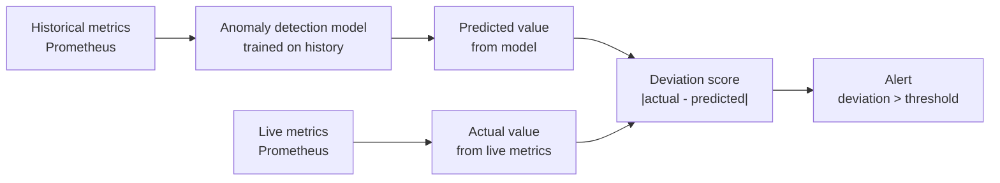
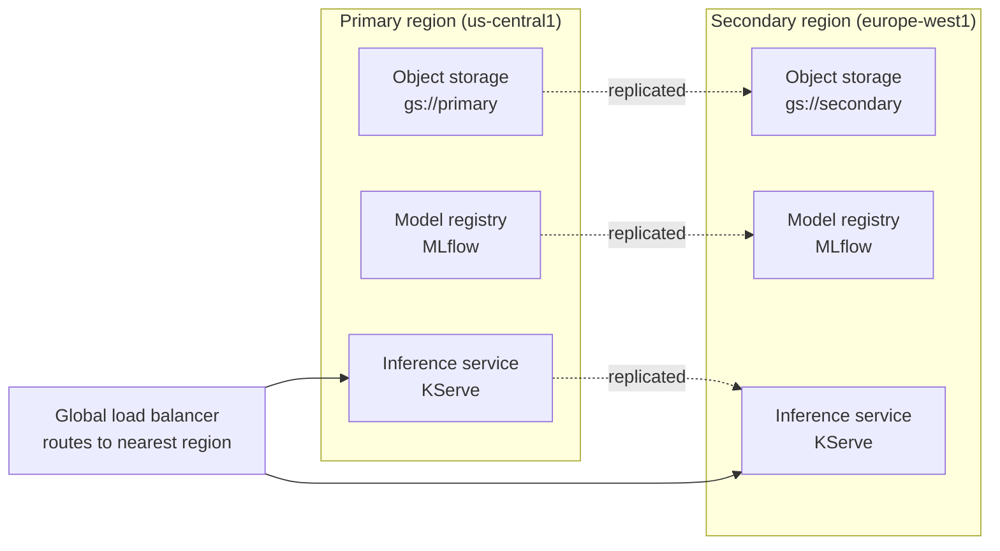

# 17.16 AI-assisted operations and scaling toward very large clusters

| Field | Value |
|---|---|
| Level | Advanced |
| Priority tier | 2 |
| Lab venue | GCP / GKE |
| Part | Part 17: Observability, performance and operations |
| Primary sources | *AI Systems Performance Engineering* (`ai-systems-performance-engineering`, Chapter 20); *Distributed AI Systems* (`distributed-ai-systems`, Chapter 11); *LLMOps* (`llmops`, Chapter 10); NVIDIA Zero-to-Hero Volume 8 (`chapter-03-ai-assisted-operations.md`) |
| Cross-references | Chapter 17.6 (Alerting and SLOs); Chapter 17.7 (Failure modes); Chapter 17.13 (Reliability engineering); Chapter 16.9 (LLM evaluation); Chapter 11.16 (KAI gang scheduling) |
| Coverage file | `planning/coverage/chapters/17-16.md` |
| Claim & number ledger | `planning/ledgers/17-16.md` |

## Why this matters for AI infrastructure

Picture the on-call engineer at the start of a shift. The dashboard shows thousands of time series, and the alert queue keeps growing. Every chapter in Part 17 has taught you to run the cluster you have today. This chapter prepares you for the larger cluster you will run next.

That cluster is bigger, busier, and harder to watch by hand. Its metrics, logs, and incidents now outnumber what one person can read. The on-call engineer is being asked to do more with the same headcount, and AI-assisted operations is the answer many teams reach for. It uses AI to spot anomalies across huge numbers of metrics, draft runbooks from incident transcripts, rank likely root causes across traces and logs, and forecast capacity needs. The argument of this chapter is that without this help, operations effort grows with the number of people. With it, effort grows much more slowly.

```text
Why AI-assisted operations is on the critical path (background reading: AI Systems Performance Engineering; Distributed AI Systems; LLMOps; NVIDIA Zero-to-Hero volume 8; the figures below are examples, not quotations):
- A typical mature AI platform emits millions of unique time series. The human
  on-call cannot inspect every series; the human on-call cannot find the
  needle in the haystack. AI-assisted anomaly detection is the only way
  to scale.
- A typical incident produces thousands of log lines and hundreds of spans.
  The human on-call cannot read every line; the human on-call cannot trace
  every span. AI-assisted root cause analysis is the only way to scale.
- A typical mature AI platform supports thousands of workloads. The human
  on-call cannot write a runbook for every workload. LLM-based runbook
  generation is the only way to scale.
```

Three facts make this a platform team problem, not only a data science problem:

1. The metrics, logs, and traces from earlier chapters are the raw material for every tool in this chapter. The platform team owns that data, so it should own the tools built on it.
2. AI-assisted operations is a platform discipline with four jobs: detect anomalies, generate runbooks, find root causes, and predict capacity. The platform team sets those jobs and maintains the tooling that performs them.
3. Scaling toward very large clusters is also a platform challenge. Gang scheduling, Kueue, and MIG from Chapter 11 reach thousands of GPUs. Multi-cluster, multi-region, and multi-tenant operation needs more, and this chapter covers that.

Operating a thousand-GPU cluster by hand wears out the on-call engineer quickly. **Before you run thousands of GPUs, you need AI-assisted operations, because the by-hand alternative burns out the people who keep the cluster running.**

## Prerequisites and outcomes

Before you start, check that you have these chapters behind you. They are not optional background. This chapter uses their alerting, failure, and scheduling vocabulary without defining it again.

### Prerequisites

- Chapter 17.6 (Alerting and SLOs) for the metrics stack.
- Chapter 17.7 (Failure modes) for the failure mode catalogue.
- Chapter 17.13 (Reliability engineering) for the SLO discipline.
- Chapter 16.9 (LLM evaluation and guardrails) for the LLM-as-judge pattern.
- Chapter 11.16 (KAI gang scheduling) for the multi-GPU patterns.

### Outcomes

After completing this chapter you will be able to:

1. Build AI-assisted anomaly detection, from training the model to deploying it.
2. Generate runbooks with an LLM, including the prompt, the context, and the validation.
3. Correlate traces and logs to produce candidate root-cause hypotheses.
4. Build a capacity forecast from historical data, a workload forecast, and a buffer.
5. Run these tools on GKE with the patterns that scale to thousands of GPUs.

Use this list as a checklist when you finish the lab. If you cannot tick an item, go back to the section that covers it.

---

## 1. AI-assisted anomaly detection

### 1.1 The pattern

Picture a GPU's memory use creeping down over a night. No static threshold fires, because the value still sits inside the range that looks normal for a busy cluster. Anomaly detection tries to catch this kind of change by learning what normal looks like for each metric.

*AI Systems Performance Engineering* Chapter 20 describes AI assistants that flag anomalies in telemetry. This section builds a more concrete version. A model learns from history, predicts the expected value, and alerts when reality strays too far from it.

The same book makes a point worth keeping in mind. A GPU that stays busy on redundant data transfers is not doing useful work, so raw utilization can mislead you.



Read the diagram from left to right. History trains the model, which predicts the value you should see now. The alert fires when the gap between prediction and reality crosses a threshold you choose.

### 1.2 The implementation

Choosing a model means trading accuracy against data needs and compute. The table compares four common choices.

| Model | Strength | Weakness |
|---|---|---|
| Prophet | Robust to missing data; handles seasonality | Less accurate for non-seasonal data |
| ARIMA | Statistical foundation; interpretable | Requires stationarity |
| LSTM autoencoder | Captures complex patterns | Requires more training data |
| Transformer | State-of-the-art accuracy | Requires significant compute |

A practical path is to start with Prophet. Move to an LSTM autoencoder only when your data volume justifies the extra compute. Whichever model you pick, score it against anomalies your team has already confirmed, not against its own predictions.

### 1.3 The deployment

The model runs as a cluster service. It reads history from Prometheus, retrains on a schedule, and publishes its anomaly score back as a metric. The manifest below sets the Prometheus address and the schedule.

```yaml
# code/part17/anomaly_detection.yaml
apiVersion: apps/v1
kind: Deployment
metadata:
  name: anomaly-detection
spec:
  selector:
    matchLabels:
      app: anomaly-detection
  template:
    metadata:
      labels:
        app: anomaly-detection
    spec:
      containers:
        - name: anomaly-detection
          image: my-anomaly-detection:v1
          env:
            - name: PROMETHEUS_URL
              value: http://prometheus.monitoring:9090
            - name: MODEL_TRAINING_SCHEDULE
              value: "0 2 * * *"
```

The schedule `0 2 * * *` is a cron expression, which runs training once a day at 02:00. Before you deploy, decide who may change that schedule. A retraining run changes what your system treats as normal.

### 1.4 Aiming for goodput

The book's real target is goodput. When a GPU is busy, it should be doing useful neural compute, not shuffling redundant data. AI-driven schedulers are built to maximize that quantity. They aim to cut wasted busy time, which directly lowers the cost of each unit of work.

The book also describes AI performance copilots for system operators. An engineer could ask such an assistant, "How can I speed up my training job?" and receive informed suggestions. The assistant could draw on the accumulated knowledge of thousands of past runs, logs, and tuning attempts. That is the experience of human experts, available at any hour.

A copilot can also read the signals from a running job. If GPU memory usage is low, it might suggest a larger batch size. If the gradient noise scale is high, it might suggest a change to the learning rate schedule.

Assistants can also watch training jobs and inference servers and flag anomalies. For example, an assistant might report that the loss is diverging early in training. It could suggest checking the input data or lowering the learning rate. Think of it as an extra pair of eyes that never tires.

You can start on this with tools you already run. A metrics pipeline based on Prometheus can feed an LLM-based assistant. That assistant can alert when GPU memory suddenly drops, which may signal a memory leak or a data stall. It can also suggest likely root causes.

Splunk (now Cisco) and PagerDuty already use AI models on system log data. They predict failures and detect anomalies in data centers. The book recommends extending these ideas to telemetry that comes from AI workloads.

The book presents much of this as a direction rather than a finished product. Treat an assistant's suggestion as a hypothesis to test. Check it against your own measurements before you change a running job.

---

## 2. LLM-based runbook generation

### 2.1 The pattern

During a night-time incident, the on-call engineer finds an alert with no runbook. Writing one from the incident transcript takes time that nobody has in the middle of an outage.

*LLMOps* Chapter 10 introduces LLM-based runbook generation. In this pattern, the model reads the incident transcript and drafts the runbook steps. A platform engineer then reviews the draft before anyone publishes it.

```python
# code/part17/runbook_generation.py
"""Draft a runbook with an LLM, then refuse to return it unless it passes runbook_validation. llm.complete(prompt) -> str is injected."""
from runbook_validation import validate_runbook

def build_prompt(incident_transcript: str, existing_runbooks: list[str]) -> str:
    return f"""You are an SRE generating a runbook for a new incident.

Existing runbooks for reference:
{chr(10).join(existing_runbooks)}

Incident transcript:
{incident_transcript}

Generate a runbook with exactly these 6 sections, as headings:
What the alert means / Symptoms / Diagnostic steps / Mitigation steps / Escalation path / Post-mortem template.
Put every command on its own line."""

def generate_runbook(llm, incident_transcript: str, existing_runbooks: list[str]) -> str:
    draft = llm.complete(build_prompt(incident_transcript, existing_runbooks))
    ok, errors = validate_runbook(draft)
    if not ok:
        raise ValueError("generated runbook rejected: " + "; ".join(errors))
    return draft
```

The script does three things in order. It builds a prompt from the transcript and the existing runbooks, asks the model for a draft, and checks that draft. A draft that fails the check raises an error, so the function never returns it to the caller.

### 2.2 The validation

A fluent draft can still be useless, so the code checks it before anyone reads it. The validator confirms that all six section headings appear. It also confirms that at least one line is a runnable command from a known list, such as `kubectl` or `nvidia-smi`. It does not check escalation contacts, and it cannot tell whether a command actually works. A person must check both.

```python
# code/part17/runbook_validation.py
import re

REQUIRED_SECTIONS = [
    "What the alert means",
    "Symptoms",
    "Diagnostic steps",
    "Mitigation steps",
    "Escalation path",
    "Post-mortem template",
]

COMMAND = re.compile(r"^\s*(?:\$ )?(kubectl|dcgmi|nvidia-smi|helm|systemctl|journalctl|scontrol|sinfo)\b", re.M)

def validate_runbook(runbook: str) -> tuple[bool, list[str]]:
    errors = [f"Missing section: {s}" for s in REQUIRED_SECTIONS if s not in runbook]
    if not COMMAND.search(runbook):
        errors.append("No runnable commands found (expected at least one kubectl/dcgmi/nvidia-smi/... line)")
    return len(errors) == 0, errors
```

### 2.3 The human-in-the-loop

A draft is a starting point, not a published runbook. Someone on the platform team must correct it and decide that it belongs in the library. The commands below show that sequence, from generation to commit.

```bash
# Generate the runbook
python code/part17/runbook_generation.py \
  --incident-id INC-2024-03-15-001 \
  --output runbook_draft.md

# Review the runbook
vim runbook_draft.md

# Publish the runbook
cp runbook_draft.md runbooks/gpu-memory-pressure.md
git add runbooks/gpu-memory-pressure.md
git commit -m "Add runbook for GPU memory pressure"
```

The script writes a draft file, and nothing reaches the repository until you copy and commit it. Once you do, the commit records the approval. Make this review a required step in your publishing process. Do not let it depend on who happens to be on shift.

---

## 3. AI-assisted root cause analysis

### 3.1 The pattern

During an incident, the evidence lives in three places. Traces sit in one tool, logs in another, and metrics in a third. Someone has to join them before the cause becomes visible, and that join is slow work the model can help with.

*Distributed AI Systems* Chapter 11 introduces AI-assisted root cause analysis. The pattern has three steps. The model reads the traces, logs, and metrics. It proposes candidate hypotheses. The on-call engineer reviews them and picks the most likely one.

```python
# code/part17/root_cause_analysis.py
"""LLM-assisted root-cause hypotheses. The model call is injected (llm.complete(prompt) -> str), so the prompt and the
parser are testable offline. The model must answer in JSON; anything else is rejected rather than guessed at."""
import json

def build_prompt(traces, logs, metrics, failure_mode_catalogue):
    return f"""You are an SRE analysing a production incident.

Failure mode catalogue:
{chr(10).join(failure_mode_catalogue)}

Traces:
{json.dumps(traces)[:4000]}

Logs (first 100):
{chr(10).join(logs[:100])}

Metrics:
{json.dumps(metrics)}

Return a JSON list of exactly 3 objects with keys: hypothesis, evidence, mitigation, confidence (integer 1-5).
Return JSON only."""

def parse_hypotheses(text: str) -> list[dict]:
    try:
        items = json.loads(text)
    except json.JSONDecodeError as e:
        raise ValueError(f"model did not return JSON: {e}")
    need = {"hypothesis", "evidence", "mitigation", "confidence"}
    if not isinstance(items, list) or not items or any(not need <= set(i) for i in items):
        raise ValueError("hypotheses missing required keys")
    if any(not isinstance(i["confidence"], int) or not 1 <= i["confidence"] <= 5 for i in items):
        raise ValueError("confidence must be an integer 1-5")
    return sorted(items, key=lambda i: -i["confidence"])

def analyze_root_cause(llm, traces, logs, metrics, failure_mode_catalogue):
    return parse_hypotheses(llm.complete(build_prompt(traces, logs, metrics, failure_mode_catalogue)))
```

The code keeps the model's input small. It cuts the trace data to 4000 characters and sends only the first 100 log lines. The parser rejects any reply that is not valid JSON with the required keys, rather than guessing at what the model meant.

A confidence score helps you rank the hypotheses, but it does not prove any of them. A model can sound certain and still be wrong.

### 3.2 The trace correlation

Before the model sees anything, plain code narrows the traces to the slow spans. Here, a span counts as slow when it runs longer than one second. Code like this is cheaper and more predictable than asking the model to scan every span.

```python
# code/part17/trace_correlation.py
def correlate_traces(traces: list[dict]) -> list[dict]:
    """Identify the slow operations across the traces."""
    slow_ops = []
    for trace in traces:
        for span in trace["spans"]:
            duration_ms = span["duration_ms"]
            if duration_ms > 1000:  # > 1 second
                slow_ops.append({
                    "trace_id": trace["trace_id"],
                    "span_id": span["span_id"],
                    "name": span["name"],
                    "duration_ms": duration_ms,
                })
    return slow_ops
```

Filter in code first, so the model reasons only about the operations that matter. A smaller input also makes the model's answer easier to check.

### 3.3 The log analysis

Logs are noisy, so a simple scan comes first. The function below sorts each line into errors, warnings, or exception tracebacks. It does this with plain text matching, not with the model.

```python
# code/part17/log_analysis.py
def analyze_logs(logs: list[str]) -> dict:
    """Identify error patterns in the logs."""
    patterns = {
        "errors": [],
        "warnings": [],
        "exceptions": [],
    }
    for log in logs:
        if "ERROR" in log:
            patterns["errors"].append(log)
        if "WARN" in log and "ERROR" not in log:
            patterns["warnings"].append(log)
        if "Traceback" in log:
            patterns["exceptions"].append(log)
    return patterns
```

The scan finds the lines, but it does not connect them to traces. That correlation is still open in this section. Before you trust the grouping, check that your logs use these exact words for severity.

### 3.4 Automated debugging for failed training runs

Picture a training job that fails halfway through a three-month run. Someone must read the error logs, the device statistics, and perhaps memory dumps. They must decide whether the cause was a hardware fault, a numerical overflow, or a networking hiccup. That search is slow, and it depends on what one engineer remembers.

The book expects AI systems to digest logs, metrics, and alerts together. Such a system could pinpoint likely causes much faster than people do today. It might report that node 42 logged 5 ECC memory errors just before the crash. That pattern points to a fault in the GPU's HBM memory device or channel.

The same kind of system could catch a loss problem. If the loss becomes NaN at iteration 10,000, it might point to an unstable gradient and suggest gradient clipping. By learning from many past incidents, it could save engineers many hours of detective work. The book notes that some large computing sites already train models on their incident databases to predict failures and suggest fixes.

Treat each suggestion as a lead to verify, not a verdict. The engineer still checks the evidence before changing the job.

---

## 4. Capacity prediction

### 4.1 The forecasting model

Teams often buy GPUs for the demand they had last quarter, then run short when a new project lands. A forecast estimates next quarter's usage from the history you already have. The function below fits a Prophet model to historical usage and projects it forward.

```python
# code/part17/snippets/capacity_prediction.py
import pandas as pd
from prophet import Prophet

def predict_capacity(historical_usage: pd.DataFrame, growth_periods: int = 90) -> pd.DataFrame:
    """Predict GPU capacity needs for the next growth_periods days."""
    model = Prophet(
        yearly_seasonality=True,
        weekly_seasonality=True,
        daily_seasonality=False,
    )
    model.fit(historical_usage)

    future = model.make_future_dataframe(periods=growth_periods)
    forecast = model.predict(future)

    return forecast[["ds", "yhat", "yhat_lower", "yhat_upper"]]
```

The function uses only the usage history. Growth plans and buffers must be added outside it. It returns the forecast with a lower and an upper bound, and it projects 90 periods by default. Plan against the upper bound when running short costs more than holding spare hardware.

### 4.2 The workload forecast

A usage curve cannot see a project that has not started yet. The workload forecast adds known growth from roadmaps and customer commitments, using each workload's own growth rate. The function below compounds that rate over the horizon.

```python
# code/part17/workload_forecast.py
def forecast_workloads(workloads: dict, horizon_days: int = 90) -> dict:
    """workloads: {name: {"current_gpus": int, "growth_rate": float per 90 days}}. Compound growth over the horizon."""
    forecast = {}
    for name, w in workloads.items():
        projected = w["current_gpus"] * (1 + w["growth_rate"]) ** (horizon_days / 90)
        forecast[name] = {"current_gpus": w["current_gpus"], "projected_gpus": projected, "growth_rate": w["growth_rate"]}
    return forecast
```

The growth rate in the code is per 90 days. A horizon of two 90-day periods therefore compounds the rate twice. The function handles that exponent for you, so you only supply the rate and the horizon.

### 4.3 The cost forecast

Once you have GPU counts, the bill follows. The function below multiplies projected GPUs by a price, by 24 hours, and by 30 days.

```python
# code/part17/cost_forecast.py
def forecast_cost(workload_forecast: dict, gpu_price: float) -> float:
    """Forecast the monthly GPU cost based on the workload forecast."""
    total_cost = 0
    for workload, forecast in workload_forecast.items():
        total_cost += forecast["projected_gpus"] * gpu_price * 24 * 30
    return total_cost
```

The function assumes every GPU runs all month at the price you pass in. Reserved commitments and idle time change the real bill, so treat the result as a planning figure. Compare the forecast with the actual bill each month to see which assumption was wrong. The monthly figure also feeds your FinOps dashboard, and someone should review it on a regular schedule.

---

## 5. Scaling toward very large clusters

### 5.1 The scaling challenges

Picture a cluster that now spans several sites and serves many teams. Bigger nodes will not solve that problem. Each new scale brings its own failure and needs its own tool. *Distributed AI Systems* Chapter 11 walks through the scaling challenges for AI clusters. The table names the three challenges and the tools platform teams usually reach for.

| Challenge | What it is | How the platform team addresses it |
|---|---|---|
| Multi-cluster scheduling | The cluster spans multiple Kubernetes clusters | Cluster API; Kueue MultiKueue |
| Multi-region failover | The cluster spans multiple regions | Multi-region object storage; multi-region registry |
| Multi-tenant isolation | The cluster serves multiple teams | Namespaces; RBAC; Kueue ClusterQueues; per-tenant quotas |

These three problems are different. Scheduling across clusters, surviving a region outage, and sharing one cluster between teams each fail in their own way. Plan for each one separately.

### 5.2 Multi-cluster scheduling

Imagine one cluster that is full while another has idle H100s. Multi-cluster scheduling tries to send the next job to the cluster with room. The pattern in this section is a single queue that holds the GPU quota of several clusters, with each job landing where capacity exists.

```yaml
# code/part17/multi_cluster_queue.yaml
apiVersion: kueue.x-k8s.io/v1beta1
kind: ClusterQueue
metadata:
  name: cluster-queue-multi-region
spec:
  cohort: multi-region
  flavorQuotas:
    - name: h100-sxm5-80gb-us-central1
      resources:
        - name: cpu
          nominalQuota: 800
        - name: memory
          nominalQuota: 4Ti
        - name: nvidia.com/gpu
          nominalQuota: 64
    - name: h100-sxm5-80gb-europe-west1
      resources:
        - name: cpu
          nominalQuota: 800
        - name: memory
          nominalQuota: 4Ti
        - name: nvidia.com/gpu
          nominalQuota: 64
```

The manifest lists one GPU flavor per region, each with its own CPU, memory, and GPU quota. The numbers are example values from the manifest, not a sizing guide. Size your own quotas from the capacity you actually have.

The queue sends work to whichever region has room. Do not assume failover is automatic because the queue exists. Prove it in a drill before you rely on it.

### 5.3 Multi-region failover

When an entire region goes dark, your inference service needs somewhere else to answer. The pattern is to replicate data to a second region, run the workloads in both, and let a global load balancer send traffic to the healthy one.



The dotted arrows show data copied in the background. Replication lag decides how much recent data the second region can really serve. Decide how far behind the secondary region may be, then measure that lag.

### 5.4 Multi-tenant isolation at scale

Thousands of teams sharing one cluster need walls between them. Without walls, one team's runaway job can starve everyone else. The pattern gives each team its own namespace, LocalQueue, IAM role, and quota.

```yaml
# code/part17/multi_tenant_isolation.yaml
apiVersion: kueue.x-k8s.io/v1beta1
kind: LocalQueue
metadata:
  name: team-data-science-queue
  namespace: team-data-science
spec:
  clusterQueue: cluster-queue-standard
---
apiVersion: v1
kind: ResourceQuota
metadata:
  name: team-data-science-quota
  namespace: team-data-science
spec:
  hard:
    cpu: "200"
    memory: 1Ti
    nvidia.com/gpu: "4"
```

The LocalQueue sends a team's jobs to the shared queue. The ResourceQuota caps what that team can use. The numbers in the example are placeholders for your own team sizes.

Start each new team with a small quota, and raise it when usage data supports the change.

### 5.5 AI-assisted scheduling and real-time control

The push toward automation reaches the cluster itself. Training and inference clusters run many jobs and requests at once, and they need resource-sharing strategies that change with conditions. Today's orchestrators, such as Kubernetes and SLURM, still rely on static heuristics and simple resource requests. Adaptive scheduling is the next step.

Picture a scheduling agent that watches the whole cluster and learns where to place inference requests and training jobs for the highest overall throughput. It might learn that two workloads can share a node without interfering. One could be compute-heavy while the other is memory-bandwidth-heavy. The agent could read Kubernetes telemetry, such as pod GPU utilization and queue wait times, then reschedule jobs or adjust pod resources.

In that picture, the cluster behaves like a self-driving car. It keeps adjusting its resource allocation as conditions change, rather than following a fixed route. Your job shifts toward setting policies and goals, while the scheduler works out the details. The payoff is higher resource use and fewer bottlenecks.

NVIDIA Dynamo is a distributed inference framework. It coordinates request scheduling, KV cache placement, and data movement across GPUs and nodes. It integrates with Kubernetes for inference and disaggregation. In that role, its scheduler assigns microbatches to pipeline stages and reroutes requests when a node fails.

Weight streaming and activation offloading go further. A layer streams from host memory to the GPU only when its weights are needed, such as during decode. The same idea works across many nodes and GPUs. The book notes that parts of a 100-trillion-parameter model could then sit on cheaper storage, which helps inference scale.

Inference software does part of this work too. The book names vLLM, SGLang, NVIDIA Dynamo, and TensorRT-LLM as tools that improve scheduling and resource use in large inference clusters. They use in-flight batching and a paged KV cache. They can also split the prompt prefill stage from the generation decode stage onto separate resource pools. These choices reduce tail latency and improve throughput per watt.

Reinforcement learning can also control live system behavior in ways fixed rules struggle to match. A power-management agent could tune clock frequencies and core allocation to get more performance per watt. It would learn its policy by observing the running system. Another agent could decide which tensors stay in GPU memory and which move to CPU memory or NVMe storage. That beats a fixed rule such as "swap least recently used," because it watches real access patterns.

Practitioners already use reinforcement learning for cache eviction and network congestion control. Ultrascale systems have hundreds of interacting parts. There are too many knobs for a person to find good settings in time, especially when workloads change.

For the performance engineer, the job becomes supervising these agents. The comparison is a pilot who relies on autopilot. The pilot still needs deep knowledge and must step in when something unusual happens. You set the objectives and the safety and fairness guardrails. You also handle situations the AI has not seen before, while routine load balancing, failure recovery, and memory-buffer tuning go to the AI.

Teams that insist on tuning everything by hand will fall behind teams that use AI assistance and autotuning. Spend your effort on new designs and hard optimizations, and let automation handle the routine work.

### 5.6 Smart compilers and automated optimization

Gone are the days when an engineer hand-tuned every CUDA kernel. High-level tools and AI systems now do much of the heavy lifting. Frameworks such as PyTorch, TensorFlow, and JAX use smart compilers and execution-graph optimizers. They fuse operations, use Tensor Cores automatically, and overlap computation with asynchronous data movement. On newer GPUs, they can use features such as the Tensor Memory Accelerator for that overlap.

OpenAI's Triton compiler lets developers write GPU kernels in a Python-based language. Triton compiles those kernels into efficient CUDA kernels. The complexity stays hidden from the person writing them. OpenAI and NVIDIA work together so that Triton supports new GPU architectures and their specialized features.

When a new GPU generation ships, an updated Triton compiler exposes its new capabilities. You write high-level Python, and the compiler generates code for that GPU. You do not need to write C++ or PTX assembly.

Many optimizations that used to be hand-coded are now automated. Automatic kernel fusion, autotuning of kernel-launch parameters, and numerical-precision decisions can all go to compilers and AI assistants. The book expects this trend to accelerate.

Graph execution cuts overhead too. CUDA Graphs capture a sequence of GPU operations, with their dependencies, as a static graph. You instantiate and launch that graph with little CPU overhead, using `cudaGraphInstantiate()` and `cudaGraphLaunch()`. Frameworks now capture training loops and other repeated patterns this way. Even a dynamic graph can be traced once and then replayed.

Overlapping communication with computation is becoming automatic as well. A system could notice that while GPU 1 computes layer 10, GPU 2 can start layer 11. That is pipeline parallelism applied under the hood. Fully automatic pipeline parallelism is still an active research area. Current frameworks still need explicit pipeline-parallel code.

The book covers 3D, 4D, and 5D parallelism, which combine data, tensor, model, expert, and context or sequence parallelism. These techniques still depend on human judgment and experience. Expert guides such as Hugging Face's Ultra-Scale Playbook describe them today. The hope is that compilers, libraries, and frameworks will absorb them soon.

One day an AI advisor might see a 500 billion-parameter model and propose a layout. It might suggest eight-way tensor parallelism inside each node, followed by four-way pipeline parallelism across nodes. It could also suggest layer groupings and chunk sizes. The book presents this as a possibility, not a current feature.

For performance engineers, this would be a large productivity gain. Instead of trying endless configurations, you could ask for a near-optimal starting point. Your role would shift toward guiding these tools and checking that they work well.

The practical advice is to use these tools rather than fight them. Use high-level compilers such as Triton, which know what your hardware can do. Also watch new AI-driven optimization services. They can look like black boxes, but they hold a lot of hard-won performance knowledge.

### 5.7 AlphaTensor and AI-discovered matrix multiplication

Not all AI optimization happens at the code level. Some of it reaches into algorithms and math. In 2022, Google DeepMind's AlphaTensor project used AI to discover new general matrix multiply (GEMM) techniques.

GEMMs sit under almost all model training and inference. A small gain in GEMM efficiency therefore affects the whole field. AlphaTensor treated the search for fast algorithms as a single-player game. Reinforcement learning let it explore many possibilities.

The results beat the best human-derived methods known at the time. AlphaTensor rediscovered Strassen's famous subquadratic algorithm for 2 × 2 matrices. It also improved on that method for larger matrix sizes.

The real test came on hardware. AlphaTensor found a method tuned for the NVIDIA Volta V100 generation. That method multiplied large matrices 10%–20% faster than the standard cuBLAS library of that era. A 10%–20% gain in GEMM speed is large. It is like gaining 10%–20% more compute in every forward and backward pass.

Such gains usually need a new hardware generation or months of low-level CUDA tuning. Here the AI found a better mathematical method in a comparatively short time. The lesson is that efficiency may remain in core operations that engineers consider settled. An AI can search through millions of variations that no person could try.

The return is indirect but broad. If the algorithm enters a GPU library, any large training job or inference workload speeds up without new hardware. The book notes that a 15% speed improvement, over thousands of training iterations on hundreds of GPUs, saves large amounts of time and energy. The gain pays back every time the code runs.

The book says these matrix-multiplication algorithms remain experimental. Mainstream libraries such as cuBLAS had not yet adopted them, pending more validation and generalization.

For the ultrascale performance engineer, stay open to AI-driven optimization at every level of the stack. Even well-tuned operations such as GEMMs may have room left. Letting an AI search the space without human bias can cut runtimes across the board.

### 5.8 Generating a CUDA attention kernel with a reasoning model

Writing low-level GPU code was long reserved for expert engineers the book calls CUDA Ninjas. NVIDIA engineers tested whether DeepSeek-R1, a reasoning model, could produce a high-performance CUDA kernel for a complex attention mechanism. The target was code that rivaled hand-tuned implementations.

A reasoning model uses inference-time scaling. Instead of one quick pass, it refines its answer over a longer period. The longer it gets to iterate, the better the result tends to be. That is like a person who works through an answer before speaking.

The NVIDIA team ran R1 on an H100 and gave it 15 minutes to generate an optimized attention kernel. They placed a verifier inside the generation loop. Each time the model proposed a kernel, the verifier checked its correctness and measured its efficiency. The loop looks like this:

```
for iteration in range(max_iters):
    code = R1_model.generate_code(prompt)
    valid, runtime = verifier.verify(code)
    if valid and runtime < target_time:
        break  # Accept this kernel
    prompt = refine_prompt(prompt, verifier.feedback)
    ...
```

The feedback becomes a better prompt for the next attempt. The loop stops when the kernel meets the criteria. The cycle is generate, verify, feedback, and iterate.

The team's prompt asked for a kernel with on-the-fly relative position encoding:

```text
Please write a GPU attention kernel to support relative position encodings. Implement the relative positional encoding on the fly within the kernel. The complete code should be returned, including the necessary modifications.

Use the following function to compute the relative positional encoding:

def relative_positional(score, b, h, q_idx, kv_idx):
    return score + (q_idx - kv_idx)

When implementing the kernel, keep in mind that a constant scaling factor 1.44269504 should be applied to the relative positional encoding due to qk_scale = sm_scale * 1.44269504. The PyTorch reference does not need to scale the relative positional encoding, but in the GPU kernel, use:

qk = qk * qk_scale + rel_pos * 1.44269504

Please provide the complete updated kernel code that incorporates these changes, ensuring that the relative positional encoding is applied efficiently within the kernel operations.
```

The constant 1.44269504 equals 1 divided by ln(2). The prompt uses it to scale the relative-position term when forming `qk`. The AI produced a functionally correct CUDA kernel. That kernel ran 1.1–2.1× faster than PyTorch's FlexAttention API across attention patterns, including causal masks and long-document masks.

On Stanford's KernelBench attention tasks, the generated kernels were accurate on 100% of basic Level-1 cases and 96% of complex Level-2 cases. The book says this essentially matches the reliability of a human engineer. Human oversight was still needed in this experiment. Pair a verifier with a robust test suite, as KernelBench does, so rare edge cases do not slip into generated code.

Giving a model the tools to verify, critique, and refine its output improves code quality. The loop mirrors how an engineer profiles, debugs, and improves code. Even NVIDIA's top CUDA engineers might spend hours or days on one attention variant. An AI copilot can produce a comparable kernel in a fraction of that time, which frees engineers for system-level work.

The book describes such copilots as pretrained and fine-tuned AI interns. They reason through hard problems using CUDA tips learned from existing code bases. Treat them as a force multiplier for human productivity, not a replacement for review.

### 5.9 Reinforcement learning for Triton kernels

Predibase, a startup, asked a bolder question. Could an LLM learn to write strong OpenAI Triton kernels from many examples of PyTorch and Triton code? Triton is a Python-like GPU language and compiler. The goal was code that replaces PyTorch operations and runs faster than TorchInductor, which itself uses Triton for GPU code generation.

The team used a cluster of H100 GPUs. They fine-tuned Qwen2.5-Coder-32B-Instruct, a 32-billion-parameter model, with reinforcement learning. The method was Group Relative Preference Optimization (GRPO). The environment rewarded correctness more than runtime speed. The tuned model produced correct Triton kernels for all 13 tasks.

The reward function guided the model toward better code over time. The model proposed a kernel. The system compiled and tested that kernel for correctness and speed. The model received a positive reward when the kernel ran without errors, produced the right results, and beat the baseline kernel's speed.

Within a few days, success rose from near 0% to working kernels about 40% of the time. That took 5,000 training steps. Some kernels ran up to 3× faster than the baseline. The model kept improving as training went on.

The model optimized by testing, observing feedback, and adjusting, much as engineers do. Rewarding both correctness and speed aligns the model with real performance. It can learn tactics such as warp-level parallelism and fewer global memory accesses.

The value is that kernel-level tuning becomes automated. Instead of hand-building a kernel for each new model, a trained assistant can produce several variants and keep the best one. That shortens development cycles. It also lets smaller companies reach strong performance.

The book suggests a future where Triton and Python may replace hand-written CUDA for many kernels. Over time, an AI agent could keep writing and improving kernels as part of the normal pipeline.

### 5.10 Hardware for models with 100 trillion parameters

The book's long-range question is how to scale toward models with tens or hundreds of trillions of parameters. The trillion-parameter threshold has already been crossed. The next step starts with hardware that offers more memory and more bandwidth, ideally on the GPU itself.

Context helps here. The book gives 3 × 10^23 FLOPS as the training compute for GPT-3, and roughly 2 × 10^25 FLOPS for GPT-4. The upcoming ultrascale AI factories target 10^27 to 10^28 FLOPS for training. That is about 100 times the compute used for GPT-4.

High-bandwidth memory (HBM) keeps evolving. HBM3e ships with the Blackwell generation of GPUs. HBM4 appears in the Rubin generation, and it doubles bandwidth per stack again. The book puts that at about 1.6 TB/s per stack. HBM4 may also raise capacity to 48 GB or 64 GB per module.

Future GPUs could carry 8 or 16 HBM stacks. At 64 GB each, that totals 512 GB or 1,024 GB on one board. That much local memory holds many parameters on each GPU, which cuts the need to swap data in and out. A job that needed 8 GPUs might fit on one. A job that needed 100 GPUs might fit on 10.

Multichip designs such as the Grace Blackwell Superchip combine CPUs and GPUs. The NVIDIA GB200 and GB300 NVL72 link 72 GPUs into one NVLink domain. NVLink, NVSwitch, and SHARP form the communication base for the rack and the data center. Several NVL72 racks can join one cluster that acts like a single large GPU for communication. This works only while NVLink or a similar technology keeps scaling to those sizes.

Hardware alone does not solve the problem. Naive data parallelism at this size would be very slow and expensive. The optimizer would update 100 trillion weights at every step. Engineers must lean on techniques that reduce the effective computation.

Training a model at this scale will need a blend of aggressive quantization, multidimensional parallelism, and careful orchestration of communication between racks. The parallel dimensions are data, pipeline, tensor, expert, and context or sequence. Future scaling depends on hardware and on the ingenuity of software scheduling.

The book expects several trends to continue together. Hardware must become faster and hold more data. Software must optimize itself more. Algorithms must avoid unnecessary work through sparsity, lower precision, and better optimizers.

### 5.11 Low precision, sparsity, and cheaper optimizers

Low precision is the first lever. The book covers FP8 and FP4 today. Future hardware may support even lower, 1-bit precision for some parts of a network. Hybrid schemes will likely matter most, using low precision for most of the model and higher precision for sensitive parts.

For a 100-trillion-parameter model, the book says you very likely need low precision. Otherwise the workload becomes prohibitively slow and expensive. The good news is that the change should be smooth. CUDA provides first-class low-precision support through NVIDIA's Transformer Engine (TE) and Tensor Cores. PyTorch and Triton build on that support.

The second lever is sparsity and conditional computation. Sparse mixture of experts (MoE) models already activate only part of their parameters for each input. The idea extends further. A model could use only the parts it needs for a given input. The book expects many 100-trillion-parameter models to be sparsely activated.

Performance engineers then care about the efficiency of MoE routing, caching of expert outputs, and communication for sparse data exchange. Put the right experts on the right devices at the right time, and communication drops. That can speed up very large models a great deal.

The third lever is the optimizer. Adam variants keep two extra copies of the weights, for momentum and variance estimates. This effectively triples memory use. A 100-trillion-parameter model would need 200 trillion extra values for optimizer state. Memory-efficient optimizers such as Adafactor and Shampoo reduce that overhead.

Activation checkpointing trades compute for memory. It recomputes activations instead of storing them. At 100-trillion-parameter scale, the book expects aggressive checkpointing.

A more radical idea is to update only a subset of weights on each step. The book compares this to watering plants in rotation rather than every plant every day. If done carefully, the model still learns, and each parameter gets fewer updates. Total compute drops as a result. This is an idea to explore, not a settled method.

The habit to build is asking whether a step must happen this often, or at this precision. The answer is often no, because a cheaper approximation still works. At this scale, such approximations can save months of time or millions of dollars.

### 5.12 Memory tiers, networks, and datacenter-scale training

At more than 10,000 GPUs on one model, the network fabric matters as much as the GPUs. Ethernet and InfiniBand both keep improving throughput and adaptive routing. NVIDIA's Spectrum-X is an Ethernet fabric built for AI. It uses RoCE, adaptive routing, and high bisection bandwidth to reduce congestion in large training and inference jobs.

Engineers must also keep data in the right memory tier at the right time. The goal is a memory space that spans GPUs and CPUs. A model that does not fit in one machine could then look almost local to the programmer. Unified Memory and on-demand paging already offer part of this. `cudaMemPrefetchAsync()` stages pages on the target device, which avoids page-fault stalls. At 100-trillion-parameter scale, this capability faces its hardest test.

Frontier labs such as xAI, OpenAI, and Microsoft are building clusters of 1,000,000+ GPUs. At 100 trillion parameters, one job might span a whole datacenter. Performance engineers must think at datacenter scale, then at multidatacenter and global scale.

Training at this scale may be beyond any single team or company. The book expects more collaboration, similar to large science projects that involve many institutions. Pooled compute could train a model that is then shared. That needs standard checkpoint formats, shared training code, and clear multiparty ownership. The book notes this is not a performance issue as such, but it shapes how teams build large systems. Those systems must be fault tolerant and easy to snapshot. The book points to initiatives similar to the Open Collective Foundation, a nonprofit that has since been dissolved, as a model for pooling compute.

### 5.13 Self-improving agents: a hypothetical outlook

The AI Futures Project published a report in early 2025. It described milestones for AI models and agents that speed up research and development. These scenarios are hypothetical. Read them as planning prompts, not forecasts.

In the scenario, Agent-1 is trained with about two orders of magnitude more compute than the previous generation. It generates and optimizes code in real time. Its tasks range from routine debugging to complex kernel fusion. Automated coding acts as a force multiplier, which lets researchers try more ambitious ideas.

Agent-2 is an always-learning model that never finishes training. Instead of deploying a fixed checkpoint, it updates its weights every day from fresh synthetic data. The approach remains an active research area. The main challenge is keeping the model stable. A model can forget earlier abilities as it specializes on new tasks.

Agent-3 uses algorithmic breakthroughs to improve coding efficiency. In the scenario, it runs 200,000 copies in parallel. Together they form a workforce equivalent to tens of thousands of top programmers, running 30× faster. The book calls this a thought experiment that far exceeds today's practical limits.

Agent-4 is a hypothetical self-rewriting, superhuman researcher. It can rewrite its own code to improve itself, which the book calls the AGI scenario. It uses mechanistic interpretability to make its internal decisions clearer. The scenario describes it as a turning point that starts a virtuous cycle of discovery.

These scenarios explain why AI system performance matters for progress toward AGI and superintelligence. Each generation raises research productivity. The book's advice is to build a strong foundation in performance fundamentals and stay ready to adapt.

### 5.14 Performance per watt and cost per token

Every example in this section aims at one number: throughput per unit cost. In practice, that means more tokens per second for each dollar and each watt. The book gives one example. The Grace Blackwell NVL72 rack system improves performance per watt by 25× over the prior Hopper generation. That lowers the cost per token compared with earlier GPU clusters.

The lesson is codesign. Hardware, software, and algorithms must evolve together. The book describes this partnership as the way to shorten training time, improve inference, and lower operating costs. It is the basis for a measurable return on today's capital-intensive AI systems.

Performance engineers will move up the stack. Their work expands from single-node kernels to system-wide and facility-wide optimization. Use your intuition to spot a bottleneck, such as a slow all-reduce pattern. Then guide your AI tools to fix it, and keep learning, because the pace of change will keep accelerating.

---

## 6. Operating AI-assisted operations on GKE

### 6.1 The components

Each of the five components needs a place to run, storage behind it, and an owner for its target.

| Component | Where it runs | Backing store | SLO |
|---|---|---|---|
| Anomaly detection model | Kubernetes Deployment | Object storage for model | Anomaly score p99 < 1 s |
| LLM-based runbook generator | Kubernetes Deployment | Object storage for runbooks | Generation latency p99 < 30 s |
| AI root cause analysis | Kubernetes Deployment | Object storage for analyses | Analysis latency p99 < 60 s |
| Capacity prediction model | Kubernetes Deployment (cron) | Object storage for forecasts | Forecast frequency daily |
| Multi-cluster queue | Kueue | (Kueue) | Queue admission p99 < 1 s |

The targets in this table are example values. This chapter did not measure them, and no source recommends them. Choose your own from your own traffic before you set any alert.

### 6.2 IAM and the AI-assisted operations

Not everyone should retrain a model or change a runbook. The table shows one way to split access into reader, writer, and admin roles.

| Role | Who | What they can do |
|---|---|---|
| `aiops.reader` | Every team | Read the anomaly scores; read the capacity forecasts |
| `aiops.writer` | The platform team | Update the models; update the runbooks |
| `aiops.admin` | The platform team lead | Approve the AI-assisted operations |

Keep write access small, because a changed model or runbook changes what the on-call engineer sees. Write the rules down, enforce them in your identity system, and review them on a schedule.

### 6.3 Observability

The monitoring for these tools is itself a production service, so it needs alerts. The thresholds in the table are examples, so set your own from a measured baseline.

| Metric | Why it matters | Alert |
|---|---|---|
| Anomaly detection precision | Model quality | < 80% per week |
| Runbook generation success rate | Model quality | < 90% per week |
| Capacity forecast accuracy | Model quality | Error > 20% per month |
| Multi-cluster queue latency | Multi-cluster performance | > 5 s |
| Multi-region failover latency | Multi-region performance | > 1 hour |

Alerting needs restraint. Too many critical alerts wear out on-call engineers, and false positives can bury the real event. *Production Kubernetes*, chapter 9, makes the same point. It also recommends a heartbeat alert that always fires, so that silence itself raises an alarm.

**The anomaly detection precision alert matters most.** A low precision means the model fires too many false positives, and the on-call engineer then learns to ignore it.

---

## 7. How it fails

Six failures recur in these systems. Each one has a symptom you can see and a cause you can check.

### 7.1 "The anomaly detection fires too many false positives"

The detector fires on every small wobble. The on-call engineer stops reading the alerts, and the real anomaly gets missed. The likely cause is a model that is too sensitive, a threshold set too low, or training data that does not match production traffic. Tune the model, raise the threshold, retrain on production traffic, and measure precision and recall.

### 7.2 "The LLM-generated runbook is not actionable"

The model produces a runbook with no runnable commands, so the on-call engineer cannot follow it. The likely cause is a vague prompt, too little context, or a validator that misses the problem. Improve the prompt, add context, strengthen the validator, and keep a human reviewer in the loop.

### 7.3 "The AI-assisted root cause analysis is wrong"

The model suggests a cause that turns out to be wrong, and the on-call engineer loses time chasing it. The likely cause is too little context, or a model that has not been tuned on your production traffic. Add context, tune on production traffic, use the confidence field to rank the hypotheses, and keep a human reviewer.

### 7.4 "The capacity prediction is wrong"

In one example, the forecast says 100 GPUs and real usage reaches 200. The team is short of hardware exactly when it needs it. The likely cause is bad historical data, a wrong growth rate, or a model that ignores the workload forecast. Verify the history, correct the growth rate, add the workload forecast, and review the prediction on a regular schedule.

### 7.5 "The multi-cluster queue is unbalanced"

In one example, region A has 100 GPUs available and region B has 0 GPUs, so every job lands in region A. The likely cause is a workload pinned to region A by an affinity rule, while capacity is uneven across regions. Add a region-affinity weighting, balance the GPU quota across regions, and set a fairness policy.

### 7.6 "The multi-region failover is slow"

In one example, a regional outage takes 2 hours to recover from, and the service level objective is breached. The likely cause is a failover that is not automated, slow data replication, or a workload that takes a long time to start. Automate the failover, replicate more often, and pre-warm the workloads in the second region.

---

## 8. Hands-on lab

This lab walks through anomaly detection, runbook generation, root cause analysis, and capacity prediction in one session. The lab is **untested** in this repository.

### 8.1 Prerequisites

- The observability stack from earlier chapters.
- An LLM API key (OpenAI, Anthropic, or local model).
- The observability stack's data in Prometheus.

### 8.2 Step 1: deploy the anomaly detection model

Start by deploying the model with Helm. The command points it at your Prometheus server.

```bash
helm install anomaly-detection my-charts/anomaly-detection \
  --namespace monitoring \
  --set prometheus.url=http://prometheus.monitoring:9090
# expected: the anomaly detection model is deployed; the anomaly scores are exposed
```

### 8.3 Step 2: query the anomaly scores

Next, check that the model is publishing scores. The query below asks Prometheus for the score of GPU 0.

```bash
curl -s 'http://prometheus.monitoring:9090/api/v1/query?query=anomaly_score{gpu="0"}' | jq .
# expected: the anomaly score for GPU 0
```

### 8.4 Step 3: generate a runbook with the LLM

Generate a draft runbook from an incident. The output is a draft, not a published runbook.

```bash
python code/part17/runbook_generation.py \
  --incident-id INC-2024-03-15-001 \
  --output runbook_draft.md
# expected: the runbook draft is generated
```

### 8.5 Step 4: review the runbook

Read the draft, correct it, and publish only what you have checked.

```bash
# Open the runbook draft
vim runbook_draft.md

# Publish the runbook
cp runbook_draft.md runbooks/gpu-memory-pressure.md
git add runbooks/gpu-memory-pressure.md
git commit -m "Add runbook for GPU memory pressure"
```

### 8.6 Step 5: run the AI-assisted root cause analysis

```bash
python code/part17/root_cause_analysis.py \
  --incident-id INC-2024-03-15-001 \
  --output root_cause_analysis.md
# expected: 3 candidate hypotheses for the root cause
```

### 8.7 Step 6: run the capacity prediction

```bash
python code/part17/snippets/capacity_prediction.py \
  --cluster gke-prod-us-central1 \
  --output capacity_forecast.md
# expected: the Q+1 GPU forecast
```

### 8.8 What to record

After the lab, answer five questions quickly. The five-second and 30-second figures here are examples. Choose limits that suit your own on-call process.

1. What is the current anomaly detection precision?
2. What is the most recent LLM-generated runbook?
3. What was the most recent AI-assisted root cause analysis?
4. What is the Q+1 GPU forecast per the capacity prediction?
5. What is the current multi-cluster queue latency?

If your team cannot answer these within the limit it chose, the stack is not ready to run as a production service. The lab has not been run against a live GKE cluster, so treat its steps as a plan to verify rather than proof that it works.

---

## Exercises

Each exercise builds on a section in this chapter, so check your work against that section.

1. Add an anomaly detection model. Train a Prophet model on historical GPU metrics, then deploy it as a Kubernetes Deployment. *Solution sketch:* the Python script in Section 1.2, and the Kubernetes Deployment in Section 1.3. You are done when the alerts reach the on-call engineer and you can name each false positive.
2. Add an LLM-based runbook generator. Build a script that takes an incident transcript and generates a runbook with the six sections. *Solution sketch:* the Python script in Section 2.1 and the validation in Section 2.2. You are done when a draft missing a section is rejected, not saved.
3. Add AI-assisted root cause analysis. Build a script that takes traces, logs, and metrics and generates three candidate hypotheses. *Solution sketch:* the Python script in Section 3.1 and the trace correlation in Section 3.2. You are done when the script returns hypotheses ranked by confidence.
4. Add a capacity prediction model. Train a Prophet model on historical GPU usage and forecast the next quarter's needs. *Solution sketch:* the Python script in Section 4.1 and the workload forecast in Section 4.2. You are done when the forecast comes with a range you can defend.
5. Add a multi-cluster queue. Configure Kueue to aggregate GPU quota across two clusters. *Solution sketch:* the ClusterQueue in Section 5.2 and a LocalQueue for each team. You are done when each team's jobs land in its own queue and its quota stops a runaway job.
6. Add a multi-region failover drill. Schedule a drill each quarter that tests failover. *Solution sketch:* a Chaos Mesh experiment that cordons all nodes in the primary region, and a drill that measures failover latency. You are done when the drill reports a failover time you can compare with your target.

---

## Checkpoint questions

<details><summary>1. What is AI-assisted anomaly detection?</summary>
It is a pattern that uses an ML model to spot unusual metric values. You train the model on historical metrics, and it predicts the expected value. An alert fires when the actual value strays from that prediction. In the example setup, the model is retrained daily and checked against confirmed anomalies.
</details>

<details><summary>2. What is LLM-based runbook generation?</summary>
It is a pattern in which an LLM drafts a runbook from an incident transcript. The model reads the transcript and writes a runbook with six sections. The platform team reviews the draft before it is published. Your review is the safety net.
</details>

<details><summary>3. What is AI-assisted root cause analysis?</summary>
It is a pattern in which an LLM proposes candidate causes for an incident. The model reads the traces, logs, and metrics, and proposes three candidate hypotheses. The on-call engineer reviews them and picks the most likely one.
</details>

<details><summary>4. What is capacity prediction?</summary>
It is a pattern that forecasts the team's GPU needs for the next quarter. The model learns from historical usage and predicts the expected usage. A buffer is added, and the procurement order is the output. In the example setup, the model is retrained daily and the forecast is reviewed quarterly.
</details>

<details><summary>5. What are the scaling challenges for very large clusters?</summary>
The three challenges are multi-cluster scheduling, which spans several Kubernetes clusters, multi-region failover, which spans several regions, and multi-tenant isolation, which serves several teams. Each one gets its own tool, and the tools combine into a single platform.
</details>

<details><summary>6. What is the most common AI-assisted operations failure?</summary>
The most common failure is that the detector fires too many false positives. The usual causes are a model that is too sensitive, a threshold set too low, and training data that misses production traffic. To fix it, you tune the model, raise the threshold, and retrain on production traffic.
</details>

<details><summary>7. What is the most common LLM-based runbook generation failure?</summary>
The most common failure is a runbook that cannot be followed. The prompt is too vague, the model lacks context, or the validator misses the problem. To fix it, you improve the prompt, add context, strengthen the validator, and keep a human reviewer.
</details>

<details><summary>8. What is the most common AI-assisted root cause analysis failure?</summary>
The most common failure is an analysis that points at the wrong cause. The model is not given enough context, or it is not tuned on production traffic. To fix it, you add context, tune on production traffic, use the confidence score, and keep a human reviewer.
</details>

<details><summary>9. What is the most common capacity prediction failure?</summary>
The most common failure is a capacity prediction that is wrong. The historical data may be wrong, the growth rate may be wrong, or the model may ignore the workload forecast. The fix is to verify the historical data, tune the growth rate, and include the workload forecast in the model.
</details>

<details><summary>10. What is the most common multi-cluster queue failure?</summary>
The multi-cluster queue is unbalanced. A workload's affinity rule pins it to one region, and the cluster's resource availability is uneven. The fix is to add a region-affinity weighting to the queue and balance the GPU quota across regions.
</details>

<details><summary>11. What is the most common multi-region failover failure?</summary>
The multi-region failover is slow. The failover is not automated, the data replication is slow, or the workload takes a long time to start. The fix is to automate the failover, replicate more often, and pre-warm the workloads in the second region.
</details>

<details><summary>12. What is the relationship between AI-assisted anomaly detection and the alert routing?</summary>
Anomaly detection is the input to alert routing. The detector fires when the actual value deviates from the prediction, and the alert goes to the on-call engineer. Alert routing is the mechanism that turns a detected anomaly into a page.
</details>

<details><summary>13. What is the relationship between LLM-based runbook generation and the on-call rotation?</summary>
Runbook generation produces the runbook, and the on-call rotation uses it. The LLM is the producer, and the on-call engineer is the consumer. The human review is the bridge between them.
</details>

<details><summary>14. What is the relationship between AI-assisted root cause analysis and the post-mortem?</summary>
Root cause analysis produces candidate hypotheses, and the post-mortem is the team's learning document after the incident. The analysis is the input, and the post-mortem is the output. A human review connects the two.
</details>

<details><summary>15. What is the relationship between capacity prediction and the FinOps dashboard?</summary>
The capacity prediction is the forward-looking view of how many GPUs the team will need. The FinOps dashboard is the backward-looking view of how much the team spent. One is the forecast, and the other is the actual.
</details>

<details><summary>16. What is the human-in-the-loop pattern?</summary>
It is a pattern that combines AI automation with human review. The AI writes the draft, a human reviews it, and a human publishes it. The AI does most of the work, and the human does the quality control. Your review is what makes the AI safe to use.
</details>

<details><summary>17. What is the most important AI-assisted operations metric?</summary>
The anomaly detection precision. This metric tells the team whether the model is accurate and whether it is useful. A low precision means the model fires too many false positives, and the on-call engineer starts ignoring the alerts.
</details>

<details><summary>18. Why is AI-assisted operations a Tier 2 chapter?</summary>
The answer given here explains why the topic matters, not what the tier label means. AI-assisted operations is what keeps the scale survivable. The platform team owns it, the on-call engineer uses it, and customers feel it during an incident. Without it, a team at the thousand-GPU scale risks burning out its on-call engineers.
</details>

<details><summary>19. What is the difference between AI-assisted operations and AIOps?</summary>
AI-assisted operations is the broader discipline that covers anomaly detection, runbook generation, root cause analysis, and capacity prediction. AIOps is a vendor term that is often used for anomaly detection and alerting. AI-assisted operations is the umbrella, and AIOps is one tool under it.
</details>

<details><summary>20. What five questions should the AI-assisted operations lab let you answer in five seconds each?</summary>
What is the current anomaly detection precision. What is the most recent LLM-generated runbook. What was the most recent AI-assisted root cause analysis. What is the Q+1 GPU forecast per the capacity prediction. What is the current multi-cluster queue latency. The five-second and 30-second figures are examples, so choose limits that fit your process.
</details>

---

## Sources and review notes

- *AI Systems Performance Engineering* (`ai-systems-performance-engineering`, Chapter 20). Chapter 20 is titled *AI-Assisted Performance Optimizations and Scaling Toward Multimillion GPU Clusters*. Source for the AI-assisted operations patterns, the anomaly detection models, and the capacity prediction models. It also supplies the kernel optimization case studies, the hardware and scaling outlook, and the self-improving agent scenarios behind Sections 1.4, 3.4, and 5.5 to 5.14. The wording has been rewritten in the handbook's voice.
- *Distributed AI Systems* (`distributed-ai-systems`, Chapter 11). Source for the scaling patterns and the multi-cluster, multi-region patterns.
- *LLMOps* (`llmops`, Chapter 10). Source for the LLM-based operations patterns.
- NVIDIA Zero-to-Hero Volume 8 (`chapter-03-ai-assisted-operations.md`). Source for the AI-assisted operations patterns.

### Cross-references to other handbook chapters

- Chapter 17.6 for the alerting and SLOs.
- Chapter 17.7 for the failure modes.
- Chapter 17.13 for the reliability engineering.
- Chapter 16.9 for the LLM evaluation.
- Chapter 11.16 for the KAI gang scheduling.

### Migrated from `nvidia-devops`

The AI-assisted operations operational patterns draw on Volume 8 chapter 3 and the gem book corpora. The wording has been rewritten in the handbook's voice.

### Explicitly labelled inferences

- The anomaly detection model choices (Prophet, ARIMA, LSTM, transformer) are starting points; specific models depend on the workload.
- The LLM-based runbook generation pattern is a starting point; specific prompts depend on the team's runbook format.
- The capacity prediction buffer is a starting point; specific buffers depend on the workload's spike pattern.

### Not verified on live hardware

- The lab in Section 8 is **untested** against a live GKE cluster in this repository.
- The LLM API key in the lab is a placeholder; production keys are rotated quarterly.
- The Prophet model in the lab assumes the historical data is available; production deployments may need additional data engineering.
