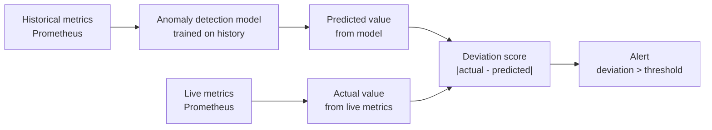
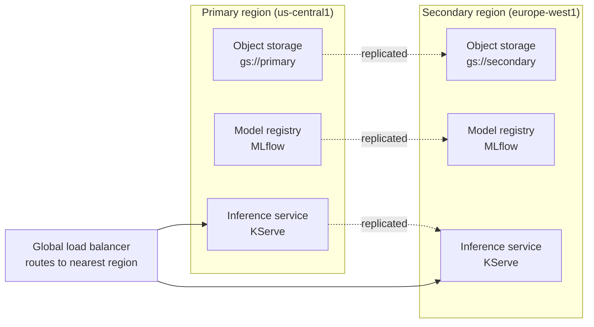

# 17.16 AI-assisted operations and scaling toward very large clusters

| Field | Value |
|---|---|
| Level | Advanced |
| Priority tier | 2 |
| Lab venue | GCP / GKE |
| Part | Part 17: Observability, performance and operations |
| Cross-references | Chapter 17.6 (Alerting and SLOs); Chapter 17.7 (Failure modes); Chapter 17.13 (Reliability engineering); Chapter 16.9 (LLM evaluation); Chapter 11.16 (KAI gang scheduling) |
| Coverage file | `planning/coverage/chapters/17-16.md` |
| Claim & number ledger | `planning/ledgers/17-16.md` |

## Why this matters for AI infrastructure

Picture the on-call engineer at the start of a shift. The dashboard shows thousands of time series, and the alert queue keeps growing. Every chapter in Part 17 has taught you to run the cluster you have today. This chapter prepares you for the larger cluster you will run next.

That cluster is bigger, busier, and harder to watch by hand. Its metrics, logs, and incidents now outnumber what one person can read. The on-call engineer is being asked to do more with the same headcount, and AI-assisted operations is the answer many teams reach for. It uses AI to spot anomalies across huge numbers of metrics, draft runbooks from incident transcripts, rank likely root causes across traces and logs, and forecast capacity needs. Think of it as an extra pair of eyes that reads faster than you do, and that can be wrong just as quickly.

The argument of this chapter is narrow. AI is useful where a human cannot read everything and a wrong answer is cheap to check. It is dangerous where a wrong answer triggers an action. Every pattern below keeps a person between the model and the cluster. If a model's output is only a suggestion on a ticket, a mistake costs a few minutes. If the same output drains a node, a mistake costs the work that was running on it.

AI can help in four places, and each place has a way to go wrong. An LLM can summarise a burst of alerts, but it can also state a confident cause that is not true. A model can flag a GPU that drifts away from its peers, but with ten thousand series it can also page you every hour. An assistant can draft a runbook, but it can also invent a flag. And a cluster that grows tenfold does not get ten times more people, so the tooling has to scale while Prometheus itself reaches its limits. This chapter shows concrete patterns for each place, the guardrails that keep them honest, and the arithmetic that tells you whether they are worth running.

Three facts make this a platform team problem, not only a data science problem. Each one names a piece of work that someone on the platform team has to own.

1. The metrics, logs, and traces from earlier chapters are the raw material for every tool in this chapter. The platform team owns that data, so it should own the tools built on it.
2. AI-assisted operations is a platform discipline with four jobs: detect anomalies, generate runbooks, find root causes, and predict capacity. The platform team sets those jobs and maintains the tooling that performs them.
3. Scaling toward very large clusters is also a platform challenge. Gang scheduling, Kueue, and MIG from Chapter 11 reach thousands of GPUs. Multi-cluster, multi-region, and multi-tenant operation needs more, and this chapter covers that.

Use AI to shorten the time to understand a problem, and never to make the decision that changes the cluster.

## Prerequisites and outcomes

Picture a new platform engineer who is handed this chapter on her first week and asked what she must already know. Before you start, check that you have these chapters behind you. They are not optional background. This chapter uses their alerting, failure, and scheduling vocabulary without defining it again.

### Prerequisites

Picture a reader who opens this chapter cold and needs to know what to read first. Each of these chapters supplies one of the building blocks used below.

- Chapter 17.6 (Alerting and SLOs) for the metrics stack.
- Chapter 17.7 (Failure modes) for the failure mode catalogue.
- Chapter 17.13 (Reliability engineering) for the SLO discipline.
- Chapter 16.9 (LLM evaluation and guardrails) for the LLM-as-judge pattern.
- Chapter 11.16 (KAI gang scheduling) for the multi-GPU patterns.

### Outcomes

Picture a team that wants to know, before it adds any model, whether the model will save time or create new work. This chapter takes that question through four jobs and one platform question. It starts with anomaly detection, moves through LLM-based runbook generation and then AI-assisted root cause analysis, and covers capacity prediction last. Each job comes with a pattern, the code that implements it and the guardrails that keep a person in charge. The chapter then turns to scaling toward very large clusters, with multi-cluster queues, multi-region failover, multi-tenant isolation and the Prometheus limits that appear first. It ends with the same tools running on GKE, with patterns that hold at thousands of GPUs.

Use this list as a checklist when you finish the lab. If you cannot tick an item, go back to the section that covers it.

---

## 1. AI-assisted anomaly detection

Picture a team that wants its first AI tool to watch the GPUs overnight. Anomaly detection is the first job, because it is the one most teams try first. This section explains what an anomaly is in this setting, how a model learns what normal looks like and how to keep the false alarms under control.

### 1.1 The pattern

Picture a GPU's memory use creeping down over a night. No static threshold fires, because the value still sits inside the range that looks normal for a busy cluster. Anomaly detection tries to catch this kind of change by learning what normal looks like for each metric. The model does not know that the GPU is sick. It only knows that the GPU has stopped looking like its history.

Anomaly detection earns its place on slow drifts that fixed thresholds miss and that cost money. Examples are a GPU that draws less power than its neighbours at the same load, a GPU whose NVLink throughput falls behind its peers in one job, or a training step time that creeps up over a week. It does not replace the fault rules from chapter 17.4. A double-bit ECC error or a tier 3 Xid needs no model, because a plain rule is exact, explainable and testable. An Xid is a numbered error code that the NVIDIA driver writes to the system log.

A model learns from history, predicts the expected value, and alerts when reality strays too far from it. A simpler and often stronger variant compares each GPU with its peers right now. In a healthy job all GPUs of one model do similar work, so a GPU far from the median of its node or job is suspicious without any history. The peer comparison has one big advantage: it does not need a long history to start working, and it adjusts itself when the whole fleet moves at once.

```promql
# GPU power relative to the median power of the GPUs on the same node
DCGM_FI_DEV_BOARD_POWER_WATTS
  / on (node) group_left
  quantile by (node) (0.5, DCGM_FI_DEV_BOARD_POWER_WATTS)
```

Read the query as a ratio. The numerator is one GPU's power. The denominator is the median power of the GPUs on the same node. A ratio far from one tells you that a GPU is working very differently from its peers, and the query does not need to know what the right power value is in advance.

Utilisation alone can mislead here. A GPU that is busy moving redundant data looks as busy as one doing useful work, so chapter 15.13 covers the profiling signals that show useful work. A model fed only with utilisation will learn to reward busy-but-wasteful GPUs.



History trains the model, which predicts the value you should see now. The alert fires when the gap between prediction and reality crosses a threshold you choose. The diagram shows two streams that meet at the deviation score, and that meeting point is where most of the tuning happens.

**The false-positive budget.** Decide how many false alerts the on-call will tolerate, then work backwards. Take 1,000 GPUs with 10 monitored signals each, checked every 5 minutes. That is 10,000 series times 12 checks an hour times 168 hours, about 20 million checks a week. If the team will tolerate 5 false alerts a week, each check may be wrong about 2.5 times in 10 million. A plain three-sigma rule is wrong about 27 times in 10,000 checks on normal data, which would give roughly 54,000 false alerts a week. This is why anomaly alerts need more than a point threshold. Require the deviation to persist across several windows, require agreement with the peer comparison, and send the result to a ticket queue first. Consecutive windows are correlated, so the persistence rule helps less than independent odds suggest. Measure the real rate on a month of data before you route anything to a pager.

### 1.2 The implementation

Picture an engineer choosing between a simple model and a clever one on a deadline. Choosing a model means trading accuracy against data needs and compute. A small model that you understand can beat a large one that nobody can explain late at night. The table compares four common choices, and each row names what the model is good at and what it demands.

| Model | Strength | Weakness |
|---|---|---|
| Prophet | Robust to missing data; handles seasonality | Less accurate for non-seasonal data |
| ARIMA | Statistical foundation; interpretable | Requires stationarity |
| LSTM autoencoder | Captures complex patterns | Requires more training data |
| Transformer | State-of-the-art accuracy | Requires significant compute |

A practical path is to start with Prophet. Move to an LSTM autoencoder only when your data volume justifies the extra compute. Whichever model you pick, score it against anomalies your team has already confirmed, not against its own predictions. A model that agrees with itself has passed a test it wrote for itself.

Picture the first review meeting after a model goes live. The team opens its list of confirmed anomalies from the last quarter and lines each one up against the alerts the model raised. Some alerts match, some were missed, and some were false alarms that nobody had labelled yet. That review, not the training log, tells you whether the model is worth keeping. Build the list before you train anything, because a list written after the results tends to favour the model that was already chosen.

### 1.3 The deployment

Picture the model's first morning on the cluster, when nobody remembers which schedule it runs on. The model runs as a cluster service. It reads history from Prometheus, retrains on a schedule, and publishes its anomaly score back as a metric. The manifest below sets the Prometheus address and the schedule. Once the score is a metric, every other tool in the stack can read it the same way it reads GPU temperature.

```yaml
# code/part17/anomaly_detection.yaml
apiVersion: apps/v1
kind: Deployment
metadata:
  name: anomaly-detection
spec:
  selector:
    matchLabels:
      app: anomaly-detection
  template:
    metadata:
      labels:
        app: anomaly-detection
    spec:
      containers:
        - name: anomaly-detection
          image: my-anomaly-detection:v1
          env:
            - name: PROMETHEUS_URL
              value: http://prometheus.monitoring:9090
            - name: MODEL_TRAINING_SCHEDULE
              value: "0 2 * * *"
```

The schedule `0 2 * * *` is a cron expression, which runs training once a day at 02:00. Before you deploy, decide who may change that schedule. A retraining run changes what your system treats as normal, so a change to the schedule is a change to the definition of normal. Treat it with the same care as a change to an alert threshold.

### 1.4 Alert summarisation with guardrails

During an alert storm, the on-call opens forty notifications that share one cause. An LLM can read the grouped alerts and write a short summary: what is firing, what changed, and which dashboard to open. That saves minutes at three in the morning. It is also where a model does the most harm if it is trusted, because a fluent wrong cause sends the engineer down the wrong path. The engineer who reads a confident summary at that hour often does not have the energy to doubt it.

The pattern is simple. Alertmanager groups related alerts and posts one notification. A summariser reads the group, calls the model, and posts the summary next to the original notification. The guardrails are the design, not an afterthought. Each guardrail in the table answers one way the summariser could hurt the response.

| Guardrail | What it prevents |
|---|---|
| The summary sits beside the original alert and never replaces it | A wrong summary hiding the real alert |
| Severity and routing come from labels, never from the model | A model downgrading a page |
| The prompt contains only alert labels, annotations and a bounded set of recent metric values | Prompt injection through log text an attacker can control |
| The summary may only name alerts and metrics that appear in its input, and a check rejects any other name | Invented alert names and services |
| A timeout of a few seconds, after which the plain alert goes out | The summariser delaying a page |
| Secrets and tokens are removed from the input | Leaking credentials to an outside API |
| The model has no tools that change anything | An assistant acting on its own guess |
| Every input and output is stored with an on-call rating | No way to measure whether it helps |

Score the summariser on past incidents before it goes live. For each incident, ask whether the summary named the same cause the post-mortem found, and track that rate every month. If the rate is low, phrase the summary as context and do not state a cause at all. A summary that says "these alerts all mention the same node" is safer than one that names a root cause, and it still saves the reading time.

---

## 2. LLM-based runbook generation

Picture an incident that is already under way, with an alert that has no runbook behind it. Runbook generation is the second job, and it helps exactly in that moment. This section shows how the model drafts the steps, how the code checks the draft and how a person decides what gets published.

### 2.1 The pattern

During a night-time incident, the on-call engineer finds an alert with no runbook. Writing one from the incident transcript takes time that nobody has in the middle of an outage. The transcript is the chat log and the notes from the response, and it already contains most of the steps the team took. The model can turn that raw material into a first draft while the engineer is still working.

In LLM-based runbook generation, the model reads the incident transcript and drafts the runbook steps. A platform engineer then reviews the draft before anyone publishes it. The draft is a starting point, and the reviewer decides what the team keeps.

```python
# code/part17/runbook_generation.py
"""Draft a runbook with an LLM, then refuse to return it unless it passes runbook_validation. llm.complete(prompt) -> str is injected."""
from runbook_validation import validate_runbook

def build_prompt(incident_transcript: str, existing_runbooks: list[str]) -> str:
    return f"""You are an SRE generating a runbook for a new incident.

Existing runbooks for reference:
{chr(10).join(existing_runbooks)}

Incident transcript:
{incident_transcript}

Generate a runbook with exactly these 6 sections, as headings:
What the alert means / Symptoms / Diagnostic steps / Mitigation steps / Escalation path / Post-mortem template.
Put every command on its own line."""

def generate_runbook(llm, incident_transcript: str, existing_runbooks: list[str]) -> str:
    draft = llm.complete(build_prompt(incident_transcript, existing_runbooks))
    ok, errors = validate_runbook(draft)
    if not ok:
        raise ValueError("generated runbook rejected: " + "; ".join(errors))
    return draft
```

The script does three things in order. It builds a prompt from the transcript and the existing runbooks, asks the model for a draft, and checks that draft. A draft that fails the check raises an error, so the function never returns it to the caller. The caller never sees a bad draft, because the check runs before the return.

The existing runbooks in the prompt are there for style. A new draft that looks like the team's other runbooks is easier for the next engineer to read. The model copies the shape it sees, so a messy set of examples produces messy drafts.

### 2.2 The validation

Picture a draft that reads beautifully and has no commands at all. A fluent draft can still be useless, so the code checks it before anyone reads it. The validator confirms that all six section headings appear. It also confirms that at least one line is a runnable command from a known list, such as `kubectl` or `nvidia-smi`. It does not check escalation contacts, and it cannot tell whether a command actually works. A person must check both.

```python
# code/part17/runbook_validation.py
import re

REQUIRED_SECTIONS = [
    "What the alert means",
    "Symptoms",
    "Diagnostic steps",
    "Mitigation steps",
    "Escalation path",
    "Post-mortem template",
]

COMMAND = re.compile(r"^\s*(?:\$ )?(kubectl|dcgmi|nvidia-smi|helm|systemctl|journalctl|scontrol|sinfo)\b", re.M)

def validate_runbook(runbook: str) -> tuple[bool, list[str]]:
    errors = [f"Missing section: {s}" for s in REQUIRED_SECTIONS if s not in runbook]
    if not COMMAND.search(runbook):
        errors.append("No runnable commands found (expected at least one kubectl/dcgmi/nvidia-smi/... line)")
    return len(errors) == 0, errors
```

Read the validator as a gatekeeper with a short list of questions. Are the six headings there? Is there at least one line that starts with a known command? If either answer is no, the draft is rejected with a reason. Passing this check says the draft has the right shape, and nothing more.

### 2.3 The human-in-the-loop

Picture the reviewer opening the draft at the start of a shift. A draft is a starting point, not a published runbook. Someone on the platform team must correct it and decide that it belongs in the library. The commands below show that sequence, from generation to commit. Each step leaves a trace, so the team can later see who reviewed what.

```bash
# Generate the runbook
python code/part17/runbook_generation.py \
  --incident-id INC-2024-03-15-001 \
  --output runbook_draft.md

# Review the runbook
vim runbook_draft.md

# Publish the runbook
cp runbook_draft.md runbooks/gpu-memory-pressure.md
git add runbooks/gpu-memory-pressure.md
git commit -m "Add runbook for GPU memory pressure"
```

The script writes a draft file, and nothing reaches the repository until you copy and commit it. Once you do, the commit records the approval. Make this review a required step in your publishing process. Do not let it depend on who happens to be on shift. A rule that depends on the shift will be skipped on the busiest night.

### 2.4 How LLM runbook assistants fail

Picture a draft that passes the validator and still sends the engineer the wrong way. The validator in section 2.2 checks that six headings exist and that one line looks like a command. A draft can pass and still be wrong, so know the ways it fails. The table lists six failures, what each one looks like on the page and the control that catches it.

| Failure | Example | Control |
|---|---|---|
| Invented command or flag | A `dcgmi` option that does not exist | Run every command in staging before the runbook is published |
| Stale step | A mitigation for an old driver | Record the runbook date and the versions it was written for, and review on a schedule |
| Mutating step with no warning | A drain or delete placed in the diagnostic section | Allow only read-only commands in the Diagnostic steps section, and flag any other verb for the reviewer |
| Wrong target | A node or namespace copied from the transcript | Use placeholders in commands and fill them from the alert labels |
| Instructions hidden in the transcript | A pasted log line that says to ignore the format | Treat the transcript as data and review the draft line by line |
| Headings present, content empty | Sections with one vague sentence | Reviewer checks that each section is actionable |

The model never runs a command. A person reviews the draft, and a person publishes it. Keep that sentence in the team's runbook policy, because the easiest way for a generated runbook to cause harm is for someone to assume it has been checked.

Notice that most rows in the table are about people, not about the model. A stale step or a copied node name gets through because a reviewer was tired or trusted the draft. The controls therefore put the check in a place a tired person cannot skip, such as a staging run or a required approval on the commit.

---

## 3. AI-assisted root cause analysis

Picture an incident where the evidence is scattered across three tools and nobody has time to join it. Root cause analysis is the third job, and the model can help with that join. The model proposes, and the engineer decides.

### 3.1 The pattern

During an incident, the evidence lives in three places. Traces sit in one tool, logs in another, and metrics in a third. Someone has to join them before the cause becomes visible, and that join is slow work the model can help with. A trace is the record of one request as it moves through services, and a log is the text line a program writes about what it did.

AI-assisted root cause analysis has three steps. The model reads the traces, logs, and metrics. It proposes candidate hypotheses. The on-call engineer reviews them and picks the most likely one. Each hypothesis carries the evidence and the mitigation it implies, so the engineer can check the reasoning instead of trusting the conclusion.

```python
# code/part17/root_cause_analysis.py
"""LLM-assisted root-cause hypotheses. The model call is injected (llm.complete(prompt) -> str), so the prompt and the
parser are testable offline. The model must answer in JSON; anything else is rejected rather than guessed at."""
import json

def build_prompt(traces, logs, metrics, failure_mode_catalogue):
    return f"""You are an SRE analysing a production incident.

Failure mode catalogue:
{chr(10).join(failure_mode_catalogue)}

Traces:
{json.dumps(traces)[:4000]}

Logs (first 100):
{chr(10).join(logs[:100])}

Metrics:
{json.dumps(metrics)}

Return a JSON list of exactly 3 objects with keys: hypothesis, evidence, mitigation, confidence (integer 1-5).
Return JSON only."""

def parse_hypotheses(text: str) -> list[dict]:
    try:
        items = json.loads(text)
    except json.JSONDecodeError as e:
        raise ValueError(f"model did not return JSON: {e}")
    need = {"hypothesis", "evidence", "mitigation", "confidence"}
    if not isinstance(items, list) or not items or any(not need <= set(i) for i in items):
        raise ValueError("hypotheses missing required keys")
    if any(not isinstance(i["confidence"], int) or not 1 <= i["confidence"] <= 5 for i in items):
        raise ValueError("confidence must be an integer 1-5")
    return sorted(items, key=lambda i: -i["confidence"])

def analyze_root_cause(llm, traces, logs, metrics, failure_mode_catalogue):
    return parse_hypotheses(llm.complete(build_prompt(traces, logs, metrics, failure_mode_catalogue)))
```

The code keeps the model's input small. It cuts the trace data to 4000 characters and sends only the first 100 log lines. The parser rejects any reply that is not valid JSON with the required keys, rather than guessing at what the model meant. Read the parser as a bouncer at the door. A reply that is not in the right shape never reaches the engineer's screen.

A confidence score helps you rank the hypotheses, but it does not prove any of them. A model can sound certain and still be wrong. Treat the score as the model's own opinion, and check the evidence line before you act on the top item.

### 3.2 The trace correlation

Picture a trace with a long list of spans and one slow database call. Before the model sees anything, plain code narrows the traces to the slow spans. A span is one timed step inside a trace, such as a database call or a model inference. Here, a span counts as slow when it runs longer than one second. Code like this is cheaper and more predictable than asking the model to scan every span, and the result is the same every time you run it.

```python
# code/part17/trace_correlation.py
def correlate_traces(traces: list[dict]) -> list[dict]:
    """Identify the slow operations across the traces."""
    slow_ops = []
    for trace in traces:
        for span in trace["spans"]:
            duration_ms = span["duration_ms"]
            if duration_ms > 1000:  # > 1 second
                slow_ops.append({
                    "trace_id": trace["trace_id"],
                    "span_id": span["span_id"],
                    "name": span["name"],
                    "duration_ms": duration_ms,
                })
    return slow_ops
```

Think of the filter as a sieve that runs before the model arrives. Most spans in a busy system are fast and boring, and they would only bury the slow ones if the model had to read them all. The sieve removes the noise, so the model's attention lands where the latency is.

Filter in code first, so the model reasons only about the operations that matter. A smaller input also makes the model's answer easier to check. When the model names a slow operation, you can look up its trace ID and confirm that the operation really was slow.

### 3.3 The log analysis

Picture a log file with thousands of lines and one traceback hidden in the middle. Logs are noisy, so a simple scan comes first. The function below sorts each line into errors, warnings, or exception tracebacks. A traceback is the list of calls that a program prints when it crashes, and finding one in the logs is often the fastest route to the failing line. The function does this with plain text matching, not with the model.

```python
# code/part17/log_analysis.py
def analyze_logs(logs: list[str]) -> dict:
    """Identify error patterns in the logs."""
    patterns = {
        "errors": [],
        "warnings": [],
        "exceptions": [],
    }
    for log in logs:
        if "ERROR" in log:
            patterns["errors"].append(log)
        if "WARN" in log and "ERROR" not in log:
            patterns["warnings"].append(log)
        if "Traceback" in log:
            patterns["exceptions"].append(log)
    return patterns
```

The scan finds the lines, but it does not connect them to traces. That correlation is still open in this section. Before you trust the grouping, check that your logs use these exact words for severity. A service that writes "error" in lower case, or "W" instead of "WARN", will slip past the scan without a sound.

### 3.4 Debugging a failed training run

Picture a training job that fails halfway through a three-month run. Someone must read the error logs, the device statistics and perhaps memory dumps, and decide whether the cause was a hardware fault, a numerical overflow or a network problem. The pattern from this section helps with the joining work. Narrow the evidence with plain code, give the model the failure mode catalogue from chapter 17.7, and ask for ranked hypotheses with evidence.

Two examples show what a good hypothesis looks like. Five ECC memory errors on one node just before the crash point to that GPU's HBM, and chapter 17.4 has the rule. A loss that turns NaN at one iteration points to an unstable gradient, where clipping may help. In both cases the engineer still checks the evidence before changing the job. A hypothesis is a lead and not a verdict. A good hypothesis says what it saw, what it thinks that means and what it would check next.

---

## 4. Capacity prediction

Picture a GPU order that takes weeks to arrive while the queue keeps growing. Capacity prediction is the fourth job, and it is the one with the longest lead time. A GPU order can take weeks to arrive, so the forecast has to look ahead of the work that is already running.

### 4.1 The forecasting model

Teams often buy GPUs for the demand they had last quarter, then run short when a new project lands. A forecast estimates next quarter's usage from the history you already have. The function below fits a Prophet model to historical usage and projects it forward. Prophet is a forecasting library that separates a trend from weekly and yearly rhythms.

```python
# code/part17/snippets/capacity_prediction.py
import pandas as pd
from prophet import Prophet

def predict_capacity(historical_usage: pd.DataFrame, growth_periods: int = 90) -> pd.DataFrame:
    """Predict GPU capacity needs for the next growth_periods days."""
    model = Prophet(
        yearly_seasonality=True,
        weekly_seasonality=True,
        daily_seasonality=False,
    )
    model.fit(historical_usage)

    future = model.make_future_dataframe(periods=growth_periods)
    forecast = model.predict(future)

    return forecast[["ds", "yhat", "yhat_lower", "yhat_upper"]]
```

The function uses only the usage history. Growth plans and buffers must be added outside it. It returns the forecast with a lower and an upper bound, and it projects 90 periods by default. Plan against the upper bound when running short costs more than holding spare hardware. A forecast without the bounds hides how wide the uncertainty really is, and the bounds are where the buying decision lives.

### 4.2 The workload forecast

Picture a new project that lands next month and does not appear in any usage curve yet. A usage curve cannot see a project that has not started yet. The workload forecast adds known growth from roadmaps and customer commitments, using each workload's own growth rate. Think of it as the forecast that a product manager can read, because it speaks in projects rather than curves. The function below compounds that rate over the horizon.

```python
# code/part17/workload_forecast.py
def forecast_workloads(workloads: dict, horizon_days: int = 90) -> dict:
    """workloads: {name: {"current_gpus": int, "growth_rate": float per 90 days}}. Compound growth over the horizon."""
    forecast = {}
    for name, w in workloads.items():
        projected = w["current_gpus"] * (1 + w["growth_rate"]) ** (horizon_days / 90)
        forecast[name] = {"current_gpus": w["current_gpus"], "projected_gpus": projected, "growth_rate": w["growth_rate"]}
    return forecast
```

The growth rate in the code is per 90 days. A horizon of two 90-day periods therefore compounds the rate twice. The function handles that exponent for you, so you only supply the rate and the horizon. Compounding means each period grows on top of the one before, which is why a modest rate can look large over a long horizon.

### 4.3 The cost forecast

Picture the finance partner asking why the GPU bill jumped this month. Once you have GPU counts, the bill follows. The function below multiplies projected GPUs by a price, by 24 hours, and by 30 days. It is the simplest possible bill, and it is useful exactly because it is simple. A finance partner can check it by hand.

```python
# code/part17/cost_forecast.py
def forecast_cost(workload_forecast: dict, gpu_price: float) -> float:
    """Forecast the monthly GPU cost based on the workload forecast."""
    total_cost = 0
    for workload, forecast in workload_forecast.items():
        total_cost += forecast["projected_gpus"] * gpu_price * 24 * 30
    return total_cost
```

The function assumes every GPU runs all month at the price you pass in. Reserved commitments and idle time change the real bill, so treat the result as a planning figure. Compare the forecast with the actual bill each month to see which assumption was wrong. The monthly figure also feeds your FinOps dashboard, and someone should review it on a regular schedule. FinOps is the practice of watching cloud spend against the value it buys.

---

## 5. Scaling toward very large clusters

Picture the first week after a second site joins the cluster, when the queue, the monitoring and the teams all change at once. The first four jobs assume one cluster. At large scale the cluster itself changes shape, and the problems move from "what is wrong" to "where should work go and how do we keep teams apart". This section covers those problems.

### 5.1 The scaling challenges

Picture a cluster that now spans several sites and serves many teams. Bigger nodes will not solve that problem. Each new scale brings its own failure and needs its own tool. The table names the three challenges and the tools platform teams usually reach for.

| Challenge | What it is | How the platform team addresses it |
|---|---|---|
| Multi-cluster scheduling | The cluster spans multiple Kubernetes clusters | Cluster API; Kueue MultiKueue |
| Multi-region failover | The cluster spans multiple regions | Multi-region object storage; multi-region registry |
| Multi-tenant isolation | The cluster serves multiple teams | Namespaces; RBAC; Kueue ClusterQueues; per-tenant quotas |

These three problems are different. Scheduling across clusters, surviving a region outage, and sharing one cluster between teams each fail in their own way. Plan for each one separately. A team that solves one of them and assumes the other two are solved will be surprised in the next incident.

### 5.2 Multi-cluster scheduling

Imagine one cluster that is full while another has idle H100s. Multi-cluster scheduling tries to send the next job to the cluster with room. The pattern in this section is a single queue that holds the GPU quota of several clusters, with each job landing where capacity exists. The manifest below defines two flavors, one per region, and one shared queue that holds both. A flavor is Kueue's name for a set of nodes with the same hardware, and a ClusterQueue is the shared pool of quota that jobs wait in.

```yaml
# code/part17/multi_cluster_queue.yaml
apiVersion: kueue.x-k8s.io/v1beta2
kind: ResourceFlavor
metadata:
  name: h100-sxm5-80gb-us-central1
spec:
  nodeLabels:
    nvidia.com/gpu.product: NVIDIA-H100-80GB-HBM3
---
apiVersion: kueue.x-k8s.io/v1beta2
kind: ResourceFlavor
metadata:
  name: h100-sxm5-80gb-europe-west1
spec:
  nodeLabels:
    nvidia.com/gpu.product: NVIDIA-H100-80GB-HBM3
---
apiVersion: kueue.x-k8s.io/v1beta2
kind: ClusterQueue
metadata:
  name: cluster-queue-multi-region
spec:
  cohortName: multi-region
  namespaceSelector: {}
  resourceGroups:
    - coveredResources: ["cpu", "memory", "nvidia.com/gpu"]
      flavors:
        - name: h100-sxm5-80gb-us-central1
          resources:
            - name: cpu
              nominalQuota: 800
            - name: memory
              nominalQuota: 4Ti
            - name: nvidia.com/gpu
              nominalQuota: 64
        - name: h100-sxm5-80gb-europe-west1
          resources:
            - name: cpu
              nominalQuota: 800
            - name: memory
              nominalQuota: 4Ti
            - name: nvidia.com/gpu
              nominalQuota: 64
```

The manifest lists one GPU flavor per region, each with its own CPU, memory, and GPU quota. The numbers are example values from the manifest, not a sizing guide. Size your own quotas from the capacity you actually have.

Picture a training job submitted on a Monday morning. The queue looks at the quota in each region, finds room in the one with idle hardware, and starts the job there without anyone choosing a region by hand. That convenience is the point of the design, and it is also why the team has to watch where the work actually lands.

The queue sends work to whichever region has room. Do not assume failover is automatic because the queue exists. Prove it in a drill before you rely on it. A queue that routes jobs well on a quiet day can still stall when a region is actually down, and only a drill shows that gap.

### 5.3 Multi-region failover

When an entire region goes dark, your inference service needs somewhere else to answer. The pattern is to replicate data to a second region, run the workloads in both, and let a global load balancer send traffic to the healthy one. The diagram shows the two regions and the one load balancer that sits in front of both.



The dotted arrows show data copied in the background. Think of them as a courier who delivers the newest files to the second region on a regular route. The load balancer, drawn with solid arrows, is the traffic cop that decides which region answers each request. Replication lag decides how much recent data the second region can really serve. Decide how far behind the secondary region may be, then measure that lag. A second region that is always a few minutes behind can answer questions, but it cannot answer with the newest model unless the lag fits the target you chose.

### 5.4 Multi-tenant isolation at scale

Picture one team's runaway job taking every GPU on the cluster on a Friday night. Thousands of teams sharing one cluster need walls between them. Without walls, one team's runaway job can starve everyone else. The pattern gives each team its own namespace, LocalQueue, IAM role, and quota. A namespace is a separate area of the cluster for one team's objects, and a LocalQueue is the team's entry point into the shared queue. The manifest below sets the team's queue and its cap on CPU, memory and GPUs.

```yaml
# code/part17/multi_tenant_isolation.yaml
apiVersion: kueue.x-k8s.io/v1beta2
kind: LocalQueue
metadata:
  name: team-data-science-queue
  namespace: team-data-science
spec:
  clusterQueue: cluster-queue-standard
---
apiVersion: v1
kind: ResourceQuota
metadata:
  name: team-data-science-quota
  namespace: team-data-science
spec:
  hard:
    cpu: "200"
    memory: 1Ti
    nvidia.com/gpu: "4"
```

The LocalQueue sends a team's jobs to the shared queue. The ResourceQuota caps what that team can use. The numbers in the example are placeholders for your own team sizes. Read the two objects together. One says where the work goes, and the other says how much of the cluster the team may take.

Start each new team with a small quota, and raise it when usage data supports the change. A quota that starts large is hard to shrink later, because the team has already built its habits around it.

### 5.5 Prometheus cardinality at fleet scale

Picture a dashboard that stops loading once the fleet reaches ten thousand GPUs. The first thing that breaks at that size is usually the monitoring system. Cardinality means the number of distinct time series, and every label multiplies them. Every GPU exports many series. As an example, 10,000 GPUs with 50 series each is 500,000 active series. That is manageable. The trouble comes from churn. Churn is the rate at which new series appear and old ones disappear. If a metric carries a pod label and each GPU sees 20 pod restarts a day, that is 10,000 times 50 times 20, or 10 million new series a day. These counts are example arithmetic, so measure your own.

Prometheus exposes the numbers you need. `prometheus_tsdb_head_series` is the current series count, and the rate of `prometheus_tsdb_head_series_created_total` is the churn. Watch both, and alert when churn jumps after a release. A release that adds one label to a busy metric can double the series count overnight, and the churn figure is the first place that shows it.

Four levers keep the cost down.

- Drop labels you never query, especially pod names on hardware metrics, with relabelling at scrape time.
- Record per-node and per-rack aggregates, and let dashboards and models read the recorded series.
- Scrape slow signals such as temperature less often than fast ones.
- Run one Prometheus per cluster and send long-term data to a remote store, so one overloaded server does not blind the whole fleet.

Anomaly models should read the recorded aggregates, not the raw per-GPU series, whenever the question allows it. That one habit keeps the model's input small and the monitoring stack calm.

### 5.6 Fleet automation: the cordon, drain and RMA loop

Picture a Tuesday morning with a dozen hardware faults waiting in the queue. At fleet scale a person cannot handle every hardware fault by hand. The loop is simple. A fault alert from chapter 17.4 fires, automation cordons the node, drains it with the policy from chapter 17.10, runs `dcgmi diag -r 3`, and then either returns the node to service or opens a vendor RMA. An RMA is a return merchandise authorisation, the vendor process for sending broken hardware back. Chapter 17.13 shows why the speed of this loop sets your pool availability.

Automation needs its own safety rules, because a bug in it can do more harm than the fault. Each rule below answers one way the loop could make things worse.

- Rate limit: never take more nodes out of service than your spare pool covers.
- Common-cause breaker: if many nodes raise the same alert within a short time, stop and page a person. A bad driver rollout, a switch failure or a power event looks like a hundred hardware faults, and draining a hundred nodes makes it worse. For example, stop when more than 2 percent of the fleet alarms within 10 minutes. The numbers are examples to tune.
- Dry run first: new rules run in log-only mode for a month, and a person compares what they would have done with what happened.
- Audit trail: every action records the alert, the evidence and the actor.
- Human approval for irreversible steps, such as an RMA or a rack power cycle.

The common-cause breaker is the part teams forget, and it is the one that prevents the worst night. A single broken node is a routine event. A hundred broken nodes in ten minutes is a different event, and the automation should know the difference before it acts.

---

## 6. Operating AI-assisted operations on GKE

Picture a platform team putting these tools on GKE for the first time. This section puts the four jobs and the scaling pieces on Google Kubernetes Engine (GKE). It names the components, the access rules and the signals that show whether the tools are helping.

### 6.1 The components

Each of the five components needs a place to run, storage behind it, and an owner for its target. Picture the first week after launch, when the summariser and the anomaly model both begin posting alerts at once. Only a table of owners and targets tells you which one to look at first.

| Component | Where it runs | Backing store | SLO |
|---|---|---|---|
| Anomaly detection model | Kubernetes Deployment | Object storage for model | Anomaly score p99 < 1 s |
| LLM-based runbook generator | Kubernetes Deployment | Object storage for runbooks | Generation latency p99 < 30 s |
| AI root cause analysis | Kubernetes Deployment | Object storage for analyses | Analysis latency p99 < 60 s |
| Capacity prediction model | Kubernetes Deployment (cron) | Object storage for forecasts | Forecast frequency daily |
| Multi-cluster queue | Kueue | (Kueue) | Queue admission p99 < 1 s |

Each row in the table is a place where the tool could fail silently. The model might stop publishing, the generator might stall on a long transcript, or the queue might hold jobs longer than anyone expects. Naming the store and the owner for each row tells the on-call where to look first. The targets in this table are example values. This chapter did not measure them, and no source recommends them. Choose your own from your own traffic before you set any alert. A target that nobody measured is a guess, and a guess that becomes an alert will wake people for the wrong reasons.

### 6.2 IAM and the AI-assisted operations

Picture a reader who is given write access by accident. Not everyone should retrain a model or change a runbook. IAM, the identity and access management system, sets the rules for who may change what. A model that is retrained by accident changes what the team calls normal, and a runbook that is edited by accident changes what the next engineer does at night. The table shows one way to split access into reader, writer, and admin roles.

| Role | Who | What they can do |
|---|---|---|
| `aiops.reader` | Every team | Read the anomaly scores; read the capacity forecasts |
| `aiops.writer` | The platform team | Update the models; update the runbooks |
| `aiops.admin` | The platform team lead | Approve the AI-assisted operations |

Keep write access small, because a changed model or runbook changes what the on-call engineer sees. Write the rules down, enforce them in your identity system, and review them on a schedule. A reader who can edit a runbook has become a writer, even if the role list still says reader.

### 6.3 Observability

Picture the anomaly model going quiet on a busy night, with nobody noticing for hours. The monitoring for these tools is itself a production service, so it needs alerts. If the anomaly model goes quiet, you need to know whether the model is healthy or the feed is broken. The thresholds in the table are examples, so set your own from a measured baseline.

| Metric | Why it matters | Alert |
|---|---|---|
| Anomaly detection precision | Model quality | < 80% per week |
| Runbook generation success rate | Model quality | < 90% per week |
| Capacity forecast accuracy | Model quality | Error > 20% per month |
| Multi-cluster queue latency | Multi-cluster performance | > 5 s |
| Multi-region failover latency | Multi-region performance | > 1 hour |
| Summary agreement with the post-mortem | Whether the summariser helps | Falling month over month |
| Automation actions per day | Whether the loop is behaving | Above the pool's spare capacity |
| Series churn | Monitoring health | Jump after a release |

Alerting needs restraint. Too many critical alerts wear out on-call engineers, and false positives can bury the real event. Also keep a heartbeat alert that always fires, so that silence itself raises an alarm. A heartbeat is the same dead man's switch idea from the on-call runbooks chapter, applied to the AI tools.

**The anomaly detection precision alert matters most.** A low precision means the model fires too many false positives, and the on-call engineer then learns to ignore it. Once the engineer ignores the model, the model is worth nothing, however good it was on paper.

---

## 7. How it fails

Picture a Friday evening when a summary, a detector and a queue each misbehave in a different way, and the on-call has to sort out which problem is real. Six failures recur in these systems. Each one has a symptom you can see and a cause you can check. Each entry below says what the on-call notices first, the likely cause and the fix.

### 7.1 "The anomaly detection fires too many false positives"

The detector fires on every small wobble. The on-call engineer stops reading the alerts, and the real anomaly gets missed. Work out the false-positive budget from section 1.1 before you tune anything. The likely cause is a model that is too sensitive, a threshold set too low, or training data that does not match production traffic. Tune the model, raise the threshold, retrain on production traffic, and measure precision and recall.

### 7.2 "The LLM-generated runbook is not actionable"

The model produces a runbook with no runnable commands, so the on-call engineer cannot follow it. The engineer reads the page, finds prose and no commands, and goes back to searching. The likely cause is a vague prompt, too little context, or a validator that misses the problem. Improve the prompt, add context, strengthen the validator, and keep a human reviewer in the loop.

### 7.3 "The AI-assisted root cause analysis is wrong"

The model suggests a cause that turns out to be wrong, and the on-call engineer loses time chasing it. A wrong lead is more expensive than no lead, because it pulls attention away from the real cause. The likely cause is too little context, or a model that has not been tuned on your production traffic. Add context, tune on production traffic, use the confidence field to rank the hypotheses, and keep a human reviewer.

### 7.4 "The capacity prediction is wrong"

In one example, the forecast says 100 GPUs and real usage reaches 200. The team is short of hardware exactly when it needs it. The likely cause is bad historical data, a wrong growth rate, or a model that ignores the workload forecast. Verify the history, correct the growth rate, add the workload forecast, and review the prediction on a regular schedule.

### 7.5 "The multi-cluster queue is unbalanced"

In one example, region A has 100 GPUs available and region B has 0 GPUs, so every job lands in region A. Region B sits idle while region A backs up. The likely cause is a workload pinned to region A by an affinity rule, while capacity is uneven across regions. Add a region-affinity weighting, balance the GPU quota across regions, and set a fairness policy.

### 7.6 "The multi-region failover is slow"

In one example, a regional outage takes 2 hours to recover from, and the service level objective is breached. The customers see the breach before the team does. The likely cause is a failover that is not automated, slow data replication, or a workload that takes a long time to start. Automate the failover, replicate more often, and pre-warm the workloads in the second region.

---

## 8. Hands-on lab

Picture a platform team that wants to see all four jobs working on one cluster in a single afternoon. This lab walks through anomaly detection, runbook generation, root cause analysis, and capacity prediction in one session. The commands were not run on hardware for this book, so check flags against your versions.

### 8.1 Prerequisites

Picture a lab partner who starts before the API key exists. Check these three things before you start, because each later step relies on one of them.

- The observability stack from earlier chapters.
- An LLM API key (OpenAI, Anthropic, or local model).
- The observability stack's data in Prometheus.

### 8.2 Step 1: deploy the anomaly detection model

Picture a new cluster with no anomaly model on it yet. Start by deploying the model with Helm. Helm is the package manager that installs a bundle of Kubernetes objects from one command. The command points the model at your Prometheus server, so the model reads the same history your dashboards read.

```bash
helm install anomaly-detection my-charts/anomaly-detection \
  --namespace monitoring \
  --set prometheus.url=http://prometheus.monitoring:9090
# expected: the anomaly detection model is deployed; the anomaly scores are exposed
```

### 8.3 Step 2: query the anomaly scores

Picture a dashboard panel that stays empty where the score should be. Next, check that the model is publishing scores. The query below asks Prometheus for the score of GPU 0. If the query returns nothing, the model is not publishing yet, and there is no point checking the alerts.

```bash
curl -s 'http://prometheus.monitoring:9090/api/v1/query?query=anomaly_score{gpu="0"}' | jq .
# expected: the anomaly score for GPU 0
```

### 8.4 Step 3: generate a runbook with the LLM

Picture an incident that has just ended with no runbook for its alert. Generate a draft runbook from that incident. The output is a draft, not a published runbook. Keep that distinction in mind, because the next step is the review that makes the draft safe to use.

```bash
python code/part17/runbook_generation.py \
  --incident-id INC-2024-03-15-001 \
  --output runbook_draft.md
# expected: the runbook draft is generated
```

### 8.5 Step 4: review the runbook

Picture the reviewer with the draft open in one window and the cluster in another. Read the draft, correct it, and publish only what you have checked. Read every command as if you were about to run it at night, because that is how the next on-call will read it.

```bash
# Open the runbook draft
vim runbook_draft.md

# Publish the runbook
cp runbook_draft.md runbooks/gpu-memory-pressure.md
git add runbooks/gpu-memory-pressure.md
git commit -m "Add runbook for GPU memory pressure"
```

### 8.6 Step 5: run the AI-assisted root cause analysis

Picture the same incident the next morning, when the team wants a second opinion. Run the analysis for the same incident, so the hypotheses can be compared with the runbook. The output should contain three candidates, each with its evidence and its mitigation. Check each candidate against the traces before you act on it.

```bash
python code/part17/root_cause_analysis.py \
  --incident-id INC-2024-03-15-001 \
  --output root_cause_analysis.md
# expected: 3 candidate hypotheses for the root cause
```

### 8.7 Step 6: run the capacity prediction

Picture a planning meeting that asks how many GPUs the next quarter needs. Run the forecast for the production cluster. Read the output with its bounds, and plan against the upper one. A single forecast number with no range is a number you should not trust yet.

```bash
python code/part17/snippets/capacity_prediction.py \
  --cluster gke-prod-us-central1 \
  --output capacity_forecast.md
# expected: the Q+1 GPU forecast
```

### 8.8 What to record

After the lab, answer five questions quickly. Write the answers down, so the team can see them without rerunning the lab. The five-second and 30-second figures here are examples. Choose limits that suit your own on-call process.

1. What is the current anomaly detection precision?
2. What is the most recent LLM-generated runbook?
3. What was the most recent AI-assisted root cause analysis?
4. What is the Q+1 GPU forecast per the capacity prediction?
5. What is the current multi-cluster queue latency?

If your team cannot answer these within the limit it chose, the stack is not ready to run as a production service. A slow answer usually means a record is missing or a dashboard is hard to find, and both are fixable before the next incident.

---

## Exercises

Picture a teammate who asks where to start. Each exercise builds on a section in this chapter, so check your work against that section. Work them in order, because later ones reuse the parts built by earlier ones.

1. Add an anomaly detection model. Train a Prophet model on historical GPU metrics, then deploy it as a Kubernetes Deployment. *Solution sketch:* the Python script in Section 1.2, and the Kubernetes Deployment in Section 1.3. You are done when the alerts reach the on-call engineer and you can name each false positive.
2. Add an LLM-based runbook generator. Build a script that takes an incident transcript and generates a runbook with the six sections. *Solution sketch:* the Python script in Section 2.1 and the validation in Section 2.2. You are done when a draft missing a section is rejected, not saved.
3. Add AI-assisted root cause analysis. Build a script that takes traces, logs, and metrics and generates three candidate hypotheses. *Solution sketch:* the Python script in Section 3.1 and the trace correlation in Section 3.2. You are done when the script returns hypotheses ranked by confidence.
4. Add a capacity prediction model. Train a Prophet model on historical GPU usage and forecast the next quarter's needs. *Solution sketch:* the Python script in Section 4.1 and the workload forecast in Section 4.2. You are done when the forecast comes with a range you can defend.
5. Add a multi-cluster queue. Configure Kueue to aggregate GPU quota across two clusters. *Solution sketch:* the ClusterQueue in Section 5.2 and a LocalQueue for each team. You are done when each team's jobs land in its own queue and its quota stops a runaway job.
6. Add a multi-region failover drill. Schedule a drill each quarter that tests failover. *Solution sketch:* a Chaos Mesh experiment that cordons all nodes in the primary region, and a drill that measures failover latency. You are done when the drill reports a failover time you can compare with your target.

---

## Checkpoint questions

<details><summary>1. The anomaly detector fires on every small wobble, and the on-call engineer has stopped reading its alerts. What does the chapter say went wrong, and what do you change?</summary>
The model is too sensitive, the threshold is too low, or the training data does not match production traffic. The real anomaly is then missed because people ignore the noise. Tune the model, raise the threshold, retrain on production traffic, and measure precision and recall.
</details>

<details><summary>2. The LLM drafts a runbook with no runnable commands, so the on-call cannot follow it. What are the likely causes?</summary>
The prompt is vague, the context is too thin, or the validator misses the problem. Improve the prompt, add context, strengthen the validator, and keep a human reviewer in the loop. The validator only checks six headings and one known command, so it cannot prove the runbook works.
</details>

<details><summary>3. The AI root cause tool names a cause, the engineer chases it, and it is wrong. How does the chapter say to reduce the damage?</summary>
Add context and tune on your production traffic. Use the confidence field to rank the hypotheses, and keep a human reviewer. A confidence score ranks hypotheses but proves none of them, because a model can sound certain and still be wrong.
</details>

<details><summary>4. The forecast said 100 GPUs and real usage reached 200. What do you verify?</summary>
Verify the history, correct the growth rate, and add the workload forecast. The model may have used bad history, a wrong growth rate, or ignored known projects. Then review the prediction on a regular schedule.
</details>

<details><summary>5. Region A has 100 GPUs available and region B has none, yet every job lands in A. What is the cause and the fix?</summary>
A workload may be pinned to region A by an affinity rule while capacity is uneven. Add a region-affinity weighting, balance the GPU quota across regions, and set a fairness policy. The queue alone does not guarantee balance.
</details>

<details><summary>6. A regional outage takes 2 hours to recover from and the objective is breached. What does the chapter suggest?</summary>
The failover may not be automated, data replication may be slow, or the workload may take long to start. Automate the failover, replicate more often, and pre-warm the workloads in the second region. Prove it in a drill rather than assuming the queue handles it.
</details>

<details><summary>7. Why can anomaly detection catch a GPU memory use that creeps down overnight when a static threshold cannot?</summary>
The value still sits inside the range that looks normal, so a fixed threshold never fires. The model learns what normal looks like from history and predicts the expected value now. It alerts when the gap between predicted and actual crosses a threshold.
</details>

<details><summary>8. Why does the chapter filter traces and logs in plain code before the model sees them?</summary>
Code is cheaper and more predictable than asking the model to scan every span. The trace filter keeps only spans over one second. A smaller input also makes the model's answer easier to check.
</details>

<details><summary>9. Why does the runbook validator not replace a human review?</summary>
It confirms that all six section headings appear and that at least one line is a command from a known list. It does not check escalation contacts, and it cannot tell whether a command actually works. A person must check both.
</details>

<details><summary>10. Why does the root cause parser reject a reply that is not valid JSON instead of guessing?</summary>
Guessing at what the model meant could turn a malformed answer into a confident but wrong hypothesis. The parser demands the required keys and an integer confidence from 1 to 5. Anything else raises an error that a person can see.
</details>

<details><summary>11. Your team will tolerate 5 false anomaly alerts a week across 10,000 series checked every 5 minutes. What false-positive rate per check does that require?</summary>
There are 10,000 times 12 times 168, about 20 million checks a week. Five false alerts in 20 million checks is about 2.5 in 10 million. A three-sigma rule is wrong about 27 times in 10,000 checks, which would give tens of thousands of false alerts a week. So require persistence across windows, agreement with a peer comparison, and a ticket queue before any pager.
</details>

<details><summary>12. You must pick an anomaly model. When do you start with Prophet and when move to an LSTM autoencoder, and what do you give up?</summary>
Start with Prophet, which is robust to missing data and handles seasonality, but is less accurate on non-seasonal data. Move to an LSTM autoencoder when your data volume justifies the extra compute. It captures complex patterns but needs more training data. Score either one against anomalies your team has already confirmed.
</details>

<details><summary>13. Do you plan capacity against the forecast line or its upper bound, and what do you give up?</summary>
Plan against the upper bound when running short costs more than holding spare hardware. You give up some idle GPUs and money. In return a surprise project does not find you short.
</details>

<details><summary>14. A new team asks for a large GPU quota. Do you give it, or start small and raise it later?</summary>
Start small and raise the quota when usage data supports the change. The team waits for more capacity at first. In return one team's runaway job cannot starve everyone else, because the ResourceQuota caps what it can use.
</details>

<details><summary>15. A hardware fault alert fires on 3 percent of the fleet within 10 minutes. Should the cordon and drain automation proceed, and what do you give up?</summary>
No. Many nodes raising one alert at once points to a common cause such as a driver rollout, a switch or a power event, and draining them all would make it worse. The common-cause breaker stops the automation and pages a person. You give up speed on genuine simultaneous faults, which is rare and costs less than draining a fleet by mistake.
</details>

<details><summary>16. A workload has 100 GPUs and a growth rate of 20 percent per 90 days. What does the forecast function project for 180 days?</summary>
The growth rate compounds once per 90-day period, and 180 days is two periods. That is 100 times 1.2 times 1.2, which is 144 GPUs. The function handles the exponent as the horizon divided by 90.
</details>

<details><summary>17. The multi-cluster queue has two flavors, each with a GPU quota of 64 and a CPU quota of 800. What is the total in the shared queue?</summary>
GPUs add up to 64 plus 64, which is 128. CPUs add up to 800 plus 800, which is 1,600. These are example values, so size your own from the capacity you have.
</details>

<details><summary>18. A cluster has 10,000 GPUs with 50 series each, and a pod label adds 20 pod restarts a day per GPU. How many new series appear per day?</summary>
That is 10,000 times 50 times 20, which is 10 million new series a day. The active count of 500,000 is manageable, but the churn is what overloads the head of the database. Drop the pod label from hardware metrics or record per-node aggregates. The inputs are example numbers, so measure your own.
</details>

<details><summary>19. The anomaly detection precision alert fires at below 80 percent for the week. In what order do you check?</summary>
First measure precision and recall against anomalies your team has already confirmed. Second look at the threshold, since one set too low causes false positives. Third compare the training data with production traffic, then retrain if they differ.
</details>

<details><summary>20. A three-month training run fails halfway. What does the chapter say you read first, and what leads would each clue give?</summary>
Read the error logs, the device statistics, and any memory dumps, and decide between a hardware fault, a numerical overflow, and a networking problem. Several ECC memory errors on one node just before the crash point to the GPU's HBM. A loss that turns NaN at one iteration points to an unstable gradient, where clipping may help. Treat each as a lead to verify, not a verdict.
</details>

---

## Sources and review notes

- *AI Systems Performance Engineering* (`ai-systems-performance-engineering`, Chapter 20), for AI-assisted operations and anomaly detection. The kernel generation, AlphaTensor and hardware outlook sections that earlier versions took from that chapter were moved out of this chapter. Prometheus metric names `prometheus_tsdb_head_series` and `prometheus_tsdb_head_series_created_total` are from the Prometheus documentation.
- *Distributed AI Systems* (`distributed-ai-systems`, Chapter 11). Source for the scaling patterns and the multi-cluster, multi-region patterns.
- *LLMOps* (`llmops`, Chapter 10). Source for the LLM-based operations patterns.
- NVIDIA Zero-to-Hero Volume 8 (`chapter-03-ai-assisted-operations.md`). Source for the AI-assisted operations patterns.

### Cross-references to other handbook chapters

- Chapter 17.6 for the alerting and SLOs.
- Chapter 17.7 for the failure modes.
- Chapter 17.13 for the reliability engineering.
- Chapter 16.9 for the LLM evaluation.
- Chapter 11.16 for the KAI gang scheduling.

### Migrated from `nvidia-devops`

The AI-assisted operations operational patterns draw on Volume 8 chapter 3 and the gem book corpora. The wording has been rewritten in the handbook's voice.

### Explicitly labelled inferences

- The anomaly detection model choices (Prophet, ARIMA, LSTM, transformer) are starting points; specific models depend on the workload.
- The LLM-based runbook generation pattern is a starting point; specific prompts depend on the team's runbook format.
- The capacity prediction buffer is a starting point; specific buffers depend on the workload's spike pattern.

### Not verified on live hardware

- The lab in Section 8 is **untested** against a live GKE cluster in this repository.
- The LLM API key in the lab is a placeholder; production keys are rotated quarterly.
- The Prophet model in the lab assumes the historical data is available; production deployments may need additional data engineering.
- Manifest checked against upstream CRDs on 2026-11-11 (versions: Kueue v0.20.5, API kueue.x-k8s.io/v1beta2).
