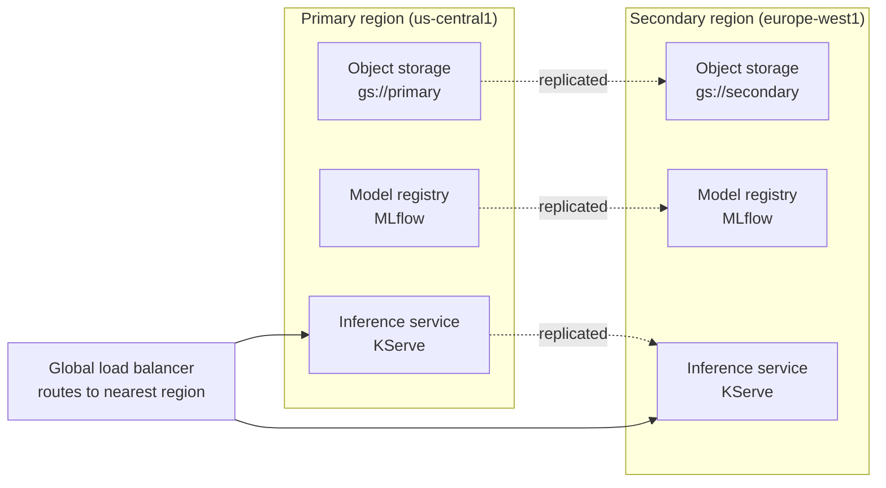

# 17.16 AI-assisted operations and scaling toward very large clusters

| Field | Value |
|---|---|
| Level | Advanced |
| Priority tier | 2 |
| Lab venue | GCP / GKE |
| Part | Part 17: Observability, performance and operations |
| Primary sources | *AI Systems Performance Engineering* (`ai-systems-performance-engineering`, Chapter 20); *Distributed AI Systems* (`distributed-ai-systems`, Chapter 11); *LLMOps* (`llmops`, Chapter 10); NVIDIA Zero-to-Hero Volume 8 (`chapter-03-ai-assisted-operations.md`) |
| Cross-references | Chapter 17.6 (Alerting and SLOs); Chapter 17.7 (Failure modes); Chapter 17.13 (Reliability engineering); Chapter 17.9 (LLM evaluation); Chapter 11.16 (KAI gang scheduling) |
| Coverage file | `planning/coverage/chapters/17-16.md` |
| Claim & number ledger | `planning/ledgers/17-16.md` |

## Why this matters for AI infrastructure

Every chapter in Part 17 has been about operating the cluster the platform team has today. This chapter is about operating the cluster the platform team will have tomorrow. The cluster is growing; the cluster is becoming harder to operate by hand; the on-call engineer is being asked to do more with the same headcount. The answer is AI-assisted operations.

AI-assisted operations is the discipline that uses AI to do what humans cannot do at scale: detect anomalies across millions of metrics; generate runbooks from incident transcripts; find the root cause across thousands of spans; predict capacity needs across thousands of workloads. An AI factory without AI-assisted operations is an AI factory that scales linearly with the number of humans. An AI factory with AI-assisted operations is an AI factory that scales logarithmically with the number of humans.

```text
Why AI-assisted operations is on the critical path (ASP Ch 20; DAI Ch 11; LLO Ch 10; V8 ch3):
- A typical mature AI platform emits millions of unique time series. The human
  on-call cannot inspect every series; the human on-call cannot find the
  needle in the haystack. AI-assisted anomaly detection is the only way
  to scale.
- A typical incident produces thousands of log lines and hundreds of spans.
  The human on-call cannot read every line; the human on-call cannot trace
  every span. AI-assisted root cause analysis is the only way to scale.
- A typical mature AI platform supports thousands of workloads. The human
  on-call cannot write a runbook for every workload. LLM-based runbook
  generation is the only way to scale.
```

Three operational realities make this chapter a platform-team concern rather than a data-science-only concern:

1. **The AI infrastructure is the substrate for AI-assisted operations.** The metrics, logs, and traces from earlier chapters are the inputs to the AI-assisted operations. The platform team owns the data; the platform team owns the AI-assisted operations.
2. **The AI-assisted operations is a platform-team discipline.** The discipline is: detect anomalies; generate runbooks; find root causes; predict capacity needs. The platform team owns the discipline; the platform team owns the tooling.
3. **The scaling toward very large clusters is a platform-team challenge.** The patterns from Chapter 11 (gang scheduling, Kueue, MIG) scale to thousands of GPUs; the patterns beyond Chapter 11 (multi-cluster, multi-region, multi-tenant) are what this chapter covers.

**Before a team can operate a cluster with thousands of GPUs, the team must have AI-assisted operations. A team that operates by hand at the thousand-GPU scale burns out the on-call. AI-assisted operations is what makes the scale survivable.**

## Prerequisites and outcomes

### Prerequisites

- Chapter 17.6 (Alerting and SLOs) for the metrics stack.
- Chapter 17.7 (Failure modes) for the failure mode catalogue.
- Chapter 17.13 (Reliability engineering) for the SLO discipline.
- Chapter 17.9 (LLM evaluation and guardrails) for the LLM-as-judge pattern.
- Chapter 11.16 (KAI gang scheduling) for the multi-GPU patterns.

### Outcomes

After completing this chapter you will be able to:

1. Implement AI-assisted anomaly detection: the model, the training, the deployment.
2. Implement LLM-based runbook generation: the prompt, the context, the validation.
3. Implement AI-assisted root cause analysis: the trace correlation, the log analysis, the candidate hypotheses.
4. Build the capacity prediction model: the historical data, the forecast, the buffer.
5. Operate the AI-assisted operations on GKE with the patterns for scaling to thousands of GPUs.

---

## 1. AI-assisted anomaly detection

### 1.1 The pattern

*AI Systems Performance Engineering* Chapter 20 introduces AI-assisted anomaly detection. The pattern is: train a model on the historical metrics; the model predicts the expected value; the alert fires when the actual value deviates from the prediction.

```mermaid
flowchart LR
    H[Historical metrics<br/>Prometheus]
    M[Anomaly detection model<br/>trained on history]
    L[Live metrics<br/>Prometheus]
    P[Predicted value<br/>from model]
    A[Actual value<br/>from live metrics]
    D[Deviation score<br/>|actual - predicted|]
    Alert[Alert<br/>deviation > threshold]

    H --> M
    M --> P
    L --> A
    P --> D
    A --> D
    D --> Alert
```

The pattern is: train the model on history; predict the expected value; compare the actual value; fire the alert when the deviation is significant. The model is retrained daily; the model is evaluated against the actual anomalies.

### 1.2 The implementation

The implementation uses a time-series anomaly detection model. The common choices are: Prophet (Facebook), ARIMA, LSTM autoencoder, transformer-based models.

| Model | Strength | Weakness |
|---|---|---|
| Prophet | Robust to missing data; handles seasonality | Less accurate for non-seasonal data |
| ARIMA | Statistical foundation; interpretable | Requires stationarity |
| LSTM autoencoder | Captures complex patterns | Requires more training data |
| Transformer | State-of-the-art accuracy | Requires significant compute |

The pattern is: start with Prophet; move to LSTM autoencoder when the volume justifies the compute; evaluate against the actual anomalies.

### 1.3 The deployment

The anomaly detection model is deployed as a service. The service reads the historical metrics from Prometheus; the service trains the model daily; the service exposes the anomaly score as a Prometheus metric.

```yaml
# code/part17/anomaly_detection.yaml (shape only)
apiVersion: apps/v1
kind: Deployment
metadata:
  name: anomaly-detection
spec:
  template:
    spec:
      containers:
        - name: anomaly-detection
          image: my-anomaly-detection:v1
          env:
            - name: PROMETHEUS_URL
              value: http://prometheus.monitoring:9090
            - name: MODEL_TRAINING_SCHEDULE
              value: "0 2 * * *"
```

The pattern is: the anomaly detection runs as a Kubernetes Deployment; the model is retrained daily; the anomaly score is exposed as a Prometheus metric.

---

## 2. LLM-based runbook generation

### 2.1 The pattern

*LLMOps* Chapter 10 introduces LLM-based runbook generation. The pattern is: the LLM reads the incident transcript; the LLM generates the runbook steps; the platform team reviews the runbook before publishing.

```python
# code/part17/runbook_generation.py (shape only)
import openai

def generate_runbook(incident_transcript: str, existing_runbooks: list[str]) -> str:
    prompt = f"""
You are an SRE generating a runbook for a new incident.

Existing runbooks for reference:
{chr(10).join(existing_runbooks)}

Incident transcript:
{incident_transcript}

Generate a runbook with the 6 sections:
1. What the alert means
2. Symptoms
3. Diagnostic steps
4. Mitigation steps
5. Escalation path
6. Post-mortem template
"""
    response = openai.Completion.create(
        model="gpt-4",
        prompt=prompt,
        max_tokens=2000,
    )
    return response.choices[0].text
```

The pattern is: the LLM reads the incident transcript; the LLM generates the runbook; the platform team reviews the runbook before publishing.

### 2.2 The validation

The generated runbook must be validated before publishing. The validation includes: the 6 sections are present; the mitigation steps are runnable; the escalation contacts are valid.

```python
# code/part17/runbook_validation.py (shape only)
import re

REQUIRED_SECTIONS = [
    "What the alert means",
    "Symptoms",
    "Diagnostic steps",
    "Mitigation steps",
    "Escalation path",
    "Post-mortem template",
]

def validate_runbook(runbook: str) -> tuple[bool, list[str]]:
    errors = []
    for section in REQUIRED_SECTIONS:
        if section not in runbook:
            errors.append(f"Missing section: {section}")
    if not re.search(r"\$\([^)]+\)", runbook):  # No command substitution
        errors.append("No runnable commands found")
    return len(errors) == 0, errors
```

The pattern is: the validation is automated; the validation catches the missing sections; the validation catches the non-runnable commands.

### 2.3 The human-in-the-loop

The LLM-generated runbook must be reviewed by the platform team before publishing. The human review ensures the runbook is accurate; the human review ensures the runbook is actionable.

```bash
# Generate the runbook
python code/part17/runbook_generation.py \
  --incident-id INC-2024-03-15-001 \
  --output runbook_draft.md

# Review the runbook
vim runbook_draft.md

# Publish the runbook
cp runbook_draft.md runbooks/gpu-memory-pressure.md
git add runbooks/gpu-memory-pressure.md
git commit -m "Add runbook for GPU memory pressure"
```

The pattern is: the LLM generates the draft; the human reviews the draft; the human publishes the runbook. The human-in-the-loop is the safety net.

---

## 3. AI-assisted root cause analysis

### 3.1 The pattern

*Distributed AI Systems* Chapter 11 introduces AI-assisted root cause analysis. The pattern is: the LLM reads the traces, logs, and metrics; the LLM generates candidate hypotheses; the on-call engineer reviews the hypotheses and selects the most likely.

```python
# code/part17/root_cause_analysis.py (shape only)
import openai

def analyze_root_cause(
    traces: list[dict],
    logs: list[str],
    metrics: dict,
    failure_mode_catalogue: list[str],
) -> list[dict]:
    prompt = f"""
You are an SRE analysing a production incident.

Failure mode catalogue:
{chr(10).join(failure_mode_catalogue)}

Traces:
{traces}

Logs:
{chr(10).join(logs[:100])}

Metrics:
{metrics}

Generate 3 candidate hypotheses for the root cause. For each hypothesis, provide:
- The hypothesis
- The supporting evidence
- The mitigation step
- The confidence score (1-5)
"""
    response = openai.Completion.create(
        model="gpt-4",
        prompt=prompt,
        max_tokens=2000,
    )
    return parse_hypotheses(response.choices[0].text)
```

The pattern is: the LLM reads the signals; the LLM generates hypotheses; the on-call reviews the hypotheses; the on-call selects the most likely.

### 3.2 The trace correlation

The AI-assisted root cause analysis starts with the trace correlation. The LLM identifies the slow operations; the LLM identifies the failed operations; the LLM identifies the dependent operations.

```python
# code/part17/trace_correlation.py (shape only)
def correlate_traces(traces: list[dict]) -> list[dict]:
    """Identify the slow operations across the traces."""
    slow_ops = []
    for trace in traces:
        for span in trace["spans"]:
            duration_ms = span["duration_ms"]
            if duration_ms > 1000:  # > 1 second
                slow_ops.append({
                    "trace_id": trace["trace_id"],
                    "span_id": span["span_id"],
                    "name": span["name"],
                    "duration_ms": duration_ms,
                })
    return slow_ops
```

The pattern is: the slow operations are identified; the failed operations are identified; the dependent operations are identified. The on-call reviews the list; the on-call focuses on the highest-priority operations.

### 3.3 The log analysis

The AI-assisted root cause analysis continues with the log analysis. The LLM identifies the error patterns; the LLM identifies the warning patterns; the LLM correlates the logs with the traces.

```python
# code/part17/log_analysis.py (shape only)
def analyze_logs(logs: list[str]) -> dict:
    """Identify error patterns in the logs."""
    patterns = {
        "errors": [],
        "warnings": [],
        "exceptions": [],
    }
    for log in logs:
        if "ERROR" in log:
            patterns["errors"].append(log)
        elif "WARN" in log:
            patterns["warnings"].append(log)
        elif "Traceback" in log:
            patterns["exceptions"].append(log)
    return patterns
```

The pattern is: the error patterns are identified; the warning patterns are identified; the exceptions are identified. The on-call reviews the patterns; the on-call focuses on the highest-priority patterns.

---

## 4. Capacity prediction

### 4.1 The forecasting model

The capacity prediction model forecasts the team's GPU needs. The model is: historical usage + growth rate + buffer + workload forecast = prediction.

```python
# code/part17/capacity_prediction.py (shape only)
import pandas as pd
from prophet import Prophet

def predict_capacity(historical_usage: pd.DataFrame, growth_periods: int = 90) -> pd.DataFrame:
    """Predict GPU capacity needs for the next growth_periods days."""
    model = Prophet(
        yearly_seasonality=True,
        weekly_seasonality=True,
        daily_seasonality=False,
    )
    model.fit(historical_usage)

    future = model.make_future_dataframe(periods=growth_periods)
    forecast = model.predict(future)

    return forecast[["ds", "yhat", "yhat_lower", "yhat_upper"]]
```

The pattern is: train the model on historical usage; forecast the future; add the buffer; output the procurement order.

### 4.2 The workload forecast

The workload forecast is the prediction of which workloads will grow. The forecast is based on the team's roadmap; the forecast is based on the team's customer commitments; the forecast is based on the historical growth rate.

```python
# code/part17/workload_forecast.py (shape only)
def forecast_workloads(workload_growth: dict, horizon_days: int = 90) -> dict:
    """Forecast the workload growth for the next horizon_days days."""
    forecast = {}
    for workload, growth_rate in workload_growth.items():
        forecast[workload] = {
            "current_gpus": workload_growth[workload]["current_gpus"],
            "projected_gpus": workload_growth[workload]["current_gpus"] * (1 + growth_rate) ** (horizon_days / 90),
            "growth_rate": growth_rate,
        }
    return forecast
```

The pattern is: the workload forecast is per workload; the forecast is the input to the capacity prediction; the forecast is reviewed quarterly.

### 4.3 The cost forecast

The cost forecast is the prediction of the GPU bill. The forecast is based on the workload forecast; the forecast is based on the GPU price; the forecast is based on the reserved-instance commitments.

```python
# code/part17/cost_forecast.py (shape only)
def forecast_cost(workload_forecast: dict, gpu_price: float) -> float:
    """Forecast the monthly GPU cost based on the workload forecast."""
    total_cost = 0
    for workload, forecast in workload_forecast.items():
        total_cost += forecast["projected_gpus"] * gpu_price * 24 * 30
    return total_cost
```

The pattern is: the cost forecast is per month; the forecast feeds the FinOps dashboard; the forecast is reviewed quarterly.

---

## 5. Scaling toward very large clusters

### 5.1 The scaling challenges

*Distributed AI Systems* Chapter 11 walks through the scaling challenges for AI clusters. The challenges are: multi-cluster scheduling, multi-region failover, multi-tenant isolation.

| Challenge | What it is | How the platform team addresses it |
|---|---|---|
| Multi-cluster scheduling | The cluster spans multiple Kubernetes clusters | Cluster API; KubeFed; Kueue multi-cluster |
| Multi-region failover | The cluster spans multiple regions | Multi-region object storage; multi-region registry |
| Multi-tenant isolation | The cluster serves multiple teams | Namespaces; RBAC; Kueue ClusterQueues; per-tenant quotas |

The pattern is: the platform team addresses each challenge with a specific tool; the tools compose into the multi-cluster, multi-region, multi-tenant platform.

### 5.2 Multi-cluster scheduling

Multi-cluster scheduling is the ability to schedule workloads across multiple Kubernetes clusters. The pattern is: Kueue ClusterQueue aggregates the GPU quota across clusters; the workloads are submitted to the queue; the workloads are scheduled on the cluster with available capacity.

```yaml
# code/part17/multi_cluster_queue.yaml (shape only)
apiVersion: kueue.x-k8s.io/v1beta1
kind: ClusterQueue
metadata:
  name: cluster-queue-multi-region
spec:
  cohort: multi-region
  flavorQuotas:
    - name: h100-sxm5-80gb-us-central1
      resources:
        - name: cpu
          nominalQuota: 800
        - name: memory
          nominalQuota: 4Ti
        - name: nvidia.com/gpu
          nominalQuota: 64
    - name: h100-sxm5-80gb-europe-west1
      resources:
        - name: cpu
          nominalQuota: 800
        - name: memory
          nominalQuota: 4Ti
        - name: nvidia.com/gpu
          nominalQuota: 64
```

The pattern is: the ClusterQueue aggregates the GPU quota across regions; the workloads are scheduled on the region with available capacity; the failover is automatic.

### 5.3 Multi-region failover

Multi-region failover is the ability to fail over from one region to another. The pattern is: the data is replicated across regions; the workloads are deployed in both regions; the failover is automatic on regional outage.



The pattern is: the data is replicated across regions; the workloads are deployed in both regions; the global load balancer routes to the nearest region; the failover is automatic.

### 5.4 Multi-tenant isolation at scale

Multi-tenant isolation at scale is the ability to serve thousands of teams from the same cluster. The pattern is: one namespace per team; one Kueue LocalQueue per team; one IAM role per team; one per-team quota.

```yaml
# code/part17/multi_tenant_isolation.yaml (shape only)
apiVersion: kueue.x-k8s.io/v1beta1
kind: LocalQueue
metadata:
  name: team-data-science-queue
  namespace: team-data-science
spec:
  clusterQueue: cluster-queue-standard
---
apiVersion: v1
kind: ResourceQuota
metadata:
  name: team-data-science-quota
  namespace: team-data-science
spec:
  hard:
    cpu: "200"
    memory: 1Ti
    nvidia.com/gpu: "4"
```

The pattern is: one namespace per team; one LocalQueue per team; one ResourceQuota per team; one IAM role per team. The platform team owns the templates; the teams consume the templates.

---

## 6. Operating AI-assisted operations on GKE

### 6.1 The components

| Component | Where it runs | Backing store | SLO |
|---|---|---|---|
| Anomaly detection model | Kubernetes Deployment | Object storage for model | Anomaly score p99 < 1 s |
| LLM-based runbook generator | Kubernetes Deployment | Object storage for runbooks | Generation latency p99 < 30 s |
| AI root cause analysis | Kubernetes Deployment | Object storage for analyses | Analysis latency p99 < 60 s |
| Capacity prediction model | Kubernetes Deployment (cron) | Object storage for forecasts | Forecast frequency daily |
| Multi-cluster queue | Kueue | (Kueue) | Queue admission p99 < 1 s |

### 6.2 IAM and the AI-assisted operations

The AI-assisted operations stack has its own IAM. The pattern is:

| Role | Who | What they can do |
|---|---|---|
| `aiops.reader` | Every team | Read the anomaly scores; read the capacity forecasts |
| `aiops.writer` | The platform team | Update the models; update the runbooks |
| `aiops.admin` | The platform team lead | Approve the AI-assisted operations |

The AI-assisted operations is the platform team's discipline. The discipline is documented; the discipline is enforced; the discipline is reviewed quarterly.

### 6.3 Observability

| Metric | Why it matters | Alert |
|---|---|---|
| Anomaly detection precision | Model quality | < 80% per week |
| Runbook generation success rate | Model quality | < 90% per week |
| Capacity forecast accuracy | Model quality | Error > 20% per month |
| Multi-cluster queue latency | Multi-cluster performance | > 5 s |
| Multi-region failover latency | Multi-region performance | > 1 hour |

The anomaly detection precision alert is the most important. A low precision means the model is firing too many false positives; a low precision means the on-call is ignoring the alerts.

---

## 7. How it fails

Six failure modes recur.

### 7.1 "The anomaly detection fires too many false positives"

**Symptom:** The anomaly detection fires on every minor variation; the on-call ignores the alerts; the real anomaly is missed.

**Diagnosis:** The anomaly detection model is too sensitive; the threshold is too low; the model is not trained on the production traffic.

**Fix:** Tune the model; raise the threshold; retrain the model on the production traffic; add a precision/recall evaluation.

### 7.2 "The LLM-generated runbook is not actionable"

**Symptom:** The LLM generates a runbook; the runbook has no runnable commands; the on-call cannot follow the runbook.

**Diagnosis:** The LLM prompt is too vague; the LLM is not given enough context; the validation is not catching the issue.

**Fix:** Improve the prompt; add more context; strengthen the validation; add a human-in-the-loop review.

### 7.3 "The AI-assisted root cause analysis is wrong"

**Symptom:** The AI-assisted root cause analysis generates a hypothesis; the hypothesis is wrong; the on-call wastes time on the wrong hypothesis.

**Diagnosis:** The AI-assisted root cause analysis is not given enough context; the model is not fine-tuned on the production traffic.

**Fix:** Add more context; fine-tune the model on the production traffic; add a confidence score; add a human-in-the-loop review.

### 7.4 "The capacity prediction is wrong"

**Symptom:** The capacity prediction says 100 GPUs; the actual usage is 200 GPUs; the team is under-provisioned.

**Diagnosis:** The historical data is wrong; the growth rate is wrong; the model is not capturing the workload forecast.

**Fix:** Verify the historical data; tune the growth rate; include the workload forecast in the model; review the prediction quarterly.

### 7.5 "The multi-cluster queue is unbalanced"

**Symptom:** The multi-cluster queue has 100 GPUs in region A and 0 GPUs in region B; the workloads are scheduled only in region A.

**Diagnosis:** The workload's affinity rule is pinned to region A; the cluster's resource availability is asymmetric.

**Fix:** Add a region-affinity weighting to the queue; balance the GPU quota across regions; add a fairness policy.

### 7.6 "The multi-region failover is slow"

**Symptom:** The regional outage happens; the failover takes 2 hours; the SLO is breached.

**Diagnosis:** The failover is not automated; the data replication is slow; the workload's startup is slow.

**Fix:** Automate the failover; increase the replication frequency; pre-warm the workloads in the secondary region.

---

## 8. Hands-on lab

This lab walks through AI-assisted anomaly detection, LLM-based runbook generation, AI-assisted root cause analysis, and capacity prediction. The lab is **untested** in this repository.

### 8.1 Prerequisites

- The observability stack from earlier chapters.
- An LLM API key (OpenAI, Anthropic, or local model).
- The observability stack's data in Prometheus.

### 8.2 Step 1: deploy the anomaly detection model

```bash
helm install anomaly-detection my-charts/anomaly-detection \
  --namespace monitoring \
  --set prometheus.url=http://prometheus.monitoring:9090
# expected: the anomaly detection model is deployed; the anomaly scores are exposed
```

### 8.3 Step 2: query the anomaly scores

```bash
curl -s 'http://prometheus.monitoring:9090/api/v1/query?query=anomaly_score{gpu="0"}' | jq .
# expected: the anomaly score for GPU 0
```

### 8.4 Step 3: generate a runbook with the LLM

```bash
python code/part17/runbook_generation.py \
  --incident-id INC-2024-03-15-001 \
  --output runbook_draft.md
# expected: the runbook draft is generated
```

### 8.5 Step 4: review the runbook

```bash
# Open the runbook draft
vim runbook_draft.md

# Publish the runbook
cp runbook_draft.md runbooks/gpu-memory-pressure.md
git add runbooks/gpu-memory-pressure.md
git commit -m "Add runbook for GPU memory pressure"
```

### 8.6 Step 5: run the AI-assisted root cause analysis

```bash
python code/part17/root_cause_analysis.py \
  --incident-id INC-2024-03-15-001 \
  --output root_cause_analysis.md
# expected: 3 candidate hypotheses for the root cause
```

### 8.7 Step 6: run the capacity prediction

```bash
python code/part17/capacity_prediction.py \
  --cluster gke-prod-us-central1 \
  --output capacity_forecast.md
# expected: the Q+1 GPU forecast
```

### 8.8 What to record

After the lab, you should be able to answer five questions in five seconds each:

1. What is the current anomaly detection precision?
2. What is the most recent LLM-generated runbook?
3. What was the most recent AI-assisted root cause analysis?
4. What is the Q+1 GPU forecast per the capacity prediction?
5. What is the current multi-cluster queue latency?

If any takes more than 30 seconds, the AI-assisted operations stack is not yet a production service. The lab is **untested** against a live GKE cluster.

---

## Exercises

1. **Add an anomaly detection model.** Train a Prophet model on the historical GPU metrics; deploy the model as a Kubernetes Deployment. *Solution sketch:* the Python script in Section 1.2; the Kubernetes Deployment in Section 1.3.
2. **Add an LLM-based runbook generator.** Build a script that takes an incident transcript and generates a runbook with the 6 sections. *Solution sketch:* the Python script in Section 2.1; the validation in Section 2.2.
3. **Add an AI-assisted root cause analysis.** Build a script that takes the traces, logs, and metrics and generates 3 candidate hypotheses. *Solution sketch:* the Python script in Section 3.1; the trace correlation in Section 3.2.
4. **Add a capacity prediction model.** Train a Prophet model on the historical GPU usage; forecast the next quarter's GPU needs. *Solution sketch:* the Python script in Section 4.1; the forecast script in Section 4.2.
5. **Add a multi-cluster queue.** Configure Kueue to aggregate the GPU quota across two clusters. *Solution sketch:* the ClusterQueue in Section 5.2; the LocalQueue per team.
6. **Add a multi-region failover drill.** Schedule a quarterly drill that tests the multi-region failover. *Solution sketch:* the Chaos Mesh experiment that cordoning all nodes in the primary region; the drill measures the failover latency.

---

## Checkpoint questions

<details><summary>1. What is AI-assisted anomaly detection?</summary>
A pattern that uses an ML model to detect anomalies in metrics. The model is trained on the historical metrics; the model predicts the expected value; the alert fires when the actual value deviates from the prediction. The model is retrained daily; the model is evaluated against the actual anomalies.
</details>

<details><summary>2. What is LLM-based runbook generation?</summary>
A pattern that uses an LLM to generate a runbook from an incident transcript. The LLM reads the incident transcript; the LLM generates the runbook with the 6 sections; the platform team reviews the runbook before publishing. The human-in-the-loop is the safety net.
</details>

<details><summary>3. What is AI-assisted root cause analysis?</summary>
A pattern that uses an LLM to generate candidate hypotheses for the root cause of an incident. The LLM reads the traces, logs, and metrics; the LLM generates 3 candidate hypotheses; the on-call reviews the hypotheses and selects the most likely.
</details>

<details><summary>4. What is capacity prediction?</summary>
A pattern that forecasts the team's GPU needs for the next quarter. The model is trained on the historical usage; the model predicts the expected usage; the buffer is added; the procurement order is the output. The model is retrained daily; the forecast is reviewed quarterly.
</details>

<details><summary>5. What are the scaling challenges for very large clusters?</summary>
Multi-cluster scheduling (the cluster spans multiple Kubernetes clusters), multi-region failover (the cluster spans multiple regions), multi-tenant isolation (the cluster serves multiple teams). The platform team addresses each challenge with a specific tool; the tools compose into the multi-cluster, multi-region, multi-tenant platform.
</details>

<details><summary>6. What is the most common AI-assisted operations failure?</summary>
The anomaly detection fires too many false positives. The model is too sensitive; the threshold is too low; the model is not trained on the production traffic. The fix is to tune the model; raise the threshold; retrain the model on the production traffic.
</details>

<details><summary>7. What is the most common LLM-based runbook generation failure?</summary>
The LLM-generated runbook is not actionable. The LLM prompt is too vague; the LLM is not given enough context; the validation is not catching the issue. The fix is to improve the prompt; add more context; strengthen the validation; add a human-in-the-loop review.
</details>

<details><summary>8. What is the most common AI-assisted root cause analysis failure?</summary>
The AI-assisted root cause analysis is wrong. The analysis is not given enough context; the model is not fine-tuned on the production traffic. The fix is to add more context; fine-tune the model; add a confidence score; add a human-in-the-loop review.
</details>

<details><summary>9. What is the most common capacity prediction failure?</summary>
The capacity prediction is wrong. The historical data is wrong; the growth rate is wrong; the model is not capturing the workload forecast. The fix is to verify the historical data; tune the growth rate; include the workload forecast in the model.
</details>

<details><summary>10. What is the most common multi-cluster queue failure?</summary>
The multi-cluster queue is unbalanced. The workload's affinity rule is pinned to one region; the cluster's resource availability is asymmetric. The fix is to add a region-affinity weighting to the queue; balance the GPU quota across regions.
</details>

<details><summary>11. What is the most common multi-region failover failure?</summary>
The multi-region failover is slow. The failover is not automated; the data replication is slow; the workload's startup is slow. The fix is to automate the failover; increase the replication frequency; pre-warm the workloads in the secondary region.
</details>

<details><summary>12. What is the relationship between AI-assisted anomaly detection and the alert routing?</summary>
AI-assisted anomaly detection is the input to the alert routing. The anomaly detection fires when the actual value deviates from the prediction; the alert is routed to the on-call. The alert routing is the mechanism that turns the anomaly detection into a page.
</details>

<details><summary>13. What is the relationship between LLM-based runbook generation and the on-call rotation?</summary>
The LLM-based runbook generation produces the runbook; the on-call rotation consumes the runbook. The LLM is the producer; the on-call is the consumer. The human-in-the-loop review is the bridge between the producer and the consumer.
</details>

<details><summary>14. What is the relationship between AI-assisted root cause analysis and the post-mortem?</summary>
The AI-assisted root cause analysis produces the candidate hypotheses; the post-mortem is the team's learning document after the incident. The AI-assisted root cause analysis is the input; the post-mortem is the output. The human review is the bridge between the input and the output.
</details>

<details><summary>15. What is the relationship between capacity prediction and the FinOps dashboard?</summary>
The capacity prediction is the forward-looking view (how many GPUs will the team need); the FinOps dashboard is the backward-looking view (how much the team spent). The capacity prediction is the forecast; the FinOps dashboard is the actual.
</details>

<details><summary>16. What is the human-in-the-loop pattern?</summary>
A pattern that combines AI automation with human review. The AI generates the draft; the human reviews the draft; the human publishes the draft. The AI does the bulk of the work; the human does the quality control. The pattern is what makes the AI safe to use.
</details>

<details><summary>17. What is the most important AI-assisted operations metric?</summary>
The anomaly detection precision. The metric tells the team whether the model is accurate; the metric tells the team whether the model is useful. A low precision means the model is firing too many false positives; a low precision means the on-call is ignoring the alerts.
</details>

<details><summary>18. Why is AI-assisted operations a Tier 2 chapter?</summary>
Because AI-assisted operations is what makes the scale survivable. The chapter is what the platform team owns; the chapter is what the on-call consumes; the chapter is what the customer experiences during an incident. A team that does not have AI-assisted operations is a team that burns out the on-call at the thousand-GPU scale.
</details>

<details><summary>19. What is the difference between AI-assisted operations and AIOps?</summary>
AI-assisted operations is the broader discipline that includes anomaly detection, runbook generation, root cause analysis, and capacity prediction. AIOps is a vendor term that often refers specifically to anomaly detection and alerting. AI-assisted operations is the umbrella; AIOps is one tool.
</details>

<details><summary>20. What five questions should the AI-assisted operations lab let you answer in five seconds each?</summary>
What is the current anomaly detection precision. What is the most recent LLM-generated runbook. What was the most recent AI-assisted root cause analysis. What is the Q+1 GPU forecast per the capacity prediction. What is the current multi-cluster queue latency. If any takes more than 30 seconds, the AI-assisted operations stack is not yet a production service.
</details>

---

## Sources and review notes

- *AI Systems Performance Engineering* (`ai-systems-performance-engineering`, Chapter 20). Source for the AI-assisted operations patterns, the anomaly detection models, and the capacity prediction models. The wording has been rewritten in the handbook's voice.
- *Distributed AI Systems* (`distributed-ai-systems`, Chapter 11). Source for the scaling patterns and the multi-cluster, multi-region patterns.
- *LLMOps* (`llmops`, Chapter 10). Source for the LLM-based operations patterns.
- NVIDIA Zero-to-Hero Volume 8 (`chapter-03-ai-assisted-operations.md`). Source for the AI-assisted operations patterns.

### Cross-references to other handbook chapters

- Chapter 17.6 for the alerting and SLOs.
- Chapter 17.7 for the failure modes.
- Chapter 17.13 for the reliability engineering.
- Chapter 17.9 for the LLM evaluation.
- Chapter 11.16 for the KAI gang scheduling.

### Migrated from `nvidia-devops`

The AI-assisted operations operational patterns draw on Volume 8 chapter 3 and the gem book corpora. The wording has been rewritten in the handbook's voice.

### Explicitly labelled inferences

- The anomaly detection model choices (Prophet, ARIMA, LSTM, transformer) are starting points; specific models depend on the workload.
- The LLM-based runbook generation pattern is a starting point; specific prompts depend on the team's runbook format.
- The capacity prediction buffer is a starting point; specific buffers depend on the workload's spike pattern.

### Not verified on live hardware

- The lab in Section 8 is **untested** against a live GKE cluster in this repository.
- The LLM API key in the lab is a placeholder; production keys are rotated quarterly.
- The Prophet model in the lab assumes the historical data is available; production deployments may need additional data engineering.
