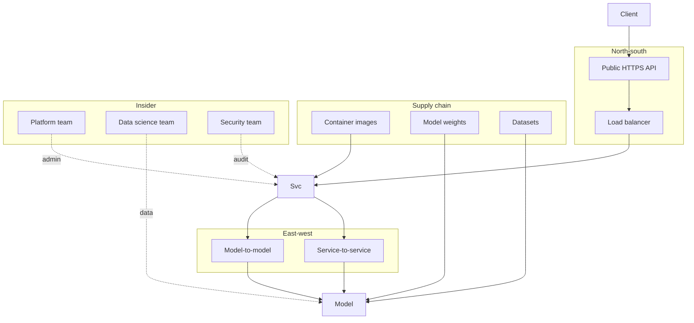

# 18.1 Threat modeling for AI infrastructure

| Field | Value |
|---|---|
| Level | Intermediate |
| Priority tier | 2 |
| Lab venue | GCP / GKE |
| Part | Part 18: Security |
| Primary sources | NVIDIA Zero-to-Hero Volume 18 (`chapter-01-threat-modeling.md`); NVIDIA Zero-to-Hero Volume 8 (`chapter-03-platform-security-and-trust.md`); *Engineering AI Systems* (`engineering-ai-systems-architecture-and-devops-essentials`, Chapter 9) |
| Cross-references | Chapter 16.13 (Governance, privacy, compliance); Chapter 11 (GPU Kubernetes); Chapter 5 (Kubernetes); Chapter 18.2-18.7 (other security chapters) |
| Coverage file | `planning/coverage/chapters/18-01.md` |
| Claim & number ledger | `planning/ledgers/18-01.md` |

## Why this matters for AI infrastructure

Every other chapter in this part starts from a known threat. This chapter is the discipline that produces the list of known threats. Without threat modeling, the security controls are guesswork; with threat modeling, the security controls are evidence-driven. The threat model is what the auditor sees; the threat model is what the regulator references; the threat model is what the on-call engineer uses when the alert fires.

An AI factory without a threat model is an AI factory that has controls but cannot explain why. An AI factory with a threat model is an AI factory that has controls and the evidence that the controls address the actual threats. The threat model is the difference between "we have a firewall" and "we have a firewall that addresses threats T1 through T7".

```text
Why threat modeling is on the critical path (V18 ch1; V8 ch3; EAS Ch 9):
- A typical mature AI platform has 30-100 distinct threats. The threats range
  from model theft (an attacker exfiltrates model weights) to prompt injection
  (a user crafts input that bypasses the safety guardrails) to training data
  poisoning (an attacker inserts bad examples into the training set).
- The threat model is the foundation of the security controls. Every control
  in Chapter 18.2-18.7 is justified by a threat in the threat model.
- The threat model is updated quarterly. New threats appear (new CVE; new
  research; new attack pattern); old threats retire (control closed the gap).
  The threat model is the living artefact.
```

Three operational realities make this chapter a platform-team concern rather than a data-science-only concern:

1. **The threat model is a platform-team deliverable.** The platform team owns the threat catalogue; the platform team owns the risk matrix; the platform team owns the mitigation status. The data scientist consumes the threat model; the platform team produces it.
2. **The threat model drives the security controls.** Every control in 18.2-18.7 is justified by a threat. Without a threat model, the controls are not auditable; with a threat model, the controls are auditable.
3. **The threat model is updated quarterly.** New threats appear (new CVEs, new research, new attack patterns); old threats retire (controls closed the gap). The threat model is the living artefact; the threat model is reviewed by the platform team.

**Before a team can claim their AI factory is secure, the team must have a threat model. A threat model is the team's commitment to knowing what they are defending against. A team without a threat model has controls; a team with a threat model has controls that match the threats.**

## Prerequisites and outcomes

### Prerequisites

- Chapter 16.13 (Governance, privacy, compliance) for the regulatory context.
- Chapter 11 (GPU Kubernetes) for the cluster topology.
- Chapter 5 (Kubernetes) for the cluster primitives.
- Familiarity with the STRIDE methodology.

### Outcomes

After completing this chapter you will be able to:

1. Apply the STRIDE methodology to an AI infrastructure: the Spoofing, Tampering, Repudiation, Information Disclosure, Denial of Service, and Elevation of Privilege threats.
2. Build the asset inventory: the models, the weights, the datasets, the keys, the audit logs, the credentials, the GPUs.
3. Map the attack surface: the north-south traffic, the east-west traffic, the supply chain, the insider.
4. Build the threat catalogue: the model theft, the weight exfiltration, the prompt injection, the training data poisoning, the denial of service, the privilege escalation.
5. Build the risk matrix: the likelihood and the impact for each threat; the mitigation status for each threat.
6. Operate the threat model on GKE with quarterly reviews, automated updates, and evidence-driven controls.

---

## 1. The STRIDE methodology

### 1.1 STRIDE adapted for AI infrastructure

*Engineering AI Systems* Chapter 9 introduces STRIDE. STRIDE is the canonical threat-modeling methodology; STRIDE names six threat categories: Spoofing, Tampering, Repudiation, Information Disclosure, Denial of Service, and Elevation of Privilege. AI infrastructure extends each category with AI-specific threats.

| Category | Generic threat | AI-specific threat |
|---|---|---|
| **Spoofing** | An attacker impersonates a user or a service | An attacker spoofs a model's identity (e.g. claims to be a specific fine-tune) |
| **Tampering** | An attacker modifies data or code | An attacker poisons the training data (inserts bad examples into the training set) |
| **Repudiation** | An attacker denies an action | An attacker denies a model prediction (no audit trail) |
| **Information Disclosure** | An attacker reads data they should not | An attacker exfiltrates model weights (the IP of the model) |
| **Denial of Service** | An attacker makes the service unavailable | An attacker exhausts the GPU pool (denial of service to other workloads) |
| **Elevation of Privilege** | An attacker gains more access than they should | An attacker escalates from a tenant namespace to the cluster admin |

The pattern is: every threat is a STRIDE category plus an AI-specific variant. The team walks through STRIDE; the team identifies the AI-specific variant for each category.

### 1.2 The threat-model workshop

The threat model is produced in a workshop. The workshop has participants from the platform team, the security team, the data science team, the compliance team. The workshop has a scope (which system is being modelled); the workshop has a duration (half a day); the workshop has a deliverable (the threat catalogue).

```text
Threat-model workshop:
- Participants: platform team, security team, data science team, compliance team
- Scope: AI inference platform (the InferenceService, the model registry, the feature store)
- Duration: half a day
- Deliverable: the threat catalogue (50-100 threats), the risk matrix (likelihood × impact), the mitigation status
```

The pattern is: the workshop is half a day; the workshop has a scope; the workshop has a deliverable. The deliverable is the threat model.

### 1.3 The threat model document

The threat model document is the deliverable of the workshop. The document is version-controlled; the document is reviewed quarterly; the document is the audit trail.

```markdown
# Threat Model: AI Inference Platform

## Scope
The AI inference platform: the InferenceService, the model registry, the feature store, the GPU pool.

## Asset Inventory
- Models: 10 production models; 5 fine-tunes; 20 experiments
- Weights: 10 production model weights; 5 fine-tune weights; 100 GB
- Datasets: 50 production datasets; 1 TB
- Keys: API keys, model signing keys, encryption keys
- Audit logs: 100 GB/day; 7-year retention
- GPUs: 32 H100s; 16 A100s; 8 L40Ss
- Credentials: 200 service accounts; 100 IAM roles

## Attack Surface
- North-south: public HTTPS API for inference
- East-west: model-to-model traffic; service-to-service traffic
- Supply chain: container images; model weights; datasets
- Insider: platform team; data science team; security team

## Threat Catalogue
(Snip of 50-100 threats; see the threat catalogue in the platform repo)

## Risk Matrix
(Snip of likelihood × impact for each threat)

## Mitigation Status
(Snip of which threats are mitigated; which are accepted; which are in progress)
```

The pattern is: the document has a scope; the document has an asset inventory; the document has an attack surface; the document has a threat catalogue; the document has a risk matrix; the document has a mitigation status.

---

## 2. The asset inventory

### 2.1 What is in the asset inventory

The asset inventory is the list of things that have value and must be protected. The asset inventory is the foundation of the threat model.

| Asset category | Examples | Why it matters |
|---|---|---|
| **Models** | Production models; fine-tunes; experiments | The IP of the platform |
| **Weights** | Production model weights; fine-tune weights; checkpoints | The training result |
| **Datasets** | Training data; evaluation data; production data | The input to the training |
| **Keys** | API keys; model signing keys; encryption keys; GPU attestation keys | The authentication |
| **Audit logs** | Inference logs; training logs; access logs; audit logs | The compliance evidence |
| **GPUs** | GPU nodes; GPU memory; GPU bandwidth | The compute |
| **Credentials** | Service accounts; IAM roles; Kubernetes secrets; database credentials | The access |

The pattern is: every asset has a value; every asset has a threat; every asset has a control. The asset inventory is the foundation.

### 2.2 The asset value

The asset value is the cost of compromise. The asset value is the dollar cost of the loss; the asset value is the reputational cost of the disclosure; the asset value is the regulatory cost of the breach.

```text
Asset value formula:
- Models: training cost + competitive advantage cost
- Weights: training cost (often $100k-$1M for foundation models)
- Datasets: collection cost + cleaning cost + privacy cost (often $10k-$1M)
- Keys: cost of credential rotation + cost of impersonation
- Audit logs: cost of reconstruction + cost of regulatory non-compliance
- GPUs: replacement cost ($3-5k per H100)
- Credentials: cost of credential rotation + cost of unauthorized access
```

The pattern is: every asset has a value; the value is the cost of compromise; the value drives the priority of the threat.

### 2.3 The asset owner

The asset owner is the team or person responsible for the asset. The asset owner is the one who is paged when the asset is compromised; the asset owner is the one who authorises the access; the asset owner is the one who is accountable for the asset's security.

| Asset category | Asset owner |
|---|---|
| Models | Data science team |
| Weights | ML platform team |
| Datasets | Data engineering team |
| Keys | Security team |
| Audit logs | Compliance team |
| GPUs | Infrastructure team |
| Credentials | Security team |

The pattern is: every asset has an owner; the owner is accountable; the owner is paged.

---

## 3. The attack surface

### 3.1 The four attack surfaces

An AI infrastructure has four attack surfaces: north-south, east-west, supply chain, and insider. Each surface has different threats; each surface has different controls.



The four surfaces are: north-south (the public API), east-west (the internal traffic), supply chain (the artifacts), and insider (the team members).

### 3.2 The north-south attack surface

The north-south attack surface is the public-facing API. The threats are: DDoS, API abuse, prompt injection, authentication bypass, rate limit bypass.

| Threat | Mitigation |
|---|---|
| DDoS | Cloud Armor; rate limiting; WAF |
| API abuse | API key rotation; rate limiting; quota |
| Prompt injection | Input validation; guardrails; LLM-as-judge (Chapter 16.9) |
| Authentication bypass | OAuth 2.1; mTLS; service mesh |
| Rate limit bypass | Per-key rate limiting; per-tenant rate limiting |

The pattern is: every north-south threat has a mitigation; the mitigation is documented; the mitigation is tested.

### 3.3 The east-west attack surface

The east-west attack surface is the internal traffic between services. The threats are: lateral movement, man-in-the-middle, service impersonation, container escape.

| Threat | Mitigation |
|---|---|
| Lateral movement | NetworkPolicy; mTLS; service mesh |
| Man-in-the-middle | mTLS; certificate pinning |
| Service impersonation | ServiceAccount; Workload Identity; SPIFFE |
| Container escape | Pod Security Standards; seccomp; AppArmor |

The pattern is: every east-west threat has a mitigation; the mitigation is enforced by the cluster primitives.

### 3.4 The supply chain attack surface

The supply chain attack surface is the artifacts: container images, model weights, datasets. The threats are: image poisoning, model backdoor, dataset poisoning, dependency confusion.

| Threat | Mitigation |
|---|---|
| Image poisoning | cosign signing; admission controller; Trivy scan |
| Model backdoor | Model signing; eval suite; adversarial testing |
| Dataset poisoning | DVC content hash; provenance tracking; outlier detection |
| Dependency confusion | SBOM; dependency pinning; supply chain security |

The pattern is: every supply chain threat has a mitigation; the mitigation is enforced by the build pipeline.

### 3.5 The insider attack surface

The insider attack surface is the team members. The threats are: data exfiltration, privilege abuse, credential theft, model theft by employee.

| Threat | Mitigation |
|---|---|
| Data exfiltration | DLP; egress filtering; audit log review |
| Privilege abuse | Just-in-time access; break-glass admin; audit log |
| Credential theft | MFA; short-lived credentials; Workload Identity |
| Model theft by employee | Watermarking; access logging; NDAs |

The pattern is: every insider threat has a mitigation; the mitigation is enforced by IAM and audit.

---

## 4. The threat catalogue

### 4.1 The threat template

The threat catalogue is the structured list of threats. Every threat has the same fields.

```markdown
## Threat: T-001 Model weight exfiltration

**STRIDE category:** Information Disclosure
**Asset:** Model weights (production model weights; fine-tune weights)
**Attack surface:** Supply chain
**Description:** An attacker with access to the model registry exfiltrates the model weights to a competitor.

**Likelihood:** Medium (3)
**Impact:** High (5) — competitive advantage loss; regulatory implications
**Risk score:** 15 (likelihood × impact)

**Mitigation:**
- Model registry access controlled by IAM (Chapter 5.26)
- Model weights encrypted at rest (Chapter 13)
- Model signing (cosign; Chapter 18.3)
- Watermarking (Chapter 18.7)

**Mitigation status:** Mitigated
**Residual risk:** Low (2)
**Owner:** ML platform team
**Last reviewed:** 2024-03-15
```

The pattern is: every threat has the same fields; the fields are searchable; the fields are auditable.

### 4.2 The top threats for AI infrastructure

The threat catalogue for an AI factory typically includes the following high-priority threats.

| ID | Threat | STRIDE | Likelihood × Impact |
|---|---|---|---|
| T-001 | Model weight exfiltration | Information Disclosure | 3 × 5 |
| T-002 | Training data poisoning | Tampering | 4 × 5 |
| T-003 | Prompt injection | Tampering | 4 × 4 |
| T-004 | Model backdoor | Tampering | 2 × 5 |
| T-005 | Container image supply chain attack | Tampering | 3 × 5 |
| T-006 | GPU memory scraping (cross-tenant) | Information Disclosure | 3 × 4 |
| T-007 | Inference API DDoS | Denial of Service | 4 × 4 |
| T-008 | Model version rollback attack | Tampering | 2 × 4 |
| T-009 | Audit log tampering | Repudiation | 2 × 5 |
| T-010 | Credential theft (service account) | Spoofing | 3 × 5 |

The pattern is: the threat catalogue has the top 10-20 threats; each threat has the standard fields; each threat is tracked.

### 4.3 The threat catalogue maintenance

The threat catalogue is maintained as a living artefact. The maintenance includes: adding new threats, retiring old threats, updating likelihood and impact, updating mitigation status.

```bash
# Update the threat catalogue
python code/part18/threat_catalogue_update.py \
  --threat-id T-001 \
  --new-mitigation "Add watermark detection to the inference API"
# expected: the threat catalogue is updated; the audit log is updated; the change is reviewed
```

The pattern is: the threat catalogue is a version-controlled document (in Git); the threat catalogue is updated via a script; the update is reviewed.

---

## 5. The risk matrix

### 5.1 The likelihood-impact grid

The risk matrix is the grid that maps the likelihood to the impact. The grid is the decision tool for prioritising the threats.

| | Impact 1 (Low) | Impact 2 | Impact 3 | Impact 4 | Impact 5 (High) |
|---|---|---|---|---|---|
| **Likelihood 5 (Very High)** | 5 | 10 | 15 | 20 | 25 |
| **Likelihood 4 (High)** | 4 | 8 | 12 | 16 | 20 |
| **Likelihood 3 (Medium)** | 3 | 6 | 9 | 12 | 15 |
| **Likelihood 2 (Low)** | 2 | 4 | 6 | 8 | 10 |
| **Likelihood 1 (Very Low)** | 1 | 2 | 3 | 4 | 5 |

The pattern is: the risk score is likelihood × impact; the risk score drives the priority; the risk score drives the budget.

### 5.2 The risk-driven priority

The risk-driven priority is the order in which the team mitigates the threats. The priority is driven by the risk score.

| Risk score | Priority | Mitigation timeline |
|---|---|---|
| 20-25 | Critical | Immediate (within 1 week) |
| 15-19 | High | Within 1 month |
| 10-14 | Medium | Within 1 quarter |
| 5-9 | Low | Within 1 year |
| 1-4 | Very Low | Accept the risk |

The pattern is: the risk score drives the priority; the priority drives the timeline; the timeline drives the sprint planning.

### 5.3 The risk-driven budget

The risk-driven budget is the money the team spends on the security controls. The budget is driven by the risk score.

```text
Security budget formula:
- Critical threats (20-25): $100k+ per threat for immediate mitigation
- High threats (15-19): $10-100k per threat for monthly mitigation
- Medium threats (10-14): $1-10k per threat for quarterly mitigation
- Low threats (5-9): < $1k per threat for annual mitigation
- Very low threats (1-4): $0 (accept the risk)
```

The pattern is: the risk score drives the budget; the budget is auditable; the budget is approved by the CFO.

---

## 6. Operating threat modeling on GKE

### 6.1 The components

| Component | Where it runs | Backing store | SLO |
|---|---|---|---|
| Threat catalogue | Git repo | Git history | Catalogue freshness < 90 days |
| Risk matrix | Git repo | Git history | Risk matrix reviewed quarterly |
| Threat model workshop | (human) | (meeting notes) | Workshop held quarterly |
| Audit log | Object storage | Object storage | Audit log retention 7 years |

### 6.2 IAM and the threat model

The threat model has its own IAM. The pattern is:

| Role | Who | What they can do |
|---|---|---|
| `threatmodel.reader` | Every team | Read the threat catalogue; read the risk matrix |
| `threatmodel.writer` | The security team; the platform team | Update the threat catalogue; update the risk matrix |
| `threatmodel.admin` | The CISO's office | Approve the threat model; approve the risk acceptance |

The threat model is the security team's discipline. The discipline is documented; the discipline is enforced; the discipline is reviewed quarterly.

### 6.3 Observability

| Metric | Why it matters | Alert |
|---|---|---|
| Threat catalogue freshness | Threat model currency | > 90 days stale |
| Top-10 threat mitigation status | Risk posture | Any unmitigated |
| Risk-driven budget utilisation | Budget discipline | > 120% per quarter |
| Quarterly workshop completion | Process compliance | > 1 quarter since last workshop |

The top-10 threat mitigation status is the most important metric. Any unmitigated top-10 threat is a security incident waiting to happen.

---

## 7. How it fails

Six failure modes recur.

### 7.1 "The threat model is out of date"

**Symptom:** A new CVE is published; the threat model does not include the CVE; the team does not know the CVE applies.

**Diagnosis:** The threat model is not updated quarterly; the team is not monitoring CVE feeds.

**Fix:** Schedule the quarterly workshop; automate the CVE monitoring; add new threats from the CVE feed to the catalogue.

### 7.2 "The threat model is too generic"

**Symptom:** The threat model has 30 generic threats; the model does not have AI-specific threats; the model does not address the actual AI risks.

**Diagnosis:** The workshop did not include the AI-specific threats; the workshop participants were not from the AI team.

**Fix:** Include the data science team in the workshop; add the AI-specific threat variants; review the threat model with the AI team.

### 7.3 "The threat model is too long"

**Symptom:** The threat catalogue has 500 threats; the team cannot prioritise; the team cannot focus on the top 10.

**Diagnosis:** The workshop produced too many threats; the team did not prioritise; the team did not filter.

**Fix:** Filter the top 10-20 threats; archive the remaining threats; review the top threats quarterly.

### 7.4 "The threat model is not used"

**Symptom:** The threat model exists; the controls are designed; the controls are not justified by the threats.

**Diagnosis:** The threat model is not the source of truth for the controls; the controls are designed ad-hoc.

**Fix:** Make the threat model the source of truth for the controls; every control must justify a threat; every threat must have a control.

### 7.5 "The risk matrix is not updated"

**Symptom:** The risk matrix has the same likelihood and impact for a year; the actual likelihood and impact have changed.

**Diagnosis:** The risk matrix is not reviewed quarterly; the team is not tracking the actual incidents.

**Fix:** Review the risk matrix quarterly; track the actual incidents; update the likelihood and impact based on the actuals.

### 7.6 "The threat-driven budget is not approved"

**Symptom:** The security team identifies the risks; the team proposes the mitigations; the CFO does not approve the budget.

**Diagnosis:** The risk-driven budget is not aligned with the business; the CFO does not see the value.

**Fix:** Present the threat model to the CFO; show the risk-driven budget; align the budget with the business priorities.

---

## 8. Hands-on lab

This lab walks through building the threat model for an AI inference platform: the workshop, the asset inventory, the attack surface, the threat catalogue, the risk matrix, and the review. The lab is **untested** in this repository.

### 8.1 Prerequisites

- A team of 4-6 people (platform team, security team, data science team, compliance team).
- A scope (the AI inference platform).
- Half a day.
- A whiteboard (or a virtual whiteboard).

### 8.2 Step 1: hold the threat-model workshop

```bash
# Schedule the workshop
python code/part18/schedule_workshop.py \
  --date "2024-04-15" \
  --time "09:00-13:00 UTC" \
  --scope "AI Inference Platform" \
  --participants platform-team,security-team,data-science-team,compliance-team
# expected: the workshop is scheduled; the participants are notified
```

### 8.3 Step 2: build the asset inventory

```bash
# Generate the asset inventory
python code/part18/asset_inventory.py \
  --platform gke-prod-us-central1 \
  --output asset_inventory.yaml
# expected: the asset inventory is generated; the inventory is reviewed
```

### 8.4 Step 3: map the attack surface

```bash
# Generate the attack surface diagram
python code/part18/attack_surface.py \
  --platform gke-prod-us-central1 \
  --output attack_surface.md
# expected: the attack surface is mapped; the four surfaces are documented
```

### 8.5 Step 4: build the threat catalogue

```bash
# Generate the threat catalogue
python code/part18/threat_catalogue.py \
  --scope "AI Inference Platform" \
  --asset-inventory asset_inventory.yaml \
  --attack-surface attack_surface.md \
  --output threat_catalogue.md
# expected: the threat catalogue has 50-100 threats; each threat has the standard fields
```

### 8.6 Step 5: compute the risk matrix

```bash
# Compute the risk matrix
python code/part18/risk_matrix.py \
  --threat-catalogue threat_catalogue.md \
  --output risk_matrix.md
# expected: the risk matrix has the likelihood × impact grid; the top 10-20 threats are highlighted
```

### 8.7 Step 6: review the threat model

```bash
# Schedule the quarterly review
python code/part18/schedule_review.py \
  --threat-model threat_catalogue.md \
  --date "2024-07-15"
# expected: the review is scheduled; the participants are notified
```

### 8.8 What to record

After the lab, you should be able to answer five questions in five seconds each:

1. What is the current threat catalogue freshness?
2. What is the current risk-driven budget utilisation?
3. What is the top-10 threat mitigation status?
4. What is the most recent threat added to the catalogue?
5. What is the next quarterly review date?

If any takes more than 30 seconds, the threat model is not yet a production service. The lab is **untested** against a live GKE cluster.

---

## Exercises

1. **Add a new threat to the catalogue.** Identify a recent incident; add the threat to the catalogue; update the risk matrix. *Solution sketch:* the threat template in Section 4.1; the script in Section 4.3.
2. **Add an AI-specific threat variant.** For each STRIDE category, add the AI-specific variant. *Solution sketch:* the table in Section 1.1; the catalogue in Section 4.2.
3. **Add a risk-driven budget.** Compute the budget for the top 10 threats. *Solution sketch:* the budget formula in Section 5.3; the spreadsheet in the Git repo.
4. **Add a threat-driven control matrix.** For each top threat, identify the control. *Solution sketch:* the control table in Section 3; the GitHub issue tracker.
5. **Add a quarterly review process.** Schedule a quarterly workshop; review the threat model; update the risk matrix. *Solution sketch:* the calendar event; the workshop agenda; the script in Section 8.7.
6. **Add a threat-driven dashboard.** Build a Grafana dashboard that shows the top threats, the risk scores, the mitigation status. *Solution sketch:* the dashboard JSON; the data source for the threat catalogue; the panels.

---

## Checkpoint questions

<details><summary>1. What six STRIDE categories does the chapter adapt for AI infrastructure?</summary>
Spoofing (model identity spoofing), Tampering (training data poisoning), Repudiation (model prediction denial), Information Disclosure (model weight exfiltration), Denial of Service (GPU pool exhaustion), Elevation of Privilege (namespace-to-admin escalation). Each STRIDE category has an AI-specific variant.
</details>

<details><summary>2. What four attack surfaces does the chapter walk through?</summary>
North-south (the public API), east-west (the internal traffic between services), supply chain (container images, model weights, datasets), and insider (the team members). Each surface has different threats; each surface has different controls.
</details>

<details><summary>3. What categories does the asset inventory cover?</summary>
Models, weights, datasets, keys, audit logs, GPUs, credentials. Every asset has a value; every asset has a threat; every asset has a control. The asset inventory is the foundation of the threat model.
</details>

<details><summary>4. What is the risk matrix formula?</summary>
Risk score = likelihood × impact. Likelihood is 1 (Very Low) to 5 (Very High). Impact is 1 (Low) to 5 (High). Risk scores drive the priority; risk scores 20-25 are Critical (immediate), 15-19 are High (1 month), 10-14 are Medium (1 quarter), 5-9 are Low (1 year), 1-4 are Very Low (accept).
</details>

<details><summary>5. What is the threat-model workshop?</summary>
A half-day workshop with participants from the platform team, the security team, the data science team, and the compliance team. The workshop has a scope (the system being modelled); the workshop has a deliverable (the threat catalogue, the risk matrix, the mitigation status). The workshop is held quarterly; the workshop's output is the threat model document.
</details>

<details><summary>6. What is the most common threat-model failure?</summary>
The threat model is out of date. A new CVE is published; the threat model does not include the CVE; the team does not know the CVE applies. The diagnosis is that the threat model is not updated quarterly; the team is not monitoring CVE feeds. The fix is to schedule the quarterly workshop; automate the CVE monitoring; add new threats from the CVE feed.
</details>

<details><summary>7. What is the second most common threat-model failure?</summary>
The threat model is too generic. The threat model has 30 generic threats; the model does not have AI-specific threats; the model does not address the actual AI risks. The diagnosis is that the workshop did not include the AI-specific threats. The fix is to include the data science team in the workshop; add the AI-specific threat variants.
</details>

<details><summary>8. What is the most common threat-priority failure?</summary>
The risk matrix is too long. The threat catalogue has 500 threats; the team cannot prioritise; the team cannot focus on the top 10. The fix is to filter the top 10-20 threats; archive the remaining threats; review the top threats quarterly.
</details>

<details><summary>9. What is the most common threat-driven control failure?</summary>
The threat model is not used. The threat model exists; the controls are designed; the controls are not justified by the threats. The fix is to make the threat model the source of truth for the controls; every control must justify a threat; every threat must have a control.
</details>

<details><summary>10. What is the most common risk-matrix-update failure?</summary>
The risk matrix is not updated. The risk matrix has the same likelihood and impact for a year; the actual likelihood and impact have changed. The fix is to review the risk matrix quarterly; track the actual incidents; update the likelihood and impact based on the actuals.
</details>

<details><summary>11. What is the relationship between the threat model and the controls?</summary>
The threat model is the source of truth for the controls. Every control in Chapter 18.2-18.7 is justified by a threat in the threat model. Without a threat model, the controls are not auditable; with a threat model, the controls are auditable.
</details>

<details><summary>12. What is the relationship between the threat model and the audit log?</summary>
The threat model defines the threats; the audit log records the events that indicate whether the threats are being realised. The audit log is the evidence that the controls are working. Without a threat model, the audit log is just noise; with a threat model, the audit log is evidence.
</details>

<details><summary>13. What is the relationship between the threat model and the SLO?</summary>
The SLO is the commitment to the customer; the threat model is the threat to that commitment. The threat model identifies the threats to the SLO; the controls mitigate the threats; the SLO is the contract that the customer sees.
</details>

<details><summary>14. What is the relationship between the threat model and the compliance?</summary>
The compliance is the regulatory commitment; the threat model is the threat to that commitment. The threat model identifies the threats to the compliance; the controls mitigate the threats; the compliance is the contract that the regulator sees.
</details>

<details><summary>15. What is the relationship between the threat model and the incident response?</summary>
The threat model defines the threats; the incident response handles the threats that have been realised. The incident response is the operational counterpart to the threat model. Without a threat model, the incident response is reactive; with a threat model, the incident response is proactive.
</details>

<details><summary>16. What is the relationship between the threat model and the post-mortem?</summary>
The post-mortem is the learning document after an incident; the threat model is the catalogue of threats. The post-mortem may identify a new threat; the threat model is updated with the new threat. The two documents form a feedback loop: the post-mortem feeds the threat model; the threat model feeds the controls.
</details>

<details><summary>17. What is the most important threat-model metric?</summary>
The top-10 threat mitigation status. The metric tells the team whether the top threats are mitigated. Any unmitigated top-10 threat is a security incident waiting to happen. The metric is the team's security posture.
</details>

<details><summary>18. Why is threat modeling a Tier 2 chapter?</summary>
Because the threat model is the foundation of the security controls. Without a threat model, the controls are guesswork. The threat model is what the platform team owns; the threat model is what the regulator sees; the threat model is what the auditor inspects.
</details>

<details><summary>19. What is the difference between a threat model and a risk assessment?</summary>
A risk assessment is a one-time evaluation of the risks. A threat model is a living artefact that is updated quarterly; the threat model includes the asset inventory, the attack surface, the threat catalogue, the risk matrix, and the mitigation status. The risk assessment is a snapshot; the threat model is the living artefact.
</details>

<details><summary>20. What five questions should the threat-model lab let you answer in five seconds each?</summary>
What is the current threat catalogue freshness. What is the current risk-driven budget utilisation. What is the top-10 threat mitigation status. What is the most recent threat added to the catalogue. What is the next quarterly review date. If any takes more than 30 seconds, the threat model is not yet a production service.
</details>

---

## Sources and review notes

- NVIDIA Zero-to-Hero Volume 18 (`chapter-01-threat-modeling.md`). Source for the STRIDE methodology, the asset inventory, the attack surface, and the threat catalogue for AI infrastructure. The wording has been rewritten in the handbook's voice.
- NVIDIA Zero-to-Hero Volume 8 (`chapter-03-platform-security-and-trust.md`). Source for the platform-level security patterns and the trust model.
- *Engineering AI Systems* (`engineering-ai-systems-architecture-and-devops-essentials`, Chapter 9). Source for the security patterns and the risk-driven approach.

### Cross-references to other handbook chapters

- Chapter 16.13 for the governance and compliance context.
- Chapter 11 for the GPU Kubernetes topology.
- Chapter 5 for the Kubernetes primitives.
- Chapters 18.2-18.7 for the security controls that the threat model justifies.

### Migrated from `nvidia-devops`

The threat-model operational patterns draw on Volume 18 chapter 1 and Volume 8 chapter 3. The wording has been rewritten in the handbook's voice.

### Explicitly labelled inferences

- The risk matrix thresholds (20-25 Critical, 15-19 High) are starting points; specific thresholds depend on the business's risk tolerance.
- The threat-model workshop duration (half a day) is a starting point; specific durations depend on the system's complexity.
- The top-10 threat list is a starting point; specific threats depend on the system's specifics.

### Not verified on live hardware

- The lab in Section 8 is **untested** against a live GKE cluster in this repository.
- The threat catalogue in Section 4.2 is illustrative; production catalogues are more detailed.
- The risk matrix in Section 5.1 is starting points; production risk matrices are tuned to the business.
