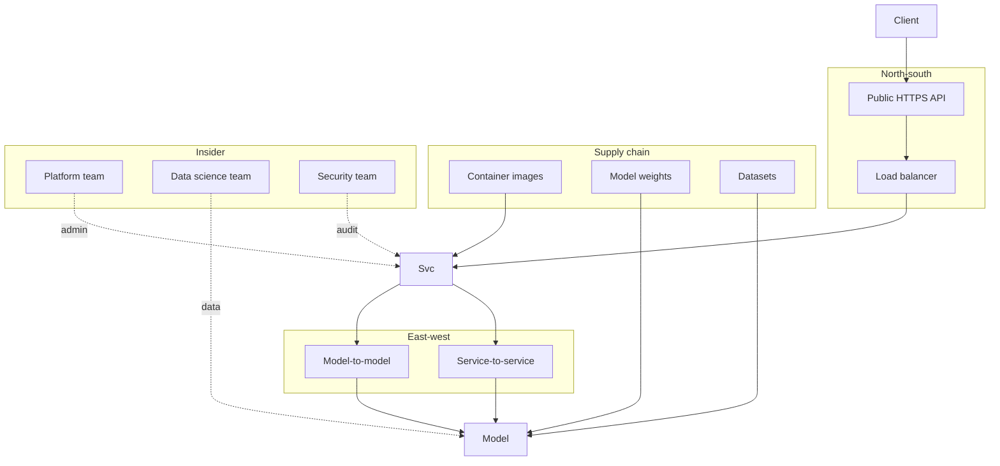

# 18.1 Threat modeling for AI infrastructure

| Field | Value |
|---|---|
| Level | Intermediate |
| Priority tier | 2 |
| Lab venue | GCP / GKE |
| Part | Part 18: Security |
| Primary sources | NVIDIA Zero-to-Hero Volume 18 (`chapter-01-threat-modeling.md`); NVIDIA Zero-to-Hero Volume 8 (`chapter-03-platform-security-and-trust.md`); *Engineering AI Systems* (`engineering-ai-systems-architecture-and-devops-essentials`, Chapter 9) |
| Cross-references | Chapter 16.13 (Governance, privacy, compliance); Chapter 11 (GPU Kubernetes); Chapter 5 (Kubernetes); Chapter 18.2-18.7 (other security chapters) |
| Coverage file | `planning/coverage/chapters/18-01.md` |
| Claim & number ledger | `planning/ledgers/18-01.md` |

## Why this matters for AI infrastructure

Picture an engineer on call at two in the morning. An alert shows that an unknown client is pulling large volumes of responses from your inference API. Is this a traffic spike, or is someone copying the model? The engineer can answer that quickly only if the team already wrote down what must be protected and how it could be attacked. That written list is the threat model.

Every other chapter in this part starts from a known threat. This chapter explains how the team builds that list in the first place. Without a threat model, security controls are educated guesses. With one, each control points to the threat it answers, so an auditor who asks why it exists gets a clear answer.

Compare "we have a firewall" with "we have a firewall that addresses threats T1 through T7". The second statement is the one an auditor wants to hear, and a threat model is what makes it possible.

```text
Why threat modeling is on the critical path (background reading: NVIDIA Zero-to-Hero volume 18; NVIDIA Zero-to-Hero volume 8; Engineering AI Systems; the figures below are examples, not quotations):
- A typical mature AI platform has 30-100 distinct threats. The threats range
  from model theft (an attacker exfiltrates model weights) to prompt injection
  (a user crafts input that bypasses the safety guardrails) to training data
  poisoning (an attacker inserts bad examples into the training set).
- The threat model is the foundation of the security controls. Every control
  in Chapter 18.2-18.7 is justified by a threat in the threat model.
- The threat model is updated quarterly. New threats appear (new CVE; new
  research; new attack pattern); old threats retire (control closed the gap).
  The threat model is the living artefact.
```

The note above gives a range of 30 to 100 threats. Treat that as an example size, not a target your platform has to reach.

Three points make this a platform-team job rather than a data-science task.

1. The platform team owns the view of the whole system, including the attack surface and the controls.
2. Data scientists use the results, but they rarely see every path into the platform.
3. The model needs an owner who keeps it current, because new CVEs and attack patterns appear while old gaps get closed.

The chapter suggests a quarterly review. That cadence is a practice you can adjust, but a model that nobody revisits quickly falls behind the platform it describes.

**Write the threat down before you write the control.** Before you adopt a security control from the rest of this part, name the threat it answers.

## Prerequisites and outcomes

### Prerequisites

- Chapter 16.13 covers governance, privacy, and compliance, which give the regulatory context.
- Chapter 11 covers GPU Kubernetes and the cluster layout you will model.
- Chapter 5 covers the Kubernetes primitives used throughout this chapter.
- You should know the STRIDE method, which the next section explains.

### Outcomes

After completing this chapter, you will be able to:

1. Apply STRIDE to AI infrastructure, checking for spoofing, tampering, repudiation, information disclosure, denial of service, and elevation of privilege.
2. Build an asset inventory that lists models, weights, datasets, keys, audit logs, credentials, and GPUs.
3. Map the attack surface across north-south traffic, east-west traffic, the supply chain, and insiders.
4. Build a threat catalogue that covers model theft, weight exfiltration, prompt injection, training data poisoning, denial of service, and privilege escalation.
5. Score each threat by likelihood and impact, and record its mitigation status in a risk matrix.
6. Run the threat model on GKE with quarterly reviews, automated updates, and controls backed by evidence.

---

## 1. The STRIDE methodology

### 1.1 STRIDE adapted for AI infrastructure

Imagine a security review that starts with the question "what could go wrong?" and nothing more. Different people answer that question differently, and the important risks are often the ones nobody thought to name. STRIDE gives the review a fixed list of questions to work through.

STRIDE is the standard threat-modeling method, described in *Engineering AI Systems* Chapter 9. It names six threat types: Spoofing, Tampering, Repudiation, Information Disclosure, Denial of Service, and Elevation of Privilege. For AI infrastructure, each type gets an AI-specific version, as the table shows.

Production Kubernetes, chapter 10, draws a line that helps here. Authentication establishes who a user or application is. Authorization decides what that identity may do once it is known. A spoofing threat attacks the first step, so a permission check cannot help if the identity itself is faked.

| Category | Generic threat | AI-specific threat |
|---|---|---|
| **Spoofing** | An attacker impersonates a user or a service | An attacker spoofs a model's identity (e.g. claims to be a specific fine-tune) |
| **Tampering** | An attacker modifies data or code | An attacker poisons the training data (inserts bad examples into the training set) |
| **Repudiation** | An attacker denies an action | An attacker denies a model prediction (no audit trail) |
| **Information Disclosure** | An attacker reads data they should not | An attacker exfiltrates model weights (the IP of the model) |
| **Denial of Service** | An attacker makes the service unavailable | An attacker exhausts the GPU pool (denial of service to other workloads) |
| **Elevation of Privilege** | An attacker gains more access than they should | An attacker escalates from a tenant namespace to the cluster admin |

Walk through each row of the table in a workshop. For each category, write down the AI-specific variant that your platform could realistically face.

### 1.2 The threat-model workshop

A threat model written by one team alone misses the risks that other teams can see. The workshop brings those teams into one room. It has a scope, which is the system being modelled, and a time limit. Its deliverable is the threat catalogue, the risk matrix, and the mitigation status.

Invite people from the platform team, the security team, the data science team, and the compliance team. Each group sees different failure modes, and the mix is what catches them.

```text
Threat-model workshop:
- Participants: platform team, security team, data science team, compliance team
- Scope: AI inference platform (the InferenceService, the model registry, the feature store)
- Duration: half a day
- Deliverable: the threat catalogue (50-100 threats), the risk matrix (likelihood × impact), the mitigation status
```

The duration and the catalogue size in this block are example settings. Choose your own based on how large and complex your system is.

### 1.3 The threat model document

Six months after a review, someone will ask why a particular control exists. The threat model document should answer that question in one place. It is version-controlled, reviewed on a schedule, and kept as the audit trail.

```markdown
# Threat Model: AI Inference Platform

## Scope
The AI inference platform: the InferenceService, the model registry, the feature store, the GPU pool.

## Asset Inventory
- Models: 10 production models; 5 fine-tunes; 20 experiments
- Weights: 10 production model weights; 5 fine-tune weights; 100 GB
- Datasets: 50 production datasets; 1 TB
- Keys: API keys, model signing keys, encryption keys
- Audit logs: 100 GB/day; 7-year retention
- GPUs: 32 H100s; 16 A100s; 8 L40Ss
- Credentials: 200 service accounts; 100 IAM roles

## Attack Surface
- North-south: public HTTPS API for inference
- East-west: model-to-model traffic; service-to-service traffic
- Supply chain: container images; model weights; datasets
- Insider: platform team; data science team; security team

## Threat Catalogue
(Snip of 50-100 threats; see the threat catalogue in the platform repo)

## Risk Matrix
(Snip of likelihood × impact for each threat)

## Mitigation Status
(Snip of which threats are mitigated; which are accepted; which are in progress)
```

The counts in this sample are placeholders that show the shape of the document. They are not targets. Keep the document in Git, so every change to a threat has an author and a date.

---

## 2. The asset inventory

### 2.1 What is in the asset inventory

Consider two lost laptops. One holds only public documentation, and losing it is a small inconvenience. The other holds model weights that took months to train, and losing it is a serious incident. You cannot protect what you have not listed, so the inventory starts by naming the things that would hurt most if they were copied, changed, or deleted.

| Asset category | Examples | Why it matters |
|---|---|---|
| **Models** | Production models; fine-tunes; experiments | The IP of the platform |
| **Weights** | Production model weights; fine-tune weights; checkpoints | The training result |
| **Datasets** | Training data; evaluation data; production data | The input to the training |
| **Keys** | API keys; model signing keys; encryption keys; GPU attestation keys | The authentication |
| **Audit logs** | Inference logs; training logs; access logs; audit logs | The compliance evidence |
| **GPUs** | GPU nodes; GPU memory; GPU bandwidth | The compute |
| **Credentials** | Service accounts; IAM roles; Kubernetes secrets; database credentials | The access |

Keys and credentials need extra care. Kubernetes Secrets are base64 encoded, which is encoding and not encryption. Production Kubernetes, chapter 7, makes the same point. The real protection comes from RBAC, the permission system that decides who can read a Secret.

Every asset in the table needs three things: a value, a threat, and a control. The inventory is the starting point for the rest of the threat model.

### 2.2 The asset value

Asset value is the cost of losing something. For a model, that includes the training bill and the advantage a competitor gains from a copy. For a log, it includes the cost of rebuilding the record and the cost of failing an audit.

```text
Asset value formula:
- Models: training cost + competitive advantage cost
- Weights: training cost (often $100k-$1M for foundation models)
- Datasets: collection cost + cleaning cost + privacy cost (often $10k-$1M)
- Keys: cost of credential rotation + cost of impersonation
- Audit logs: cost of reconstruction + cost of regulatory non-compliance
- GPUs: replacement cost ($3-5k per H100)
- Credentials: cost of credential rotation + cost of unauthorized access
```

The dollar ranges in this block are examples that show the kind of cost to count. They are not market prices. Replace them with figures from your own finance team before you use them to set budgets.

### 2.3 The asset owner

When a key leaks at night, someone must be paged. The asset owner is that person or team. The owner also approves access to the asset and stays accountable for its security.

| Asset category | Asset owner |
|---|---|
| Models | Data science team |
| Weights | ML platform team |
| Datasets | Data engineering team |
| Keys | Security team |
| Audit logs | Compliance team |
| GPUs | Infrastructure team |
| Credentials | Security team |

Assign an owner to every asset before you list its threats, not after an incident forces the question.

---

## 3. The attack surface

### 3.1 The four attack surfaces

Follow one request through your platform. It arrives from the internet, passes through a load balancer, calls an internal service, loads a model image, and reads a dataset. Each step is a place where someone could act. Grouping those places gives you four attack surfaces, and each one needs its own controls.



### 3.2 The north-south attack surface

Traffic from outside your network is the surface most people think of first. The public API is the entry point, and anyone on the internet can send it requests. The threats here are DDoS, API abuse, prompt injection, bypassed authentication, and rate-limit bypass.

| Threat | Mitigation |
|---|---|
| DDoS | Cloud Armor; rate limiting; WAF |
| API abuse | API key rotation; rate limiting; quota |
| Prompt injection | Input validation; guardrails; LLM-as-judge (Chapter 16.9) |
| Authentication bypass | OAuth 2.1; mTLS; service mesh |
| Rate limit bypass | Per-key rate limiting; per-tenant rate limiting |

Rate limits are only as strong as the identity behind them. A limit per key does little if one attacker can create many keys.

### 3.3 The east-west attack surface

East-west traffic is the traffic between your own services. An attacker who has already got a foothold will try to move sideways along these paths. The threats are lateral movement, man-in-the-middle attacks, service impersonation, and container escape.

| Threat | Mitigation |
|---|---|
| Lateral movement | NetworkPolicy; mTLS; service mesh |
| Man-in-the-middle | mTLS; certificate pinning |
| Service impersonation | ServiceAccount; Workload Identity; SPIFFE |
| Container escape | Pod Security Standards; seccomp; AppArmor |

Production Kubernetes, chapter 15, explains why the runtime user matters for container escape. A container that runs as root gives an attacker a stronger position. If the attacker breaks out of the container, root inside it can become root on the host.

### 3.4 The supply chain attack surface

Some attacks never touch your network. A tampered base image or a poisoned model file can reach production through the normal build and deploy path. The threats are image poisoning, model backdoors, dataset poisoning, and dependency confusion.

| Threat | Mitigation |
|---|---|
| Image poisoning | cosign signing; admission controller; Trivy scan |
| Model backdoor | Model signing; eval suite; adversarial testing |
| Dataset poisoning | DVC content hash; provenance tracking; outlier detection |
| Dependency confusion | SBOM; dependency pinning; supply chain security |

### 3.5 The insider attack surface

Not every threat comes from outside. A team member with legitimate access can copy weights, misuse a credential, or export data. The threats are data exfiltration, privilege abuse, credential theft, and model theft by an employee.

| Threat | Mitigation |
|---|---|
| Data exfiltration | DLP; egress filtering; audit log review |
| Privilege abuse | Just-in-time access; break-glass admin; audit log |
| Credential theft | MFA; short-lived credentials; Workload Identity |
| Model theft by employee | Watermarking; access logging; NDAs |

Each insider threat in the table needs a mitigation that is enforced through IAM and checked through audit logs.

---

## 4. The threat catalogue

### 4.1 The threat template

A new vulnerability report arrives on a Friday afternoon. The question is whether anything in your catalogue already covers it. A catalogue works only when every threat has the same fields, because then you can compare, sort, and search them quickly.

```markdown
## Threat: T-001 Model weight exfiltration

**STRIDE category:** Information Disclosure
**Asset:** Model weights (production model weights; fine-tune weights)
**Attack surface:** Supply chain
**Description:** An attacker with access to the model registry exfiltrates the model weights to a competitor.

**Likelihood:** Medium (3)
**Impact:** High (5) — competitive advantage loss; regulatory implications
**Risk score:** 15 (likelihood × impact)

**Mitigation:**
- Model registry access controlled by IAM (Chapter 5.26)
- Model weights encrypted at rest (Chapter 13)
- Model signing (cosign; Chapter 18.3)
- Watermarking (Chapter 18.7)

**Mitigation status:** Mitigated
**Residual risk:** Low (2)
**Owner:** ML platform team
**Last reviewed:** 2024-03-15
```

Each threat gets a stable ID, an owner, and a review date. The owner is the person who answers for the threat when it changes.

### 4.2 The top threats for AI infrastructure

The table below lists threats that an AI platform often needs to track. The likelihood and impact numbers are example scores, not measured frequencies. Score your own threats with your own team, using evidence from your system.

| ID | Threat | STRIDE | Likelihood × Impact |
|---|---|---|---|
| T-001 | Model weight exfiltration | Information Disclosure | 3 × 5 |
| T-002 | Training data poisoning | Tampering | 4 × 5 |
| T-003 | Prompt injection | Tampering | 4 × 4 |
| T-004 | Model backdoor | Tampering | 2 × 5 |
| T-005 | Container image supply chain attack | Tampering | 3 × 5 |
| T-006 | GPU memory scraping (cross-tenant) | Information Disclosure | 3 × 4 |
| T-007 | Inference API DDoS | Denial of Service | 4 × 4 |
| T-008 | Model version rollback attack | Tampering | 2 × 4 |
| T-009 | Audit log tampering | Repudiation | 2 × 5 |
| T-010 | Credential theft (service account) | Spoofing | 3 × 5 |

Production Kubernetes, chapter 7, walks through an attacker who gets root on the API server node and then reads Secrets from etcd. The chapter then argues that an RBAC mistake or a compromised application is the more likely way a secret leaks. Use the same reasoning when you rank the threats above.

A catalogue usually holds the top 10 to 20 threats, with the same fields on each one.

### 4.3 The threat catalogue maintenance

The catalogue is a living document. You add new threats, retire old ones, and update likelihood, impact, and mitigation status as your system changes. Make each change through a script or a reviewed commit, so the change leaves a record.

```bash
# Update the threat catalogue
python code/part18/threat_catalogue_update.py \
  --threat-id T-001 \
  --new-mitigation "Add watermark detection to the inference API"
# expected: the threat catalogue is updated; the audit log is updated; the change is reviewed
```

---

## 5. The risk matrix

### 5.1 The likelihood-impact grid

Your team has more open threats than budget to fix them this quarter. The risk matrix tells you which ones come first. Multiply the likelihood of a threat by its impact, and the result is the score you use to rank the threats.

| | Impact 1 (Low) | Impact 2 | Impact 3 | Impact 4 | Impact 5 (High) |
|---|---|---|---|---|---|
| **Likelihood 5 (Very High)** | 5 | 10 | 15 | 20 | 25 |
| **Likelihood 4 (High)** | 4 | 8 | 12 | 16 | 20 |
| **Likelihood 3 (Medium)** | 3 | 6 | 9 | 12 | 15 |
| **Likelihood 2 (Low)** | 2 | 4 | 6 | 8 | 10 |
| **Likelihood 1 (Very Low)** | 1 | 2 | 3 | 4 | 5 |

Because the score multiplies two values, a rare threat with a severe impact can score as high as a common threat with a modest impact. Read the grid with both numbers in mind, not only the total.

### 5.2 The risk-driven priority

The score sets the order of work. The table below maps score ranges to priority levels and example timelines.

| Risk score | Priority | Mitigation timeline |
|---|---|---|
| 20-25 | Critical | Immediate (within 1 week) |
| 15-19 | High | Within 1 month |
| 10-14 | Medium | Within 1 quarter |
| 5-9 | Low | Within 1 year |
| 1-4 | Very Low | Accept the risk |

The bands and timelines in this table are examples. Set your own with the people who own each risk, because the right cut-offs depend on how much risk your business accepts.

### 5.3 The risk-driven budget

The budget follows the risk score, so the money goes where the risk is highest. The block below shows the shape of that rule.

```text
Security budget formula:
- Critical threats (20-25): $100k+ per threat for immediate mitigation
- High threats (15-19): $10-100k per threat for monthly mitigation
- Medium threats (10-14): $1-10k per threat for quarterly mitigation
- Low threats (5-9): < $1k per threat for annual mitigation
- Very low threats (1-4): $0 (accept the risk)
```

The dollar figures in the block are placeholders, not benchmarks. Replace them with your own cost estimates. Your organization may also route the approval to finance, so that the spending is visible and checked.

---

## 6. Operating threat modeling on GKE

### 6.1 The components

Six months from now, a new engineer will ask where the threat catalogue lives and whether it is current. If nobody can answer quickly, the model has become a document that nobody reads. Each component below needs a home, a backing store, and a check that tells you it is still working.

| Component | Where it runs | Backing store | SLO |
|---|---|---|---|
| Threat catalogue | Git repo | Git history | Catalogue freshness < 90 days |
| Risk matrix | Git repo | Git history | Risk matrix reviewed quarterly |
| Threat model workshop | (human) | (meeting notes) | Workshop held quarterly |
| Audit log | Object storage | Object storage | Audit log retention 7 years |

The targets in the SLO column are example values. Choose targets that match your own review cadence and retention rules.

### 6.2 IAM and the threat model

The threat model needs its own access rules. Every team should be able to read it. A smaller group should be able to change it. A single approver should sign off on risk acceptance.

| Role | Who | What they can do |
|---|---|---|
| `threatmodel.reader` | Every team | Read the threat catalogue; read the risk matrix |
| `threatmodel.writer` | The security team and the platform team | Update the threat catalogue; update the risk matrix |
| `threatmodel.admin` | The CISO's office | Approve the threat model; approve the risk acceptance |

The role names are one way to split these permissions. Decide who can approve a risk acceptance before the first review, not during an incident.

### 6.3 Observability

Track a few signals that show whether the threat model is still doing its job. Each one has an alert, so a stale model triggers a message rather than waiting to be noticed. The thresholds in the table are examples to adjust.

| Metric | Why it matters | Alert |
|---|---|---|
| Threat catalogue freshness | Threat model currency | > 90 days stale |
| Top-10 threat mitigation status | Risk posture | Any unmitigated |
| Risk-driven budget utilisation | Budget discipline | > 120% per quarter |
| Quarterly workshop completion | Process compliance | > 1 quarter since last workshop |

Of these, the mitigation status of your top threats tells you the most. An unmitigated top threat needs a named owner and a due date.

---

## 7. How it fails

Six failure modes show up often in teams that run a threat model. Each one has a recognisable symptom, a likely cause, and a fix you can start this week. If you recognise a symptom in your own team, start with the fix.

### 7.1 "The threat model is out of date"

**Symptom:** A new CVE is published, the threat model does not list it, and nobody realises it applies.

**Diagnosis:** Nobody reviews the model on a schedule, and nobody watches the CVE feeds.

**Fix:** Schedule the quarterly workshop, automate CVE monitoring, and add each relevant new threat to the catalogue.

### 7.2 "The threat model is too generic"

**Symptom:** The model lists 30 generic threats and none that are specific to AI, so it misses the risks the AI team worries about.

**Diagnosis:** The workshop left out the AI team, so the AI-specific variants never came up.

**Fix:** Bring the data science team into the workshop, add the AI-specific variants, and review the model with that team.

### 7.3 "The threat model is too long"

**Symptom:** The catalogue holds 500 threats, so the team cannot decide what to work on first.

**Diagnosis:** The workshop produced too many threats, and nobody filtered them.

**Fix:** Keep the top 10 to 20 threats, archive the rest, and review the top threats each quarter.

### 7.4 "The threat model is not used"

**Symptom:** The threat model exists and the controls are in place, but no control points to a threat.

**Diagnosis:** The controls were designed ad hoc, and the threat model is not the source of truth for them.

**Fix:** Make the threat model the source of truth. Every control must justify a threat, and every threat must have a control.

### 7.5 "The risk matrix is not updated"

**Symptom:** The likelihood and impact scores have not changed in a year, even though the real situation has.

**Diagnosis:** Nobody reviews the matrix on a schedule, and nobody compares it with the incidents that actually happened.

**Fix:** Review the matrix quarterly, track real incidents, and update the scores from what you observe.

### 7.6 "The threat-driven budget is not approved"

**Symptom:** The security team identifies the risks and proposes fixes, but the budget request stalls.

**Diagnosis:** The budget request does not connect to business priorities, so the finance team does not see the value.

**Fix:** Present the threat model to the people who approve spending, show the budget against the risk scores, and tie each fix to a business priority.

---

## 8. Hands-on lab

This lab builds a threat model for an AI inference platform, one step at a time. You will hold the workshop, inventory the assets, map the attack surface, build the catalogue, score the risks, and schedule the review. The lab is untested in this repository.

### 8.1 Prerequisites

- Four to six people from the platform, security, data science, and compliance teams.
- A scope: the AI inference platform.
- Half a day of time.
- A whiteboard, physical or virtual.

### 8.2 Step 1: hold the threat-model workshop

```bash
# Schedule the workshop
python code/part18/schedule_workshop.py \
  --date "2024-04-15" \
  --time "09:00-13:00 UTC" \
  --scope "AI Inference Platform" \
  --participants platform-team,security-team,data-science-team,compliance-team
# expected: the workshop is scheduled; the participants are notified
```

### 8.3 Step 2: build the asset inventory

```bash
# Generate the asset inventory
python code/part18/asset_inventory.py \
  --platform gke-prod-us-central1 \
  --output asset_inventory.yaml
# expected: the asset inventory is generated; the inventory is reviewed
```

### 8.4 Step 3: map the attack surface

```bash
# Generate the attack surface diagram
python code/part18/attack_surface.py \
  --platform gke-prod-us-central1 \
  --output attack_surface.md
# expected: the attack surface is mapped; the four surfaces are documented
```

### 8.5 Step 4: build the threat catalogue

```bash
# Generate the threat catalogue
python code/part18/threat_catalogue.py \
  --scope "AI Inference Platform" \
  --asset-inventory asset_inventory.yaml \
  --attack-surface attack_surface.md \
  --output threat_catalogue.md
# expected: the threat catalogue has 50-100 threats; each threat has the standard fields
```

### 8.6 Step 5: compute the risk matrix

```bash
# Compute the risk matrix
python code/part18/risk_matrix.py \
  --threat-catalogue threat_catalogue.md \
  --output risk_matrix.md
# expected: the risk matrix has the likelihood × impact grid; the top 10-20 threats are highlighted
```

### 8.7 Step 6: review the threat model

```bash
# Schedule the quarterly review
python code/part18/schedule_review.py \
  --threat-model threat_catalogue.md \
  --date "2024-07-15"
# expected: the review is scheduled; the participants are notified
```

### 8.8 What to record

Afterwards, you should be able to answer five questions quickly. Check the catalogue freshness, the risk budget in use, the mitigation status of the top 10 threats, the newest threat added, and the date of the next review. The 30-second bar in the chapter is an example, not a standard. If an answer takes much longer than that, the threat model is not yet run as a production service.

---

## Exercises

1. **Add a new threat to the catalogue.** Pick a recent incident, add it to the catalogue, and update the risk matrix. *Solution sketch:* use the threat template in Section 4.1 and the script in Section 4.3.
2. **Add an AI-specific threat variant.** For each STRIDE category, write the AI-specific variant that fits your platform. *Solution sketch:* use the table in Section 1.1 and the catalogue in Section 4.2.
3. **Compute a risk-driven budget.** Work out the budget for your top 10 threats. *Solution sketch:* use the budget formula in Section 5.3 and the spreadsheet in the Git repo.
4. **Map each top threat to a control.** For every top threat, name the control that answers it. *Solution sketch:* use the control table in Section 3 and the GitHub issue tracker.
5. **Set up a quarterly review.** Schedule the workshop, review the threat model, and update the risk matrix. *Solution sketch:* use the calendar event, the workshop agenda, and the script in Section 8.7.
6. **Build a threat dashboard.** Make a Grafana dashboard that shows the top threats, their risk scores, and their mitigation status. *Solution sketch:* start from the dashboard JSON and connect the threat catalogue as the data source.

---

## Checkpoint questions

<details><summary>1. What six STRIDE categories does the chapter adapt for AI infrastructure?</summary>
The six categories are Spoofing, Tampering, Repudiation, Information Disclosure, Denial of Service, and Elevation of Privilege. You can map each one to an AI-specific form: a fake model identity, poisoned training data, a denied prediction, stolen weights, GPU pool exhaustion, and a jump from a tenant namespace to cluster admin.
</details>

<details><summary>2. What four attack surfaces does the chapter walk through?</summary>
The four surfaces are the public API, the traffic between services, the artifacts such as images, weights and datasets, and the team members themselves. Each surface has its own threats and its own controls.
</details>

<details><summary>3. What categories does the asset inventory cover?</summary>
The inventory covers models, weights, datasets, keys, audit logs, GPUs, and credentials. Every asset needs a value, a threat, and a control, which makes the inventory the starting point of the threat model.
</details>

<details><summary>4. What is the risk matrix formula?</summary>
The risk score is likelihood multiplied by impact. Both scales run from 1 (Very Low or Low) to 5 (Very High or High). In the example bands, 20 to 25 is Critical, 15 to 19 is High, 10 to 14 is Medium, 5 to 9 is Low, and 1 to 4 is accepted. These bands are examples that your team sets.
</details>

<details><summary>5. What is the threat-model workshop?</summary>
If you run the workshop, plan for a half-day session with the platform, security, data science, and compliance teams. It starts from a scope, which is the system being modelled, and it produces a threat catalogue, a risk matrix, and a mitigation status. The chapter suggests holding it quarterly, and its output becomes the threat model document.
</details>

<details><summary>6. What is the most common threat-model failure?</summary>
The most common failure is an out-of-date threat model. A new CVE appears, the model does not list it, and nobody realises it applies. The usual cause is that nobody reviews the model quarterly or watches CVE feeds. The fix is a scheduled quarterly workshop, automated CVE monitoring, and adding each relevant CVE to the catalogue.
</details>

<details><summary>7. What is the second most common threat-model failure?</summary>
The second most common failure is a model that is too generic. It lists 30 generic threats and no AI-specific ones, so it misses the risks the AI team cares about. The workshop left out the AI team. The fix is to bring the data science team into the workshop and add AI-specific variants.
</details>

<details><summary>8. What is the most common threat-priority failure?</summary>
The most common priority failure is a catalogue that is too long. A catalogue of 500 threats leaves the team unable to choose, so it cannot focus on the top 10. Keep the top 10 to 20 threats, archive the rest, and review the top threats quarterly.
</details>

<details><summary>9. What is the most common threat-driven control failure?</summary>
The most common control failure is that the threat model is not used. The controls exist, but nobody can say which threat each one answers. If you want controls to hold up, make the threat model the source of truth. Every control must justify a threat, and every threat must have a control.
</details>

<details><summary>10. What is the most common risk-matrix-update failure?</summary>
The risk matrix is not updated. The same likelihood and impact stay in place for a year, even though the real ones have changed. You should review the matrix quarterly, track real incidents, and update the scores from what actually happened.
</details>

<details><summary>11. What is the relationship between the threat model and the controls?</summary>
The threat model is the source of truth for the controls. Each control in Chapters 18.2 to 18.7 is justified by a threat in the model. Without a threat model, auditors cannot check the controls; with one, they can.
</details>

<details><summary>12. What is the relationship between the threat model and the audit log?</summary>
The threat model defines the threats, and the audit log records events that show whether those threats are happening. The audit log is the evidence that the controls work. Without a threat model, the log is just noise; with one, it becomes evidence.
</details>

<details><summary>13. What is the relationship between the threat model and the SLO?</summary>
The SLO is the commitment to the customer, and the threat model lists the threats to that commitment. Controls reduce those threats. The SLO is the promise the customer sees.
</details>

<details><summary>14. What is the relationship between the threat model and the compliance?</summary>
Compliance is the regulatory commitment, and the threat model lists the threats to it. Controls reduce those threats. Compliance is the contract the regulator sees.
</details>

<details><summary>15. What is the relationship between the threat model and the incident response?</summary>
The threat model names the threats, and incident response handles the ones that actually happen. Incident response is the operational partner of the model. Without the model, response tends to be reactive; with it, the team can act earlier.
</details>

<details><summary>16. What is the relationship between the threat model and the post-mortem?</summary>
The post-mortem is the learning record after an incident, and the threat model is the catalogue of known threats. A post-mortem can reveal a new threat, which then goes into the model. The two documents form a loop: the post-mortem feeds the model, and the model feeds the controls.
</details>

<details><summary>17. What is the most important threat-model metric?</summary>
The most important metric is the mitigation status of the top 10 threats. It tells you whether those threats have controls. Any unmitigated top-10 threat is a security incident waiting to happen, so the metric reflects the team's security posture.
</details>

<details><summary>18. Why is threat modeling a Tier 2 chapter?</summary>
The chapter gives the threat model a Tier 2 label because it is the foundation of the security controls. Without it, the controls are guesses. The platform team owns the model, and auditors and regulators inspect it.
</details>

<details><summary>19. What is the difference between a threat model and a risk assessment?</summary>
A risk assessment is a one-time evaluation of risks. A threat model is a living artifact, updated quarterly, that holds the asset inventory, attack surface, catalogue, risk matrix, and mitigation status. The assessment is a snapshot, and the threat model keeps changing.
</details>

<details><summary>20. What five questions should the threat-model lab let you answer in five seconds each?</summary>
You should answer five questions quickly: catalogue freshness, risk-driven budget use, top-10 mitigation status, the newest threat, and the next review date. The chapter's 30-second bar is an example, not a standard. A slow answer suggests the model is not yet run as a service.
</details>

---

## Sources and review notes

- NVIDIA Zero-to-Hero Volume 18 (`chapter-01-threat-modeling.md`). Source for the STRIDE methodology, the asset inventory, the attack surface, and the threat catalogue for AI infrastructure. The wording has been rewritten in the handbook's voice.
- NVIDIA Zero-to-Hero Volume 8 (`chapter-03-platform-security-and-trust.md`). Source for the platform-level security patterns and the trust model.
- *Engineering AI Systems* (`engineering-ai-systems-architecture-and-devops-essentials`, Chapter 9). Source for the security patterns and the risk-driven approach.

### Cross-references to other handbook chapters

- Chapter 16.13 for the governance and compliance context.
- Chapter 11 for the GPU Kubernetes topology.
- Chapter 5 for the Kubernetes primitives.
- Chapters 18.2-18.7 for the security controls that the threat model justifies.

### Migrated from `nvidia-devops`

The threat-model operational patterns draw on Volume 18 chapter 1 and Volume 8 chapter 3. The wording has been rewritten in the handbook's voice.

### Explicitly labelled inferences

- The risk matrix thresholds (20-25 Critical, 15-19 High) are starting points; specific thresholds depend on the business's risk tolerance.
- The threat-model workshop duration (half a day) is a starting point; specific durations depend on the system's complexity.
- The top-10 threat list is a starting point; specific threats depend on the system's specifics.

### Not verified on live hardware

- The lab in Section 8 is **untested** against a live GKE cluster in this repository.
- The threat catalogue in Section 4.2 is illustrative; production catalogues are more detailed.
- The risk matrix in Section 5.1 is starting points; production risk matrices are tuned to the business.
