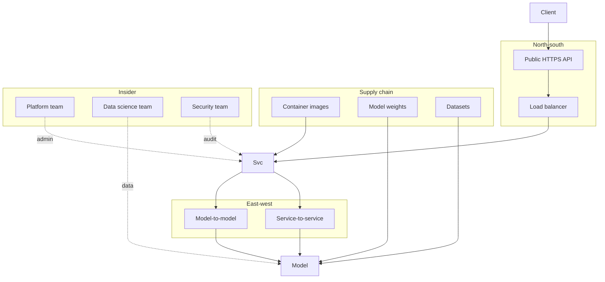

# 18.1 Threat modeling for AI infrastructure

| Field | Value |
|---|---|
| Level | Intermediate |
| Priority tier | 2 |
| Lab venue | GCP / GKE |
| Part | Part 18: Security |
| Cross-references | Chapter 16.13 (Governance, privacy, compliance); Chapter 11 (GPU Kubernetes); Chapter 5 (Kubernetes); Chapter 18.2-18.7 (other security chapters) |
| Coverage file | `planning/coverage/chapters/18-01.md` |
| Claim & number ledger | `planning/ledgers/18-01.md` |

## Why this matters for AI infrastructure

Picture an engineer on call at two in the morning. An alert shows that an unknown client is pulling large volumes of responses from your inference API. The first question is whether this is an ordinary traffic spike or someone quietly copying the model. The engineer can answer that quickly only if the team already wrote down what must be protected and how it could be attacked. That written list is the threat model.

Every other chapter in this part starts from a known threat. This one explains how the team builds that list in the first place. Without a threat model, security controls are educated guesses made one at a time, and nobody can say later why a given control exists. With one, each control points to the threat it answers, so an auditor who asks why a control is there gets a clear reply.

Compare the sentence "we have a firewall" with "we have a firewall that addresses threats T1 through T7". The second statement is the one an auditor wants to hear. A threat model is what makes it possible to say it honestly, because the threats are written down first and the controls are matched to them.

```text
Why threat modeling is on the critical path (background reading: NVIDIA Zero-to-Hero volume 18; NVIDIA Zero-to-Hero volume 8; Engineering AI Systems; the figures below are examples, not quotations):
- A typical mature AI platform has 30-100 distinct threats. The threats range
  from model theft (an attacker exfiltrates model weights) to prompt injection
  (a user crafts input that bypasses the safety guardrails) to training data
  poisoning (an attacker inserts bad examples into the training set).
- The threat model is the foundation of the security controls. Every control
  in Chapter 18.2-18.7 is justified by a threat in the threat model.
- The threat model is updated quarterly. New threats appear (new CVE; new
  research; new attack pattern); old threats retire (control closed the gap).
  The threat model is the living artefact.
```

The note above gives a range of 30 to 100 threats. Treat that as an example size, not a target your platform has to reach. A small platform with a handful of models may end up with a shorter list, and that is fine as long as every entry on it is real and every entry has an owner.

Three questions explain why this is a platform-team job rather than a data-science task. Each one comes up again and again in reviews.

1. Who sees the whole system? The platform team does. It holds the view of the attack surface and of the controls that already exist.
2. Who uses the results? Data scientists do, but they rarely see every path into the platform, so they need the platform team to show them.
3. Who keeps the model current? The model needs a named owner, because new CVEs and attack patterns keep appearing while old gaps get closed.

The chapter suggests a quarterly review. Treat that cadence as a practice you can adjust to your own team. The reason it matters is simple. A model that nobody revisits quickly falls behind the platform it describes, and then it stops helping anyone make decisions.

**Write the threat down before you write the control.** Before you adopt a security control from the rest of this part, name the threat it answers. A control with no named threat is hard to justify in a review and easy to remove by mistake.

## Prerequisites and outcomes

### Prerequisites

Suppose a new hire asks where to start. Read these first.

- Chapter 16.13 covers governance, privacy, and compliance, which give the regulatory context. You need that context before you can say what a leak would cost.
- Chapter 11 covers GPU Kubernetes and the cluster layout you will model. The threat model is only as good as your picture of the cluster, so re-read this chapter if the layout feels unfamiliar.
- Chapter 5 covers the Kubernetes primitives used throughout this chapter, such as service accounts, roles, and namespaces.
- Know the STRIDE method before the workshop. The first section below explains each category in plain words.

### Outcomes

A team that has never written a threat model usually starts with a meeting and no document. This section describes the path from that meeting to a working model. The chapter walks through STRIDE applied to AI infrastructure, then the asset inventory that lists what to protect, then the attack surface that shows where attackers can act. After that it builds the threat catalogue with scores, uses a risk matrix to rank the work, and ends with how to run the whole process on GKE with reviews and evidence.

---

## 1. The STRIDE methodology

### 1.1 STRIDE adapted for AI infrastructure

Picture a security review that starts with the question "what could go wrong?" and nothing more. People answer that question from their own experience, so the answers pile up in no order. The risks that matter most are often the ones nobody thought to name, because they sit in a part of the system that belongs to someone else. STRIDE gives the review a fixed list of questions to work through, so every part of the system gets asked the same things.

STRIDE is the standard threat-modeling method, described in *Engineering AI Systems* Chapter 9. It names six threat types: Spoofing, Tampering, Repudiation, Information Disclosure, Denial of Service, and Elevation of Privilege. Each letter stands for one type. For AI infrastructure, each type gets an AI-specific version, as the table shows.

| Category | Generic threat | AI-specific threat |
|---|---|---|
| **Spoofing** | An attacker impersonates a user or a service | An attacker spoofs a model's identity (e.g. claims to be a specific fine-tune) |
| **Tampering** | An attacker modifies data or code | An attacker poisons the training data (inserts bad examples into the training set) |
| **Repudiation** | An attacker denies an action | An attacker denies a model prediction (no audit trail) |
| **Information Disclosure** | An attacker reads data they should not | An attacker exfiltrates model weights (the IP of the model) |
| **Denial of Service** | An attacker makes the service unavailable | An attacker exhausts the GPU pool (denial of service to other workloads) |
| **Elevation of Privilege** | An attacker gains more access than they should | An attacker escalates from a tenant namespace to the cluster admin |

Production Kubernetes, chapter 10, draws a line that helps here. Authentication establishes who a user or application is. Authorization decides what that identity may do once it is known. A spoofing threat attacks the first step. That means a permission check cannot help you when the identity itself is faked, because the check trusts the identity it was given.

Take the rows of the table one at a time. For each category, ask what the AI-specific version looks like on your platform. A row that feels abstract becomes concrete once you name a real model, a real registry, or a real GPU pool that the threat would touch.

### 1.2 The threat-model workshop

Picture a platform team that writes its threat model alone on a Thursday afternoon. A threat model written by one team alone misses the risks that other teams can see. The workshop brings those teams into one room. It has a scope, which is the system being modelled, and a time limit, so the discussion stays focused. Its deliverables are the threat catalogue, the risk matrix, and the mitigation status for each threat.

Invite people from the platform team, the security team, the data science team, and the compliance team. Each group sees different failure modes. A data scientist notices that a fine-tune can be swapped without anyone noticing. A compliance officer notices that the audit log is not kept long enough. A platform engineer notices that a service account has more rights than its job needs. The mix of people is what catches these problems.

```text
Threat-model workshop:
- Participants: platform team, security team, data science team, compliance team
- Scope: AI inference platform (the InferenceService, the model registry, the feature store)
- Duration: half a day
- Deliverable: the threat catalogue (50-100 threats), the risk matrix (likelihood × impact), the mitigation status
```

The duration and the catalogue size in this block are example settings. Choose your own based on how large and complex your system is. A small team with a narrow scope can finish faster, and a large platform may need more than one session.

### 1.3 The threat model document

Six months after a review, someone will ask why a particular control exists. The threat model document should answer that question in one place, without a search through old chat messages. It is version-controlled, reviewed on a schedule, and kept as the audit trail for the platform.

```markdown
# Threat Model: AI Inference Platform

## Scope
The AI inference platform: the InferenceService, the model registry, the feature store, the GPU pool.

## Asset Inventory
- Models: 10 production models; 5 fine-tunes; 20 experiments
- Weights: 10 production model weights; 5 fine-tune weights; 100 GB
- Datasets: 50 production datasets; 1 TB
- Keys: API keys, model signing keys, encryption keys
- Audit logs: 100 GB/day; 7-year retention
- GPUs: 32 H100s; 16 A100s; 8 L40Ss
- Credentials: 200 service accounts; 100 IAM roles

## Attack Surface
- North-south: public HTTPS API for inference
- East-west: model-to-model traffic; service-to-service traffic
- Supply chain: container images; model weights; datasets
- Insider: platform team; data science team; security team

## Threat Catalogue
(Snip of 50-100 threats; see the threat catalogue in the platform repo)

## Risk Matrix
(Snip of likelihood × impact for each threat)

## Mitigation Status
(Snip of which threats are mitigated; which are accepted; which are in progress)
```

The counts in this sample are placeholders that show the shape of the document. They are not targets for your platform. Keep the document in Git, so every change to a threat has an author and a date. A change you cannot trace is a change nobody can defend in an audit.

---

## 2. The asset inventory

### 2.1 What is in the asset inventory

Consider two lost laptops. One holds only public documentation, and losing it is a small inconvenience. The other holds model weights that took months to train, and losing it is a serious incident. The two laptops look the same from across the room, so you need a list to tell them apart. You cannot protect what you have not listed, so the inventory starts by naming the things that would hurt most if they were copied, changed, or deleted.

| Asset category | Examples | Why it matters |
|---|---|---|
| **Models** | Production models; fine-tunes; experiments | The IP of the platform |
| **Weights** | Production model weights; fine-tune weights; checkpoints | The training result |
| **Datasets** | Training data; evaluation data; production data | The input to the training |
| **Keys** | API keys; model signing keys; encryption keys; GPU attestation keys | The authentication |
| **Audit logs** | Inference logs; training logs; access logs; audit logs | The compliance evidence |
| **GPUs** | GPU nodes; GPU memory; GPU bandwidth | The compute |
| **Credentials** | Service accounts; IAM roles; Kubernetes secrets; database credentials | The access |

Keys and credentials need extra care. A Kubernetes Secret is base64 encoded, which is a way of writing bytes as text, and it is not encryption. Anyone who can read the Secret can decode it with a single command, so the stored form gives no protection on its own. Production Kubernetes, chapter 7, makes the same point. The real protection comes from RBAC, the permission system that decides who can read a Secret in the first place.

Every asset in the table needs three things: a value, a threat, and a control. The value tells you how much a loss would cost. The threat tells you how the loss could happen. The control tells you what stops it. The inventory is the starting point for the rest of the threat model, so a missing row here means a missing branch everywhere else.

### 2.2 The asset value

Picture a model that a competitor copies from your registry before anyone notices. Asset value is the cost of losing something, or of having it changed without you knowing. For a model, that includes the training bill and the advantage a competitor gains from a copy. For a log, it includes the cost of rebuilding the record and the cost of failing an audit. For a key, it includes the cost of rotating it everywhere it is used, plus the cost of an impersonation that happens before the rotation finishes.

```text
Asset value formula:
- Models: training cost + competitive advantage cost
- Weights: training cost (often $100k-$1M for foundation models)
- Datasets: collection cost + cleaning cost + privacy cost (often $10k-$1M)
- Keys: cost of credential rotation + cost of impersonation
- Audit logs: cost of reconstruction + cost of regulatory non-compliance
- GPUs: replacement cost ($3-5k per H100)
- Credentials: cost of credential rotation + cost of unauthorized access
```

The dollar ranges in this block are examples that show the kind of cost to count. They are not market prices. Replace them with figures from your own finance team before you use them to set budgets. The useful part is the list of cost types, because it reminds you that a copied file costs more than the storage it sits on.

### 2.3 The asset owner

When a key leaks at night, someone must be paged. The asset owner is that person or team. The owner also approves access to the asset and stays accountable for its security over time. Without a named owner, a leak becomes a discussion about whose problem it is, and that discussion takes time you do not have.

| Asset category | Asset owner |
|---|---|
| Models | Data science team |
| Weights | ML platform team |
| Datasets | Data engineering team |
| Keys | Security team |
| Audit logs | Compliance team |
| GPUs | Infrastructure team |
| Credentials | Security team |

Assign an owner to every asset before you list its threats, not after an incident forces the question. The owner is the person who gets the page, so choose someone who can act on it.

---

## 3. The attack surface

### 3.1 The four attack surfaces

Follow one request through your platform. It arrives from the internet, passes through a load balancer, calls an internal service, loads a model image, and reads a dataset. Each step is a place where someone could act, either to abuse the request or to slip into the path behind it. Grouping those places gives you four attack surfaces, and each one needs its own controls.



The diagram shows where traffic and trust move. Traffic from outside comes in at the top left. Traffic between your services runs through the middle. Artifacts from the supply chain feed the services from the side. People with access sit at the bottom, and they can reach the same places the services can.

### 3.2 The north-south attack surface

Picture a public inference API that a stranger starts hammering with requests at midnight. Traffic from outside your network is the surface most people think of first. The public API is the entry point, and anyone on the internet can send it requests. That openness is the reason it is a product, and it is also the reason it is a target. The threats here are DDoS, API abuse, prompt injection, bypassed authentication, and rate-limit bypass.

| Threat | Mitigation |
|---|---|
| DDoS | Cloud Armor; rate limiting; WAF |
| API abuse | API key rotation; rate limiting; quota |
| Prompt injection | Input validation; guardrails; LLM-as-judge (Chapter 16.9) |
| Authentication bypass | OAuth 2.1; mTLS; service mesh |
| Rate limit bypass | Per-key rate limiting; per-tenant rate limiting |

Rate limits are only as strong as the identity behind them. A limit per key does little if one attacker can create many keys, because each new key starts with a fresh allowance. That is why the table lists per-tenant limits next to per-key limits.

Here is how the reasoning plays out on a quiet afternoon. A client that hits the limit on one key simply signs up for another. The gateway sees a stream of new keys, each one behaving well on its own, and the total load still lands on the same GPUs. The fix is to count the tenant, the account behind the keys, so that the allowance follows the customer and not the credential. Ask yourself, for each limit you set, who could get a second allowance by doing something cheap.

### 3.3 The east-west attack surface

Picture one compromised pod inside the cluster looking for a neighbour that trusts it. East-west traffic is the traffic between your own services. It never leaves the cluster, so people often treat it as safe by default. An attacker who has already got a foothold will try to move sideways along these paths, looking for a service that trusts whatever calls it. The threats are lateral movement, man-in-the-middle attacks, service impersonation, and container escape.

| Threat | Mitigation |
|---|---|
| Lateral movement | NetworkPolicy; mTLS; service mesh |
| Man-in-the-middle | mTLS; certificate pinning |
| Service impersonation | ServiceAccount; Workload Identity; SPIFFE |
| Container escape | Pod Security Standards; seccomp; AppArmor |

Production Kubernetes, chapter 15, explains why the runtime user matters for container escape. A container that runs as root gives an attacker a stronger position from the start. If the attacker breaks out of the container, root inside it can become root on the host. That is why the mitigations in the table focus on what the container is allowed to do.

### 3.4 The supply chain attack surface

Picture a base image that a build pulled last week without anyone checking where it came from. Some attacks never touch your network at the moment they succeed. A tampered base image or a poisoned model file can reach production through the normal build and deploy path, carried in by a process you trust. The threats are image poisoning, model backdoors, dataset poisoning, and dependency confusion. Each one enters through an artifact that someone downloaded, built, or trained, so the defence starts with knowing where every artifact came from.

| Threat | Mitigation |
|---|---|
| Image poisoning | cosign signing; admission controller; Trivy scan |
| Model backdoor | Model signing; eval suite; adversarial testing |
| Dataset poisoning | DVC content hash; provenance tracking; outlier detection |
| Dependency confusion | SBOM; dependency pinning; supply chain security |

### 3.5 The insider attack surface

Picture a colleague with valid access who copies a folder of weights on the way out. Not every threat comes from outside. A team member with legitimate access can copy weights, misuse a credential, or export data, and the logs will show a valid identity doing it. The threats are data exfiltration, privilege abuse, credential theft, and model theft by an employee. This surface is harder than the others, because the access that enables the threat is the access people need to do their jobs.

| Threat | Mitigation |
|---|---|
| Data exfiltration | DLP; egress filtering; audit log review |
| Privilege abuse | Just-in-time access; break-glass admin; audit log |
| Credential theft | MFA; short-lived credentials; Workload Identity |
| Model theft by employee | Watermarking; access logging; NDAs |

Each insider threat in the table needs a mitigation that is enforced through IAM and checked through audit logs. A policy document alone does not stop a determined insider, but a rule that the system enforces, with a log entry for every use, makes misuse visible.

---

## 4. The threat catalogue

### 4.1 The threat template

A new vulnerability report arrives on a Friday afternoon. The question is whether anything in your catalogue already covers it. A catalogue is only useful when every threat has the same fields, because then you can compare, sort, and search the entries in minutes rather than reading each one from the top. Without a shared template, the same risk gets written three different ways by three different teams.

```markdown
## Threat: T-001 Model weight exfiltration

**STRIDE category:** Information Disclosure
**Asset:** Model weights (production model weights; fine-tune weights)
**Attack surface:** Supply chain
**Description:** An attacker with access to the model registry exfiltrates the model weights to a competitor.

**Likelihood:** Medium (3)
**Impact:** High (5) — competitive advantage loss; regulatory implications
**Risk score:** 15 (likelihood × impact)

**Mitigation:**
- Model registry access controlled by IAM (Chapter 5.26)
- Model weights encrypted at rest (Chapter 13)
- Model signing (cosign; Chapter 18.3)
- Watermarking (Chapter 18.7)

**Mitigation status:** Mitigated
**Residual risk:** Low (2)
**Owner:** ML platform team
**Last reviewed:** 2024-03-15
```

Each threat gets a stable ID, an owner, and a review date. The ID lets people refer to the same threat in a ticket, a risk acceptance, or an incident report. The owner is the person who answers for the threat when it changes, and the review date tells the next reader how old the entry is.

### 4.2 The top threats for AI infrastructure

Picture the first meeting where the team tries to rank its threats in one list. The table below lists threats that an AI platform often needs to track. The likelihood and impact numbers are example scores, not measured frequencies. Nobody measured how often these events happen on a typical platform, so the scores are a starting point for a discussion. Score your own threats with your own team, using evidence from your system such as past incidents and logs.

| ID | Threat | STRIDE | Likelihood × Impact |
|---|---|---|---|
| T-001 | Model weight exfiltration | Information Disclosure | 3 × 5 |
| T-002 | Training data poisoning | Tampering | 4 × 5 |
| T-003 | Prompt injection | Tampering | 4 × 4 |
| T-004 | Model backdoor | Tampering | 2 × 5 |
| T-005 | Container image supply chain attack | Tampering | 3 × 5 |
| T-006 | GPU memory scraping (cross-tenant) | Information Disclosure | 3 × 4 |
| T-007 | Inference API DDoS | Denial of Service | 4 × 4 |
| T-008 | Model version rollback attack | Tampering | 2 × 4 |
| T-009 | Audit log tampering | Repudiation | 2 × 5 |
| T-010 | Credential theft (service account) | Spoofing | 3 × 5 |

Production Kubernetes, chapter 7, walks through an attacker who gets root on the API server node and then reads Secrets from etcd. The chapter then argues that an RBAC mistake or a compromised application is the more likely way a secret leaks. Use the same reasoning when you rank the threats above. The loud attack is not always the one that happens.

A catalogue usually holds the top 10 to 20 threats, with the same fields on each one. Anything below that line can wait in an archive until the next review.

### 4.3 The threat catalogue maintenance

Picture a new model family arriving in the registry on a Tuesday. The catalogue is a living document. You add new threats, retire old ones, and update likelihood, impact, and mitigation status as your system changes. A new model family, a new registry, or a new vendor each changes the list. Make each change through a script or a reviewed commit, so the change leaves a record that someone can read later.

```bash
# Update the threat catalogue
python code/part18/threat_catalogue_update.py \
  --threat-id T-001 \
  --new-mitigation "Add watermark detection to the inference API"
# expected: the threat catalogue is updated; the audit log is updated; the change is reviewed
```

The script does two jobs at once. It changes the entry, and it leaves a record of who changed it and why. Ask for both every time. A catalogue edited by hand in a shared document may look correct today, but nobody can tell in six months who changed a mitigation or when the change happened. That gap is exactly what an auditor will ask about.

---

## 5. The risk matrix

### 5.1 The likelihood-impact grid

Your team has more open threats than budget to fix them this quarter. The risk matrix tells you which ones come first. You multiply the likelihood of a threat by its impact, and the result is the score you use to rank the threats. A threat that is likely and severe rises to the top. A threat that is unlikely and minor drops to the bottom and may be accepted.

| | Impact 1 (Low) | Impact 2 | Impact 3 | Impact 4 | Impact 5 (High) |
|---|---|---|---|---|---|
| **Likelihood 5 (Very High)** | 5 | 10 | 15 | 20 | 25 |
| **Likelihood 4 (High)** | 4 | 8 | 12 | 16 | 20 |
| **Likelihood 3 (Medium)** | 3 | 6 | 9 | 12 | 15 |
| **Likelihood 2 (Low)** | 2 | 4 | 6 | 8 | 10 |
| **Likelihood 1 (Very Low)** | 1 | 2 | 3 | 4 | 5 |

Because the score multiplies two values, a rare threat with a severe impact can score as high as a common threat with a modest impact. Read the grid with both numbers in mind, not only the total. A score of 10 can mean a likely nuisance or an unlikely disaster, and those two call for very different responses.

### 5.2 The risk-driven priority

Picture two threats that both need work and only one budget to pay for them. The score sets the order of work. The table below maps score ranges to priority levels and example timelines. A Critical threat is one you act on this week, while a Very Low threat is one you accept on purpose and write down. The point of the table is to make the order of work visible to everyone, so nobody has to argue about it again in every meeting.

| Risk score | Priority | Mitigation timeline |
|---|---|---|
| 20-25 | Critical | Immediate (within 1 week) |
| 15-19 | High | Within 1 month |
| 10-14 | Medium | Within 1 quarter |
| 5-9 | Low | Within 1 year |
| 1-4 | Very Low | Accept the risk |

The bands and timelines in this table are examples. Set your own with the people who own each risk, because the right cut-offs depend on how much risk your business accepts. A regulated bank and a research lab will draw these lines in different places.

### 5.3 The risk-driven budget

Picture a finance meeting where every threat asks for the same amount of money. The budget follows the risk score, so the money goes where the risk is highest. A team that spends the same amount on every threat usually underfunds the worst ones and overspends on the trivial ones. The block below shows the shape of the rule. Read it as a way of thinking about spending, not as a price list.

```text
Security budget formula:
- Critical threats (20-25): $100k+ per threat for immediate mitigation
- High threats (15-19): $10-100k per threat for monthly mitigation
- Medium threats (10-14): $1-10k per threat for quarterly mitigation
- Low threats (5-9): < $1k per threat for annual mitigation
- Very low threats (1-4): $0 (accept the risk)
```

A useful way to read the block is to ask what happens when the money runs short. A Critical threat that gets less than its share is still a Critical threat on the list next month, so a shortfall at the top should trigger a conversation with the risk owner rather than a quiet deferral. Low threats are the opposite case. Spending a lot on them is a sign that the budget is following habit rather than risk.

The dollar figures in the block are placeholders, not benchmarks. Replace them with your own cost estimates. Your organization may also route the approval to finance, so that the spending is visible and checked by people who did not write the threat model.

---

## 6. Operating threat modeling on GKE

### 6.1 The components

Six months from now, a new engineer will ask where the threat catalogue lives and whether it is current. If nobody can answer quickly, the model has turned into a document that nobody reads. Each component below needs a home, a backing store, and a check that tells you it is still working. Without those three things, the threat model drifts away from the platform it is supposed to describe.

| Component | Where it runs | Backing store | SLO |
|---|---|---|---|
| Threat catalogue | Git repo | Git history | Catalogue freshness < 90 days |
| Risk matrix | Git repo | Git history | Risk matrix reviewed quarterly |
| Threat model workshop | (human) | (meeting notes) | Workshop held quarterly |
| Audit log | Object storage | Object storage | Audit log retention 7 years |

Notice that the components are not all software. The workshop is a meeting, and a meeting has no metrics unless someone writes down when it happened. Give each human step a record, such as meeting notes checked into the same repo as the catalogue, so the process can be checked the same way the storage can.

The targets in the SLO column are example values. Choose targets that match your own review cadence and retention rules. An SLO here is a promise to yourself about how fresh the model stays, and it only helps if someone checks it.

### 6.2 IAM and the threat model

Picture a new contractor who asks whether they can read the threat catalogue. The threat model needs its own access rules. Every team needs to read it, because every team can be the source of a threat. A smaller group should be able to change it, so changes go through people who understand the platform. A single approver should sign off on risk acceptance, so one person answers for each decision to accept a risk.

| Role | Who | What they can do |
|---|---|---|
| `threatmodel.reader` | Every team | Read the threat catalogue; read the risk matrix |
| `threatmodel.writer` | The security team and the platform team | Update the threat catalogue; update the risk matrix |
| `threatmodel.admin` | The CISO's office | Approve the threat model; approve the risk acceptance |

The role names are one way to split these permissions. Decide who can approve a risk acceptance before the first review, not during an incident. When the pressure is high, a vague rule about approvals turns into a quick decision that nobody owns.

### 6.3 Observability

Picture a dashboard that stays green for a long stretch while the catalogue quietly goes stale. Track a few signals that show whether the threat model is still doing its job. Each signal gets an alert, so a stale model sends a message rather than waiting for someone to notice. The thresholds in the table are examples to adjust for your own team and cadence. A signal with no alert is a number on a dashboard that nobody reads.

| Metric | Why it matters | Alert |
|---|---|---|
| Threat catalogue freshness | Threat model currency | > 90 days stale |
| Top-10 threat mitigation status | Risk posture | Any unmitigated |
| Risk-driven budget utilisation | Budget discipline | > 120% per quarter |
| Quarterly workshop completion | Process compliance | > 1 quarter since last workshop |

Of these, the mitigation status of your top threats tells you the most. An unmitigated top threat needs a named owner and a due date. If a top threat sits without either, the review should spend its time on that one line before it looks at anything else.

---

## 7. How it fails

Picture the first quarterly review after the model goes live, when a stale entry comes up. Teams that run a threat model tend to fail in a few predictable ways. Each failure has a recognisable symptom, a likely cause, and a fix you can start this week. If you recognise a symptom in your own team, start with the fix that matches it, and only then look for a bigger change.

### 7.1 "The threat model is out of date"

What it looks like: a new CVE is published, the threat model does not list it, and nobody realises it applies. The team learns about it from a vendor email or a news post, which is the wrong way round.

Why it happens: nobody reviews the model on a schedule, and nobody watches the CVE feeds for the components the platform actually runs.

What to do: schedule the quarterly workshop, automate CVE monitoring for your images and frameworks, and add each relevant new threat to the catalogue.

### 7.2 "The threat model is too generic"

What it looks like: the model lists 30 generic threats and none that are specific to AI, so it misses the risks the AI team worries about every day.

Why it happens: the workshop left out the AI team, so the AI-specific variants never came up in the room.

What to do: bring the data science team into the workshop, add the AI-specific variants from the STRIDE table, and review the model with that team before you sign it off.

### 7.3 "The threat model is too long"

What it looks like: the catalogue holds 500 threats, so the team cannot decide what to work on first. Every meeting ends with the same list and no decision.

Why it happens: the workshop produced too many threats, and nobody filtered them into a short list of priorities.

What to do: keep the top 10 to 20 threats, archive the rest, and review the top threats each quarter. A short list is what turns a catalogue back into a work order.

### 7.4 "The threat model is not used"

What it looks like: the threat model exists and the controls are in place, but no control points to a threat. When someone asks why a control exists, the answer is "someone added it last year".

Why it happens: the controls were designed ad hoc, and the threat model is not the source of truth for them.

What to do: make the threat model the source of truth. Every control must justify a threat, and every threat must have a control. When both rules hold, the review can trace each control back to its reason in a minute.

### 7.5 "The risk matrix is not updated"

What it looks like: the likelihood and impact scores have not changed in a year, even though the real situation has changed a great deal. A new model family has arrived, but the scores still describe the old platform.

Why it happens: nobody reviews the matrix on a schedule, and nobody compares it with the incidents that actually happened.

What to do: review the matrix quarterly, track real incidents as they happen, and update the scores from what you observe rather than from what you remember.

### 7.6 "The threat-driven budget is not approved"

What it looks like: the security team identifies the risks and proposes fixes, but the budget request stalls and nothing gets bought.

Why it happens: the request does not connect to business priorities, so the finance team does not see the value in it.

What to do: present the threat model to the people who approve spending, show the budget against the risk scores, and tie each fix to a business priority that the approvers already care about.

---

## 8. Hands-on lab

Picture a Tuesday afternoon when the team first tries the workshop from start to finish. Think of this lab as a rehearsal of the workshop. You will hold the meeting, inventory the assets, map the attack surface, build the catalogue, score the risks, and book the review, one step at a time. The lab is untested in this repository, so run each step against your own cluster first and check the output before you rely on it.

### 8.1 Prerequisites

Picture the calendar invite going out to every team in the room.

- Four to six people from the platform, security, data science, and compliance teams. Make sure each group has someone in the room who knows its part of the system.
- A scope: the AI inference platform. Write the scope down before the meeting, so the discussion does not drift into other systems.
- Half a day of time. Protect the calendar slot, because a workshop cut short tends to leave the risk matrix half-finished.
- A whiteboard, physical or virtual. The diagram from the attack surface section is a good starting picture.

### 8.2 Step 1: hold the threat-model workshop

Picture a calendar where no single slot fits every team. Start by booking the meeting with the right people in the room. The script below writes the booking for you, and the output tells you whether the invitations went out.

```bash
# Schedule the workshop
python code/part18/schedule_workshop.py \
  --date "2024-04-15" \
  --time "09:00-13:00 UTC" \
  --scope "AI Inference Platform" \
  --participants platform-team,security-team,data-science-team,compliance-team
# expected: the workshop is scheduled; the participants are notified
```

### 8.3 Step 2: build the asset inventory

Picture a platform with no written list of its assets, which is the usual starting point. Next, generate a first draft of the asset inventory from the cluster. The draft is a starting list, and the workshop should review it line by line before anyone trusts it.

```bash
# Generate the asset inventory
python code/part18/asset_inventory.py \
  --platform gke-prod-us-central1 \
  --output asset_inventory.yaml
# expected: the asset inventory is generated; the inventory is reviewed
```

### 8.4 Step 3: map the attack surface

Picture a security reviewer who asks which services talk to which, and gets a shrug. With the inventory in hand, map where the traffic and trust move. The output is a document that shows the four surfaces from the diagram, populated with your real services.

```bash
# Generate the attack surface diagram
python code/part18/attack_surface.py \
  --platform gke-prod-us-central1 \
  --output attack_surface.md
# expected: the attack surface is mapped; the four surfaces are documented
```

### 8.5 Step 4: build the threat catalogue

Picture the moment the inventory and the attack surface are both done and someone asks for the catalogue. Now combine the inventory and the attack surface into a catalogue. Each threat that comes out of this step should carry the standard fields from the template.

```bash
# Generate the threat catalogue
python code/part18/threat_catalogue.py \
  --scope "AI Inference Platform" \
  --asset-inventory asset_inventory.yaml \
  --attack-surface attack_surface.md \
  --output threat_catalogue.md
# expected: the threat catalogue has 50-100 threats; each threat has the standard fields
```

### 8.6 Step 5: compute the risk matrix

Picture a catalogue sitting in a spreadsheet with no order to the work. Score the catalogue and rank the threats. The top of the ranked list is where the team's next decisions should start.

```bash
# Compute the risk matrix
python code/part18/risk_matrix.py \
  --threat-catalogue threat_catalogue.md \
  --output risk_matrix.md
# expected: the risk matrix has the likelihood × impact grid; the top 10-20 threats are highlighted
```

### 8.7 Step 6: review the threat model

Picture the review that everyone forgot to book after the workshop ended. Finally, book the next review, so the model does not go stale the moment the workshop ends. A review on the calendar is the cheapest control in this whole chapter.

```bash
# Schedule the quarterly review
python code/part18/schedule_review.py \
  --threat-model threat_catalogue.md \
  --date "2024-07-15"
# expected: the review is scheduled; the participants are notified
```

### 8.8 What to record

Picture a manager who asks for the catalogue freshness during a board call. After the steps are done, check that the model answers basic questions quickly. Look at the catalogue freshness, the risk budget in use, the mitigation status of the top 10 threats, the newest threat added, and the date of the next review. The 30-second bar in the chapter is an example, not a standard. If an answer takes much longer than that, the threat model is not yet run as a production service, and the next step is to make the answers easier to find.

---

## Exercises

Picture the first week after the lab, when your team starts using the model for real.

1. **Add a new threat to the catalogue.** Pick a recent incident from your own platform. Ask where it fits in the catalogue, then add it and update the risk matrix. *Solution sketch:* use the threat template in Section 4.1 and the script in Section 4.3.
2. **Add an AI-specific threat variant.** Go through the STRIDE categories one at a time. Ask what each category looks like for a model rather than a web app. *Solution sketch:* use the table in Section 1.1 and the catalogue in Section 4.2.
3. **Compute a risk-driven budget.** Take your top threats and ask what each one would cost to mitigate. *Solution sketch:* use the budget formula in Section 5.3 and the spreadsheet in the Git repo.
4. **Map each top threat to a control.** For each top threat, ask which control answers it. If no control answers it, write that down as a gap. *Solution sketch:* use the control table in Section 3 and the GitHub issue tracker.
5. **Set up a quarterly review.** Book the workshop, run the review, and update the risk matrix in the same session. *Solution sketch:* use the calendar event, the workshop agenda, and the script in Section 8.7.
6. **Build a threat dashboard.** Picture a dashboard that shows your top threats, their risk scores, and their mitigation status side by side. *Solution sketch:* start from the dashboard JSON and connect the threat catalogue as the data source.

---

## Checkpoint questions

<details><summary>1. At 2 a.m. an alert shows an unknown client pulling large volumes of responses from your inference API. Why can the on-call engineer judge quickly whether this is a traffic spike or model copying only if a threat model already exists?</summary>
The chapter says the engineer can answer quickly only when the team has already written down what must be protected and how it could be attacked. That written list is the threat model. Without it, the engineer has to work out the assets and the attack paths during the incident.
</details>

<details><summary>2. A vulnerability report arrives on a Friday afternoon. Why does it matter that every threat in your catalogue uses the same fields?</summary>
You need to know whether the catalogue already covers the report. Identical fields let you compare, sort, and search the threats quickly. Each threat in the template also carries a stable ID, an owner, and a review date, so you can see who answers for a match.
</details>

<details><summary>3. After the workshop your catalogue holds 500 threats and the team cannot decide what to work on first. What do you do?</summary>
The workshop produced too many threats and nobody filtered them. Keep the top 10 to 20 threats, archive the rest, and review the top threats each quarter. A short list turns the catalogue back into a work order.
</details>

<details><summary>4. Your threat model lists 30 threats, all generic, and the AI team says it misses what they worry about. What went wrong and how do you fix it?</summary>
The workshop left out the data science team, so the AI-specific variants never came up. Bring that team into the workshop, add the AI-specific variants such as poisoned training data or exhausted GPU pools, and review the model with them.
</details>

<details><summary>5. The security team has identified the risks and proposed fixes, but the budget request stalls with finance. What is the likely cause and what do you change?</summary>
The request is not connected to business priorities, so finance does not see the value. Present the threat model to the people who approve spending. Show the budget against the risk scores and tie each fix to a business priority.
</details>

<details><summary>6. An auditor finds that controls are in place but no control points to a threat. What does this tell you about how the controls were designed and what rule do you adopt?</summary>
The controls were designed ad hoc, so the threat model is not the source of truth for them. Adopt one rule. Every control must justify a threat, and every threat must have a control. Then "we have a firewall that addresses threats T1 through T7" becomes a statement you can defend.
</details>

<details><summary>7. Why can a permission check not help against a spoofing threat?</summary>
Authentication establishes who a user or application is, and authorization decides what that identity may do. Spoofing attacks the first step. If the identity is faked, the permission check runs against the wrong identity and approves what that identity is allowed to do.
</details>

<details><summary>8. Why can a rare threat with severe impact score as high as a common threat with modest impact?</summary>
The risk score multiplies likelihood by impact, so two different pairs can give the same product. In the grid, likelihood 2 with impact 5 gives 10, and likelihood 5 with impact 2 also gives 10. Read both numbers and not only the total.
</details>

<details><summary>9. Why is storing a key in a Kubernetes Secret not protection by itself?</summary>
Secrets are base64 encoded, and base64 is encoding, not encryption. Anyone who can read the Secret can decode it. The real protection comes from RBAC, which decides who can read the Secret.
</details>

<details><summary>10. Why does running a container as root make container escape more dangerous?</summary>
Production Kubernetes chapter 15 explains that root inside the container can become root on the host if the attacker breaks out. A non-root runtime user leaves the attacker with a weaker position after an escape. The chapter lists Pod Security Standards, seccomp, and AppArmor as the mitigations for container escape.
</details>

<details><summary>11. Why does a rate limit per API key give little protection by itself?</summary>
A rate limit is only as strong as the identity behind it. If one attacker can create many keys, each key gets its own allowance. The chapter lists per-tenant rate limiting next to per-key limiting for this reason.
</details>

<details><summary>12. When would you run the workshop with four teams in the room instead of letting the platform team write the model alone, and what do you give up?</summary>
Use the four-team workshop whenever the system has risks that only some teams can see. Platform, security, data science, and compliance each see different failure modes. You give up time, because the chapter's example is a half-day session. A model written by one team misses the risks other teams can see.
</details>

<details><summary>13. A threat has likelihood 1 and impact 3. Would you spend money mitigating it, and what do you give up?</summary>
The score is 1 × 3 = 3, which is in the 1 to 4 band that the example table says to accept. The example budget for that band is $0. You give up any protection against that threat, so the owner should record that the risk was accepted on purpose.
</details>

<details><summary>14. In the example budget a Critical threat gets $100k or more and a Low threat gets under $1k. What does this rule give you and what does it cost?</summary>
The money goes where the risk is highest, so the worst threats get fixed first. The cost is that Low threats wait up to a year and get little spending. The dollar figures are placeholders, so replace them with estimates from your own finance team.
</details>

<details><summary>15. The chapter suggests a quarterly review. When would you review more or less often, and what do you give up?</summary>
The cadence is a practice you can adjust. A faster cadence keeps the model close to new CVEs and attack patterns but costs more meeting time. A slower cadence is cheaper, but a model that nobody revisits quickly falls behind the platform it describes.
</details>

<details><summary>16. T-001 model weight exfiltration scores likelihood 3 and impact 5. What is its risk score, which band is that in the example table, and how fast should it be mitigated?</summary>
The score is 3 × 5 = 15. In the example table 15 to 19 is High, and High means mitigation within 1 month. The chapter marks these bands as examples that your business can change.
</details>

<details><summary>17. Compare T-004 model backdoor at 2 × 5 with T-008 model version rollback attack at 2 × 4. What are their scores and mitigation timelines?</summary>
T-004 scores 2 × 5 = 10, which is Medium and gets mitigation within 1 quarter. T-008 scores 2 × 4 = 8, which is Low and gets mitigation within 1 year. One point of impact moves the threat across a band and changes the deadline by two quarters.
</details>

<details><summary>18. The sample asset inventory lists audit logs at 100 GB per day with 7-year retention. How much log data does that mean you must keep?</summary>
Seven years is 7 × 365 = 2,555 days. At 100 GB per day that is 2,555 × 100 = 255,500 GB, or about 255 TB. The chapter calls these counts placeholders, so use your own log volume.
</details>

<details><summary>19. A new CVE is published, the threat model does not list it, and nobody noticed it applies. What do you check, in order?</summary>
First check whether the quarterly workshop is scheduled, because the diagnosis says nobody reviews the model on a schedule. Second check whether anyone watches CVE feeds, because that is the other named cause. Third add the relevant CVE to the catalogue and check the catalogue freshness metric, which should alert when it is more than 90 days stale.
</details>

<details><summary>20. The likelihood and impact scores have not changed in a year although the real situation has. What do you check, in order?</summary>
First check whether anyone reviews the matrix on a schedule. Second compare the scores with the incidents that actually happened. Third update the scores from what you observed and keep reviewing quarterly.
</details>

---

## Sources and review notes

- NVIDIA Zero-to-Hero Volume 18 (`chapter-01-threat-modeling.md`). Source for the STRIDE methodology, the asset inventory, the attack surface, and the threat catalogue for AI infrastructure. The wording has been rewritten in the handbook's voice.
- NVIDIA Zero-to-Hero Volume 8 (`chapter-03-platform-security-and-trust.md`). Source for the platform-level security patterns and the trust model.
- *Engineering AI Systems* (`engineering-ai-systems-architecture-and-devops-essentials`, Chapter 9). Source for the security patterns and the risk-driven approach.

### Cross-references to other handbook chapters

- Chapter 16.13 for the governance and compliance context.
- Chapter 11 for the GPU Kubernetes topology.
- Chapter 5 for the Kubernetes primitives.
- Chapters 18.2-18.7 for the security controls that the threat model justifies.

### Migrated from `nvidia-devops`

The threat-model operational patterns draw on Volume 18 chapter 1 and Volume 8 chapter 3. The wording has been rewritten in the handbook's voice.

### Explicitly labelled inferences

- The risk matrix thresholds (20-25 Critical, 15-19 High) are starting points; specific thresholds depend on the business's risk tolerance.
- The threat-model workshop duration (half a day) is a starting point; specific durations depend on the system's complexity.
- The top-10 threat list is a starting point; specific threats depend on the system's specifics.

### Not verified on live hardware

- The lab in Section 8 is **untested** against a live GKE cluster in this repository.
- The threat catalogue in Section 4.2 is illustrative; production catalogues are more detailed.
- The risk matrix in Section 5.1 is starting points; production risk matrices are tuned to the business.
