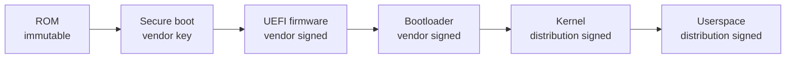
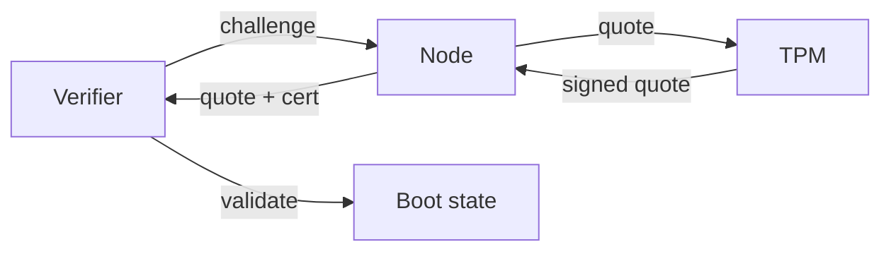
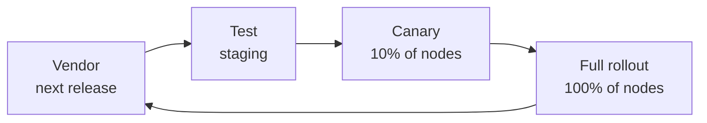

# 18.2 Hardware and firmware trust

| Field | Value |
|---|---|
| Level | Advanced |
| Priority tier | 2 |
| Lab venue | GCP / GKE |
| Part | Part 18: Security |
| Primary sources | NVIDIA Zero-to-Hero Volume 18 (`chapter-02-hardware-and-firmware-trust.md`); NVIDIA Zero-to-Hero Volume 10 (`chapter-16-hardware-and-firmware-trust.md`); *Engineering AI Systems* (`engineering-ai-systems-architecture-and-devops-essentials`, Chapter 9) |
| Cross-references | Chapter 18.1 (Threat modeling); Chapter 11.21 (GPU device plugin); Chapter 10.21 (GPU health); Chapter 18.3 (Containers and software supply chain) |
| Coverage file | `planning/coverage/chapters/18-02.md` |
| Claim & number ledger | `planning/ledgers/18-02.md` |

## Why this matters for AI infrastructure

Chapter 18.1 named the threats. This chapter is about the controls that close the threat-model gaps on the hardware and firmware layer. A GPU cluster is a collection of hardware, firmware, drivers, and workloads. Every layer is a potential attack surface; every layer is a potential control point. The team's job is to verify the hardware is trusted before the workload runs, and to keep verifying it continuously.

The hardware and firmware layer is the foundation. If the foundation is compromised, every layer above it is compromised. A model signing key on a compromised host is worthless; a supply chain attestation on a compromised GPU is worthless. The hardware and firmware trust is what makes every other security control trustworthy.

```text
Why hardware and firmware trust is on the critical path (V18 ch2; V10 ch16; EAS Ch 9):
- A typical mature AI platform runs on hundreds of GPU nodes. Each node has a
  TPM, a UEFI firmware, a BMC, a GPU, and a NIC. Each component has its own
  firmware; each firmware has its own vulnerabilities. The firmware surface is
  larger than the software surface.
- The firmware is the foundation of the boot chain. If the firmware is
  compromised, the operating system is compromised; if the operating system is
  compromised, the workload is compromised. The firmware must be trusted
  before the workload runs.
- The firmware bill of materials (FW BOM) is the inventory of every firmware
  component on every node. The FW BOM is the audit trail for the firmware
  trust. The FW BOM is what the auditor sees.
```

Three operational realities make this chapter a platform-team concern rather than a data-science-only concern:

1. **The firmware is the platform team's responsibility.** The platform team owns the GPU nodes; the platform team owns the firmware updates; the platform team owns the firmware bill of materials. The firmware trust is the platform team's discipline.
2. **The GPU attestation is a hardware-level control.** The GPU is the most expensive component in the cluster; the GPU is the most attacked component in the cluster; the GPU attestation is what proves the GPU is genuine and unmodified. The platform team's job is to deploy the GPU attestation.
3. **The supply chain integrity starts at the firmware.** A compromised firmware at the factory is a supply chain attack that bypasses every software-level control. The platform team's job is to verify the firmware provenance.

**Before a team can claim their AI factory is secure, the team must have verified that the hardware is trusted. The firmware must be trusted before the workload runs; the firmware must be re-verified continuously; the firmware bill of materials must be auditable. A team that has not verified the firmware is a team that has not verified the foundation.**

## Prerequisites and outcomes

### Prerequisites

- Chapter 18.1 (Threat modeling) for the threat context.
- Chapter 11.21 (GPU device plugin) for the GPU hardware.
- Chapter 10.21 (GPU health) for the GPU monitoring.
- Familiarity with UEFI, TPM, and measured boot.

### Outcomes

After completing this chapter you will be able to:

1. Implement UEFI secure boot on every GPU node; verify the boot chain.
2. Implement TPM-based measured boot; record the PCR values.
3. Implement GPU attestation; verify the GPU is genuine and unmodified.
4. Build the firmware bill of materials (FW BOM); track every firmware component.
5. Implement the firmware update process; verify the firmware is current and signed.
6. Operate the hardware and firmware trust on GKE with continuous verification, FW BOM tracking, and incident response.

---

## 1. UEFI secure boot

### 1.1 The secure boot chain

UEFI secure boot is the foundation of the firmware trust. The secure boot chain verifies that every firmware component is signed by a trusted key.



The chain is: ROM -> secure boot -> firmware -> bootloader -> kernel -> userspace. Each link is verified against a trusted key. If any link fails, the boot is aborted.

### 1.2 The vendor keys

The vendor keys are the trust anchors. The keys are stored in the TPM; the keys are immutable; the keys are vendor-specific.

| Vendor | Key store | Signing authority |
|---|---|---|
| Microsoft | UEFI CA | Microsoft |
| Red Hat | RHEL shim | Microsoft + Red Hat |
| Ubuntu | Canonical shim | Microsoft + Canonical |
| NVIDIA | GPU firmware | NVIDIA |

The pattern is: the vendor signs the firmware; the platform team trusts the vendor's keys; the secure boot chain verifies the signatures.

### 1.3 The platform team's role

The platform team's role is to enable secure boot on every node; the platform team verifies the boot chain; the platform team responds to boot failures.

```bash
# Verify secure boot is enabled on a node
mokutil --sb-state
# expected: SecureBoot enabled

# List the enrolled keys
mokutil --list-enrolled
# expected: the vendor keys are enrolled

# Verify the boot chain
sudo journalctl --boot | grep -i 'secure boot'
# expected: "Secure boot: enabled" appears in the log
```

The pattern is: every node has secure boot enabled; every boot is verified; every boot failure is investigated.

---

## 2. TPM-based measured boot

### 2.1 The TPM

The TPM (Trusted Platform Module) is a hardware chip that stores the keys and the measurements. The TPM is the root of trust for the firmware.

```text
TPM functions:
- PCRs (Platform Configuration Registers): store the boot measurements
- Keys: store the endorsement, attestation, and storage keys
- Random number generator: provides entropy for cryptographic operations
- Sealed storage: encrypts data that can only be unsealed by the same TPM
```

The TPM records the measurements of every boot component. The measurements are stored in the PCRs. The PCRs can be quoted (signed by the TPM's attestation key) to prove the boot state.

### 2.2 Measured boot

Measured boot records the measurements of every boot component. The measurements are stored in the TPM's PCRs. The PCRs can be quoted to prove the boot state.

```bash
# Read the PCR values
sudo tpm2_pcrread sha256
# expected: PCR0-23 are populated with the boot measurements

# Quote the PCR values
sudo tpm2_quote --key-context 0x81000000 --pcr-bank sha256 --pcrs 0,1,2,3,4,5,6,7 --out quote.bin
# expected: the quote is signed by the TPM's attestation key
```

The pattern is: the PCRs are populated at boot; the PCRs can be quoted; the quote proves the boot state.

### 2.3 Remote attestation

Remote attestation proves the boot state to a remote verifier. The verifier asks the TPM for a quote; the TPM signs the quote with the attestation key; the verifier validates the signature.



The pattern is: the verifier challenges the node; the node asks the TPM for a quote; the TPM signs the quote; the verifier validates the quote.

### 2.4 The attestation in production

The attestation is used by the workload to prove that the node is trusted. The workload reads the PCRs; the workload verifies the signature; the workload continues if the signature is valid.

```python
# code/part18/tpm_attestation.py (shape only)
import tpm2_pytss

def attest_node(pcrs: list[int], nonce: bytes) -> dict:
    """Attest the node's boot state via the TPM."""
    esys = tpm2_pytss.ESYS()
    quote = esys.quote(
        pcrs=pcrs,
        qualifying_data=nonce,
    )
    return {
        "quoted": quote.quoted,
        "signature": quote.signature,
        "attestation_key": quote.attestation_key,
    }
```

The pattern is: the workload calls the TPM for a quote; the workload validates the quote; the workload continues if the quote is valid.

---

## 3. GPU attestation

### 3.1 The NVIDIA GPU attestation

The NVIDIA GPU has a hardware root of trust. The GPU attestation proves that the GPU is genuine and unmodified.

```text
GPU attestation components:
- GPU endorsement key: stored in the GPU's fuse; unique per GPU
- GPU attestation key: derived from the endorsement key; proves the GPU is genuine
- GPU measurement: the hash of the GPU firmware; proves the firmware is unmodified
```

The pattern is: the GPU has an endorsement key; the GPU has an attestation key; the GPU has a firmware measurement. The workload can verify all three.

### 3.2 The NVIDIA NVLink Switch attestation

The NVIDIA NVLink Switch has its own attestation. The NVLink Switch attestation proves that the NVLink Switch is genuine and unmodified.

```bash
# Read the NVLink Switch attestation
nvidia-smi -q | grep -i attestation
# expected: the attestation key is present; the measurement is present

# Verify the NVLink Switch attestation
nv-switch-cli -c attestation
# expected: the attestation is valid
```

The pattern is: the NVLink Switch has an attestation; the platform team verifies the attestation; the platform team responds to attestation failures.

### 3.3 The BMC attestation

The BMC (Baseboard Management Controller) has its own attestation. The BMC attestation proves that the BMC is genuine and unmodified.

```bash
# Read the BMC attestation
ipmitool -I lanplus -H <bmc-ip> -U <user> -P <pass> raw 0x30 0x0e
# expected: the attestation is present

# Verify the BMC attestation
ipmitool -I lanplus -H <bmc-ip> -U <user> -P <pass> attestation verify
# expected: the attestation is valid
```

The pattern is: the BMC has an attestation; the platform team verifies the attestation; the platform team responds to attestation failures.

---

## 4. The firmware bill of materials

### 4.1 What the FW BOM contains

The firmware bill of materials (FW BOM) is the inventory of every firmware component on every node. The FW BOM is the audit trail for the firmware trust.

```text
FW BOM schema:
- node_id: the unique identifier of the node
- component: the firmware component (UEFI, BMC, GPU, NIC, etc.)
- version: the version of the firmware
- vendor: the vendor of the firmware
- signature_status: the status of the firmware signature (signed, unsigned, unknown)
- attestation_status: the status of the attestation (valid, invalid, unknown)
- last_verified: the timestamp of the last verification
- cve: the list of known CVEs for the firmware version
```

The pattern is: every firmware component has a record; the record is auditable; the record is tracked.

### 4.2 Building the FW BOM

The FW BOM is built by scanning every node and recording the firmware components. The scan is automated; the scan is continuous; the scan is auditable.

```bash
# Scan a node for its firmware components
python code/part18/fw_bom_scan.py \
  --node gpu-node-1 \
  --output fw_bom/gpu-node-1.yaml
# expected: the FW BOM for gpu-node-1 is generated; the components are listed
```

The pattern is: the scan is automated; the scan is continuous; the scan produces a structured record.

### 4.3 The FW BOM dashboard

The FW BOM dashboard shows the firmware status across the cluster. The dashboard is the platform team's view of the firmware trust.

```yaml
# code/part18/fw_bom_dashboard.json (shape only)
{
  "dashboard": {
    "title": "AI Factory - Firmware BOM",
    "panels": [
      {"title": "Firmware components per node", "type": "stat", "targets": [{"expr": "count by (component) (fw_bom_component)"}]},
      {"title": "Unsigned firmware components", "type": "stat", "targets": [{"expr": "count(fw_bom_component{signature_status=\"unsigned\"})"}]},
      {"title": "Firmware with known CVEs", "type": "table", "targets": [{"expr": "fw_bom_cve"}]},
      {"title": "Last FW BOM scan", "type": "stat", "targets": [{"expr": "max(fw_bom_last_verified)"}]}
    ]
  }
}
```

The pattern is: the dashboard shows the firmware status; the on-call engineer sees the dashboard when the alert fires.

---

## 5. The firmware update process

### 5.1 The firmware update cycle

The firmware update cycle is the process for updating the firmware on every node. The cycle includes: the firmware vendor releases an update; the platform team tests the update; the platform team rolls out the update to staging; the platform team rolls out the update to production.



The pattern is: the firmware is tested in staging; the firmware is canaried on 10% of nodes; the firmware is rolled out to 100% of nodes. The cycle is quarterly.

### 5.2 The firmware rollback

The firmware rollback is the process for reverting to the previous firmware version. The rollback is triggered by: the firmware causes a boot failure; the firmware causes a performance regression; the firmware introduces a CVE.

```bash
# Roll back the firmware on a node
python code/part18/fw_rollback.py \
  --node gpu-node-1 \
  --previous-version 550.54.14
# expected: the firmware is rolled back; the node boots successfully
```

The pattern is: the firmware rollback is automated; the firmware rollback is tested in staging; the firmware rollback is documented in the change log.

### 5.3 The firmware CVE monitoring

The firmware CVE monitoring is the process for tracking CVEs in the firmware. The monitoring includes: subscribing to the vendor CVE feeds; correlating the CVEs with the FW BOM; alerting on the CVEs.

```bash
# Subscribe to the vendor CVE feeds
python code/part18/fw_cve_monitor.py \
  --vendor nvidia \
  --webhook https://alertmanager.example.com/webhook
# expected: the CVE monitor subscribes to the vendor feeds; the CVEs are correlated with the FW BOM
```

The pattern is: the CVE monitoring is automated; the CVE monitoring is continuous; the CVE monitoring produces alerts.

---

## 6. Operating hardware and firmware trust on GKE

### 6.1 The components

| Component | Where it runs | Backing store | SLO |
|---|---|---|---|
| Secure boot | Every GPU node | TPM | Boot chain verified on every boot |
| TPM attestation | Every GPU node | TPM | Attestation quote generated on demand |
| GPU attestation | Every GPU | GPU fuse | GPU attestation verified on every workload start |
| FW BOM | Object storage | Object storage | FW BOM freshness < 24 hours |
| Firmware update process | CI/CD | Git history | Firmware version current |
| CVE monitoring | CI/CD | CVE feeds | CVE alert latency < 1 hour |

### 6.2 IAM and the firmware trust

The firmware trust has its own IAM. The pattern is:

| Role | Who | What they can do |
|---|---|---|
| `firmware.reader` | The platform team; the security team | Read the FW BOM; read the attestation status |
| `firmware.writer` | The platform team | Update the firmware; update the FW BOM |
| `firmware.admin` | The platform team lead | Approve the firmware update; approve the firmware rollback |

The firmware trust is the platform team's discipline. The discipline is documented; the discipline is enforced; the discipline is reviewed quarterly.

### 6.3 Observability

| Metric | Why it matters | Alert |
|---|---|---|
| Secure boot verification rate | Boot chain health | < 100% |
| TPM attestation verification rate | Attestation health | < 100% |
| GPU attestation verification rate | GPU trust | < 100% |
| Firmware with known CVEs | Vulnerability exposure | > 0 |
| Firmware version currency | Update cadence | > 90 days stale |
| FW BOM freshness | Audit trail | > 24 hours stale |

The firmware with known CVEs alert is the most important. Any firmware with a known CVE is a security exposure that the team must address.

---

## 7. How it fails

Six failure modes recur.

### 7.1 "Secure boot is disabled on a node"

**Symptom:** A node boots with secure boot disabled. The node is vulnerable to firmware attacks.

**Diagnosis:** The BIOS setting was changed; the platform team's policy is not enforced.

**Fix:** Re-enable secure boot; verify the boot chain; alert on any node with secure boot disabled.

### 7.2 "The TPM is not provisioned"

**Symptom:** A node has a TPM but the TPM is not provisioned. The TPM cannot generate quotes.

**Diagnosis:** The TPM was not initialised; the platform team's policy is not enforced.

**Fix:** Initialise the TPM; verify the attestation; alert on any node with an unprovisioned TPM.

### 7.3 "The GPU attestation fails"

**Symptom:** A workload tries to verify the GPU attestation; the attestation fails. The workload cannot run.

**Diagnosis:** The GPU firmware has been modified; the GPU is counterfeit; the GPU is compromised.

**Fix:** Investigate the GPU; replace the GPU if necessary; alert on any GPU attestation failure.

### 7.4 "The firmware is out of date"

**Symptom:** A node runs a firmware version that is more than 90 days old. The firmware has known CVEs.

**Diagnosis:** The firmware update process is not running; the firmware is not being tested.

**Fix:** Run the firmware update process; verify the firmware is current; alert on any firmware older than 90 days.

### 7.5 "The FW BOM is incomplete"

**Symptom:** A node has a firmware component that is not in the FW BOM. The audit trail is incomplete.

**Diagnosis:** The FW BOM scan did not run; the FW BOM scan missed a component.

**Fix:** Re-run the FW BOM scan; verify every component is in the FW BOM; alert on any missing component.

### 7.6 "The firmware update causes a regression"

**Symptom:** The firmware update is rolled out; the workload's performance degrades; the workload's latency spikes.

**Diagnosis:** The firmware update was not tested in staging; the firmware has a performance regression.

**Fix:** Roll back the firmware; investigate the regression; update the firmware when the vendor releases a fix.

---

## 8. Hands-on lab

This lab walks through verifying the firmware trust on a GPU node: the secure boot, the TPM attestation, the GPU attestation, the FW BOM, and the firmware update process. The lab is **untested** in this repository.

### 8.1 Prerequisites

- A GPU node with TPM, UEFI, and NVIDIA GPU.
- Access to the node's BMC.
- Access to the node's operating system.

### 8.2 Step 1: verify secure boot

```bash
# Verify secure boot is enabled
mokutil --sb-state
# expected: SecureBoot enabled
```

### 8.3 Step 2: verify the TPM

```bash
# Read the TPM version
sudo tpm2_getcap properties-fixed
# expected: the TPM is present; the TPM version is reported

# Read the PCR values
sudo tpm2_pcrread sha256
# expected: PCR0-23 are populated
```

### 8.4 Step 3: verify the GPU attestation

```bash
# Read the GPU attestation
nvidia-smi -q | grep -i attestation
# expected: the attestation is present
```

### 8.5 Step 4: build the FW BOM

```bash
# Scan the node for its firmware components
python code/part18/fw_bom_scan.py \
  --node gpu-node-1 \
  --output fw_bom/gpu-node-1.yaml
# expected: the FW BOM is generated
```

### 8.6 Step 5: update the firmware

```bash
# Apply the firmware update
python code/part18/fw_update.py \
  --node gpu-node-1 \
  --version 550.54.15
# expected: the firmware is updated; the node reboots; the FW BOM is updated
```

### 8.7 Step 6: verify the firmware update

```bash
# Verify the firmware is current
python code/part18/fw_verify.py \
  --node gpu-node-1 \
  --expected-version 550.54.15
# expected: the firmware is verified; the FW BOM is updated
```

### 8.8 What to record

After the lab, you should be able to answer five questions in five seconds each:

1. What is the current secure boot verification rate?
2. What is the current TPM attestation verification rate?
3. What is the current GPU attestation verification rate?
4. What is the current firmware version?
5. What is the current number of firmware CVEs?

If any takes more than 30 seconds, the hardware and firmware trust is not yet a production service. The lab is **untested** against a live GKE cluster.

---

## Exercises

1. **Add a secure boot alert.** Configure an alert that fires when secure boot is disabled on any node. *Solution sketch:* a Prometheus exporter for the boot state; an alert that fires when the boot state is not "SecureBoot enabled".
2. **Add a TPM attestation alert.** Configure an alert that fires when the TPM attestation fails on any node. *Solution sketch:* a Prometheus exporter for the TPM; an alert that fires when the attestation is invalid.
3. **Add a GPU attestation alert.** Configure an alert that fires when the GPU attestation fails on any GPU. *Solution sketch:* a Prometheus exporter for the GPU; an alert that fires when the attestation is invalid.
4. **Add a firmware CVE alert.** Configure an alert that fires when a firmware component has a known CVE. *Solution sketch:* a Prometheus alert on the FW BOM CVE field; the alert fires when the field is non-empty.
5. **Add a firmware update process.** Configure a CI/CD pipeline that updates the firmware quarterly. *Solution sketch:* a CI/CD pipeline that runs the firmware update script; the pipeline verifies the firmware is current.
6. **Add a firmware rollback process.** Configure a CI/CD pipeline that rolls back the firmware when an alert fires. *Solution sketch:* a CI/CD pipeline that runs the firmware rollback script; the pipeline verifies the firmware is rolled back.

---

## Checkpoint questions

<details><summary>1. What is UEFI secure boot?</summary>
The foundation of the firmware trust. The secure boot chain verifies that every firmware component (ROM, secure boot, firmware, bootloader, kernel, userspace) is signed by a trusted key. If any link fails, the boot is aborted. Secure boot is enabled on every node; every boot is verified.
</details>

<details><summary>2. What is the TPM?</summary>
A hardware chip that stores the keys and the measurements. The TPM is the root of trust for the firmware. The TPM has PCRs (Platform Configuration Registers) that store the boot measurements; the PCRs can be quoted to prove the boot state.
</details>

<details><summary>3. What is measured boot?</summary>
The process of recording the measurements of every boot component. The measurements are stored in the TPM's PCRs. The PCRs can be quoted (signed by the TPM's attestation key) to prove the boot state. Measured boot is the foundation of remote attestation.
</details>

<details><summary>4. What is remote attestation?</summary>
The process of proving the boot state to a remote verifier. The verifier challenges the node; the node asks the TPM for a quote; the TPM signs the quote; the verifier validates the signature. Remote attestation is the foundation of the workload's trust in the node.
</details>

<details><summary>5. What is the firmware bill of materials?</summary>
The inventory of every firmware component on every node. The FW BOM has the node id, the component, the version, the vendor, the signature status, the attestation status, the last verified, and the CVE list. The FW BOM is the audit trail for the firmware trust.
</details>

<details><summary>6. What is the most common firmware trust failure?</summary>
Secure boot is disabled on a node. The node is vulnerable to firmware attacks. The diagnosis is that the BIOS setting was changed; the platform team's policy is not enforced. The fix is to re-enable secure boot; verify the boot chain; alert on any node with secure boot disabled.
</details>

<details><summary>7. What is the second most common firmware trust failure?</summary>
The TPM is not provisioned. The TPM cannot generate quotes. The diagnosis is that the TPM was not initialised. The fix is to initialise the TPM; verify the attestation; alert on any node with an unprovisioned TPM.
</details>

<details><summary>8. What is the most dangerous firmware trust failure?</summary>
The GPU attestation fails. The workload tries to verify the GPU attestation; the attestation fails. The GPU firmware has been modified; the GPU is counterfeit; the GPU is compromised. The fix is to investigate the GPU; replace the GPU if necessary.
</details>

<details><summary>9. What is the most common firmware update failure?</summary>
The firmware is out of date. A node runs a firmware version that is more than 90 days old. The firmware has known CVEs. The diagnosis is that the firmware update process is not running. The fix is to run the firmware update process; verify the firmware is current.
</details>

<details><summary>10. What is the relationship between secure boot and TPM?</summary>
Secure boot verifies the signatures of every firmware component. The TPM stores the measurements of every firmware component. Together, they form the boot chain: secure boot verifies the signatures; the TPM records the measurements. The boot chain is the foundation of the firmware trust.
</details>

<details><summary>11. What is the relationship between TPM attestation and remote attestation?</summary>
TPM attestation is the local process of generating a quote. Remote attestation is the network process of sending the quote to a verifier. The verifier validates the quote; the verifier trusts the TPM's attestation key. Together, they form the attestation chain.
</details>

<details><summary>12. What is the relationship between GPU attestation and workload trust?</summary>
The GPU attestation proves that the GPU is genuine and unmodified. The workload reads the attestation; the workload verifies the attestation; the workload continues if the attestation is valid. The workload trust is built on the GPU attestation.
</details>

<details><summary>13. What is the difference between TPM and GPU attestation?</summary>
The TPM attests the host (the CPU, the firmware, the bootloader). The GPU attests the GPU itself. Both are needed for full attestation: the workload needs to trust the host and the GPU. The workload's trust chain includes both the TPM and the GPU attestation.
</details>

<details><summary>14. What is the firmware update cycle?</summary>
Vendor release -> test in staging -> canary on 10% of nodes -> full rollout to 100% of nodes -> vendor's next release. The cycle is quarterly. The firmware is tested in staging; the firmware is canaried on 10% of nodes; the firmware is rolled out to 100% of nodes.
</details>

<details><summary>15. What is the firmware rollback?</summary>
The process for reverting to the previous firmware version. The rollback is triggered by: the firmware causes a boot failure; the firmware causes a performance regression; the firmware introduces a CVE. The rollback is automated; the rollback is tested in staging; the rollback is documented.
</details>

<details><summary>16. What is the most important firmware trust metric?</summary>
Firmware with known CVEs. The metric tells the team which firmware components have known CVEs. Any firmware with a known CVE is a security exposure that the team must address. The alert fires when the field is non-empty.
</details>

<details><summary>17. What is the FW BOM cadence?</summary>
The FW BOM is scanned daily. The scan is automated; the scan is continuous; the scan produces a structured record. The FW BOM freshness is less than 24 hours; the alert fires when the FW BOM is older than 24 hours.
</details>

<details><summary>18. What is the relationship between the FW BOM and the threat model?</summary>
The threat model identifies the threats to the firmware (T-005: Container image supply chain attack; T-006: GPU memory scraping). The FW BOM is the audit trail for the controls that mitigate the threats. The FW BOM is the evidence that the controls are working.
</details>

<details><summary>19. Why is hardware and firmware trust a Tier 2 chapter?</summary>
Because the hardware and firmware trust is the foundation of the security controls. Without the firmware trust, every other control is compromised. The firmware trust is what the platform team owns; the firmware trust is what the regulator sees; the firmware trust is what the auditor inspects.
</details>

<details><summary>20. What five questions should the firmware trust lab let you answer in five seconds each?</summary>
What is the current secure boot verification rate. What is the current TPM attestation verification rate. What is the current GPU attestation verification rate. What is the current firmware version. What is the current number of firmware CVEs. If any takes more than 30 seconds, the hardware and firmware trust is not yet a production service.
</details>

---

## Sources and review notes

- NVIDIA Zero-to-Hero Volume 18 (`chapter-02-hardware-and-firmware-trust.md`). Source for the secure boot, TPM, GPU attestation, FW BOM, and firmware update process. The wording has been rewritten in the handbook's voice.
- NVIDIA Zero-to-Hero Volume 10 (`chapter-16-hardware-and-firmware-trust.md`). Source for the operational patterns and the firmware update cycle.
- *Engineering AI Systems* (`engineering-ai-systems-architecture-and-devops-essentials`, Chapter 9). Source for the security patterns and the firmware trust model.

### Cross-references to other handbook chapters

- Chapter 18.1 for the threat-model context.
- Chapter 11.21 for the GPU device plugin.
- Chapter 10.21 for the GPU health.
- Chapter 18.3 for the container and software supply chain.

### Migrated from `nvidia-devops`

The hardware and firmware trust operational patterns draw on Volume 18 chapter 2 and Volume 10 chapter 16. The wording has been rewritten in the handbook's voice.

### Explicitly labelled inferences

- The firmware update cycle (quarterly) is a starting point; specific cadences depend on the vendor's release cadence and the team's risk tolerance.
- The FW BOM scan frequency (daily) is a starting point; specific frequencies depend on the team's audit requirements.
- The attestation verification rate (100%) is the goal; specific rates depend on the attestation implementation.

### Not verified on live hardware

- The lab in Section 8 is **untested** against a live GKE cluster in this repository.
- The secure boot verification commands assume a node with UEFI firmware; production deployments may vary.
- The TPM attestation commands assume a node with a TPM 2.0; production deployments may vary.
