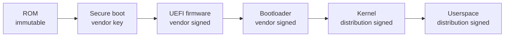
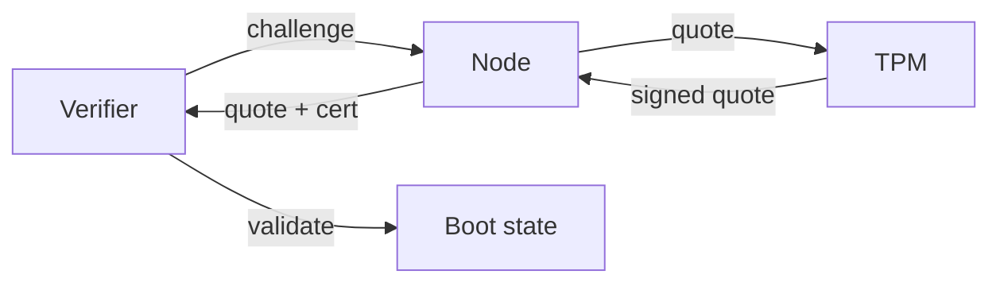
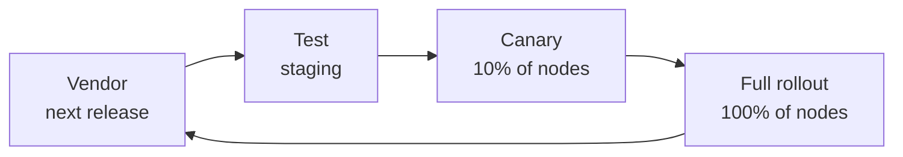

# 18.2 Hardware and firmware trust

| Field | Value |
|---|---|
| Level | Advanced |
| Priority tier | 2 |
| Lab venue | GCP / GKE |
| Part | Part 18: Security |
| Primary sources | NVIDIA Zero-to-Hero Volume 18 (`chapter-02-hardware-and-firmware-trust.md`); NVIDIA Zero-to-Hero Volume 10 (`chapter-16-hardware-and-firmware-trust.md`); *Engineering AI Systems* (`engineering-ai-systems-architecture-and-devops-essentials`, Chapter 9) |
| Cross-references | Chapter 18.1 (Threat modeling); Chapter 11.2 (device plugin and container toolkit); Chapter 10.21 (GPU health); Chapter 18.3 (Containers and software supply chain) |
| Coverage file | `planning/coverage/chapters/18-02.md` |
| Claim & number ledger | `planning/ledgers/18-02.md` |

## Why this matters for AI infrastructure

Chapter 18.1 listed the threats to your GPU platform. This chapter covers the controls that close the gaps at the hardware and firmware layer. A GPU cluster is a stack of hardware, firmware, drivers, and workloads, and any layer in that stack can be attacked. Your job is to confirm that the hardware is trusted before a workload runs, and then to keep checking.

The firmware sits at the bottom of that stack, so a problem there reaches everything above it. A model signing key on a compromised host protects nothing. A supply chain attestation for a tampered GPU proves nothing either. Hardware and firmware trust is what gives every other security control its value.

```text
Why hardware and firmware trust is on the critical path (background reading: NVIDIA Zero-to-Hero volume 18; NVIDIA Zero-to-Hero volume 10; Engineering AI Systems; the figures below are examples, not quotations):
- A typical mature AI platform runs on hundreds of GPU nodes. Each node has a
  TPM, a UEFI firmware, a BMC, a GPU, and a NIC. Each component has its own
  firmware; each firmware has its own vulnerabilities. The firmware surface is
  larger than the software surface.
- The firmware is the foundation of the boot chain. If the firmware is
  compromised, the operating system is compromised; if the operating system is
  compromised, the workload is compromised. The firmware must be trusted
  before the workload runs.
- The firmware bill of materials (FW BOM) is the inventory of every firmware
  component on every node. The FW BOM is the audit trail for the firmware
  trust. The FW BOM is what the auditor sees.
```

Three realities make this a platform team concern, not only a data science concern.

1. Firmware belongs to the platform team. The platform team owns the GPU nodes, the firmware updates, and the firmware bill of materials, so firmware trust is part of its daily work.
2. GPU attestation is a hardware control. The GPU is the most expensive part of the node and a frequent target, so you need proof that it is genuine and unmodified. Deploying GPU attestation is the platform team's job.
3. Supply chain trust starts in the factory. Firmware tampered with before it reaches your data center bypasses every software control you run. Verifying firmware provenance is therefore part of the platform team's job too.

**Verify the hardware before the workload runs, and keep verifying it.** A team that has not checked its firmware has not checked its foundation.

## Prerequisites and outcomes

Firmware work touches the boot process, so a mistake here can stop a node from starting at all. Check the prerequisites below before you touch a node's firmware.

### Prerequisites

- Chapter 18.1 (Threat modeling), for the threat context.
- Chapter 11.2 (device plugin and container toolkit), for the GPU hardware.
- Chapter 10.21 (GPU health), for GPU monitoring.
- Working familiarity with UEFI, TPM, and measured boot.

### Outcomes

After completing this chapter you will be able to:

1. Turn on UEFI secure boot on every GPU node, and verify the boot chain.
2. Turn on TPM-based measured boot, and read the PCR values.
3. Check GPU attestation, and confirm that the GPU is genuine and unmodified.
4. Build the firmware bill of materials (FW BOM), and track every firmware component.
5. Run the firmware update process, and confirm that firmware is current and signed.
6. Operate hardware and firmware trust on GKE, with continuous verification, FW BOM tracking, and incident response.

---

## 1. UEFI secure boot

### 1.1 The secure boot chain

Imagine a node that boots a modified bootloader. The machine starts, the operating system loads, and nobody notices the change until someone uses it. Secure boot is the control that catches this, because it checks every stage before that stage is allowed to run.



The chain runs in this order: ROM, secure boot, firmware, bootloader, kernel, and then userspace. Each link is checked against a trusted key. If any link fails, the boot stops, so a node with a bad component never reaches the workload.

### 1.2 The vendor keys

The vendor keys are the trust anchors of the chain. Every check ultimately depends on them. The vendor's public keys are stored in firmware, in the UEFI key databases. The TPM holds the measurements and its own keys. Each vendor has its own key.

The table shows who signs each layer you will meet on a typical GPU node.

| Vendor | Key store | Signing authority |
|---|---|---|
| Microsoft | UEFI CA | Microsoft |
| Red Hat | RHEL shim | Microsoft + Red Hat |
| Ubuntu | Canonical shim | Microsoft + Canonical |
| NVIDIA | GPU firmware | NVIDIA |

### 1.3 The platform team's role

Check secure boot on a new node before it joins the cluster, not after the first incident. The platform team turns secure boot on for every node, verifies the boot chain, and responds when a boot fails. The three commands below show what a healthy node reports.

```bash
# Verify secure boot is enabled on a node
mokutil --sb-state
# expected: SecureBoot enabled

# List the enrolled keys
mokutil --list-enrolled
# expected: the vendor keys are enrolled

# Verify the boot chain
sudo journalctl --boot | grep -i 'secure boot'
# expected: "Secure boot: enabled" appears in the log
```

If the first command does not report SecureBoot enabled, keep that node away from GPU workloads until it passes.

---

## 2. TPM-based measured boot

### 2.1 The TPM

Secure boot blocks code that is not signed, but it does not leave a record of what booted. The TPM, a Trusted Platform Module, fills that gap. It is a hardware chip that stores keys and measurements, and it is the root of trust for the firmware.

```text
TPM functions:
- PCRs (Platform Configuration Registers): store the boot measurements
- Keys: store the endorsement, attestation, and storage keys
- Random number generator: provides entropy for cryptographic operations
- Sealed storage: encrypts data that can only be unsealed by the same TPM
```

The TPM records a measurement of every boot component, and it keeps those measurements in PCRs. A PCR value can be quoted, which means the TPM signs it with its attestation key. A signed quote is the proof of the boot state that you can hand to another system.

### 2.2 Measured boot

Measured boot is the recording step. It stores a measurement of every boot component in the TPM's PCRs, so you can later see exactly what booted. Read the PCRs to see the current values, and quote them when another system needs proof.

```bash
# Read the PCR values
sudo tpm2_pcrread sha256
# expected: PCR0-23 are populated with the boot measurements

# Quote the PCR values
sudo tpm2_quote --key-context 0x81000000 --pcr-bank sha256 --pcrs 0,1,2,3,4,5,6,7 --out quote.bin
# expected: the quote is signed by the TPM's attestation key
```

### 2.3 Remote attestation

Remote attestation lets a verifier check a node's boot state from another machine. Instead of trusting the node's own report, the verifier asks the TPM for proof. Decide which service plays the verifier before you build the flow, so that one owner is responsible for the answer.

The verifier sends a challenge. The node asks its TPM for a quote, and the TPM signs it. The verifier then checks the signature before it trusts the boot state.



Do not confuse this with node attestation in SPIRE. Production Kubernetes, chapter 10, describes node attestation as the step where a SPIRE agent identifies its node, so the server can issue that node an identity. The book presents it as identification, not as a check of the boot state.

### 2.4 The attestation in production

A workload that depends on a node should wait until the node proves its boot state. The snippet below shows one way to request a quote. The function takes a nonce, which is a value from the verifier, and passes it into the quote.

```python
# code/part18/snippets/tpm_attestation.py
import tpm2_pytss

def attest_node(pcrs: list[int], nonce: bytes) -> dict:
    """Attest the node's boot state via the TPM."""
    esys = tpm2_pytss.ESYS()
    quote = esys.quote(
        pcrs=pcrs,
        qualifying_data=nonce,
    )
    return {
        "quoted": quote.quoted,
        "signature": quote.signature,
        "attestation_key": quote.attestation_key,
    }
```

In production, the workload reads the PCRs, verifies the signature, and continues only if the signature is valid. Confirm that this call succeeds on each node before you schedule GPU work onto it.

---

## 3. GPU attestation

### 3.1 The NVIDIA GPU attestation

Picture a GPU that was swapped for a copy somewhere between the factory and your rack. It looks the same, it boots, and it runs your jobs. Only a check against the hardware itself can reveal the difference. GPU attestation is that check, and it proves that the GPU is genuine and unmodified.

```text
GPU attestation components:
- GPU endorsement key: provisioned by the vendor in the GPU; unique per GPU
- GPU attestation key: derived from the endorsement key; proves the GPU is genuine
- GPU measurement: the hash of the GPU firmware; proves the firmware is unmodified
```

The GPU carries three pieces you can verify. These are an endorsement key, an attestation key derived from it, and a measurement of the GPU firmware. A workload can check all three before it starts.

### 3.2 The NVIDIA NVLink Switch attestation

The NVLink Switch has its own attestation, separate from the GPU's. Check it the same way you check the GPU. Treat a failure as a reason to investigate before you run more jobs.

```bash
# Read the NVLink Switch attestation
nvidia-smi -q | grep -i attestation
# expected: the attestation key is present; the measurement is present

# Verify the NVLink Switch attestation
# Illustrative command: check NVIDIA's NVSwitch documentation for the real attestation tool
nv-switch-cli -c attestation
# expected: the attestation is valid
```

The platform team verifies the switch attestation and responds when it fails.

### 3.3 The BMC attestation

The BMC, or baseboard management controller, has its own attestation. It proves that the BMC is genuine and unmodified. The BMC sits outside the operating system, so check it as well and do not assume the operating system's checks cover it.

```bash
# Read the BMC attestation
ipmitool -I lanplus -H <bmc-ip> -U <user> -P <pass> raw 0x30 0x0e
# expected: the attestation is present

# Verify the BMC attestation
# Illustrative: ipmitool has no 'attestation verify' command; BMC attestation goes through the vendor's Redfish or management tooling
ipmitool -I lanplus -H <bmc-ip> -U <user> -P <pass> attestation verify
# expected: the attestation is valid
```

---

## 4. The firmware bill of materials

### 4.1 What the FW BOM contains

Ask a simple question: which firmware is running on gpu-node-1 right now? If you cannot answer that quickly, your audit trail has a gap. The firmware bill of materials, or FW BOM, is the inventory that closes that gap, with one record for every firmware component on every node.

```text
FW BOM schema:
- node_id: the unique identifier of the node
- component: the firmware component (UEFI, BMC, GPU, NIC, etc.)
- version: the version of the firmware
- vendor: the vendor of the firmware
- signature_status: the status of the firmware signature (signed, unsigned, unknown)
- attestation_status: the status of the attestation (valid, invalid, unknown)
- last_verified: the timestamp of the last verification
- cve: the list of known CVEs for the firmware version
```

Each record shows the state of one component at one point in time. A record that marks a component as unsigned, or that lists a known CVE, is a finding you must act on, not a footnote.

### 4.2 Building the FW BOM

Build the FW BOM by scanning every node and recording what the scan finds. Run the scan on a schedule, so the inventory does not fall far behind the real state of the cluster. Save each node's output in a location your auditors can reach later.

```bash
# Scan a node for its firmware components
python code/part18/fw_bom_scan.py \
  --node gpu-node-1 \
  --output fw_bom/gpu-node-1.yaml
# expected: the FW BOM for gpu-node-1 is generated; the components are listed
```

### 4.3 The FW BOM dashboard

A dashboard puts the FW BOM for the whole cluster in one view. That makes it the platform team's daily view of firmware trust. Look at the unsigned-component and CVE panels first, because they show risk, while the inventory panels only show what you have.

```yaml
# code/part18/fw_bom_dashboard.json
{
  "dashboard": {
    "title": "AI Factory - Firmware BOM",
    "panels": [
      {"title": "Firmware components per node", "type": "stat", "targets": [{"expr": "count by (component) (fw_bom_component)"}]},
      {"title": "Unsigned firmware components", "type": "stat", "targets": [{"expr": "count(fw_bom_component{signature_status=\"unsigned\"})"}]},
      {"title": "Firmware with known CVEs", "type": "table", "targets": [{"expr": "fw_bom_cve"}]},
      {"title": "Last FW BOM scan", "type": "stat", "targets": [{"expr": "max(fw_bom_last_verified)"}]}
    ]
  }
}
```

---

## 5. The firmware update process

### 5.1 The firmware update cycle

A vendor ships a firmware update that fixes a security bug. Do you push it to every node tonight? Don't. Test the update in staging first, then roll it out in stages so a bad update reaches only a few nodes at a time.

The cycle in this chapter has four steps: the vendor releases the update, your team tests it in staging, a canary group of nodes runs it, and then the full fleet gets it. The chapter uses 10 percent for the canary group and a quarterly cycle as examples. Choose your own canary size and cadence. Each step must pass before the next one starts.



The same idea appears for container images. Production Kubernetes, chapter 15, describes signing an image at each pipeline stage, then having the deployment check those signatures before it runs. The book also notes that signing tools were hard to adopt, because they need extra services and careful key rotation. If your firmware vendor signs its updates, you can apply the same check before any update reaches a node.

### 5.2 The firmware rollback

Roll back when a new firmware version breaks something. The chapter lists three triggers: a boot failure, a performance regression, or a new CVE. A rollback you have never run is a guess, so test it in staging as well.

```bash
# Roll back the firmware on a node
python code/part18/fw_rollback.py \
  --node gpu-node-1 \
  --previous-version 550.54.14
# expected: the firmware is rolled back; the node boots successfully
```

### 5.3 The firmware CVE monitoring

A check you ran last month does not tell you about a CVE published yesterday. That is why CVE monitoring needs a feed that keeps watching. The monitor subscribes to the vendor feeds, matches each CVE against the FW BOM, and sends an alert when a match appears.

```bash
# Subscribe to the vendor CVE feeds
python code/part18/fw_cve_monitor.py \
  --vendor nvidia \
  --webhook https://alertmanager.example.com/webhook
# expected: the CVE monitor subscribes to the vendor feeds; the CVEs are correlated with the FW BOM
```

The monitor runs automatically and keeps running, so it can produce alerts at any hour. Start by alerting on the components that matter most to your fleet.

---

## 6. Operating hardware and firmware trust on GKE

### 6.1 The components

Each control needs an owner, a place where its data lives, and a target it must meet. The table lists those for the six controls in this chapter. The two time limits in it, 24 hours and 1 hour, are example values. Your team should set its own targets based on its risk and its audit needs.

| Component | Where it runs | Backing store | SLO |
|---|---|---|---|
| Secure boot | Every GPU node | TPM | Boot chain verified on every boot |
| TPM attestation | Every GPU node | TPM | Attestation quote generated on demand |
| GPU attestation | Every GPU | GPU fuse | GPU attestation verified on every workload start |
| FW BOM | Object storage | Object storage | FW BOM freshness < 24 hours |
| Firmware update process | CI/CD | Git history | Firmware version current |
| CVE monitoring | CI/CD | CVE feeds | CVE alert latency < 1 hour |

### 6.2 IAM and the firmware trust

Firmware changes deserve tighter access than ordinary cluster changes. A single shared account that can both read and rewrite firmware records makes every change hard to trace. Split the rights into reader, writer, and admin roles, as the table shows.

| Role | Who | What they can do |
|---|---|---|
| `firmware.reader` | The platform team and the security team | Read the FW BOM; read the attestation status |
| `firmware.writer` | The platform team | Update the firmware; update the FW BOM |
| `firmware.admin` | The platform team lead | Approve the firmware update; approve the firmware rollback |

These roles are an example pattern. Map them onto your own identity system, and review who holds each role on a schedule you choose.

### 6.3 Observability

Track one metric for each control, and alert when that metric leaves its healthy state. The thresholds in the table, such as 90 days for firmware age, are example values, not standards. Set them to match what your team can act on.

| Metric | Why it matters | Alert |
|---|---|---|
| Secure boot verification rate | Boot chain health | < 100% |
| TPM attestation verification rate | Attestation health | < 100% |
| GPU attestation verification rate | GPU trust | < 100% |
| Firmware with known CVEs | Vulnerability exposure | > 0 |
| Firmware version currency | Update cadence | > 90 days stale |
| FW BOM freshness | Audit trail | > 24 hours stale |

Of these, the alert for firmware with known CVEs matters most. Any such firmware is an exposure the team must address, so treat a count above zero as urgent.

---

## 7. How it fails

The chapter lists six failure modes. Start from the symptom you can see, then work back to the cause. Each entry below gives the symptom, the likely diagnosis, and the fix.

### 7.1 "Secure boot is disabled on a node"

A BIOS setting changed, and nothing caught it. The node now boots without checking signatures, so a firmware attack has a way in.

**Symptom:** The node boots with secure boot turned off.

**Diagnosis:** The BIOS setting changed, and the platform team's policy was not enforced.

**Fix:** Turn secure boot back on, verify the boot chain, and alert on any node that boots with it off.

### 7.2 "The TPM is not provisioned"

A TPM that was never set up is only a chip on the board. It cannot produce the quotes that attestation depends on.

**Symptom:** The node has a TPM, but the TPM is not provisioned, so it cannot generate quotes.

**Diagnosis:** Nobody initialised the TPM, and the platform policy did not catch it.

**Fix:** Initialise the TPM, confirm that attestation works, and alert on any node with an unprovisioned TPM.

### 7.3 "The GPU attestation fails"

This is the failure that should stop you cold. A workload checks the GPU, the check fails, and the workload cannot start. A failed check does not say which cause is behind it.

**Symptom:** A workload checks the GPU attestation, and the check fails. The workload cannot run.

**Diagnosis:** The GPU firmware may have been modified, the GPU may be counterfeit, or the GPU may be compromised. Investigation tells these apart.

**Fix:** Investigate the GPU, replace it if the investigation confirms a problem, and alert on any GPU attestation failure.

### 7.4 "The firmware is out of date"

Old firmware can carry known CVEs that newer releases have fixed. Decide on an age limit that your team can act on. The chapter uses 90 days as an example.

**Symptom:** A node runs firmware older than the age limit, and that firmware may carry known CVEs.

**Diagnosis:** The firmware update process is not running, so newer firmware is never tested.

**Fix:** Run the update process, confirm the firmware is current, and alert on any node past the age limit.

### 7.5 "The FW BOM is incomplete"

An inventory with a missing component is an audit trail with a hole in it. The hole matters most when you need the record during an incident.

**Symptom:** A node has a firmware component that is missing from the FW BOM.

**Diagnosis:** The FW BOM scan did not run, or it missed a component.

**Fix:** Run the scan again, confirm that every component appears, and alert on any missing component.

### 7.6 "The firmware update causes a regression"

A firmware update can make a workload slower even though it installed cleanly. The update should have been tested in staging before the rollout started.

**Symptom:** After the firmware update, the workload slows down and its latency rises.

**Diagnosis:** The update skipped staging, and the firmware has a performance regression.

**Fix:** Roll the firmware back, find the cause of the regression, and update again only after the vendor ships a fix.

---

## 8. Hands-on lab

This lab checks the firmware trust of one GPU node. You will verify secure boot, the TPM, and the GPU attestation. Then you will build the FW BOM and run a firmware update. The lab is **untested** in this repository, so run each step on a staging node first.

### 8.1 Prerequisites

Before you start, confirm that the node has a TPM, UEFI firmware, and an NVIDIA GPU. You also need access to its BMC and to its operating system.

### 8.2 Step 1: verify secure boot

Start with the simplest check. Confirm that secure boot is on before you look at anything else.

```bash
# Verify secure boot is enabled
mokutil --sb-state
# expected: SecureBoot enabled
```

### 8.3 Step 2: verify the TPM

Next, confirm that the TPM is present and that its PCRs hold values.

```bash
# Read the TPM version
sudo tpm2_getcap properties-fixed
# expected: the TPM is present; the TPM version is reported

# Read the PCR values
sudo tpm2_pcrread sha256
# expected: PCR0-23 are populated
```

### 8.4 Step 3: verify the GPU attestation

Then check the GPU attestation with `nvidia-smi`.

```bash
# Read the GPU attestation
nvidia-smi -q | grep -i attestation
# expected: the attestation is present
```

### 8.5 Step 4: build the FW BOM

Scan the node so you have a record of its firmware components.

```bash
# Scan the node for its firmware components
python code/part18/fw_bom_scan.py \
  --node gpu-node-1 \
  --output fw_bom/gpu-node-1.yaml
# expected: the FW BOM is generated
```

### 8.6 Step 5: update the firmware

Apply the update, after the staging test has passed.

```bash
# Apply the firmware update
python code/part18/fw_update.py \
  --node gpu-node-1 \
  --version 550.54.15
# expected: the firmware is updated; the node reboots; the FW BOM is updated
```

### 8.7 Step 6: verify the firmware update

Last, confirm that the node runs the version you expected.

```bash
# Verify the firmware is current
python code/part18/fw_verify.py \
  --node gpu-node-1 \
  --expected-version 550.54.15
# expected: the firmware is verified; the FW BOM is updated
```

### 8.8 What to record

After the lab, you should be able to answer five questions in about five seconds each. The chapter's five seconds is an example target, not a standard. The five questions are below.

1. What is the current secure boot verification rate?
2. What is the current TPM attestation verification rate?
3. What is the current GPU attestation verification rate?
4. What is the current firmware version?
5. What is the current number of firmware CVEs?

The chapter treats 30 seconds as the example limit for any one answer. If an answer takes longer than that, the firmware trust is not yet ready to run as a production service. The lab is **untested** against a live GKE cluster.

---

## Exercises

These exercises turn the chapter's controls into alerts and pipelines. Build each one on a staging node before you touch production.

1. **Add a secure boot alert.** Set up an alert that fires when secure boot is off on any node. *Solution sketch:* write a Prometheus exporter for the boot state, then alert whenever the state is not `SecureBoot enabled`.
2. **Add a TPM attestation alert.** Set up an alert that fires when TPM attestation fails on any node. *Solution sketch:* write a Prometheus exporter for the TPM, then alert when the attestation is invalid.
3. **Add a GPU attestation alert.** Set up an alert that fires when GPU attestation fails on any GPU. *Solution sketch:* write a Prometheus exporter for the GPU, then alert when the attestation is invalid.
4. **Add a firmware CVE alert.** Set up an alert that fires when a firmware component has a known CVE. *Solution sketch:* write a Prometheus alert on the FW BOM CVE field, which fires when the field is not empty.
5. **Add a firmware update process.** Build a CI/CD pipeline that updates firmware on the cadence you choose. The chapter uses quarterly as an example. *Solution sketch:* the pipeline runs the update script, then checks that the firmware is current.
6. **Add a firmware rollback process.** Build a CI/CD pipeline that rolls firmware back when an alert fires. *Solution sketch:* the pipeline runs the rollback script, then checks that the previous version is running.

---

## Checkpoint questions

<details><summary>1. You add a new GPU node and `mokutil --sb-state` does not report SecureBoot enabled. What do you do before it takes work?</summary>
Keep the node away from GPU workloads until the check passes. The likely cause is a BIOS setting that changed and a policy that was not enforced. Turn secure boot back on, verify the boot chain, and alert on any node that boots with it off.
</details>

<details><summary>2. A node has a TPM, but the attestation flow cannot get a quote from it. What is the likely cause and the fix?</summary>
The TPM was never initialised, so it cannot generate quotes. Nobody set it up and the platform policy did not catch the gap. Initialise the TPM, confirm that attestation works, and alert on any node with an unprovisioned TPM.
</details>

<details><summary>3. A workload checks the GPU attestation and the check fails, so the workload cannot start. What could be behind it and what do you do?</summary>
The GPU firmware may have been modified, the GPU may be counterfeit, or the GPU may be compromised. The failed check does not say which one, so investigation has to tell them apart. Replace the GPU if the investigation confirms a problem, and alert on every attestation failure.
</details>

<details><summary>4. The FW BOM dashboard shows a node on firmware older than the 90-day example limit, and that firmware has a known CVE. What is the likely diagnosis and fix?</summary>
The firmware update process is not running, so newer firmware is never tested and never reaches the node. Run the update process, confirm the firmware is current, and alert on any node past the age limit. The known CVE is an exposure to address, not a footnote.
</details>

<details><summary>5. A node fails to boot after a firmware update. What do you do?</summary>
A boot failure is one of the three rollback triggers in the chapter. Roll the node back to the previous version with the rollback script and check that the node boots. A rollback you have never run is a guess, so the chapter says to test it in staging as well.
</details>

<details><summary>6. An auditor asks which firmware runs on gpu-node-1 and you find one component missing from its FW BOM record. What happened and how do you fix it?</summary>
Either the FW BOM scan did not run or it missed a component. The inventory now has a hole exactly where you need it during an incident. Run the scan again, confirm that every component appears, and alert on any missing component.
</details>

<details><summary>7. Why does a compromised firmware make a model signing key on that host worthless?</summary>
Firmware is the foundation of the boot chain. If it is compromised, the operating system is compromised, and then the workload is compromised. Every control above it, including a signing key, runs on a base the attacker controls.
</details>

<details><summary>8. Secure boot already blocks unsigned code. Why do you also need measured boot?</summary>
Secure boot stops code that is not signed, but it leaves no record of what booted. Measured boot stores a measurement of every boot component in the TPM's PCRs. You can later read the PCRs, or quote them, to see exactly what booted.
</details>

<details><summary>9. Why does remote attestation ask the TPM for a signed quote instead of accepting the node's own report?</summary>
A node that is compromised could say anything in its own report. The verifier sends a challenge, the node asks its TPM for a quote, and the TPM signs it with its attestation key. The verifier checks that signature before it trusts the boot state.
</details>

<details><summary>10. A node passes its TPM quote. Why does that not prove its GPU is genuine?</summary>
The TPM attests the host, including the firmware and bootloader. GPU attestation covers the GPU itself through its endorsement key, attestation key, and firmware measurement. The NVLink Switch and the BMC have their own attestations too, and the BMC sits outside the operating system, so those checks do not cover it.
</details>

<details><summary>11. A colleague says SPIRE node attestation already does what TPM remote attestation does. What is the confusion?</summary>
Production Kubernetes chapter 10 describes SPIRE node attestation as the step where a SPIRE agent identifies its node so the server can issue it an identity. It is identification, not a check of the boot state. TPM remote attestation is the one that proves what booted.
</details>

<details><summary>12. A vendor ships a security fix. When would you push it to every node at once, and when would you stage it?</summary>
The chapter says to stage it. Test it in staging, then run it on a canary group, then roll it out to the fleet, and let each step pass before the next starts. You give up speed, and in return a bad update reaches only a few nodes at a time. The chapter's 10 percent canary and quarterly cycle are examples you can change.
</details>

<details><summary>13. A firmware update caused a regression and you roll back. What do you give up by doing so?</summary>
You return to the previous version, which does not carry the changes in the update you rolled back. Update again only after the vendor ships a fix for the regression. In the meantime you also need to find the cause of the regression.
</details>

<details><summary>14. When would you alert on every firmware component and when only on the ones that matter most to your fleet?</summary>
The chapter says to start by alerting on the components that matter most. A narrow start keeps the alerts readable and gives each one an owner who can act. The cost is that components outside the list can go unwatched until you widen it.
</details>

<details><summary>15. Why does the chapter split firmware access into reader, writer, and admin roles instead of one shared account, and what does it cost you?</summary>
A single shared account that can both read and rewrite firmware records makes every change hard to trace. Separate roles let only the platform team lead approve an update or a rollback. The cost is more roles to map onto your identity system and to review on a schedule.
</details>

<details><summary>16. The FW BOM scan last finished at 02:00 yesterday and it is now 03:30 today. Does the freshness alert fire?</summary>
Yes. The age is 24 hours plus 1 hour 30 minutes, which is 25.5 hours. The alert fires when the FW BOM is more than 24 hours stale. The 24-hour limit is an example value.
</details>

<details><summary>17. A fleet has 300 GPU nodes and you use the chapter's 10 percent canary. How many nodes does the canary hold and how many are left for the full rollout?</summary>
The canary is 10 percent of 300, which is 30 nodes. The full rollout then covers the other 300 - 30 = 270 nodes. The 300 nodes are an example size, and the 10 percent is an example canary.
</details>

<details><summary>18. A vendor publishes a CVE at 09:00 and your monitor alert reaches you at 10:20. Does it meet the example CVE alert target?</summary>
No. The time from 09:00 to 10:20 is 1 hour 20 minutes, which is 80 minutes. The example target is under 1 hour, so the alert is 20 minutes late. The monitor should match each new CVE against the FW BOM and send the alert at once.
</details>

<details><summary>19. A new node fails to run GPU work and you do not know why. In what order do you run the lab checks, and why?</summary>
Check secure boot first with `mokutil --sb-state`, because the lab calls it the simplest check. Then read the TPM with `tpm2_pcrread sha256`. Then read the GPU attestation with `nvidia-smi -q`. This follows the stack from the boot chain up to the GPU.
</details>

<details><summary>20. After a clean firmware install, workload latency rises. What do you check and do, in order?</summary>
First roll the firmware back, since a performance regression is one of the three rollback triggers. Second check whether the update skipped staging, because that is the likely diagnosis. Third find the cause of the regression and update again only after the vendor ships a fix.
</details>

---

## Sources and review notes

- NVIDIA Zero-to-Hero Volume 18 (`chapter-02-hardware-and-firmware-trust.md`). Source for the secure boot, TPM, GPU attestation, FW BOM, and firmware update process. The wording has been rewritten in the handbook's voice.
- NVIDIA Zero-to-Hero Volume 10 (`chapter-16-hardware-and-firmware-trust.md`). Source for the operational patterns and the firmware update cycle.
- *Engineering AI Systems* (`engineering-ai-systems-architecture-and-devops-essentials`, Chapter 9). Source for the security patterns and the firmware trust model.

### Cross-references to other handbook chapters

- Chapter 18.1 for the threat-model context.
- Chapter 11.2 for the GPU device plugin.
- Chapter 10.21 for the GPU health.
- Chapter 18.3 for the container and software supply chain.

### Migrated from `nvidia-devops`

The hardware and firmware trust operational patterns draw on Volume 18 chapter 2 and Volume 10 chapter 16. The wording has been rewritten in the handbook's voice.

### Explicitly labelled inferences

- The firmware update cycle (quarterly) is a starting point; specific cadences depend on the vendor's release cadence and the team's risk tolerance.
- The FW BOM scan frequency (daily) is a starting point; specific frequencies depend on the team's audit requirements.
- The attestation verification rate (100%) is the goal; specific rates depend on the attestation implementation.

### Not verified on live hardware

- The lab in Section 8 is **untested** against a live GKE cluster in this repository.
- The secure boot verification commands assume a node with UEFI firmware; production deployments may vary.
- The TPM attestation commands assume a node with a TPM 2.0; production deployments may vary.
