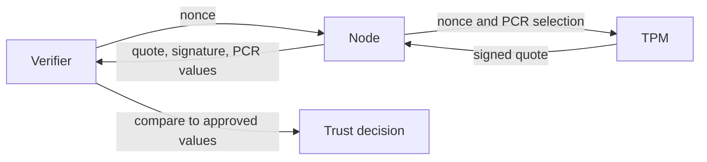

# 18.2 Hardware and firmware trust

| Field | Value |
|---|---|
| Level | Advanced |
| Priority tier | 2 |
| Lab venue | GCP / GKE |
| Part | Part 18: Security |
| Cross-references | Chapter 18.1 (Threat modeling); Chapter 11.2 (device plugin and container toolkit); Chapter 10.21 (GPU health); Chapter 18.3 (Containers and software supply chain) |
| Coverage file | `planning/coverage/chapters/18-02.md` |
| Claim & number ledger | `planning/ledgers/18-02.md` |

## Why this matters for AI infrastructure

Picture a server in a rack that nobody has logged into for months. Its operating system is patched, and its Kubernetes version is current. Then, in March 2025, a flaw was published in AMI's SPx firmware, which runs on the baseboard management controller of many servers. The National Vulnerability Database describes it as a way to bypass authentication remotely through the Redfish Host Interface, and it is tracked as CVE-2024-54085. In June 2025 the US cybersecurity agency CISA added it to its Known Exploited Vulnerabilities list. An attacker who controls that controller can power the server on and off and act below the operating system. Nothing in Kubernetes can see it.

That is the pattern of this chapter. Every layer above the firmware is only as trustworthy as the firmware below it. A GPU node holds firmware in the BMC, the UEFI firmware, the GPU, the network card and the DPU, each with its own update path and its own flaws. A DPU is a data processing unit, a network card with its own processor. The BMC, or baseboard management controller, is a small computer on the board that manages the server from outside its operating system.

This chapter covers how to know what firmware a node runs, how to check that it boots what you approved, how a GPU proves its identity, and how to treat the BMC as the powerful device it is. It stops short of building a full attestation service. Chapter 18.6 shows how attestation gates a key release. Read this chapter with the threat model from Chapter 18.1 in mind, because each control here answers one of the threats written down there.

## Prerequisites and outcomes

### Prerequisites

Suppose you are about to hand a new GPU node to the team. Before you do, check these background topics. Chapter 18.1 for the threat model, Chapter 11.2 for how the GPU reaches containers, and Chapter 10.21 for GPU health. You should know what UEFI and a TPM are before you start. UEFI is the firmware that starts the machine before the operating system loads. A TPM is the chip that records what the machine started with.

### Outcomes

Start from the question a security reviewer will ask on day one: can you prove what this node booted? This chapter answers that question in layers. It begins with Secure Boot and measured boot, then shows how a TPM quote lets a remote party check the boot state. Next it covers SPDM, the protocol that lets a GPU or other device prove its firmware, and then the BMC, which sits above every other layer. The last sections cover the firmware inventory, the staged update process, the ways the chain fails, and a lab you run on a staging node.

---

## 1. Secure boot and measured boot

### 1.1 Two different jobs

Picture a bootloader that runs on a node after a kernel upgrade. Somebody asks whether that bootloader was the one the team approved. Two different mechanisms answer that question, and they do different jobs. Secure Boot decides whether code may run. At each stage of start-up, the firmware checks a signature against keys it trusts and refuses code that fails. Measured boot decides what gets recorded. Each stage computes a hash of the next stage and extends it into a register of the TPM, which cannot be set directly, only extended. Secure Boot blocks. Measured boot remembers.

Extending a register means the new value is the hash of the old value combined with the new measurement. The result depends on the whole sequence, so a change at any stage changes the final value. This is why a record of the boot cannot be quietly rewritten after the fact.

A TPM, or Trusted Platform Module, is a small chip that stores keys, computes hashes and signs statements. Its registers are called PCRs, short for platform configuration registers. The Linux tools below read them.

```bash
mokutil --sb-state
mokutil --list-enrolled
sudo tpm2_pcrread sha256
```

The first command reports whether Secure Boot is enabled. The second lists the keys enrolled in shim's database. The third prints the PCR values for the sha256 bank. Keep a node with Secure Boot off away from GPU workloads until it passes. A node that boots without checking signatures has no reliable record of what ran on it.

### 1.2 Proving the state to someone else

Imagine a verifier in another building that wants to know whether node gpu-node-1 booted cleanly before it hands the node a job. A PCR value on the node proves nothing to that verifier, because a compromised node can print anything it likes. The TPM can sign a statement called a quote that covers selected PCRs and a nonce the verifier chose. The nonce is a random value that only the verifier knows in advance. It stops an attacker from replaying an old good quote, because a replayed quote would carry the wrong nonce.



With tpm2-tools, `tpm2_quote` takes a key context with `-c`, the PCR selection with `-l`, and a qualification with `-q`, which the documentation says is typically used to add a nonce against replay. The Redfish data model describes the same operation for a management controller: a request with a nonce, a certificate and a PCR selection, answered with signed measurements made of the quoted data and the signature.

A signed quote proves that the TPM saw these measurements. It does not say whether the measurements are good. The verifier must hold a list of approved values for your exact firmware and bootloader versions, and update it each time you update firmware. Do not confuse this with SPIRE node attestation, which identifies a node so a server can issue it an identity. It does not check the boot state. Those are two different questions, and a team that mixes them up will trust a node for the wrong reason.

---

## 2. Device attestation with SPDM

### 2.1 The problem

Picture a host that passed its boot check this morning, with a GPU sitting on its PCIe bus. A TPM vouches for the host's boot. A GPU, a network card and a switch have their own firmware and are not covered by that TPM quote. A good host boot tells you nothing about the GPU sitting on its PCIe bus. Something has to speak for each device separately, and the device has to be able to answer for itself. Think of it as a badge check at each door of a building. The host's badge tells you about the lobby, but it tells you nothing about the locked room behind a different door. The industry answer is SPDM, the Security Protocol and Data Model, a standard from the DMTF. It lets a requester authenticate a device, ask for its signed firmware measurements and set up a secure session. The Redfish data model has a ComponentIntegrity resource that reports, for a component, the SPDM version negotiated and the signed measurements that an SPDM requester obtained from the responder.

### 2.2 What NVIDIA documents for GPUs

Picture a team that wants to run a sensitive model on a GPU it did not build itself. It needs evidence from the GPU, not from the host. NVIDIA's confidential computing documentation describes that GPU evidence in practical terms. The GPU has a hardware root of trust and runs signed firmware. GPU secure boot requires NVIDIA-signed firmware. During attestation the GPU collects and signs measurements, and a verifier compares them with reference values, including identity, firmware measurements, security mode and certificate status. NVIDIA also states that GPU remote procedure calls use authenticated encryption with keys derived through SPDM.

Two cautions come from the same documentation. A valid signature alone does not establish that a firmware version is acceptable, so your policy must reject older versions. A successful GPU attestation also does not validate the CPU or your workload. Each layer needs its own check, and passing one check does not pass the others.

The attestation commands for GPUs are in Chapter 18.6. Outside confidential computing mode, this handbook did not find a vendor command that returns a verifiable GPU attestation report, so it gives none. The old text in this chapter named `nvidia-smi -q | grep attestation` and an `nv-switch-cli` tool. Neither is in the vendor documentation consulted.

---

## 3. The BMC is the most powerful device on the node

### 3.1 What it can do

Picture a node whose operating system has crashed while its BMC still answers the network. Think of the BMC as a second computer that lives inside the server. The baseboard management controller is a small computer on the server's board with its own network port and its own firmware. It can power the server, mount virtual media, read sensors and update other firmware. It runs even when the host is off, which is exactly why it is useful to operators and exactly why it is dangerous when someone else gets in.

NVIDIA's confidential computing documentation says management access through BIOS, UEFI or the BMC does not make those interfaces trusted recipients of workload data. In the dedicated-host model it requires that the infrastructure owner's management interfaces, including the BMC, must not have access to workload plaintext. Plaintext means data that is not encrypted. That is the design goal. The incident in the opening shows what happens when the BMC itself is compromised, because the design goal stops meaning anything if the controller is under an attacker's control.

### 3.2 Controls

Picture a bulletin that lands on a Tuesday morning and names a BMC version your team runs.

1. Patch the BMC firmware on the same schedule as the operating system. The question to ask is whether the controller is patched at all. CVE-2024-54085 was on a list of exploited vulnerabilities three months after publication.
2. Keep BMC network ports on a management network with no route from tenant networks. The question is who can reach the controller. This is a design recommendation of this handbook, not a vendor requirement.
3. List every BMC in the firmware inventory in section 4 with its version, so a bulletin can be matched in minutes. The question is how fast you can find the affected machines.
4. Treat a BMC finding as a reason to rebuild the node, because the controller can persist below the operating system. The question is whether you can trust the node after the finding, and the answer is usually no.

The inventory is the control that makes the other three possible. Without a current list of BMC versions, the patch schedule, the network rule and the rebuild decision all become guesses.

---

## 4. The firmware inventory

### 4.1 What it records

Ask which firmware is running on gpu-node-1 right now. If the answer takes an afternoon of hunting through consoles, an advisory about the BMC cannot be acted on in time. A firmware bill of materials is a table with one row per component per node. It turns that afternoon into a lookup that takes seconds.

| Field | Meaning |
|---|---|
| node_id | The node |
| component | BMC, UEFI, GPU, network card, DPU, and so on |
| version | The running version |
| vendor | Who supplies it |
| signature_status | Signed, unsigned or unknown |
| last_verified | When this row was last confirmed |
| cve | Known advisories for this version |

Redfish gives a standard place to read these. Its update service exposes a firmware inventory collection, and each member reports a version. Pull from it with a read-only account and store the rows with a date. The date matters, because a row that was true last month may describe a machine that has been updated since.

```bash
python code/part18/fw_bom_scan.py --node gpu-node-1 --output fw_bom/gpu-node-1.yaml
```

The script in the repository reads a local simulated inventory and writes the table for one node. Replace its input with your real Redfish or vendor data before you rely on the output. A simulated inventory tells you that the script works, and nothing about your hardware.

### 4.2 Updates that can be undone

Picture a firmware update that goes out to a whole fleet on a Thursday. A firmware update is a change to the lowest layer of the machine, so it deserves the same care as a change to a database schema. Test a firmware update in staging, run it on a small canary group, then roll it out in stages. A canary is a small group that gets the change first, so a bad update hurts a few machines instead of the whole fleet. The size of the canary and the cadence are your policy, and the repository example uses 10 percent. Each step must pass before the next starts. The reason for the pause is that some firmware problems only show up under real load, and a canary is the cheapest place to find them. Watch the canary for the same signals you watch on the rest of the fleet, such as job latency and error counts, before you widen the group.

Test the rollback before you need it. A firmware version that cannot be reverted turns a regression into an outage. Match advisories against the inventory continuously, because a check from last month does not know about yesterday's CVE. A monthly check is a good start, but an advisory that arrives on Tuesday should be matched on Tuesday.

---

## 5. How it fails

Picture a node that passes every health check on Monday and fails its attestation check on Tuesday. Trust chains break in a few predictable places. Each failure below has a sign you can see, a cause you can check, and a first move. Start with the first move, then work outward to the cause.

### 5.1 Secure Boot is off on a node

A firmware setting changed, perhaps after a board replacement. The node boots without checking signatures, and nothing on the host complains. The sign is a node that passes every health check but reports Secure Boot disabled. Detect it with `mokutil --sb-state`, keep the node out of the pool, turn it on and recheck.

### 5.2 A TPM that cannot quote

The node has a TPM but the attestation flow fails to get a quote. The TPM was never provisioned or the attestation key was never created. The attestation flow is the only place where the problem shows up, so a normal workload can run without anyone noticing. Fix provisioning and treat the node as untrusted until a quote verifies.

### 5.3 A quote verifies but the platform is wrong

The quote is valid and the verifier approves it, but the approved list is stale and contains an old bootloader with a known flaw. This is the most confusing failure, because every check is green. The fault sits in the reference list, not in the node. A reviewer who only looks at the dashboard will call the node healthy, and the stale list will keep approving the same bootloader on the next node too. Keep the reference list under change control, with the same review as a firmware update.

### 5.4 A BMC advisory arrives

Picture an advisory that arrives on a Wednesday and names a range of versions. The advisory names a version range. With an inventory, you query it, patch the affected nodes first, and check logs for unexpected logins. Without one, you cannot say which servers are exposed, and you end up checking every server by hand. That is the cost of skipping the inventory, and it arrives on the worst possible day.

### 5.5 A firmware update slows a workload

Latency rises after a clean install. The update finished without errors, and the job still runs slower than it did before. Roll back the canary group, find the cause, and update again once the vendor ships a fix. A quick rollback is cheap only if you tested it earlier, as section 4 explains.

### 5.6 A GPU attestation fails

The check fails and the workload cannot start. The cause could be a modified GPU, counterfeit hardware, or a verifier with outdated reference values. The three causes call for very different responses, and the failure alone does not say which one you have. Do not run workloads on that GPU until you know which.

---

## 6. Hands-on lab

Picture a new GPU node on staging that needs its firmware checked before the team trusts it. These steps were not run on a live cluster. The checks below use standard Linux tools, while the firmware scripts in the repository work on local simulated data, and their version numbers are simulation values. Run all of it on a staging node first, and read each output before you move to the next step.

1. Start with the simplest question: is Secure Boot on?

```bash
mokutil --sb-state
```

2. Next, read the TPM and its measurements.

```bash
sudo tpm2_getcap properties-fixed
sudo tpm2_pcrread sha256
```

3. Build the inventory for the node, so you have a record to compare against later.

```bash
python code/part18/fw_bom_scan.py --node gpu-node-1 --output fw_bom/gpu-node-1.yaml
```

4. Apply a simulated update, verify it, and then roll it back.

```bash
python code/part18/fw_update.py --node gpu-node-1 --version 550.54.15
python code/part18/fw_verify.py --node gpu-node-1 --expected-version 550.54.15
python code/part18/fw_rollback.py --node gpu-node-1 --previous-version 550.54.14
```

Record the Secure Boot state, which PCRs are populated, the number of components in the inventory and how long you needed to answer which BMC version a node runs. Those notes tell you whether the process works on your hardware, which the chapter cannot tell you. Keep them with the staging run, not in your head, so the next person who repeats the lab can compare results. If a step surprises you, stop there and write down what you saw before you move on to the next command.

---

## Exercises

Picture a shared queue of small tickets, each one about a single node.

1. A new node reports Secure Boot disabled after a motherboard swap. What do you do before it takes work? *Solution sketch:* keep it out of the GPU pool, enable Secure Boot, recheck with `mokutil --sb-state`, then verify the PCRs against your approved values.
2. A verifier approves a quote from a node that runs a bootloader with a known flaw. Why, and what do you change? *Solution sketch:* the quote only proves what was measured. The approved reference list contained the old bootloader, so update the list and put it under change control.
3. A BMC advisory affects versions 12.0 through 12.6. Your inventory lists 300 nodes. Of those, 40 sit on 12.4. How do you prioritise? *Solution sketch:* patch the 40 first, check logs on them, and use the inventory to confirm no others are in range.
4. A canary group of 10 percent of 300 nodes gets a new GPU firmware, and job latency rises on those nodes. How many nodes are affected, and what next? *Solution sketch:* 30 nodes. Roll back those 30, find the cause and hold the rollout.
5. A colleague says SPIRE node attestation already proves the boot state. Correct the statement. *Solution sketch:* SPIRE node attestation identifies a node so the server can issue it an identity. A TPM quote with a nonce, compared with approved values, is what checks boot state.
6. Design the evidence you would require before a key is released to a GPU job. *Solution sketch:* a fresh signed quote for the host, GPU evidence with identity, firmware measurements and mode checked against reference values, and a policy that rejects old versions. Chapter 18.6 covers the flow.

---

## Checkpoint questions

<details><summary>1. A node boots with Secure Boot off after a board replacement. What do you do?</summary>
Keep it out of the GPU pool until the check passes. Turn Secure Boot on, verify with mokutil --sb-state, and read the PCRs. Alert on any node that boots with it off.
</details>

<details><summary>2. Secure Boot blocks unsigned code. Why do you also want measured boot?</summary>
Secure Boot decides what may run but leaves no record. Measured boot extends a hash of each stage into TPM registers, so a verifier can later see what actually booted.
</details>

<details><summary>3. Why does a remote verifier send a nonce when it asks for a quote?</summary>
The nonce is included in the signed statement. It stops an attacker from replaying an old quote taken when the node was healthy.
</details>

<details><summary>4. A quote verifies against the TPM's key but the node runs a vulnerable bootloader. What went wrong?</summary>
The quote proves the measurements are genuine, not that they are acceptable. The verifier's approved list included the vulnerable bootloader. Update the list and review it like any firmware change.
</details>

<details><summary>5. A GPU is passed through to a workload and the TPM quote of the host is good. Does that prove the GPU firmware is genuine?</summary>
No. The TPM covers the host's boot. The GPU needs its own evidence, such as signed measurements checked against reference values, as NVIDIA's documentation describes.
</details>

<details><summary>6. What does SPDM let one component do to another?</summary>
It lets a requester authenticate a device, obtain signed measurements of its firmware and set up a secure session. Redfish exposes the result for each component in a ComponentIntegrity resource.
</details>

<details><summary>7. A GPU attestation returns a valid signature on an old firmware version. Do you accept it?</summary>
Not automatically. NVIDIA says a valid signature does not establish that a version is acceptable, so your policy must reject disallowed versions.
</details>

<details><summary>8. An advisory about a BMC is published on Monday. Which control decides how fast you can respond?</summary>
The firmware inventory. With a current table of BMC versions per node you can find exposed servers in minutes. Without it you cannot say which are affected.
</details>

<details><summary>9. A BMC is found to be compromised. Why rebuild the node?</summary>
The controller runs below the operating system and can persist across OS reinstalls. Reinstalling the OS does not clear it, so verify or replace the firmware and treat tenant secrets on the node as exposed.
</details>

<details><summary>10. Why should the BMC network have no route from tenant networks?</summary>
A tenant who could reach the controller would attack the most privileged device on the node. This is a recommendation of the handbook. The aim is to keep the exposed surface small while you patch.
</details>

<details><summary>11. A colleague says SPIRE node attestation does what TPM attestation does. What is the confusion?</summary>
SPIRE identifies a node so it can receive an identity. It does not check the boot state. A TPM quote compared with approved values does.
</details>

<details><summary>12. A vendor ships a firmware fix. When do you push it to every node at once?</summary>
Almost never. Test it in staging, run a canary group, then roll out in stages. You give up speed and gain a small blast radius for a bad update.
</details>

<details><summary>13. After a rollback, what do you still owe?</summary>
A cause. You return to the old version, which may carry the flaw the update fixed, so find the regression and plan a second update when the vendor fixes it.
</details>

<details><summary>14. Your alert fires for every firmware component without a current version. Do you widen or narrow it?</summary>
Start with the components that matter most: BMC, GPU, network cards. A narrow start keeps alerts readable, at the cost that other components go unwatched until you widen it.
</details>

<details><summary>15. A tenant asks whether you can read their data through the BMC. What does NVIDIA's confidential computing model say?</summary>
It says management interfaces, including the BMC, must not have access to workload plaintext in the dedicated-host model, and BMC access does not make those interfaces trusted recipients of workload data. The design depends on that property and on patching.
</details>

<details><summary>16. The inventory was built at 02:00 yesterday and a policy requires it to be no older than 24 hours. It is 03:30 today. Is it fresh?</summary>
No. It is 25.5 hours old. The 24-hour limit is an example, so set your own.
</details>

<details><summary>17. A fleet has 300 nodes and a 10 percent canary. How many are left for the full rollout?</summary>
The canary is 30 nodes, so 270 remain.
</details>

<details><summary>18. A CVE feed alert reaches you 80 minutes after publication and your target is 60. How late is it?</summary>
20 minutes late. The monitor must match the new CVE against the inventory as soon as it is published.
</details>

<details><summary>19. A new node will not run GPU work. In what order do you check it?</summary>
Secure Boot first, then the TPM and PCRs, then GPU evidence. This follows the stack from the boot chain up to the GPU.
</details>

<details><summary>20. After a clean firmware install, latency rises. What do you do, in order?</summary>
Roll the canary back, check whether staging was skipped, find the cause, and update again only after the vendor fixes the regression.
</details>

---

## Sources and review notes

- NIST National Vulnerability Database record for CVE-2024-54085 (published 11 March 2025, CISA Known Exploited Vulnerabilities entry added 25 June 2025), read through the NVD API on 2026-11-12.
- NVIDIA Confidential Computing documentation, virtual machine and bare metal threat models: GPU secure boot, signed firmware, reference values, SPDM-derived keys, BMC as an untrusted recipient of plaintext. Fetched 2026-11-12.
- DMTF Redfish Data Model Specification DSP0268, version 2024.4: ComponentIntegrity (TPM and SPDM, signed measurements, nonce) and UpdateService firmware inventory.
- tpm2-tools manual pages for `tpm2_quote` and `tpm2_pcrread`. Fetched 2026-11-12.
- mokutil manual page: `--sb-state` and `--list-enrolled`. Fetched 2026-11-12.
- *Production Kubernetes*, chapter 10, for SPIRE node attestation.

### Corrections made in this rework

- Removed commands with no vendor documentation: `nvidia-smi -q | grep attestation`, `nv-switch-cli -c attestation`, `ipmitool raw 0x30 0x0e`, and `ipmitool attestation verify`.
- Removed a Python sketch that called `tpm2_pytss.ESYS().quote`. It does not match that library's interface and was not tested.
- Removed the table of signing authorities per vendor, the Microsoft shim chain and the firmware IAM roles, which had no source.
- The repository firmware scripts keep their simulated version numbers, which are driver-style numbers and not real firmware versions.

### Open items

- A verifiable GPU attestation report outside confidential computing mode: no vendor command was found.
- The affected version range of CVE-2024-54085 differs between public trackers. Read the vendor advisory for your hardware.
