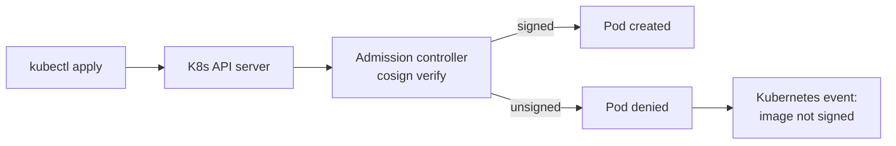

# 18.3 Containers and the software supply chain

| Field | Value |
|---|---|
| Level | Advanced |
| Priority tier | 2 |
| Lab venue | GCP / GKE |
| Part | Part 18: Security |
| Cross-references | Chapter 18.1 (Threat modeling); Chapter 18.2 (Hardware and firmware trust); Chapter 11 (GPU Kubernetes); Chapter 5 (Kubernetes) |
| Coverage file | `planning/coverage/chapters/18-03.md` |
| Claim & number ledger | `planning/ledgers/18-03.md` |

## Why this matters for AI infrastructure

Imagine a model-serving team that ships a new image on a Friday afternoon. The image runs fine in staging, and nobody checks where its base layer came from or which libraries it bundles. On Monday, a scanner flags a serious flaw in one of those libraries, and nobody can say which running pods contain it. The team spends the morning rebuilding inventory by hand, and the flaw stays live the whole time. This chapter closes that gap.

Chapter 18.2 verified the firmware. This chapter verifies the software that runs on top of it. A model-serving workload is a container image. That image was built from a Dockerfile, the Dockerfile started from a base image, and the base image came from a registry. Each link can be attacked, and each link can also be checked before the workload runs. Your job is to check them, and to keep checking after deployment, because a check made once on Friday says nothing about the flaws published on Monday.

The software supply chain is one of the most common attack surfaces in modern infrastructure. A compromised base image, dependency, or build script can insert malicious code into a workload that otherwise looks correct. The SolarWinds and 3CX incidents both worked this way. The code you wrote is not the only code that runs. Most of what runs is code you did not write, and it arrived through a path you may never have looked at.

```text
Why the software supply chain is on the critical path (background reading: NVIDIA Zero-to-Hero volume 18; Production Kubernetes; the figures below are examples, not quotations):
- A typical AI workload has 100-1000 transitive dependencies. Each dependency
  is a potential attack surface. The supply chain attack is the most common
  attack pattern in modern infrastructure.
- The container image is the artefact that runs in the cluster. If the
  image is compromised, the workload is compromised. The image must be
  signed, scanned, and verified before the workload runs.
- The supply chain integrity is the foundation of the workload's trust.
  Without supply chain integrity, every other control is compromised. The
  supply chain must be auditable.
```

The 100 to 1,000 dependency range in that block is an example, chosen to show the scale of the risk. It is not a measured figure for your workload. Count the transitive dependencies in your own image before you plan around any number. A transitive dependency is one that your dependency needs, which you never named yourself, and that is why the count is usually bigger than people expect.

Three operational realities make this a platform-team concern, not only a data-science concern. The first is ownership. The platform team builds the image, signs it, and verifies it, so the image is the platform team's artifact, even when a data scientist wrote the code inside it. The second is that supply chain discipline runs continuously. Every link needs a check, and each check must leave a record that an auditor can follow later. The third is the admission controller. It sits at the cluster door and checks each image before its pod starts, which makes it the one place where a policy can actually be enforced rather than only recommended.

A Kubernetes platform is a means to an end, not the goal itself. Companies exist to deliver a core business, such as an ecommerce site, a monitoring product, or an insurance website. The platform helps only when it moves code to customers faster and more safely. This chapter follows that path from developer code to a running workload. It treats each stage as a clean handoff point, so you can improve one stage without rebuilding the whole pipeline.

**Before you call an AI factory secure, check every link in its supply chain. Confirm that the base image is signed, that the dependencies are scanned, and that the build can be reproduced.**

## Prerequisites and outcomes

### Prerequisites

Suppose you are the platform engineer who will own this pipeline. Check these first.

- Chapter 18.1 (Threat modeling) for the threat context.
- Chapter 18.2 (Hardware and firmware trust) for the foundation.
- Chapter 11 (GPU Kubernetes) for the cluster.
- Chapter 5 (Kubernetes) for the cluster primitives.

### Outcomes

Most teams meet this material after an incident, when someone asks which image was running and nobody can answer. This chapter walks the path that prevents that question from being hard. It starts with signing, so each image carries proof of who built it. It then adds an admission policy that refuses unsigned images at the cluster door. Next it covers the SBOM, the list of every component in an image, and the scanner that compares that list with known vulnerabilities. After that it shows how to pin dependencies so a build installs the same bytes every time, and how to protect the build from dependency confusion. The last sections run the whole chain on GKE with continuous checks and a path for responding to an incident.

---

## 1. Container image signing

### 1.1 cosign

Picture a Friday deploy in which someone pushes a new image with the same tag as the one your team reviewed on Thursday. A tag such as `v1` can be overwritten after your review, and the cluster would never notice. A signature closes that gap. It lets a verifier check that an image came from a known key holder and has not changed since the signature was made.

cosign is the Sigstore tool for signing and checking images. The private key signs, and the public key verifies. Keep the private key in your CI secret store, never in the repository. A key that sits in Git is a key that every person with read access can copy, and a copied key lets anyone sign images as your team.

```bash
# Sign a container image
cosign sign --key cosign.key myregistry/myimage:v1
# expected: the image is signed; the signature is stored in the registry

# Verify a container image
cosign verify --key cosign.pub myregistry/myimage:v1
# expected: the signature is valid; the image is unmodified
```

The signature is stored in the registry next to the image, so the image and its proof travel together. Signing and verifying both need the key files on the machine that runs the command. That is the reason the key handling matters so much. Whoever holds the private key on any machine can produce a signature that the cluster will accept.

Rotation is the part teams forget. A key that is never replaced stays valid for as long as anyone remembers it. When a person leaves the team, or a CI runner is retired, the question to ask is which copies of the key still exist. Write the rotation steps down before you need them, including who creates the new key, where it is stored, and how the verifiers learn about the new public key. A rotation that is planned in advance takes an afternoon. A rotation planned during an incident takes much longer, and it tends to break releases in the middle of the work.

### 1.2 Keyless signing with cosign

Picture a release night when the signing key file is missing from the CI runner. A key file must be stored, rotated, and protected, and each of those jobs can go wrong. Keyless signing removes the file and ties the signature to the builder's OIDC identity instead. OIDC, or OpenID Connect, is the login standard that CI systems already use to prove who a job is. The signing service issues a short-lived certificate for that identity, so there is no long-lived key to lose. Check that your CI runners can reach the signing service before you depend on it, because a pipeline that cannot sign will stop every release.

```bash
# Sign with keyless mode (the default in cosign 2.x; it opens an OIDC login or uses the CI identity token)
cosign sign myregistry/myimage:v1
# expected: a short-lived certificate is issued by Fulcio and the signature is recorded in the Rekor transparency log
```

### 1.3 The signature in the registry

Picture a reviewer who asks whether a production image really came from your pipeline. Once an image is signed, you will want to see what the registry holds for it. Think of this as checking the paperwork that travels with the image. Use the command below to list the signature data for an image.

```bash
# List the signatures for an image
cosign triangulate myregistry/myimage:v1
# expected: the signatures are listed; the signature count is reported
```

Before you let a pipeline deploy an image, confirm that a verify step runs against that exact image reference. A verify against a different tag, or against a copy you rebuilt by hand, proves a different artifact. The reference you verify must be the one the cluster will pull.

---

## 2. Admission control

### 2.1 OPA Gatekeeper

Picture a cluster that accepts an unsigned image on a busy afternoon. A signature helps only if the cluster refuses unsigned images. Otherwise the signature is a nice label that nothing reads. An admission controller sits in the API server request path and checks each new pod before it is stored. Gatekeeper is the Open Policy Agent controller that does this. It evaluates each request against policies you write, and it can deny the request before any pod starts.

The policy below is a skeleton, so read it as one. Its rule calls `cosign_verify`, but the snippet never defines that function. The file shows the shape of a policy, not a working signature check. Treat it as a starting outline for your own rule, and do not deploy it as a control on its own.

```yaml
# code/part18/gatekeeper_policy.yaml
apiVersion: templates.gatekeeper.sh/v1
kind: ConstraintTemplate
metadata:
  name: k8srequiredimageverification
spec:
  crd:
    spec:
      names:
        kind: K8sRequiredImageVerification
      validation:
        openAPIV3Schema:
          properties:
            image:
              type: string
  targets:
    - target: admission.k8s.gatekeeper.sh
      rego: |
        package k8srequiredimageverification
        violation[{"msg": msg}] {
          container := input.review.object.spec.containers[_]
          not cosign_verify(container.image)
          msg := sprintf("image %v is not signed by cosign", [container.image])
        }
```

### 2.2 Kyverno

Picture a platform team that prefers its policies written as ordinary Kubernetes objects. Kyverno is a Kubernetes-native policy engine. It writes its rules as Kubernetes objects, which some teams find easier to read than Rego. The rule below shows the same gap as the Gatekeeper skeleton. It checks for a label named `cosign.sigstore.dev/signed` on each Pod. Nothing in this chapter sets that label, so the rule checks a label and never checks a signature. Replace it with a rule that verifies the signature itself before you count on it.

```yaml
# code/part18/kyverno_policy.yaml
apiVersion: kyverno.io/v1
kind: ClusterPolicy
metadata:
  name: require-image-signature
spec:
  validationFailureAction: enforce
  rules:
    - name: verify-signature
      match:
        resources:
          kinds:
            - Pod
      validate:
        message: "image must be signed by cosign"
        pattern:
          metadata:
            labels:
              cosign.sigstore.dev/signed: "true"
```

### 2.3 The admission controller in production

Picture a developer who runs kubectl apply and gets a refusal with no explanation. In production, the admission controller runs as a Deployment inside the cluster. It intercepts each pod creation, checks the image, and then allows or denies the pod. A denial appears as a Kubernetes event, so the developer sees the reason in the output of the failed apply. That message is the first thing to read when a deploy is refused, because it says which rule fired.



Test the denial path on purpose. Apply an unsigned test image to a non-production namespace, and confirm the pod is refused before you trust the policy. A policy that has only ever allowed good images has never shown that it can say no. The test is the only evidence that the refusal works.

---

## 3. The Software Bill of Materials

### 3.1 What the SBOM contains

Suppose a new vulnerability is announced for a logging library. You need to know quickly whether any of your images ship that library, and which version. You can answer only if you kept a list of every component in each image. That list is the Software Bill of Materials, or SBOM. The name borrows from manufacturing, where a bill of materials lists every part that goes into a product.

The SBOM records each package with its name, version, license, supplier, and dependency relationships. The scanner adds vulnerability data to it later, so the same SBOM can be checked again when new CVEs appear. A CVE is a public identifier for a known security flaw. Because the SBOM is a file, you keep it, and you do not need to rebuild the image to ask a new question about it.

```text
SBOM schema (CycloneDX):
- components: list of every package (name, version, license, supplier)
- dependencies: graph of package dependencies
- vulnerabilities: list of known CVEs (added by the scanner)
- tools: list of tools used to generate the SBOM
- metadata: timestamp, author, version
```

### 3.2 Generating the SBOM with Syft

Picture the first build that has to produce an SBOM for a newly added service. Syft is the Anchore tool that reads a container image and writes its SBOM. It can write CycloneDX or SPDX, and this chapter uses CycloneDX. Generate the SBOM at build time, from the same image reference you pushed, so the inventory matches what runs. An SBOM made from a different build, or from a local copy, can describe an image that is not the one in production.

```bash
# Generate the SBOM for an image
syft myregistry/myimage:v1 -o cyclonedx-json > sbom.json
# expected: the SBOM is generated; the SBOM is in CycloneDX format
```

### 3.3 The SBOM in production

Picture a clean scan report filed on build day and then forgotten. A clean scan on the day you built an image does not stay clean. New CVEs are published every week, so scan the stored SBOM on a schedule, not only once. The command below scans the SBOM against vulnerability data and writes the findings as SARIF, a format many CI systems can read. Reading SARIF in a CI tool lets the findings show up next to the code that produced them.

```bash
# Scan the SBOM for known vulnerabilities (grype reads the SBOM; it does not upload it)
grype sbom:./sbom.json -o sarif > vulns.sarif
# expected: the vulnerabilities are listed in SARIF format
```

Store each SBOM beside its image so responders need not rebuild it during an incident. A responder at two in the morning needs to open the file and see the components without waiting for a build to finish.

---

## 4. Vulnerability scanning

### 4.1 Trivy

Picture a scan report that lists far more findings than anyone can read on a Monday morning. A scanner compares the packages in an image with a database of known vulnerabilities. Trivy is the Aqua Security scanner, and it can scan an image directly. Read the output by severity first, then check whether your application actually loads each flagged package. A flagged package that the application never loads is a lower priority than one it uses on every request.

```bash
# Scan a container image for vulnerabilities
trivy image myregistry/myimage:v1
# expected: the vulnerabilities are listed; the severity is reported
```

### 4.2 Grype

Picture a registry that is slow to serve a large image on the morning of a release. Grype is the Anchore scanner, and it reads an SBOM directly. That means you can check an image's inventory without pulling the image again. This matters when the registry is slow or when the image is large. Either Trivy or Grype does the job, so choose the one your team can run and maintain. The worst choice is the scanner nobody has time to keep up to date. A scanner is only as good as its vulnerability database, and that database changes every day. Whichever tool you pick, schedule its database update as a routine job rather than something people remember to do. Ask the team who will read the output when the scan fails, because a scan without a reader is only a log file.

Scanners also disagree with each other. Two tools can report different counts for the same image, because they read different sources and match packages in different ways. Pick one tool as the source of truth for your gate, and use the other only as a second opinion when a result looks wrong. Mixing both in the gate makes it hard to explain why a build passed on one day and failed on the next.

```bash
# Scan an SBOM for vulnerabilities
grype sbom:./sbom.json
# expected: the vulnerabilities are listed; the severity is reported
```

### 4.3 The scan in CI/CD

Picture a pipeline where the scan step was switched off last month and nobody noticed. A scan that nobody runs protects nothing. Put it in the pipeline so every build creates an SBOM and then scans it. The job below fails when the scan finds HIGH or CRITICAL issues, so the build stops before the image is promoted. A failed job is noisy on purpose, because a quiet failure is the one that gets ignored.

```yaml
# code/part18/cicd_scan.yaml
# GitHub Actions workflow: build, generate an SBOM, scan it, fail on HIGH or CRITICAL.
name: image-scan
on: [push]
jobs:
  build-scan:
    runs-on: ubuntu-latest
    steps:
      - uses: actions/checkout@v4
      - name: Build image
        run: docker build -t myregistry/myimage:${{ github.sha }} .
      - name: Generate SBOM (CycloneDX)
        run: syft myregistry/myimage:${{ github.sha }} -o cyclonedx-json > sbom.json
      - name: Scan the SBOM
        run: trivy sbom --severity HIGH,CRITICAL --exit-code 1 sbom.json
```

A hard fail on every finding can block a deploy that a team has already reviewed. Production Kubernetes, chapter 15, describes two controls that help here. An allowlist lets a team accept a CVE that has no fix yet or does not apply to its setup, with the reason written down. Blocking image pulls for a high-severity CVE also carries a risk, because a pod that reschedules onto a new node may not be able to pull its image at all. Weigh the security gain against that availability cost, and record the decision so the next reviewer can see why it was made.

---

## 5. Dependency confusion defence

### 5.1 What is dependency confusion

Picture a build that installs a package named `myorg-common-lib`. Your company publishes that package on a private index, which is a server that hosts packages for your own use. An attacker publishes a package with the same name on the public index. If the build looks at the public index too, it may pick up the attacker's copy. The build does not warn you, and the malicious code runs inside your build, where it can read the secrets the build holds.

```text
Dependency confusion attack:
- Legitimate package: myorg-common-lib (private registry)
- Malicious package: myorg-common-lib (public registry)
- Build system: pip install myorg-common-lib
- Attack: the build system pulls the malicious package from the public registry
- Result: the malicious code runs in the build; the build is compromised
```

### 5.2 The defence: dependency pinning

Picture a build that installs one set of packages on Friday and a different set on Monday. Pinning is the first defence. A lockfile records the exact version and a hash for every package. A hash is a short fingerprint computed from the file's contents, so any change to the file changes the fingerprint. The install step checks each downloaded file against its hash, so a swapped package fails the build. Use the lockfile your language already produces: pip's requirements file with hashes, npm's `package-lock.json`, or Go's `go.sum`.

```bash
# Verify the dependency hashes
pip install --require-hashes -r requirements.txt
# expected: pip verifies the hash of every package; the install fails if any hash is wrong
```

Pin the operating system packages too. Production Kubernetes, chapter 15, makes the same point for packages installed with `apk`, `yum`, or `apt`. Without a pinned version, two builds of the same Dockerfile can end up with different packages. The Dockerfile looks identical in Git, but the image it produces has changed underneath it. Pinning makes the build repeatable, so a bad package shows up as a failed build and not as a surprise in production.

Pinning also has a maintenance cost, and teams that skip that cost tend to unpin their files in a hurry. A pinned file goes stale, so something has to update it. Plan a regular job that proposes new pinned versions as pull requests, so the updates arrive in small reviewable pieces. A large update that arrives all at once is the one people refuse to merge, and an unmerged update leaves the old packages in place with their known flaws.

### 5.3 The defence: private registry

Picture a developer who adds a second index to pip.conf to fix a quick install error. The build system pulls from a private registry, which holds a curated set of packages. The build system cannot pull from a public registry. The configuration below sets that up for pip. The comment in the file explains the one line that does the most harm when it is wrong.

```yaml
# code/part18/pip.conf
[global]
# Only the private registry. A second public index (extra-index-url) is exactly what dependency confusion exploits.
index-url = https://my-private-registry.example.com/pypi/
```

Before you trust a build, check which index each package name resolves from. A private registry helps only when the build never falls back to the public index for a name your company owns. A single extra index in a config file is enough to undo the whole defence, and it is easy to add without noticing.

---

## 6. Operating the software supply chain on GKE

### 6.1 The components

Picture an on-call page at night for a drop in the signing rate, and nobody knows who owns it. Every control needs an owner and a target. Without an owner, nobody gets paged when the signing rate drops. Without a target, nobody can say whether the control is doing its job. The targets in the last column are example values, so choose your own.

| Component | Where it runs | Backing store | SLO |
|---|---|---|---|
| cosign signing | CI/CD pipeline | Registry | 100% of images signed |
| Admission controller | Kubernetes Deployment | (verifies pods) | Admission latency p99 < 100 ms |
| SBOM generation | CI/CD pipeline | Object storage | SBOM generated for every image |
| Vulnerability scanner | CI/CD pipeline | Vulnerability database | Scan latency p99 < 5 minutes |
| Dependency pinning | CI/CD pipeline | Lockfile | 100% of dependencies pinned |

Production Kubernetes, chapter 15, suggests tagging each image with its git commit hash, then adding readable version tags as it moves through environments. Immutable tags stop anyone from overwriting an approved tag. A commit hash tag is the simplest immutable tag, because the same commit always produces the same name.

### 6.2 IAM and the supply chain integrity

Picture a contractor who is given rights to sign images for one week. Anyone who can sign an image can vouch for it, so signing rights need the same care as deploy rights. A person who can sign can make an image look approved, even if nobody reviewed it. The table separates three roles: readers, writers who sign and update, and an admin who approves policy. Keep the writer group small, and log every signature it makes.

| Role | Who | What they can do |
|---|---|---|
| `supplychain.reader` | The platform team. The security team | Read the SBOM; read the vulnerability report |
| `supplychain.writer` | The platform team | Sign the image; update the SBOM; update the lockfile |
| `supplychain.admin` | The platform team lead | Approve the image signing policy; approve the SBOM policy |

Production Kubernetes, chapter 15, also suggests keeping deployment configuration in a separate repository from application code. The two repositories then carry different permissions and audit rules. The role names above are a pattern to adapt, not a standard. A quarterly review of role holders is one reasonable cadence, because people change teams and their old access often stays behind.

### 6.3 Observability

Picture a dashboard that stays green while the signing rate quietly falls. Metrics tell you whether the controls still work, so watch them as you would any other production signal. Each row below names a control, why it matters, and the alert you would set. The alert values are examples, so set thresholds your team can act on. An alert that fires every hour is one the team learns to ignore, so start with thresholds that fire rarely and mean something.

| Metric | Why it matters | Alert |
|---|---|---|
| Image signing rate | Supply chain integrity | < 100% |
| Image verification rate | Admission control | < 100% |
| SBOM freshness | SBOM currency | > 24 hours stale |
| Vulnerability count (HIGH/CRITICAL) | Vulnerability exposure | > 0 |
| Dependency pinning rate | Dependency confusion defence | < 100% |

Of these, the HIGH or CRITICAL count matters most. Every such finding is an exposure, and it needs an owner and a fix date. A dashboard that shows the count without an owner will show the same red number for months.

It helps to read these metrics together rather than one at a time. A falling signing rate with a steady verification rate usually means the pipeline is changing, not the cluster. A rising vulnerability count with a flat SBOM freshness means the scanner is working and the images have simply not been rebuilt. Each pair of numbers points at a different owner, so the dashboard should show them side by side and name who acts on each one.

---

## 7. How it fails

Picture an engineer on call who sees a deploy refused in the middle of the night. Six failure modes come back again and again in supply chain incidents. Each subsection gives the symptom you see first, the likely cause, and the fix. Start from the symptom, because that is where the on-call engineer begins, and the cause comes later once the immediate problem is contained.

### 7.1 "The image is not signed"

Symptom: a deploy fails because the admission controller refuses the pod. Diagnosis: the pipeline pushed the image without a signing step, so no signature exists. Fix: add the signing step to the pipeline, confirm the signature now exists in the registry, and redeploy. The fix is the boring one, and it is the right one, because the policy did exactly its job.

### 7.2 "The signature is invalid"

Symptom: the admission controller refuses the pod because verification fails. Diagnosis: the image changed after signing, the signing key was compromised, or the signature was made with the wrong key. Fix: sign again from a trusted build, rotate the key if you suspect compromise, and find out how the image changed before you trust the next one. Treat this as a possible incident, not as a typo in the pipeline.

### 7.3 "The admission controller is bypassed"

Symptom: a pod with an unsigned image starts anyway. Diagnosis: the policy is set to warn instead of enforce, the namespace is excluded, or the controller is not running. Fix: set the policy to enforce, confirm the controller is running, and include the namespace. Then test again with an unsigned image, because a policy you never tested is a policy you cannot vouch for.

The reason this failure is so common is that a policy in warn mode looks almost identical to a policy in enforce mode. Both appear in the cluster, both have a name, and both show a green status until someone reads the warning. Check the mode on the policy object itself, not only in the document that describes it.

### 7.4 "The SBOM is missing"

Symptom: a vulnerability is announced, but no SBOM exists for the image, so the team cannot tell which components are affected. Diagnosis: the SBOM was never generated, was never stored, or was deleted. Fix: regenerate the SBOM from the image reference, store it next to the image, and confirm you can retrieve it before the next incident. An SBOM you cannot find during an incident is the same as no SBOM at all.

### 7.5 "The vulnerability is not patched"

Symptom: a HIGH or CRITICAL finding is open, and the workload keeps running the vulnerable image. Diagnosis: no patch is available yet, the patch breaks compatibility, or nobody has prioritised the fix. Fix: patch the base image, rebuild the workload image, redeploy, and confirm the finding is gone. Production Kubernetes, chapter 15, warns against automatic patching that skips your change process, because a new image can break the running application. Send the patch through the same pipeline and tests as any other change.

### 7.6 "The dependency is confused"

Symptom: a malicious package appears in the build, and the workload runs its code. Diagnosis: dependencies are not pinned, the private registry is not configured, or the build still pulls from the public index. Fix: pin every dependency, configure the private registry, and confirm the build resolves names from the registry you intended.

---

## 8. Hands-on lab

This lab walks you through the full chain on GKE: sign the image, admit it, generate its SBOM, scan the SBOM, and pin the dependencies. The lab is **untested** in this repository, so treat each expected result as something to check, not something already proven. Run each step in a non-production project first, and read the output before you move on.

### 8.1 Prerequisites

- A GKE Autopilot or Standard cluster (1.27+).
- A CI/CD pipeline (GitHub Actions, GitLab CI, or Jenkins).
- A container registry (GCR, ECR, or Harbor).

### 8.2 Step 1: sign a container image with cosign

Picture a freshly built image that nothing has signed yet. Start by signing the image your pipeline built. The admission controller checks this signature later, so the image must carry it before you deploy. If the signature is missing at this step, every later step will fail for the same reason, so it is worth checking the registry before you continue.

```bash
# Sign the image
cosign sign --key cosign.key gcr.io/${PROJECT_ID}/myimage:v1
# expected: the image is signed; the signature is stored in GCR
```

### 8.3 Step 2: deploy the admission controller

Picture a cluster with no admission check at all, which is where many clusters start. Install Gatekeeper, then apply the policy file. The policy only proves something once it checks a real signature, as section 2.1 explains. Until then, the apply succeeds and the refusal never happens, which looks like success and is not.

```bash
helm install gatekeeper gatekeeper/gatekeeper \
  --namespace gatekeeper-system --create-namespace

kubectl apply -f code/part18/gatekeeper_policy.yaml
# expected: the policy is applied; the admission controller refuses unsigned images
```

### 8.4 Step 3: generate the SBOM

Picture a signed image and an inventory file that were made from two different tags. Generate the SBOM from the same image reference you signed. That keeps the signature and the inventory pointing at one artifact. If the two references differ, you have two different artifacts and no proof that they match.

```bash
# Generate the SBOM for the image
syft gcr.io/${PROJECT_ID}/myimage:v1 -o cyclonedx-json > sbom.json
# expected: the SBOM is generated; the SBOM is in CycloneDX format
```

### 8.5 Step 4: scan for vulnerabilities

Picture the first scan you run by hand, before the pipeline does it for you. Scan the SBOM and read the severity counts. This is the same check the CI job in section 4.3 runs on every build. Running it by hand here shows you the output format before the pipeline depends on it.

```bash
# Scan the SBOM for vulnerabilities
trivy sbom sbom.json
# expected: the vulnerabilities are listed; the severity is reported
```

### 8.6 Step 5: pin the dependencies

Picture a requirements file that installs a different version each time someone runs the build. Compile the requirements file with hashes, then commit the output. The next build installs the same bytes, not whatever the index happens to serve that day. Commit the file, not your memory of it, so a teammate's build gets the same bytes too.

```bash
# Pin the Python dependencies
pip-compile requirements.in --generate-hashes --output-file requirements.txt
# expected: the dependencies are pinned with hashes; the lockfile is reproducible
```

### 8.7 Step 6: deploy the signed image

Picture the moment the signed workload goes to the cluster for the first time. Apply the workload manifest and watch the admission result. A pod that starts here shows that the signed image passed the policy. A pod that is refused shows you the policy did its job, and the event message tells you which rule fired. Both outcomes are useful, and you should look for both before you call the step finished. Keep the output of this step in your lab notes, so the next run has something to compare against.

```bash
kubectl apply -f code/part18/workload.yaml
# expected: the admission controller verifies the signature; the pod is created
```

### 8.8 What to record

Picture a dashboard review on the day after the lab. After the lab, check whether the five questions below can be answered from your dashboard without digging through logs:

1. What is the current image signing rate?
2. What is the current image verification rate?
3. What is the current SBOM freshness?
4. What is the current vulnerability count (HIGH/CRITICAL)?
5. What is the current dependency pinning rate?

If you cannot answer one of these quickly, the supply chain is not yet running as a production service. How quickly counts as quick is your team's call. Write the answers down with the date, so the next review can see how the numbers moved.

---

## 9. Building images and delivering them

Picture a developer who asks why the same code works on her laptop and fails in the cluster. Sections 1 to 8 assume that an image already exists and that you trust it. This section covers how the image is built, stored, and rolled out. The answerSections 1 to 8 assume that an image already exists and that you trust it. This section covers how the image is built, stored, and rolled out. Picture a developer who asks why the same code works on her laptop and fails in the cluster. The answer usually lives in the build and the runtime settings, not in the application. Each stage has a clean handoff point, so you can choose the best approach for each stage and improve it without replacing the rest.

### 9.1 The image is the deployable asset

Picture a team that shipped a binary to a few servers and found they had drifted apart. Before containers, teams deployed a binary, a compressed archive, or raw source code onto a server. They then made sure the server had the right dependencies and configuration. That process worked until two servers drifted apart, and then nobody could say which one was correct. A container image packs those pieces into one artifact. It holds the application, the execution environment, and the dependencies together, so the thing you test is the thing you run.

The image also has a life of its own after the build. It sits in a registry, gets pulled by many nodes, and may be rebuilt under the same name by a careless job. Each of those steps is a point where the artifact can change. That is why the rest of this part talks about signatures and scans, and why this section talks about the build itself. A signed image that was built from a messy Dockerfile is still a messy image, only now with a stamp on it.

The image is a set of compressed filesystem layers with some metadata. It follows the Open Container Initiative (OCI) image specification, an agreed standard in the cloud native community. The OCI is the group that maintains the standard. Because the standard is shared, many build tools can produce images, and any compliant container runtime can run them. That shared format is the reason the rest of this section can talk about tools without tying you to one vendor.

### 9.2 Gold images are an antipattern

Picture a security team that approves one gold base image, a preconfigured operating system that every application must start from. In a pre-container environment that was a sensible rule. It kept the fleet uniform and gave the team one place to patch. When teams moved to containers, many copied that habit. They took useful upstream images from third parties and vendors, then rebased their applications and configuration onto internal copies, one copy per team.

This causes three problems. The conversion from the upstream image to an internal image costs extra work. The platform team must store and maintain every internal copy. Because the set of images sprawls, updates happen rarely, if at all, and the security posture often gets worse. The internal copy becomes a fork that drifts further from upstream with every month that passes.

Start by asking the security team what each gold image is for. The reason is usually one or more of these requirements.

- Does the image need a specific agent installed? If so, the pipeline can install it.
- Does the image need to be free of vulnerable libraries? If so, the pipeline can scan for them.
- Do the user accounts need the correct permissions? If so, the pipeline can check them.

Once you know the reason, encode it as a check in the pipeline. The check rejects or alerts on a non-compliant image. Teams can then keep reusing upstream images and the work that went into them, while the pipeline holds the security line. The rule moves from a copied image to a check that runs on every build, and that is easier to audit.

Teams often want a fixed base operating system so that the organization keeps troubleshooting knowledge. This benefit is smaller than it looks. You should rarely need to exec into a container to troubleshoot. Even then, the differences between Linux distributions matter little for most support work. More applications now ship as scratch or distroless images, which carry less overhead inside the container.

Do not try to move every upstream or vendor image onto your own base. The costs described above make that a poor use of effort. A curated set of internal base images is still a good idea, though. Those bases make a solid foundation for your own applications, and they give the platform team one place to apply a patch.

### 9.3 Build images and runtime images

Containers can also run the build. Picture a Java service whose build needs a full compiler and test toolchain, while the running service needs almost none of it. A build image holds the compiler, the test tools, and the libraries that compile the code. A runtime image holds only the application and what it needs to run. For a Java application, the build image might hold the JDK, Gradle or Maven, and the test tooling. The runtime image might hold only a Java runtime and the application.

The runtime image should not carry build tools, because the application does not need them when it runs. A leaner image is faster to distribute and has a tighter attack surface. Every tool left in the image is one more program an attacker could use after getting in. Docker's multistage build feature separates the two images in one Dockerfile. The example below builds a Go binary in one stage, then copies only that binary into a distroless runtime stage.

```
# Build stage
FROM golang:1.12.7 as build
WORKDIR /my-app
COPY go.mod .
RUN go mod download
COPY main.go .
ENV CGO_ENABLED=0
RUN go build -o my-app
# Deploy stage
FROM gcr.io/distroless/base
USER nonroot:nonroot
COPY --from=build --chown=nonroot:nonroot /my-app/my-app /my-app
CMD ["/my-app"]
```

Four details in this file matter.

- Why use the `golang` image? It holds the Go toolchain, which the running application does not need, so it stays in the build stage only.
- Why copy `go.mod` and download modules first? That order lets Docker reuse the download layer when only the code changes, which keeps rebuilds fast.
- Why use the distroless base? It gives a minimal image with no extra dependencies, so there is less to scan and less to attack.
- Why copy only the `my-app` binary? Only the compiled file is needed in the deploy stage, so nothing else travels with it.

### 9.4 Runtime user

Picture a pod that runs a web service with no user set, and an attacker who gets inside it. Containers share the Linux kernel with the host, so the runtime user has real consequences. When the user is not set, the process usually runs as root. That raises the attack surface. If an attacker compromises the application and escapes the container, they could gain root access on the host. Decide whether the application needs root, and whether it depends on `/etc/passwd`. If it does not need root, add a nonroot user to the image. The file `/etc/passwd` is the system's list of user accounts, and an application that reads it may need a real user entry to run correctly.

Set the user in the image itself, not only in the Kubernetes manifest. In a Dockerfile, the `USER` directive does this. The reason is that the image should behave the same way on a laptop, in CI, and in the cluster. If the user is set only in a manifest, a developer who runs the image directly gets a different process than the one in production. The example below runs the `my-app` binary as the nonroot user and group, which the distroless images create by default.

```
FROM gcr.io/distroless/base
USER nonroot:nonroot
COPY ./my-app /my-app
CMD ["./my-app", "serve"]
```

An image that names its user documents itself. Developers also get the same user and group ID on their own machines, so file permissions behave the same way when they test locally. That small detail prevents a class of bugs that only appear after a deploy.

Containers usually run a single process with no init system. Your application must therefore handle signals correctly. A signal is a short message the operating system sends to a process, such as a request to stop. It must also reap orphaned processes that get reparented to it. Reaping means collecting the exit status of a child process that has already finished, so it does not linger as a zombie. Minimal init programs can handle both jobs, and they can act as a bootstrap for your application.

### 9.5 Buildpacks for platform teams

Picture a developer who is asked to containerize a service but has never written a Dockerfile. Dockerfiles are not the only way to build an image. Cloud Native Buildpacks analyze the source code and run the buildpacks that match it. A Go buildpack runs when Go files are present. A Maven buildpack runs when a `pom.xml` file is found. Developers start the process with a CLI named `pack`, and they never write a Dockerfile. For a team that does not want to maintain Dockerfiles across many services, that is a real saving.

Platform teams can also write custom buildpacks. Those buildpacks enforce policy, meet compliance rules, and standardize the images that run on the platform. The value grows with the size of the organization. Development teams want to build value into the application, not learn how to containerize it. A custom buildpack lets the platform team own the packaging decisions once, and lets every team inherit them.

### 9.6 Scanning images after deployment

Picture an image that passed its scan on Monday and has a new CVE by Wednesday. Scanning at pull time is a start, but it shows only today's findings. New vulnerabilities appear in images that already run, and a clean scan at deploy time can turn into a finding the next morning. Schedule scans of the images in use, and plan how you will update them. Automatic remediation is tempting, but a new image can break the running application. Automated update systems can also act outside your change process, which makes them hard to audit.

Blocking pulls has a cost too. Suppose a core application's image gets a new CVE, and pulls of that image are blocked. The people who wrote the policy may be far away from the people who run the on-call rotation, so the cost lands on someone who never saw the decision. If its pods move to a new node, they may not be able to pull the image. The application then loses availability. Security and availability pull in opposite directions here, so record the trade-off you choose. A block that is written down and reviewed is a decision. A block that nobody remembers is a surprise.

A more common model is to alert on scan results and send them to operations and security teams. Some registries call a webhook when a scan finishes, and the payload lists the vulnerable images and CVEs. Other registries expose metrics that standard alerting tools can scrape. This takes more manual work, but it gives you control over when and how you patch. Run each patch through the normal deployment pipeline, so every change is tested and auditable.

Static scanning is one layer of defense in depth. Defense in depth means several independent layers, so that one missed check does not expose the whole system. An image can download malicious content after it is deployed. A running container can also be hijacked. Runtime scanning addresses those risks. A simple form scans the filesystem of running containers on a schedule. A stronger form limits the actions and behaviors a container can perform, so you do not chase each new CVE. Look at Falco and the Aqua Security suite, and plan time to study runtime scanning on its own.

### 9.7 Rollout patterns

When you deploy a new version, you also need to watch its health. A new version can look fine in the first minute and fail under real traffic an hour later. You must decide whether to fix the issue or roll back. Rollout patterns support that decision. They also separate deploying an application from releasing it to users. You can turn on new behavior when you are ready, which reduces the risk of each change.

A canary release sends a new version into the cluster and routes a small share of traffic to it. The share can depend on metadata, on users, or on another attribute. You watch the canary for errors and for behavior that differs from the old version. If confidence grows, you increase its share over time. A canary that fails hurts only the users who were routed to it, which is the whole point.

Blue/green is similar to a canary, but it cuts traffic over all at once. The old version is blue and the new version is green. Green can run in the same cluster or in a second cluster. You can test green in a setting that users do not see before the cutover. If errors rise after the cutover, you move traffic back to blue. Applications that hold state or sessions need extra care for this to work, because a user who is halfway through a session may land on the wrong version.

A/B testing is also close to a canary. You roll out a version with different behavior to a subset of consumers. You then collect metrics on how people use it. Those results guide whether you roll back, roll forward, or expand the experiment. The difference from a canary is the goal. A canary asks whether the new version is safe, and an experiment asks which version is better.

Most of these patterns use network traffic shifting. Kubernetes provides networking primitives that make this practical. Flagger is an open source tool that automates the patterns on top of a service mesh. It runs as a controller in the cluster and watches the `image` field of `Deployment` resources. It configures the mesh to shift traffic and checks the health of the new version. It then either continues the rollout or halts it and reverts.

Flagger and similar tools usually belong in a second or third phase of a Kubernetes journey. Most patterns need a service mesh, and the mesh adds complexity of its own. Start with a plain rolling update, and add the traffic-shifting tools once the team can already run a deploy without fear.

### 9.8 GitOps trade-offs

Picture a deployment that someone changed by hand at night, with no record of the change. Push-based pipelines change the cluster from the outside, one command at a time. A pipeline runs, applies the manifests, and stops. GitOps reverses that. A controller keeps reconciling the cluster with the contents of a git repository, much as Kubernetes itself reconciles resources. Reconciling means the controller keeps comparing the two states and fixing the difference. ArgoCD and Flux are the two main tools in this space, and their teams are building a shared engine underneath both.

GitOps is declarative. If the tooling goes down or someone deletes a deployment, the controller tries to restore the declared state. Git becomes the single source of truth, and a pull request workflow becomes the gate for cluster changes. You also get an audit log by default, because every change is a commit with an author and a time.

GitOps has costs. If git is the single source of truth, secret data must live in version control. Bitnami's Sealed Secrets is the best-known answer. It lets you commit encrypted Secrets, and the cluster decrypts them when they are applied. The encrypted file is safe to store in Git, while the plain value never appears there.

A failed push shows up as a failed pipeline. A declarative system can stay diverged without any failure. Nothing errors, but the cluster and git quietly disagree. Alert when the observed state in the cluster and the declared state in git stay different for too long.

Few applications deploy cleanly as a flat set of YAML resources. You may need ordering and some scripting while you move to GitOps. Watch for tools that create resources at runtime. A controller that watches a custom resource and creates other objects through the Kubernetes API is one example. In strict mode, GitOps tooling may delete those objects, because git does not list them. That deletion is often what you want, but changes made outside git can break the model, so plan a workaround for those cases.

### 9.9 Summary of the delivery path

Picture a new engineer who asks where a release actually goes after the pull request merges. This section followed code from a container into a Kubernetes cluster. Build, test, continuous integration, and continuous delivery still apply in a container environment, but with different tools. GitOps builds on Kubernetes primitives to improve reliability and security in existing deployment patterns. Keep the handoffs clean, and each stage stays easy to check.

Decide how much of the pipeline each group should see. Some development teams know Kubernetes well and can write the build and deployment artifacts. Other organizations hide the details from developers to scale and standardize. That choice moves work to the platform team, which must put the foundations and automation in place before developers can rely on them.

---

## Exercises

Picture a pipeline that builds images today with no signing, scanning or pinning at all. Work through these in order, because each one assumes the earlier ones are in place. Each exercise asks you to add one control to your own pipeline.

1. **Add a cosign signing step to the CI/CD pipeline.** Your pipeline builds images but signs none of them. Add a signing step at build time, then verify the signature before deploy. *Solution sketch:* the cosign sign and verify commands in Section 1.1, placed in the job from Section 4.3.
2. **Add an admission controller policy.** Picture a pod with an unsigned image that the cluster accepts today. Write a rule that refuses it. *Solution sketch:* the OPA Gatekeeper policy in Section 2.1, or the Kyverno policy in Section 2.2, with the signature check replaced by a real verification rule.
3. **Add an SBOM generation step to the CI/CD pipeline.** Each build should leave an inventory behind. Generate an SBOM for every image, and store it with the image. *Solution sketch:* the syft command in Section 3.2 and the scan command in Section 3.3.
4. **Add a vulnerability scanning step to the CI/CD pipeline.** Scan every image for CVEs, and refuse to deploy images with HIGH or CRITICAL CVEs. *Solution sketch:* the CI/CD YAML in Section 4.3, and the trivy scan command in Section 4.1.
5. **Add a dependency pinning step to the CI/CD pipeline.** Your build still installs whatever the index serves that day. Pin every dependency with a hash, and verify the hash on install. *Solution sketch:* the pip-compile command in Section 8.6, and the `--require-hashes` install in Section 5.2.
6. **Add a supply chain dashboard.** Picture the metrics table as a single screen that the on-call engineer can read. Build a Grafana dashboard that shows the image signing rate, the vulnerability count, and the SBOM freshness. *Solution sketch:* the metrics table in Section 6.3, with one panel for each row.

---

## Checkpoint questions

<details><summary>1. A scanner flags a serious flaw in a library on Monday and nobody can say which running pods contain it. What was missing and what do you build?</summary>
The team has no stored list of what each image contains. Generate an SBOM for every image at build time from the same image reference you pushed. Store it next to the image, and scan the stored SBOM on a schedule so a new CVE can be matched to images without rebuilding anything.
</details>

<details><summary>2. A pod with an unsigned image starts anyway. What are the three likely causes and what do you do?</summary>
The policy may be set to warn instead of enforce, the namespace may be excluded, or the controller may not be running. Set the policy to enforce, confirm the controller is running, and include the namespace. Then test again with an unsigned image, because a policy you never tested is a policy you cannot vouch for.
</details>

<details><summary>3. The admission controller refuses a pod because signature verification fails. What could have happened and what do you do?</summary>
The image may have changed after signing, the signing key may be compromised, or the signature may have been made with the wrong key. Sign again from a trusted build and rotate the key if you suspect compromise. Find out how the image changed before you trust the next one.
</details>

<details><summary>4. Your Kyverno policy requires the label `cosign.sigstore.dev/signed: "true"` on every Pod. A pod with an unsigned image carries that label. Does the policy stop it?</summary>
No. The rule checks a label and never checks a signature, and nothing in the chapter sets that label. A pod that carries the label passes whether or not its image is signed. Replace the rule with one that verifies the signature itself before you count on it.
</details>

<details><summary>5. A build that installs `myorg-common-lib` runs malicious code. What are the likely causes and the fix?</summary>
Dependencies may not be pinned, the private registry may not be configured, or the build may still pull from the public index. An attacker can publish a package with the same name on the public index. Pin every dependency, configure the private registry, and confirm the build resolves each name from the registry you intended.
</details>

<details><summary>6. A core application's image gets a new CVE and your policy blocks pulls of it. A pod moves to a new node. What happens and what does that teach?</summary>
The pod may not be able to pull the image, so the application loses availability. Security and availability pull in opposite directions here. Weigh the security gain against that cost and record the trade-off you choose.
</details>

<details><summary>7. Why is a signature better evidence than the tag `v1`?</summary>
A tag can be overwritten after your review and the cluster would never notice. A signature lets a verifier check that the image came from a known key holder and has not changed since. The signature is stored in the registry next to the image, so the two travel together.
</details>

<details><summary>8. Why does a clean scan on build day not stay clean?</summary>
New CVEs are published every week, so an image that was clean when built can become vulnerable without any change. Scan the stored SBOM on a schedule, not only once. The SBOM lets the same inventory be checked again against new vulnerability data.
</details>

<details><summary>9. Why does keyless signing remove the key file problem, and what do you check before you depend on it?</summary>
A key file must be stored, rotated, and protected. Keyless signing ties the signature to the builder's OIDC identity and issues a short-lived certificate from Fulcio. The signature is recorded in the Rekor transparency log. Check that your CI runners can reach the signing service before you depend on it.
</details>

<details><summary>10. Why does `pip install --require-hashes -r requirements.txt` stop a swapped package?</summary>
The lockfile records the exact version and a hash for every package. The install step checks each downloaded file against its hash. A package that was swapped has a different hash, so the install fails.
</details>

<details><summary>11. Why does an image that does not set a user raise the attack surface, and why set it in the image?</summary>
Containers share the Linux kernel with the host. With no user set, the process usually runs as root, so an attacker who compromises the application and escapes the container could gain root on the host. Setting `USER` in the image makes the image document itself and gives developers the same user and group ID on their own machines.
</details>

<details><summary>12. A CI job fails on every HIGH or CRITICAL finding and blocks a deploy the team already reviewed. When would you use an allowlist, and what do you give up?</summary>
Use an allowlist for a CVE that has no fix yet or does not apply to your setup. Write the reason down. You give up a clean zero, because a known finding stays open on purpose. Weigh that against blocking a reviewed deploy.
</details>

<details><summary>13. Security wants one gold base image for every application. When would you instead reuse upstream images, and what do you give up?</summary>
Ask what the gold image is for. Usually it is a required agent, no vulnerable libraries, or correct user permissions. Encode that reason as a pipeline check and keep reusing upstream images. You give up a fixed base operating system and the shared troubleshooting knowledge it brings, which the chapter says is a smaller benefit than it looks.
</details>

<details><summary>14. When would you let an automated system patch images and when would you alert people instead?</summary>
Automatic remediation is tempting, but a new image can break the running application. Automated updates can also act outside your change process, which makes them hard to audit. Alerting needs more manual work, but you control when and how you patch. Send each patch through the normal pipeline so it is tested and auditable.
</details>

<details><summary>15. When would you choose blue/green over a canary release, and what do you give up?</summary>
A canary sends a small share of traffic to the new version and grows it as confidence builds. Blue/green cuts all traffic over at once, and you move it back to blue if errors rise. You get a clean test of green before the cutover. You give up the gradual exposure, and applications that hold state or sessions need extra care.
</details>

<details><summary>16. Your pipeline built 50 images today and 47 are signed. What is the image signing rate and does the alert fire?</summary>
The rate is 47 / 50 = 94 percent. The example alert fires when the rate is below 100 percent, so it fires. The three unsigned images are the ones the admission controller should refuse.
</details>

<details><summary>17. One image has 400 transitive dependencies and 360 are pinned with hashes. What is the pinning rate and how many are exposed?</summary>
The rate is 360 / 400 = 90 percent. That leaves 400 - 360 = 40 dependencies that are not pinned. The example alert fires below 100 percent. The count of 400 is an example, so count the real dependencies in your own image.
</details>

<details><summary>18. A scan of your SBOM reports 0 CRITICAL, 2 HIGH, and 14 MEDIUM findings. Does the CI job in the chapter pass?</summary>
No. The job runs `trivy sbom --severity HIGH,CRITICAL --exit-code 1`, so it fails when any HIGH or CRITICAL finding exists. The 2 HIGH findings fail the job. The 14 MEDIUM findings do not count.
</details>

<details><summary>19. A deploy is refused by the admission controller. What do you check, in order?</summary>
First read the Kubernetes event in the output of the failed apply, which gives the reason. Second list the signatures for the exact image reference with `cosign triangulate` and check that a signature exists. Third, if one exists but verification fails, check for a changed image, a compromised key, or a wrong key.
</details>

<details><summary>20. A malicious package shows up in your build. What do you check, in order?</summary>
First check whether the dependencies are pinned with hashes. Second check whether the private registry is configured, for example with only `index-url` in `pip.conf`. Third check which index each package name actually resolves from, because a second public index is what dependency confusion exploits.
</details>

---

## Sources and review notes

- NVIDIA Zero-to-Hero Volume 18 (`chapter-03-containers-and-the-software-supply-chain.md`). Source for the cosign signing, the admission controller, the SBOM generation, and the vulnerability scanning patterns. The wording has been rewritten in the handbook's voice.
- *Production Kubernetes* (`production-kubernetes`, Chapter 15, "Software Supply Chain"). Source for the supply chain patterns and the admission control patterns, and for the image build, base image, rollout, and GitOps material in section 9.

### Cross-references to other handbook chapters

- Chapter 18.1 for the threat-model context.
- Chapter 18.2 for the hardware and firmware trust.
- Chapter 11 for the GPU Kubernetes.
- Chapter 5 for the Kubernetes primitives.

### Migrated from `nvidia-devops`

The supply chain operational patterns draw on Volume 18 chapter 3. The wording has been rewritten in the handbook's voice.

### Explicitly labelled inferences

- The firmware update cycle (quarterly) is a starting point; specific cadences depend on the vendor's release cadence.
- The vulnerability scanner choice (Trivy vs Grype) is a starting point; specific choices depend on the team's preference.
- The lockfile format (pip-compile, package-lock.json, go.sum) is a starting point; specific formats depend on the language.

### Not verified on live hardware

- The lab in Section 8 is **untested** against a live GKE cluster in this repository.
- The cosign signing commands assume a registry with OCI support; production deployments may vary.
- The admission controller commands assume a Kubernetes cluster with admission control enabled.
