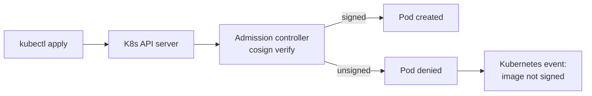

# 18.3 Containers and the software supply chain

| Field | Value |
|---|---|
| Level | Advanced |
| Priority tier | 2 |
| Lab venue | GCP / GKE |
| Part | Part 18: Security |
| Primary sources | NVIDIA Zero-to-Hero Volume 18 (`chapter-03-containers-and-the-software-supply-chain.md`); *Production Kubernetes* (`production-kubernetes`, Chapter 15) |
| Cross-references | Chapter 18.1 (Threat modeling); Chapter 18.2 (Hardware and firmware trust); Chapter 11 (GPU Kubernetes); Chapter 5 (Kubernetes) |
| Coverage file | `planning/coverage/chapters/18-03.md` |
| Claim & number ledger | `planning/ledgers/18-03.md` |

## Why this matters for AI infrastructure

Chapter 18.2 verified the firmware. This chapter verifies the software that runs on top of the firmware. A model serving workload is a container image; the container image was built from a Dockerfile; the Dockerfile was based on a base image; the base image was downloaded from a registry. Every link in the chain is a potential attack surface; every link is a potential control point. The team's job is to verify every link before the workload runs, and to keep verifying it continuously.

The software supply chain is the most attacked surface in modern infrastructure. A compromised base image, a compromised dependency, a compromised build script — each is a way for an attacker to insert malicious code into the workload. The supply chain attack is what the SolarWinds incident was; the supply chain attack is what the 3CX incident was; the supply chain attack is what every CVE in the last decade has been. The team's job is to make the supply chain auditable.

```text
Why the software supply chain is on the critical path (V18 ch3; PK Ch 15):
- A typical AI workload has 100-1000 transitive dependencies. Each dependency
  is a potential attack surface. The supply chain attack is the most common
  attack pattern in modern infrastructure.
- The container image is the artefact that runs in the cluster. If the
  image is compromised, the workload is compromised. The image must be
  signed, scanned, and verified before the workload runs.
- The supply chain integrity is the foundation of the workload's trust.
  Without supply chain integrity, every other control is compromised. The
  supply chain must be auditable.
```

Three operational realities make this chapter a platform-team concern rather than a data-science-only concern:

1. **The container image is the platform team's artefact.** The platform team owns the image build; the platform team owns the image signing; the platform team owns the image verification. The image is the platform team's responsibility.
2. **The software supply chain is the platform team's discipline.** Every link in the chain is verified by the platform team; every link is auditable by the platform team. The supply chain integrity is the platform team's discipline.
3. **The admission controller is the cluster's gatekeeper.** The admission controller verifies the image signature; the admission controller verifies the SBOM; the admission controller refuses to start pods with unverified images. The admission controller is the platform team's gatekeeper.

**Before a team can claim their AI factory is secure, the team must have verified every link in the software supply chain. The base image must be signed; the dependencies must be scanned; the build must be reproducible. A team that has not verified the supply chain is a team that has not verified the foundation.**

## Prerequisites and outcomes

### Prerequisites

- Chapter 18.1 (Threat modeling) for the threat context.
- Chapter 18.2 (Hardware and firmware trust) for the foundation.
- Chapter 11 (GPU Kubernetes) for the cluster.
- Chapter 5 (Kubernetes) for the cluster primitives.

### Outcomes

After completing this chapter you will be able to:

1. Implement cosign image signing on every CI/CD pipeline; verify the signature before deploy.
2. Implement OPA Gatekeeper or Kyverno admission control; refuse to start pods with unsigned images.
3. Generate the SBOM for every container image; track the SBOM over time.
4. Implement vulnerability scanning (Trivy, Grype) on every image; refuse to deploy images with HIGH or CRITICAL CVEs.
5. Implement dependency confusion defence; pin every dependency; verify the dependency hash.
6. Operate the supply chain integrity on GKE with continuous verification, SBOM tracking, and incident response.

---

## 1. Container image signing

### 1.1 cosign

cosign is the Sigstore tool for signing and verifying container images. cosign signs the image; cosign verifies the signature; cosign stores the signature in the registry alongside the image.

```bash
# Sign a container image
cosign sign --key cosign.key myregistry/myimage:v1
# expected: the image is signed; the signature is stored in the registry

# Verify a container image
cosign verify --key cosign.pub myregistry/myimage:v1
# expected: the signature is valid; the image is unmodified
```

The pattern is: every image is signed at build time; every image is verified before deploy; the signature is stored in the registry.

### 1.2 Keyless signing with cosign

Keyless signing uses the Sigstore public good (fulcio) for certificate transparency. The signature is tied to the builder's OIDC identity; the verifier checks the OIDC identity.

```bash
# Sign with keyless mode
cosign sign --fulcio --rekor https://rekor.sigstore.dev myregistry/myimage:v1
# expected: the image is signed with the keyless certificate; the certificate is in Rekor
```

The pattern is: keyless signing does not require a private key; keyless signing uses the OIDC identity; keyless signing is auditable via Rekor.

### 1.3 The signature in the registry

The signature is stored in the registry alongside the image. The registry is OCI-compliant; the signature is in the same OCI distribution spec as the image.

```bash
# List the signatures for an image
cosign triangulate myregistry/myimage:v1
# expected: the signatures are listed; the signature count is reported
```

The pattern is: every image has a signature; the signature is in the registry; the signature can be retrieved.

---

## 2. Admission control

### 2.1 OPA Gatekeeper

OPA Gatekeeper is the Open Policy Agent admission controller for Kubernetes. Gatekeeper verifies the image signature; Gatekeeper verifies the SBOM; Gatekeeper refuses to start pods with unverified images.

```yaml
# code/part18/gatekeeper_policy.yaml (shape only)
apiVersion: templates.gatekeeper.sh/v1
kind: ConstraintTemplate
metadata:
  name: k8srequiredimageverification
spec:
  crd:
    spec:
      names:
        kind: K8sRequiredImageVerification
      validation:
        openAPIV3Schema:
          properties:
            image:
              type: string
  targets:
    - target: admission.k8s.gatekeeper.sh
      rego: |
        package k8srequiredimageverification
        violation[{"msg": msg}] {
          container := input.review.object.spec.containers[_]
          not cosign_verify(container.image)
          msg := sprintf("image %v is not signed by cosign", [container.image])
        }
```

The pattern is: the policy is defined as code; the policy is enforced at admission time; the policy is auditable.

### 2.2 Kyverno

Kyverno is the Kubernetes-native policy engine. Kyverno can verify the image signature; Kyverno can verify the SBOM; Kyverno can refuse to start pods with unverified images.

```yaml
# code/part18/kyverno_policy.yaml (shape only)
apiVersion: kyverno.io/v1
kind: ClusterPolicy
metadata:
  name: require-image-signature
spec:
  validationFailureAction: enforce
  rules:
    - name: verify-signature
      match:
        resources:
          kinds:
            - Pod
      validate:
        message: "image must be signed by cosign"
        pattern:
          metadata:
            labels:
              cosign.sigstore.dev/signed: "true"
```

The pattern is: the policy is defined as code; the policy is enforced at admission time; the policy is auditable.

### 2.3 The admission controller in production

The admission controller is deployed as a Kubernetes Deployment. The controller intercepts every pod creation; the controller verifies the image; the controller allows or denies the pod.



The pattern is: the admission controller is the gatekeeper; the admission controller verifies every image; the admission controller refuses unsigned images.

---

## 3. The Software Bill of Materials

### 3.1 What the SBOM contains

The Software Bill of Materials (SBOM) is the inventory of every component in the container image. The SBOM has the package name, the version, the license, the supplier, and the dependency relationship.

```text
SBOM schema (CycloneDX):
- components: list of every package (name, version, license, supplier)
- dependencies: graph of package dependencies
- vulnerabilities: list of known CVEs (added by the scanner)
- tools: list of tools used to generate the SBOM
- metadata: timestamp, author, version
```

The pattern is: every package is in the SBOM; every dependency is in the SBOM; every vulnerability is in the SBOM.

### 3.2 Generating the SBOM with Syft

Syft is the Anchore tool for generating SBOMs from container images. Syft reads the image; Syft produces the SBOM in CycloneDX or SPDX format.

```bash
# Generate the SBOM for an image
syft myregistry/myimage:v1 -o cyclonedx-json > sbom.json
# expected: the SBOM is generated; the SBOM is in CycloneDX format
```

The pattern is: the SBOM is generated at build time; the SBOM is stored alongside the image; the SBOM is auditable.

### 3.3 The SBOM in production

The SBOM is uploaded to the vulnerability database; the SBOM is scanned for vulnerabilities; the SBOM is correlated with the CVE feeds.

```bash
# Upload the SBOM to the vulnerability database
grype sbom:./sbom.json -o sarif > vulns.sarif
# expected: the vulnerabilities are listed in SARIF format
```

The pattern is: the SBOM is uploaded to the vulnerability database; the SBOM is scanned for vulnerabilities; the SBOM is correlated with the CVE feeds.

---

## 4. Vulnerability scanning

### 4.1 Trivy

Trivy is the Aqua Security vulnerability scanner. Trivy scans container images for CVEs; Trivy scans the SBOM for vulnerabilities; Trivy scans the dependencies for known issues.

```bash
# Scan a container image for vulnerabilities
trivy image myregistry/myimage:v1
# expected: the vulnerabilities are listed; the severity is reported
```

The pattern is: the scan is automated; the scan is continuous; the scan produces a structured report.

### 4.2 Grype

Grype is the Anchore vulnerability scanner. Grype scans the SBOM for vulnerabilities; Grype uses the vulnerability database; Grype reports the vulnerabilities.

```bash
# Scan an SBOM for vulnerabilities
grype sbom:./sbom.json
# expected: the vulnerabilities are listed; the severity is reported
```

The pattern is: Grype is the alternative to Trivy; the team's choice depends on the team's preference.

### 4.3 The scan in CI/CD

The scan is integrated into the CI/CD pipeline. The pipeline builds the image; the pipeline generates the SBOM; the pipeline scans the SBOM; the pipeline fails the build if the scan finds HIGH or CRITICAL CVEs.

```yaml
# code/part18/cicd_scan.yaml (shape only)
stages:
  - name: build
    image: my-builder:v1
    command: [docker, build, -t, myregistry/myimage:v1, .]
  - name: sbom
    image: anchore/syft:v1
    command: [syft, myregistry/myimage:v1, -o, cyclonedx-json, >, sbom.json]
  - name: scan
    image: aquasec/trivy:v1
    command: [trivy, image, --input, sbom.json, --severity, HIGH,CRITICAL, --exit-code, 1, myregistry/myimage:v1]
```

The pattern is: the pipeline builds; the pipeline scans; the pipeline fails the build if the scan finds vulnerabilities.

---

## 5. Dependency confusion defence

### 5.1 What is dependency confusion

Dependency confusion is the attack where a malicious package with the same name as a legitimate package is uploaded to a public registry. The build system pulls the malicious package instead of the legitimate package.

```text
Dependency confusion attack:
- Legitimate package: myorg-common-lib (private registry)
- Malicious package: myorg-common-lib (public registry)
- Build system: pip install myorg-common-lib
- Attack: the build system pulls the malicious package from the public registry
- Result: the malicious code runs in the build; the build is compromised
```

The pattern is: the attacker uploads a package with the same name as a private package; the build system pulls the wrong package.

### 5.2 The defence: dependency pinning

The defence is dependency pinning. The build system uses a lockfile (pip's `requirements.txt` with hashes, npm's `package-lock.json`, go's `go.sum`); the build system verifies the hash of every dependency.

```bash
# Verify the dependency hashes
pip install --require-hashes -r requirements.txt
# expected: pip verifies the hash of every package; the install fails if any hash is wrong
```

The pattern is: every dependency has a hash; the build system verifies the hash; the build fails if any hash is wrong.

### 5.3 The defence: private registry

The defence is a private registry. The build system pulls from a private registry; the private registry has a curated set of packages; the build system cannot pull from a public registry.

```yaml
# code/part18/pip_conf.yaml (shape only)
[global]
index-url = https://my-private-registry.example.com/pypi/
extra-index-url = https://pypi.org/simple/
```

The pattern is: the build system uses the private registry as the primary index; the public registry is the fallback; the build system prefers the private registry.

---

## 6. Operating the software supply chain on GKE

### 6.1 The components

| Component | Where it runs | Backing store | SLO |
|---|---|---|---|
| cosign signing | CI/CD pipeline | Registry | 100% of images signed |
| Admission controller | Kubernetes Deployment | (verifies pods) | Admission latency p99 < 100 ms |
| SBOM generation | CI/CD pipeline | Object storage | SBOM generated for every image |
| Vulnerability scanner | CI/CD pipeline | Vulnerability database | Scan latency p99 < 5 minutes |
| Dependency pinning | CI/CD pipeline | Lockfile | 100% of dependencies pinned |

### 6.2 IAM and the supply chain integrity

The supply chain integrity has its own IAM. The pattern is:

| Role | Who | What they can do |
|---|---|---|
| `supplychain.reader` | The platform team; the security team | Read the SBOM; read the vulnerability report |
| `supplychain.writer` | The platform team | Sign the image; update the SBOM; update the lockfile |
| `supplychain.admin` | The platform team lead | Approve the image signing policy; approve the SBOM policy |

The supply chain integrity is the platform team's discipline. The discipline is documented; the discipline is enforced; the discipline is reviewed quarterly.

### 6.3 Observability

| Metric | Why it matters | Alert |
|---|---|---|
| Image signing rate | Supply chain integrity | < 100% |
| Image verification rate | Admission control | < 100% |
| SBOM freshness | SBOM currency | > 24 hours stale |
| Vulnerability count (HIGH/CRITICAL) | Vulnerability exposure | > 0 |
| Dependency pinning rate | Dependency confusion defence | < 100% |

The vulnerability count alert is the most important. Any HIGH or CRITICAL vulnerability is a security exposure that the team must address immediately.

---

## 7. How it fails

Six failure modes recur.

### 7.1 "The image is not signed"

**Symptom:** A workload tries to deploy; the admission controller refuses the pod; the workload cannot run.

**Diagnosis:** The CI/CD pipeline does not sign the image; the image is unsigned.

**Fix:** Add cosign signing to the CI/CD pipeline; verify the signature is present; redeploy.

### 7.2 "The signature is invalid"

**Symptom:** A workload tries to deploy; the admission controller refuses the pod; the signature verification fails.

**Diagnosis:** The image was modified after signing; the signing key was compromised; the signature is wrong.

**Fix:** Re-sign the image; rotate the signing key if compromised; investigate the source of the invalid signature.

### 7.3 "The admission controller is bypassed"

**Symptom:** A pod with an unsigned image starts in the cluster. The admission controller did not enforce the policy.

**Diagnosis:** The admission controller is misconfigured; the policy is set to warn instead of enforce; the namespace is excluded.

**Fix:** Set the policy to enforce; verify the controller is running; verify the namespace is included.

### 7.4 "The SBOM is missing"

**Symptom:** A vulnerability is reported; the SBOM is not available; the team cannot determine the affected components.

**Diagnosis:** The SBOM was not generated; the SBOM was not uploaded; the SBOM was deleted.

**Fix:** Re-generate the SBOM; upload to the vulnerability database; verify the SBOM is auditable.

### 7.5 "The vulnerability is not patched"

**Symptom:** A HIGH or CRITICAL vulnerability is reported; the image is not patched; the workload continues to run with the vulnerability.

**Diagnosis:** The patch is not available; the patch breaks compatibility; the team has not prioritised the patch.

**Fix:** Patch the base image; rebuild the workload image; redeploy; verify the vulnerability is resolved.

### 7.6 "The dependency is confused"

**Symptom:** A malicious package is pulled into the build; the build is compromised; the workload runs with the malicious code.

**Diagnosis:** The dependency pinning is missing; the private registry is not configured; the build system pulls from the public registry.

**Fix:** Pin every dependency; configure the private registry; verify the build system uses the private registry.

---

## 8. Hands-on lab

This lab walks through verifying the supply chain integrity on GKE: the cosign signing, the admission controller, the SBOM generation, the vulnerability scanning, and the dependency pinning. The lab is **untested** in this repository.

### 8.1 Prerequisites

- A GKE Autopilot or Standard cluster (1.27+).
- A CI/CD pipeline (GitHub Actions, GitLab CI, or Jenkins).
- A container registry (GCR, ECR, or Harbor).

### 8.2 Step 1: sign a container image with cosign

```bash
# Sign the image
cosign sign --key cosign.key gcr.io/${PROJECT_ID}/myimage:v1
# expected: the image is signed; the signature is stored in GCR
```

### 8.3 Step 2: deploy the admission controller

```bash
helm install gatekeeper gatekeeper/gatekeeper \
  --namespace gatekeeper-system --create-namespace

kubectl apply -f code/part18/gatekeeper_policy.yaml
# expected: the policy is applied; the admission controller refuses unsigned images
```

### 8.4 Step 3: generate the SBOM

```bash
# Generate the SBOM for the image
syft gcr.io/${PROJECT_ID}/myimage:v1 -o cyclonedx-json > sbom.json
# expected: the SBOM is generated; the SBOM is in CycloneDX format
```

### 8.5 Step 4: scan for vulnerabilities

```bash
# Scan the SBOM for vulnerabilities
trivy sbom sbom.json
# expected: the vulnerabilities are listed; the severity is reported
```

### 8.6 Step 5: pin the dependencies

```bash
# Pin the Python dependencies
pip-compile requirements.in --generate-hashes --output-file requirements.txt
# expected: the dependencies are pinned with hashes; the lockfile is reproducible
```

### 8.7 Step 6: deploy the signed image

```bash
kubectl apply -f code/part18/workload.yaml
# expected: the admission controller verifies the signature; the pod is created
```

### 8.8 What to record

After the lab, you should be able to answer five questions in five seconds each:

1. What is the current image signing rate?
2. What is the current image verification rate?
3. What is the current SBOM freshness?
4. What is the current vulnerability count (HIGH/CRITICAL)?
5. What is the current dependency pinning rate?

If any takes more than 30 seconds, the software supply chain integrity is not yet a production service. The lab is **untested** against a live GKE cluster.

---

## Exercises

1. **Add a cosign signing step to the CI/CD pipeline.** Sign every image at build time; verify the signature before deploy. *Solution sketch:* the CI/CD YAML in Section 6.1; the cosign sign and verify commands.
2. **Add an admission controller policy.** Refuse to start pods with unsigned images. *Solution sketch:* the OPA Gatekeeper policy in Section 2.1; the Kyverno policy in Section 2.2.
3. **Add an SBOM generation step to the CI/CD pipeline.** Generate the SBOM for every image; upload to the vulnerability database. *Solution sketch:* the syft command in Section 3.2; the upload command in Section 3.3.
4. **Add a vulnerability scanning step to the CI/CD pipeline.** Scan every image for CVEs; refuse to deploy images with HIGH or CRITICAL CVEs. *Solution sketch:* the CI/CD YAML in Section 4.3; the trivy scan command.
5. **Add a dependency pinning step to the CI/CD pipeline.** Pin every dependency with a hash; verify the hash on install. *Solution sketch:* the pip-compile command in Section 5.2; the requirements.txt with hashes.
6. **Add a supply chain dashboard.** Build a Grafana dashboard that shows the image signing rate, the vulnerability count, and the SBOM freshness. *Solution sketch:* the dashboard JSON; the panels; the data sources.

---

## Checkpoint questions

<details><summary>1. What is cosign?</summary>
The Sigstore tool for signing and verifying container images. cosign signs the image at build time; cosign verifies the signature at deploy time; cosign stores the signature in the registry alongside the image. Every image is signed; every image is verified.
</details>

<details><summary>2. What is the OPA Gatekeeper?</summary>
The Open Policy Agent admission controller for Kubernetes. Gatekeeper verifies the image signature; Gatekeeper verifies the SBOM; Gatekeeper refuses to start pods with unverified images. Gatekeeper is the cluster's gatekeeper.
</details>

<details><summary>3. What is the SBOM?</summary>
The Software Bill of Materials: the inventory of every component in the container image. The SBOM has the package name, the version, the license, the supplier, and the dependency relationship. The SBOM is the audit trail for the supply chain.
</details>

<details><summary>4. What is dependency confusion?</summary>
The attack where a malicious package with the same name as a legitimate package is uploaded to a public registry. The build system pulls the malicious package instead of the legitimate package. The defence is dependency pinning with hashes.
</details>

<details><summary>5. What is the most common supply chain failure?</summary>
The image is not signed. A workload tries to deploy; the admission controller refuses the pod; the workload cannot run. The diagnosis is that the CI/CD pipeline does not sign the image. The fix is to add cosign signing to the CI/CD pipeline.
</details>

<details><summary>6. What is the most dangerous supply chain failure?</summary>
The admission controller is bypassed. A pod with an unsigned image starts in the cluster. The diagnosis is that the admission controller is misconfigured. The fix is to set the policy to enforce; verify the controller is running.
</details>

<details><summary>7. What is the most common SBOM failure?</summary>
The SBOM is missing. A vulnerability is reported; the SBOM is not available; the team cannot determine the affected components. The fix is to re-generate the SBOM; upload to the vulnerability database; verify the SBOM is auditable.
</details>

<details><summary>8. What is the most common vulnerability failure?</summary>
The vulnerability is not patched. A HIGH or CRITICAL vulnerability is reported; the image is not patched; the workload continues to run with the vulnerability. The fix is to patch the base image; rebuild the workload image; redeploy.
</details>

<details><summary>9. What is the most common dependency confusion failure?</summary>
The dependency is confused. A malicious package is pulled into the build; the build is compromised. The fix is to pin every dependency; configure the private registry; verify the build system uses the private registry.
</details>

<details><summary>10. What is the relationship between cosign and the admission controller?</summary>
cosign signs the image; the admission controller verifies the signature. Together, they form the signature chain: cosign produces the signature; the admission controller consumes the signature. The signature chain is the foundation of the supply chain trust.
</details>

<details><summary>11. What is the relationship between the SBOM and the vulnerability scanner?</summary>
The SBOM is the inventory; the vulnerability scanner is the auditor. The scanner reads the SBOM; the scanner correlates with the CVE feeds; the scanner reports the vulnerabilities. The SBOM is the input; the scanner is the output.
</details>

<details><summary>12. What is the relationship between the lockfile and the dependency confusion defence?</summary>
The lockfile pins every dependency with a hash; the build system verifies the hash. The lockfile is the input; the verification is the output. The lockfile is what makes the build reproducible; the verification is what makes the build safe.
</details>

<details><summary>13. What is the difference between Trivy and Grype?</summary>
Trivy is the Aqua Security vulnerability scanner. Grype is the Anchore vulnerability scanner. Both scan the SBOM for vulnerabilities; both use the vulnerability database; both report the severity. The team's choice depends on the team's preference.
</details>

<details><summary>14. What is the most important supply chain metric?</summary>
The vulnerability count (HIGH/CRITICAL). The metric tells the team which images have known vulnerabilities. Any HIGH or CRITICAL vulnerability is a security exposure that the team must address immediately. The alert fires when the count is non-zero.
</details>

<details><summary>15. What is the difference between keyful and keyless signing?</summary>
Keyful signing uses a private key stored locally. Keyless signing uses the Sigstore public good (fulcio) for certificate transparency; the signature is tied to the builder's OIDC identity. Keyless signing is auditable via Rekor; keyful signing does not require a third party.
</details>

<details><summary>16. What is the relationship between cosign and Rekor?</summary>
cosign signs the image; Rekor stores the signature. Rekor is the transparency log; Rekor is auditable; Rekor is the evidence that the signature existed at a specific time. cosign + Rekor = signed image with transparency.
</details>

<details><summary>17. What is the difference between SBOM and CVE?</summary>
The SBOM is the inventory of every component in the image. The CVE is the known vulnerability for a specific component. The SBOM is the input; the CVE is the output. The scanner reads the SBOM; the scanner correlates with the CVE feeds; the scanner reports the vulnerabilities.
</details>

<details><summary>18. Why is containers and supply chain a Tier 2 chapter?</summary>
Because the supply chain integrity is the foundation of the workload's trust. Without the supply chain integrity, every other control is compromised. The supply chain integrity is what the platform team owns; the supply chain integrity is what the regulator sees; the supply chain integrity is what the auditor inspects.
</details>

<details><summary>19. What is the difference between an image and an artefact?</summary>
An image is a container image; an image is what runs in the cluster. An artefact is anything that is built and stored; an artefact includes images, models, datasets, and SBOMs. The supply chain integrity covers all artefacts.
</details>

<details><summary>20. What five questions should the supply chain lab let you answer in five seconds each?</summary>
What is the current image signing rate. What is the current image verification rate. What is the current SBOM freshness. What is the current vulnerability count HIGH/CRITICAL. What is the current dependency pinning rate. If any takes more than 30 seconds, the software supply chain integrity is not yet a production service.
</details>

---

## Sources and review notes

- NVIDIA Zero-to-Hero Volume 18 (`chapter-03-containers-and-the-software-supply-chain.md`). Source for the cosign signing, the admission controller, the SBOM generation, and the vulnerability scanning patterns. The wording has been rewritten in the handbook's voice.
- *Production Kubernetes* (`production-kubernetes`, Chapter 15). Source for the supply chain patterns and the admission control patterns.

### Cross-references to other handbook chapters

- Chapter 18.1 for the threat-model context.
- Chapter 18.2 for the hardware and firmware trust.
- Chapter 11 for the GPU Kubernetes.
- Chapter 5 for the Kubernetes primitives.

### Migrated from `nvidia-devops`

The supply chain operational patterns draw on Volume 18 chapter 3. The wording has been rewritten in the handbook's voice.

### Explicitly labelled inferences

- The firmware update cycle (quarterly) is a starting point; specific cadences depend on the vendor's release cadence.
- The vulnerability scanner choice (Trivy vs Grype) is a starting point; specific choices depend on the team's preference.
- The lockfile format (pip-compile, package-lock.json, go.sum) is a starting point; specific formats depend on the language.

### Not verified on live hardware

- The lab in Section 8 is **untested** against a live GKE cluster in this repository.
- The cosign signing commands assume a registry with OCI support; production deployments may vary.
- The admission controller commands assume a Kubernetes cluster with admission control enabled.
