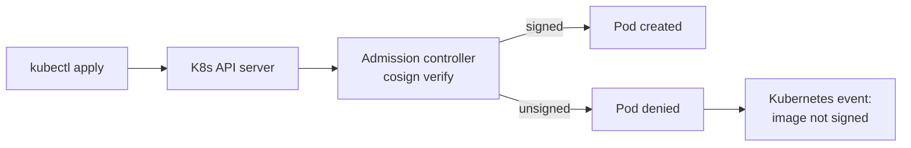

# 18.3 Containers and the software supply chain

| Field | Value |
|---|---|
| Level | Advanced |
| Priority tier | 2 |
| Lab venue | GCP / GKE |
| Part | Part 18: Security |
| Primary sources | NVIDIA Zero-to-Hero Volume 18 (`chapter-03-containers-and-the-software-supply-chain.md`); *Production Kubernetes* (`production-kubernetes`, Chapter 15) |
| Cross-references | Chapter 18.1 (Threat modeling); Chapter 18.2 (Hardware and firmware trust); Chapter 11 (GPU Kubernetes); Chapter 5 (Kubernetes) |
| Coverage file | `planning/coverage/chapters/18-03.md` |
| Claim & number ledger | `planning/ledgers/18-03.md` |

## Why this matters for AI infrastructure

Imagine a model-serving team that ships a new image on a Friday afternoon. The image runs fine in staging, and nobody checks where its base layer came from or which libraries it bundles. On Monday, a scanner flags a serious flaw in one of those libraries, and nobody can say which running pods contain it. This chapter closes that gap.

Chapter 18.2 verified the firmware. This chapter verifies the software that runs on top of it. A model-serving workload is a container image. That image was built from a Dockerfile, the Dockerfile started from a base image, and the base image came from a registry. Each link can be attacked, and each link can also be checked before the workload runs. Your job is to check them, and to keep checking after deployment.

The software supply chain is one of the most common attack surfaces in modern infrastructure. A compromised base image, dependency, or build script can insert malicious code into a workload that otherwise looks correct. The SolarWinds and 3CX incidents both worked this way. The code you wrote is not the only code that runs.

```text
Why the software supply chain is on the critical path (background reading: NVIDIA Zero-to-Hero volume 18; Production Kubernetes; the figures below are examples, not quotations):
- A typical AI workload has 100-1000 transitive dependencies. Each dependency
  is a potential attack surface. The supply chain attack is the most common
  attack pattern in modern infrastructure.
- The container image is the artefact that runs in the cluster. If the
  image is compromised, the workload is compromised. The image must be
  signed, scanned, and verified before the workload runs.
- The supply chain integrity is the foundation of the workload's trust.
  Without supply chain integrity, every other control is compromised. The
  supply chain must be auditable.
```

The 100 to 1,000 dependency range in that block is an example, chosen to show the scale of the risk. It is not a measured figure for your workload. Count the transitive dependencies in your own image before you plan around any number.

Three operational realities make this a platform-team concern, not only a data-science concern. The first is ownership. The platform team builds the image, signs it, and verifies it, so the image is the platform team's artifact. The second is that supply chain discipline runs continuously. Every link needs a check, and each check must leave a record that an auditor can follow later. The third is the admission controller. It sits at the cluster door and checks each image before its pod starts, which makes it the one place where a policy can actually be enforced.

A Kubernetes platform is a means to an end, not the goal itself. Companies exist to deliver a core business, such as an ecommerce site, a monitoring product, or an insurance website. The platform helps only when it moves code to customers faster and more safely. This chapter follows that path from developer code to a running workload. It treats each stage as a clean handoff point, so you can improve one stage without rebuilding the whole pipeline.

**Before you call an AI factory secure, check every link in its supply chain. Confirm that the base image is signed, that the dependencies are scanned, and that the build can be reproduced.**

## Prerequisites and outcomes

### Prerequisites

- Chapter 18.1 (Threat modeling) for the threat context.
- Chapter 18.2 (Hardware and firmware trust) for the foundation.
- Chapter 11 (GPU Kubernetes) for the cluster.
- Chapter 5 (Kubernetes) for the cluster primitives.

### Outcomes

By the end of this chapter, you should be able to do five things:

- Sign every image in your pipeline with cosign, and verify the signature before anything deploys it.
- Add an admission policy that refuses pods with unsigned images, and prove that it refuses them.
- Generate an SBOM for every image, scan it, and refuse to deploy images with HIGH or CRITICAL CVEs.
- Pin every dependency and verify its hash at install time.
- Run the supply chain on GKE with continuous verification, SBOM tracking, and a path for incident response.

---

## 1. Container image signing

### 1.1 cosign

A tag such as `v1` can be overwritten after your review, and the cluster would never notice. A signature lets a verifier check that an image came from a known key holder and has not changed since.

cosign is the Sigstore tool for signing and checking images. The private key signs, and the public key verifies. Keep the private key in your CI secret store, never in the repository.

```bash
# Sign a container image
cosign sign --key cosign.key myregistry/myimage:v1
# expected: the image is signed; the signature is stored in the registry

# Verify a container image
cosign verify --key cosign.pub myregistry/myimage:v1
# expected: the signature is valid; the image is unmodified
```

The signature is stored in the registry next to the image, so the image and its proof travel together. Signing and verifying both need the key files on the machine that runs the command.

### 1.2 Keyless signing with cosign

A key file must be stored, rotated, and protected. Keyless signing removes the file and ties the signature to the builder's OIDC identity instead. Check that your CI runners can reach the signing service before you depend on it.

```bash
# Sign with keyless mode (the default in cosign 2.x; it opens an OIDC login or uses the CI identity token)
cosign sign myregistry/myimage:v1
# expected: a short-lived certificate is issued by Fulcio and the signature is recorded in the Rekor transparency log
```

### 1.3 The signature in the registry

Use the command below to see what signature data the registry holds for an image.

```bash
# List the signatures for an image
cosign triangulate myregistry/myimage:v1
# expected: the signatures are listed; the signature count is reported
```

Before you let a pipeline deploy an image, confirm that a verify step runs against that exact image reference.

---

## 2. Admission control

### 2.1 OPA Gatekeeper

A signature helps only if the cluster refuses unsigned images. An admission controller sits in the API server request path and checks each new pod before it is stored. Gatekeeper is the Open Policy Agent controller that does this.

The policy below is a skeleton, so read it as one. Its rule calls `cosign_verify`, but the snippet never defines that function. The file shows the shape of a policy, not a working signature check.

```yaml
# code/part18/gatekeeper_policy.yaml
apiVersion: templates.gatekeeper.sh/v1
kind: ConstraintTemplate
metadata:
  name: k8srequiredimageverification
spec:
  crd:
    spec:
      names:
        kind: K8sRequiredImageVerification
      validation:
        openAPIV3Schema:
          properties:
            image:
              type: string
  targets:
    - target: admission.k8s.gatekeeper.sh
      rego: |
        package k8srequiredimageverification
        violation[{"msg": msg}] {
          container := input.review.object.spec.containers[_]
          not cosign_verify(container.image)
          msg := sprintf("image %v is not signed by cosign", [container.image])
        }
```

### 2.2 Kyverno

Kyverno is a Kubernetes-native policy engine. The rule below shows the same gap. It checks for a label named `cosign.sigstore.dev/signed` on each Pod. Nothing in this chapter sets that label, so the rule checks a label and never checks a signature. Replace it with a rule that verifies the signature itself before you count on it.

```yaml
# code/part18/kyverno_policy.yaml
apiVersion: kyverno.io/v1
kind: ClusterPolicy
metadata:
  name: require-image-signature
spec:
  validationFailureAction: enforce
  rules:
    - name: verify-signature
      match:
        resources:
          kinds:
            - Pod
      validate:
        message: "image must be signed by cosign"
        pattern:
          metadata:
            labels:
              cosign.sigstore.dev/signed: "true"
```

### 2.3 The admission controller in production

In production, the admission controller runs as a Deployment inside the cluster. It intercepts each pod creation, checks the image, and then allows or denies the pod. A denial appears as a Kubernetes event, so the developer sees the reason in the output of the failed apply.



Test the denial path on purpose. Apply an unsigned test image to a non-production namespace, and confirm the pod is refused before you trust the policy.

---

## 3. The Software Bill of Materials

### 3.1 What the SBOM contains

Suppose a new vulnerability is announced for a logging library. You need to know quickly whether any of your images ship that library. You can answer only if you kept a list of every component in each image. That list is the Software Bill of Materials, or SBOM.

The SBOM records each package with its name, version, license, supplier, and dependency relationships. The scanner adds vulnerability data to it later, so the same SBOM can be checked again when new CVEs appear.

```text
SBOM schema (CycloneDX):
- components: list of every package (name, version, license, supplier)
- dependencies: graph of package dependencies
- vulnerabilities: list of known CVEs (added by the scanner)
- tools: list of tools used to generate the SBOM
- metadata: timestamp, author, version
```

### 3.2 Generating the SBOM with Syft

Syft is the Anchore tool that reads a container image and writes its SBOM. It can write CycloneDX or SPDX, and this chapter uses CycloneDX. Generate the SBOM at build time, from the same image reference you pushed, so the inventory matches what runs.

```bash
# Generate the SBOM for an image
syft myregistry/myimage:v1 -o cyclonedx-json > sbom.json
# expected: the SBOM is generated; the SBOM is in CycloneDX format
```

### 3.3 The SBOM in production

A clean scan on the day you built an image does not stay clean. New CVEs are published every week, so scan the stored SBOM on a schedule, not only once. The command below scans the SBOM against vulnerability data and writes the findings as SARIF, a format many CI systems can read.

```bash
# Scan the SBOM for known vulnerabilities (grype reads the SBOM; it does not upload it)
grype sbom:./sbom.json -o sarif > vulns.sarif
# expected: the vulnerabilities are listed in SARIF format
```

Store each SBOM beside its image so responders need not rebuild it during an incident.

---

## 4. Vulnerability scanning

### 4.1 Trivy

A scanner compares the packages in an image with a database of known vulnerabilities. Trivy is the Aqua Security scanner, and it can scan an image directly. Read the output by severity first, then check whether your application actually loads each flagged package.

```bash
# Scan a container image for vulnerabilities
trivy image myregistry/myimage:v1
# expected: the vulnerabilities are listed; the severity is reported
```

### 4.2 Grype

Grype is the Anchore scanner, and it reads an SBOM directly. That means you can check an image's inventory without pulling the image again. Either Trivy or Grype does the job, so choose the one your team can run and maintain.

```bash
# Scan an SBOM for vulnerabilities
grype sbom:./sbom.json
# expected: the vulnerabilities are listed; the severity is reported
```

### 4.3 The scan in CI/CD

A scan that nobody runs protects nothing. Put it in the pipeline so every build creates an SBOM and then scans it. The job below fails when the scan finds HIGH or CRITICAL issues, so the build stops before the image is promoted.

```yaml
# code/part18/cicd_scan.yaml
# GitHub Actions workflow: build, generate an SBOM, scan it, fail on HIGH or CRITICAL.
name: image-scan
on: [push]
jobs:
  build-scan:
    runs-on: ubuntu-latest
    steps:
      - uses: actions/checkout@v4
      - name: Build image
        run: docker build -t myregistry/myimage:${{ github.sha }} .
      - name: Generate SBOM (CycloneDX)
        run: syft myregistry/myimage:${{ github.sha }} -o cyclonedx-json > sbom.json
      - name: Scan the SBOM
        run: trivy sbom --severity HIGH,CRITICAL --exit-code 1 sbom.json
```

A hard fail on every finding can block a deploy that a team has already reviewed. Production Kubernetes, chapter 15, describes two controls that help here. An allowlist lets a team accept a CVE that has no fix yet or does not apply to its setup, with the reason written down. Blocking image pulls for a high-severity CVE also carries a risk, because a pod that reschedules onto a new node may not be able to pull its image at all. Weigh the security gain against that availability cost, and record the decision.

---

## 5. Dependency confusion defence

### 5.1 What is dependency confusion

Picture a build that installs a package named `myorg-common-lib`. Your company publishes that package on a private index. An attacker publishes a package with the same name on the public index. If the build looks at the public index too, it may pick up the attacker's copy. The build does not warn you, and the malicious code runs inside your build.

```text
Dependency confusion attack:
- Legitimate package: myorg-common-lib (private registry)
- Malicious package: myorg-common-lib (public registry)
- Build system: pip install myorg-common-lib
- Attack: the build system pulls the malicious package from the public registry
- Result: the malicious code runs in the build; the build is compromised
```

### 5.2 The defence: dependency pinning

Pinning is the first defence. A lockfile records the exact version and a hash for every package. The install step checks each downloaded file against its hash, so a swapped package fails the build. Use the lockfile your language already produces: pip's requirements file with hashes, npm's `package-lock.json`, or Go's `go.sum`.

```bash
# Verify the dependency hashes
pip install --require-hashes -r requirements.txt
# expected: pip verifies the hash of every package; the install fails if any hash is wrong
```

Pin the operating system packages too. Production Kubernetes, chapter 15, makes the same point for packages installed with `apk`, `yum`, or `apt`. Without a pinned version, two builds of the same Dockerfile can end up with different packages.

### 5.3 The defence: private registry

The build system pulls from a private registry, which holds a curated set of packages. The build system cannot pull from a public registry. The configuration below sets that up for pip.

```yaml
# code/part18/pip.conf
[global]
# Only the private registry. A second public index (extra-index-url) is exactly what dependency confusion exploits.
index-url = https://my-private-registry.example.com/pypi/
```

Before you trust a build, check which index each package name resolves from. A private registry helps only when the build never falls back to the public index for a name your company owns.

---

## 6. Operating the software supply chain on GKE

### 6.1 The components

Every control needs an owner and a target. The targets in the last column are example values, so choose your own.

| Component | Where it runs | Backing store | SLO |
|---|---|---|---|
| cosign signing | CI/CD pipeline | Registry | 100% of images signed |
| Admission controller | Kubernetes Deployment | (verifies pods) | Admission latency p99 < 100 ms |
| SBOM generation | CI/CD pipeline | Object storage | SBOM generated for every image |
| Vulnerability scanner | CI/CD pipeline | Vulnerability database | Scan latency p99 < 5 minutes |
| Dependency pinning | CI/CD pipeline | Lockfile | 100% of dependencies pinned |

Production Kubernetes, chapter 15, suggests tagging each image with its git commit hash, then adding readable version tags as it moves through environments. Immutable tags stop anyone from overwriting an approved tag.

### 6.2 IAM and the supply chain integrity

Anyone who can sign an image can vouch for it, so signing rights need the same care as deploy rights. The table separates three roles: readers, writers who sign and update, and an admin who approves policy.

| Role | Who | What they can do |
|---|---|---|
| `supplychain.reader` | The platform team. The security team | Read the SBOM; read the vulnerability report |
| `supplychain.writer` | The platform team | Sign the image; update the SBOM; update the lockfile |
| `supplychain.admin` | The platform team lead | Approve the image signing policy; approve the SBOM policy |

Production Kubernetes, chapter 15, also suggests keeping deployment configuration in a separate repository from application code. The two repositories then carry different permissions and audit rules. The role names above are a pattern to adapt, not a standard. A quarterly review of role holders is one reasonable cadence.

### 6.3 Observability

Metrics tell you whether the controls still work, so watch them as you would any other production signal. Each row below names a control, why it matters, and the alert you would set. The alert values are examples, so set thresholds your team can act on.

| Metric | Why it matters | Alert |
|---|---|---|
| Image signing rate | Supply chain integrity | < 100% |
| Image verification rate | Admission control | < 100% |
| SBOM freshness | SBOM currency | > 24 hours stale |
| Vulnerability count (HIGH/CRITICAL) | Vulnerability exposure | > 0 |
| Dependency pinning rate | Dependency confusion defence | < 100% |

Of these, the HIGH or CRITICAL count matters most. Every such finding is an exposure, and it needs an owner and a fix date.

---

## 7. How it fails

Six failure modes come back again and again in supply chain incidents. Each subsection gives the symptom you see first, the likely cause, and the fix. Start from the symptom, because that is where the on-call engineer begins.

### 7.1 "The image is not signed"

Symptom: a deploy fails because the admission controller refuses the pod. Diagnosis: the pipeline pushed the image without a signing step, so no signature exists. Fix: add the signing step to the pipeline, confirm the signature now exists in the registry, and redeploy.

### 7.2 "The signature is invalid"

Symptom: the admission controller refuses the pod because verification fails. Diagnosis: the image changed after signing, the signing key was compromised, or the signature was made with the wrong key. Fix: sign again from a trusted build, rotate the key if you suspect compromise, and find out how the image changed before you trust the next one.

### 7.3 "The admission controller is bypassed"

Symptom: a pod with an unsigned image starts anyway. Diagnosis: the policy is set to warn instead of enforce, the namespace is excluded, or the controller is not running. Fix: set the policy to enforce, confirm the controller is running, and include the namespace. Then test again with an unsigned image, because a policy you never tested is a policy you cannot vouch for.

### 7.4 "The SBOM is missing"

Symptom: a vulnerability is announced, but no SBOM exists for the image, so the team cannot tell which components are affected. Diagnosis: the SBOM was never generated, was never stored, or was deleted. Fix: regenerate the SBOM from the image reference, store it next to the image, and confirm you can retrieve it before the next incident.

### 7.5 "The vulnerability is not patched"

Symptom: a HIGH or CRITICAL finding is open, and the workload keeps running the vulnerable image. Diagnosis: no patch is available yet, the patch breaks compatibility, or nobody has prioritised the fix. Fix: patch the base image, rebuild the workload image, redeploy, and confirm the finding is gone. Production Kubernetes, chapter 15, warns against automatic patching that skips your change process, because a new image can break the running application. Send the patch through the same pipeline and tests as any other change.

### 7.6 "The dependency is confused"

Symptom: a malicious package appears in the build, and the workload runs its code. Diagnosis: dependencies are not pinned, the private registry is not configured, or the build still pulls from the public index. Fix: pin every dependency, configure the private registry, and confirm the build resolves names from the registry you intended.

---

## 8. Hands-on lab

This lab walks you through the full chain on GKE: sign the image, admit it, generate its SBOM, scan the SBOM, and pin the dependencies. The lab is **untested** in this repository, so treat each expected result as something to check, not something already proven.

### 8.1 Prerequisites

- A GKE Autopilot or Standard cluster (1.27+).
- A CI/CD pipeline (GitHub Actions, GitLab CI, or Jenkins).
- A container registry (GCR, ECR, or Harbor).

### 8.2 Step 1: sign a container image with cosign

Start by signing the image your pipeline built. The admission controller checks this signature later, so the image must carry it before you deploy.

```bash
# Sign the image
cosign sign --key cosign.key gcr.io/${PROJECT_ID}/myimage:v1
# expected: the image is signed; the signature is stored in GCR
```

### 8.3 Step 2: deploy the admission controller

Install Gatekeeper, then apply the policy file. The policy only proves something once it checks a real signature, as section 2.1 explains.

```bash
helm install gatekeeper gatekeeper/gatekeeper \
  --namespace gatekeeper-system --create-namespace

kubectl apply -f code/part18/gatekeeper_policy.yaml
# expected: the policy is applied; the admission controller refuses unsigned images
```

### 8.4 Step 3: generate the SBOM

Generate the SBOM from the same image reference you signed. That keeps the signature and the inventory pointing at one artifact.

```bash
# Generate the SBOM for the image
syft gcr.io/${PROJECT_ID}/myimage:v1 -o cyclonedx-json > sbom.json
# expected: the SBOM is generated; the SBOM is in CycloneDX format
```

### 8.5 Step 4: scan for vulnerabilities

Scan the SBOM and read the severity counts. This is the same check the CI job in section 4.3 runs on every build.

```bash
# Scan the SBOM for vulnerabilities
trivy sbom sbom.json
# expected: the vulnerabilities are listed; the severity is reported
```

### 8.6 Step 5: pin the dependencies

Compile the requirements file with hashes, then commit the output. The next build installs the same bytes, not whatever the index happens to serve that day.

```bash
# Pin the Python dependencies
pip-compile requirements.in --generate-hashes --output-file requirements.txt
# expected: the dependencies are pinned with hashes; the lockfile is reproducible
```

### 8.7 Step 6: deploy the signed image

Apply the workload manifest and watch the admission result. A pod that starts here shows that the signed image passed the policy.

```bash
kubectl apply -f code/part18/workload.yaml
# expected: the admission controller verifies the signature; the pod is created
```

### 8.8 What to record

After the lab, you should be able to answer five questions from your dashboard, without digging through logs:

1. What is the current image signing rate?
2. What is the current image verification rate?
3. What is the current SBOM freshness?
4. What is the current vulnerability count (HIGH/CRITICAL)?
5. What is the current dependency pinning rate?

If you cannot answer one of these quickly, the supply chain is not yet running as a production service. How quickly counts as quick is your team's call. This lab has not been run against a live GKE cluster in this repository.

---

## 9. Building images and delivering them

Sections 1 to 8 assume that an image already exists and that you trust it. This section covers how the image is built, stored, and rolled out. Each stage has a clean handoff point, so you can choose the best approach for each stage and improve it without replacing the rest.

### 9.1 The image is the deployable asset

Before containers, teams deployed a binary, a compressed archive, or raw source code onto a server. They then made sure the server had the right dependencies and configuration. A container image packs those pieces into one artifact. It holds the application, the execution environment, and the dependencies together.

The image is a set of compressed filesystem layers with some metadata. It follows the Open Container Initiative (OCI) image specification, an agreed standard in the cloud native community. Because the standard is shared, many build tools can produce images, and any compliant container runtime can run them.

### 9.2 Gold images are an antipattern

In a pre-container environment, security teams often approved one gold base image, such as a preconfigured CentOS image. Every application had to be built on it. When teams moved to containers, many copied that habit. They took useful upstream images from third parties and vendors, then rebased their applications and configuration onto internal copies.

This causes three problems. The conversion from the upstream image to an internal image costs extra work. The platform team must store and maintain every internal copy. Because the set of images sprawls, updates happen rarely, if at all, and the security posture often gets worse.

Start by asking the security team what each gold image is for. The reason is usually one or more of these requirements.

- Specific agents or software must be installed.
- No vulnerable libraries may be present.
- User accounts must have the correct permissions.

Once you know the reason, encode it as a check in the pipeline. The check rejects or alerts on a non-compliant image. Teams can then keep reusing upstream images and the work that went into them, while the pipeline holds the security line.

Teams often want a fixed base operating system so that the organization keeps troubleshooting knowledge. This benefit is smaller than it looks. You should rarely need to exec into a container to troubleshoot. Even then, the differences between Linux distributions matter little for most support work. More applications now ship as scratch or distroless images, which carry less overhead inside the container.

Do not try to move every upstream or vendor image onto your own base. The costs described above make that a poor use of effort. A curated set of internal base images is still a good idea, though. Those bases make a solid foundation for your own applications.

### 9.3 Build images and runtime images

Containers can also run the build. A build image holds the compiler, the test tools, and the libraries that compile the code. A runtime image holds only the application and what it needs to run. For a Java application, the build image might hold the JDK, Gradle or Maven, and the test tooling. The runtime image might hold only a Java runtime and the application.

The runtime image should not carry build tools, because the application does not need them when it runs. A leaner image is faster to distribute and has a tighter attack surface. Docker's multistage build feature separates the two images in one Dockerfile. The example below builds a Go binary in one stage, then copies only that binary into a distroless runtime stage.

```
# Build stage
FROM golang:1.12.7 as build
WORKDIR /my-app
COPY go.mod .
RUN go mod download
COPY main.go .
ENV CGO_ENABLED=0
RUN go build -o my-app
# Deploy stage
FROM gcr.io/distroless/base
USER nonroot:nonroot
COPY --from=build --chown=nonroot:nonroot /my-app/my-app /my-app
CMD ["/my-app"]
```

Four details in this file matter.

- The `golang` image holds the Go toolchain, which the running application does not need.
- Copying `go.mod` and downloading modules first lets Docker reuse that layer when only the code changes.
- The distroless base gives a minimal image with no extra dependencies.
- Only the compiled `my-app` binary is copied into the deploy stage.

### 9.4 Runtime user

Containers share the Linux kernel with the host, so the runtime user has real consequences. When the user is not set, the process usually runs as root. That raises the attack surface. If an attacker compromises the application and escapes the container, they could gain root access on the host. Decide whether the application needs root, and whether it depends on `/etc/passwd`. If it does not need root, add a nonroot user to the image.

Set the user in the image itself, not only in the Kubernetes manifest. In a Dockerfile, the `USER` directive does this. The example below runs the `my-app` binary as the nonroot user and group, which the distroless images create by default.

```
FROM gcr.io/distroless/base
USER nonroot:nonroot
COPY ./my-app /my-app
CMD ["./my-app", "serve"]
```

An image that names its user documents itself. Developers also get the same user and group ID on their own machines.

Containers usually run a single process with no init system. Your application must therefore handle signals correctly. It must also reap orphaned processes that get reparented to it. Minimal init programs can handle both jobs, and they can act as a bootstrap for your application.

### 9.5 Buildpacks for platform teams

Dockerfiles are not the only way to build an image. Cloud Native Buildpacks analyze the source code and run the buildpacks that match it. A Go buildpack runs when Go files are present. A Maven buildpack runs when a `pom.xml` file is found. Developers start the process with a CLI named `pack`, and they never write a Dockerfile.

Platform teams can also write custom buildpacks. Those buildpacks enforce policy, meet compliance rules, and standardize the images that run on the platform. The value grows with the size of the organization. Development teams want to build value into the application, not learn how to containerize it.

### 9.6 Scanning images after deployment

Scanning at pull time is a start, but it shows only today's findings. New vulnerabilities appear in images that already run. Schedule scans of the images in use, and plan how you will update them. Automatic remediation is tempting, but a new image can break the running application. Automated update systems can also act outside your change process, which makes them hard to audit.

Blocking pulls has a cost too. Suppose a core application's image gets a new CVE, and pulls of that image are blocked. If its pods move to a new node, they may not be able to pull the image. The application then loses availability. Security and availability pull in opposite directions here, so record the trade-off you choose.

A more common model is to alert on scan results and send them to operations and security teams. Some registries call a webhook when a scan finishes, and the payload lists the vulnerable images and CVEs. Other registries expose metrics that standard alerting tools can scrape. This takes more manual work, but it gives you control over when and how you patch. Run each patch through the normal deployment pipeline, so every change is tested and auditable.

Static scanning is one layer of defense in depth. An image can download malicious content after it is deployed. A running container can also be hijacked. Runtime scanning addresses those risks. A simple form scans the filesystem of running containers on a schedule. A stronger form limits the actions and behaviors a container can perform, so you do not chase each new CVE. Look at Falco and the Aqua Security suite, and plan time to study runtime scanning on its own.

### 9.7 Rollout patterns

When you deploy a new version, you also need to watch its health. You must decide whether to fix the issue or roll back. Rollout patterns support that decision. They also separate deploying an application from releasing it to users. You can turn on new behavior when you are ready, which reduces the risk of each change.

A canary release sends a new version into the cluster and routes a small share of traffic to it. The share can depend on metadata, on users, or on another attribute. You watch the canary for errors and for behavior that differs from the old version. If confidence grows, you increase its share over time.

Blue/green is similar to a canary, but it cuts traffic over all at once. The old version is blue and the new version is green. Green can run in the same cluster or in a second cluster. You can test green in a setting that users do not see before the cutover. If errors rise after the cutover, you move traffic back to blue. Applications that hold state or sessions need extra care for this to work.

A/B testing is also close to a canary. You roll out a version with different behavior to a subset of consumers. You then collect metrics on how people use it. Those results guide whether you roll back, roll forward, or expand the experiment.

Most of these patterns use network traffic shifting. Kubernetes provides networking primitives that make this practical. Flagger is an open source tool that automates the patterns on top of a service mesh. It runs as a controller in the cluster and watches the `image` field of `Deployment` resources. It configures the mesh to shift traffic and checks the health of the new version. It then either continues the rollout or halts it and reverts.

Flagger and similar tools usually belong in a second or third phase of a Kubernetes journey. Most patterns need a service mesh, and the mesh adds complexity of its own.

### 9.8 GitOps trade-offs

Push-based pipelines change the cluster from the outside, one command at a time. GitOps reverses that. A controller keeps reconciling the cluster with the contents of a git repository, much as Kubernetes itself reconciles resources. ArgoCD and Flux are the two main tools in this space, and their teams are building a shared engine underneath both.

GitOps is declarative. If the tooling goes down or someone deletes a deployment, the controller tries to restore the declared state. Git becomes the single source of truth, and a pull request workflow becomes the gate for cluster changes. You also get an audit log by default.

GitOps has costs. If git is the single source of truth, secret data must live in version control. Bitnami's Sealed Secrets is the best-known answer. It lets you commit encrypted Secrets, and the cluster decrypts them when they are applied.

A failed push shows up as a failed pipeline. A declarative system can stay diverged without any failure. Alert when the observed state in the cluster and the declared state in git stay different for too long.

Few applications deploy cleanly as a flat set of YAML resources. You may need ordering and some scripting while you move to GitOps. Watch for tools that create resources at runtime. A controller that watches a custom resource and creates other objects through the Kubernetes API is one example. In strict mode, GitOps tooling may delete those objects, because git does not list them. That deletion is often what you want, but changes made outside git can break the model, so plan a workaround for those cases.

### 9.9 Summary of the delivery path

This section followed code from a container into a Kubernetes cluster. Build, test, continuous integration, and continuous delivery still apply in a container environment, but with different tools. GitOps builds on Kubernetes primitives to improve reliability and security in existing deployment patterns.

Decide how much of the pipeline each group should see. Some development teams know Kubernetes well and can write the build and deployment artifacts. Other organizations hide the details from developers to scale and standardize. That choice moves work to the platform team, which must put the foundations and automation in place.

---

## Exercises

Work through these in order, because each one assumes the earlier ones are in place. Each exercise asks you to add one control to your own pipeline.

1. **Add a cosign signing step to the CI/CD pipeline.** Sign every image at build time, and verify the signature before deploy. *Solution sketch:* the cosign sign and verify commands in Section 1.1, placed in the job from Section 4.3.
2. **Add an admission controller policy.** Refuse to start pods with unsigned images. *Solution sketch:* the OPA Gatekeeper policy in Section 2.1, or the Kyverno policy in Section 2.2, with the signature check replaced by a real verification rule.
3. **Add an SBOM generation step to the CI/CD pipeline.** Generate an SBOM for every image, and store it with the image. *Solution sketch:* the syft command in Section 3.2 and the scan command in Section 3.3.
4. **Add a vulnerability scanning step to the CI/CD pipeline.** Scan every image for CVEs, and refuse to deploy images with HIGH or CRITICAL CVEs. *Solution sketch:* the CI/CD YAML in Section 4.3, and the trivy scan command in Section 4.1.
5. **Add a dependency pinning step to the CI/CD pipeline.** Pin every dependency with a hash, and verify the hash on install. *Solution sketch:* the pip-compile command in Section 8.6, and the `--require-hashes` install in Section 5.2.
6. **Add a supply chain dashboard.** Build a Grafana dashboard that shows the image signing rate, the vulnerability count, and the SBOM freshness. *Solution sketch:* the metrics table in Section 6.3, with one panel for each row.

---

## Checkpoint questions

<details><summary>1. A scanner flags a serious flaw in a library on Monday and nobody can say which running pods contain it. What was missing and what do you build?</summary>
The team has no stored list of what each image contains. Generate an SBOM for every image at build time from the same image reference you pushed. Store it next to the image, and scan the stored SBOM on a schedule so a new CVE can be matched to images without rebuilding anything.
</details>

<details><summary>2. A pod with an unsigned image starts anyway. What are the three likely causes and what do you do?</summary>
The policy may be set to warn instead of enforce, the namespace may be excluded, or the controller may not be running. Set the policy to enforce, confirm the controller is running, and include the namespace. Then test again with an unsigned image, because a policy you never tested is a policy you cannot vouch for.
</details>

<details><summary>3. The admission controller refuses a pod because signature verification fails. What could have happened and what do you do?</summary>
The image may have changed after signing, the signing key may be compromised, or the signature may have been made with the wrong key. Sign again from a trusted build and rotate the key if you suspect compromise. Find out how the image changed before you trust the next one.
</details>

<details><summary>4. Your Kyverno policy requires the label `cosign.sigstore.dev/signed: "true"` on every Pod. A pod with an unsigned image carries that label. Does the policy stop it?</summary>
No. The rule checks a label and never checks a signature, and nothing in the chapter sets that label. A pod that carries the label passes whether or not its image is signed. Replace the rule with one that verifies the signature itself before you count on it.
</details>

<details><summary>5. A build that installs `myorg-common-lib` runs malicious code. What are the likely causes and the fix?</summary>
Dependencies may not be pinned, the private registry may not be configured, or the build may still pull from the public index. An attacker can publish a package with the same name on the public index. Pin every dependency, configure the private registry, and confirm the build resolves each name from the registry you intended.
</details>

<details><summary>6. A core application's image gets a new CVE and your policy blocks pulls of it. A pod moves to a new node. What happens and what does that teach?</summary>
The pod may not be able to pull the image, so the application loses availability. Security and availability pull in opposite directions here. Weigh the security gain against that cost and record the trade-off you choose.
</details>

<details><summary>7. Why is a signature better evidence than the tag `v1`?</summary>
A tag can be overwritten after your review and the cluster would never notice. A signature lets a verifier check that the image came from a known key holder and has not changed since. The signature is stored in the registry next to the image, so the two travel together.
</details>

<details><summary>8. Why does a clean scan on build day not stay clean?</summary>
New CVEs are published every week, so an image that was clean when built can become vulnerable without any change. Scan the stored SBOM on a schedule, not only once. The SBOM lets the same inventory be checked again against new vulnerability data.
</details>

<details><summary>9. Why does keyless signing remove the key file problem, and what do you check before you depend on it?</summary>
A key file must be stored, rotated, and protected. Keyless signing ties the signature to the builder's OIDC identity and issues a short-lived certificate from Fulcio. The signature is recorded in the Rekor transparency log. Check that your CI runners can reach the signing service before you depend on it.
</details>

<details><summary>10. Why does `pip install --require-hashes -r requirements.txt` stop a swapped package?</summary>
The lockfile records the exact version and a hash for every package. The install step checks each downloaded file against its hash. A package that was swapped has a different hash, so the install fails.
</details>

<details><summary>11. Why does an image that does not set a user raise the attack surface, and why set it in the image?</summary>
Containers share the Linux kernel with the host. With no user set, the process usually runs as root, so an attacker who compromises the application and escapes the container could gain root on the host. Setting `USER` in the image makes the image document itself and gives developers the same user and group ID on their own machines.
</details>

<details><summary>12. A CI job fails on every HIGH or CRITICAL finding and blocks a deploy the team already reviewed. When would you use an allowlist, and what do you give up?</summary>
Use an allowlist for a CVE that has no fix yet or does not apply to your setup. Write the reason down. You give up a clean zero, because a known finding stays open on purpose. Weigh that against blocking a reviewed deploy.
</details>

<details><summary>13. Security wants one gold base image for every application. When would you instead reuse upstream images, and what do you give up?</summary>
Ask what the gold image is for. Usually it is a required agent, no vulnerable libraries, or correct user permissions. Encode that reason as a pipeline check and keep reusing upstream images. You give up a fixed base operating system and the shared troubleshooting knowledge it brings, which the chapter says is a smaller benefit than it looks.
</details>

<details><summary>14. When would you let an automated system patch images and when would you alert people instead?</summary>
Automatic remediation is tempting, but a new image can break the running application. Automated updates can also act outside your change process, which makes them hard to audit. Alerting needs more manual work, but you control when and how you patch. Send each patch through the normal pipeline so it is tested and auditable.
</details>

<details><summary>15. When would you choose blue/green over a canary release, and what do you give up?</summary>
A canary sends a small share of traffic to the new version and grows it as confidence builds. Blue/green cuts all traffic over at once, and you move it back to blue if errors rise. You get a clean test of green before the cutover. You give up the gradual exposure, and applications that hold state or sessions need extra care.
</details>

<details><summary>16. Your pipeline built 50 images today and 47 are signed. What is the image signing rate and does the alert fire?</summary>
The rate is 47 / 50 = 94 percent. The example alert fires when the rate is below 100 percent, so it fires. The three unsigned images are the ones the admission controller should refuse.
</details>

<details><summary>17. One image has 400 transitive dependencies and 360 are pinned with hashes. What is the pinning rate and how many are exposed?</summary>
The rate is 360 / 400 = 90 percent. That leaves 400 - 360 = 40 dependencies that are not pinned. The example alert fires below 100 percent. The count of 400 is an example, so count the real dependencies in your own image.
</details>

<details><summary>18. A scan of your SBOM reports 0 CRITICAL, 2 HIGH, and 14 MEDIUM findings. Does the CI job in the chapter pass?</summary>
No. The job runs `trivy sbom --severity HIGH,CRITICAL --exit-code 1`, so it fails when any HIGH or CRITICAL finding exists. The 2 HIGH findings fail the job. The 14 MEDIUM findings do not count.
</details>

<details><summary>19. A deploy is refused by the admission controller. What do you check, in order?</summary>
First read the Kubernetes event in the output of the failed apply, which gives the reason. Second list the signatures for the exact image reference with `cosign triangulate` and check that a signature exists. Third, if one exists but verification fails, check for a changed image, a compromised key, or a wrong key.
</details>

<details><summary>20. A malicious package shows up in your build. What do you check, in order?</summary>
First check whether the dependencies are pinned with hashes. Second check whether the private registry is configured, for example with only `index-url` in `pip.conf`. Third check which index each package name actually resolves from, because a second public index is what dependency confusion exploits.
</details>

---

## Sources and review notes

- NVIDIA Zero-to-Hero Volume 18 (`chapter-03-containers-and-the-software-supply-chain.md`). Source for the cosign signing, the admission controller, the SBOM generation, and the vulnerability scanning patterns. The wording has been rewritten in the handbook's voice.
- *Production Kubernetes* (`production-kubernetes`, Chapter 15, "Software Supply Chain"). Source for the supply chain patterns and the admission control patterns, and for the image build, base image, rollout, and GitOps material in section 9.

### Cross-references to other handbook chapters

- Chapter 18.1 for the threat-model context.
- Chapter 18.2 for the hardware and firmware trust.
- Chapter 11 for the GPU Kubernetes.
- Chapter 5 for the Kubernetes primitives.

### Migrated from `nvidia-devops`

The supply chain operational patterns draw on Volume 18 chapter 3. The wording has been rewritten in the handbook's voice.

### Explicitly labelled inferences

- The firmware update cycle (quarterly) is a starting point; specific cadences depend on the vendor's release cadence.
- The vulnerability scanner choice (Trivy vs Grype) is a starting point; specific choices depend on the team's preference.
- The lockfile format (pip-compile, package-lock.json, go.sum) is a starting point; specific formats depend on the language.

### Not verified on live hardware

- The lab in Section 8 is **untested** against a live GKE cluster in this repository.
- The cosign signing commands assume a registry with OCI support; production deployments may vary.
- The admission controller commands assume a Kubernetes cluster with admission control enabled.
