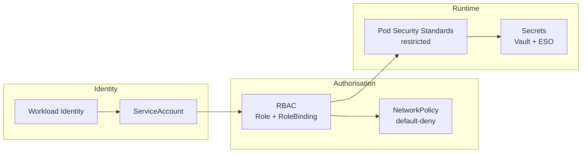

# 18.4 Kubernetes access control and pod security

| Field | Value |
|---|---|
| Level | Advanced |
| Priority tier | 2 |
| Lab venue | GCP / GKE |
| Part | Part 18: Security |
| Cross-references | Chapter 18.1 (Threat modeling); Chapter 18.3 (Containers and software supply chain); Chapter 5 (Kubernetes); Chapter 11 (GPU Kubernetes); Chapter 16.13 (Governance, privacy, compliance) |
| Coverage file | `planning/coverage/chapters/18-04.md` |
| Claim & number ledger | `planning/ledgers/18-04.md` |

## Access controls at a glance



A workload first proves who it is through its ServiceAccount and Workload Identity. RBAC and NetworkPolicy then decide what that identity may do and where it may connect. Pod Security Standards and Secrets control what runs inside the pod and what credentials it holds. Each layer can be checked on its own.

## Why this matters for AI infrastructure

A data scientist is given permission to create pods in a namespace on the shared GPU cluster, so they can launch training jobs. The Kubernetes documentation on RBAC good practices says what that permission really grants. Permission to create pods implicitly grants access to the Secrets, ConfigMaps and PersistentVolumes in that namespace, because a pod can mount them. Since a pod can run as any ServiceAccount in the namespace, it also grants the API access of every one of them. A user who can run privileged pods can use that access to reach the node.

Chapters 18.2 and 18.3 checked firmware and software supply chain. This chapter checks the access controls on the cluster itself, with a focus on what changes when the cluster runs GPUs. GPU clusters add components that run privileged on every node, and they add namespaces where tenants launch long-lived jobs. Those two facts shape the controls below.

## Prerequisites and outcomes

### Prerequisites

Chapter 18.1 for the threat model, Chapter 18.3 for the artifact layer, Chapter 11 for GPU Kubernetes, and Chapter 5 for the cluster primitives.

### Outcomes

After this chapter you will be able to:

1. Write least-privilege Roles and RoleBindings for each tenant namespace.
2. List the RBAC permissions that quietly give node or secret access.
3. Keep tenant namespaces at the Restricted Pod Security level while GPU components run privileged elsewhere.
4. Write NetworkPolicies that deny by default and allow only what a workload needs.
5. Keep secrets out of manifests and out of etcd in plain text.

---

## 1. RBAC

### 1.1 Roles and RoleBindings

A data scientist needs to watch training jobs in one namespace and nothing else. RBAC, which stands for role-based access control, grants exactly that. A Role lists permissions, and a RoleBinding attaches the Role to a user, a group or a ServiceAccount.

```yaml
# code/part18/rbac_role.yaml
apiVersion: rbac.authorization.k8s.io/v1
kind: Role
metadata:
  name: model-trainer
  namespace: team-data-science
rules:
  - apiGroups: [""]
    resources: ["pods", "services", "configmaps"]
    verbs: ["get", "list", "watch"]
  - apiGroups: ["batch"]
    resources: ["jobs"]
    verbs: ["get", "list", "watch", "create", "delete"]
```

This Role reads pods, services and config maps, and it can create and delete Jobs. A RoleBinding attaches it to the ServiceAccount that the workload runs under. Production Kubernetes, in its multitenancy chapter, describes the built-in view, edit and admin roles. The admin role can create Roles and RoleBindings, so give it only to a tenant administrator.

### 1.2 ClusterRoles

A ClusterRole works across the whole cluster. You need one for resources that do not belong to a namespace, such as nodes.

```yaml
# code/part18/rbac_clusterrole.yaml
apiVersion: rbac.authorization.k8s.io/v1
kind: ClusterRole
metadata:
  name: ml-platform-reader
rules:
  - apiGroups: [""]
    resources: ["nodes", "namespaces"]
    verbs: ["get", "list", "watch"]
  - apiGroups: ["admissionregistration.k8s.io"]
    resources: ["validatingwebhookconfigurations", "mutatingwebhookconfigurations"]
    verbs: ["get", "list", "watch"]
```

Bind a ClusterRole with a RoleBinding when you want its rules to apply inside one namespace only.

### 1.3 Common mistakes

| Mistake | Why it is wrong | The fix |
|---|---|---|
| cluster-admin for everyone | Grants full cluster access | Grant only the needed permissions |
| Wildcard verbs or resources | Grants far more than the job needs | List the specific verbs and resources |
| A ClusterRoleBinding for namespace users | Gives rights in every namespace | Use a RoleBinding per namespace |
| Long-lived tokens in environment variables | A stolen token works until someone notices | Use Workload Identity |

Tenants can usually list every namespace. Production Kubernetes notes that RBAC cannot hide namespace names from them. The Kubernetes documentation also says boundaries within a namespace should be considered weak.

### 1.4 Permissions that give more than they say

The Kubernetes RBAC good practices page lists permissions that allow privilege escalation. Review every tenant role against this list.

| Permission | What it quietly gives |
|---|---|
| get, list or watch on Secrets | List and watch also reveal the content of every Secret in scope |
| Create pods, or workloads that manage pods | Access to Secrets, ConfigMaps and PersistentVolumes in the namespace, and the API rights of every ServiceAccount there |
| Create PersistentVolumes | Can include hostPath volumes, which give a pod the node's file system |
| The escalate, bind and impersonate verbs | Bypass the protections against granting rights you do not hold |
| Access to the nodes proxy subresource | Reaches the kubelet API on nodes |

For a GPU cluster the first two rows matter most. A tenant who can create pods in a namespace can reach every secret mounted there. Put each team in its own namespace and keep model credentials in a ServiceAccount that the team's pods alone use.

---

## 2. Workload Identity

A training job must read a model file from a cloud bucket. The job should not carry a password for that bucket. Workload Identity links the job's Kubernetes ServiceAccount to a cloud IAM role, so the job gets short-lived credentials.

```yaml
# code/part18/workload_identity.yaml
apiVersion: v1
kind: ServiceAccount
metadata:
  name: churn-trainer
  namespace: team-data-science
  annotations:
    iam.gke.io/gcp-service-account: churn-trainer@gke-prod.iam.gserviceaccount.com
```

The annotation names the cloud service account that this ServiceAccount maps to. Give each workload its own ServiceAccount, not the namespace default. Production Kubernetes recommends turning off automatic token mounting when a workload never calls the Kubernetes API. Set `automountServiceAccountToken: false` on the ServiceAccount or the Pod. The Pod setting wins when both are present.

Confirm the credential works from inside a pod.

```bash
kubectl exec -it POD_NAME -- gcloud auth print-access-token
```

Before you grant cloud access, ask which single IAM role the workload needs, and grant only that role.

---

## 3. Pod Security for GPU clusters

### 3.1 The three levels

A pod can ask for powerful things, such as the host's network or privileged access to the node. Pod Security Standards set how far a pod may go. The Kubernetes documentation defines three cumulative levels.

| Level | What it allows |
|---|---|
| Privileged | Unrestricted, including known privilege escalations |
| Baseline | Minimally restrictive, prevents known privilege escalations |
| Restricted | Heavily restricted, following current pod hardening practice |

The Baseline level forbids hostPath volumes and host ports. The RBAC documentation says to enforce Baseline or Restricted where you do not fully trust the people who create pods.

### 3.2 Tenants and GPU components need different levels

Not every pod on a GPU node can be Restricted. The Kubernetes device plugin documentation says the device plugin directory under /var/lib/kubelet requires privileged access, so a device plugin must run in a privileged security context and mount that directory. The NVIDIA GPU Operator documentation tells you, when your cluster uses Pod Security Admission, to label the operator's namespace with enforce set to privileged.

So the pattern is two kinds of namespace. The GPU Operator namespace runs privileged, and only the platform team may create anything in it. Tenant namespaces run Restricted, and their pods request GPUs through resource limits rather than through host paths or privileged mode.

```yaml
# code/part18/pss_restricted.yaml
apiVersion: v1
kind: Namespace
metadata:
  name: team-data-science
  labels:
    pod-security.kubernetes.io/enforce: restricted
    pod-security.kubernetes.io/enforce-version: latest
    pod-security.kubernetes.io/warn: restricted
    pod-security.kubernetes.io/warn-version: latest
    pod-security.kubernetes.io/audit: restricted
    pod-security.kubernetes.io/audit-version: latest
```

A namespace with these labels applies Restricted to the pods inside it. A namespace without them is not covered, so check every namespace. Check from time to time that nobody has labelled a tenant namespace privileged to make a job start.

Never allow tenants to create workloads in the privileged operator namespace. Treat write access to that namespace as node administrator access.

### 3.3 Custom admission rules

Pod Security admission handles one job. For an extra rule, such as requiring allowPrivilegeEscalation to be false, Kubernetes offers ValidatingAdmissionPolicy, which evaluates a rule written in CEL with no webhook to run.

```yaml
# code/part18/pss_admission.yaml
# A ValidatingAdmissionPolicy only takes effect once a binding selects where it applies.
apiVersion: admissionregistration.k8s.io/v1
kind: ValidatingAdmissionPolicy
metadata:
  name: restricted-pod-security
spec:
  failurePolicy: Fail
  matchConstraints:
    resourceRules:
      - apiGroups: [""]
        apiVersions: ["v1"]
        operations: ["CREATE", "UPDATE"]
        resources: ["pods"]
  validations:
    - expression: "object.spec.containers.all(c, has(c.securityContext) && has(c.securityContext.allowPrivilegeEscalation) && c.securityContext.allowPrivilegeEscalation == false)"
      message: "Every container must set securityContext.allowPrivilegeEscalation to false"
    - expression: "!has(object.spec.hostNetwork) || object.spec.hostNetwork == false"
      message: "hostNetwork is not allowed"
---
apiVersion: admissionregistration.k8s.io/v1
kind: ValidatingAdmissionPolicyBinding
metadata:
  name: restricted-pod-security-mlops
spec:
  policyName: restricted-pod-security
  validationActions: ["Deny"]
  matchResources:
    namespaceSelector:
      matchLabels:
        kubernetes.io/metadata.name: mlops
```

A policy takes effect only once a binding selects where it applies. The policy here is separate from the namespace labels, so you need both if you want both checks. Test a policy against one passing pod and one failing pod, and confirm it does not silently block a team's training job.

---

## 4. NetworkPolicies

Imagine a pod in one tenant's namespace opening a connection to a pod in another's. Nothing in the network stopped it. A default-deny policy closes that gap by blocking all traffic to and from the pods in a namespace until you allow it. Production Kubernetes makes the same point: a namespace alone has no effect on the workload plane until you add policy.

```yaml
# code/part18/networkpolicy_default_deny.yaml
apiVersion: networking.k8s.io/v1
kind: NetworkPolicy
metadata:
  name: default-deny
  namespace: team-data-science
spec:
  podSelector: {}
  policyTypes:
    - Ingress
    - Egress
```

Then open one path at a time. This policy lets pods labelled `app: churn-model` accept traffic on two ports, but only from the namespace labelled `name: ingress`.

```yaml
# code/part18/networkpolicy_explicit_allow.yaml
apiVersion: networking.k8s.io/v1
kind: NetworkPolicy
metadata:
  name: allow-inference
  namespace: team-data-science
spec:
  podSelector:
    matchLabels:
      app: churn-model
  policyTypes:
    - Ingress
  ingress:
    - from:
        - namespaceSelector:
            matchLabels:
              name: ingress
      ports:
        - port: 8080
        - port: 8443
```

| Mistake | Why it is wrong | The fix |
|---|---|---|
| No NetworkPolicy | All traffic is allowed | Add a default-deny policy |
| Egress to 0.0.0.0/0 | All outbound traffic is allowed | Restrict to the destinations the job needs |
| Missing policyTypes | The policy may cover less than you meant | Specify Ingress and Egress |

A NetworkPolicy needs a network plugin that enforces it. Confirm that your cluster's does.

---

## 5. Secrets

### 5.1 Types and placement

Secrets are the passwords and keys your workloads need. Kubernetes has several types, including Opaque for generic data, dockerconfigjson for image pull credentials, and tls for certificates.

```yaml
# code/part18/secret_opaque.yaml
apiVersion: v1
kind: Secret
metadata:
  name: mlflow-credentials
  namespace: mlops
type: Opaque
stringData:
  username: mlflow
  password: <random-password>
```

The password above is a placeholder. The real value should never go into Git. Chapter 18.7 explains how to make sure Secrets are encrypted in etcd.

### 5.2 External Secrets Operator

Production Kubernetes says the built-in Secret API may fall short for enterprise secret data. External Secrets Operator syncs secrets from external managers such as Vault, AWS Secrets Manager or GCP Secret Manager into Kubernetes Secrets. It syncs on a refresh interval and does not rotate the secret in the external manager. Rotation happens there.

```yaml
# code/part18/external_secret.yaml
apiVersion: external-secrets.io/v1beta1
kind: ExternalSecret
metadata:
  name: mlflow-credentials
  namespace: mlops
spec:
  refreshInterval: 1h
  secretStoreRef:
    name: vault-backend
    kind: ClusterSecretStore
  data:
    - secretKey: password          # key name inside the resulting Kubernetes Secret
      remoteRef:
        key: secret/data/mlflow    # path in the external store
        property: password
```

The `refreshInterval` field sets how often the sync runs. If you rotate the value in the manager at 10:05 and the interval is one hour, a pod can see the old value until 11:05 at the latest.

---

## 6. How it fails

### 6.1 A tenant job has cluster-admin

The job can list secrets in every namespace and create pods anywhere. Its ServiceAccount is bound to the cluster-admin ClusterRole. Remove the binding, write a least-privilege Role and bind that.

### 6.2 A privileged pod runs in a tenant namespace

A pod sets `privileged: true`. The namespace enforces privileged, perhaps relabelled to make a job start. Change it to Restricted and recreate the pod without the privileged fields. Check who may relabel namespaces.

### 6.3 A tenant reads a neighbour's secrets

The tenant has permission to create pods or list secrets in a namespace that holds shared credentials. Move shared credentials out of tenant namespaces and remove the list permission.

### 6.4 The network allows all traffic

A pod in namespace A reaches a pod in namespace B. There is no policy, or one allows all ingress. Add default-deny and then explicit allows.

### 6.5 A secret is hard-coded in a manifest in Git

Use External Secrets Operator and refer to the Secret by name. Rotate the leaked value at once, because Git history keeps it.

### 6.6 A long-lived token was never rotated

A workload holds a ServiceAccount token as an environment variable. Move it to Workload Identity and rotate the token.

---

## 7. Hands-on lab

The lab applies the repository files on a test cluster. It has not been run on a live GKE cluster here.

1. Apply the least-privilege Role and its binding.

```bash
kubectl apply -f code/part18/rbac_role.yaml
kubectl apply -f code/part18/rbac_rolebinding.yaml
```

2. Check what the ServiceAccount can do.

```bash
kubectl auth can-i create pods --as=system:serviceaccount:team-data-science:trainer -n team-data-science
kubectl auth can-i list secrets --as=system:serviceaccount:team-data-science:trainer -n team-data-science
```

3. Label the tenant namespace Restricted and try to create a privileged pod. It should be refused.

```bash
kubectl apply -f code/part18/pss_restricted.yaml
```

4. Apply default-deny and the explicit allow, then test a connection from another namespace.

```bash
kubectl apply -f code/part18/networkpolicy_default_deny.yaml
kubectl apply -f code/part18/networkpolicy_explicit_allow.yaml
```

5. Check which namespaces carry the privileged label.

```bash
kubectl get ns -L pod-security.kubernetes.io/enforce
```

Record the answer to one question: which namespaces are privileged, and who may create pods in them.

---

## Exercises

1. A team can create pods in its namespace and says it has no access to secrets. Is that right? *Solution sketch:* no. Creating pods implicitly grants access to Secrets, ConfigMaps and PersistentVolumes mounted in pods in that namespace, and to the API rights of the ServiceAccounts there. Check with `kubectl auth can-i` and restrict what is stored in the namespace.
2. List the namespaces on your cluster whose Pod Security enforce label is missing or privileged. *Solution sketch:* run `kubectl get ns -L pod-security.kubernetes.io/enforce` and justify each exception, such as the GPU Operator namespace.
3. A GPU Operator pod is refused in a namespace labelled Restricted. What do you do, and what do you not do? *Solution sketch:* install it in its own namespace labelled privileged, as the NVIDIA documentation instructs. Do not relabel tenant namespaces.
4. A user holds the escalate verb on ClusterRoles. Explain the risk. *Solution sketch:* RBAC normally prevents creating ClusterRoles with more rights than you hold, and the escalate verb is the exception.
5. After you rotate a value in Vault at 10:05 with a refresh interval of 1h, when is the new value guaranteed to reach the pod? *Solution sketch:* by 11:05.
6. Write a default-deny policy and a rule that lets only the ingress namespace reach pods labelled `app: churn-model` on port 8443. *Solution sketch:* adapt the two repository files and test from two namespaces.

---

## Checkpoint questions

<details><summary>1. A pod in namespace A reaches a pod in namespace B. What do you look for and add?</summary>
Look for a policy that allows all ingress or egress, and check that a policy exists at all, because with none all traffic is allowed. Add default-deny to each namespace and an explicit allow for each needed path.
</details>

<details><summary>2. A workload can list secrets everywhere and create pods anywhere. What is the cause?</summary>
Its ServiceAccount is bound to cluster-admin. Remove the binding, write a least-privilege Role and bind that.
</details>

<details><summary>3. A pod runs privileged in a tenant namespace. How was it admitted, and what do you change?</summary>
The namespace enforces Privileged, so no rule stopped it. Set it to Restricted, recreate the pod without privileged fields, and restrict who can change namespace labels.
</details>

<details><summary>4. The GPU Operator is installed in a namespace labelled Restricted and its pods are refused. Do you relabel the tenant namespace?</summary>
No. NVIDIA's documentation says to label the operator's namespace privileged. Keep tenants in Restricted namespaces and treat write access to the operator namespace as node administrator access.
</details>

<details><summary>5. You rotate the MLflow password in Vault at 10:05 and a pod still shows the old value at 10:30. Why?</summary>
External Secrets Operator syncs on its refresh interval, one hour in the example, so the new value arrives by 11:05 at the latest. The operator does not rotate secrets in the manager.
</details>

<details><summary>6. A workload holds a long-lived ServiceAccount token in an environment variable. What do you do?</summary>
Move it to Workload Identity, remove the token mount and rotate the token. It then gets short-lived credentials.
</details>

<details><summary>7. A user is allowed to create pods but not to read secrets. Why is that not enough?</summary>
Creating pods implicitly grants access to Secrets, ConfigMaps and PersistentVolumes that can be mounted, and to the API access of any ServiceAccount in the namespace.
</details>

<details><summary>8. Why is creating PersistentVolumes a risky permission on a GPU node?</summary>
A PersistentVolume can be a hostPath volume, which gives a pod the node's file system. A container with that access can read other containers' data and abuse the credentials of system services such as the kubelet.
</details>

<details><summary>9. Why does a namespace alone not isolate a tenant's network traffic?</summary>
A namespace has no effect on the workload plane until you add policy. With no NetworkPolicy all traffic is allowed.
</details>

<details><summary>10. Why does a ValidatingAdmissionPolicy do nothing on its own?</summary>
It takes effect only when a binding selects where it applies. It also does not replace the Pod Security labels.
</details>

<details><summary>11. Why must a device plugin run privileged?</summary>
The Kubernetes documentation says the directory it uses on the host requires privileged access, so the plugin must run in a privileged security context and mount that directory.
</details>

<details><summary>12. A team asks for the Baseline level instead of Restricted for its namespace. How do you decide?</summary>
Move down only when the workload truly needs it. Baseline still prevents known escalations. Each step down gives the pod more power over the node.
</details>

<details><summary>13. When do you use External Secrets Operator rather than plain Secrets, and what does it cost?</summary>
Use it when secrets live in an enterprise manager. The cost is lag: a change in the manager reaches the cluster only after the next sync.
</details>

<details><summary>14. Why is a ClusterRoleBinding for namespace users a problem?</summary>
It gives the rights in every namespace. A RoleBinding per namespace keeps the grant inside the boundary.
</details>

<details><summary>15. Why is Workload Identity safer than a copied key?</summary>
The credential is short-lived, rotates automatically, comes from the metadata server and leaves an audit trail.
</details>

<details><summary>16. Three Pod Security modes each need a mode label and a version label. How many labels per namespace, and for 200 namespaces?</summary>
Six per namespace and 1,200 for 200 namespaces. Automate the labels and check them.
</details>

<details><summary>17. A policy allows ingress to app churn-model on ports 8080 and 8443 from the ingress namespace with default-deny in place. What is allowed?</summary>
Only traffic from that namespace to those two ports. Everything else is denied.
</details>

<details><summary>18. A tenant role includes list on secrets. What does that expose?</summary>
List and watch access effectively let a user read the content of every Secret in scope, not just names.
</details>

<details><summary>19. A training pod cannot reach its bucket. What do you check?</summary>
Whether a token is issued from inside the pod, whether the pod uses its own ServiceAccount with the annotation, and whether the IAM role covers the bucket.
</details>

<details><summary>20. A new pod is refused in a Restricted namespace. What do you check?</summary>
Read the denial message, which names the rule. Then check the namespace labels, and which namespaces a custom policy binding selects.
</details>

---

## Sources and review notes

- Kubernetes documentation, RBAC good practices (listing secrets, workload creation, PersistentVolume creation, escalate, bind and impersonate verbs, nodes proxy). Fetched 2026-11-12.
- Kubernetes documentation, Pod Security Standards (three profiles, HostPath volumes forbidden at Baseline). Fetched 2026-11-12.
- Kubernetes documentation, device plugins (privileged context, hostPath directory). Fetched 2026-11-12.
- NVIDIA GPU Operator documentation, getting started (label the operator namespace privileged). Fetched 2026-11-12.
- *Production Kubernetes*, chapters 7, 10 and 12, for secrets, identity and multitenancy.

### Corrections made in this rework

- Removed the sections on hand-written mutating webhooks, controller-runtime webhooks and an Ingress Gatekeeper example. They were about admission programming rather than access control, and the Ingress example used an API version that has been removed.
- Removed the invented `rbac.*` IAM roles and the unsourced SLO and alert tables.
- Added GPU-specific RBAC and Pod Security guidance.

### Open items

- The ExternalSecret example uses the `external-secrets.io/v1beta1` API. Check which version your operator release serves.
- GKE-specific Workload Identity prerequisites are not restated here. Check the current GKE documentation.
