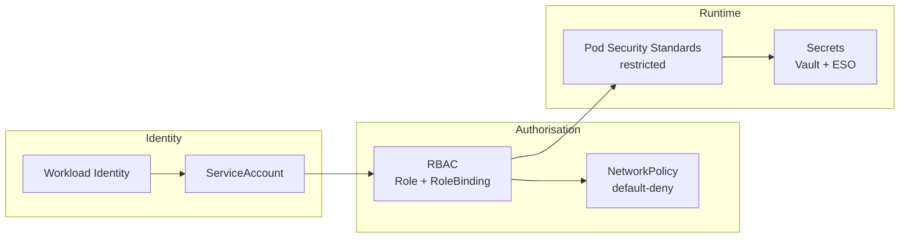

# 18.4 Kubernetes access control and pod security

| Field | Value |
|---|---|
| Level | Advanced |
| Priority tier | 2 |
| Lab venue | GCP / GKE |
| Part | Part 18: Security |
| Primary sources | NVIDIA Zero-to-Hero Volume 18 (`chapter-04-kubernetes-access-control.md`, `chapter-05-pod-security.md`); *Production Kubernetes* (`production-kubernetes`, Chapters 8, 10) |
| Cross-references | Chapter 18.1 (Threat modeling); Chapter 18.3 (Containers and software supply chain); Chapter 5 (Kubernetes); Chapter 11 (GPU Kubernetes); Chapter 16.13 (Governance, privacy, compliance) |
| Coverage file | `planning/coverage/chapters/18-04.md` |
| Claim & number ledger | `planning/ledgers/18-04.md` |

## Access controls at a glance



Read the diagram from left to right. A workload first proves who it is, through its ServiceAccount and Workload Identity. RBAC and NetworkPolicy then decide what that identity may do and where it may connect. Pod Security Standards and Secrets control what runs inside the pod itself. You can check each layer on its own, and that is what makes the whole stack auditable.

## Why this matters for AI infrastructure

Suppose three teams share one GPU cluster, and each team runs its training jobs in its own namespace. Chapters 18.2 and 18.3 checked the firmware and the software supply chain. This chapter checks the access controls on the cluster itself. A namespace marks a tenant. A ServiceAccount is the identity of a workload. A NetworkPolicy marks the network boundary, and a Pod Security Standard limits what a pod may do.

The access controls mark the boundary between tenants. A workload that can read another tenant's data has crossed that boundary. As the platform owner, you should enforce the boundary by default, so that crossing it needs an explicit, approved grant. When an auditor asks who can read a secret, the answer should come from these controls, not from memory.

```text
Why Kubernetes access control is on the critical path (background reading: NVIDIA Zero-to-Hero volume 18; Production Kubernetes; the figures below are examples, not quotations):
- A typical mature AI platform has 50-200 namespaces. Each namespace is a
  tenant boundary. Each ServiceAccount is a workload identity. The cluster's
  access controls are what enforce the tenant boundary.
- A pod that can read another tenant's data is a pod that has escaped the
  tenant boundary. The platform team's job is to make the escape impossible
  without explicit cross-tenant authorisation.
- The Kubernetes access controls are layered: RBAC (who can do what);
  ServiceAccounts (what identity runs the workload); PodSecurityStandards
  (what the workload can do); NetworkPolicies (where the workload can
  communicate); Secrets (what credentials the workload has). Each layer is
  a control; each layer is auditable.
```

Three realities make this a platform-team concern, not only a data-science concern.

1. **The platform team owns the access controls.** It writes the RBAC roles, sets the Pod Security Standards, and manages the secrets. When a control drifts, the platform team is the one that has to fix it.
2. **Tenants expect their data to stay private.** The platform team must enforce that privacy by default. It cannot rely on each team to configure it correctly.
3. **Secrets need the same care.** API keys, database passwords, and model signing keys are all secrets. You have to store them safely, rotate them, and keep a record of their use.

**Before you claim your AI platform is secure, check that the access controls are enforced. Use least-privilege RBAC, restricted Pod Security Standards, default-deny NetworkPolicies, and secrets that are encrypted and rotated. A cluster without these controls has no real tenant boundary.**

## Prerequisites and outcomes

### Prerequisites

- Chapter 18.1 (Threat modeling) for the threat context.
- Chapter 18.3 (Containers and software supply chain) for the artefact layer.
- Chapter 11 (GPU Kubernetes) for the cluster.
- Chapter 5 (Kubernetes) for the cluster primitives.

### Outcomes

After completing this chapter you will be able to:

1. Write least-privilege Roles and RoleBindings for each namespace.
2. Use Workload Identity to link Kubernetes ServiceAccounts to cloud IAM roles.
3. Set Pod Security Standards to "restricted" and refuse privileged pods.
4. Write NetworkPolicies that deny by default and allow only what each workload needs.
5. Manage secrets with Vault or External Secrets Operator, and rotate them automatically.
6. Run these controls on GKE, with ongoing checks, secret rotation, and incident response.

---

## 1. RBAC

### 1.1 Roles and RoleBindings

Picture a data scientist who needs to watch training jobs in one namespace and nothing else. RBAC (Role-Based Access Control) lets you grant exactly that. A Role lists the permissions, and a RoleBinding attaches the Role to a user, a group, or a ServiceAccount.

```yaml
# code/part18/rbac_role.yaml
apiVersion: rbac.authorization.k8s.io/v1
kind: Role
metadata:
  name: model-trainer
  namespace: team-data-science
rules:
  - apiGroups: [""]
    resources: ["pods", "services", "configmaps"]
    verbs: ["get", "list", "watch"]
  - apiGroups: ["batch"]
    resources: ["jobs"]
    verbs: ["get", "list", "watch", "create", "delete"]
```

This Role reads pods, services, and config maps, and it can create and delete Jobs. A RoleBinding then attaches it to the ServiceAccount that the workload runs under.

The Production Kubernetes multitenancy chapter (chapter 12) describes three built-in tenant roles. The view role is read-only inside a namespace, and edit can also change resources. The admin role can create Roles and RoleBindings too, so give it only to a tenant administrator.

### 1.2 ClusterRoles and ClusterRoleBindings

A ClusterRole works across the whole cluster. You need one for resources that do not belong to a single namespace, such as nodes. The example below lets a platform reader view nodes, namespaces, and webhook configurations.

```yaml
# code/part18/rbac_clusterrole.yaml
apiVersion: rbac.authorization.k8s.io/v1
kind: ClusterRole
metadata:
  name: ml-platform-reader
rules:
  - apiGroups: [""]
    resources: ["nodes", "namespaces"]
    verbs: ["get", "list", "watch"]
  - apiGroups: ["admissionregistration.k8s.io"]
    resources: ["validatingwebhookconfigurations", "mutatingwebhookconfigurations"]
    verbs: ["get", "list", "watch"]
```

### 1.3 The RBAC anti-patterns

Most RBAC mistakes come from granting more than a workload needs. The table lists five common patterns and the fix for each. Check every binding against this list.

| Anti-pattern | Why it's wrong | The fix |
|---|---|---|
| `cluster-admin` for everyone | Grants full cluster access | Grant only the needed permissions |
| `*` verbs | Grants all actions | Grant only the specific verbs |
| `*` resources | Grants access to all resources | Grant only the specific resources |
| `clusterrolebinding` for namespace users | Bypasses the namespace boundary | Use `rolebinding` per namespace |
| ServiceAccount tokens mounted as env vars | Long-lived credentials | Use Workload Identity |

Tenants can usually list every namespace. Production Kubernetes, chapter 12, notes that RBAC cannot hide namespace names from them.

---

## 2. Workload Identity

### 2.1 The Workload Identity pattern

Suppose a training job must read a model file from a cloud bucket. The job should not carry a password for that bucket. Workload Identity links the job's Kubernetes ServiceAccount to a cloud IAM role, so the job gets short-lived credentials for that role instead.

```yaml
# code/part18/workload_identity.yaml
apiVersion: v1
kind: ServiceAccount
metadata:
  name: churn-trainer
  namespace: team-data-science
  annotations:
    iam.gke.io/gcp-service-account: churn-trainer@gke-prod.iam.gserviceaccount.com
```

The annotation names the cloud service account that this Kubernetes ServiceAccount maps to. Give each workload its own ServiceAccount, not the namespace default. The Production Kubernetes identity chapter (chapter 10) recommends turning off automatic token mounting when a workload never calls the Kubernetes API. Set `automountServiceAccountToken: false` on the ServiceAccount, or on the Pod, where the Pod setting wins if both are present.

### 2.2 The benefits of Workload Identity

Long-lived keys copied into environment variables cause trouble over time. Workload Identity avoids four of those problems, as the table shows.

| Benefit | Legacy pattern | Workload Identity |
|---|---|---|
| Credential lifetime | Long-lived | Short-lived |
| Credential rotation | Manual | Automatic |
| Credential storage | Environment variable | Metadata server |
| Credential audit | Limited | Full audit trail |

### 2.3 The Workload Identity in production

You configure Workload Identity for each ServiceAccount, and you size the IAM role to that workload's needs. At runtime, the cluster's metadata server issues the short-lived credential automatically. Run the check below from inside a pod to confirm the credential works.

```bash
# Verify the Workload Identity is working
kubectl exec -it <pod> -- gcloud auth print-access-token
# expected: the access token is issued; the workload can access the cloud resources
```

Before you grant a workload cloud access, ask which single IAM role it needs, and grant only that role.

---

## 3. Pod Security Standards

### 3.1 The Pod Security Standards levels

A pod can ask for powerful things, such as the host's network or privileged access to the node. Pod Security Standards (PSS) set how far a pod may go. They come in three levels, from open to strict.

| Level | Restrictions |
|---|---|
| **Privileged** | No restrictions; allows host namespaces, host paths, privileged containers |
| **Baseline** | Minimal restrictions; prevents known privilege escalations |
| **Restricted** | Strict restrictions; enforces Pod Security Best Practices |

Aim for Restricted. Move a workload down a level only when it truly needs the extra access.

### 3.2 The Restricted level in production

Restricted is the level to apply to team namespaces. The labels below turn it on in three modes, named enforce, warn, and audit.

```yaml
# code/part18/pss_restricted.yaml
apiVersion: v1
kind: Namespace
metadata:
  name: team-data-science
  labels:
    pod-security.kubernetes.io/enforce: restricted
    pod-security.kubernetes.io/enforce-version: latest
    pod-security.kubernetes.io/warn: restricted
    pod-security.kubernetes.io/warn-version: latest
    pod-security.kubernetes.io/audit: restricted
    pod-security.kubernetes.io/audit-version: latest
```

A namespace with these labels applies Restricted to the pods inside it. A namespace without them is not covered, so check every namespace for the labels.

### 3.3 The Pod Security admission

The admission controller enforces the Pod Security Standards at admission time. The admission controller refuses pods that violate the standard.

```yaml
# code/part18/pss_admission.yaml
# A ValidatingAdmissionPolicy only takes effect once a binding selects where it applies.
apiVersion: admissionregistration.k8s.io/v1
kind: ValidatingAdmissionPolicy
metadata:
  name: restricted-pod-security
spec:
  failurePolicy: Fail
  matchConstraints:
    resourceRules:
      - apiGroups: [""]
        apiVersions: ["v1"]
        operations: ["CREATE", "UPDATE"]
        resources: ["pods"]
  validations:
    - expression: "object.spec.containers.all(c, has(c.securityContext) && has(c.securityContext.allowPrivilegeEscalation) && c.securityContext.allowPrivilegeEscalation == false)"
      message: "Every container must set securityContext.allowPrivilegeEscalation to false"
    - expression: "!has(object.spec.hostNetwork) || object.spec.hostNetwork == false"
      message: "hostNetwork is not allowed"
---
apiVersion: admissionregistration.k8s.io/v1
kind: ValidatingAdmissionPolicyBinding
metadata:
  name: restricted-pod-security-mlops
spec:
  policyName: restricted-pod-security
  validationActions: ["Deny"]
  matchResources:
    namespaceSelector:
      matchLabels:
        kubernetes.io/metadata.name: mlops
```

The policy above is a custom rule written as a ValidatingAdmissionPolicy. It is separate from the namespace labels in Section 3.2, so you need both if you want both checks. The policy sets `failurePolicy` to `Fail`. The Production Kubernetes admission chapter (chapter 8) warns that Gatekeeper fails open by default, so check which behaviour your own admission tool uses. After any policy change, confirm that the rule does not silently block a team's training job.

### 3.4 Mutating webhooks and their trade-offs

Pod Security admission is built in, and it handles one job. Kubernetes also lets you add your own admission logic through webhooks. A validating webhook can only admit or reject the object it receives. A mutating webhook can change the object before it is saved.

A mutating webhook can add functionality to a Deployment and hide that complexity from the end user. The developer writes a short manifest, and the cluster fills in the rest. This is an effective way to improve the user experience.

The trade-off is visibility. The object in the cluster can differ from the one the user applied. That confuses anyone who does not know a mutating controller is running. Tell your users which webhooks change their objects, and why.

### 3.5 Writing a mutating webhook by hand

A webhook receives a request from the API server and sends a response back. The format of these messages is well known. A webhook can therefore read the request and change the object by writing the patches itself.

The response carries the patch set in its `Patch` field, and it sets the patch type to JSON Patch. The `v1beta1` admission API used in this snippet comes from the older book. Current Kubernetes versions use the `admission.k8s.io/v1` types, so check the type names against your client library.

```go
return &v1beta1.AdmissionResponse{
	Allowed: true,
	Patch:   patchBytes,
	PatchType: func() *v1beta1.PatchType {
		pt := v1beta1.PatchTypeJSONPatch
		return &pt
	}(),
}
```

This approach needs a lot of manual work. You build the patch set and the response yourself, even with the Kubernetes libraries for Go. A real webhook also needs code for errors, graceful shutdown, and HTTP headers, which the example leaves out.

Writing patches by hand gives you the most flexibility. It also requires more domain knowledge, and it is harder to build and maintain. Weigh that cost against your use case and your team's skills. If the effort grows, the next section shows an approach with much less boilerplate.

### 3.6 Controller-runtime webhooks

Controller-runtime gives admission controllers a strong foundation. It lets you focus on the logic you want, with very little boilerplate. The cost is that you need programming expertise. The admission logic also sits inside controller code, so end users can see results they did not expect. Before you choose this route, check that your team can build and maintain the controller.

### 3.7 Gatekeeper and centralized policy

For the rest of this section we focus on Gatekeeper, the most popular tool for the centralized policy model. Kyverno is also gaining traction. Gatekeeper runs on Open Policy Agent, an open source policy engine. That engine applies policies written in Rego to JSON documents and returns a result.

Rego is designed for queries over data rather than general programming, and it can be hard to read at first. Gatekeeper connects the engine to Kubernetes, so you can write Rego rules for the objects applied to the cluster.

Ingress rules are a good example. Teams should not overwrite each other's Ingress resources. Some Ingress controllers block this on their own, but if yours does not, Gatekeeper can enforce the rule. The official Gatekeeper documentation keeps this case in its library of common policies.

The next example checks Ingress hosts against a pattern. A Namespace holds the regex in an annotation, and every Ingress in that Namespace must match it. Gatekeeper needs the Namespace data in its cache to make that decision, so the cluster must sync it first. The example below uses a Namespace annotated with the regex `\w\.my-namespace\.com`.

```yaml
# FAILS because the host doesn't match the pattern above
apiVersion: networking.k8s.io/v1beta1
kind: Ingress
metadata:
  name: test-1
  namespace: ingress-test
spec:
  rules:
    - host: foo.other-namespace.com
      http:
        paths:
          - backend:
              serviceName: service1
              servicePort: 80
---
# SUCCEEDS as the pattern matches
apiVersion: networking.k8s.io/v1beta1
kind: Ingress
metadata:
  name: test-2
  namespace: ingress-test
spec:
  rules:
    - host: foo.my-namespace.com
      http:
        paths:
          - backend:
              serviceName: service2
              servicePort: 80
```

The first Ingress is denied, because its host does not match the regex. The second Ingress is admitted, because its host matches. Test a policy like this with one passing object and one failing object before you rely on it.

---

## 4. NetworkPolicies

### 4.1 The default-deny pattern

Imagine a pod in one tenant's namespace opening a connection to a pod in another tenant's namespace. Nothing in the network stopped it. A default-deny policy closes that gap, because it blocks traffic to and from every pod in the namespace until you allow it.

The Production Kubernetes multitenancy chapter (chapter 12) makes the same point. A namespace on its own has no effect on the workload plane until you add policy. Treat the default-deny policy as the first control you apply to each namespace.

```yaml
# code/part18/networkpolicy_default_deny.yaml
apiVersion: networking.k8s.io/v1
kind: NetworkPolicy
metadata:
  name: default-deny
  namespace: team-data-science
spec:
  podSelector: {}
  policyTypes:
    - Ingress
    - Egress
```

Apply a default-deny policy to each namespace. Then add an allow rule for each workload that needs traffic.

### 4.2 The explicit-allow pattern

The explicit-allow policy opens one path. In this example, pods labelled `app: churn-model` accept traffic on ports 8080 and 8443, but only from the namespace labelled `name: ingress`. Keep each allow rule as small as the workload allows.

```yaml
# code/part18/networkpolicy_explicit_allow.yaml
apiVersion: networking.k8s.io/v1
kind: NetworkPolicy
metadata:
  name: allow-inference
  namespace: team-data-science
spec:
  podSelector:
    matchLabels:
      app: churn-model
  policyTypes:
    - Ingress
  ingress:
    - from:
        - namespaceSelector:
            matchLabels:
              name: ingress
      ports:
        - port: 8080
        - port: 8443
```

### 4.3 The NetworkPolicy anti-patterns

Most NetworkPolicy mistakes make the policy wider than intended. The table lists four common ones and the fix for each.

| Anti-pattern | Why it's wrong | The fix |
|---|---|---|
| No NetworkPolicy | Allows all traffic by default | Add a default-deny NetworkPolicy |
| `0.0.0.0/0` egress | Allows all egress traffic | Restrict to specific destinations |
| Empty podSelector with allow | Allows all pods | Use a specific podSelector |
| No `policyTypes` | Allows all traffic | Specify Ingress and Egress |

Write each policy with the smallest set of allowed traffic, and record why each rule exists. Review the policies on a schedule your team chooses.

---

## 5. Secrets management

### 5.1 The secret types

Secrets are the passwords and keys your workloads need to do their work. If you store them the wrong way, anyone who can read the manifest can read them too. Kubernetes has four commonly used types of secrets: Opaque (generic key-value), kubernetes.io/dockerconfigjson (image pull), kubernetes.io/tls (TLS certificate), and service-account-token (ServiceAccount token).

```yaml
# code/part18/secret_opaque.yaml
apiVersion: v1
kind: Secret
metadata:
  name: mlflow-credentials
  namespace: mlops
type: Opaque
stringData:
  username: mlflow
  password: <random-password>
```

The Opaque type holds generic data. The password above is a placeholder. The real value should never go into Git.

### 5.2 The External Secrets Operator pattern

The Production Kubernetes secrets chapter (chapter 7) says the built-in Secret API may fall short for enterprise secret data. External Secrets Operator (ESO) syncs secrets from external managers, such as Vault, AWS Secrets Manager, or GCP Secret Manager, into Kubernetes Secrets. ESO syncs the secrets on a refresh interval; it does not rotate the secret in the external manager, so rotation is done there. It then exposes them to your pods as Kubernetes Secrets.

```yaml
# code/part18/external_secret.yaml
apiVersion: external-secrets.io/v1beta1
kind: ExternalSecret
metadata:
  name: mlflow-credentials
  namespace: mlops
spec:
  refreshInterval: 1h
  secretStoreRef:
    name: vault-backend
    kind: ClusterSecretStore
  data:
    - secretKey: password          # key name inside the resulting Kubernetes Secret
      remoteRef:
        key: secret/data/mlflow    # path in the external store
        property: password
```

The `refreshInterval` field sets how often the sync runs. In this example, it runs every hour.

### 5.3 The secret rotation

Rotation means replacing a secret on a schedule, so that an old value stops working. First, generate a new secret. Then invalidate the old one. Finally, update every workload that reads it.

```bash
# Rotate the secret in Vault
vault kv put -mount=secret mlflow password=<new-password>
# expected: ESO syncs the new secret to Kubernetes within the refresh interval
```

The command updates Vault. The Kubernetes Secret changes only after the next sync, so check the refresh timing before you rely on it.

---

## 6. Operating Kubernetes access control on GKE

A control that nobody watches tends to drift. Each access control on GKE runs in a different place and has its own latency target. Knowing where each one runs tells you where to look when a request is slow or denied.

The SLO column below holds example targets. The chapter does not source them, so treat them as starting points. Set your own targets from measured latency.

### 6.1 The components

| Component | Where it runs | Backing store | SLO |
|---|---|---|---|
| RBAC | Kubernetes API server | etcd | RBAC evaluation p99 < 10 ms |
| Workload Identity | GKE metadata server | (GKE) | Identity issuance p99 < 1 s |
| Pod Security Standards | Kubernetes admission | etcd | Admission latency p99 < 100 ms |
| NetworkPolicies | Kubernetes networking | etcd | Network policy evaluation p99 < 10 ms |
| External Secrets Operator | Kubernetes Deployment | (vault) | Secret sync p99 < 1 minute |

### 6.2 IAM and the access controls

The people who change access controls need permissions too. The table below shows one example split of those permissions. Treat these role names as a pattern to adapt, not as names you will find in your cloud.

| Role | Who | What they can do |
|---|---|---|
| `rbac.reader` | Every team | Read RBAC roles and bindings |
| `rbac.writer` | The platform team | Manage RBAC roles and bindings |
| `rbac.admin` | The platform team lead | Approve RBAC changes; approve secret rotation |

Write down who may change each control, and why. Then review that list on a cadence your team chooses.

### 6.3 Observability

Five signals tell you whether the access controls are healthy. The alert column holds example thresholds, which the chapter does not source. Set each threshold from your own baseline.

| Metric | Why it matters | Alert |
|---|---|---|
| RBAC denial rate | Access control health | > 0 (expected; alerts on anomalous spike) |
| Workload Identity issuance rate | Identity health | < 100% |
| Pod Security Standards admission rate | Pod security health | < 100% |
| NetworkPolicy denial rate | Network isolation health | > 0 (expected; alerts on anomalous spike) |
| Secret rotation freshness | Secret rotation health | > 24 hours stale |

The chapter treats the RBAC denial rate as the most important alert. A sudden spike can mean a workload is trying to reach a resource it should not. The alert should page the on-call engineer, so check that it does.

---

## 7. How it fails

When a control misbehaves, you can find the fix faster by matching the symptom to a known pattern. Six failure modes come up again and again. Each one below gives the symptom, the likely cause, and the fix.

### 7.1 "A workload has cluster-admin"

**Symptom:** The workload can list secrets in every namespace and create pods anywhere. It has full cluster access.

**Diagnosis:** The workload's ServiceAccount is bound to the cluster-admin ClusterRole. That binding is wrong for this workload.

**Fix:** Remove the cluster-admin binding. Create a least-privilege Role, and bind it to the ServiceAccount.

### 7.2 "The ServiceAccount token is mounted as an env var"

**Symptom:** A workload holds a long-lived ServiceAccount token in an environment variable, and nobody has rotated it.

**Diagnosis:** The workload still uses the legacy token pattern. It has not moved to Workload Identity.

**Fix:** Move the workload to Workload Identity, remove the legacy token mount, and rotate the token.

### 7.3 "A privileged pod is running"

**Symptom:** A pod sets `privileged: true`, and it uses host namespaces and host paths.

**Diagnosis:** The pod runs at the Privileged level, because its namespace sets `enforce: privileged`.

**Fix:** Change the namespace to `enforce: restricted`. Then recreate the pod without the privileged fields.

### 7.4 "The NetworkPolicy allows all traffic"

**Symptom:** A pod in namespace A reaches a pod in namespace B, and a NetworkPolicy allows that traffic.

**Diagnosis:** The policy allows all ingress or egress. Its podSelector is empty, or its policyTypes are missing.

**Fix:** Add a default-deny policy. Then add explicit allow rules for what the workload needs.

### 7.5 "The secret is hard-coded in the manifest"

**Symptom:** A secret sits in plain text in a Kubernetes manifest, and that manifest is in Git.

**Diagnosis:** The workload reads a Kubernetes Secret defined in the manifest, so the value lives in Git.

**Fix:** Use External Secrets Operator, and refer to the Secret by name. Keep the value in Vault, so you never store it in Git.

### 7.6 "The secret has not been rotated in 90 days"

**Symptom:** The secret has not changed for a long time, so it is at risk of compromise. The 90 days in this heading is an example age, not a standard.

**Diagnosis:** No rotation policy is configured, and the ESO refresh interval is set too long.

**Fix:** Set a rotation interval that matches your policy. Verify that rotation actually runs, and alert on stale secrets.

Before you change anything in the cluster, match the symptom to one of these six patterns.

---

## 8. Hands-on lab

This lab walks you through the controls in this chapter on GKE, in the order you would apply them. The lab is **untested** in this repository, so it has not been run against a live GKE cluster. Treat the commands as a plan to check, not as proof that the controls work.

### 8.1 Prerequisites

- A GKE Autopilot or Standard cluster. The first draft named version 1.27 without a source, so confirm the minimum version in the GKE documentation.
- A cloud IAM role for Workload Identity.
- A Vault instance (or GCP Secret Manager) for secrets management.

### 8.2 Step 1: create a least-privilege Role

```bash
kubectl apply -f code/part18/rbac_role.yaml
# expected: the Role is created
```

### 8.3 Step 2: bind the Role to a ServiceAccount

```bash
kubectl apply -f code/part18/rbac_rolebinding.yaml
# expected: the RoleBinding is created; the ServiceAccount has the Role
```

### 8.4 Step 3: configure Workload Identity

```bash
kubectl apply -f code/part18/workload_identity.yaml
# expected: the ServiceAccount has the IAM annotation; the cluster creates the IAM binding
```

### 8.5 Step 4: enable Pod Security Standards

```bash
kubectl apply -f code/part18/pss_restricted.yaml
# expected: the namespace has the Restricted label; the admission controller enforces Restricted
```

### 8.6 Step 5: deploy NetworkPolicies

```bash
kubectl apply -f code/part18/networkpolicy_default_deny.yaml
kubectl apply -f code/part18/networkpolicy_explicit_allow.yaml
# expected: the default-deny is in place; the explicit-allow is in place
```

### 8.7 Step 6: configure External Secrets

```bash
kubectl apply -f code/part18/external_secret.yaml
# expected: the ExternalSecret is created; the secret is synced from Vault
```

### 8.8 What to record

After the lab, you should be able to answer five questions quickly. The five-second and 30-second limits in this chapter are example values, so set your own.

1. What is the current RBAC denial rate?
2. What is the current Workload Identity issuance rate?
3. What is the current Pod Security Standards admission rate?
4. What is the current secret rotation freshness?
5. What is the current NetworkPolicy denial rate?

If any answer takes longer than the limit you set, the access controls are not yet ready to run as a production service. The lab is **untested** against a live GKE cluster, so that check is still open.

---

## Exercises

1. **Write a least-privilege Role for the MLflow tracking server.** Give the server only the verbs and resources it needs. If you are unsure, start with read-only verbs, and add more only when a real request fails. *Solution sketch:* the Role YAML in Section 1.1, a matching RoleBinding, and the ServiceAccount reference.
2. **Configure Workload Identity for the model registry.** Bind the ServiceAccount to a cloud IAM role that can read and write the registry bucket. Before you finish, confirm that you can reach the bucket from inside the pod. *Solution sketch:* the Workload Identity YAML in Section 2.1 and the IAM role configuration.
3. **Enable Restricted Pod Security Standards in every namespace.** Apply the namespace labels to each one, and confirm that every namespace you own shows them. *Solution sketch:* the PSS YAML in Section 3.2 and a `kubectl apply` command.
4. **Add a default-deny NetworkPolicy to every namespace.** Then add an explicit allow rule for each workload. *Solution sketch:* the default-deny YAML in Section 4.1 and the explicit-allow YAML in Section 4.2.
5. **Configure External Secrets Operator for the production secrets.** Sync the secrets from Vault, and make the rotation automatic. *Solution sketch:* the ExternalSecret YAML in Section 5.2 and the ClusterSecretStore configuration.
6. **Build an access-control health dashboard.** Show the RBAC denial rate, the Pod Security Standards admission rate, and the NetworkPolicy denial rate in Grafana. *Solution sketch:* the dashboard JSON, the panels, and the data sources.

---

## Checkpoint questions

<details><summary>1. A pod in namespace A reaches a pod in namespace B. What do you look for and what do you add?</summary>
Look for a NetworkPolicy that allows all ingress or egress, for example one with an empty podSelector or with missing policyTypes. Also check that a policy exists at all, because with no NetworkPolicy all traffic is allowed. Add a default-deny policy to each namespace, then add an explicit allow rule for each workload that needs traffic.
</details>

<details><summary>2. A workload can list secrets in every namespace and create pods anywhere. What is the likely cause and the fix?</summary>
Its ServiceAccount is bound to the cluster-admin ClusterRole, which is wrong for this workload. Remove the cluster-admin binding. Create a least-privilege Role and bind that Role to the ServiceAccount.
</details>

<details><summary>3. A pod runs with `privileged: true` and uses host namespaces and host paths. Why was it admitted and what do you change?</summary>
Its namespace sets `enforce: privileged`, so the pod runs at the Privileged level, which has no restrictions. Change the namespace to `enforce: restricted`. Then recreate the pod without the privileged fields.
</details>

<details><summary>4. You find a plain-text password in a manifest that is stored in Git. What do you do?</summary>
The workload reads a Kubernetes Secret defined in the manifest, so the value lives in Git. Use External Secrets Operator and refer to the Secret by name. Keep the value in Vault so it is never stored in Git.
</details>

<details><summary>5. You rotate the MLflow password in Vault at 10:05, but a pod still reads the old value at 10:30. Why, and when at the latest will the pod see the new one?</summary>
The command updates only Vault. The Kubernetes Secret changes after the next External Secrets Operator sync, and the example `refreshInterval` is 1h. The sync happens within that interval, so the new value should arrive by 11:05 at the latest. The operator does not rotate the secret in the external manager.
</details>

<details><summary>6. A workload holds a long-lived ServiceAccount token in an environment variable and nobody has rotated it. What do you do?</summary>
The workload still uses the legacy token pattern. Move it to Workload Identity, remove the legacy token mount, and rotate the token. After that the workload gets short-lived credentials from the metadata server.
</details>

<details><summary>7. Why does a clusterrolebinding for namespace users bypass the namespace boundary?</summary>
A ClusterRole works across the whole cluster, not inside one namespace. Binding users to it with a clusterrolebinding gives them those rights everywhere. A rolebinding per namespace keeps the grant inside the boundary.
</details>

<details><summary>8. Why is Workload Identity safer than a key copied into an environment variable?</summary>
The credential is short-lived instead of long-lived. Rotation is automatic instead of manual. The credential comes from the metadata server instead of an environment variable, and it leaves a full audit trail instead of a limited one.
</details>

<details><summary>9. Why does creating a namespace not isolate a tenant's network traffic?</summary>
Production Kubernetes chapter 12 says a namespace alone has no effect on the workload plane until you add policy. With no NetworkPolicy all traffic is allowed. A default-deny policy with an empty podSelector and both Ingress and Egress policy types blocks traffic to and from every pod until you allow it.
</details>

<details><summary>10. Why does a ValidatingAdmissionPolicy do nothing on its own and why do you still need the namespace labels?</summary>
A policy only takes effect once a binding selects where it applies. The binding in the chapter uses a namespaceSelector for the namespace named `mlops`. The policy is a custom rule and is separate from the Pod Security labels. A namespace without the labels is not covered by Restricted, so you need both.
</details>

<details><summary>11. Why does a mutating webhook confuse users who do not know it exists?</summary>
A mutating webhook changes the object before it is saved. The object in the cluster can then differ from the one the user applied. The developer writes a short manifest and the cluster fills in the rest, so tell users which webhooks change their objects and why.
</details>

<details><summary>12. You need a custom admission rule. When would you write the webhook by hand and when would you use controller-runtime?</summary>
Writing patches by hand gives the most flexibility but needs more domain knowledge and is harder to build and maintain. A real webhook also needs code for errors, shutdown, and headers. Controller-runtime removes most boilerplate but needs programming expertise, and its admission logic sits inside controller code. Choose by your team's skills and your use case.
</details>

<details><summary>13. A mutating webhook would let developers write much shorter manifests. What do you gain and what do you give up?</summary>
You gain a better user experience, because the cluster fills in what the developer leaves out. You give up visibility. The object in the cluster can differ from the one the user applied, which confuses anyone who does not know the webhook is running.
</details>

<details><summary>14. A team asks for a lower Pod Security level for its namespace. How do you decide and what do you give up?</summary>
Aim for Restricted and move a workload down a level only when it truly needs the extra access. Baseline prevents known privilege escalations. Privileged has no restrictions and allows host namespaces, host paths, and privileged containers. Each step down gives the pod more power over the node.
</details>

<details><summary>15. When would you sync secrets with External Secrets Operator instead of using plain Kubernetes Secrets, and what does it cost?</summary>
Production Kubernetes chapter 7 says the built-in Secret API may fall short for enterprise secret data. The operator syncs secrets from a manager such as Vault into Kubernetes Secrets. The cost is lag. A change in the external manager reaches the cluster only after the next sync, and rotation itself is done in the manager.
</details>

<details><summary>16. The chapter's namespace file sets three Pod Security modes, each with a version label. How many labels is that per namespace and how many for 200 namespaces?</summary>
Each mode needs the mode label and the version label, so 3 × 2 = 6 labels. For 200 namespaces that is 200 × 6 = 1,200 labels. The 200 is the upper end of the chapter's example range, so check every namespace you own for them.
</details>

<details><summary>17. A policy allows ingress to pods labelled `app: churn-model` on ports 8080 and 8443 from the namespace labelled `name: ingress`. Which connections are allowed, given default-deny is in place?</summary>
Only traffic from the namespace labelled `name: ingress` to port 8080 or port 8443 is allowed. Traffic from that namespace to any other port is denied. Traffic from any other namespace is denied on all ports. The rule opens one path and keeps it small.
</details>

<details><summary>18. A secret was rotated 30 hours ago and the example freshness alert is set at more than 24 hours. Does it fire and what does that tell you?</summary>
Yes. The age is 30 hours, which is 6 hours over the 24-hour limit. The alert says the rotation is stale. The 24 hours is an example threshold, so set your own from your rotation policy.
</details>

<details><summary>19. A training pod cannot reach its cloud bucket. What do you check for Workload Identity, in order?</summary>
First run `gcloud auth print-access-token` from inside the pod and see whether a token is issued. Second check that the pod uses its own ServiceAccount, not the namespace default, and that the ServiceAccount carries the `iam.gke.io/gcp-service-account` annotation. Third check that the IAM role behind it covers the bucket the job needs.
</details>

<details><summary>20. A new pod is refused at creation in a namespace that has the Restricted labels. What do you check, in order?</summary>
First read the denial message, because the policy messages name the exact rule, such as allowPrivilegeEscalation or hostNetwork. Second check the Pod Security labels on the namespace. Third check which namespaces the policy binding selects, since the binding decides where the custom rule applies. Confirm the rule does not silently block a team's training job.
</details>

---

## Sources and review notes

- NVIDIA Zero-to-Hero Volume 18 (`chapter-04-kubernetes-access-control.md`, `chapter-05-pod-security.md`). Source for the RBAC, Workload Identity, Pod Security Standards, NetworkPolicies, and secrets management patterns. The wording has been rewritten in the handbook's voice.
- *Production Kubernetes* (`production-kubernetes`, Chapters 8, 10). Source for the Kubernetes access control patterns and the operational discipline. Chapter 8 (Admission Control) is the source for the webhook, mutating, and Gatekeeper material in Sections 3.4 to 3.7.

### Cross-references to other handbook chapters

- Chapter 18.1 for the threat-model context.
- Chapter 18.3 for the supply chain context.
- Chapter 11 for the GPU Kubernetes.
- Chapter 5 for the Kubernetes primitives.

### Migrated from `nvidia-devops`

The Kubernetes access control operational patterns draw on Volume 18 chapters 4-5. The wording has been rewritten in the handbook's voice.

### Explicitly labelled inferences

- The PSS level (Restricted) is a starting point; specific levels depend on the workload's needs.
- The NetworkPolicy default-deny is the foundation; specific allow rules depend on the workload's needs.
- The secret rotation frequency (30 days) is a starting point; specific frequencies depend on the regulatory regime.

### Not verified on live hardware

- The lab in Section 8 is **untested** against a live GKE cluster in this repository.
- The RBAC YAML assumes a Kubernetes cluster with RBAC enabled.
- The Workload Identity YAML assumes a GKE cluster with Workload Identity enabled.
