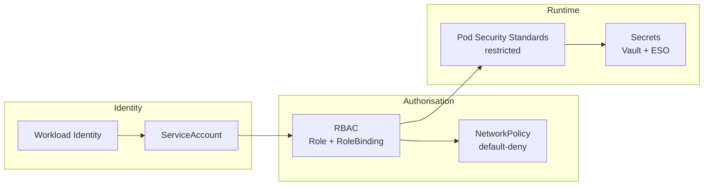

# 18.4 Kubernetes access control and pod security

| Field | Value |
|---|---|
| Level | Advanced |
| Priority tier | 2 |
| Lab venue | GCP / GKE |
| Part | Part 18: Security |
| Cross-references | Chapter 18.1 (Threat modeling); Chapter 18.3 (Containers and software supply chain); Chapter 5 (Kubernetes); Chapter 11 (GPU Kubernetes); Chapter 16.13 (Governance, privacy, compliance) |
| Coverage file | `planning/coverage/chapters/18-04.md` |
| Claim & number ledger | `planning/ledgers/18-04.md` |

## Access controls at a glance

Picture a training job in one tenant's namespace that tries to read a Secret stored in another namespace. Several controls stand between that request and the answer, and each one can say no. The diagram shows them in the order a request meets them, so you can see where a missing control would let the request through.



A workload first proves who it is through its ServiceAccount and Workload Identity. RBAC and NetworkPolicy then decide what that identity may do and where it may connect. Pod Security Standards and Secrets control what runs inside the pod and what credentials it holds. Each layer can be checked on its own, and that matters, because a gap in one layer is often hidden by the others until something goes wrong.

## Why this matters for AI infrastructure

A data scientist is given permission to create pods in a namespace on the shared GPU cluster, so they can launch training jobs. The Kubernetes documentation on RBAC good practices says what that permission really grants. Permission to create pods implicitly grants access to the Secrets, ConfigMaps and PersistentVolumes in that namespace, because a pod can mount them. Since a pod can run as any ServiceAccount in the namespace, it also grants the API access of every one of them. A user who can run privileged pods can use that access to reach the node.

The data scientist did not ask for any of that. They asked for a place to run a job. Each control below narrows the grant, so a request for pods stays a request for pods.

Chapters 18.2 and 18.3 checked firmware and software supply chain. This chapter checks the access controls on the cluster itself, with a focus on what changes when the cluster runs GPUs. GPU clusters add components that run privileged on every node, and they add namespaces where tenants launch long-lived jobs. Those two facts shape the controls below. A privileged component on every node means one mistake reaches every node, and a long-lived job means a leaked credential stays useful for a long time.

## Prerequisites and outcomes

### Prerequisites

Suppose you are about to grant a new team its first namespace on the GPU cluster. Read these before you do. Chapter 18.1 for the threat model, Chapter 18.3 for the artifact layer, Chapter 11 for GPU Kubernetes, and Chapter 5 for the cluster primitives. If you have not yet read how a request moves through the API server, Chapter 5 gives the background you need before the RBAC section makes sense.

### Outcomes

Picture an access review where nobody can say what a service account is for. Most of the work in this chapter comes down to one habit. For each identity on the cluster, you ask what it can do, then you cut the list down to the actions it needs. The chapter starts with Roles and RoleBindings, then the permissions that look harmless and are not, then Workload Identity for cloud access. Next it covers the three Pod Security levels and why GPU components need a different level from tenant pods. It then shows NetworkPolicies that deny by default and open one path at a time, and it ends with secrets kept out of manifests and out of etcd in plain text.

---

## 1. RBAC

### 1.1 Roles and RoleBindings

A data scientist needs to watch training jobs in one namespace and nothing else. Picture the request in a ticket: "can you give my team access to the jobs?" The honest answer is yes, but only for jobs, only in their namespace, and only for the verbs they use. RBAC, which stands for role-based access control, grants exactly that. A Role lists permissions, and a RoleBinding attaches the Role to a user, a group or a ServiceAccount. A ServiceAccount is the identity that a pod uses when it talks to the Kubernetes API.

```yaml
# code/part18/rbac_role.yaml
apiVersion: rbac.authorization.k8s.io/v1
kind: Role
metadata:
  name: model-trainer
  namespace: team-data-science
rules:
  - apiGroups: [""]
    resources: ["pods", "services", "configmaps"]
    verbs: ["get", "list", "watch"]
  - apiGroups: ["batch"]
    resources: ["jobs"]
    verbs: ["get", "list", "watch", "create", "delete"]
```

This Role reads pods, services and config maps, and it can create and delete Jobs. A RoleBinding attaches it to the ServiceAccount that the workload runs under. Production Kubernetes, in its multitenancy chapter, describes the built-in view, edit and admin roles. The admin role can create Roles and RoleBindings, so give it only to a tenant administrator. A role that can grant roles is a role that can grow its own power, which is why it deserves a short list of holders.

### 1.2 ClusterRoles

Picture a platform engineer who needs to see every node, not just one namespace. A ClusterRole works across the whole cluster. You need one for resources that do not belong to a namespace, such as nodes. Think of nodes as the building itself rather than a room inside it. A namespace-scoped Role cannot describe the building, so the platform team needs a ClusterRole for that kind of read access.

```yaml
# code/part18/rbac_clusterrole.yaml
apiVersion: rbac.authorization.k8s.io/v1
kind: ClusterRole
metadata:
  name: ml-platform-reader
rules:
  - apiGroups: [""]
    resources: ["nodes", "namespaces"]
    verbs: ["get", "list", "watch"]
  - apiGroups: ["admissionregistration.k8s.io"]
    resources: ["validatingwebhookconfigurations", "mutatingwebhookconfigurations"]
    verbs: ["get", "list", "watch"]
```

Bind a ClusterRole with a RoleBinding when you want its rules to apply inside one namespace only. That pattern is useful for a shared reader role. The same role definition then serves many namespaces, and each namespace gets its own binding, so the grant stays where you put it.

### 1.3 Common mistakes

The mistakes below show up in almost every cluster that grew quickly. Each one is easy to make on a Friday and hard to find on a Monday. The table lists the mistake, why it is wrong, and the fix you can apply the same day.

| Mistake | Why it is wrong | The fix |
|---|---|---|
| cluster-admin for everyone | Grants full cluster access | Grant only the needed permissions |
| Wildcard verbs or resources | Grants far more than the job needs | List the specific verbs and resources |
| A ClusterRoleBinding for namespace users | Gives rights in every namespace | Use a RoleBinding per namespace |
| Long-lived tokens in environment variables | A stolen token works until someone notices | Use Workload Identity |

Tenants can usually list every namespace. Production Kubernetes notes that RBAC cannot hide namespace names from them. The Kubernetes documentation also says boundaries within a namespace should be considered weak.

### 1.4 Permissions that give more than they say

Picture a tenant role that looks read-only in the YAML and still lets its holder reach a secret. The Kubernetes RBAC good practices page lists permissions that allow privilege escalation. Escalation here means a role that gives more power than its name suggests. Review every tenant role against this list, because a role that looks like read-only can carry one of these permissions inside it.

| Permission | What it quietly gives |
|---|---|
| get, list or watch on Secrets | List and watch also reveal the content of every Secret in scope |
| Create pods, or workloads that manage pods | Access to Secrets, ConfigMaps and PersistentVolumes in the namespace, and the API rights of every ServiceAccount there |
| Create PersistentVolumes | Can include hostPath volumes, which give a pod the node's file system |
| The escalate, bind and impersonate verbs | Bypass the protections against granting rights you do not hold |
| Access to the nodes proxy subresource | Reaches the kubelet API on nodes |

For a GPU cluster the first two rows matter most. A tenant who can create pods in a namespace can reach every secret mounted there. Put each team in its own namespace and keep model credentials in a ServiceAccount that the team's pods alone use. When you audit a role, search for these rows first, because they are the ones that turn a small grant into a large one.

---

## 2. Workload Identity

A training job must read a model file from a cloud bucket. The job should not carry a password for that bucket. A password copied into a pod is a password that can be read by anyone who can read the pod, and it stays valid until someone remembers to change it. Workload Identity links the job's Kubernetes ServiceAccount to a cloud IAM role, so the job gets short-lived credentials instead.

```yaml
# code/part18/workload_identity.yaml
apiVersion: v1
kind: ServiceAccount
metadata:
  name: churn-trainer
  namespace: team-data-science
  annotations:
    iam.gke.io/gcp-service-account: churn-trainer@gke-prod.iam.gserviceaccount.com
```

The annotation names the cloud service account that this ServiceAccount maps to. Give each workload its own ServiceAccount, not the namespace default. The default ServiceAccount is shared by every pod in the namespace that does not name another one, so a grant to it reaches all of them. Production Kubernetes recommends turning off automatic token mounting when a workload never calls the Kubernetes API. Set `automountServiceAccountToken: false` on the ServiceAccount or the Pod. The Pod setting wins when both are present, so check the Pod spec when you want to be sure which one is in force.

Confirm the credential works from inside a pod. A quick test shows you whether the mapping is correct before a real job depends on it.

```bash
kubectl exec -it POD_NAME -- gcloud auth print-access-token
```

Before you grant cloud access, ask which single IAM role the workload needs, and grant only that role. A training job that reads one bucket does not need project-wide storage rights. When the role is narrow, a leaked token does less damage, and the audit log shows exactly what the job touched.

---

## 3. Pod Security for GPU clusters

### 3.1 The three levels

A pod can ask for powerful things, such as the host's network or privileged access to the node. Pod Security Standards set how far a pod may go. Think of them as three doors of increasing trust. The Kubernetes documentation defines three cumulative levels, which means each level includes the rules of the one before it.

| Level | What it allows |
|---|---|
| Privileged | Unrestricted, including known privilege escalations |
| Baseline | Minimally restrictive, prevents known privilege escalations |
| Restricted | Heavily restricted, following current pod hardening practice |

The Baseline level forbids hostPath volumes and host ports. The RBAC documentation says to enforce Baseline or Restricted where you do not fully trust the people who create pods. That sentence is the reason this section exists. For a shared GPU cluster, most of the people who create pods are people you trust, and a few are not, and you cannot tell which from the manifest alone.

### 3.2 Tenants and GPU components need different levels

Picture a device plugin pod that refuses to start in a namespace labelled Restricted. Not every pod on a GPU node can be Restricted. A GPU device plugin is the component that makes the GPU visible to the kubelet and to pods. Its job touches the host, so the rules that protect tenants get in its way. The Kubernetes device plugin documentation says the device plugin directory under /var/lib/kubelet requires privileged access, so a device plugin must run in a privileged security context and mount that directory. The NVIDIA GPU Operator documentation tells you, when your cluster uses Pod Security Admission, to label the operator's namespace with enforce set to privileged.

So the pattern is two kinds of namespace. The GPU Operator namespace runs privileged, and only the platform team may create anything in it. Tenant namespaces run Restricted, and their pods request GPUs through resource limits rather than through host paths or privileged mode. That split lets the components that must touch the node do so, while the tenant workloads stay boxed in.

```yaml
# code/part18/pss_restricted.yaml
apiVersion: v1
kind: Namespace
metadata:
  name: team-data-science
  labels:
    pod-security.kubernetes.io/enforce: restricted
    pod-security.kubernetes.io/enforce-version: latest
    pod-security.kubernetes.io/warn: restricted
    pod-security.kubernetes.io/warn-version: latest
    pod-security.kubernetes.io/audit: restricted
    pod-security.kubernetes.io/audit-version: latest
```

A namespace with these labels applies Restricted to the pods inside it. A namespace without them is not covered, so check every namespace. Check from time to time that nobody has labelled a tenant namespace privileged to make a job start. That relabel is a small change that undoes a large control, and it often happens under deadline pressure.

Never allow tenants to create workloads in the privileged operator namespace. Treat write access to that namespace as node administrator access, because a pod there can reach the host the same way the operator's own pods do.

### 3.3 Custom admission rules

Picture a team that needs one extra rule that the built-in levels do not express. Pod Security admission handles one job. For an extra rule, such as requiring allowPrivilegeEscalation to be false, Kubernetes offers ValidatingAdmissionPolicy, which evaluates a rule written in CEL with no webhook to run. CEL is the Common Expression Language, a small expression language that Kubernetes uses for these checks. The policy below is an example of what the rule looks like in practice.

```yaml
# code/part18/pss_admission.yaml
# A ValidatingAdmissionPolicy only takes effect once a binding selects where it applies.
apiVersion: admissionregistration.k8s.io/v1
kind: ValidatingAdmissionPolicy
metadata:
  name: restricted-pod-security
spec:
  failurePolicy: Fail
  matchConstraints:
    resourceRules:
      - apiGroups: [""]
        apiVersions: ["v1"]
        operations: ["CREATE", "UPDATE"]
        resources: ["pods"]
  validations:
    - expression: "object.spec.containers.all(c, has(c.securityContext) && has(c.securityContext.allowPrivilegeEscalation) && c.securityContext.allowPrivilegeEscalation == false)"
      message: "Every container must set securityContext.allowPrivilegeEscalation to false"
    - expression: "!has(object.spec.hostNetwork) || object.spec.hostNetwork == false"
      message: "hostNetwork is not allowed"
---
apiVersion: admissionregistration.k8s.io/v1
kind: ValidatingAdmissionPolicyBinding
metadata:
  name: restricted-pod-security-mlops
spec:
  policyName: restricted-pod-security
  validationActions: ["Deny"]
  matchResources:
    namespaceSelector:
      matchLabels:
        kubernetes.io/metadata.name: mlops
```

A policy takes effect only once a binding selects where it applies. The policy here is separate from the namespace labels, so you need both if you want both checks. Test a policy against one passing pod and one failing pod, and confirm it does not silently block a team's training job.

---

## 4. NetworkPolicies

Imagine a pod in one tenant's namespace opening a connection to a pod in another's. Nothing in the network stopped it. The cluster network is open by default, so the connection simply worked, and nobody noticed until a log review found it. A default-deny policy closes that gap by blocking all traffic to and from the pods in a namespace until you allow it. Production Kubernetes makes the same point: a namespace alone has no effect on the workload plane until you add policy.

```yaml
# code/part18/networkpolicy_default_deny.yaml
apiVersion: networking.k8s.io/v1
kind: NetworkPolicy
metadata:
  name: default-deny
  namespace: team-data-science
spec:
  podSelector: {}
  policyTypes:
    - Ingress
    - Egress
```

Then open one path at a time. Each path you open is a decision someone can explain. This policy lets pods labelled `app: churn-model` accept traffic on two ports, but only from the namespace labelled `name: ingress`.

```yaml
# code/part18/networkpolicy_explicit_allow.yaml
apiVersion: networking.k8s.io/v1
kind: NetworkPolicy
metadata:
  name: allow-inference
  namespace: team-data-science
spec:
  podSelector:
    matchLabels:
      app: churn-model
  policyTypes:
    - Ingress
  ingress:
    - from:
        - namespaceSelector:
            matchLabels:
              name: ingress
      ports:
        - port: 8080
        - port: 8443
```

| Mistake | Why it is wrong | The fix |
|---|---|---|
| No NetworkPolicy | All traffic is allowed | Add a default-deny policy |
| Egress to 0.0.0.0/0 | All outbound traffic is allowed | Restrict to the destinations the job needs |
| Missing policyTypes | The policy may cover less than you meant | Specify Ingress and Egress |

A NetworkPolicy needs a network plugin that enforces it. Confirm that your cluster's does. A policy object that the plugin ignores looks correct in `kubectl get` and protects nothing, so test it with a real connection from another namespace before you rely on it.

---

## 5. Secrets

### 5.1 Types and placement

Picture a pod that fails to connect to the experiment tracker because its password is missing. Secrets are the passwords and keys your workloads need. A pod that connects to an experiment tracker needs a password for it, and a pod that pulls a private image needs registry credentials. Kubernetes has several types, including Opaque for generic data, dockerconfigjson for image pull credentials, and tls for certificates. The type tells the cluster what the data is for, so it can validate the shape of it.

```yaml
# code/part18/secret_opaque.yaml
apiVersion: v1
kind: Secret
metadata:
  name: mlflow-credentials
  namespace: mlops
type: Opaque
stringData:
  username: mlflow
  password: <random-password>
```

The password above is a placeholder. The real value should never go into Git. Once a value is in Git, it lives in the history forever, even after you delete the file. Chapter 18.7 explains how to make sure Secrets are encrypted in etcd, which is the database that stores the cluster state, so the stored form is not readable by anyone who copies the disk.

### 5.2 External Secrets Operator

Picture a team whose secrets already live in an enterprise manager with its own rotation schedule. Production Kubernetes says the built-in Secret API may fall short for enterprise secret data. Enterprise teams often already run a secret manager with audit trails, approval flows and rotation. External Secrets Operator syncs secrets from external managers such as Vault, AWS Secrets Manager or GCP Secret Manager into Kubernetes Secrets. It syncs on a refresh interval and does not rotate the secret in the external manager. Rotation happens there, and the operator copies the new value in on its next sync.

```yaml
# code/part18/external_secret.yaml
apiVersion: external-secrets.io/v1beta1
kind: ExternalSecret
metadata:
  name: mlflow-credentials
  namespace: mlops
spec:
  refreshInterval: 1h
  secretStoreRef:
    name: vault-backend
    kind: ClusterSecretStore
  data:
    - secretKey: password          # key name inside the resulting Kubernetes Secret
      remoteRef:
        key: secret/data/mlflow    # path in the external store
        property: password
```

The `refreshInterval` field sets how often the sync runs. If you rotate the value in the manager at 10:05 and the interval is one hour, a pod can see the old value until 11:05 at the latest.

---

## 6. How it fails

Picture an alert that fires because a tenant can read a secret it should never see. Access problems usually show up as something that should be impossible but is not. The sections below describe the common ones. Each starts with the situation you would see, then names the cause and the first change to make.

### 6.1 A tenant job has cluster-admin

A training job starts listing secrets in other namespaces, and nobody asked it to. The job can list secrets in every namespace and create pods anywhere. The cause is usually a binding someone created to make a job start, which attached a powerful role to a ServiceAccount. Its ServiceAccount is bound to the cluster-admin ClusterRole. Remove the binding, write a least-privilege Role and bind that.

### 6.2 A privileged pod runs in a tenant namespace

A pod with `privileged: true` is running in a namespace meant for tenants. The namespace enforces privileged, perhaps relabelled to make a job start. Nobody set the pod to privileged on purpose, but the namespace allowed it. Change the namespace back to Restricted and recreate the pod without the privileged fields. Check who may relabel namespaces, because that permission is the real problem.

### 6.3 A tenant reads a neighbour's secrets

A tenant reads a credential that belongs to another team, and the team does not know it happened. The tenant has permission to create pods or list secrets in a namespace that holds shared credentials. Shared credentials should not sit in a namespace that tenants can reach. Move shared credentials out of tenant namespaces and remove the list permission.

### 6.4 The network allows all traffic

A pod in namespace A reaches a pod in namespace B, and the owner of B did not expect it. There is no policy, or one allows all ingress. Nothing in the logs flags the connection, because nothing denied it. Add default-deny and then explicit allows.

### 6.5 A secret is hard-coded in a manifest in Git

A developer copies a password into a manifest so the pod can start, then commits the file. The value is now in the repository history. Use External Secrets Operator and refer to the Secret by name. Rotate the leaked value at once, because Git history keeps it, and deleting the file in a later commit does not remove the old copy.

### 6.6 A long-lived token was never rotated

A workload holds a ServiceAccount token as an environment variable, and the token has not changed in a long time. A stolen token keeps working until someone notices. Move it to Workload Identity and rotate the token. Then check that the old token no longer authenticates.

---

## 7. Hands-on lab

Picture a test cluster that a teammate has just handed over for a practice run. The lab applies the repository files on a test cluster. It was not run on a live GKE cluster here. Work on a test namespace first, and keep the output of each step so you can compare it with the next run.

1. Apply the least-privilege Role and its binding. Start here, because every later check depends on the binding being in place.

```bash
kubectl apply -f code/part18/rbac_role.yaml
kubectl apply -f code/part18/rbac_rolebinding.yaml
```

2. Check what the ServiceAccount can do. The two answers should match the Role you wrote, and any surprise is a finding.

```bash
kubectl auth can-i create pods --as=system:serviceaccount:team-data-science:trainer -n team-data-science
kubectl auth can-i list secrets --as=system:serviceaccount:team-data-science:trainer -n team-data-science
```

3. Label the tenant namespace Restricted and try to create a privileged pod. It should be refused.

```bash
kubectl apply -f code/part18/pss_restricted.yaml
```

4. Apply default-deny and the explicit allow, then test a connection from another namespace. A blocked connection is the result you want from the other namespace.

```bash
kubectl apply -f code/part18/networkpolicy_default_deny.yaml
kubectl apply -f code/part18/networkpolicy_explicit_allow.yaml
```

5. Check which namespaces carry the privileged label. Read the list and ask whether each entry has a reason to be there.

```bash
kubectl get ns -L pod-security.kubernetes.io/enforce
```

Record the answer to one question: which namespaces are privileged, and who may create pods in them.

---

## Exercises

Picture a sprint review in which a team asks whether its permissions are safe.

1. A team can create pods in its namespace and says it has no access to secrets. Is that right? *Solution sketch:* no. Creating pods implicitly grants access to Secrets, ConfigMaps and PersistentVolumes mounted in pods in that namespace, and to the API rights of the ServiceAccounts there. Check with `kubectl auth can-i` and restrict what is stored in the namespace.
2. List the namespaces on your cluster whose Pod Security enforce label is missing or privileged. *Solution sketch:* run `kubectl get ns -L pod-security.kubernetes.io/enforce` and justify each exception, such as the GPU Operator namespace.
3. A GPU Operator pod is refused in a namespace labelled Restricted. What do you do, and what do you not do? *Solution sketch:* install it in its own namespace labelled privileged, as the NVIDIA documentation instructs. Do not relabel tenant namespaces.
4. A user holds the escalate verb on ClusterRoles. Explain the risk. *Solution sketch:* RBAC normally prevents creating ClusterRoles with more rights than you hold, and the escalate verb is the exception.
5. After you rotate a value in Vault at 10:05 with a refresh interval of 1h, when is the new value guaranteed to reach the pod? *Solution sketch:* by 11:05.
6. Write a default-deny policy and a rule that lets only the ingress namespace reach pods labelled `app: churn-model` on port 8443. *Solution sketch:* adapt the two repository files and test from two namespaces.

---

## Checkpoint questions

<details><summary>1. A pod in namespace A reaches a pod in namespace B. What do you look for and add?</summary>
Look for a policy that allows all ingress or egress, and check that a policy exists at all, because with none all traffic is allowed. Add default-deny to each namespace and an explicit allow for each needed path.
</details>

<details><summary>2. A workload can list secrets everywhere and create pods anywhere. What is the cause?</summary>
Its ServiceAccount is bound to cluster-admin. Remove the binding, write a least-privilege Role and bind that.
</details>

<details><summary>3. A pod runs privileged in a tenant namespace. How was it admitted, and what do you change?</summary>
The namespace enforces Privileged, so no rule stopped it. Set it to Restricted, recreate the pod without privileged fields, and restrict who can change namespace labels.
</details>

<details><summary>4. The GPU Operator is installed in a namespace labelled Restricted and its pods are refused. Do you relabel the tenant namespace?</summary>
No. NVIDIA's documentation says to label the operator's namespace privileged. Keep tenants in Restricted namespaces and treat write access to the operator namespace as node administrator access.
</details>

<details><summary>5. You rotate the MLflow password in Vault at 10:05 and a pod still shows the old value at 10:30. Why?</summary>
External Secrets Operator syncs on its refresh interval, one hour in the example, so the new value arrives by 11:05 at the latest. The operator does not rotate secrets in the manager.
</details>

<details><summary>6. A workload holds a long-lived ServiceAccount token in an environment variable. What do you do?</summary>
Move it to Workload Identity, remove the token mount and rotate the token. It then gets short-lived credentials.
</details>

<details><summary>7. A developer has permission to create pods in a tenant namespace but not to read Secrets. Why is that not enough to keep the Secrets safe?</summary>
Permission to create pods lets a pod mount the Secrets, ConfigMaps and PersistentVolumes in that namespace, and it gives the API rights of every ServiceAccount there. So the missing read verb on Secrets does not close that path. Keep model credentials in a ServiceAccount that only the team's pods use, and write a Role that lists only the verbs and resources the job needs.
</details>

<details><summary>8. Why is creating PersistentVolumes a risky permission on a GPU node?</summary>
A PersistentVolume can be a hostPath volume, which gives a pod the node's file system. A container with that access can read other containers' data and abuse the credentials of system services such as the kubelet.
</details>

<details><summary>9. Pods in two tenant namespaces can still reach each other after you created the namespaces. Why does a namespace alone not stop that, and what do you check first?</summary>
A namespace does not block traffic by itself, because the cluster network is open by default and a namespace has no effect on the workload plane until you add policy. Check first that your network plugin enforces NetworkPolicy, since a policy the plugin ignores looks correct in `kubectl get` and protects nothing. Then add a default-deny policy in each namespace and open one explicit path at a time.
</details>

<details><summary>10. You applied a ValidatingAdmissionPolicy that blocks containers which allow privilege escalation, but a pod with that setting is still created in the mlops namespace. What is missing?</summary>
The policy takes effect only after a ValidatingAdmissionPolicyBinding selects where it applies, so the policy alone does nothing. Add a binding with validationActions set to Deny and a namespaceSelector that matches the mlops namespace. The namespace Pod Security labels are a separate check, so you need both if you want both.
</details>

<details><summary>11. A device plugin is refused in a namespace labelled Restricted. Why does it need privileged access, and what label change fixes it?</summary>
A device plugin must touch the host, because the device plugin directory under /var/lib/kubelet requires privileged access. The NVIDIA GPU Operator documentation says to label the operator's namespace with enforce set to privileged when Pod Security Admission is in use. That label lets a pod there reach the host, so only the platform team should be able to create workloads in that namespace.
</details>

<details><summary>12. A team asks for the Baseline level instead of Restricted for its namespace. How do you decide?</summary>
Move down only when the workload truly needs it. Baseline still prevents known escalations. Each step down gives the pod more power over the node.
</details>

<details><summary>13. When do you use External Secrets Operator rather than plain Secrets, and what does it cost?</summary>
Use it when secrets live in an enterprise manager. The cost is lag: a change in the manager reaches the cluster only after the next sync.
</details>

<details><summary>14. After a binding change, users from one team can read resources in another team's namespace. Which binding type is the likely cause, and what is the fix?</summary>
A ClusterRoleBinding gives its rights in every namespace, so a binding made for namespace users reaches every namespace. Use a RoleBinding in each namespace instead, which keeps the grant where you put it. You can still reuse one ClusterRole for the shared rules and bind it with a RoleBinding per namespace.
</details>

<details><summary>15. A copied password for a training job's bucket is found inside a pod spec. Why is Workload Identity safer, and what do you check after you link the ServiceAccount?</summary>
A copied password stays valid until someone changes it, and anyone who can read the pod can read it. Workload Identity links the ServiceAccount to a cloud IAM role, so the job gets short-lived credentials instead. Confirm the mapping from inside the pod with `kubectl exec` and `gcloud auth print-access-token` before a real job depends on it.
</details>

<details><summary>16. Three Pod Security modes each need a mode label and a version label. How many labels per namespace, and for 200 namespaces?</summary>
Six per namespace and 1,200 for 200 namespaces. Automate the labels and check them.
</details>

<details><summary>17. A policy allows ingress to app churn-model on ports 8080 and 8443 from the ingress namespace with default-deny in place. What is allowed?</summary>
Only traffic from that namespace to those two ports. Everything else is denied.
</details>

<details><summary>18. A tenant role in a shared namespace includes list on Secrets. What can a stolen token read, and what should the role contain instead?</summary>
The permissions table says list and watch also reveal the content of every Secret in scope, so a token with that verb can read every Secret in the namespace. Remove the verb, and write a Role that lists only the verbs and resources the job needs. Move shared credentials out of tenant namespaces as well, because a tenant who can reach them can read them.
</details>

<details><summary>19. A training pod cannot reach its bucket after a ServiceAccount change. What do you check, and in what order?</summary>
First check that the ServiceAccount annotation names the right cloud service account, since Workload Identity maps through that annotation. Then check the automountServiceAccountToken setting on the Pod and the ServiceAccount, because the Pod setting wins when both are present. Run `gcloud auth print-access-token` from inside the pod, and confirm that the single IAM role the workload needs is granted.
</details>

<details><summary>20. A new pod is refused in a Restricted namespace. What do you check?</summary>
Read the denial message, which names the rule. Then check the namespace labels, and which namespaces a custom policy binding selects.
</details>

---

## Sources and review notes

- Kubernetes documentation, RBAC good practices (listing secrets, workload creation, PersistentVolume creation, escalate, bind and impersonate verbs, nodes proxy). Fetched 2026-11-12.
- Kubernetes documentation, Pod Security Standards (three profiles, HostPath volumes forbidden at Baseline). Fetched 2026-11-12.
- Kubernetes documentation, device plugins (privileged context, hostPath directory). Fetched 2026-11-12.
- NVIDIA GPU Operator documentation, getting started (label the operator namespace privileged). Fetched 2026-11-12.
- *Production Kubernetes*, chapters 7, 10 and 12, for secrets, identity and multitenancy.

### Corrections made in this rework

- Removed the sections on hand-written mutating webhooks, controller-runtime webhooks and an Ingress Gatekeeper example. They were about admission programming rather than access control, and the Ingress example used an API version that has been removed.
- Removed the invented `rbac.*` IAM roles and the unsourced SLO and alert tables.
- Added GPU-specific RBAC and Pod Security guidance.

### Open items

- The ExternalSecret example uses the `external-secrets.io/v1beta1` API. Check which version your operator release serves.
- GKE-specific Workload Identity prerequisites are not restated here. Check the current GKE documentation.
