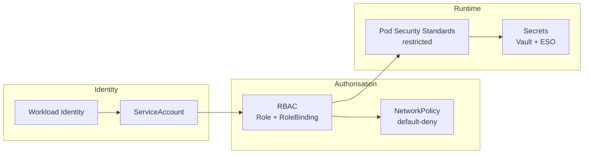

# 18.4 Kubernetes access control and pod security

| Field | Value |
|---|---|
| Level | Advanced |
| Priority tier | 2 |
| Lab venue | GCP / GKE |
| Part | Part 18: Security |
| Primary sources | NVIDIA Zero-to-Hero Volume 18 (`chapter-04-kubernetes-access-control.md`, `chapter-05-pod-security.md`); *Production Kubernetes* (`production-kubernetes`, Chapters 8, 10) |
| Cross-references | Chapter 18.1 (Threat modeling); Chapter 18.3 (Containers and software supply chain); Chapter 5 (Kubernetes); Chapter 11 (GPU Kubernetes); Chapter 16.13 (Governance, privacy, compliance) |
| Coverage file | `planning/coverage/chapters/18-04.md` |
| Claim & number ledger | `planning/ledgers/18-04.md` |

## Access controls at a glance



The four layers of Kubernetes access controls: identity (Workload Identity), authorisation (RBAC + NetworkPolicy), runtime (PSS + Secrets). Every layer is a control; every layer is auditable.

## Why this matters for AI infrastructure

Chapters 18.2 and 18.3 verified the firmware and the supply chain. This chapter verifies the access controls on the cluster itself. A Kubernetes namespace is the unit of multi-tenancy; a ServiceAccount is the identity of a workload; a NetworkPolicy is the network boundary; a PodSecurityStandard is the constraint on the pod. Every control in this chapter is a control on what a workload can do, who can do it, and where it can happen.

The cluster's access controls are the boundary between tenants. A workload that can read another tenant's data is a workload that has escaped the tenant boundary. The platform team's job is to make the tenant boundary enforced by default; the platform team's job is to make the escape impossible without explicit cross-tenant authorisation.

```text
Why Kubernetes access control is on the critical path (V18 ch4, 5; PK Ch 8, 10):
- A typical mature AI platform has 50-200 namespaces. Each namespace is a
  tenant boundary. Each ServiceAccount is a workload identity. The cluster's
  access controls are what enforce the tenant boundary.
- A pod that can read another tenant's data is a pod that has escaped the
  tenant boundary. The platform team's job is to make the escape impossible
  without explicit cross-tenant authorisation.
- The Kubernetes access controls are layered: RBAC (who can do what);
  ServiceAccounts (what identity runs the workload); PodSecurityStandards
  (what the workload can do); NetworkPolicies (where the workload can
  communicate); Secrets (what credentials the workload has). Each layer is
  a control; each layer is auditable.
```

Three operational realities make this chapter a platform-team concern rather than a data-science-only concern:

1. **The Kubernetes access controls are the platform team's discipline.** The platform team defines the RBAC roles; the platform team configures the PodSecurityStandards; the platform team manages the secrets. The access controls are the platform team's responsibility.
2. **The multi-tenant boundary is the platform team's contract.** The tenant expects that their data is not accessible by other tenants. The platform team's job is to enforce the boundary by default; the platform team's job is to make the escape impossible.
3. **The secrets are the platform team's vault.** The API keys, the database credentials, the model signing keys are all secrets. The platform team's job is to store the secrets securely; the platform team's job is to rotate the secrets; the platform team's job is to make the secrets auditable.

**Before a team can claim their AI factory is secure, the team must have enforced the Kubernetes access controls. The RBAC must be least-privilege; the PodSecurityStandards must be restricted; the NetworkPolicies must be default-deny; the secrets must be encrypted and rotated. A team that has not enforced the access controls is a team that has not enforced the tenant boundary.**

## Prerequisites and outcomes

### Prerequisites

- Chapter 18.1 (Threat modeling) for the threat context.
- Chapter 18.3 (Containers and software supply chain) for the artefact layer.
- Chapter 11 (GPU Kubernetes) for the cluster.
- Chapter 5 (Kubernetes) for the cluster primitives.

### Outcomes

After completing this chapter you will be able to:

1. Implement RBAC with least-privilege Roles and RoleBindings per namespace.
2. Use Workload Identity to bind Kubernetes ServiceAccounts to cloud IAM roles.
3. Configure PodSecurityStandards at the "restricted" level; refuse privileged pods.
4. Implement NetworkPolicies with default-deny and explicit allow rules.
5. Implement secrets management with Vault or External Secrets Operator; rotate secrets automatically.
6. Operate the access controls on GKE with continuous verification, secret rotation, and incident response.

---

## 1. RBAC

### 1.1 Roles and RoleBindings

RBAC (Role-Based Access Control) is the Kubernetes mechanism for controlling who can do what. Roles define the permissions; RoleBindings bind the Roles to subjects (users, groups, ServiceAccounts).

```yaml
# code/part18/rbac_role.yaml (shape only)
apiVersion: rbac.authorization.k8s.io/v1
kind: Role
metadata:
  name: model-trainer
  namespace: team-data-science
rules:
  - apiGroups: [""]
    resources: ["pods", "services", "configmaps"]
    verbs: ["get", "list", "watch"]
  - apiGroups: ["batch"]
    resources: ["jobs"]
    verbs: ["get", "list", "watch", "create", "delete"]
```

The pattern is: the Role grants least-privilege permissions; the RoleBinding binds the Role to the ServiceAccount; the workload uses the ServiceAccount.

### 1.2 ClusterRoles and ClusterRoleBindings

ClusterRoles and ClusterRoleBindings are cluster-wide. They are used for cluster-level resources (nodes, namespaces, cluster roles).

```yaml
# code/part18/rbac_clusterrole.yaml (shape only)
apiVersion: rbac.authorization.k8s.io/v1
kind: ClusterRole
metadata:
  name: ml-platform-reader
rules:
  - apiGroups: [""]
    resources: ["nodes", "namespaces"]
    verbs: ["get", "list", "watch"]
  - apiGroups: ["admissionregistration.k8s.io"]
    resources: ["validatingwebhookconfigurations", "mutatingwebhookconfigurations"]
    verbs: ["get", "list", "watch"]
```

The pattern is: ClusterRoles grant least-privilege cluster-wide permissions; ClusterRoleBindings bind the ClusterRoles to subjects.

### 1.3 The RBAC anti-patterns

| Anti-pattern | Why it's wrong | The fix |
|---|---|---|
| `cluster-admin` for everyone | Grants full cluster access | Grant only the needed permissions |
| `*` verbs | Grants all actions | Grant only the specific verbs |
| `*` resources | Grants access to all resources | Grant only the specific resources |
| `clusterrolebinding` for namespace users | Bypasses the namespace boundary | Use `rolebinding` per namespace |
| ServiceAccount tokens mounted as env vars | Long-lived credentials | Use Workload Identity |

The pattern is: every RBAC grant is least-privilege; every RBAC grant is auditable; every RBAC grant is reviewed quarterly.

---

## 2. Workload Identity

### 2.1 The Workload Identity pattern

Workload Identity binds a Kubernetes ServiceAccount to a cloud IAM role. The workload uses the IAM role to access cloud resources (object storage, secrets); the IAM role has the least-privilege permissions.

```yaml
# code/part18/workload_identity.yaml (shape only)
apiVersion: v1
kind: ServiceAccount
metadata:
  name: churn-trainer
  namespace: team-data-science
  annotations:
    iam.gke.io/gcp-service-account: churn-trainer@gke-prod.iam.gserviceaccount.com
```

The pattern is: the ServiceAccount has the annotation; the cluster creates the IAM binding; the workload uses the IAM role automatically.

### 2.2 The benefits of Workload Identity

Workload Identity has four benefits over the legacy pattern of mounting service account keys as environment variables.

| Benefit | Legacy pattern | Workload Identity |
|---|---|---|
| Credential lifetime | Long-lived (90+ days) | Short-lived (1 hour) |
| Credential rotation | Manual | Automatic |
| Credential storage | Environment variable | Metadata server |
| Credential audit | Limited | Full audit trail |

The pattern is: Workload Identity replaces the legacy pattern; every workload uses Workload Identity; no workload has long-lived credentials.

### 2.3 The Workload Identity in production

The Workload Identity is configured per ServiceAccount. The IAM role is configured per workload's needs. The cluster's metadata server issues the short-lived credential automatically.

```bash
# Verify the Workload Identity is working
kubectl exec -it <pod> -- gcloud auth print-access-token
# expected: the access token is issued; the workload can access the cloud resources
```

The pattern is: every workload has a Workload Identity; every Workload Identity has a least-privilege IAM role; every IAM role is auditable.

---

## 3. Pod Security Standards

### 3.1 The Pod Security Standards levels

Pod Security Standards (PSS) are the Kubernetes mechanism for enforcing the security baseline on every pod. PSS has three levels: Privileged (no restrictions), Baseline (minimal restrictions), Restricted (strict restrictions).

| Level | Restrictions |
|---|---|
| **Privileged** | No restrictions; allows host namespaces, host paths, privileged containers |
| **Baseline** | Minimal restrictions; prevents known privilege escalations |
| **Restricted** | Strict restrictions; enforces Pod Security Best Practices |

The pattern is: every workload runs at the Restricted level; the Baseline level is the fallback; the Privileged level is forbidden.

### 3.2 The Restricted level in production

The Restricted level enforces the Pod Security Best Practices.

```yaml
# code/part18/pss_restricted.yaml (shape only)
apiVersion: v1
kind: Namespace
metadata:
  name: team-data-science
  labels:
    pod-security.kubernetes.io/enforce: restricted
    pod-security.kubernetes.io/enforce-version: latest
    pod-security.kubernetes.io/warn: restricted
    pod-security.kubernetes.io/warn-version: latest
    pod-security.kubernetes.io/audit: restricted
    pod-security.kubernetes.io/audit-version: latest
```

The pattern is: every namespace has the Restricted label; every pod in the namespace is restricted; the admission controller enforces the restriction.

### 3.3 The Pod Security admission

The admission controller enforces the Pod Security Standards at admission time. The admission controller refuses pods that violate the standard.

```yaml
# code/part18/pss_admission.yaml (shape only)
apiVersion: admissionregistration.k8s.io/v1
kind: ValidatingAdmissionPolicy
metadata:
  name: pod-security-standards
spec:
  failurePolicy: Fail
  rules:
    - operations: ["CREATE", "UPDATE"]
      apiGroups: [""]
      apiVersions: ["v1"]
      resources: ["pods"]
  validations:
    - expression: "object.metadata.labels['pod-security.kubernetes.io/enforce'] != 'restricted'"
      message: "Pod Security Standards enforcement level must be 'restricted'"
```

The pattern is: the admission controller enforces PSS; the admission controller refuses non-compliant pods; the platform team's audit log records the refusals.

---

## 4. NetworkPolicies

### 4.1 The default-deny pattern

The default-deny NetworkPolicy denies all traffic to and from every pod in the namespace. The default-deny is the foundation of the multi-tenant boundary.

```yaml
# code/part18/networkpolicy_default_deny.yaml (shape only)
apiVersion: networking.k8s.io/v1
kind: NetworkPolicy
metadata:
  name: default-deny
  namespace: team-data-science
spec:
  podSelector: {}
  policyTypes:
    - Ingress
    - Egress
```

The pattern is: every namespace has a default-deny NetworkPolicy; every pod in the namespace is denied by default; explicit allow rules are added for the workload's needs.

### 4.2 The explicit-allow pattern

The explicit-allow NetworkPolicy allows specific traffic for the workload. The allow rule is the minimum necessary for the workload's function.

```yaml
# code/part18/networkpolicy_explicit_allow.yaml (shape only)
apiVersion: networking.k8s.io/v1
kind: NetworkPolicy
metadata:
  name: allow-inference
  namespace: team-data-science
spec:
  podSelector:
    matchLabels:
      app: churn-model
  policyTypes:
    - Ingress
  ingress:
    - from:
        - namespaceSelector:
            matchLabels:
              name: ingress
      ports:
        - port: 8080
        - port: 8443
```

The pattern is: the explicit allow rule grants the minimum necessary access; the explicit allow rule is documented; the explicit allow rule is reviewed quarterly.

### 4.3 The NetworkPolicy anti-patterns

| Anti-pattern | Why it's wrong | The fix |
|---|---|---|
| No NetworkPolicy | Allows all traffic by default | Add a default-deny NetworkPolicy |
| `0.0.0.0/0` egress | Allows all egress traffic | Restrict to specific destinations |
| Empty podSelector with allow | Allows all pods | Use a specific podSelector |
| No `policyTypes` | Allows all traffic | Specify Ingress and Egress |

The pattern is: every NetworkPolicy is least-privilege; every NetworkPolicy is documented; every NetworkPolicy is reviewed quarterly.

---

## 5. Secrets management

### 5.1 The secret types

Kubernetes has three types of secrets: Opaque (generic key-value), kubernetes.io/dockerconfigjson (image pull), kubernetes.io/tls (TLS certificate), and service-account-token (ServiceAccount token).

```yaml
# code/part18/secret_opaque.yaml (shape only)
apiVersion: v1
kind: Secret
metadata:
  name: mlflow-credentials
  namespace: mlops
type: Opaque
stringData:
  username: mlflow
  password: <random-password>
```

The pattern is: every secret has a type; every secret is in a namespace; every secret is encrypted at rest.

### 5.2 The External Secrets Operator pattern

External Secrets Operator (ESO) syncs secrets from external secret managers (Vault, AWS Secrets Manager, GCP Secret Manager) into Kubernetes Secrets. ESO rotates the secrets automatically; ESO exposes the secrets as Kubernetes Secrets.

```yaml
# code/part18/external_secret.yaml (shape only)
apiVersion: external-secrets.io/v1beta1
kind: ExternalSecret
metadata:
  name: mlflow-credentials
  namespace: mlops
spec:
  refreshInterval: 1h
  secretStoreRef:
    name: vault-backend
    kind: ClusterSecretStore
  data:
    - secretKey: secret/data/mlflow
      remoteRef:
        key: credentials
```

The pattern is: the secret is in Vault; ESO syncs the secret to Kubernetes; the secret is rotated automatically; the workload reads the Kubernetes Secret.

### 5.3 The secret rotation

The secret rotation is the process for changing the secret periodically. The rotation includes: the new secret is generated; the old secret is invalidated; the workloads are updated with the new secret.

```bash
# Rotate the secret in Vault
vault write -force secret/data/mlflow password=<new-password>
# expected: ESO syncs the new secret to Kubernetes within the refresh interval
```

The pattern is: the secret is rotated automatically; the rotation is recorded in the audit log; the rotation is tested in staging.

---

## 6. Operating Kubernetes access control on GKE

### 6.1 The components

| Component | Where it runs | Backing store | SLO |
|---|---|---|---|
| RBAC | Kubernetes API server | etcd | RBAC evaluation p99 < 10 ms |
| Workload Identity | GKE metadata server | (GKE) | Identity issuance p99 < 1 s |
| Pod Security Standards | Kubernetes admission | etcd | Admission latency p99 < 100 ms |
| NetworkPolicies | Kubernetes networking | etcd | Network policy evaluation p99 < 10 ms |
| External Secrets Operator | Kubernetes Deployment | (vault) | Secret sync p99 < 1 minute |

### 6.2 IAM and the access controls

The access controls have their own IAM. The pattern is:

| Role | Who | What they can do |
|---|---|---|
| `rbac.reader` | Every team | Read RBAC roles and bindings |
| `rbac.writer` | The platform team | Manage RBAC roles and bindings |
| `rbac.admin` | The platform team lead | Approve RBAC changes; approve secret rotation |

The access controls are the platform team's discipline. The discipline is documented; the discipline is enforced; the discipline is reviewed quarterly.

### 6.3 Observability

| Metric | Why it matters | Alert |
|---|---|---|
| RBAC denial rate | Access control health | > 0 (expected; alerts on anomalous spike) |
| Workload Identity issuance rate | Identity health | < 100% |
| Pod Security Standards admission rate | Pod security health | < 100% |
| NetworkPolicy denial rate | Network isolation health | > 0 (expected; alerts on anomalous spike) |
| Secret rotation freshness | Secret rotation health | > 24 hours stale |

The RBAC denial rate alert is the most important. An anomalous spike in RBAC denials indicates a workload that is trying to access a resource it should not; the alert pages the on-call.

---

## 7. How it fails

Six failure modes recur.

### 7.1 "A workload has cluster-admin"

**Symptom:** A workload can list all secrets in all namespaces; the workload can create pods in any namespace; the workload has full cluster access.

**Diagnosis:** The workload's ServiceAccount is bound to the cluster-admin ClusterRole; the binding is incorrect.

**Fix:** Remove the cluster-admin binding; create a least-privilege Role; bind the Role to the ServiceAccount.

### 7.2 "The ServiceAccount token is mounted as an env var"

**Symptom:** A workload has a long-lived ServiceAccount token in an environment variable; the token has not been rotated.

**Diagnosis:** The workload is using the legacy pattern of mounting tokens; the workload has not migrated to Workload Identity.

**Fix:** Migrate the workload to Workload Identity; remove the legacy token mount; rotate the token.

### 7.3 "A privileged pod is running"

**Symptom:** A pod has `privileged: true`; the pod has host namespaces; the pod has host paths.

**Diagnosis:** The pod is running at the Privileged PSS level; the namespace has `enforce: privileged`.

**Fix:** Change the namespace to `enforce: restricted`; recreate the pod without the privileged fields.

### 7.4 "The NetworkPolicy allows all traffic"

**Symptom:** A pod in namespace A can reach a pod in namespace B; the NetworkPolicy allows the traffic.

**Diagnosis:** The NetworkPolicy allows all ingress or egress; the podSelector is empty; the policyTypes are missing.

**Fix:** Add a default-deny NetworkPolicy; add explicit allow rules for the workload's needs.

### 7.5 "The secret is hard-coded in the manifest"

**Symptom:** A secret is in plain text in the Kubernetes manifest; the secret is in the Git repository.

**Diagnosis:** The workload is using a Kubernetes Secret; the Secret is in the manifest; the manifest is in Git.

**Fix:** Use External Secrets Operator; reference the Secret by name; the Secret is in Vault.

### 7.6 "The secret has not been rotated in 90 days"

**Symptom:** A secret is older than 90 days; the secret has not been rotated; the secret is at risk of compromise.

**Diagnosis:** The rotation policy is not configured; the ESO refresh interval is too long.

**Fix:** Set the rotation policy to 30 days; verify the rotation is happening; alert on stale secrets.

---

## 8. Hands-on lab

This lab walks through implementing the Kubernetes access controls on GKE: the RBAC, the Workload Identity, the Pod Security Standards, the NetworkPolicies, and the secrets management. The lab is **untested** in this repository.

### 8.1 Prerequisites

- A GKE Autopilot or Standard cluster (1.27+).
- A cloud IAM role for Workload Identity.
- A Vault instance (or GCP Secret Manager) for secrets management.

### 8.2 Step 1: create a least-privilege Role

```bash
kubectl apply -f code/part18/rbac_role.yaml
# expected: the Role is created
```

### 8.3 Step 2: bind the Role to a ServiceAccount

```bash
kubectl apply -f code/part18/rbac_rolebinding.yaml
# expected: the RoleBinding is created; the ServiceAccount has the Role
```

### 8.4 Step 3: configure Workload Identity

```bash
kubectl apply -f code/part18/workload_identity.yaml
# expected: the ServiceAccount has the IAM annotation; the cluster creates the IAM binding
```

### 8.5 Step 4: enable Pod Security Standards

```bash
kubectl apply -f code/part18/pss_restricted.yaml
# expected: the namespace has the Restricted label; the admission controller enforces Restricted
```

### 8.6 Step 5: deploy NetworkPolicies

```bash
kubectl apply -f code/part18/networkpolicy_default_deny.yaml
kubectl apply -f code/part18/networkpolicy_explicit_allow.yaml
# expected: the default-deny is in place; the explicit-allow is in place
```

### 8.7 Step 6: configure External Secrets

```bash
kubectl apply -f code/part18/external_secret.yaml
# expected: the ExternalSecret is created; the secret is synced from Vault
```

### 8.8 What to record

After the lab, you should be able to answer five questions in five seconds each:

1. What is the current RBAC denial rate?
2. What is the current Workload Identity issuance rate?
3. What is the current Pod Security Standards admission rate?
4. What is the current secret rotation freshness?
5. What is the current NetworkPolicy denial rate?

If any takes more than 30 seconds, the Kubernetes access controls are not yet a production service. The lab is **untested** against a live GKE cluster.

---

## Exercises

1. **Add a least-privilege Role for the MLflow tracking server.** The Role should grant only the verbs and resources the tracking server needs. *Solution sketch:* the Role YAML in Section 1.1; the RoleBinding YAML; the ServiceAccount reference.
2. **Configure Workload Identity for the model registry.** The ServiceAccount should be bound to a cloud IAM role with read/write permissions on the registry bucket. *Solution sketch:* the Workload Identity YAML in Section 2.1; the IAM role configuration.
3. **Enable Pod Security Standards at the Restricted level for every namespace.** The namespace labels should be applied. *Solution sketch:* the PSS YAML in Section 3.2; the kubectl apply command.
4. **Add a default-deny NetworkPolicy for every namespace.** The NetworkPolicy should be in place; explicit allow rules should be added per workload. *Solution sketch:* the default-deny YAML in Section 4.1; the explicit-allow YAML in Section 4.2.
5. **Configure External Secrets Operator for the production secrets.** The secrets should be synced from Vault; the rotation should be automatic. *Solution sketch:* the ExternalSecret YAML in Section 5.2; the ClusterSecretStore configuration.
6. **Add a Kubernetes access controls dashboard.** Build a Grafana dashboard that shows the RBAC denial rate, the PSS admission rate, and the NetworkPolicy denial rate. *Solution sketch:* the dashboard JSON; the panels; the data sources.

---

## Checkpoint questions

<details><summary>1. What is RBAC?</summary>
Role-Based Access Control: the Kubernetes mechanism for controlling who can do what. Roles define the permissions; RoleBindings bind the Roles to subjects. ClusterRoles and ClusterRoleBindings are cluster-wide. The pattern is least-privilege: every Role grants only the necessary permissions.
</details>

<details><summary>2. What is Workload Identity?</summary>
The pattern that binds a Kubernetes ServiceAccount to a cloud IAM role. The workload uses the IAM role to access cloud resources; the IAM role has the least-privilege permissions. Workload Identity replaces the legacy pattern of mounting long-lived credentials; Workload Identity issues short-lived credentials automatically.
</details>

<details><summary>3. What is Pod Security Standards?</summary>
The Kubernetes mechanism for enforcing the security baseline on every pod. PSS has three levels: Privileged (no restrictions), Baseline (minimal restrictions), Restricted (strict restrictions). The pattern is: every workload runs at the Restricted level.
</details>

<details><summary>4. What is the default-deny NetworkPolicy?</summary>
The NetworkPolicy that denies all traffic to and from every pod in the namespace. The default-deny is the foundation of the multi-tenant boundary. The pattern is: every namespace has a default-deny NetworkPolicy; every pod in the namespace is denied by default; explicit allow rules are added for the workload's needs.
</details>

<details><summary>5. What is the External Secrets Operator?</summary>
The Kubernetes operator that syncs secrets from external secret managers (Vault, AWS Secrets Manager, GCP Secret Manager) into Kubernetes Secrets. ESO rotates the secrets automatically; ESO exposes the secrets as Kubernetes Secrets. The pattern is: every secret is in Vault; ESO syncs the secret to Kubernetes; the secret is rotated automatically.
</details>

<details><summary>6. What is the most common RBAC failure?</summary>
A workload has cluster-admin. The workload can list all secrets in all namespaces; the workload can create pods in any namespace. The fix is to remove the cluster-admin binding; create a least-privilege Role; bind the Role to the ServiceAccount.
</details>

<details><summary>7. What is the second most common RBAC failure?</summary>
The ServiceAccount token is mounted as an environment variable. The token is long-lived; the token has not been rotated. The fix is to migrate to Workload Identity; remove the legacy token mount.
</details>

<details><summary>8. What is the most dangerous pod security failure?</summary>
A privileged pod is running. The pod has `privileged: true`; the pod has host namespaces; the pod has host paths. The fix is to change the namespace to `enforce: restricted`; recreate the pod without the privileged fields.
</details>

<details><summary>9. What is the most common network policy failure?</summary>
The NetworkPolicy allows all traffic. A pod in namespace A can reach a pod in namespace B. The fix is to add a default-deny NetworkPolicy; add explicit allow rules for the workload's needs.
</details>

<details><summary>10. What is the most dangerous secret failure?</summary>
The secret is hard-coded in the manifest. The secret is in plain text in the Git repository. The fix is to use External Secrets Operator; reference the Secret by name; the Secret is in Vault.
</details>

<details><summary>11. What is the relationship between RBAC and Workload Identity?</summary>
RBAC controls who can do what within the cluster. Workload Identity extends that to cloud resources. Together, they form the access control chain: RBAC is the cluster's access control; Workload Identity is the cloud's access control.
</details>

<details><summary>12. What is the relationship between Pod Security Standards and NetworkPolicies?</summary>
Pod Security Standards control what the pod can do (host namespaces, host paths, privileged). NetworkPolicies control where the pod can communicate (other pods, other namespaces, the internet). Together, they form the containment chain: PSS is the workload's containment; NetworkPolicies is the network's containment.
</details>

<details><summary>13. What is the relationship between RBAC and NetworkPolicies?</summary>
RBAC controls who can do what. NetworkPolicies control where the traffic can go. Together, they form the multi-tenant boundary: RBAC is the identity boundary; NetworkPolicies is the network boundary.
</details>

<details><summary>14. What is the relationship between External Secrets Operator and Workload Identity?</summary>
Workload Identity provides the cloud IAM identity. External Secrets Operator provides the secrets. Together, they form the secret chain: Workload Identity is the identity that accesses the secrets; External Secrets Operator is the source of the secrets.
</details>

<details><summary>15. What is the most important Kubernetes access control metric?</summary>
The RBAC denial rate. The metric tells the team which workloads are being denied access. An anomalous spike indicates a workload that is trying to access a resource it should not. The alert fires when the rate spikes above the expected baseline.
</details>

<details><summary>16. What is the difference between Roles and ClusterRoles?</summary>
Roles are namespace-scoped. ClusterRoles are cluster-wide. The pattern is: use Roles for namespace resources; use ClusterRoles for cluster-wide resources; avoid ClusterRoleBindings for namespace resources (the binding bypasses the namespace boundary).
</details>

<details><summary>17. What is the difference between Pod Security Standards and OPA Gatekeeper?</summary>
Pod Security Standards are the Kubernetes-native mechanism for enforcing the security baseline. OPA Gatekeeper is the general-purpose policy engine for enforcing arbitrary policies. PSS is the baseline; Gatekeeper is the customisations.
</details>

<details><summary>18. What is the difference between NetworkPolicies and service mesh policies?</summary>
NetworkPolicies are the Kubernetes-native L3/L4 network control. Service mesh policies (Istio, Linkerd) are the L7 network control. Together, they form the network control: NetworkPolicies is the network isolation; service mesh is the network observability and L7 control.
</details>

<details><summary>19. Why is Kubernetes access control a Tier 2 chapter?</summary>
Because the Kubernetes access controls are the boundary between tenants. Without the access controls, every tenant can access every other tenant's data. The access controls are what the platform team owns; the access controls are what the regulator sees; the access controls are what the auditor inspects.
</details>

<details><summary>20. What five questions should the Kubernetes access controls lab let you answer in five seconds each?</summary>
What is the current RBAC denial rate. What is the current Workload Identity issuance rate. What is the current Pod Security Standards admission rate. What is the current secret rotation freshness. What is the current NetworkPolicy denial rate. If any takes more than 30 seconds, the Kubernetes access controls are not yet a production service.
</details>

---

## Sources and review notes

- NVIDIA Zero-to-Hero Volume 18 (`chapter-04-kubernetes-access-control.md`, `chapter-05-pod-security.md`). Source for the RBAC, Workload Identity, Pod Security Standards, NetworkPolicies, and secrets management patterns. The wording has been rewritten in the handbook's voice.
- *Production Kubernetes* (`production-kubernetes`, Chapters 8, 10). Source for the Kubernetes access control patterns and the operational discipline.

### Cross-references to other handbook chapters

- Chapter 18.1 for the threat-model context.
- Chapter 18.3 for the supply chain context.
- Chapter 11 for the GPU Kubernetes.
- Chapter 5 for the Kubernetes primitives.

### Migrated from `nvidia-devops`

The Kubernetes access control operational patterns draw on Volume 18 chapters 4-5. The wording has been rewritten in the handbook's voice.

### Explicitly labelled inferences

- The PSS level (Restricted) is a starting point; specific levels depend on the workload's needs.
- The NetworkPolicy default-deny is the foundation; specific allow rules depend on the workload's needs.
- The secret rotation frequency (30 days) is a starting point; specific frequencies depend on the regulatory regime.

### Not verified on live hardware

- The lab in Section 8 is **untested** against a live GKE cluster in this repository.
- The RBAC YAML assumes a Kubernetes cluster with RBAC enabled.
- The Workload Identity YAML assumes a GKE cluster with Workload Identity enabled.
