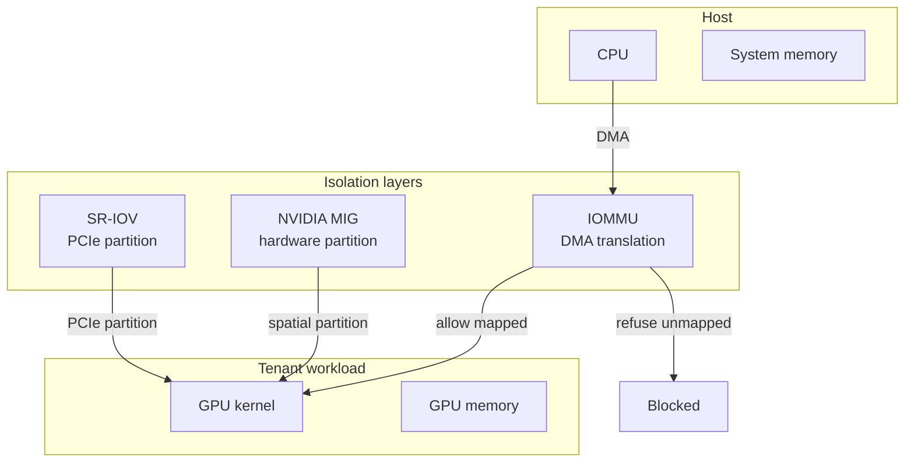

# 18.5 GPU sharing security, DMA, IOMMU and SR-IOV

| Field | Value |
|---|---|
| Level | Advanced |
| Priority tier | 2 |
| Lab venue | GCP / GKE |
| Part | Part 18: Security |
| Primary sources | NVIDIA Zero-to-Hero Volume 18 (`chapter-06-gpu-sharing-security.md`, `chapter-07-iommu-and-sr-iov.md`); NVIDIA Zero-to-Hero Volume 11 (`chapter-21-gpu-device-plugin.md`) |
| Cross-references | Chapter 18.1 (Threat modeling); Chapter 18.4 (Kubernetes access control); Chapter 11.24-11.27 (MIG, time-slicing); Chapter 10.20 (Profiling tools) |
| Coverage file | `planning/coverage/chapters/18-05.md` |
| Claim & number ledger | `planning/ledgers/18-05.md` |

## GPU sharing security at a glance

Suppose two teams share one GPU server. What stops the training job from reading the serving team's data? Three hardware layers answer that, as the diagram shows.



The IOMMU checks the memory addresses devices use for DMA. MIG splits the GPU itself, and SR-IOV splits access at the PCIe level.

## Why this matters for AI infrastructure

Chapter 18.4 checked who can reach the cluster. This chapter checks what a workload can reach once it is running on a GPU. A GPU reads system memory directly through DMA, which stands for Direct Memory Access. When two tenants share a GPU, that direct access is the path you have to contain.

Three mechanisms draw the boundary between tenants. The IOMMU governs memory addresses, MIG governs the GPU's internal resources, and SR-IOV governs PCIe access. Your job as the platform team is to configure all three correctly. A mistake in any one of them can leave one tenant's memory open to another.

Sharing is what makes a multi-tenant GPU cluster affordable. Without it, every tenant needs a card of its own, and many cards sit idle. With it, several tenants use one card, and the cost per tenant falls. The saving is only safe when hardware enforces the boundary, not software alone.

The figures in the block below are example values for planning a budget. They are not measured costs, so replace them with your own numbers.

```text
Why GPU sharing security is on the critical path (background reading: NVIDIA Zero-to-Hero volume 18; NVIDIA Zero-to-Hero volume 11; the figures below are examples, not quotations):
- A typical mature AI platform runs 50-200 GPU nodes. Each node has 8 GPUs.
  Each GPU costs $3-5/hour. The cluster costs $10-30k/hour. GPU sharing
  reduces the cluster cost by 2-4x; the cost saving is millions of dollars
  per year.
- GPU sharing without hardware-enforced isolation is a security risk. A
  tenant can read another tenant's GPU memory via DMA. The platform team's
  job is to enable hardware-enforced isolation (MIG, SR-IOV, IOMMU).
- The IOMMU is the foundation of the GPU sharing security. Without the IOMMU,
  the GPU can DMA any system memory; the GPU can read any tenant's data. With
  the IOMMU, the GPU can only DMA the memory the IOMMU has mapped for the
  tenant.
```

Three operational realities make this a platform-team concern, not only a data-science concern.

1. The GPU reads system memory through DMA. Without the IOMMU, it can read any part of that memory, so the platform team must turn the IOMMU on and enforce the DMA boundaries.
2. The GPU is the most expensive shared resource. Sharing it cuts cost, but it also opens a DMA attack surface, so you must weigh the saving against the risk.
3. Each sharing mode has different security properties. Time-slicing takes turns on the GPU, MIG splits it in hardware, and SR-IOV virtualizes it at the PCIe level. Choose the mode for each workload.

Production Kubernetes, chapter 12, describes multitenancy as a spectrum rather than a yes-or-no choice. At the hard end, tenants are treated as possible adversaries, and that is the assumption a GPU shared across teams should be built for.

**Before a team can claim its AI factory is multi-tenant, it must configure this security.** The IOMMU must be on, the MIG partitions must be enforced, and the SR-IOV virtual functions must be isolated. A team that skips this has not enforced the tenant boundary on its most expensive resource.

## Prerequisites and outcomes

### Prerequisites

Start with the chapters that give you the context for this one. Chapter 18.1 covers the threat model, and Chapter 18.4 covers the cluster access controls. Chapters 11.24 to 11.27 explain the MIG and time-slicing modes you will configure here. You also need a working knowledge of DMA, IOMMU, SR-IOV, and NVIDIA MIG.

### Outcomes

After completing this chapter you will be able to:

1. Enable the IOMMU on every GPU node and check that it governs the DMA boundaries.
2. Configure NVIDIA MIG partitions and confirm that they enforce the partition boundaries.
3. Configure SR-IOV virtual functions and confirm that they isolate PCIe-level GPU access.
4. Choose the right GPU sharing mode for each workload, weighing cost against security.
5. Detect and respond to GPU memory scraping attacks.
6. Run the GPU sharing security on GKE with continuous verification, MIG enforcement, and incident response.

---

## 1. The IOMMU

### 1.1 What the IOMMU does

Picture a GPU that writes to a memory page it was never given. Without a check, that write could land in another tenant's data. The IOMMU, or Input-Output Memory Management Unit, is the hardware check that stops it. It is a hardware chip that translates the addresses devices use for DMA.

The IOMMU maps each device's DMA addresses to physical addresses and enforces that mapping. It also refuses any DMA access the mapping does not allow.

```text
IOMMU functions:
- Address translation: maps device DMA addresses to physical addresses
- Access control: enforces read/write permissions per mapping
- Isolation: each device sees only its mapped memory
- Audit: logs DMA accesses for forensics
```

### 1.2 The IOMMU on the GPU node

Before you rely on the IOMMU, confirm that the node actually has it on. Three things must be true. The IOMMU is enabled in the BIOS, the kernel configures it, and the GPU driver uses it. The commands below check the kernel log and the GPU's IOMMU entry.

```bash
# Verify the IOMMU is enabled
dmesg | grep -i iommu
# expected: "DMAR: IOMMU enabled" appears in the kernel log

# Verify the IOMMU is in use by the GPU
cat /sys/class/iommu/*/devices/* | grep -i nvidia
# expected: the NVIDIA GPU device is listed under the IOMMU
```

If the expected line does not match what you see, do not assume the IOMMU is off. Read the full kernel log for your hardware before you decide.

### 1.3 The IOMMU in production

Do not assume the IOMMU is on just because the hardware supports it. Many servers ship with it off in the BIOS or leave the kernel option unset. So the real work is verifying it on every node, watching its translations, and responding when faults appear. A page fault is a signal to investigate, not noise to ignore.

```bash
# Monitor the IOMMU translations
perf stat -e iommu.io_page_walk.cycles,iommu.io_page_fault.cycles
# expected: the IOMMU page walks are tracked; the IOMMU page faults are tracked
```

The event names in the command depend on the CPU and the kernel, so list the events your system offers with `perf list` first. Alert on IOMMU page faults, and make sure the on-call engineer knows to investigate each one. Check the IOMMU state on each node before you admit it to the GPU pool.

---

## 2. NVIDIA MIG (Multi-Instance GPU)

### 2.1 What MIG does

Suppose two teams each need only a small slice of a GPU. Without MIG, they must share the whole card and trust software to keep them apart. MIG, which stands for Multi-Instance GPU, divides one GPU into separate instances. Each instance gets its own compute, memory, and bandwidth, and the instances cannot read each other's memory.

The layout below shows example partition profiles. A GPU has seven compute slices, and every instance uses some of them, so the instances you create must fit inside that budget. Check the profiles your GPU model supports with `nvidia-smi mig -lgip` before you configure anything.

```text
MIG partitioning:
- A100 80GB: up to 7 instances, for example seven 1g.10gb instances
  or one 3g.40gb instance plus three 1g.10gb instances
- H100 80GB: up to 7 instances, with similar profile names
- Each instance has dedicated compute, memory, bandwidth
- Instances are hardware-isolated
```

### 2.2 The MIG configuration

Configuring MIG takes three steps: turn MIG mode on, create the instances, and list them to confirm. Each step depends on the one before it. The partitions are set up at boot, and workloads are then assigned to them.

```bash
# Enable MIG mode
nvidia-smi -mig 1
# expected: the GPU enters MIG mode; the GPU is partitioned

# Create MIG instances
nvidia-smi mig -cgi 0,1,2,3,4,5,6 -C
# expected: the MIG instances are created; the instances are listed

# List the MIG instances
nvidia-smi -L
# expected: the MIG instances are listed; each instance has a unique ID
```

The numbers after `-cgi` are profile IDs, and the IDs differ between GPU models. List them with `nvidia-smi mig -lgip` and substitute the ones for your plan. Compare the final listing with the layout you planned before any workload starts.

### 2.3 The MIG in Kubernetes

Imagine a churn model that needs one small slice of a GPU, not the whole card. You request that slice in the Pod spec, and the scheduler finds a node that offers it. The device plugin exposes one resource name per partition, so the Pod asks for the partition by that name.

```yaml
# code/part18/mig_workload.yaml
apiVersion: v1
kind: Pod
metadata:
  name: churn-model
spec:
  containers:
    - name: model
      image: my-model:v1
      resources:
        limits:
          nvidia.com/mig-1g.5gb: 1
```

The cluster schedules the Pod onto a node that has that partition, and the workload runs inside it. The profile name in the example belongs to a 40 GB card. An 80 GB card names its smallest slice `1g.10gb`. Request the smallest partition that fits the workload, and check the resource name against what the node advertises.

---

## 3. SR-IOV

### 3.1 What SR-IOV does

Think of SR-IOV, which stands for Single Root I/O Virtualization, as a way to cut one PCIe device into several smaller devices. The Physical Function, or PF, is the full device. Each Virtual Function, or VF, is a lightweight partition that the system treats as its own device.

```text
SR-IOV components:
- Physical Function (PF): the full PCIe device
- Virtual Function (VF): the lightweight partition
- Each VF has its own PCIe config space
- Each VF has its own BARs and interrupts
- The VFs share the underlying hardware with the PF
```

The PF is the parent, and the VFs are its children. Each VF is hardware-isolated from the others. The VFs still share the hardware's bandwidth, so one busy VF can affect the rest.

### 3.2 The SR-IOV for GPUs

NVIDIA applies the same idea to GPUs through vGPU. Each tenant gets a virtual GPU that its workload sees as a separate device. The partitions are created once, at boot, and the GPU device plugin then hands them to workloads.

```bash
# Enable SR-IOV on the GPU
nvidia-smi -vgpu 1
# expected: the GPU enters vGPU mode; the vGPU partitions are created

# List the vGPU partitions
nvidia-smi -L
# expected: the vGPU partitions are listed; each partition has a unique ID
```

Run the listing command to confirm that the partitions exist. The enable step for vGPU depends on the vGPU manager release installed on the host, and the command above has not been tested here. If it fails on your driver, follow the vGPU manager documentation rather than guessing at flags.

### 3.3 The SR-IOV vs MIG

MIG and SR-IOV both isolate tenants in hardware, but they work at different levels. MIG divides the GPU inside the chip, while SR-IOV divides access at the PCIe level. The table compares them on the points that matter when you choose one.

| Feature | MIG | SR-IOV (vGPU) |
|---|---|---|
| Isolation | Hardware (GPU-internal) | Hardware (PCIe-level) |
| Sharing | Spatial (concurrent) | Spatial (concurrent) |
| Performance | Near-native | Near-native |
| Use case | Inference; training; HPC | VDI; multi-tenant cloud |
| Management | NVIDIA driver | NVIDIA vGPU manager |

The use-case row is the simplest guide. MIG suits inference, training, and HPC, while SR-IOV suits VDI and multi-tenant cloud. Match the mode to the use case before you pick one for a workload.

---

## 4. Time-slicing security implications

### 4.1 What time-slicing does

Picture two inference services on one GPU. The GPU runs the first service for a moment, switches to the second, and then repeats the cycle. That is time-slicing. The workloads take turns on the card instead of running at the same instant.

```text
Time-slicing:
- GPU runs tenant A's kernel
- GPU preempts tenant A's kernel
- GPU runs tenant B's kernel
- GPU preempts tenant B's kernel
- Cycle continues
```

The GPU is shared in turns, not at the same time. The turns separate the tenants in time only. They do not give each tenant its own protected memory, and the table below shows what that costs.

### 4.2 The security implications

Time-slicing offers weaker security than MIG or SR-IOV. The table compares the three modes on memory, compute, predictability, and side-channel risk. Use it to decide which workloads can accept the weaker mode.

| Property | Time-slicing | MIG | SR-IOV |
|---|---|---|---|
| Memory isolation | None (processes share GPU memory) | Strong (hardware) | Strong (hardware) |
| Compute isolation | Weak (shared bandwidth) | Strong (spatial) | Strong (spatial) |
| Performance predictability | Low | High | High |
| Side-channel risk | High | Low | Low |

Time-slicing suits workloads that do not share state. MIG and SR-IOV suit workloads that need strong isolation. Production Kubernetes, chapter 12, makes a similar point about container limits. They isolate tenants less strictly than a hypervisor does, so noisy-neighbor effects can remain.

### 4.3 The time-slicing configuration

The GPU device plugin configures time-slicing. You set the slice interval and the timeout in a ConfigMap, and the plugin assigns the slices to workloads. The values in the block below are examples. Choose your own after you measure your workload.

```yaml
# code/part18/timeslicing.yaml
apiVersion: v1
kind: ConfigMap
metadata:
  name: gpu-device-plugin-config
data:
  time-slicing-config.yaml: |
    sharing:
      timeSlicingConfig:
        interval: 5
        timeout: 10
```

---

## 5. GPU memory scraping attacks

### 5.1 What is GPU memory scraping

Consider a tenant that wants another tenant's model weights or inference inputs. If the GPU memory is not isolated, the tenant can simply read them. That is GPU memory scraping. The attack works around software isolation by reading memory through DMA.

```text
GPU memory scraping attack:
- Tenant A's workload runs on the GPU
- Tenant A's workload uses DMA to read GPU memory
- Tenant A's workload reads GPU memory that contains Tenant B's data
- Tenant A's workload exfiltrates Tenant B's data
```

Application code cannot stop this kind of read, which is why the hardware boundaries matter.

### 5.2 The defence: IOMMU + MIG + SR-IOV

The defence combines the IOMMU, MIG, and SR-IOV. Each one blocks a different path, so the table below lists what each layer contributes.

| Defence | What it does |
|---|---|
| IOMMU | Translates DMA addresses and refuses unauthorised DMA |
| MIG | Hardware-isolates GPU memory, with each partition holding its own memory |
| SR-IOV | Hardware-isolates PCIe-level access, with each VF holding its own config space |

### 5.3 The detection

Detection is the step teams most often skip. Watch GPU memory use over time, and alert when the pattern looks wrong. The command below prints memory use once per second.

```bash
# Monitor the GPU memory access patterns
nvidia-smi --query-gpu=memory.used,memory.total --format=csv -l 1
# expected: the memory usage is monitored; the anomalous patterns are visible
```

Memory-use numbers alone do not prove a scraping attempt. Treat them as a starting point, and check them against other signals before you act.

---

## 6. Operating GPU sharing security on GKE

### 6.1 The components

Five components have to keep working on every GPU node. Each one has a backing store and a target state. The table lists them.

| Component | Where it runs | Backing store | SLO |
|---|---|---|---|
| IOMMU | Every GPU node | BIOS and kernel settings | IOMMU enabled |
| MIG | Every GPU node | GPU driver | MIG partitions enforced |
| SR-IOV | Every GPU node | GPU driver | VFs isolated |
| Time-slicing | Every GPU node | GPU device plugin | Time-slicing configured |
| GPU memory monitoring | Every GPU node | Prometheus | Memory metrics scraped |

The SLO column names the target state for each component. Those targets are examples for your team to set and measure against.

### 6.2 IAM and the GPU sharing security

Access to GPU sharing settings needs its own roles. The pattern has three of them. Readers can see the MIG and SR-IOV settings, writers change them, and the admin approves partitions and virtual functions.

| Role | Who | What they can do |
|---|---|---|
| `gpusharing.reader` | The platform team and the security team | Read the MIG and SR-IOV configuration |
| `gpusharing.writer` | The platform team | Configure MIG and SR-IOV |
| `gpusharing.admin` | The platform team lead | Approve MIG partitions and SR-IOV virtual functions |

A written role model only helps if people follow it and someone checks. A quarterly review is a reasonable starting point. Pick the review schedule your team can keep.

### 6.3 Observability

Five metrics show whether the boundaries still hold. Each row explains why its metric matters and what alert it should raise. The alert thresholds in the table are example values. Set your own after you see a baseline on your fleet.

| Metric | Why it matters | Alert |
|---|---|---|
| IOMMU enabled rate | IOMMU enforcement | < 100% |
| MIG partition enforcement rate | MIG isolation | < 100% |
| SR-IOV VF isolation rate | SR-IOV isolation | < 100% |
| GPU memory anomalies | Memory scraping detection | > 0 |
| GPU sharing mode (time-slicing/MIG/SR-IOV) | Sharing configuration | Wrong mode |

The GPU memory anomalies alert matters most. An anomalous pattern can mean one workload is reading another tenant's memory, so this alert should page the on-call engineer right away.

---

## 7. How it fails

Six failure modes come up again and again. Start from the symptom you see, then find the matching section below.

### 7.1 "The IOMMU is disabled"

A node with the IOMMU off lets the GPU read any system memory, including another tenant's data. The usual cause is a BIOS setting that nobody turned on, so the platform's policy is not enforced. Enable the IOMMU in the BIOS, verify that the kernel uses it, and alert on any node where it is off.

### 7.2 "The MIG is not configured"

Suppose a GPU runs with no MIG partitions. Every tenant on it shares the full card memory and can read each other's data. MIG mode was never enabled, or the instances were never created. Enable MIG, create the partitions, and check that they are enforced.

### 7.3 "The SR-IOV is not configured"

When SR-IOV is off, the tenants that were meant to get separate virtual functions share one device. The virtual functions were never created, so the PCIe-level boundary does not exist. Enable SR-IOV, create the VFs, and verify that they are isolated.

### 7.4 "The GPU memory scraping is detected"

Here the memory monitor flags an anomalous pattern and the on-call engineer is paged. The workload may be reading another tenant's memory, which would mean it is compromised. Cordon the workload, investigate it, notify the other tenants, and run your incident response.

### 7.5 "The time-slicing is not configured"

A GPU without time-slicing settings has no defined schedule, so tenants can interfere with each other. Either the time-slicing configuration was never applied, or the GPU device plugin is misconfigured. Configure time-slicing, confirm that it is in effect, and alert on any GPU that lacks it.

### 7.6 "The GPU sharing mode is wrong for the workload"

A workload may run on time-slicing when it needs MIG, or on MIG when time-slicing would do. In both cases its isolation does not match its needs. The cause is usually that nobody wrote down the workload's isolation requirements, so the mode was picked ad hoc. Write the requirements down, choose the mode from them, and review the choice on a schedule.

Most of these failures trace back to a setting nobody wrote down. When you start an investigation, check the configuration against the plan first.

---

## 8. Hands-on lab

Before you trust a GPU node with tenants, you need proof that every boundary is on. This lab checks them one by one. The lab is **untested** in this repository.

### 8.1 Prerequisites

- A GPU node with IOMMU, MIG, and SR-IOV support.
- Access to the node's BIOS.
- Access to the node's operating system.

### 8.2 Step 1: verify the IOMMU

Start with the IOMMU. The kernel log should show that it is enabled.

```bash
dmesg | grep -i iommu
# expected: "DMAR: IOMMU enabled" appears in the log
```

### 8.3 Step 2: enable MIG

Turn on MIG mode, then create the instances.

```bash
nvidia-smi -mig 1
# expected: the GPU enters MIG mode
nvidia-smi mig -cgi 0,1,2,3,4,5,6 -C
# expected: the MIG instances are created
```

### 8.4 Step 3: enable SR-IOV

Enable vGPU mode, then list the partitions.

```bash
nvidia-smi -vgpu 1
# expected: the GPU enters vGPU mode
nvidia-smi -L
# expected: the vGPU partitions are listed
```

### 8.5 Step 4: configure time-slicing

Apply the time-slicing configuration.

```bash
kubectl apply -f code/part18/timeslicing.yaml
# expected: the time-slicing is configured
```

### 8.6 Step 5: monitor GPU memory

Watch memory use on the GPU.

```bash
nvidia-smi --query-gpu=memory.used,memory.total --format=csv -l 1
# expected: the memory usage is monitored
```

### 8.7 Step 6: deploy a workload to a MIG partition

Deploy the workload and confirm that it runs inside its partition.

```bash
kubectl apply -f code/part18/mig_workload.yaml
# expected: the workload runs in the MIG partition; the partition is isolated
```

### 8.8 What to record

After the lab, you should be able to answer five questions quickly:

1. What is the current IOMMU enabled rate?
2. What is the current MIG partition enforcement rate?
3. What is the current SR-IOV VF isolation rate?
4. What is the current GPU memory anomalies count?
5. What is the current GPU sharing mode per workload?

Use five seconds per answer and 30 seconds in total as example limits. Set the limits your own on-call process can meet. If your team cannot answer within that limit, the GPU sharing security is not yet a production service. The lab is **untested** against a live GKE cluster.

---

## Exercises

Try each exercise yourself before you read its solution sketch. Each one uses a different layer of the chapter.

1. A node is about to join the GPU pool. Write a shell check that fails when the kernel log has no IOMMU line, or when `/sys/kernel/iommu_groups` is empty. *Solution sketch:* test `dmesg | grep -i iommu` and count the entries in the groups directory. Exit non-zero if either test fails, and run it before the node is labelled for tenants.
2. One 80 GB GPU must serve a team that needs 40 GB and three teams that need 10 GB each. Choose MIG profiles for them. *Solution sketch:* one 3g.40gb instance plus three 1g.10gb instances uses six of the seven compute slices. Confirm the placement with `nvidia-smi mig -lgip` before you create anything.
3. You host a trusted team's notebooks, an inference service for two paying customers, and virtual desktops for staff. Pick a sharing mode for each and give one reason. *Solution sketch:* time-slicing is acceptable for the notebooks, because the users trust each other. MIG suits the two customers, who need memory isolation. SR-IOV through vGPU suits the desktops.
4. Assume an exporter publishes a metric `node_iommu_enabled` that is 1 when the IOMMU is on. Write a Prometheus alert rule that fires when any GPU node reports 0 for five minutes. *Solution sketch:* the rule compares the metric with 0 and uses a `for: 5m` clause, with a label that names the node.
5. A Pod that asks for `nvidia.com/mig-1g.5gb` stays Pending on an 80 GB node. Explain why and what you would check. *Solution sketch:* that node advertises `1g.10gb`, not `1g.5gb`, so no resource matches. Run `kubectl describe node` and read the allocatable resources, then fix the request.
6. The memory monitor shows one tenant's pod reading far more GPU memory than its limit allows. Put the first five response actions in order, and say which evidence you must keep. *Solution sketch:* cordon the node, keep the pod and its logs instead of deleting them, notify the other tenants on that GPU, and escalate to the security team. Record the memory samples and the IOMMU state at that moment.

---

## Checkpoint questions

<details><summary>1. The GPU memory monitor flags an anomalous pattern and the on-call engineer is paged. What do you do?</summary>
The workload may be reading another tenant's memory, which means it could be compromised. Cordon the workload, investigate it, notify the other tenants, and run your incident response. Memory numbers alone do not prove scraping, so check them against other signals as you investigate.
</details>

<details><summary>2. A GPU on a shared node can read system memory that belongs to another tenant. What is the likely cause and the fix?</summary>
The IOMMU is disabled in the BIOS, so the platform's policy is not enforced. Enable the IOMMU in the BIOS, verify that it is in use, and alert on any node where it is off.
</details>

<details><summary>3. Two tenants share a GPU and can read each other's data. MIG is not in use. What do you do?</summary>
MIG was never enabled or the partitions were never created. Enable MIG, create the partitions, and verify that they are enforced. List the instances with `nvidia-smi -L` and compare the listing with the layout you planned before any workload starts.
</details>

<details><summary>4. A workload runs on time-slicing but needs strong isolation. Why did this happen and what do you change?</summary>
The workload's isolation needs were never written down, so the mode was picked ad hoc. Write down each workload's isolation needs, choose the sharing mode for it, and review the choice on a schedule. The chapter suggests quarterly.
</details>

<details><summary>5. `dmesg | grep -i iommu` does not show the expected line on a node. Is the IOMMU off?</summary>
Do not assume so. The chapter says to read the full kernel log for your hardware before you decide. Three things must be true. The IOMMU is enabled in the BIOS, the kernel configures it, and the GPU driver uses it.
</details>

<details><summary>6. A team says its cluster is multi-tenant because every GPU uses time-slicing. What is missing?</summary>
Time-slicing has no memory isolation, because processes share GPU memory. Its compute isolation is weak and its side-channel risk is high. A multi-tenant claim needs the IOMMU on, MIG partitions enforced, and SR-IOV virtual functions isolated. Time-slicing alone does not enforce the tenant boundary.
</details>

<details><summary>7. Why does sharing a GPU open a DMA attack surface?</summary>
A GPU reads system memory directly through DMA. Without the IOMMU the GPU can DMA any system memory, so it can read any tenant's data. With the IOMMU the GPU can only DMA the memory the IOMMU has mapped for that tenant.
</details>

<details><summary>8. Why can application code not stop GPU memory scraping?</summary>
The attack works around software isolation by reading memory through DMA. The read does not pass through the controls that application code can set. Only the hardware boundaries from the IOMMU, MIG, and SR-IOV stop it.
</details>

<details><summary>9. Why can one MIG instance not read another instance's memory?</summary>
MIG divides one GPU into separate instances inside the chip. Each instance gets its own compute, memory, and bandwidth. The hardware keeps the instances apart, so a tenant in one instance has no path to the memory of another.
</details>

<details><summary>10. SR-IOV isolates virtual functions in hardware. Why can one busy VF still affect the others?</summary>
Each VF has its own PCIe config space, BARs, and interrupts. The VFs still share the underlying hardware with the physical function. That shared hardware includes bandwidth, so one busy VF can affect the rest.
</details>

<details><summary>11. Why is time-slicing weaker than MIG or SR-IOV for isolating tenants?</summary>
The workloads take turns on the same GPU instead of running in separate partitions. The chapter's table gives no memory isolation, weak compute isolation, low predictability, and high side-channel risk. Production Kubernetes chapter 12 makes a similar point about container limits, which isolate less strictly than a hypervisor, so noisy-neighbor effects can remain.
</details>

<details><summary>12. When would you accept time-slicing and when would you require MIG, and what do you give up?</summary>
Time-slicing suits workloads that do not share state. MIG suits workloads that need strong isolation, with hardware-enforced memory and compute and near-native performance. By accepting time-slicing you give up memory isolation, predictable performance, and low side-channel risk. By choosing MIG you give up the simplest sharing setup.
</details>

<details><summary>13. When would you choose SR-IOV over MIG and how does management differ?</summary>
The use-case row is the simplest guide. MIG suits inference, training, and HPC, while SR-IOV suits VDI and multi-tenant cloud. MIG is managed by the NVIDIA driver and SR-IOV by the NVIDIA vGPU manager. Both give hardware isolation and near-native performance.
</details>

<details><summary>14. Sharing a GPU can cut the cluster cost by 2 to 4 times in the chapter's example. When would you share and what do you give up?</summary>
Share when hardware enforces the boundary, because the saving is only safe then. Without sharing every tenant needs a card of its own and many cards sit idle. What you give up is a DMA attack surface that you must then contain with the IOMMU, MIG, and SR-IOV. The 2 to 4 times is an example, not a measured figure.
</details>

<details><summary>15. The memory anomaly alert fires. When would you cordon at once and when would you check other signals first?</summary>
The alert can page the on-call engineer right away, because an anomaly can mean one workload is reading another tenant's memory. Memory numbers alone do not prove a scraping attempt, so check them against other signals before you act. Cordoning at once protects the other tenants but may disrupt a workload that is behaving normally. Waiting leaves the possible read open longer.
</details>

<details><summary>16. In the chapter's example, one node has 8 GPUs and each GPU costs $3 to $5 per hour. What does one node cost per hour?</summary>
At $3 per GPU, the node costs 8 × 3 = $24 per hour. At $5 per GPU, it costs 8 × 5 = $40 per hour. The range is $24 to $40. These are example prices, so use your own.
</details>

<details><summary>17. A node costs $24 per hour with no sharing. What does it cost per year, and what would a 2 times reduction from sharing leave?</summary>
A year has 24 × 365 = 8,760 hours. The node costs 24 × 8,760 = $210,240 per year. A 2 times reduction leaves $210,240 / 2 = $105,120. The 2 times figure is the low end of the chapter's example range.
</details>

<details><summary>18. You split one GPU into 7 MIG instances of equal size and give each tenant one. If the GPU costs $3 per hour, what is each tenant's share?</summary>
Each tenant's share is $3 / 7, which is about $0.43 per hour. Real MIG layouts are not always equal, so check the profiles your GPU supports. The chapter's example layout mixes instance sizes.
</details>

<details><summary>19. You are about to admit a new GPU node to the pool. In what order do you check the boundaries, and why?</summary>
Check the IOMMU first, because the chapter calls it the foundation of GPU sharing security. Then check the MIG partitions with `nvidia-smi -L` against your plan. Then check the SR-IOV virtual functions. After that confirm the time-slicing configuration and that memory metrics are scraped.
</details>

<details><summary>20. Memory usage on a shared GPU looks odd. What do you do, in order?</summary>
First watch the memory use over time with the `nvidia-smi --query-gpu` command, since one reading proves nothing. Second check the pattern against other signals. Third, if it still looks like scraping, cordon the workload, investigate, notify the other tenants, and run your incident response.
</details>

---

## Sources and review notes

- NVIDIA Zero-to-Hero Volume 18 (`chapter-06-gpu-sharing-security.md`, `chapter-07-iommu-and-sr-iov.md`). Source for the IOMMU, MIG, SR-IOV, and time-slicing patterns. The wording has been rewritten in the handbook's voice.
- NVIDIA Zero-to-Hero Volume 11 (`chapter-21-gpu-device-plugin.md`). Source for the GPU device plugin patterns and the MIG configuration.

### Cross-references to other handbook chapters

- Chapter 18.1 for the threat-model context.
- Chapter 18.4 for the Kubernetes access controls.
- Chapter 11.24-11.27 for the MIG and time-slicing patterns.
- Chapter 10.20 for the profiling tools.

### Migrated from `nvidia-devops`

The GPU sharing security operational patterns draw on Volume 18 chapters 6-7 and Volume 11 chapter 21. The wording has been rewritten in the handbook's voice.

### Explicitly labelled inferences

- The IOMMU is the foundation; specific IOMMU configurations depend on the hardware.
- The MIG partitions are hardware-isolated; specific MIG partition sizes depend on the GPU model.
- The GPU sharing mode (time-slicing, MIG, SR-IOV) is per-workload; specific modes depend on the workload's isolation requirements.

### Not verified on live hardware

- The lab in Section 8 is **untested** against a live GKE cluster in this repository.
- The IOMMU verification commands assume a node with IOMMU support; production deployments may vary.
- The MIG and SR-IOV configurations assume hardware that supports these features.
