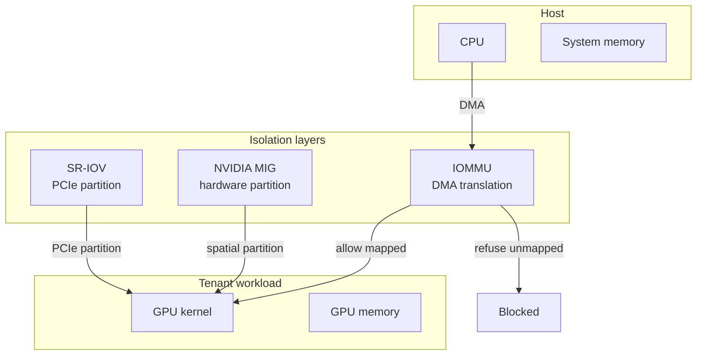

# 18.5 GPU sharing security, DMA, IOMMU and SR-IOV

| Field | Value |
|---|---|
| Level | Advanced |
| Priority tier | 2 |
| Lab venue | GCP / GKE |
| Part | Part 18: Security |
| Primary sources | NVIDIA Zero-to-Hero Volume 18 (`chapter-06-gpu-sharing-security.md`, `chapter-07-iommu-and-sr-iov.md`); NVIDIA Zero-to-Hero Volume 11 (`chapter-21-gpu-device-plugin.md`) |
| Cross-references | Chapter 18.1 (Threat modeling); Chapter 18.4 (Kubernetes access control); Chapter 11.24-11.27 (MIG, time-slicing); Chapter 10.20 (Profiling tools) |
| Coverage file | `planning/coverage/chapters/18-05.md` |
| Claim & number ledger | `planning/ledgers/18-05.md` |

## GPU sharing security at a glance



The three layers of GPU sharing isolation: IOMMU translates DMA addresses; MIG partitions the GPU spatially; SR-IOV partitions at the PCIe level.

## Why this matters for AI infrastructure

Chapter 18.4 verified the cluster's access controls. This chapter verifies the GPU's access controls. A GPU is a powerful compute device with direct access to system memory via DMA (Direct Memory Access). When two tenants share a GPU, the boundary between their memory is the boundary that prevents one tenant from reading the other's data. The boundary is implemented by the IOMMU (Input-Output Memory Management Unit); the boundary is implemented by NVIDIA MIG (Multi-Instance GPU); the boundary is implemented by SR-IOV (Single Root I/O Virtualization). The platform team's job is to configure these boundaries correctly.

The GPU sharing security is what makes multi-tenant GPU clusters possible. Without GPU sharing, every tenant needs its own GPU; the cluster is over-provisioned. With GPU sharing, multiple tenants can share a GPU; the cluster is cost-efficient. The sharing is only safe if the boundary is enforced by hardware, not by software.

```text
Why GPU sharing security is on the critical path (V18 ch6, 7; V11 ch21):
- A typical mature AI platform runs 50-200 GPU nodes. Each node has 8 GPUs.
  Each GPU costs $3-5/hour. The cluster costs $10-30k/hour. GPU sharing
  reduces the cluster cost by 2-4x; the cost saving is millions of dollars
  per year.
- GPU sharing without hardware-enforced isolation is a security risk. A
  tenant can read another tenant's GPU memory via DMA. The platform team's
  job is to enable hardware-enforced isolation (MIG, SR-IOV, IOMMU).
- The IOMMU is the foundation of the GPU sharing security. Without the IOMMU,
  the GPU can DMA any system memory; the GPU can read any tenant's data. With
  the IOMMU, the GPU can only DMA the memory the IOMMU has mapped for the
  tenant.
```

Three operational realities make this chapter a platform-team concern rather than a data-science-only concern:

1. **The GPU memory is shared with the system.** The GPU uses DMA to read system memory. Without the IOMMU, the GPU can read any system memory. The platform team's job is to enable the IOMMU and to enforce the DMA boundaries.
2. **The GPU is the most expensive shared resource.** The GPU sharing reduces the cluster cost; the GPU sharing introduces the DMA attack surface. The platform team's job is to balance the cost saving against the security risk.
3. **The GPU sharing modes have different security properties.** Time-slicing shares the GPU sequentially (no DMA isolation needed); MIG shares the GPU spatially (hardware isolation); SR-IOV virtualises the GPU at the PCIe level. The platform team's job is to choose the right mode for each workload.

**Before a team can claim their AI factory is multi-tenant, the team must have configured the GPU sharing security. The IOMMU must be enabled; the MIG partitions must be enforced; the SR-IOV virtual functions must be isolated. A team that has not configured the GPU sharing security is a team that has not enforced the tenant boundary on the most expensive resource.**

## Prerequisites and outcomes

### Prerequisites

- Chapter 18.1 (Threat modeling) for the threat context.
- Chapter 18.4 (Kubernetes access control) for the cluster access controls.
- Chapter 11.24-11.27 (MIG, time-slicing) for the GPU sharing modes.
- Familiarity with DMA, IOMMU, SR-IOV, and NVIDIA MIG.

### Outcomes

After completing this chapter you will be able to:

1. Enable the IOMMU on every GPU node; configure the DMA boundaries.
2. Configure NVIDIA MIG partitions; enforce the partition boundaries.
3. Configure SR-IOV virtual functions; isolate the PCIe-level GPU access.
4. Choose the right GPU sharing mode for each workload; balance the cost and the security.
5. Detect and respond to GPU memory scraping attacks.
6. Operate the GPU sharing security on GKE with continuous verification, MIG enforcement, and incident response.

---

## 1. The IOMMU

### 1.1 What the IOMMU does

The IOMMU (Input-Output Memory Management Unit) is a hardware chip that translates DMA addresses. The IOMMU maps device DMA addresses to physical addresses; the IOMMU enforces the mapping; the IOMMU refuses DMA accesses that are not in the mapping.

```text
IOMMU functions:
- Address translation: maps device DMA addresses to physical addresses
- Access control: enforces read/write permissions per mapping
- Isolation: each device sees only its mapped memory
- Audit: logs DMA accesses for forensics
```

The pattern is: every DMA access goes through the IOMMU; the IOMMU enforces the mapping; the IOMMU refuses unauthorised access.

### 1.2 The IOMMU on the GPU node

The GPU node has an IOMMU. The IOMMU is enabled in the BIOS; the IOMMU is configured by the kernel; the IOMMU is used by the GPU driver.

```bash
# Verify the IOMMU is enabled
dmesg | grep -i iommu
# expected: "DMAR: IOMMU enabled" appears in the kernel log

# Verify the IOMMU is in use by the GPU
cat /sys/class/iommu/*/devices/* | grep -i nvidia
# expected: the NVIDIA GPU device is listed under the IOMMU
```

The pattern is: the IOMMU is enabled on every GPU node; the GPU driver uses the IOMMU; the DMA accesses are translated by the IOMMU.

### 1.3 The IOMMU in production

The IOMMU is enabled by default on modern hardware. The platform team's job is to verify the IOMMU is enabled; the platform team's job is to monitor the IOMMU translations; the platform team's job is to respond to IOMMU errors.

```bash
# Monitor the IOMMU translations
perf stat -e iommu.io_page_walk.cycles,iommu.io_page_fault.cycles
# expected: the IOMMU page walks are tracked; the IOMMU page faults are tracked
```

The pattern is: the IOMMU is monitored; the IOMMU page faults alert; the on-call investigates the IOMMU page faults.

---

## 2. NVIDIA MIG (Multi-Instance GPU)

### 2.1 What MIG does

NVIDIA MIG partitions a single GPU into multiple independent GPU instances. Each instance has its own compute, memory, and bandwidth. The instances are hardware-isolated; the instances cannot access each other's memory.

```text
MIG partitioning:
- A100 80GB: 7 instances (1x 5g.40gb, 1x 4g.40gb, 2x 3g.20gb, 4x 1g.10gb)
- H100 80GB: 7 instances (similar)
- Each instance has dedicated compute, memory, bandwidth
- Instances are hardware-isolated (IOMMU enforced)
```

The pattern is: the MIG partitions are hardware-isolated; the MIG partitions cannot access each other's memory; the MIG partitions are auditable.

### 2.2 The MIG configuration

The MIG is configured by the NVIDIA driver. The MIG partitions are created at boot; the MIG partitions are assigned to workloads.

```bash
# Enable MIG mode
nvidia-smi -mig 1
# expected: the GPU enters MIG mode; the GPU is partitioned

# Create MIG instances
nvidia-smi mig -cgi 0,1,2,3,4,5,6 -C
# expected: the MIG instances are created; the instances are listed

# List the MIG instances
nvidia-smi -L
# expected: the MIG instances are listed; each instance has a unique ID
```

The pattern is: the MIG is configured at boot; the MIG partitions are created once; the MIG partitions are assigned to workloads via the GPU device plugin.

### 2.3 The MIG in Kubernetes

The MIG partitions are exposed to Kubernetes via the GPU device plugin. The plugin creates a resource per MIG partition; the pod requests the partition by ID.

```yaml
# code/part18/mig_workload.yaml (shape only)
apiVersion: v1
kind: Pod
metadata:
  name: churn-model
spec:
  containers:
    - name: model
      image: my-model:v1
      resources:
        limits:
          nvidia.com/mig-1g.5gb: 1
```

The pattern is: the pod requests a specific MIG partition; the cluster schedules the pod on a node that has the partition; the workload runs in the partition.

---

## 3. SR-IOV

### 3.1 What SR-IOV does

SR-IOV (Single Root I/O Virtualization) virtualises a PCIe device at the hardware level. The Physical Function (PF) is the full device; the Virtual Functions (VFs) are the lightweight partitions.

```text
SR-IOV components:
- Physical Function (PF): the full PCIe device
- Virtual Function (VF): the lightweight partition
- Each VF has its own PCIe config space
- Each VF has its own BARs and interrupts
- The VFs share the underlying hardware with the PF
```

The pattern is: the PF is the parent; the VFs are the children; each VF is hardware-isolated from the others; the VFs share the hardware's bandwidth.

### 3.2 The SR-IOV for GPUs

The SR-IOV for GPUs (NVIDIA vGPU) virtualises the GPU at the PCIe level. The vGPU partitions are hardware-isolated; the vGPU partitions are exposed to the workload as separate devices.

```bash
# Enable SR-IOV on the GPU
nvidia-smi -vgpu 1
# expected: the GPU enters vGPU mode; the vGPU partitions are created

# List the vGPU partitions
nvidia-smi -L
# expected: the vGPU partitions are listed; each partition has a unique ID
```

The pattern is: the SR-IOV is configured at boot; the vGPU partitions are created once; the vGPU partitions are assigned to workloads via the GPU device plugin.

### 3.3 The SR-IOV vs MIG

| Feature | MIG | SR-IOV (vGPU) |
|---|---|---|
| Isolation | Hardware (GPU-internal) | Hardware (PCIe-level) |
| Sharing | Spatial (concurrent) | Spatial (concurrent) |
| Performance | Near-native | Near-native |
| Use case | Inference; training; HPC | VDI; multi-tenant cloud |
| Management | NVIDIA driver | NVIDIA vGPU manager |

The pattern is: MIG is the GPU-internal partition; SR-IOV is the PCIe-level partition. Both are hardware-isolated; both can be used for multi-tenant GPU sharing.

---

## 4. Time-slicing security implications

### 4.1 What time-slicing does

Time-slicing shares the GPU sequentially. The GPU runs tenant A's workload for a time slice; the GPU runs tenant B's workload for the next time slice; the cycle continues.

```text
Time-slicing:
- GPU runs tenant A's kernel
- GPU preempts tenant A's kernel
- GPU runs tenant B's kernel
- GPU preempts tenant B's kernel
- Cycle continues
```

The pattern is: the GPU is shared sequentially; the GPU is not shared concurrently; the GPU's memory is not shared between tenants.

### 4.2 The security implications

Time-slicing has weaker security properties than MIG or SR-IOV. The GPU's memory is overwritten between time slices; the GPU's memory is not shared between tenants; the GPU's compute is shared.

| Property | Time-slicing | MIG | SR-IOV |
|---|---|---|---|
| Memory isolation | Strong (overwritten) | Strong (hardware) | Strong (hardware) |
| Compute isolation | Weak (shared bandwidth) | Strong (spatial) | Strong (spatial) |
| Performance predictability | Low | High | High |
| Side-channel risk | High | Low | Low |

The pattern is: time-slicing is suitable for workloads that do not share state; MIG and SR-IOV are suitable for workloads that need strong isolation.

### 4.3 The time-slicing configuration

Time-slicing is configured by the GPU device plugin. The plugin sets the time slice duration; the plugin assigns the slices to workloads.

```yaml
# code/part18/timeslicing.yaml (shape only)
apiVersion: v1
kind: ConfigMap
metadata:
  name: gpu-device-plugin-config
data:
  time-slicing-config.yaml: |
    sharing:
      timeSlicingConfig:
        interval: 5
        timeout: 10
```

The pattern is: time-slicing is configured per device; the time slice duration is set per workload; the time slice duration is documented.

---

## 5. GPU memory scraping attacks

### 5.1 What is GPU memory scraping

GPU memory scraping is the attack where a malicious workload reads another tenant's GPU memory. The attack works when the GPU memory is not properly isolated.

```text
GPU memory scraping attack:
- Tenant A's workload runs on the GPU
- Tenant A's workload uses DMA to read GPU memory
- Tenant A's workload reads GPU memory that contains Tenant B's data
- Tenant A's workload exfiltrates Tenant B's data
```

The pattern is: the attacker uses DMA to read GPU memory; the attacker bypasses the software isolation; the attacker reads another tenant's data.

### 5.2 The defence: IOMMU + MIG + SR-IOV

The defence is the combination of IOMMU + MIG + SR-IOV.

| Defence | What it does |
|---|---|
| IOMMU | Translates DMA addresses; refuses unauthorised DMA |
| MIG | Hardware-isolates GPU memory; each partition has its own memory |
| SR-IOV | Hardware-isolates PCIe-level access; each VF has its own config space |

The pattern is: every layer of defence is enabled; every layer is verified; every layer is monitored.

### 5.3 The detection

The detection is the monitoring of GPU memory accesses. The platform team monitors the GPU memory access patterns; the platform team alerts on anomalous patterns.

```bash
# Monitor the GPU memory access patterns
nvidia-smi --query-gpu=memory.used,memory.total --format=csv -l 1
# expected: the memory usage is monitored; the anomalous patterns are visible
```

The pattern is: the GPU memory usage is monitored; the anomalous patterns are alerted; the on-call investigates the anomalous patterns.

---

## 6. Operating GPU sharing security on GKE

### 6.1 The components

| Component | Where it runs | Backing store | SLO |
|---|---|---|---|
| IOMMU | Every GPU node | TPM | IOMMU enabled |
| MIG | Every GPU node | GPU driver | MIG partitions enforced |
| SR-IOV | Every GPU node | GPU driver | VFs isolated |
| Time-slicing | Every GPU node | GPU device plugin | Time-slicing configured |
| GPU memory monitoring | Every GPU node | Prometheus | Memory metrics scraped |

### 6.2 IAM and the GPU sharing security

The GPU sharing security has its own IAM. The pattern is:

| Role | Who | What they can do |
|---|---|---|
| `gpusharing.reader` | The platform team; the security team | Read the MIG configuration; read the SR-IOV configuration |
| `gpusharing.writer` | The platform team | Configure the MIG; configure the SR-IOV |
| `gpusharing.admin` | The platform team lead | Approve the MIG partition; approve the SR-IOV virtual function |

The GPU sharing security is the platform team's discipline. The discipline is documented; the discipline is enforced; the discipline is reviewed quarterly.

### 6.3 Observability

| Metric | Why it matters | Alert |
|---|---|---|
| IOMMU enabled rate | IOMMU enforcement | < 100% |
| MIG partition enforcement rate | MIG isolation | < 100% |
| SR-IOV VF isolation rate | SR-IOV isolation | < 100% |
| GPU memory anomalies | Memory scraping detection | > 0 |
| GPU sharing mode (time-slicing/MIG/SR-IOV) | Sharing configuration | Wrong mode |

The GPU memory anomalies alert is the most important. An anomalous pattern indicates a workload that is reading another tenant's memory; the alert pages the on-call immediately.

---

## 7. How it fails

Six failure modes recur.

### 7.1 "The IOMMU is disabled"

**Symptom:** The GPU can DMA any system memory; the GPU can read another tenant's data.

**Diagnosis:** The IOMMU is disabled in the BIOS; the platform team's policy is not enforced.

**Fix:** Enable the IOMMU in the BIOS; verify the IOMMU is in use; alert on any node with the IOMMU disabled.

### 7.2 "The MIG is not configured"

**Symptom:** The GPU runs without MIG partitions; multiple tenants share the GPU's full memory; the tenants can read each other's memory.

**Diagnosis:** The MIG is not enabled; the MIG partitions are not created; the platform team's policy is not enforced.

**Fix:** Enable the MIG; create the MIG partitions; verify the MIG partitions are enforced.

### 7.3 "The SR-IOV is not configured"

**Symptom:** The GPU runs without SR-IOV; multiple tenants share the GPU's PCIe config space; the tenants can read each other's PCIe config.

**Diagnosis:** The SR-IOV is not enabled; the SR-IOV VFs are not created; the platform team's policy is not enforced.

**Fix:** Enable the SR-IOV; create the SR-IOV VFs; verify the SR-IOV VFs are isolated.

### 7.4 "The GPU memory scraping is detected"

**Symptom:** The GPU memory monitoring detects an anomalous pattern; the on-call is paged; the workload is suspicious.

**Diagnosis:** The workload is reading another tenant's memory; the workload is compromised.

**Fix:** Cordon the workload; investigate the workload; notify the other tenants; respond to the incident.

### 7.5 "The time-slicing is not configured"

**Symptom:** The GPU runs without time-slicing; the GPU is shared without isolation; the tenants can interfere with each other.

**Diagnosis:** The time-slicing is not configured; the GPU device plugin is misconfigured.

**Fix:** Configure the time-slicing; verify the time-slicing is in effect; alert on any GPU without time-slicing.

### 7.6 "The GPU sharing mode is wrong for the workload"

**Symptom:** The workload is running with time-slicing when MIG is required; the workload is running with MIG when time-slicing is sufficient; the workload is over-isolated or under-isolated.

**Diagnosis:** The workload's isolation requirements are not documented; the GPU sharing mode is chosen ad-hoc.

**Fix:** Document the workload's isolation requirements; choose the right mode per workload; review the choice quarterly.

---

## 8. Hands-on lab

This lab walks through verifying the GPU sharing security on GKE: the IOMMU, the MIG, the SR-IOV, and the GPU memory monitoring. The lab is **untested** in this repository.

### 8.1 Prerequisites

- A GPU node with IOMMU, MIG, and SR-IOV support.
- Access to the node's BIOS.
- Access to the node's operating system.

### 8.2 Step 1: verify the IOMMU

```bash
dmesg | grep -i iommu
# expected: "DMAR: IOMMU enabled" appears in the log
```

### 8.3 Step 2: enable MIG

```bash
nvidia-smi -mig 1
# expected: the GPU enters MIG mode
nvidia-smi mig -cgi 0,1,2,3,4,5,6 -C
# expected: the MIG instances are created
```

### 8.4 Step 3: enable SR-IOV

```bash
nvidia-smi -vgpu 1
# expected: the GPU enters vGPU mode
nvidia-smi -L
# expected: the vGPU partitions are listed
```

### 8.5 Step 4: configure time-slicing

```bash
kubectl apply -f code/part18/timeslicing.yaml
# expected: the time-slicing is configured
```

### 8.6 Step 5: monitor GPU memory

```bash
nvidia-smi --query-gpu=memory.used,memory.total --format=csv -l 1
# expected: the memory usage is monitored
```

### 8.7 Step 6: deploy a workload to a MIG partition

```bash
kubectl apply -f code/part18/mig_workload.yaml
# expected: the workload runs in the MIG partition; the partition is isolated
```

### 8.8 What to record

After the lab, you should be able to answer five questions in five seconds each:

1. What is the current IOMMU enabled rate?
2. What is the current MIG partition enforcement rate?
3. What is the current SR-IOV VF isolation rate?
4. What is the current GPU memory anomalies count?
5. What is the current GPU sharing mode per workload?

If any takes more than 30 seconds, the GPU sharing security is not yet a production service. The lab is **untested** against a live GKE cluster.

---

## Exercises

1. **Add an IOMMU enforcement alert.** Configure an alert that fires when the IOMMU is disabled on any node. *Solution sketch:* a Prometheus exporter for the IOMMU state; an alert that fires when the state is not "enabled".
2. **Add a MIG partition enforcement alert.** Configure an alert that fires when a MIG partition is not enforced. *Solution sketch:* a Prometheus exporter for the MIG state; an alert that fires when the state is not "enforced".
3. **Add a GPU memory anomaly alert.** Configure an alert that fires when GPU memory access is anomalous. *Solution sketch:* a Prometheus exporter for the GPU memory; an alert that fires when the pattern is anomalous.
4. **Add a per-workload GPU sharing mode policy.** Define which workloads use time-slicing, MIG, or SR-IOV. *Solution sketch:* a policy document; a Kubernetes admission controller that enforces the policy.
5. **Add a GPU sharing security dashboard.** Build a Grafana dashboard that shows the IOMMU state, the MIG partitions, the SR-IOV VFs, and the GPU memory metrics. *Solution sketch:* a Grafana dashboard; the panels; the data sources.
6. **Add a GPU memory scraping incident response runbook.** Document the response to a GPU memory scraping attack. *Solution sketch:* a Markdown runbook; the response steps; the escalation contacts.

---

## Checkpoint questions

<details><summary>1. What is the IOMMU?</summary>
The Input-Output Memory Management Unit: a hardware chip that translates DMA addresses. The IOMMU maps device DMA addresses to physical addresses; the IOMMU enforces the mapping; the IOMMU refuses unauthorised DMA accesses. The IOMMU is the foundation of the GPU sharing security.
</details>

<details><summary>2. What is NVIDIA MIG?</summary>
Multi-Instance GPU: a hardware mechanism for partitioning a single GPU into multiple independent instances. Each instance has its own compute, memory, and bandwidth. The instances are hardware-isolated; the instances cannot access each other's memory. MIG is the GPU-internal partition.
</details>

<details><summary>3. What is SR-IOV?</summary>
Single Root I/O Virtualization: a PCIe-level mechanism for virtualising a device. The Physical Function (PF) is the full device; the Virtual Functions (VFs) are the lightweight partitions. The VFs are hardware-isolated; the VFs share the underlying hardware with the PF.
</details>

<details><summary>4. What is GPU memory scraping?</summary>
The attack where a malicious workload reads another tenant's GPU memory. The attack works when the GPU memory is not properly isolated. The defence is the combination of IOMMU + MIG + SR-IOV.
</details>

<details><summary>5. What is time-slicing?</summary>
A GPU sharing mode where the GPU runs tenant A's workload for a time slice, then tenant B's workload for the next time slice. Time-slicing has weaker security properties than MIG or SR-IOV; the GPU's memory is overwritten between time slices but the GPU's compute is shared.
</details>

<details><summary>6. What is the most common GPU sharing security failure?</summary>
The IOMMU is disabled. The GPU can DMA any system memory; the GPU can read another tenant's data. The fix is to enable the IOMMU in the BIOS; verify the IOMMU is in use.
</details>

<details><summary>7. What is the second most common GPU sharing security failure?</summary>
The MIG is not configured. The GPU runs without MIG partitions; multiple tenants share the GPU's full memory. The fix is to enable the MIG; create the MIG partitions; verify the MIG partitions are enforced.
</details>

<details><summary>8. What is the most dangerous GPU sharing security failure?</summary>
GPU memory scraping is detected. The GPU memory monitoring detects an anomalous pattern; the workload is reading another tenant's memory. The fix is to cordon the workload; investigate the workload; notify the other tenants.
</details>

<details><summary>9. What is the relationship between IOMMU and MIG?</summary>
The IOMMU is the hardware mechanism for DMA address translation. The MIG is the GPU-internal partition. Together, they form the GPU sharing security chain: the IOMMU enforces the DMA boundaries; the MIG enforces the GPU memory boundaries. The chain is what makes multi-tenant GPU sharing safe.
</details>

<details><summary>10. What is the relationship between MIG and SR-IOV?</summary>
MIG is the GPU-internal partition (spatial, concurrent). SR-IOV is the PCIe-level partition (spatial, concurrent). Together, they form the GPU sharing security chain at two levels: MIG at the GPU level; SR-IOV at the PCIe level.
</details>

<details><summary>11. What is the relationship between time-slicing and MIG?</summary>
Time-slicing is the sequential sharing (no DMA isolation needed). MIG is the spatial sharing (hardware isolation). Time-slicing is suitable for workloads that do not share state; MIG is suitable for workloads that need strong isolation.
</details>

<details><summary>12. What is the difference between MIG and SR-IOV for GPUs?</summary>
MIG is the GPU-internal partition (spatial, concurrent). SR-IOV (vGPU) is the PCIe-level partition (spatial, concurrent). Both are hardware-isolated; both can be used for multi-tenant GPU sharing. MIG is more common for inference and training; SR-IOV is more common for VDI and multi-tenant cloud.
</details>

<details><summary>13. What is the most important GPU sharing security metric?</summary>
GPU memory anomalies. The metric tells the team which workloads are reading anomalous patterns. An anomalous pattern indicates a workload that is reading another tenant's memory; the alert pages the on-call immediately.
</details>

<details><summary>14. What is the difference between hardware isolation and software isolation?</summary>
Hardware isolation (MIG, SR-IOV, IOMMU) is enforced by hardware; the isolation cannot be bypassed by software. Software isolation (namespaces, cgroups, seccomp) is enforced by the kernel; the isolation can be bypassed by kernel exploits. The GPU sharing security requires hardware isolation; software isolation alone is insufficient.
</details>

<details><summary>15. What is the difference between memory isolation and compute isolation?</summary>
Memory isolation prevents one tenant from reading another tenant's memory. Compute isolation prevents one tenant from monopolising the GPU's compute. Time-slicing has strong memory isolation (memory is overwritten) but weak compute isolation (compute is shared). MIG and SR-IOV have strong memory and compute isolation.
</details>

<details><summary>16. What is the relationship between GPU sharing security and Kubernetes access control?</summary>
Kubernetes access control (Chapter 18.4) controls who can do what within the cluster. GPU sharing security controls what one tenant can see on the GPU. Together, they form the multi-tenant boundary: Kubernetes access control is the cluster boundary; GPU sharing security is the GPU boundary.
</details>

<details><summary>17. What is the relationship between GPU sharing security and threat modeling?</summary>
The threat model (Chapter 18.1) identifies the threats (T-006: GPU memory scraping; T-007: Inference API DDoS). The GPU sharing security is the controls that mitigate the threats. Without the threat model, the controls are guesswork; with the threat model, the controls are evidence-driven.
</details>

<details><summary>18. What is the relationship between GPU sharing security and the FinOps dashboard?</summary>
The FinOps dashboard (Chapter 16.14) shows the GPU cost. The GPU sharing security reduces the GPU cost (multi-tenant sharing); the GPU sharing security introduces the security risk. The FinOps dashboard is the cost view; the GPU sharing security is the security view. Together, they inform the trade-off.
</details>

<details><summary>19. Why is GPU sharing security a Tier 2 chapter?</summary>
Because the GPU sharing security is the foundation of the multi-tenant GPU cluster. Without the GPU sharing security, every tenant can read every other tenant's GPU memory. The GPU sharing security is what the platform team owns; the GPU sharing security is what the regulator sees; the GPU sharing security is what the auditor inspects.
</details>

<details><summary>20. What five questions should the GPU sharing security lab let you answer in five seconds each?</summary>
What is the current IOMMU enabled rate. What is the current MIG partition enforcement rate. What is the current SR-IOV VF isolation rate. What is the current GPU memory anomalies count. What is the current GPU sharing mode per workload. If any takes more than 30 seconds, the GPU sharing security is not yet a production service.
</details>

---

## Sources and review notes

- NVIDIA Zero-to-Hero Volume 18 (`chapter-06-gpu-sharing-security.md`, `chapter-07-iommu-and-sr-iov.md`). Source for the IOMMU, MIG, SR-IOV, and time-slicing patterns. The wording has been rewritten in the handbook's voice.
- NVIDIA Zero-to-Hero Volume 11 (`chapter-21-gpu-device-plugin.md`). Source for the GPU device plugin patterns and the MIG configuration.

### Cross-references to other handbook chapters

- Chapter 18.1 for the threat-model context.
- Chapter 18.4 for the Kubernetes access controls.
- Chapter 11.24-11.27 for the MIG and time-slicing patterns.
- Chapter 10.20 for the profiling tools.

### Migrated from `nvidia-devops`

The GPU sharing security operational patterns draw on Volume 18 chapters 6-7 and Volume 11 chapter 21. The wording has been rewritten in the handbook's voice.

### Explicitly labelled inferences

- The IOMMU is the foundation; specific IOMMU configurations depend on the hardware.
- The MIG partitions are hardware-isolated; specific MIG partition sizes depend on the GPU model.
- The GPU sharing mode (time-slicing, MIG, SR-IOV) is per-workload; specific modes depend on the workload's isolation requirements.

### Not verified on live hardware

- The lab in Section 8 is **untested** against a live GKE cluster in this repository.
- The IOMMU verification commands assume a node with IOMMU support; production deployments may vary.
- The MIG and SR-IOV configurations assume hardware that supports these features.
