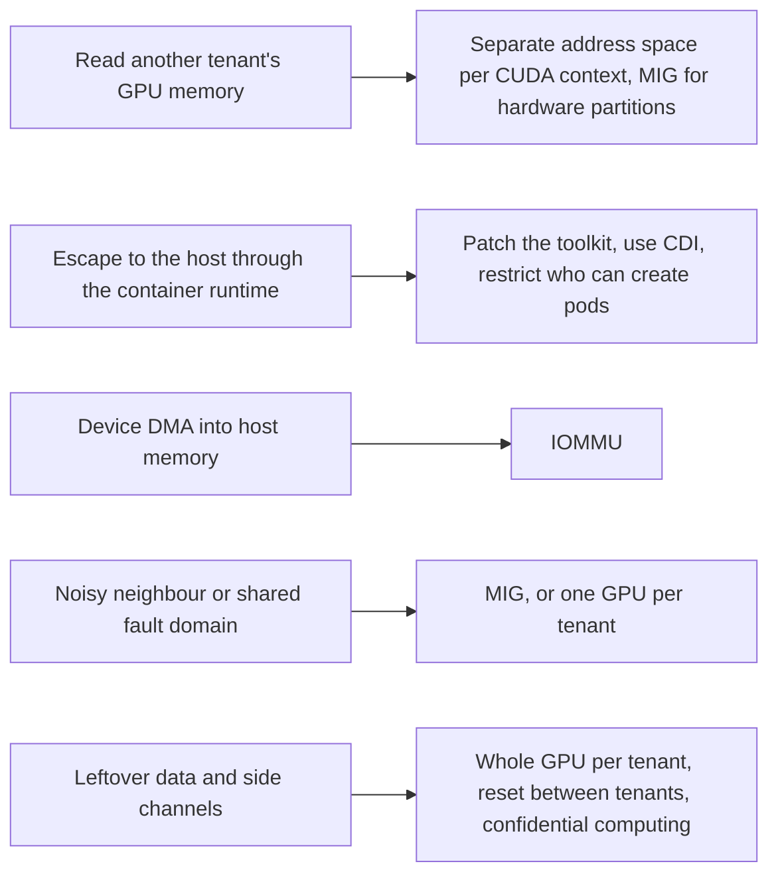

# 18.5 GPU sharing security, DMA, IOMMU and SR-IOV

| Field | Value |
|---|---|
| Level | Advanced |
| Priority tier | 2 |
| Lab venue | GCP / GKE |
| Part | Part 18: Security |
| Cross-references | Chapter 18.1 (Threat modeling); Chapter 18.4 (Kubernetes access control); Chapter 11.24-11.27 (MIG, time-slicing); Chapter 10.20 (Profiling tools) |
| Coverage file | `planning/coverage/chapters/18-05.md` |
| Claim & number ledger | `planning/ledgers/18-05.md` |

## Where this chapter starts: a container image that reached the host

In September 2024, researchers at Wiz showed that a container image built by an attacker could get out of its container and reach the file system of the node it ran on. The flaw was in the NVIDIA Container Toolkit, the software that gives a container access to the GPU. It was tracked as CVE-2024-0132. NVIDIA rated it 9.0 out of 10 and fixed it in Container Toolkit 1.16.2 and GPU Operator 24.6.2.

Nothing in that attack needed a clever trick inside the GPU. The attacker used the plumbing around it. That is the first lesson of GPU sharing security: before you ask whether one tenant can read another tenant's GPU memory, ask how many other paths lead from a tenant's container to the host.

This chapter lists the threats that exist when several tenants share GPU nodes, and it names the control that stops each one. It does not repeat how to configure MIG, time-slicing or vGPU. Chapters 11.21 to 11.26 own those mechanics, and Chapter 11.26 owns the decision between them.

Sharing is worth the effort because it is cheaper. In the planning example below, a cluster of 50 to 200 nodes with 8 GPUs each has 400 to 1,600 GPUs. At 3 to 5 dollars per GPU hour that is about 1.2 to 8 thousand dollars an hour. A sharing scheme that cuts the bill by two to four times saves a great deal of money, and that is exactly why teams accept its risks. These figures are planning examples, not measured costs.

## Prerequisites and outcomes

### Prerequisites

Chapter 18.1 gives the threat-modeling method used here. Chapter 18.4 covers who can reach the cluster. Chapters 11.21 to 11.26 explain IOMMU, SR-IOV, vGPU, MIG and time-slicing. You should know what a container runtime and a device plugin do.

### Outcomes

After this chapter you will be able to:

1. Name five threats to a shared GPU node and the control that stops each one.
2. Explain why the IOMMU protects host memory and not one tenant's GPU memory from another.
3. Patch and configure the NVIDIA Container Toolkit so a tenant image cannot reach the host.
4. Choose a sharing mode by what it separates and what it still shares.
5. Decide when a tenant needs a whole GPU, or a whole GPU in confidential computing mode.

---

## 1. Five threats and the control for each

A threat table is the fastest way to see the whole problem. Read each row as a story: who the attacker is, what they try, and what actually stops them. The sections after the table explain the rows.



| Threat | What the attacker does | Control that stops it | What it does not stop |
|---|---|---|---|
| Cross-tenant GPU memory read | A process on a shared GPU tries to read memory that belongs to another process | Each CUDA context has its own address space. MIG gives each instance dedicated memory | Time-slicing adds no separation beyond the contexts themselves |
| Host escape through the container toolkit | A crafted image or a hook abuse gives the container access to the host | Patched toolkit and device plugin, CDI mode, admission policy on who may create pods | A fully patched toolkit does not help against the next flaw |
| Device DMA into host memory | A device, or a VM that owns a device, writes to host memory it was not given | The IOMMU, with devices assigned in IOMMU groups | The IOMMU does not separate two processes sharing one GPU |
| Noisy neighbour or shared failure | One tenant fills memory, crashes the GPU or starves the others | MIG gives memory bandwidth and error isolation. Time-slicing and MPS do not | MIG slices still share some engines and the physical card |
| Leftover data and side channels | A later or concurrent tenant reads data the first tenant left, or measures timing | Whole GPU per tenant, a reset between tenants, confidential computing mode | Physical attacks and many side channels remain outside the model |

**The control that stops a threat depends on which memory is under attack.** The IOMMU guards host memory against devices. A separate address space and MIG guard GPU memory against other GPU users. A patched toolkit guards the host against the container. Mixing these up is the most common mistake in this area.

---

## 2. Cross-tenant GPU memory read and the IOMMU

### 2.1 Two different memories

A GPU node has two memories. Host memory is the node's ordinary RAM, which the operating system and every container share. GPU memory is the high-bandwidth memory on the card. A tenant worries about both, but different hardware protects each.

A CUDA context is the container for everything one process does on a GPU. The CUDA programming guide says a context is analogous to a CPU process and that each context has its own distinct address space. A pointer from one context therefore means nothing in another. This is the base separation between two processes that share a GPU, and it exists whether or not MIG is on.

### 2.2 What the IOMMU does

DMA means a device reads or writes host memory without the CPU copying the data. That is how a GPU or a network card moves data fast. The risk is that a device with unrestricted DMA can touch any page. The Linux kernel documentation for VFIO calls this the greatest risk to system integrity when a device gets read-write access to system memory.

The IOMMU, short for input-output memory management unit, sits between devices and host memory. It translates the addresses a device uses and refuses accesses that were not mapped for that device. The kernel documentation says modern IOMMUs let devices be isolated from each other and from arbitrary memory access.

The IOMMU works on a unit called an IOMMU group. The VFIO documentation defines a group as a set of devices that can be isolated from all other devices, and says the group is the smallest unit that can be safely handed to a user. It also warns that a PCIe-to-PCI bridge, or a bridge without ACS support, can let traffic redirect without reaching the IOMMU. When you give a whole GPU to a VM, the whole IOMMU group moves with it.

Check that the node has IOMMU groups before it joins a tenant pool.

```bash
ls /sys/kernel/iommu_groups | wc -l
lspci -nn -d 10de:
```

The first command counts the groups, and zero means the IOMMU is not active. The second lists NVIDIA devices, which have vendor ID 10de. For each GPU, check which devices share its group under `/sys/kernel/iommu_groups`.

Notice what this does not protect. Two containers sharing one GPU are not separated by the IOMMU. Both reach the GPU through the same driver on the same host. They are separated by the contexts in section 2.1 or by MIG in section 4.

---

## 3. Host escape through the container runtime

### 3.1 Why this is the realistic threat

Sharing a GPU does not give a tenant any way into the node by itself. The container runtime does. To give a container a GPU, a toolkit runs code on the host when the container starts. That code is a target.

NVIDIA's security bulletins record two flaws of this kind.

| CVE | What it is | Fixed in |
|---|---|---|
| CVE-2024-0132 | A time-of-check time-of-use flaw in the default configuration. A crafted image could reach the host file system. NVIDIA states it does not affect use cases where CDI is used | Container Toolkit 1.16.2, GPU Operator 24.6.2 |
| CVE-2025-23266 | A flaw in hooks the toolkit uses to initialize containers. It allows arbitrary code with elevated permissions. It is rated 9.0 and is classified as CWE-426. Systems using crun as the low-level runtime are not affected | Container Toolkit 1.17.8, device plugin 0.17.3, MIG Manager 0.12.2, GPU Operator 25.3.2 |

The bulletin for CVE-2025-23266 lists affected versions up to and including Container Toolkit 1.17.7. For the exact affected CDI configurations, read the bulletin itself, because the conditions differ by product.

### 3.2 Controls

Patching is the first control, and it must be a process, not an event. The platform team needs an inventory of the toolkit, device plugin and GPU Operator version on every node, and an alert when one falls behind a security fix. Chapter 18.2 describes the same inventory for firmware.

Next, limit who can create pods that reach the runtime. A tenant who can submit any image can try the crafted image. Chapter 18.4 covers admission policy, namespaces and service accounts. Use image provenance checks from Chapter 18.3 so that only approved images run on shared GPU nodes.

Last, keep the privileged components small. A device plugin runs privileged and mounts the kubelet device-plugin directory, as the Kubernetes documentation says. Tenants must never get that level. Chapter 18.4 explains how to keep tenant namespaces at the Restricted level.

---

## 4. Noisy neighbours and the sharing modes

Sharing modes differ in what they separate. The table summarises the vendor documentation. The mechanics are in Chapters 11.24 and 11.25.

| Mode | What is separated | What is still shared |
|---|---|---|
| Time-slicing through the device plugin | Time on the GPU | Memory, with no limit per workload, and the fault domain |
| MPS | Memory and compute can be partitioned by limits | Memory bandwidth, caches and capacity, and no error isolation between clients |
| MIG | Dedicated SMs, memory, memory bandwidth and cache, and error isolation | The physical card, and some engines inside a GPU instance |
| vGPU, time-sliced | Each VM gets a share of GPU time | The GPU's processing cycles are shared by scheduling policy |
| vGPU, MIG-backed | Each VM gets a MIG instance | As for MIG |

The device plugin README says that for time-slicing nothing special is done to isolate workloads that are granted replicas from the same GPU, and that each workload has access to the GPU memory and runs in the same fault domain as the others. Read this sentence as a statement about limits and failures. One workload can use all the memory, and one crash can hit all of them. The README does not claim that processes read each other's data.

The MIG user guide says MIG gives each instance dedicated compute and memory resources, with memory bandwidth quality of service and error isolation, which MPS and streams lack. MIG profiles also list peer-to-peer as No, so a MIG instance does not talk to its neighbours over NVLink peer access.

Non-MIG vGPU is time-sliced. NVIDIA's vGPU documentation lists the best effort, equal share and fixed share schedulers, which divide GPU processing cycles among running vGPUs. On Ampere and later GPUs the virtual functions are enabled with NVIDIA's `sriov-manage` script, and the guide warns to use no other means. The enabled functions are lost after a reboot or a driver reload.

The decision rule is short. If a tenant must not be able to slow down or crash another tenant, use MIG or a separate GPU. If tenants trust each other, as colleagues running notebooks do, time-slicing is acceptable, and you accept the shared memory and fault domain.

---

## 5. Leftover data and side channels

### 5.1 What stays behind

When a process frees GPU memory, the next user of that memory may find old bytes in it. Public research shows this is real on some GPUs. In January 2024 Trail of Bits and academic researchers disclosed LeftoverLocals, CVE-2023-4969. A kernel on affected AMD, Apple and Qualcomm GPUs could read values left in local memory by another kernel, and the researchers used it to read another user's LLM answers across process boundaries. Local memory is not cleared between kernel runs on those GPUs.

Trail of Bits reported that NVIDIA confirmed its GPUs were not impacted, and that its own tests saw only zeros in NVIDIA local memory. The same write-up cites earlier academic work in which NVIDIA GPUs leaked memory across processes through several memory regions. This handbook found no NVIDIA statement that freed GPU memory is zeroed between processes in ordinary operation, so do not assume it. The sharing guidance below follows from that.

### 5.2 Controls

The strongest control is to avoid sharing between tenants who distrust each other. Give such tenants whole GPUs, or MIG instances, and reset the device when ownership changes.

Confidential computing mode adds a documented answer. NVIDIA's threat model says session keys are ephemeral and that GPU reset and teardown mechanisms clear protected state. It also says that stopping a workload is not a substitute for the supported reset and reassignment lifecycle. In that configuration, each GPU is assigned whole to one confidential VM, and MIG, MPS and GPUDirect RDMA are not supported. Chapter 18.6 explains what confidential computing does and does not protect.

Time-slicing and MPS give no separation that is strong enough for tenants who distrust each other, as the table in section 4 shows. Side-channel measurements, such as timing, remain outside the guarantees of every mode in this chapter. NVIDIA's confidential computing documentation says timing, cache and power side channels are outside its protection.

---

## 6. How it fails

Each case starts from the symptom.

### 6.1 A tenant image has host access

A node shows a process with root files from outside its container. The toolkit version is older than the fix for CVE-2024-0132 or CVE-2025-23266. Cordon the node, preserve its logs, patch the toolkit, and rebuild any node that ran an untrusted image on the old version. Treat every secret on that node as exposed.

### 6.2 A tenant crashes its neighbours

Several inference pods on one GPU fail at the same time with a GPU error. They share a time-sliced GPU and one fault domain. Move critical tenants to MIG instances or separate GPUs, as in section 4.

### 6.3 A node has no IOMMU groups

The directory `/sys/kernel/iommu_groups` is empty on a node that hosts VM-based tenants. The IOMMU is off in firmware or the kernel. Do not admit passthrough VMs to this node. Turn the IOMMU on and recheck.

### 6.4 A tenant claims the MIG instance is not isolated

First confirm what the instance list shows, using `nvidia-smi -L` on the node, and compare it with the plan. MIG instances do not share SMs, memory or cache. If the tenant reports slowdown, the cause may be a shared engine or the card's power and thermal state, which MIG does not separate.

### 6.5 A confidential VM exposes more than expected

A team assumes confidential computing removes the need for any other control. NVIDIA's documentation says attestation does not prove the guest software is free of vulnerabilities and that network and storage paths need separate protection. Add encryption and access control for those paths.

---

## 7. Hands-on lab

These steps use only commands that appear in the vendor or kernel documentation cited below. They have not been run on a live GKE cluster here, so confirm each flag against your driver version.

1. Count IOMMU groups.

```bash
ls /sys/kernel/iommu_groups | wc -l
```

Expected: a number above zero on a node that supports device passthrough.

2. List the MIG profiles your GPU supports, then the instances that exist.

```bash
nvidia-smi mig -lgip
nvidia-smi -L
```

Expected: the profile table, and one line per MIG device, which you compare with the layout you planned.

3. Read the version of the container toolkit on a node and compare it with the fixed versions in section 3.1.

```bash
nvidia-ctk --version
```

4. Apply the MIG workload from the repository and check that the pod schedules.

```bash
kubectl apply -f code/part18/mig_workload.yaml
kubectl get pod churn-model
```

The pod requests `nvidia.com/mig-1g.5gb`. An 80 GB card names its smallest slice `1g.10gb`, so a request for 1g.5gb stays Pending on such a node. Compare the resource name with what the node advertises.

5. Apply the time-slicing example. It advertises each GPU as four shared replicas, using the device plugin schema `sharing.timeSlicing.resources` with `replicas`. Remember that the replicas share memory and the fault domain.

```bash
kubectl apply -f code/part18/timeslicing.yaml
```

Record what you learned: the toolkit version, the IOMMU group count, and the mode of each GPU.

---

## Exercises

1. A node is about to join the GPU pool for VM tenants. Write a shell check that fails when `/sys/kernel/iommu_groups` is empty. *Solution sketch:* count the entries with `ls` and `wc -l`, exit non-zero when the count is zero, and run the check before the node gets its tenant label.
2. One 80 GB GPU must serve a team that needs 40 GB and three teams that need 10 GB each, and tenants distrust each other. Choose a layout. *Solution sketch:* one 3g.40gb instance plus three 1g.10gb instances uses six of seven compute slices. Confirm placement with `nvidia-smi mig -lgip` before creating anything.
3. Three tenant types share the platform: colleagues running notebooks, two paying customers running inference, and a regulated model with patient data. Pick a sharing mode for each and give one reason. *Solution sketch:* time-slicing for the colleagues, MIG for the customers, and a whole GPU in confidential computing mode for the regulated model.
4. Your fleet runs Container Toolkit 1.17.5 on some nodes. Which of the two CVEs in section 3.1 still applies, and what do you do? *Solution sketch:* 1.17.5 is above the fix for CVE-2024-0132 and below the fix for CVE-2025-23266, which needs 1.17.8. Check the bulletin for your CDI configuration, then upgrade.
5. Several pods fail together on a time-sliced GPU after one of them hits an out-of-memory error. Explain why, and what you change. *Solution sketch:* the pods share memory with no per-workload limit and share a fault domain, so move them to MIG instances or set a memory limit with MPS.
6. A cluster has 50 nodes with 8 GPUs each at 3 dollars per GPU hour. What does it cost per day, and what would a two times saving from sharing be worth per year? *Solution sketch:* 400 GPUs times 3 dollars is 1,200 dollars an hour, which is 28,800 dollars a day. Half of that, saved over 365 days, is 5,256,000 dollars. These are planning figures, not measured costs.

---

## Checkpoint questions

<details><summary>1. A security reviewer says the IOMMU already stops tenant A from reading tenant B's GPU memory on a shared GPU. What is wrong with that claim?</summary>
The IOMMU stops a device from reaching host memory it was not given. Two processes on one GPU are separated by their own CUDA address spaces, or by MIG. The IOMMU is not the control for that threat.
</details>

<details><summary>2. A pod on a shared node runs a crafted image and later a root-owned file appears on the node. What do you check first and what do you do?</summary>
Check the Container Toolkit and GPU Operator versions against the fixes for CVE-2024-0132 and CVE-2025-23266. Cordon the node, keep its logs, patch, and treat secrets on it as exposed. Rebuild the node if the image ran on an unpatched version.
</details>

<details><summary>3. Your node runs Container Toolkit 1.16.1 in CDI mode. Does CVE-2024-0132 apply?</summary>
NVIDIA states the flaw does not affect use cases where CDI is used. Still plan to upgrade to 1.16.2 or later, and read the bulletin for CVE-2025-23266, whose conditions differ.
</details>

<details><summary>4. A node hosts VM tenants and the directory /sys/kernel/iommu_groups is empty. What is the risk and the fix?</summary>
Without an active IOMMU, a device assigned to a VM can use DMA on host memory without the mapping check. Turn the IOMMU on in firmware and the kernel, reboot, and confirm that groups appear before admitting VM tenants.
</details>

<details><summary>5. Three inference pods share one time-sliced GPU and all fail when one of them crashes the GPU. Why, and what is the fix?</summary>
The device plugin README says time-sliced workloads share the GPU memory and run in the same fault domain. Move the pods to MIG instances, which have error isolation, or to separate GPUs.
</details>

<details><summary>6. A team says its cluster is multi-tenant because every GPU uses time-slicing. What is missing?</summary>
Time-slicing separates time only. It sets no memory limit per workload and keeps one fault domain. For tenants who distrust each other, use MIG or whole GPUs, patch the container toolkit, and keep the IOMMU on for any device assigned to a VM.
</details>

<details><summary>7. A pod requests nvidia.com/mig-1g.5gb and stays Pending on an 80 GB node. Why?</summary>
That node advertises 1g.10gb for its smallest slice, so no resource matches the request. Read the node's allocatable resources and change the request.
</details>

<details><summary>8. A tenant on a MIG instance reports a slowdown while its neighbour is busy. Is MIG broken?</summary>
Not necessarily. MIG gives dedicated SMs, memory, bandwidth and cache, but the instances still live on one card with shared power and thermal limits. Compare with a run while the neighbour is idle, and check clocks before concluding anything.
</details>

<details><summary>9. A vendor tells you its GPUs were not affected by LeftoverLocals. Does that prove freed memory is zeroed on your NVIDIA nodes?</summary>
No. It says that attack did not work on them. Earlier academic work cited by Trail of Bits found cross-process leaks on NVIDIA GPUs, and this handbook found no NVIDIA statement that freed memory is zeroed. Treat leftover data as possible when tenants distrust each other.
</details>

<details><summary>10. A tenant needs a regulated model on a shared cluster. Why is a MIG instance not the answer in confidential computing mode?</summary>
NVIDIA's confidential VM threat model assigns each GPU whole to one confidential VM and lists MIG, MPS and GPUDirect RDMA as unsupported in those configurations. Use a whole GPU in confidential computing mode.
</details>

<details><summary>11. Why do ordinary vGPU profiles not give the same isolation as MIG-backed vGPU?</summary>
Non-MIG vGPU shares the GPU by time-slicing schedulers: best effort, equal share or fixed share. MIG-backed vGPU gives each VM a MIG instance with dedicated memory and compute.
</details>

<details><summary>12. When would you accept time-slicing for a team, and what do you give up?</summary>
Accept it when tenants trust each other, such as colleagues running notebooks. You give up a memory limit per workload and a separate fault domain, and you accept that one crash affects all users of the GPU.
</details>

<details><summary>13. You enabled SR-IOV virtual functions with sriov-manage and, after a reboot, the vGPUs are gone. What happened?</summary>
NVIDIA's guide says the virtual functions in sysfs are disabled after a host reboot or a driver reload or upgrade. Re-enable them at boot with NVIDIA's script, and do not enable them by other means.
</details>

<details><summary>14. A manager says sharing cuts the bill two to four times and asks you to skip isolation work. What do you answer?</summary>
Sharing saves money only if the boundary holds. The Container Toolkit flaws let a tenant image reach the host, which defeats every tenant boundary at once. Spend part of the saving on patching, MIG for tenants who distrust each other, and admission control.
</details>

<details><summary>15. A tenant asks for confidential computing so the cloud operator cannot read its data. What does it still not protect?</summary>
NVIDIA's documentation says it does not protect against a malicious guest, physical or side-channel attacks, or unprotected network and storage paths, and attestation does not prove the approved code is free of vulnerabilities. The operator can also stop the VM.
</details>

<details><summary>16. A node costs 24 dollars an hour. Sharing halves the cost. What is the yearly saving?</summary>
A year has 8,760 hours. 24 times 8,760 is 210,240 dollars, so halving saves 105,120 dollars a year. These are planning numbers.
</details>

<details><summary>17. The lab shows Container Toolkit 1.17.6 on a node. Which fix are you missing?</summary>
The fix for CVE-2025-23266 needs Container Toolkit 1.17.8, because affected versions run up to and including 1.17.7. Upgrade the toolkit and the device plugin and MIG Manager listed in the bulletin.
</details>

<details><summary>18. You split a 3 dollar per hour GPU into seven equal MIG instances. What does each tenant pay, and what caveat applies?</summary>
About 0.43 dollars per hour, which is 3 divided by 7. Real layouts are not always equal, so check the profiles your GPU supports.
</details>

<details><summary>19. In what order do you check a new GPU node before it takes tenants?</summary>
First the IOMMU groups, then the toolkit and device plugin versions against the bulletins, then the MIG layout against your plan, then the sharing mode for each GPU. Patch level comes before layout because a host escape defeats the layout.
</details>

<details><summary>20. Memory use on a shared GPU looks strange. What do you do, and what does a reading of memory used prove?</summary>
A single reading proves nothing, so compare it over time with the tenant's own jobs. Check which tenants share the GPU and its sharing mode. If you suspect one tenant is reading another, cordon the node and escalate, keeping logs.
</details>

---

## Sources and review notes

- NVIDIA security bulletin 5582 (published 25 September 2024): CVE-2024-0132 and CVE-2024-0133, Container Toolkit up to 1.16.1 and GPU Operator up to 24.6.1, fixed in 1.16.2 and 24.6.2. Fetched 2026-11-12.
- NVIDIA security bulletin 5659 (first released 15 July 2025, revised 12 August 2025, page updated 18 November 2025): CVE-2025-23266, CVSS 9.0, CWE-426, fixed versions for Container Toolkit, device plugin, MIG Manager and GPU Operator. Fetched 2026-11-12.
- NVIDIA CUDA Programming Guide, driver API section: contexts and per-context address spaces. Fetched 2026-11-12.
- Linux kernel documentation, VFIO: IOMMU groups, DMA risk, ACS. Fetched 2026-11-12.
- NVIDIA MIG User Guide, concepts, getting started and supported profiles pages: isolation, error isolation, profile table with P2P column, `nvidia-smi mig -lgip`. Fetched 2026-11-12.
- NVIDIA k8s-device-plugin README: time-slicing schema and the statement about memory and fault domain. Fetched 2026-11-12.
- NVIDIA vGPU software user guide: `sriov-manage` and the scheduling policies. Fetched 2026-11-12.
- Kubernetes documentation, device plugins: the plugin runs privileged and mounts the device-plugin directory. Fetched 2026-11-12.
- NVIDIA Confidential Computing documentation, virtual machine threat model and supported platforms. Fetched 2026-11-12.
- Trail of Bits, LeftoverLocals write-up (16 January 2024), CVE-2023-4969. Fetched 2026-11-12.
- *Production Kubernetes*, chapter 12 on multitenancy, for the idea that tenants are a spectrum of trust.

### Corrections made in this rework

- The earlier text said a tenant reads another tenant's GPU memory through DMA and that the IOMMU stops it. That mixed up host memory and GPU memory. The chapter now says what each control protects.
- Removed invented commands (`nvidia-smi -vgpu 1`, `perf stat` IOMMU events, a listing under `/sys/class/iommu`), the time-slicing fields `interval` and `timeout`, and the `gpusharing.*` IAM roles. None appears in vendor documentation.
- The old comparison called non-MIG vGPU spatial sharing. NVIDIA's documentation shows time-sliced and MIG-backed vGPU.

### Open items

- The exact CDI conditions in the CVE-2025-23266 bulletin are summarised, not restated.
- No NVIDIA source was found for zeroing freed GPU memory in non-confidential mode.
- `code/part18/timeslicing.yaml` was rewritten to the device plugin schema (`sharing.timeSlicing.resources[].replicas`).
