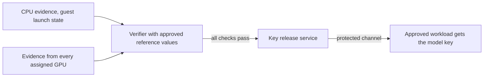

# 18.6 BlueField, DOCA and confidential computing

| Field | Value |
|---|---|
| Level | Advanced |
| Priority tier | 2 |
| Lab venue | GCP / GKE |
| Part | Part 18: Security |
| Cross-references | Chapter 18.1 (Threat modeling); Chapter 18.2 (Hardware and firmware trust); Chapter 18.4 (Kubernetes access control); Chapter 18.5 (GPU sharing security); Chapter 11 (GPU Kubernetes) |
| Coverage file | `planning/coverage/chapters/18-06.md` |
| Claim & number ledger | `planning/ledgers/18-06.md` |

## Why this matters for AI infrastructure

A lender wants to run its credit model on rented GPU servers. Its security team has done everything in the earlier chapters: patched firmware, locked down Kubernetes, encrypted storage. Then the auditor asks one more question. Can an administrator of the hosting company, with root on the host, read the model weights and the applicant data while the job runs?

Standard controls cannot answer yes or no, because the administrator sits below them. Confidential computing exists to answer that question with hardware evidence. This chapter explains what it guarantees, what it leaves trusted, and what a BlueField DPU adds. It does not repeat the mechanics of installing either. Chapters 11.27 and 11.28 cover virtual machines on Kubernetes and the DPU.

Not every workload needs this. The design costs money and operational effort. For a regulated model that handles patient or financial records on infrastructure you do not control, it is the only control that addresses the operator as an attacker.

## Prerequisites and outcomes

### Prerequisites

Chapter 18.1 for the threat model, Chapter 18.2 for firmware and attestation basics, and Chapter 18.5 for GPU sharing. You should know what a virtual machine and a trusted platform module are.

### Outcomes

After this chapter you will be able to:

1. Say which attacker confidential computing stops and which it leaves out.
2. Describe the attestation flow that must finish before a key is released.
3. Check the confidential computing mode of a GPU and set its ready state.
4. Explain what the CPU-GPU link costs in performance.
5. Say what a BlueField DPU's zero-trust mode and secure boot do for you, and what they do not.

---

## 1. What confidential computing guarantees

### 1.1 Data in use

Data can be encrypted at rest on disk and in transit on the network. The gap is data in use, while the CPU and GPU are working on it. Confidential computing closes that gap by running the workload inside a hardware-protected environment. NVIDIA's documentation says it protects AI workloads, model weights and sensitive data during processing.

A confidential virtual machine, or CVM, runs inside a trusted execution environment on a CPU with AMD SEV-SNP or Intel TDX. The CPU isolates the VM's memory from privileged host software. NVIDIA Hopper and Blackwell GPUs passed through to the CVM extend that protection to GPU memory and to the data that moves between CPU and GPU.

### 1.2 Three ways to deploy

NVIDIA defines three deployment modalities. They move the trust boundary to match who runs the infrastructure.

| Modality | Who controls the host | What is trusted | What is outside the boundary |
|---|---|---|---|
| Confidential bare metal | The model owner, on dedicated hosts | The model owner's host software and administrators | The infrastructure owner, including its management controller |
| Confidential virtual machine | The infrastructure owner, with the tenant inside the guest | The guest OS, driver and workload | Host OS, hypervisor and other tenants |
| Confidential containers | The cluster operator, with the workload in a confidential pod | The workload and its policy | Privileged host software, subject to control-plane separation |

NVIDIA states that the modalities do not provide interchangeable guarantees. The protection depends on the real topology, the trusted software and the policy you enforce.

**Confidential computing does not remove trust. It moves trust from the host operator to the CPU vendor, NVIDIA, the guest software and the service that releases keys.**

### 1.3 What the GPU does

GPU memory is not encrypted by the card. NVIDIA's CVM threat model says hardware access controls protect plaintext data in GPU memory, and that memory encryption is not the mechanism. The NVIDIA H100 blog states that the on-package memory is not encrypted and is considered secure against everyday physical attack tools.

Data crossing the PCIe link is encrypted. The GPU is blocked by the CPU hardware from reading CVM memory directly. The driver, inside the CPU's protected environment, moves data through an encrypted bounce buffer in shared system memory. Command buffers and kernels are encrypted and signed before they cross PCIe.

The modes differ in how they protect the links.

| Configuration | CPU to GPU traffic | GPU to GPU traffic |
|---|---|---|
| Single-GPU CC mode, Hopper or Blackwell | Encrypted | Not applicable |
| Multi-GPU CC mode, Blackwell | Encrypted | Encrypted over NVLink |
| Multi-GPU protected PCIe mode, Hopper | Encrypted | Unencrypted over NVLink |

In the Hopper protected PCIe mode, the unencrypted NVLink path means you must assess the fabric, including NVSwitch and physical access.

### 1.4 Performance cost

The cost is in the data path, not in compute. NVIDIA's H100 blog says raw GPU compute and memory bandwidth are on par with non-confidential mode. It says CPU-GPU interconnect bandwidth is limited by CPU encryption performance, which NVIDIA measured at roughly 4 GB per second at the time of writing, and that encrypted bounce buffers add latency.

Read that as a design rule. A job with a lot of computation per byte it receives will run close to normal speed. A job that streams large inputs across the PCIe link every step will slow down. Measure your own job before you promise a number to anyone.

---

## 2. Attestation: the step that makes the guarantee usable

Attestation answers one question: is this machine really what it claims to be? The GPU collects and signs measurements, and a verifier compares them with known-good reference values. NVIDIA's documentation states that attestation provides evidence for a trust decision and does not replace the policy that decides whether a workload may receive secrets.



NVIDIA's threat model says the verification and release flow must:

1. Verify CPU evidence against the tenant's policy for the CPU environment and guest launch state.
2. Verify evidence for every assigned GPU, covering identity, firmware measurements, security mode, reference values and certificate status.
3. Establish that the approved guest software and configuration will receive the secrets.
4. Release secrets over a protected channel to that approved recipient, and only when every check succeeds.

A successful GPU attestation does not validate the CPU environment or your workload. CPU evidence alone does not establish the state of the GPUs. A valid signature does not authorise key release, because the policy must also reject firmware versions you do not accept.

The GPU also has a ready state. In the documented flow, a user in the CVM sets it with `nvidia-smi conf-compute -srs 1` after attestation. The GPU does not accept work until then, and attestation does not set it automatically. NVIDIA warns that the ready state is not evidence that your release policy has been satisfied.

---

## 3. Commands that check the state

These commands are taken from NVIDIA's confidential computing deployment guide. They have not been run on hardware for this handbook, so check them against your driver.

```bash
# In the guest: confirm the GPU runs in the mode you expect
nvidia-smi conf-compute -f

# In the guest, after attestation succeeds: let the GPU accept work
nvidia-smi conf-compute -srs 1
```

The first command prints a line such as CC status: ON. NVIDIA recommends that `nvidia-persistenced` is running in the guest.

The mode itself is set on the host, with a privileged call, through NVIDIA's gpu-admin-tools. NVIDIA's guide shows `nvidia_gpu_tools.py` with `--set-cc-mode=on` and `--reset-after-cc-mode-switch`, and `--query-cc-settings` to print the current mode. It says CC mode and protected PCIe mode are mutually exclusive, that you must set the mode of every GPU you pass through, and that the mode persists across reboots and power cycles. It also says you cannot set the mode from a host that boots with Secure Boot enabled: either disable Secure Boot in the BIOS or set the mode from within the guest.

The supported platforms today are Hopper and Blackwell GPUs with Intel Emerald Rapids or Granite Rapids on TDX, or AMD Milan, Genoa or Turin on SEV-SNP. NVIDIA supports only the listed combinations of hardware and software, so check its compatibility matrix before you buy.

---

## 4. What is still trusted, and what is not covered

NVIDIA's own threat models list the limits. A design review should read them before approving a deployment.

| Limit | What it means for you |
|---|---|
| Guest software stays trusted | Malicious or vulnerable code inside the VM can leak data. Attestation does not prove the approved code is free of vulnerabilities |
| The verifier and key service stay trusted | A compromised verifier, wrong reference values or a permissive release policy can admit an unsafe host |
| Availability | The infrastructure owner can stop the VM, cut the network or remove power |
| Physical attacks and side channels | Invasive probing is outside the GPU threat model, and CPU side channels follow the CPU vendor's model |
| Network and storage | Protect data leaving the VM separately. Do not infer protection for another device from GPU attestation |
| Sharing | The model assumes a whole GPU assigned to one VM. MIG, MPS and GPUDirect RDMA are not supported in these configurations |
| Debug modes | CC-DevTools allows profiling and must be excluded from a production policy |

In the dedicated-host modality, NVIDIA also states that the infrastructure owner's management interfaces, including the baseboard management controller, must not have access to workload plaintext. A network card does not become trusted just because it supports attestation. Baseline NICs stay outside the trusted boundary, so the model owner's software must encrypt sensitive RDMA payloads and restrict the memory the NIC can see.

---

## 5. What a BlueField DPU adds

A BlueField DPU is a card with its own Arm cores and firmware that sits between the host and the network. Chapter 11.28 covers its architecture. Two documented features matter for security.

Secure boot on the DPU is rooted in unmodifiable ROM code. NVIDIA's BlueField documentation says the ROM verifies the off-chip public key against a hash stored in eFuses, and each stage then verifies the next. Secured devices ship with NVIDIA-signed software. You can check this state from the host with `flint`, which should report the life cycle GA SECURED, or from the Arm console with `mlxbf-bootctl`.

Zero-trust mode is a variation of DPU mode, which is the default. NVIDIA's documentation says it stops the host administrator from accessing BlueField from the host, so control shifts to the Arm cores or the management controller. The operations that can be restricted individually include assigning the host as port owner, reading hardware counters, using the tracer, using the RShim interface and flashing firmware.

What a DPU does not do is also important. It does not encrypt the host's memory, and it does not replace a CVM. NVIDIA's threat model treats NICs as outside the workload's trusted boundary unless you explicitly establish otherwise. Use the DPU to make the network edge harder for a compromised host to change, and use confidential computing to protect the workload from the host.

---

## 6. How it fails

### 6.1 The workload started with CC mode off

The GPU runs normally and nobody notices. Memory and data are not protected. The cause is that the GPU mode was never set to on, or the host mode differs from what the guest sees. Check `nvidia-smi conf-compute -f` in the guest and make the release policy reject any GPU whose attested mode is not what you require.

### 6.2 Attestation passes but the key release is too permissive

The verifier accepts any valid signature, including older firmware with a known flaw. NVIDIA warns that a valid signature alone does not establish that a firmware version is acceptable. Add version checks to the policy and track the vendor's advisories.

### 6.3 The job is slower than expected

A training job moves large batches across PCIe each step, and CPU encryption limits that link. Measure with and without CC mode and consider keeping data on the GPU between steps.

### 6.4 A debug mode slipped into production

An engineer left the mode as devtools, which permits profiling. A production policy that requires the restrictions must reject that mode in attestation.

### 6.5 The management controller is trusted by mistake

The design assumed the host's baseboard controller could not see workload data, yet the controller has a vulnerability. Chapter 18.2 describes why the controller must stay outside the trust boundary and be patched.

---

## 7. Hands-on lab

The lab needs a Hopper or Blackwell GPU on a supported CPU, which most readers do not have. Read it as a checklist for a vendor test, not as a runnable recipe. It has not been run here.

1. On the host, query the GPU mode with the gpu-admin-tools script and its `--query-cc-settings` option.
2. In the guest, run `nvidia-smi conf-compute -f` and confirm CC status ON.
3. Install the NVIDIA attestation SDK, which NVIDIA's guide names NVAT, and attest the GPU.
4. Only after attestation succeeds, run `nvidia-smi conf-compute -srs 1`.
5. On a BlueField host, run `sudo mst start`, then `sudo flint -d /dev/mst/mt41686_pciconf0 q full` and look for the life cycle line.
6. Time a data-heavy job with CC mode on and off, and record the ratio.

Record: the mode of every GPU, the life cycle state of every DPU, and the measured slowdown for your job.

---

## Exercises

1. A security review asks you to prove that a cloud administrator cannot read model weights during inference. List the four verification steps before key release, and say which one a valid GPU attestation alone does not cover. *Solution sketch:* the four steps are CPU evidence, GPU evidence, approved guest software and a protected release. GPU attestation does not cover the CPU environment or the workload.
2. A team runs a Hopper multi-GPU job in protected PCIe mode and says all traffic is encrypted. Correct the claim. *Solution sketch:* CPU to GPU traffic is encrypted, but GPU to GPU traffic over NVLink is unencrypted in that mode, so fabric and physical access must be assessed.
3. A data-loading step moves 40 GB across PCIe per training step. At the roughly 4 GB per second that NVIDIA's blog reports for CPU encryption, how long does the move take, and what do you do? *Solution sketch:* 40 divided by 4 is about 10 seconds, so reduce data movement or keep data resident on the GPU, and measure on your platform.
4. A host boots with Secure Boot enabled and the gpu-admin-tools call to set CC mode fails. What are your two options? *Solution sketch:* disable Secure Boot in the BIOS, or set the mode from within the guest, as NVIDIA's guide describes.
5. A BlueField card reports a life cycle other than GA SECURED. What do you conclude and do? *Solution sketch:* the secure boot chain is not anchored in eFuses as expected. Keep the card out of the trusted path until NVIDIA support explains it.
6. Decide whether a team needs confidential computing for an internal notebook cluster that runs open models on public data. *Solution sketch:* probably not, since the cost and operational effort protect against a host operator the team already trusts.

---

## Checkpoint questions

<details><summary>1. An auditor asks whether a hosting company's root administrator can read your model weights while it runs. Which control answers, and what must you also check?</summary>
A confidential VM with GPU confidential computing mode isolates the workload from privileged host software. You must also check attestation and the key release policy, because the model key should reach only a verified workload.
</details>

<details><summary>2. A team says confidential computing means GPU memory is encrypted. Is that right?</summary>
No. NVIDIA's threat model says hardware access controls protect plaintext in GPU memory and that memory encryption is not the mechanism. Data crossing PCIe is encrypted.
</details>

<details><summary>3. Attestation succeeds, but the GPU still refuses work. Why?</summary>
The GPU does not accept work until a user in the VM sets the ready state with nvidia-smi conf-compute -srs 1. Attestation does not set it automatically.
</details>

<details><summary>4. A verifier accepts a GPU with older firmware that has a known flaw because its signature is valid. What is the fix?</summary>
Add firmware version checks to the policy and reject disallowed versions. NVIDIA states that a valid signature does not establish that a version is acceptable.
</details>

<details><summary>5. A job runs twice as slow in CC mode. Where do you look first?</summary>
At data movement across PCIe. CPU encryption limits CPU-GPU bandwidth, and encrypted bounce buffers add latency. Compute and memory bandwidth on the card are on par with normal mode.
</details>

<details><summary>6. A team uses MIG instances for confidential tenants. What is wrong?</summary>
NVIDIA's CVM threat model assumes a whole GPU per VM and lists MIG, MPS and GPUDirect RDMA as unsupported in those configurations.
</details>

<details><summary>7. Why is a baseline network card outside the trusted boundary even when it supports attestation?</summary>
NVIDIA says a NIC does not become trusted merely because it supports attestation. Unless a deployment explicitly places it in the trusted base, the workload software must encrypt sensitive RDMA payloads and restrict the memory the NIC can reach.
</details>

<details><summary>8. A company wants to hide user data from the model owner too. Does confidential bare metal do that?</summary>
No. NVIDIA says it trusts the model owner's privileged software and does not isolate end-user data from the model owner. An additional CVM can place the approved workload inside a CPU-protected environment so host administrators are outside the boundary.
</details>

<details><summary>9. What does zero-trust mode on a BlueField DPU restrict, and what does it not do?</summary>
It prevents the host administrator from accessing BlueField from the host, with options to restrict port ownership, counters, the tracer, RShim and firmware flashing. It does not encrypt the host's memory.
</details>

<details><summary>10. How do you check that a BlueField's secure boot is anchored?</summary>
From the host, run flint and look for life cycle GA SECURED. From the Arm console, run mlxbf-bootctl and look at the lifecycle line. The ROM verifies the key against a hash in eFuses.
</details>

<details><summary>11. You must set CC mode on a host that boots with Secure Boot. What happens?</summary>
NVIDIA's guide says you cannot set the GPU mode from such a host. Disable Secure Boot in the BIOS, or set the mode from within the guest.
</details>

<details><summary>12. A team wants confidential computing for public open-model notebooks. What do you advise?</summary>
Probably not. The design adds cost and effort. It protects against a host operator, and these notebooks have no secret to protect from one.
</details>

<details><summary>13. Attestation passed, so a developer says the application code is safe. Is that right?</summary>
No. NVIDIA says attestation does not establish that approved code is free of vulnerabilities. Malicious or vulnerable guest code can still leak data.
</details>

<details><summary>14. Who can stop a confidential VM, and why does that matter for an SLA?</summary>
The infrastructure owner can stop the VM, interrupt networking, detach devices or remove power. Confidential computing does not guarantee availability against that operator.
</details>

<details><summary>15. Which GPUs and CPUs does NVIDIA support for confidential VMs?</summary>
Hopper and Blackwell GPUs, with Intel TDX CPUs such as Emerald Rapids and Granite Rapids, or AMD SEV-SNP CPUs such as Milan, Genoa and Turin. Only the listed combinations are supported.
</details>

<details><summary>16. A job moves 24 GB across PCIe per step at 4 GB per second. How long, and what does it suggest?</summary>
24 divided by 4 is 6 seconds per step spent on transfer alone. It suggests keeping data on the GPU or cutting the transfer, and measuring on your platform.
</details>

<details><summary>17. A debug mode that permits profiling is on in production. What should the policy do?</summary>
Reject it. NVIDIA's threat model says CC-DevTools permits profiling access and must be excluded from a production policy that requires the stronger restrictions.
</details>

<details><summary>18. In protected PCIe mode on Hopper, what is still exposed?</summary>
GPU to GPU traffic over NVLink is unencrypted. You must assess NVSwitch and physical access, and CPU to GPU encryption alone does not establish confidentiality on that path.
</details>

<details><summary>19. What do you check in order when a new confidential node fails to release a key?</summary>
First the guest CC status, then GPU attestation evidence and reference values, then CPU evidence, then the release policy. NVIDIA says the policy must cover both CPU and GPU evidence.
</details>

<details><summary>20. After a confidential workload ends, how do you hand the GPU to the next tenant?</summary>
Follow the supported GPU reset and reassignment lifecycle. NVIDIA says session keys are ephemeral and reset clears protected state, and that stopping a workload is not a substitute.
</details>

---

## Sources and review notes

- NVIDIA Confidential Computing documentation: overview, virtual machine overview, supported platforms, deployment guide pages "Configuring the GPUs" and "Attesting the GPU", virtual machine and bare metal threat models. Fetched 2026-11-12 from docs.nvidia.com/confidential-computing.
- NVIDIA developer blog, "Confidential Computing on H100 GPUs for Secure and Trustworthy AI": performance primitives, bounce buffers, the roughly 4 GB per second figure, and unencrypted on-package memory. Fetched 2026-11-12. The 4 GB per second figure is NVIDIA's measurement at the time of the post.
- NVIDIA BlueField BSP documentation, modes of operation (version 4.8.0) and secure boot (version 4.5.2). Fetched 2026-11-12.
- *Production Kubernetes*, chapter 7, for secret handling that still applies inside a confidential VM.

### Corrections made in this rework

- Removed the invented query `nvidia-smi --query-gpu=cc_mode`, the placeholder `--cc-mode` flag, the unverified `doca_service list` command, a verifier sketch calling `tpm2_pytss.verify` on DPU and CVM quotes, and the `highassurance.*` roles. None appears in vendor documentation.
- The earlier text said GPU CC encrypts GPU memory and that a DPU takes the host out of the trust chain. NVIDIA says GPU access controls protect GPU memory, and treats NICs as outside the trusted boundary by default.
- The earlier chapter listed BlueField core counts, memory sizes and DOCA library names without a source. They are removed.

### Open items

- NVIDIA's documentation does not describe a single end-to-end chain from TPM through DPU to CVM. The earlier diagram of that chain is removed.
- The 4 GB per second figure was published for H100. Check current numbers for Blackwell.
