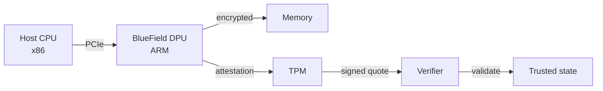
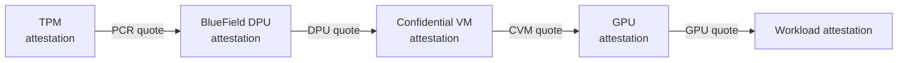

# 18.6 BlueField, DOCA and confidential computing

| Field | Value |
|---|---|
| Level | Advanced |
| Priority tier | 2 |
| Lab venue | GCP / GKE |
| Part | Part 18: Security |
| Primary sources | NVIDIA Zero-to-Hero Volume 18 (`chapter-08-bluefield-and-doca.md`, `chapter-09-confidential-computing.md`); NVIDIA Zero-to-Hero Volume 11 (`chapter-29-bluefield-and-doca.md`) |
| Cross-references | Chapter 18.1 (Threat modeling); Chapter 18.2 (Hardware and firmware trust); Chapter 18.4 (Kubernetes access control); Chapter 18.5 (GPU sharing security); Chapter 11 (GPU Kubernetes) |
| Coverage file | `planning/coverage/chapters/18-06.md` |
| Claim & number ledger | `planning/ledgers/18-06.md` |

## Why this matters for AI infrastructure

Chapters 18.2 and 18.5 covered firmware trust and GPU sharing, and this chapter builds on both. Picture a regulated model that scores loan applications or reads patient records. The data is valuable, and an attacker who reaches the host can try to read it from memory. Standard controls tell the platform team what to configure. They do not prove that a privileged user on the host cannot look inside.

This chapter covers the design that gives that proof. A BlueField DPU (Data Processing Unit) runs security work on its own processor, away from the host CPU. A confidential VM encrypts the workload's memory and registers. An attestation chain lets a remote verifier check that the stack started the way you approved.

Not every workload needs this design, and not every team can afford it. For high-stakes work, the gap still matters. A team with strong controls can say it has controls. A team with a DPU and confidential VMs can show evidence that the host cannot quietly bypass them.

```text
Why BlueField and confidential computing are on the critical path (background reading: NVIDIA Zero-to-Hero volume 18; NVIDIA Zero-to-Hero volume 11; the figures below are examples, not quotations):
- A typical mature AI platform's most sensitive workload is the model serving
  for a regulated industry. The workload handles PII; the workload handles
  regulated data; the workload is the target of advanced attacks. The
  workload needs hardware-rooted trust that the host cannot violate.
- BlueField-3 DPU offloads security functions (encryption, key management,
  attestation, network policy) from the host CPU to the DPU. The DPU has
  its own ARM cores, its own firmware, its own root of trust. The host CPU
  is no longer in the trust chain for these functions.
- Confidential VMs (NVIDIA GPU CC for confidential GPU computing, AMD SEV-SNP,
  Intel TDX) encrypt the workload's memory and registers. The hypervisor
  cannot read the workload's memory. The workload's secrets are protected
  even from the cloud operator.
```

Three realities turn this chapter into platform work, not only security work.

1. The DPU is a hardware trust anchor. It has its own ARM cores, firmware, and attestation, and it is the root of trust for the functions it takes over. Your job is to deploy it and use what it offloads.
2. The confidential VM is a workload trust anchor. It encrypts the workload's memory and registers, so the hypervisor cannot read them. Your job is to build the infrastructure and make it available to the teams that need it.
3. The attestation chain is the evidence. The TPM, the DPU, and the confidential VM each produce attestation quotes, and a verifier checks them against the hardware root. Your job is to link those quotes and expose the chain to the workloads that depend on it.

Secrets deserve care even before hardware enters the picture. Production Kubernetes, chapter 7, warns that a secret passed as an environment variable can sometimes be read in plain text, and that some debug modes write those variables into logs. Confidential computing guards against a different attacker, the host itself, so the two practices work together.

**Before a team calls its AI factory high-assurance, it needs BlueField DPUs and confidential VMs in place.** The DPU moves security work off the host, and the confidential VM keeps the workload's memory away from it. A team without them has controls. A team with them has controls that cannot be bypassed.

## Prerequisites and outcomes

This chapter builds on three earlier ones. Each covers a layer that the DPU and the confidential VM depend on, so read them first. If you skip one, the later steps will be harder to follow.

### Prerequisites

- Chapter 18.1 (Threat modeling) for the threat context.
- Chapter 18.2 (Hardware and firmware trust) for the firmware trust.
- Chapter 18.5 (GPU sharing security) for the GPU isolation.
- Familiarity with NVIDIA BlueField DPUs, DOCA, and confidential VMs.

### Outcomes

By the end of this chapter, you should be able to:

1. Deploy BlueField-3 DPUs as the security root of trust, and move security functions onto them with DOCA.
2. Configure DOCA services for encryption, key management, attestation, and network policy, and connect them to the host's services.
3. Deploy NVIDIA GPU CC so that GPU memory and registers stay protected.
4. Configure AMD SEV-SNP and Intel TDX for CPU-side confidential VMs.
5. Build the attestation chain from the TPM through the BlueField DPU to the confidential VM, and verify it.
6. Run the BlueField and confidential computing stack on GKE, with continuous verification, chained attestation, and incident response.

---

## 1. NVIDIA BlueField DPUs

### 1.1 What BlueField is

Picture a GPU node whose host CPU also handles networking, storage, and security checks. Each of those jobs takes CPU time away from your training code. The BlueField DPU is a data processing unit that moves this infrastructure work onto a processor of its own.

```text
BlueField components:
- ARM cores: 8-16 cores running the DOCA software stack
- Memory: 16-32 GB DDR memory (separate from host memory)
- Network: 100-400 Gbps Ethernet or InfiniBand
- Storage: NVMe SSD controller
- Security: hardware root of trust; secure boot; encrypted memory
```

Treat the figures in that block as example values, not a specification for any one card. Core count, memory, and port speed differ between BlueField models, so check them against the datasheet of the card you buy.

The BlueField is a small computer inside your server. It has its own resources and its own software stack, so it runs separately from the host.

### 1.2 The BlueField in the cluster

The card plugs into a PCIe slot in the GPU node. Traffic then passes through the DPU, which handles network, storage, and security work so the host CPU does not have to.

```text
BlueField deployment:
- PCIe card in the GPU node
- Connect to the network (100-400 Gbps)
- Offload network functions from the host CPU
- Offload storage functions from the host CPU
- Offload security functions from the host CPU
```

Move one function at a time. Start with the work that costs the host CPU the most, and test each change before you move the next one.

### 1.3 The BlueField as a security root of trust

The BlueField acts as a security root of trust. Its firmware is signed by NVIDIA, secure boot is enabled, and its measurements are recorded in the TPM.



The diagram shows one path. The host talks to the DPU over PCIe. The DPU produces an attestation quote, the TPM signs it, and the verifier checks the result before it trusts the state. Before you rely on this path, confirm that secure boot is on and that the verifier rejects a quote you have altered on purpose.

---

## 2. The DOCA framework

### 2.1 What DOCA is

Suppose you want the DPU to do packet work, but you do not want to write low-level code for each card. DOCA (Data Center Infrastructure-on-a-Chip Architecture) is the NVIDIA framework that gives you that route. You build applications on it, and they run on the BlueField.

```text
DOCA libraries:
- DOCA DMA: high-performance DMA between host and DPU
- DOCA Flow: hardware-accelerated packet processing
- DOCA SHA: hardware-accelerated crypto
- Rivermax: high-performance network streaming (check the current DOCA documentation for how it is packaged)
- DOCA RegEx: hardware-accelerated regex matching
```

The libraries cover network offload, storage offload, security offload, and host management. Each function runs on the DPU, which leaves the host CPU free for your workload.

### 2.2 The DOCA security services

Security work is the main reason to offload. Cryptography and packet inspection cost a lot of CPU time, so moving them to the DPU frees the host. The table lists the DOCA security services that do this.

| Service | What it does |
|---|---|
| DOCA SHA | Hardware-accelerated SHA hashing for TLS termination |
| DOCA AES | Hardware-accelerated AES encryption for storage and network |
| DOCA RegEx | Hardware-accelerated regex matching for DPI |
| DOCA TLS | Hardware-accelerated TLS termination |
| DOCA IPsec | Hardware-accelerated IPsec encryption |

### 2.3 The DOCA in production

You deploy DOCA services on the DPU, and the host manages them through the DOCA framework. Because they run on the card, every service should show up in an audit. Start by listing them.

```bash
# Illustrative command: the exact way to list DOCA services depends on your DOCA release
doca_service list
# expected: the DOCA services are listed; the services are running on the BlueField DPU
```

If a function you meant to offload still appears on the host, the offload has not happened yet. That is the first thing to check when the security work seems to stay on the CPU.

---

## 3. Confidential VMs

### 3.1 What confidential VMs are

Imagine a cloud host where the operator has root access. Normally that operator can read the memory of any VM on the machine. A confidential VM (CVM) closes that gap by encrypting its memory and registers with a key that only the VM holds.

```text
Confidential VM properties:
- Memory encryption: the CVM's memory is encrypted with a key only the CVM has
- Register encryption: the CVM's registers are encrypted
- Attestation: the CVM can prove its initial state via remote attestation
- Isolation: the CVM is isolated from the hypervisor and from other VMs
```

Attestation is the property you will use most in practice. It lets the VM prove its starting state to a party outside the machine. A CVM gives the strongest workload isolation in this chapter, which is why it is the base for high-assurance work.

### 3.2 AMD SEV-SNP

SEV-SNP (Secure Encrypted Virtualization - Secure Nested Paging) is AMD's confidential VM technology. It encrypts VM memory, provides attestation, and runs on AMD EPYC processors.

```bash
# Verify SEV-SNP is enabled
dmesg | grep -i sev
# expected: "SEV-SNP: enabled" appears in the log

# Launch a confidential VM
qemu-system-x86_64 -machine confidential-guest-support \
  -object sev-snp-guest,id=sev0,policy=0x1,cert-path=cert.pem
# expected: the VM boots with SEV-SNP enabled
```

Check the kernel log before you launch anything. If the log does not show SEV-SNP, look at the firmware settings first. A launch on a host without it will not give you a confidential VM.

### 3.3 Intel TDX

TDX (Trusted Domain Extensions) is Intel's confidential VM technology. It encrypts VM memory, provides attestation, and runs on Intel Xeon processors.

```bash
# Verify TDX is enabled
dmesg | grep -i tdx
# expected: "TDX: enabled" appears in the log

# Launch a confidential VM
# Illustrative: the exact flags for a TDX guest depend on your QEMU and host kernel
qemu-system-x86_64 -machine tdx-guest
# expected: the VM boots with TDX enabled
```

Enable TDX on the host CPU before anything else. Then launch the CVM with TDX, which encrypts its memory.

### 3.4 NVIDIA GPU CC

NVIDIA GPU CC (Confidential Computing) protects the data in GPU memory. The workload's data stays protected even from the operator of the GPU.

```bash
# Verify GPU CC is enabled
# Illustrative: check the current NVIDIA confidential computing documentation for the real query
nvidia-smi --query-gpu=cc_mode --format=csv
# expected: "ON" appears in the output

# Launch a workload with GPU CC
# my-workload.py and its --cc-mode flag are placeholders for your own workload
python my-workload.py --cc-mode=full
# expected: the workload runs with GPU CC enabled; the workload's GPU memory is encrypted
```

GPU CC completes the stack. Without it, the CVM protects the CPU side, but the data in GPU memory is not protected by the CVM.

---

## 4. The attestation chain

### 4.1 The attestation chain

Attestation answers one question: did this workload start on the hardware and software you approved? A single quote from one device cannot answer that for the whole stack. The chain answers it one layer at a time.



The order runs from the TPM, to the DPU, to the CVM, to the GPU, and finally to the workload. Each link produces a quote, and the next link verifies it before it passes trust along.

### 4.2 The remote verifier

The remote verifier is the service that decides whether the chain is valid. It runs off the cluster and holds the public keys for the TPM, the DPU, and the CVM. Keeping it separate means a compromised node cannot vouch for itself.

```python
# code/part18/snippets/attestation_verifier.py
import tpm2_pytss

def verify_attestation_chain(pcr_quote: bytes, dpu_quote: bytes, cvm_quote: bytes) -> bool:
    """Verify the attestation chain from TPM to DPU to CVM."""
    pcr_valid = tpm2_pytss.verify(pcr_quote)
    dpu_valid = tpm2_pytss.verify(dpu_quote)
    cvm_valid = tpm2_pytss.verify(cvm_quote)
    return pcr_valid and dpu_valid and cvm_valid
```

Treat this sketch as the shape of the check, not as a finished verifier. Confirm each library call against the library's own documentation before you rely on it.

### 4.3 The attestation chain in production

The chain is built at boot, checked when you need it, and rechecked on a schedule. Each step leaves a file you can keep as evidence.

```bash
# Establish the attestation chain at boot
python code/part18/establish_chain.py \
  --node gpu-node-1 \
  --output chain.json
# expected: the chain is established; the chain is stored in chain.json

# Verify the chain on demand
python code/part18/verify_chain.py \
  --chain chain.json
# expected: the chain is valid; the chain is recorded in the audit log
```

Keep the chain file with your audit log, so you can show what was verified and when.

---

## 5. Operating BlueField and confidential computing on GKE

### 5.1 The components

Five components must stay healthy at the same time. The table shows where each one runs, what backs it, and the service level you want from it.

| Component | Where it runs | Backing store | SLO |
|---|---|---|---|
| BlueField DPU | Every GPU node | DPU firmware | DPU firmware current |
| DOCA services | Every BlueField DPU | DPU memory | DOCA services running |
| Confidential VMs | Every GPU node | CVM memory | CVM attestation valid |
| Attestation chain | Every node | TPM + DPU + CVM | Attestation verified |
| GPU CC | Every H100 GPU | GPU memory | GPU CC enabled |

### 5.2 IAM and the high-assurance stack

Access to this stack needs as much care as the stack itself. Someone who can change the DPU configuration can also weaken the trust it provides. The table shows one way to split that access into three roles.

| Role | Who | What they can do |
|---|---|---|
| `highassurance.reader` | The security team | Read the attestation chain; read the CVM status |
| `highassurance.writer` | The platform team | Configure the DPU; configure the CVM |
| `highassurance.admin` | The CISO's office | Approve the high-assurance stack; approve the attestation policy |

The point of the split is that the people who change the stack are not the only people who approve it. Write down who can do what, enforce it, and review it on a schedule you choose. The source chapter uses a quarterly review as its example.

### 5.3 Observability

Each metric below tells you whether one layer of the stack is still trusted. Treat them as the signals to watch, not as a complete list.

| Metric | Why it matters | Alert |
|---|---|---|
| DPU firmware current | Firmware trust | > 90 days stale |
| DOCA services running | DPU trust | Any down |
| CVM attestation valid | CVM trust | < 100% |
| Attestation chain verified | High-assurance trust | < 100% |
| GPU CC enabled | GPU trust | < 100% |

The thresholds in the Alert column, such as 90 days and 100%, are example values. Choose your own limits based on how much risk your workload can accept.

The CVM attestation alert matters most. A CVM that fails attestation may be running on hardware you cannot trust, so the alert should page the on-call engineer right away.

Linux does not expose Prometheus metrics on its own. A node exporter reads the kernel data and serves it for scraping. Production Kubernetes, chapter 9, describes this pattern, and each metric in the table needs an exporter or collector that you run yourself.

---

## 6. How it fails

Suppose an alert fires in the middle of the night. Six failures come up again and again in this stack. Each one below gives the symptom you see, the cause behind it, and the fix.

### 6.1 "The BlueField is not provisioned"

**Symptom:** The card is in the server, but nobody has set it up. The DOCA services are not running, so nothing is offloaded.

**Diagnosis:** The BlueField was never initialised, the DOCA services were never configured, or the platform policy was not applied.

**Fix:** Initialise the BlueField, configure the DOCA services, and confirm they run.

### 6.2 "The DOCA services are not offloading"

**Symptom:** The DOCA services run on the BlueField, but the host CPU still does the security work.

**Diagnosis:** The services are misconfigured, so the offload never happens, and the host stays in the trust chain.

**Fix:** Correct the configuration, confirm the offload works, and alert when a security function runs on the host.

### 6.3 "The confidential VM is not enabled"

**Symptom:** The workload runs in a normal VM. Its memory is not encrypted, so the hypervisor can read its data.

**Diagnosis:** The CVM was never enabled, or the platform policy was not enforced.

**Fix:** Enable the CVM, move the workload into it, and check that its memory is encrypted.

### 6.4 "The attestation chain is broken"

**Symptom:** The attestation chain fails to verify, so the workload may be on hardware you do not trust.

**Diagnosis:** A link is missing. The TPM may not be provisioned, the DPU may not be configured, or the CVM may not be enabled.

**Fix:** Check each link in order, rebuild the chain, and verify it again.

### 6.5 "The GPU CC is disabled"

**Symptom:** The workload runs on a GPU with GPU CC off, so its GPU memory is not encrypted.

**Diagnosis:** GPU CC was never turned on, and the workload started without it.

**Fix:** Enable GPU CC, restart the workload, and confirm that its GPU memory is encrypted.

### 6.6 "The workload does not use the high-assurance stack"

**Symptom:** A regulated workload runs without the high-assurance stack, so it is exposed to compromise.

**Diagnosis:** Nobody wrote down the workload's security requirements, so the platform policy never reached it.

**Fix:** Document the security requirements, deploy the stack for that workload, and confirm the workload uses it.

---

## 7. Hands-on lab

Work through this lab in order. It checks each layer of the high-assurance stack on GKE: the BlueField DPU, the DOCA services, the confidential VM, the attestation chain, and GPU CC. The lab is **untested** in this repository, so treat its commands as a plan to run, not a record of a working run.

### 7.1 Prerequisites

- A GPU node with a BlueField-3 DPU.
- A host CPU that supports confidential VMs (AMD SEV-SNP or Intel TDX).
- A GPU that supports GPU CC (H100 or later).

### 7.2 Step 1: verify the BlueField DPU

Start with the hardware. If the card does not show up in the PCI list, none of the later steps can work.

```bash
lspci | grep -i mellanox
# expected: the BlueField DPU is listed
```

### 7.3 Step 2: verify the DOCA services

Next, check the DOCA services on the DPU. This is the same listing you saw in section 2.3.

```bash
doca_service list
# expected: the DOCA services are listed
```

### 7.4 Step 3: verify SEV-SNP or TDX

Then confirm that the CPU side is ready. The kernel log should mention SEV-SNP or TDX.

```bash
dmesg | grep -i "sev\|tdx"
# expected: "SEV-SNP: enabled" or "TDX: enabled" appears in the log
```

### 7.5 Step 4: verify GPU CC

Check GPU CC after the CPU side. The GPU is the last layer the workload uses.

```bash
# Illustrative: check the current NVIDIA confidential computing documentation for the real query
nvidia-smi --query-gpu=cc_mode --format=csv
# expected: "ON" appears in the output
```

### 7.6 Step 5: launch a confidential VM

Launch a test CVM from a disk image you control. Treat this boot as a check, not as a production workload.

```bash
qemu-system-x86_64 -machine confidential-guest-support \
  -object sev-snp-guest,id=sev0,policy=0x1,cert-path=cert.pem \
  -drive file=ubuntu.qcow2,if=virtio
# expected: the VM boots with SEV-SNP enabled
```

### 7.7 Step 6: verify the attestation chain

Finish by verifying the chain for the node you just tested.

```bash
python code/part18/verify_chain.py \
  --node gpu-node-1
# expected: the chain is valid; the chain is recorded in the audit log
```

### 7.8 What to record

Once the lab is done, you should be able to answer five questions quickly:

1. What is the current DPU firmware currency?
2. What is the current DOCA services status?
3. What is the current CVM attestation validity rate?
4. What is the current GPU CC enabled rate?
5. What is the current attestation chain validity rate?

The lab uses five seconds per answer as its example target. It treats any answer slower than 30 seconds as a sign the stack is not yet a production service. Both numbers are examples, so set your own limits. The lab is **untested** against a live GKE cluster.

---

## Exercises

1. **Add a BlueField provisioning alert.** Write an alert that fires when a BlueField is present but not provisioned. *Solution sketch:* a Prometheus exporter that reports the BlueField state, and an alert that fires on the "not provisioned" state.
2. **Add a DOCA services alert.** Write an alert that fires when any DOCA service is down. *Solution sketch:* an exporter for the DOCA services, and an alert that fires when the running count falls below the expected count.
3. **Add a CVM attestation alert.** Write an alert that fires when CVM attestation fails. *Solution sketch:* an exporter for CVM attestation, and an alert on any invalid result.
4. **Add a GPU CC alert.** Write an alert that fires when GPU CC is disabled. *Solution sketch:* an exporter for the GPU CC state, and an alert on the "OFF" state.
5. **Add an attestation chain alert.** Write an alert that fires when the chain is invalid. *Solution sketch:* an exporter for the chain, and an alert that fires when any link is invalid.
6. **Add a high-assurance dashboard.** Build a Grafana dashboard that shows DPU firmware, DOCA services, CVM attestation, GPU CC, and the attestation chain. *Solution sketch:* one dashboard with a panel for each check, each reading from its exporter.

Start with exercise 3, because a failing CVM attestation is the alert you need most. If you build only one alert from this list, make it that one.

---

## Checkpoint questions

<details><summary>1. What is the NVIDIA BlueField DPU?</summary>
It is a data processing unit that takes infrastructure work off the host CPU. It has its own ARM cores, firmware, and root of trust. For the security functions it takes over, the BlueField is the root of trust.
</details>

<details><summary>2. What is DOCA?</summary>
DOCA is the NVIDIA framework for building applications that run on the BlueField DPU. Its libraries cover network, storage, and security offload, plus host management. The security functions run on the DPU, and the hardware accelerates them.
</details>

<details><summary>3. What is a confidential VM?</summary>
A confidential VM is a virtual machine whose memory and registers are encrypted. Neither the hypervisor nor the cloud operator can read its memory. It gives the strongest workload isolation, so it is the base for high-assurance deployments.
</details>

<details><summary>4. What is the attestation chain?</summary>
The attestation chain is a series of attestations that prove a workload runs on trusted hardware. The order is TPM, DPU, CVM, GPU, then the workload. Each link produces a quote, and the next link verifies it.
</details>

<details><summary>5. What is GPU CC?</summary>
GPU CC is NVIDIA's confidential computing feature for GPUs. It encrypts GPU memory, so the workload's data stays protected even from the GPU's operator.
</details>

<details><summary>6. What is the most common high-assurance failure?</summary>
The most common failure is a BlueField that sits in the server but is not provisioned. Its DOCA services are not running, so nothing is offloaded. If you find this, fix it by initialising the BlueField, configuring the DOCA services, and verifying they run.
</details>

<details><summary>7. What is the second most common high-assurance failure?</summary>
The second most common failure is services that run but do not offload. The DOCA services run on the BlueField while the host CPU still does the security work. Fix it by reconfiguring the services and confirming that the offload is happening.
</details>

<details><summary>8. What is the most dangerous high-assurance failure?</summary>
The most dangerous failure is a confidential VM that was never enabled. The workload runs in a regular VM, so its memory is not encrypted and the hypervisor can read its data. You fix it by enabling the CVM, moving the workload into it, and checking that its memory is encrypted.
</details>

<details><summary>9. What is the relationship between BlueField and confidential VMs?</summary>
The BlueField takes security functions off the host CPU, and the confidential VM protects the workload's memory from the host. Together they form the high-assurance chain, where the BlueField is the security root and the CVM is the workload's trust anchor.
</details>

<details><summary>10. What is the relationship between DOCA and the BlueField?</summary>
DOCA is the framework for building applications on the BlueField. Its services run on the card and offload work from the host CPU. The security functions among them run on the BlueField as well.
</details>

<details><summary>11. What is the relationship between AMD SEV-SNP and Intel TDX?</summary>
Both are confidential VM technologies, one from AMD and one from Intel. Both encrypt the VM's memory and provide attestation. Your host CPU decides which one you use: AMD EPYC runs SEV-SNP, and Intel Xeon runs TDX.
</details>

<details><summary>12. What is the relationship between GPU CC and the confidential VM?</summary>
GPU CC protects GPU memory, while the confidential VM protects the workload's CPU memory. Together they cover both halves of the workload's state, which is what the high-assurance chain needs.
</details>

<details><summary>13. What is the difference between SEV-SNP and TDX?</summary>
SEV-SNP is AMD's confidential VM technology. TDX is Intel's. Both encrypt VM memory and both provide attestation. The processor decides the choice: SEV-SNP runs on AMD EPYC, and TDX runs on Intel Xeon.
</details>

<details><summary>14. What is the most important high-assurance metric?</summary>
The CVM attestation validity rate is the most important metric. It shows which CVMs run on trusted hardware. A CVM that fails attestation may be on untrusted hardware, so you want its alert to page the on-call engineer at once.
</details>

<details><summary>15. What is the attestation chain in production?</summary>
The chain is built at boot, checked on demand, and rechecked on a schedule. It links the TPM, DPU, CVM, GPU, and workload in that order. Each link produces a quote, and the next link verifies it.
</details>

<details><summary>16. What is the relationship between the attestation chain and the workload?</summary>
The attestation chain proves that the workload runs on trusted hardware. The workload reads the chain, verifies it, and continues only if the chain is valid. If you design the workload this way, the chain becomes the foundation of its trust.
</details>

<details><summary>17. What is the relationship between BlueField and the host CPU?</summary>
The BlueField takes security functions off the host CPU, which frees the CPU for the workload. It has its own ARM cores, so the host CPU does not touch its security functions. In short, the BlueField is the security root, and the host CPU does the workload's compute.
</details>

<details><summary>18. What is the relationship between high-assurance and threat modeling?</summary>
The threat model names threats such as T-005 (container image supply chain attack) and T-006 (GPU memory scraping). The high-assurance stack is the set of controls that address the most advanced of them. The threat model decides which workloads need that stack, because only the highest-risk ones do.
</details>

<details><summary>19. Why is BlueField and confidential computing a Tier 2 chapter?</summary>
It is the frontier of security controls, which is why it sits in Tier 2. It serves workloads that need the most secure deployment, and it is what regulators and auditors inspect.
</details>

<details><summary>20. What five questions should the high-assurance lab let you answer in five seconds each?</summary>
The five questions are: DPU firmware currency, DOCA services status, CVM attestation validity rate, GPU CC enabled rate, and attestation chain validity rate. The five-second target and the 30-second limit are example values from the lab. As an example, if you need more than 30 seconds for any answer, the stack is not yet a production service.
</details>

---

## Sources and review notes

- NVIDIA Zero-to-Hero Volume 18 (`chapter-08-bluefield-and-doca.md`, `chapter-09-confidential-computing.md`). Source for the BlueField, DOCA, and confidential VM patterns. The wording has been rewritten in the handbook's voice.
- NVIDIA Zero-to-Hero Volume 11 (`chapter-29-bluefield-and-doca.md`). Source for the BlueField deployment and the DOCA configuration.

### Cross-references to other handbook chapters

- Chapter 18.1 for the threat-model context.
- Chapter 18.2 for the firmware trust.
- Chapter 18.5 for the GPU sharing security.
- Chapter 11 for the GPU Kubernetes.

### Migrated from `nvidia-devops`

The high-assurance stack operational patterns draw on Volume 18 chapters 8-9 and Volume 11 chapter 29. The wording has been rewritten in the handbook's voice.

### Explicitly labelled inferences

- The DPU offload is a starting point; specific offloads depend on the workload's needs.
- The CVM technology (SEV-SNP vs TDX) is a starting point; specific choices depend on the host CPU.
- The GPU CC version is a starting point; specific versions depend on the GPU model.

### Not verified on live hardware

- The lab in Section 7 is **untested** against a live GKE cluster in this repository.
- The BlueField deployment assumes a node with a BlueField DPU installed.
- The confidential VM launch assumes a host CPU that supports confidential VMs.
