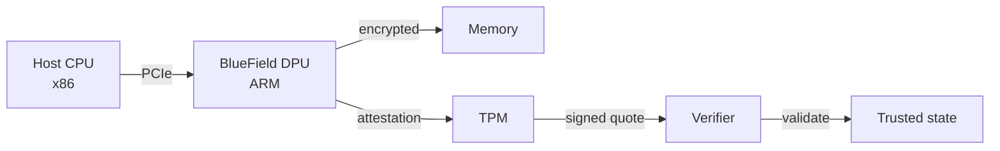
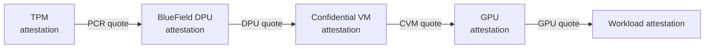

# 18.6 BlueField, DOCA and confidential computing

| Field | Value |
|---|---|
| Level | Advanced |
| Priority tier | 2 |
| Lab venue | GCP / GKE |
| Part | Part 18: Security |
| Primary sources | NVIDIA Zero-to-Hero Volume 18 (`chapter-08-bluefield-and-doca.md`, `chapter-09-confidential-computing.md`); NVIDIA Zero-to-Hero Volume 11 (`chapter-29-bluefield-and-doca.md`) |
| Cross-references | Chapter 18.1 (Threat modeling); Chapter 18.2 (Hardware and firmware trust); Chapter 18.4 (Kubernetes access control); Chapter 18.5 (GPU sharing security); Chapter 11 (GPU Kubernetes) |
| Coverage file | `planning/coverage/chapters/18-06.md` |
| Claim & number ledger | `planning/ledgers/18-06.md` |

## Why this matters for AI infrastructure

Chapters 18.2 and 18.5 verified the firmware and the GPU sharing. This chapter verifies the most secure platform the team can deploy: the DPU (Data Processing Unit) architecture with confidential computing. A BlueField DPU offloads security functions from the host CPU to a dedicated processor; a confidential VM encrypts the workload's memory and registers; an attestation chain proves the workload runs on trusted hardware. Together, these are what make a high-assurance AI factory.

The DPU and confidential computing are the frontier. Not every workload needs them; not every customer can afford them; not every threat model requires them. But for high-stakes deployments (financial services, healthcare, government, defence, regulated industries with sensitive PII or IP), the DPU and confidential computing are the difference between "we have controls" and "we have evidence that the controls cannot be bypassed".

```text
Why BlueField and confidential computing are on the critical path (V18 ch8, 9; V11 ch29):
- A typical mature AI platform's most sensitive workload is the model serving
  for a regulated industry. The workload handles PII; the workload handles
  regulated data; the workload is the target of advanced attacks. The
  workload needs hardware-rooted trust that the host cannot violate.
- BlueField-3 DPU offloads security functions (encryption, key management,
  attestation, network policy) from the host CPU to the DPU. The DPU has
  its own ARM cores, its own firmware, its own root of trust. The host CPU
  is no longer in the trust chain for these functions.
- Confidential VMs (NVIDIA GPU CC for confidential GPU computing, AMD SEV-SNP,
  Intel TDX) encrypt the workload's memory and registers. The hypervisor
  cannot read the workload's memory. The workload's secrets are protected
  even from the cloud operator.
```

Three operational realities make this chapter a platform-team concern rather than a data-science-only concern:

1. **The DPU is a hardware-level trust anchor.** The DPU has its own ARM cores, its own firmware, its own attestation. The DPU is the root of trust for the security functions it offloads. The platform team's job is to deploy the DPU and to use the DPU's offloaded functions.
2. **The confidential VM is a workload-level trust anchor.** The confidential VM encrypts the workload's memory and registers. The hypervisor cannot read the workload's memory. The platform team's job is to deploy the confidential VM infrastructure and to make it available to the consuming teams.
3. **The attestation chain is the proof of trust.** The TPM, the DPU, and the confidential VM all generate attestation quotes. The verifier validates the quotes; the verifier trusts the hardware root. The platform team's job is to chain the attestations and to expose the chain to the consuming workloads.

**Before a team can claim their AI factory is high-assurance, the team must have deployed BlueField DPUs and confidential VMs. The DPU moves the security functions off the host; the confidential VM protects the workload's memory from the host. Together, they form the high-assurance foundation. A team without the DPU and the CVM has controls; a team with the DPU and the CVM has controls that cannot be bypassed.**

## Prerequisites and outcomes

### Prerequisites

- Chapter 18.1 (Threat modeling) for the threat context.
- Chapter 18.2 (Hardware and firmware trust) for the firmware trust.
- Chapter 18.5 (GPU sharing security) for the GPU isolation.
- Familiarity with NVIDIA BlueField DPUs, DOCA, and confidential VMs.

### Outcomes

After completing this chapter you will be able to:

1. Deploy BlueField-3 DPUs as the security root of trust; offload security functions via DOCA.
2. Configure DOCA services (encryption, key management, attestation, network policy); chain them with the host's services.
3. Deploy NVIDIA GPU CC for confidential GPU computing; protect the workload's memory and registers.
4. Configure AMD SEV-SNP and Intel TDX for CPU-side confidential VMs.
5. Build the attestation chain: TPM -> BlueField DPU -> confidential VM; verify the chain.
6. Operate the BlueField and confidential computing stack on GKE with continuous verification, attestation chaining, and incident response.

---

## 1. NVIDIA BlueField DPUs

### 1.1 What BlueField is

The NVIDIA BlueField DPU is a data processing unit that offloads infrastructure functions from the host CPU. The BlueField has its own ARM cores; the BlueField has its own firmware; the BlueField has its own root of trust.

```text
BlueField components:
- ARM cores: 8-16 cores running the DOCA software stack
- Memory: 16-32 GB DDR memory (separate from host memory)
- Network: 100-400 Gbps Ethernet or InfiniBand
- Storage: NVMe SSD controller
- Security: hardware root of trust; secure boot; encrypted memory
```

The pattern is: the BlueField is a computer within the computer; the BlueField has its own resources; the BlueField runs its own software stack.

### 1.2 The BlueField in the cluster

The BlueField is deployed as a PCIe card in the GPU node. The BlueField connects to the network; the BlueField offloads the network functions from the host CPU; the BlueField exposes the storage to the host.

```text
BlueField deployment:
- PCIe card in the GPU node
- Connect to the network (100-400 Gbps)
- Offload network functions from the host CPU
- Offload storage functions from the host CPU
- Offload security functions from the host CPU
```

The pattern is: the BlueField is a PCIe card; the BlueField connects to the network; the BlueField offloads functions from the host.

### 1.3 The BlueField as a security root of trust

The BlueField is the security root of trust. The BlueField's firmware is signed by NVIDIA; the BlueField's secure boot is enabled; the BlueField's measurements are recorded in the TPM.



The pattern is: the host CPU communicates with the BlueField over PCIe; the BlueField manages the memory; the BlueField generates an attestation quote; the TPM signs the quote; the verifier validates the quote.

---

## 2. The DOCA framework

### 2.1 What DOCA is

DOCA (Data Center-on-a-Chip Architecture) is the NVIDIA framework for building applications that run on the BlueField DPU. DOCA provides libraries for network offload, storage offload, security offload, and host management.

```text
DOCA libraries:
- DOCA DMA: high-performance DMA between host and DPU
- DOCA Flow: hardware-accelerated packet processing
- DOCA SHA: hardware-accelerated crypto
- DOCA Rivermax: high-performance packet capture
- DOCA RegEx: hardware-accelerated regex matching
```

The pattern is: the DOCA libraries provide hardware-accelerated functions; the functions run on the DPU; the host CPU is freed for the workload.

### 2.2 The DOCA security services

The DOCA security services are the security functions offloaded from the host CPU to the DPU.

| Service | What it does |
|---|---|
| DOCA SHA | Hardware-accelerated SHA hashing for TLS termination |
| DOCA AES | Hardware-accelerated AES encryption for storage and network |
| DOCA RegEx | Hardware-accelerated regex matching for DPI |
| DOCA TLS | Hardware-accelerated TLS termination |
| DOCA IPsec | Hardware-accelerated IPsec encryption |

The pattern is: the security functions run on the DPU; the security functions are hardware-accelerated; the security functions are offloaded from the host CPU.

### 2.3 The DOCA in production

The DOCA services are deployed on the BlueField DPU. The DOCA services are managed by the host CPU via the DOCA framework. The DOCA services are auditable.

```bash
# Verify the DOCA services are running on the DPU
doca_service list
# expected: the DOCA services are listed; the services are running on the BlueField DPU
```

The pattern is: the DOCA services are deployed; the DOCA services are verified; the DOCA services are monitored.

---

## 3. Confidential VMs

### 3.1 What confidential VMs are

Confidential VMs (CVMs) are virtual machines whose memory and registers are encrypted. The hypervisor cannot read the CVM's memory; the cloud operator cannot read the CVM's memory.

```text
Confidential VM properties:
- Memory encryption: the CVM's memory is encrypted with a key only the CVM has
- Register encryption: the CVM's registers are encrypted
- Attestation: the CVM can prove its initial state via remote attestation
- Isolation: the CVM is isolated from the hypervisor and from other VMs
```

The pattern is: the CVM is the most secure workload isolation; the CVM is the foundation of high-assurance deployments.

### 3.2 AMD SEV-SNP

AMD SEV-SNP (Secure Encrypted Virtualization - Secure Nested Paging) is the AMD confidential VM technology. SEV-SNP encrypts the VM's memory; SEV-SNP provides attestation; SEV-SNP is supported on AMD EPYC processors.

```bash
# Verify SEV-SNP is enabled
dmesg | grep -i sev
# expected: "SEV-SNP: enabled" appears in the log

# Launch a confidential VM
qemu-system-x86_64 -machine confidential-guest-support \
  -object sev-snp-guest,id=sev0,policy=0x1,cert-path=cert.pem
# expected: the VM boots with SEV-SNP enabled
```

The pattern is: SEV-SNP is enabled on the host CPU; the CVM is launched with SEV-SNP; the CVM's memory is encrypted.

### 3.3 Intel TDX

Intel TDX (Trusted Domain Extensions) is the Intel confidential VM technology. TDX encrypts the VM's memory; TDX provides attestation; TDX is supported on Intel Xeon processors.

```bash
# Verify TDX is enabled
dmesg | grep -i tdx
# expected: "TDX: enabled" appears in the log

# Launch a confidential VM
qemu-system-x86_64 -machine tdx-guest
# expected: the VM boots with TDX enabled
```

The pattern is: TDX is enabled on the host CPU; the CVM is launched with TDX; the CVM's memory is encrypted.

### 3.4 NVIDIA GPU CC

NVIDIA GPU CC (Confidential Computing) is the NVIDIA confidential GPU computing technology. GPU CC encrypts the GPU's memory; GPU CC protects the workload's data from the GPU's operator.

```bash
# Verify GPU CC is enabled
nvidia-smi --query-gpu=cc_mode --format=csv
# expected: "ON" appears in the output

# Launch a workload with GPU CC
python my-workload.py --cc-mode=full
# expected: the workload runs with GPU CC enabled; the workload's GPU memory is encrypted
```

The pattern is: GPU CC is enabled on the GPU; the workload runs with GPU CC; the workload's GPU memory is encrypted.

---

## 4. The attestation chain

### 4.1 The attestation chain

The attestation chain is the sequence of attestations that prove the workload runs on trusted hardware.



The chain is: TPM -> DPU -> CVM -> GPU -> Workload. Each link generates a quote; each link is verified by the next link.

### 4.2 The remote verifier

The remote verifier is the service that validates the attestation chain. The verifier is a separate service; the verifier is not on the cluster; the verifier has the public keys for the TPM, the DPU, and the CVM.

```python
# code/part18/attestation_verifier.py (shape only)
import tpm2_pytss

def verify_attestation_chain(pcr_quote: bytes, dpu_quote: bytes, cvm_quote: bytes) -> bool:
    """Verify the attestation chain from TPM to DPU to CVM."""
    pcr_valid = tpm2_pytss.verify(pcr_quote)
    dpu_valid = tpm2_pytss.verify(dpu_quote)
    cvm_valid = tpm2_pytss.verify(cvm_quote)
    return pcr_valid and dpu_valid and cvm_valid
```

The pattern is: the verifier validates each link in the chain; the verifier returns a boolean; the workload continues only if the chain is valid.

### 4.3 The attestation chain in production

The attestation chain is established at boot. The chain is verified on demand. The chain is re-verified periodically.

```bash
# Establish the attestation chain at boot
python code/part18/establish_chain.py \
  --node gpu-node-1 \
  --output chain.json
# expected: the chain is established; the chain is stored in chain.json

# Verify the chain on demand
python code/part18/verify_chain.py \
  --chain chain.json
# expected: the chain is valid; the chain is recorded in the audit log
```

The pattern is: the chain is established at boot; the chain is verified on demand; the chain is re-verified periodically.

---

## 5. Operating BlueField and confidential computing on GKE

### 5.1 The components

| Component | Where it runs | Backing store | SLO |
|---|---|---|---|
| BlueField DPU | Every GPU node | DPU firmware | DPU firmware current |
| DOCA services | Every BlueField DPU | DPU memory | DOCA services running |
| Confidential VMs | Every GPU node | CVM memory | CVM attestation valid |
| Attestation chain | Every node | TPM + DPU + CVM | Attestation verified |
| GPU CC | Every H100 GPU | GPU memory | GPU CC enabled |

### 5.2 IAM and the high-assurance stack

The high-assurance stack has its own IAM. The pattern is:

| Role | Who | What they can do |
|---|---|---|
| `highassurance.reader` | The security team | Read the attestation chain; read the CVM status |
| `highassurance.writer` | The platform team | Configure the DPU; configure the CVM |
| `highassurance.admin` | The CISO's office | Approve the high-assurance stack; approve the attestation policy |

The high-assurance stack is the security team's discipline. The discipline is documented; the discipline is enforced; the discipline is reviewed quarterly.

### 5.3 Observability

| Metric | Why it matters | Alert |
|---|---|---|
| DPU firmware current | Firmware trust | > 90 days stale |
| DOCA services running | DPU trust | Any down |
| CVM attestation valid | CVM trust | < 100% |
| Attestation chain verified | High-assurance trust | < 100% |
| GPU CC enabled | GPU trust | < 100% |

The CVM attestation valid alert is the most important. A CVM that fails attestation is a workload that may be running on untrusted hardware; the alert pages the on-call immediately.

---

## 6. How it fails

Six failure modes recur.

### 6.1 "The BlueField is not provisioned"

**Symptom:** The BlueField is present but not provisioned. The DOCA services are not running. The security functions are not offloaded.

**Diagnosis:** The BlueField was not initialised; the DOCA services are not configured; the platform team's policy is not enforced.

**Fix:** Initialise the BlueField; configure the DOCA services; verify the DOCA services are running.

### 6.2 "The DOCA services are not offloading"

**Symptom:** The DOCA services are running on the BlueField; the security functions are still running on the host CPU; the offload is not working.

**Diagnosis:** The DOCA services are misconfigured; the offload is not happening; the host CPU is still in the trust chain.

**Fix:** Reconfigure the DOCA services; verify the offload is happening; alert on any security function still running on the host.

### 6.3 "The confidential VM is not enabled"

**Symptom:** The workload is running in a regular VM; the workload's memory is not encrypted; the hypervisor can read the workload's data.

**Diagnosis:** The CVM is not enabled; the workload is running in a regular VM; the platform team's policy is not enforced.

**Fix:** Enable the CVM; launch the workload in the CVM; verify the workload's memory is encrypted.

### 6.4 "The attestation chain is broken"

**Symptom:** The attestation chain fails to verify; the workload is running on untrusted hardware.

**Diagnosis:** The TPM is not provisioned; the DPU is not configured; the CVM is not enabled; the chain is incomplete.

**Fix:** Verify each link in the chain; rebuild the chain; re-verify the chain.

### 6.5 "The GPU CC is disabled"

**Symptom:** The workload is running on the GPU; the GPU CC is disabled; the GPU's memory is not encrypted.

**Diagnosis:** The GPU CC is not enabled; the workload is running without GPU CC; the platform team's policy is not enforced.

**Fix:** Enable the GPU CC; restart the workload with GPU CC; verify the GPU's memory is encrypted.

### 6.6 "The workload does not use the high-assurance stack"

**Symptom:** A regulated workload is running without the high-assurance stack; the workload is at risk of compromise.

**Diagnosis:** The workload's security requirements are not documented; the platform team's policy is not enforced.

**Fix:** Document the workload's security requirements; deploy the high-assurance stack for the workload; verify the workload uses the high-assurance stack.

---

## 7. Hands-on lab

This lab walks through verifying the high-assurance stack on GKE: the BlueField DPU, the DOCA services, the confidential VM, the attestation chain, and the GPU CC. The lab is **untested** in this repository.

### 7.1 Prerequisites

- A GPU node with a BlueField-3 DPU.
- A host CPU that supports confidential VMs (AMD SEV-SNP or Intel TDX).
- A GPU that supports GPU CC (H100 or later).

### 7.2 Step 1: verify the BlueField DPU

```bash
lspci | grep -i mellanox
# expected: the BlueField DPU is listed
```

### 7.3 Step 2: verify the DOCA services

```bash
doca_service list
# expected: the DOCA services are listed
```

### 7.4 Step 3: verify SEV-SNP or TDX

```bash
dmesg | grep -i "sev\|tdx"
# expected: "SEV-SNP: enabled" or "TDX: enabled" appears in the log
```

### 7.5 Step 4: verify GPU CC

```bash
nvidia-smi --query-gpu=cc_mode --format=csv
# expected: "ON" appears in the output
```

### 7.6 Step 5: launch a confidential VM

```bash
qemu-system-x86_64 -machine confidential-guest-support \
  -object sev-snp-guest,id=sev0,policy=0x1,cert-path=cert.pem \
  -drive file=ubuntu.qcow2,if=virtio
# expected: the VM boots with SEV-SNP enabled
```

### 7.7 Step 6: verify the attestation chain

```bash
python code/part18/verify_chain.py \
  --node gpu-node-1
# expected: the chain is valid; the chain is recorded in the audit log
```

### 7.8 What to record

After the lab, you should be able to answer five questions in five seconds each:

1. What is the current DPU firmware currency?
2. What is the current DOCA services status?
3. What is the current CVM attestation validity rate?
4. What is the current GPU CC enabled rate?
5. What is the current attestation chain validity rate?

If any takes more than 30 seconds, the high-assurance stack is not yet a production service. The lab is **untested** against a live GKE cluster.

---

## Exercises

1. **Add a BlueField provisioning alert.** Configure an alert that fires when the BlueField is present but not provisioned. *Solution sketch:* a Prometheus exporter for the BlueField state; an alert that fires when the state is "not provisioned".
2. **Add a DOCA services alert.** Configure an alert that fires when any DOCA service is down. *Solution sketch:* a Prometheus exporter for the DOCA services; an alert that fires when the service count is below the expected.
3. **Add a CVM attestation alert.** Configure an alert that fires when the CVM attestation fails. *Solution sketch:* a Prometheus exporter for the CVM attestation; an alert that fires when the attestation is invalid.
4. **Add a GPU CC alert.** Configure an alert that fires when the GPU CC is disabled. *Solution sketch:* a Prometheus exporter for the GPU CC state; an alert that fires when the state is "OFF".
5. **Add an attestation chain alert.** Configure an alert that fires when the attestation chain is invalid. *Solution sketch:* a Prometheus exporter for the chain; an alert that fires when any link in the chain is invalid.
6. **Add a high-assurance dashboard.** Build a Grafana dashboard that shows the DPU firmware, the DOCA services, the CVM attestation, the GPU CC, and the attestation chain. *Solution sketch:* a Grafana dashboard; the panels; the data sources.

---

## Checkpoint questions

<details><summary>1. What is the NVIDIA BlueField DPU?</summary>
A data processing unit that offloads infrastructure functions from the host CPU. The BlueField has its own ARM cores; the BlueField has its own firmware; the BlueField has its own root of trust. The BlueField is the security root of trust for the security functions it offloads.
</details>

<details><summary>2. What is DOCA?</summary>
The NVIDIA framework for building applications that run on the BlueField DPU. DOCA provides libraries for network offload, storage offload, security offload, and host management. The security functions run on the DPU; the security functions are hardware-accelerated.
</details>

<details><summary>3. What is a confidential VM?</summary>
A virtual machine whose memory and registers are encrypted. The hypervisor cannot read the CVM's memory; the cloud operator cannot read the CVM's memory. The CVM is the most secure workload isolation; the CVM is the foundation of high-assurance deployments.
</details>

<details><summary>4. What is the attestation chain?</summary>
The sequence of attestations that prove the workload runs on trusted hardware. The chain is: TPM -> DPU -> CVM -> GPU -> Workload. Each link generates a quote; each link is verified by the next link.
</details>

<details><summary>5. What is GPU CC?</summary>
NVIDIA Confidential Computing: the NVIDIA confidential GPU computing technology. GPU CC encrypts the GPU's memory; GPU CC protects the workload's data from the GPU's operator.
</details>

<details><summary>6. What is the most common high-assurance failure?</summary>
The BlueField is not provisioned. The BlueField is present but not provisioned. The DOCA services are not running. The fix is to initialise the BlueField; configure the DOCA services; verify the DOCA services are running.
</details>

<details><summary>7. What is the second most common high-assurance failure?</summary>
The DOCA services are not offloading. The DOCA services are running on the BlueField; the security functions are still running on the host CPU; the offload is not working. The fix is to reconfigure the DOCA services; verify the offload is happening.
</details>

<details><summary>8. What is the most dangerous high-assurance failure?</summary>
The confidential VM is not enabled. The workload is running in a regular VM; the workload's memory is not encrypted; the hypervisor can read the workload's data. The fix is to enable the CVM; launch the workload in the CVM; verify the workload's memory is encrypted.
</details>

<details><summary>9. What is the relationship between BlueField and confidential VMs?</summary>
The BlueField offloads security functions from the host CPU; the confidential VM protects the workload's memory from the host. Together, they form the high-assurance chain: the BlueField is the security root; the CVM is the workload's trust anchor.
</details>

<details><summary>10. What is the relationship between DOCA and the BlueField?</summary>
DOCA is the framework for building applications on the BlueField. The DOCA services run on the BlueField; the DOCA services offload functions from the host CPU. The DOCA services are the security functions that run on the BlueField.
</details>

<details><summary>11. What is the relationship between AMD SEV-SNP and Intel TDX?</summary>
Both are confidential VM technologies. SEV-SNP is the AMD technology; TDX is the Intel technology. Both encrypt the VM's memory; both provide attestation. The choice depends on the host CPU; AMD EPYC supports SEV-SNP; Intel Xeon supports TDX.
</details>

<details><summary>12. What is the relationship between GPU CC and the confidential VM?</summary>
GPU CC protects the GPU's memory; the confidential VM protects the workload's CPU memory. Together, they form the high-assurance workload chain: the CVM protects the workload's CPU state; the GPU CC protects the workload's GPU state.
</details>

<details><summary>13. What is the difference between SEV-SNP and TDX?</summary>
SEV-SNP is the AMD confidential VM technology. TDX is the Intel confidential VM technology. Both encrypt the VM's memory; both provide attestation. SEV-SNP is supported on AMD EPYC processors; TDX is supported on Intel Xeon processors.
</details>

<details><summary>14. What is the most important high-assurance metric?</summary>
CVM attestation validity rate. The metric tells the team which CVMs are running on trusted hardware. A CVM that fails attestation may be running on untrusted hardware; the alert pages the on-call immediately.
</details>

<details><summary>15. What is the attestation chain in production?</summary>
The chain is established at boot; the chain is verified on demand; the chain is re-verified periodically. The chain links TPM -> DPU -> CVM -> GPU -> Workload. Each link generates a quote; each link is verified by the next link.
</details>

<details><summary>16. What is the relationship between the attestation chain and the workload?</summary>
The attestation chain proves that the workload runs on trusted hardware. The workload reads the attestation chain; the workload verifies the chain; the workload continues only if the chain is valid. The attestation chain is the foundation of the workload's trust.
</details>

<details><summary>17. What is the relationship between BlueField and the host CPU?</summary>
The BlueField offloads security functions from the host CPU; the host CPU is freed for the workload. The BlueField has its own ARM cores; the host CPU does not interfere with the BlueField's security functions. The BlueField is the security root; the host CPU is the workload's compute.
</details>

<details><summary>18. What is the relationship between high-assurance and threat modeling?</summary>
The threat model identifies the threats (T-005: Container image supply chain attack; T-006: GPU memory scraping). The high-assurance stack is the controls that mitigate the most advanced threats. The high-assurance stack is for workloads that are at the highest risk; the threat model determines which workloads need the high-assurance stack.
</details>

<details><summary>19. Why is BlueField and confidential computing a Tier 2 chapter?</summary>
Because the high-assurance stack is the frontier of the security controls. The high-assurance stack is for workloads that need the most secure deployment; the high-assurance stack is what the regulator sees; the high-assurance stack is what the auditor inspects.
</details>

<details><summary>20. What five questions should the high-assurance lab let you answer in five seconds each?</summary>
What is the current DPU firmware currency. What is the current DOCA services status. What is the current CVM attestation validity rate. What is the current GPU CC enabled rate. What is the current attestation chain validity rate. If any takes more than 30 seconds, the high-assurance stack is not yet a production service.
</details>

---

## Sources and review notes

- NVIDIA Zero-to-Hero Volume 18 (`chapter-08-bluefield-and-doca.md`, `chapter-09-confidential-computing.md`). Source for the BlueField, DOCA, and confidential VM patterns. The wording has been rewritten in the handbook's voice.
- NVIDIA Zero-to-Hero Volume 11 (`chapter-29-bluefield-and-doca.md`). Source for the BlueField deployment and the DOCA configuration.

### Cross-references to other handbook chapters

- Chapter 18.1 for the threat-model context.
- Chapter 18.2 for the firmware trust.
- Chapter 18.5 for the GPU sharing security.
- Chapter 11 for the GPU Kubernetes.

### Migrated from `nvidia-devops`

The high-assurance stack operational patterns draw on Volume 18 chapters 8-9 and Volume 11 chapter 29. The wording has been rewritten in the handbook's voice.

### Explicitly labelled inferences

- The DPU offload is a starting point; specific offloads depend on the workload's needs.
- The CVM technology (SEV-SNP vs TDX) is a starting point; specific choices depend on the host CPU.
- The GPU CC version is a starting point; specific versions depend on the GPU model.

### Not verified on live hardware

- The lab in Section 7 is **untested** against a live GKE cluster in this repository.
- The BlueField deployment assumes a node with a BlueField DPU installed.
- The confidential VM launch assumes a host CPU that supports confidential VMs.
