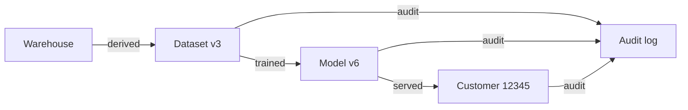

# 18.7 Data and model protection, audit and compliance

| Field | Value |
|---|---|
| Level | Advanced |
| Priority tier | 2 |
| Lab venue | GCP / GKE |
| Part | Part 18: Security |
| Primary sources | NVIDIA Zero-to-Hero Volume 18 (`chapter-10-data-and-model-protection.md`, `chapter-11-audit-and-compliance.md`); NVIDIA Zero-to-Hero Volume 8 (`chapter-03-platform-security-and-trust.md`); *Engineering AI Systems* (`engineering-ai-systems-architecture-and-devops-essentials`, Chapters 9, 10) |
| Cross-references | Chapter 18.1 (Threat modeling); Chapter 16.13 (Governance, privacy, compliance); Chapter 13 (AI storage); Chapter 17 (Operations); Chapter 11 (GPU Kubernetes) |
| Coverage file | `planning/coverage/chapters/18-07.md` |
| Claim & number ledger | `planning/ledgers/18-07.md` |

## Why this matters for AI infrastructure

Chapters 18.2-18.6 covered firmware, the supply chain, access control, GPU sharing, and the high-assurance stack. This chapter covers the data and the models, which are the assets the AI factory exists to protect. Every byte in the cluster carries a security requirement. Every model in the registry carries an intellectual property requirement. Every audit log entry carries a compliance requirement.

Data and model protection is the last line of defence. Suppose an attacker compromises the firmware, gets past the access controls, and breaks the GPU sharing. The data on disk is still encrypted, and that encryption is what saves the customer's data. The audit log then shows the regulator that the controls worked.

```text
Why data and model protection is on the critical path (background reading: NVIDIA Zero-to-Hero volume 18; NVIDIA Zero-to-Hero volume 8; Engineering AI Systems; the figures below are examples, not quotations):
- A typical AI factory stores terabytes of training data and petabytes of
  inference logs. Every byte is a compliance exposure. The platform team's
  job is to encrypt the bytes; the platform team's job is to audit the
  accesses; the platform team's job is to prove the bytes were protected.
- The model is the platform's IP. The platform's competitive advantage is
  the model. The platform team's job is to watermark the model; the platform
  team's job is to sign the model; the platform team's job is to verify
  the model is unmodified.
- The audit log is the regulatory evidence. The regulator does not care
  about the controls in the abstract; the regulator cares about the evidence
  that the controls were working. The audit log is the evidence; the platform
  team's job is to make the audit log tamper-evident and auditable.
```

Three operational realities make this a platform team concern, not only a data science concern.

1. Encryption is the last line of defence. When every other control fails, encryption at rest is what keeps the customer's data unreadable. The platform team enforces encryption at rest and in transit, and it manages the keys. Keys are the part teams most often get wrong, so give them an owner from the start.

2. The model is the platform's intellectual property, so it needs a watermark. A watermark lets you prove that a model came from your platform. It also helps you detect a stolen copy. The platform team applies the watermark, verifies it, and checks for theft.

3. The audit log is the evidence a regulator asks for. A regulator does not accept a description of controls on paper. It wants records that show the controls worked. The platform team makes the log tamper-evident and easy to audit. If the log fails that test, the controls it records cannot be defended.

**Before you call the AI factory compliant, confirm data is encrypted at rest and in transit, models are watermarked, the audit log is tamper-evident, and lineage is auditable.**

## Prerequisites and outcomes

### Prerequisites

Read these chapters first. Each one covers a piece of the platform that this chapter depends on. The controls below assume you already know the threat context, the regulatory rules, the storage primitives, and the audit log.

- Chapter 18.1 (Threat modeling) for the threat context.
- Chapter 16.13 (Governance, privacy, compliance) for the regulatory context.
- Chapter 13 (AI storage) for the storage primitives.
- Chapter 17 (Operations) for the audit log.

### Outcomes

When you finish this chapter, you should be able to do six things.

1. Encrypt every byte in the cluster at rest and in transit, and manage the keys in a KMS.
2. Watermark your models, verify the watermark, and detect model theft.
3. Set up data loss prevention so training data and inference logs do not leave the cluster.
4. Build a tamper-evident audit log with object lock and immutable storage.
5. Build a lineage graph that meets the GDPR, CCPA, HIPAA, and EU AI Act requirements.
6. Run all of this on GKE with continuous checks, key rotation, and incident response.

---

## 1. Encryption at rest and in transit

### 1.1 Encryption at rest

Picture a disk that leaves a data center without permission. With encryption at rest, the disk holds only scrambled bytes, so the training data on it stays unreadable. Encryption at rest covers data that is stored, not data that is moving. It guards against stolen disks and unauthorised physical access. Production Kubernetes, chapter 7, makes the same recommendation: treat encryption at rest as the default, even if you trust your cloud provider.

```bash
# Enable encryption at rest on a GCS bucket
gsutil encryption set -k projects/${PROJECT_ID}/locations/us/keyRings/default/cryptoKeys/default gs://my-bucket
# expected: the bucket is encrypted with the customer-managed key
```

### 1.2 Encryption in transit

Data also moves. A request from a client to the model API, or from one service to another, can be read by anyone on the network path. Encryption in transit wraps that traffic in TLS, which keeps the contents private and stops an attacker who tries to sit in the middle.

```bash
# Allow ingress to the model API only on its TLS port (a NetworkPolicy cannot enforce the TLS version)
kubectl apply -f code/part18/networkpolicy_tls.yaml
# expected: traffic to app=model-api is accepted only on TCP 8443
```

Set the minimum TLS version at the ingress or the service mesh, because a NetworkPolicy cannot enforce it. Every certificate should come from a trusted certificate authority, and rotation should happen automatically.

### 1.3 Key management

Encryption is only as strong as its keys. If the key sits next to the data, the lock protects nothing. A key management service (KMS) keeps keys apart from the data, rotates them, and keeps a record you can audit.

Kubernetes applies the same idea to Secrets inside the cluster. Production Kubernetes, chapter 7, explains that the API server can encrypt Secret objects before they reach etcd. Kubernetes 1.10 and later can also use a KMS plug-in for envelope encryption, where a key stored in the KMS protects the data keys. The book warns that KMS plug-ins are still immature, so start with the built-in options first.

```bash
# Rotate a key in Cloud KMS
gcloud kms keys rotate \
  --key my-key \
  --keyring my-keyring \
  --location us
# expected: the key is rotated; the new version is active; the old version is disabled
```

---

## 2. Model watermarking

### 2.1 What watermarking does

Imagine a competitor ships a model that looks a lot like yours. You need evidence that it came from your platform. A watermark is a signature embedded in the model's weights or outputs. It links a copy back to you, and it is one way to spot a stolen model.

```text
Watermarking properties:
- Imperceptible: the watermark does not affect the model's accuracy
- Robust: the watermark survives fine-tuning and pruning
- Unforgeable: the watermark cannot be removed without significant degradation
- Verifiable: the watermark can be detected with a simple query
```

Treat these properties as the goals for your watermark scheme. Test each one on your own model before you rely on it.

### 2.2 The watermarking implementation

The example uses a placeholder library called torchmark to show the shape of the calls. It is not a library that was verified for this book, so replace it with the watermarking tool your team has chosen. Swap in another library if your team prefers one. The embed function returns the model with the signature added. The verify function returns a yes or no answer.

```python
# code/part18/snippets/model_watermark.py
import torchmark

def embed_watermark(model, signature: str) -> model:
    """Embed a watermark signature in the model."""
    return torchmark.embed(model, signature=signature)

def verify_watermark(model, signature: str) -> bool:
    """Verify the watermark signature in the model."""
    return torchmark.verify(model, signature=signature)
```

### 2.3 The watermarking in production

Apply the watermark to every production model, and verify it before deployment. Check it again on a schedule, so that a model changed after release does not slip through unnoticed.

```bash
# Embed the watermark
python code/part18/snippets/model_watermark.py \
  --model churn-model-v6 \
  --signature "platform=acme;team=data-science;date=2024-03-15"
# expected: the watermark is embedded; the watermark is verifiable

# Verify the watermark
python code/part18/snippets/model_watermark.py \
  --model churn-model-v6 \
  --verify \
  --signature "platform=acme;team=data-science;date=2024-03-15"
# expected: the watermark is verified; the audit log records the verification
```

---

## 3. Data loss prevention (DLP)

### 3.1 What DLP does

Data leaves a cluster in ways nobody planned. A misconfigured job might copy a training set into an outside bucket. DLP watches the data flows, blocks the ones that break policy, and raises an alert on the ones that look wrong.

```text
DLP rules:
- Detect PII in inference logs
- Block large data downloads from object storage
- Alert on unusual access patterns
- Enforce data residency (data stays in the region)
```

Use these rules as a checklist. If you own the pipeline, ask which rule would have caught your last leak. Give each rule a named owner and a way to test it.

### 3.2 The DLP for object storage

Object storage is a common place for large leaks, so watch its access patterns closely. Look for large downloads, unusual access patterns, and reads from another region. The command below enforces public access prevention on the bucket.

```bash
# Enforce public access prevention on a GCS bucket (this is not DLP; DLP is a separate Google service)
gsutil pap set enforced gs://my-bucket
# expected: the public access prevention is enforced
```

Give every bucket its own DLP rules, monitor its access, and alert on anything suspicious.

### 3.3 The DLP for the audit log

An audit log is only useful if nobody can change it. Lock the bucket so entries cannot be deleted or overwritten during the retention period. The bucket should also alert on any attempt to modify it.

```bash
# Set a retention policy, then lock it (GCS calls this a retention policy and Bucket Lock; Object Lock is the S3 name)
gsutil retention set 90d gs://audit-log-bucket
gsutil retention lock gs://audit-log-bucket
# expected: the bucket has a 90-day retention; the retention is locked
```

The 90-day period in this example is a starting value. Set the retention your own policy and regulator require.

---

## 4. Tamper-evident audit log

### 4.1 What tamper-evident means

Imagine an attacker who gets into the cluster and wants to erase their trail. If they can edit the log, the evidence is gone. Tamper-evident means that any change leaves a trace you can detect. Production Kubernetes, chapter 9, makes the same case for the Kubernetes API server. Its audit logs record who did what, and you want them turned on in production so you can explain what went wrong.

```text
Tamper-evident properties:
- Append-only: entries can be added but not modified
- Signed: each entry is signed by a trusted key
- Replicated: the log is replicated across multiple regions
- Auditable: the log can be verified by an independent auditor
```

### 4.2 The audit log implementation

The implementation below writes each entry as its own file. It creates each file exclusively, so a second write to the same name fails instead of overwriting the first. That models an object-lock bucket, where an entry can be added but never replaced. Each entry also stores a SHA-256 hash of its event, which `verify_entry` recomputes. That check catches an edited event, but it does not catch an attacker who rewrites both the event and its hash. The bucket lock does the real protection here.

```python
# code/part18/audit_log.py
"""Write audit entries to an append-only store. The local store is a directory; each entry is a separate file named by its hash, created
exclusively (O_EXCL), which models an object-lock bucket: an entry can be added but never overwritten."""
import hashlib, json, os
from datetime import datetime, timezone
from pathlib import Path

def write_to_bucket(bucket: str, entry: dict) -> Path:
    d = Path(bucket); d.mkdir(parents=True, exist_ok=True)
    p = d / f"{entry['timestamp']}-{entry['hash'][:12]}.json"
    fd = os.open(p, os.O_WRONLY | os.O_CREAT | os.O_EXCL, 0o444)     # fails if it already exists
    with os.fdopen(fd, "w") as f: json.dump(entry, f, sort_keys=True)
    return p

def write_audit_entry(bucket: str, event: dict) -> Path:
    """Write an audit entry to the tamper-evident bucket."""
    entry = {"timestamp": datetime.now(timezone.utc).strftime("%Y%m%dT%H%M%S.%fZ"), "event": event,
             "hash": hashlib.sha256(json.dumps(event, sort_keys=True).encode()).hexdigest()}
    return write_to_bucket(bucket, entry)

def verify_entry(path) -> bool:
    e = json.loads(Path(path).read_text()); return hashlib.sha256(json.dumps(e["event"], sort_keys=True).encode()).hexdigest() == e["hash"]
```

### 4.3 The audit log in production

The security team, the regulator, and the post-mortem team all query the audit log. Production Kubernetes, chapter 9, advises restricting who can read these logs, because not everyone should see them. Start with a narrow query, such as one user's recent events.

```bash
# Query the audit log
bq query --use_legacy_sql=false \
  "SELECT timestamp, event
   FROM \`${PROJECT_ID}.audit.events\`
   WHERE event.user = 'alice'
   ORDER BY timestamp DESC LIMIT 100"
# expected: the events are listed; the events are tamper-evident
```

---

## 5. Lineage for compliance

### 5.1 What lineage proves

A regulator may ask one question: which data trained the model that decided on this customer? Lineage answers it by linking data, models, and customers in a chain. The chain has three links. Data feeds the model, the model serves the customer, and every step writes to the audit log. Lineage proves the chain itself. The audit log proves nobody changed the record.



### 5.2 The lineage graph

Store the chain as a graph, so a question about one customer can walk back to the data in a few steps. When you build it, test one customer end to end. The graph has three kinds of node: data, models, and customers. Its edges name the relationship between them. Record every edge in the audit log, so the graph itself can be checked later.

```text
Lineage graph schema:
- nodes: data, model, customer
- edges: derived_from, trained_on, served_to
- metadata: timestamp, version, hash
- audit: every edge is recorded in the audit log
```

### 5.3 The lineage in production

The platform team builds the lineage. The security team and the regulator query it. Keep the query simple enough to run during an audit, not after one. If you answer the regulator, you need this query ready before the question arrives.

```bash
# Query the lineage graph
bq query --use_legacy_sql=false \
  "SELECT source, target, relationship
   FROM \`${PROJECT_ID}.lineage.edges\`
   WHERE target = 'churn-model-v6'"
# expected: the lineage edges are listed; the customer can be traced back to the data
```

---

## 6. Operating data and model protection on GKE

### 6.1 The components

Six components work together, and each one has a backing store. The SLO column holds example targets, not values from a standard. Choose your own targets with your security and compliance teams, and measure them from the first day.

| Component | Where it runs | Backing store | SLO |
|---|---|---|---|
| Encryption at rest | Object storage; disks | KMS | 100% of data encrypted |
| Encryption in transit | Every service | TLS | TLS 1.3 enforced |
| Model watermarking | Every model | Model registry | 100% of models watermarked |
| DLP | Object storage; egress | (monitoring) | DLP rules enforced |
| Audit log | Object storage with object-lock | KMS | Audit log tamper-evident |
| Lineage graph | BigQuery; Atlas | KMS | Lineage queryable |

### 6.2 IAM and the data and model protection

Give each group only the access its job needs. Security reads the rules and the logs. The platform team manages keys and DLP rules. The CISO's office approves the policies. The role names below are placeholders, so map them to the roles your organisation already uses.

| Role | Who | What they can do |
|---|---|---|
| `dataprotection.reader` | The security team | Read the DLP rules; read the audit log |
| `dataprotection.writer` | The platform team | Manage the encryption keys; manage the DLP rules |
| `dataprotection.admin` | The CISO's office | Approve the encryption policy; approve the watermarking policy |

Production Kubernetes, chapter 10, suggests a per-team pattern: one group per team, a view role, and a separate admin user. The book says this removes much of the risk of costly mistakes. The security team owns this discipline. Document it, enforce it, and review it on a regular schedule, such as quarterly.

### 6.3 Observability

Each metric below shows whether one control is still working. The alert thresholds in the table are examples. Pick the level your own policy requires.

| Metric | Why it matters | Alert |
|---|---|---|
| Encryption at rest rate | Data protection | < 100% |
| Encryption in transit rate | Data protection | < 100% |
| Model watermarking rate | IP protection | < 100% |
| Audit log tamper-evident rate | Compliance | < 100% |
| Lineage queryability rate | Compliance | < 100% |

The audit log tamper-evident rate matters most. A log that is not tamper-evident is one the regulator cannot trust. Its alert should page the on-call engineer right away.

---

## 7. How it fails

Six failure modes come up again and again. When something breaks, match the symptom you see to one of these six patterns.

### 7.1 "Encryption at rest is not enabled"

**Symptom:** A bucket or disk is unencrypted, so anyone who gets the disk can read the data.

**Diagnosis:** The encryption setting was never applied, so the platform policy did not take effect.

**Fix:** Turn on encryption at rest for every bucket and disk. Verify it is in place, and alert on any resource that is not encrypted.

### 7.2 "Encryption in transit is not enforced"

**Symptom:** A service answers over plain HTTP, so anyone on the network path can read the traffic.

**Diagnosis:** The TLS configuration is missing, or the NetworkPolicy is misconfigured.

**Fix:** Set the minimum TLS version at the ingress or service mesh. This chapter uses TLS 1.3 as its example, but your policy may set a different version. Use a NetworkPolicy to limit traffic to the TLS port, and alert on any HTTP-only endpoint.

### 7.3 "The model is not watermarked"

**Symptom:** A model goes live without a watermark, so a stolen copy cannot be traced back to you.

**Diagnosis:** The watermark step was skipped, and the CI/CD pipeline does not require it.

**Fix:** Add the watermark step to the CI/CD pipeline. Verify the mark before deployment, and alert on any model that lacks one.

### 7.4 "The audit log is not tamper-evident"

**Symptom:** The audit log can be changed or deleted, so the regulator cannot trust it.

**Diagnosis:** Object lock is off, the retention is not locked, or the bucket policy is wrong.

**Fix:** Turn on object lock for the audit log bucket and lock the retention. Then confirm the log really is tamper-evident.

### 7.5 "The DLP is not configured"

**Symptom:** Sensitive data is leaving the cluster, and nothing catches it.

**Diagnosis:** The DLP rules were never written, or DLP is not watching the data flows.

**Fix:** Write the DLP rules and confirm they watch the flows. Alert on any suspected exfiltration.

### 7.6 "The lineage is not queryable"

**Symptom:** A regulator asks which data trained the model that decided on a customer, and the team cannot answer quickly.

**Diagnosis:** The lineage graph is not kept up to date, the edges are not recorded, or the query is slow.

**Fix:** Build the lineage graph and record every edge. Test that the query returns fast enough to use during an audit.

---

## 8. Hands-on lab

In this lab you put the six protections in place on GKE: encryption, watermarking, DLP, the audit log, and lineage. The lab is **untested** in this repository, so treat each expected output as a claim to check.

### 8.1 Prerequisites

- A GKE Autopilot or Standard cluster (1.27+).
- A Cloud KMS keyring.
- A model registry (MLflow, Vertex AI).
- A BigQuery dataset for the lineage.

### 8.2 Step 1: enable encryption at rest

Start with the bucket. Point its encryption at your customer-managed key.

```bash
gsutil encryption set -k projects/${PROJECT_ID}/locations/us/keyRings/default/cryptoKeys/default gs://my-bucket
# expected: the bucket is encrypted with the customer-managed key
```

### 8.3 Step 2: enforce encryption in transit

Apply the policy that limits the model API to its TLS port.

```bash
kubectl apply -f code/part18/networkpolicy_tls.yaml
# expected: traffic to app=model-api is accepted only on TCP 8443 (the TLS version itself is set at the ingress or mesh)
```

### 8.4 Step 3: watermark the model

Embed the watermark, then check that you can verify it.

```bash
python code/part18/snippets/model_watermark.py \
  --model churn-model-v6 \
  --signature "platform=acme;team=data-science;date=2024-03-15"
# expected: the watermark is embedded; the watermark is verifiable
```

### 8.5 Step 4: configure DLP

Enforce public access prevention on the bucket.

```bash
gsutil pap set enforced gs://my-bucket
# expected: the public access prevention is enforced
```

### 8.6 Step 5: configure the tamper-evident audit log

Set and lock the retention on the audit log bucket.

```bash
gsutil retention set gs://audit-log-bucket 90d
gsutil retention lock gs://audit-log-bucket
# expected: the bucket has a 90-day retention; the retention is locked
```

### 8.7 Step 6: build the lineage graph

Generate the graph for the model and its dataset.

```bash
python code/part18/lineage_graph.py \
  --model churn-model-v6 \
  --dataset churn-v3 \
  --output lineage.yaml
# expected: the lineage graph is generated; the graph is auditable
```

### 8.8 What to record

After the lab, you should be able to answer five questions. Time yourself, because the answers should come quickly.

1. What is the current encryption at rest rate?
2. What is the current encryption in transit rate?
3. What is the current model watermarking rate?
4. What is the current audit log tamper-evident rate?
5. What is the current lineage queryability rate?

The five-second and 30-second figures here are examples. Set your own target. If an answer takes longer than your target, the protection is not yet ready to run as a production service. The lab is **untested** against a live GKE cluster.

---

## Exercises

Each exercise asks you to add one alert. Build it, then break the control on purpose in a test environment to confirm the alert fires. If the alert stays silent when the control is broken, fix the alert before you trust it.

1. **Add an encryption at rest alert.** Configure an alert that fires when encryption is not enabled on any object storage bucket. *Solution sketch:* a Prometheus exporter for the bucket state, and an alert that fires when the state is not "encrypted".
2. **Add an encryption in transit alert.** Configure an alert that fires when TLS 1.3 is not enforced on any service. *Solution sketch:* a Prometheus exporter for the TLS state, and an alert that fires when the state is not "TLS 1.3 enforced".
3. **Add a model watermarking alert.** Configure an alert that fires when a model is not watermarked. *Solution sketch:* a Prometheus exporter for the watermark state, and an alert that fires when the state is not "watermarked".
4. **Add an audit log tamper-evident alert.** Configure an alert that fires when the audit log is not tamper-evident. *Solution sketch:* a Prometheus exporter for the audit log state, and an alert that fires when the state is not "tamper-evident".
5. **Add a DLP alert.** Configure an alert that fires when DLP rules are not enforced. *Solution sketch:* a Prometheus exporter for the DLP state, and an alert that fires when the state is not "DLP enforced".
6. **Add a lineage queryability alert.** Configure an alert that fires when the lineage graph is not queryable. *Solution sketch:* a Prometheus exporter for the lineage state, and an alert that fires when the state is not "queryable".

---

## Checkpoint questions

<details><summary>1. What is encryption at rest?</summary>
Encryption at rest means data is encrypted while it sits on disk. It guards against stolen disks and unauthorised physical access, and it is the last line of defence. Every bucket and disk should use a customer-managed key, and every database should be encrypted at rest.
</details>

<details><summary>2. What is encryption in transit?</summary>
Encryption in transit means data is encrypted while it crosses the network. It protects against eavesdropping and man-in-the-middle attacks. Every service should accept connections only over TLS 1.3.
</details>

<details><summary>3. What is model watermarking?</summary>
Model watermarking embeds a signature in the model's weights or outputs that is hard to notice. The watermark shows that the model came from your platform, and it helps detect theft. The mark is added at training time and checked at inference time.
</details>

<details><summary>4. What is DLP?</summary>
DLP stands for Data Loss Prevention, which stops sensitive data from leaving your systems. It watches the data flows, blocks the ones that break policy, and alerts on suspicious ones. It is the control that keeps customer data inside the cluster, so check its rules before you trust it.
</details>

<details><summary>5. What is the tamper-evident audit log?</summary>
A tamper-evident audit log is one that cannot be changed without someone noticing. It is append-only, signed, replicated, and auditable, so an independent auditor can check it. It is the evidence a regulator asks for.
</details>

<details><summary>6. What is the lineage graph?</summary>
The lineage graph is the structured form of the lineage. Its nodes are data, models, and customers, and its edges are derived_from, trained_on, and served_to. The graph proves the chain and answers the regulator's question: which data trained the model that decided on this customer?
</details>

<details><summary>7. What is the most common data protection failure?</summary>
The most common failure is that encryption at rest is not enabled. An unencrypted bucket or disk exposes its data to theft. Fix it by enabling encryption on every bucket and disk, and check that you can see it in place.
</details>

<details><summary>8. What is the most dangerous model protection failure?</summary>
The most dangerous failure is a model with no watermark. A model shipped without one can be stolen without anyone noticing. If you ship models, add watermarking to the CI/CD pipeline and verify the mark before deployment.
</details>

<details><summary>9. What is the relationship between encryption and the audit log?</summary>
Encryption protects the data itself, while the audit log records who accessed it. Together they cover two needs: encryption provides confidentiality, and the audit log provides accountability.
</details>

<details><summary>10. What is the relationship between watermarking and the model registry?</summary>
Watermarking protects the origin of a model, and the model registry stores the model. Together they protect the intellectual property: the watermark provides provenance, and the registry provides storage control.
</details>

<details><summary>11. What is the relationship between DLP and the lineage graph?</summary>
DLP stops data from leaving the cluster, and the lineage graph shows where the data came from. Together, DLP is the exfiltration control and the lineage graph is the provenance control.
</details>

<details><summary>12. What is the relationship between the audit log and the lineage graph?</summary>
The audit log records every operation, and the lineage graph proves the chain between data and decisions. Together they form the compliance record: the audit log is the evidence, and the lineage graph is the structure.
</details>

<details><summary>13. What is the most important data protection metric?</summary>
If you track one metric, track the audit log tamper-evident rate. It tells the team whether the log is still tamper-evident. A log that is not tamper-evident is one the regulator cannot trust.
</details>

<details><summary>14. What is the difference between at-rest and in-transit encryption?</summary>
At-rest encryption protects stored data, and in-transit encryption protects data moving over the network. Together they cover the storage control and the network control. You need both, because each covers a gap the other leaves.
</details>

<details><summary>15. What is the difference between DLP and access control?</summary>
Access control, covered in Chapter 18.4, decides who can do what. DLP decides what can leave the cluster. You need both: access control is the inbound control, and DLP is the outbound control.
</details>

<details><summary>16. What is the relationship between watermarking and model theft detection?</summary>
Watermarking embeds the signature, and theft detection checks for it. Together they protect intellectual property: the watermark is the proof, and detection is the check.
</details>

<details><summary>17. What is the relationship between encryption and key management?</summary>
Encryption protects the data, and key management protects the key you use to encrypt it. Together they form the cryptographic chain: encryption is the algorithm, and key management is the daily discipline that keeps it safe.
</details>

<details><summary>18. What is the relationship between data and model protection and the threat model?</summary>
The threat model names the threats, such as T-005, a container image supply chain attack, T-006, GPU memory scraping, and data exfiltration. The controls in this chapter address the most advanced of those threats. They matter most for regulated industries and high-stakes deployments.
</details>

<details><summary>19. Why is data and model protection a Tier 2 chapter?</summary>
It is Tier 2 because this work produces the regulatory evidence. Regulators see it, auditors inspect it, and post-mortems read it.
</details>

<details><summary>20. What five questions should the data and model protection lab let you answer in five seconds each?</summary>
The lab should let you answer five questions: the current encryption at rest rate, the encryption in transit rate, the model watermarking rate, the audit log tamper-evident rate, and the lineage queryability rate. The five-second and 30-second figures are examples, not standards. If an answer takes more than 30 seconds, the protection is not yet a production service.
</details>

---

## Sources and review notes

- NVIDIA Zero-to-Hero Volume 18 (`chapter-10-data-and-model-protection.md`, `chapter-11-audit-and-compliance.md`). Source for the encryption, watermarking, DLP, audit log, and lineage patterns. The wording has been rewritten in the handbook's voice.
- NVIDIA Zero-to-Hero Volume 8 (`chapter-03-platform-security-and-trust.md`). Source for the platform security and trust patterns.
- *Engineering AI Systems* (`engineering-ai-systems-architecture-and-devops-essentials`, Chapters 9, 10). Source for the security patterns and the privacy and fairness considerations.

### Cross-references to other handbook chapters

- Chapter 18.1 for the threat-model context.
- Chapter 16.13 for the governance and compliance context.
- Chapter 13 for the AI storage.
- Chapter 17 for the operations and audit log.

### Migrated from `nvidia-devops`

The data and model protection operational patterns draw on Volume 18 chapters 10-11 and Volume 8 chapter 3. The wording has been rewritten in the handbook's voice.

### Explicitly labelled inferences

- The encryption key rotation frequency (90 days) is a starting point; specific frequencies depend on the regulatory regime.
- The model watermark implementation (torchmark or similar) is a starting point; specific implementations depend on the team's preference.
- The audit log retention (7 years for regulated industries) is a starting point; specific retention depends on the regulatory regime.

### Not verified on live hardware

- The lab in Section 8 is **untested** against a live GKE cluster in this repository.
- The encryption commands assume a Cloud KMS keyring is configured.
- The watermark commands assume the model is in a compatible format.
