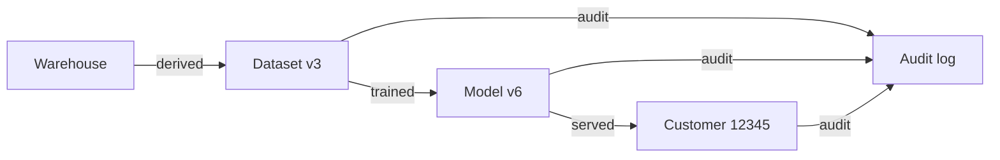

# 18.7 Data and model protection, audit and compliance

| Field | Value |
|---|---|
| Level | Advanced |
| Priority tier | 2 |
| Lab venue | GCP / GKE |
| Part | Part 18: Security |
| Cross-references | Chapter 18.1 (Threat modeling); Chapter 16.13 (Governance, privacy, compliance); Chapter 13 (AI storage); Chapter 17 (Operations); Chapter 11 (GPU Kubernetes) |
| Coverage file | `planning/coverage/chapters/18-07.md` |
| Claim & number ledger | `planning/ledgers/18-07.md` |

## Why this matters for AI infrastructure

A team downloads a fine-tuned model from a public hub, loads it on a GPU node that holds production credentials, and calls the loader. The file turns out to be a Python pickle. A pickle is Python's own format for saving objects to a file, and loading one rebuilds those objects by running code. Python's own documentation warns that unpickling can execute arbitrary code, and that you should never unpickle data from an untrusted source. The job that was meant to load numbers has just run the attacker's program with the node's permissions.

Model weights are both an asset and an attack surface. Weights are the learned numbers that make a model work. They are expensive to produce, so they are worth stealing. They are also code-adjacent, so a tampered file can attack the machine that loads it. This chapter covers the controls that protect weights across their life: the file format, the signature that says who made them, the encryption that protects them at rest, and the audit trail that shows who touched them.

It also covers the evidence a regulator asks for: which data trained which model, and proof that nobody changed the record afterwards. Chapters 16.13 and 18.1 give the regulatory and threat context. Rules such as GDPR, HIPAA or the EU AI Act are not summarised here, because this handbook does not give legal advice.

## Prerequisites and outcomes

A compliance officer asks for three things before a new model goes live: where it came from, who has touched it, and what data trained it. Answering those questions takes a few tools, and the prerequisites below name them.

### Prerequisites

Chapter 18.1 for the threat model, Chapter 18.3 for artifact signing in container images, Chapter 13 for storage, and Chapter 18.6 for protecting weights while they run. Artifact signing means attaching a checkable proof of origin to a file that a pipeline produces.

### Outcomes

The chapter walks through the file format choices that decide whether loading a model is safe. It covers how to sign a model and verify it before deployment, and how to encrypt weights at rest with a customer-managed key while protecting Kubernetes Secrets. It shows how to turn on the audit logs that record who read the weights. It finishes with an append-only audit trail and a lineage record that can answer a regulator's question.

---

## 1. The file format decides whether loading is safe

Your team inherits a checkpoint from an older training script, and a colleague asks whether it can be loaded on the production node today. A checkpoint is a saved copy of a model's weights and training state. Whether the answer is yes depends on the file format, long before anyone looks at the contents.

### 1.1 Pickle

PyTorch checkpoints have traditionally been saved with pickle. Pickle rebuilds Python objects, and a malicious file can make it call any function. In practice that means a file can run code the moment it is loaded, before any of your checks have a chance to look at it. The Python documentation says the pickle module is not secure and that only trusted data should be unpickled.

PyTorch has tightened its loader. The `torch.load` documentation lists `weights_only=True` as the default, which restricts the unpickler to tensors, primitive types, dictionaries and types you add as safe globals. A tensor is the basic array of numbers that a model is built from. The same page still says never to load data from an untrusted source. Treat the default as a safety net, not as permission.

### 1.2 Safetensors

A serving team asks for a file format that can be loaded on the production node without a sandbox. Safetensors is the usual answer. It is a format made for storing tensors. The project describes pickle as unsafe because it runs arbitrary code and designs the format to avoid it. A file holds an 8-byte header size, a JSON header, then raw tensor bytes. The header is capped at 100 MB, tensor addresses cannot overlap, and the byte buffer cannot contain holes. In plain words, the loader reads a description of the tensors and then copies the numbers, and there is no step where the file gets to run anything.

The format has limits. It does not check tensor values, so a file can hold NaN or infinity. NaN means not-a-number, a special value that shows up when a calculation goes wrong. It tells you nothing about who produced the file. A safe format removes the code-execution risk, not the provenance risk. Provenance is the record of where a file came from and who made it.

```python
from safetensors import safe_open

tensors = {}
with safe_open("model.safetensors", framework="pt", device=0) as f:
    for name in f.keys():
        tensors[name] = f.get_tensor(name)
```

Set a policy that production services load only safetensors files, and block pickle-based checkpoints at the gate that admits models into your registry. The registry is the store where approved models live before they reach serving. When a pickle file is the only form available, convert it inside an isolated sandbox with no credentials and no network, never on a production node. A sandbox is a throwaway environment that cannot reach your secrets or your network, so a bad file can do little damage there.

---

## 2. Signing: who made these weights

A partner emails you a model directory and asks you to deploy it by Friday. How do you know the files are the ones the partner meant to send? A format cannot say who produced a file. A signature can. The OpenSSF model signing project, which lives in the Sigstore organisation, signs a model directory and records the result as a Sigstore bundle. The bundle holds a statement listing each file path and its digest, plus a signature over it. A digest is a short fingerprint computed from a file's contents, so any change to the file produces a different fingerprint.

```bash
model_signing sign bert-base-uncased --signature model.sig
model_signing verify bert-base-uncased --signature model.sig --identity IDENTITY --identity-provider OIDC_PROVIDER
```

The commands come from the project's README. Signing with Sigstore opens an OIDC flow to get a short-lived certificate, and verification must reuse the identity and provider. OIDC is the login standard that many services use to prove who is signing in. The project also supports signing with your own key pair and with PKCS 11 devices, which are hardware security modules that hold keys.

Verification recomputes the file hashes and compares them with the signed ones, then checks the signature. If one byte changes, verification fails. That is the property that makes the signature useful. The signature covers the contents, not just the file name.

What it proves is narrow, and the project says so. It proves the files match what was signed and that the signature came from an identity you can check. It does not prove the signer is trustworthy, and it says nothing about whether the model is free of malicious behavior. The log makes signing events visible, but unexpected events are caught only if someone watches it. A transparency log is a public, append-only record of signing events that anyone can check.

Run verification in the deployment path, before weights reach a GPU node, and fail the deployment when it fails. Failing loudly is the point. A verification step that only logs a warning gives the same comfort as no step at all.

---

## 3. Encryption at rest and key management

An auditor asks what happens to the weights if someone copies the disk they sit on. The honest answer depends on where the key lives, so this section starts there. Encryption at rest means the stored bytes are scrambled while they sit on a disk, and encryption in transit covers the same bytes while they move over a network.

### 3.1 Why keys matter more than ciphers

A bucket holds encrypted weights, and the key sits in a file in the same bucket. Anyone who can read the bucket can read the key and decrypt the weights, so the encryption adds almost nothing. Encrypted weights on a disk are only as safe as the key. A key stored beside the data protects nothing. A key management service keeps keys apart from the data, controls who can use them, and records each use.

Google Cloud encrypts content at rest by default with envelope encryption, where a data key encrypts the content and a key encryption key wraps the data key. Wrapping means encrypting the data key so that it can only be opened with the outer key. If you want your own control, you can use Cloud KMS as the central keystore. A customer-managed key lets you decide who can use it and when it rotates. Rotation means replacing a key on a schedule, so that a leaked key stops being useful after a while.

```bash
gcloud storage buckets update gs://my-bucket --default-encryption-key=KMS_KEY_RESOURCE
```

The documented flag sets the default key for a bucket. Replace the placeholder with the full Cloud KMS key resource name. Google recommends periodic, automatic rotation of symmetric keys. Set a rotation schedule on the key in Cloud KMS, and check the current Cloud KMS documentation for the exact flags.

### 3.2 Secrets inside the cluster

A developer runs a command to read a Kubernetes Secret and sees a block of encoded text. Encoding is not encryption, and anyone with read access can decode that text. The question is whether the stored copy is encrypted too. The Kubernetes documentation says that by default the API server stores resources in etcd as plain text, with no encryption at rest. etcd is the database that holds the cluster's state, and the API server is the front door that every cluster request passes through. Encryption is enabled by passing `--encryption-provider-config` to the API server. If the first provider in the list is `identity`, you do not have encryption at rest, even if the flag is set. Resources written before encryption was enabled stay plain text until they are written again.

For envelope encryption with an external key manager, use KMS v2. The documentation says KMS v1 has been deprecated since Kubernetes 1.28 and disabled by default since 1.29, and that KMS v2 has been stable since 1.29. In KMS v2 a data key is derived per encryption, and the seed rotates when the key encryption key rotates. A seed here is the starting value from which the data keys are derived.

On GKE, application-layer secrets encryption is a managed option, and the platform sets up the control plane. Check your platform's documentation before you edit control plane flags yourself. Editing the flags on a managed control plane can be overwritten by the platform later, so the managed option is usually the safer path.

### 3.3 In transit

A model API is reachable from the office network, and a reviewer asks whether the traffic between the client and the server is encrypted. Traffic to a model API needs TLS, the protocol that encrypts a connection. A NetworkPolicy works at the IP and port layer and cannot require a TLS version. The repository example limits traffic to port 8443. Set the minimum TLS version at the ingress or the service mesh. The ingress is the entry point that routes outside requests into the cluster, and a service mesh is a layer of proxies that handles traffic between services.

```bash
kubectl apply -f code/part18/networkpolicy_tls.yaml
```

---

## 4. Who read the weights: audit logs

Last month a weights file was downloaded from a bucket, and the team now needs to know who did it. The only way to answer that later is to have turned on the right logs before the download happened. This section is about setting that up.

### 4.1 Turn the logs on

A new bucket goes live, and nobody has enabled the logs that record reads. Cloud Storage audit logging has two parts. Admin Activity logs are always on and cover changes such as setting bucket permissions. Data Access logs, which record reads of object data, are disabled by default and are not written unless you enable them. Without them, Cloud Audit Logs does not record who read an object. Reads through allUsers or allAuthenticatedUsers are not tracked there even when Data Access logs are on. allUsers means anyone on the internet, and allAuthenticatedUsers means anyone with a Google account.

So the first audit control for weights is simple: enable Data Access logs on the bucket that holds them, and route the logs to a store the weight owners cannot edit. For the Kubernetes API, the audit policy decides which events are recorded. Turn it on in production so you can explain what happened. An audit policy that records nothing gives you nothing to explain later.

### 4.2 Make the log hard to change

An attacker who gets into the cluster wants to erase their trail, and the first place they look is the log. Cloud Storage retention policies and Bucket Lock make logs durable. The documentation says objects under a retention policy can be deleted or replaced only once their age exceeds the retention period. Locking the policy is irreversible. It cannot be removed and the period cannot be shortened, though it can be lengthened.

```bash
gcloud storage buckets update gs://audit-log-bucket --retention-period=90d
```

That is a retention policy. Locking it is a separate step, and you cannot undo it, so confirm the period with your compliance team before you lock. The 90 days here is a starting value. Use the period your policy and regulator require.

The sketch below models the append-only idea locally. Each entry is a separate file created exclusively, so a second write to the same name fails. Each entry also stores a SHA-256 hash of its event. SHA-256 is a standard hash function, and a hash of the event changes whenever the event changes. That catches an edited event but not an attacker who rewrites both the event and its hash. The bucket lock does the real protection. The local sketch helps you understand the idea, and it is not a replacement for the locked bucket.

```python
# code/part18/audit_log.py
"""Write audit entries to an append-only store. The local store is a directory; each entry is a separate file named by its hash, created
exclusively (O_EXCL), which models an object-lock bucket: an entry can be added but never overwritten."""
import hashlib, json, os
from datetime import datetime, timezone
from pathlib import Path

def write_to_bucket(bucket: str, entry: dict) -> Path:
    d = Path(bucket); d.mkdir(parents=True, exist_ok=True)
    p = d / f"{entry['timestamp']}-{entry['hash'][:12]}.json"
    fd = os.open(p, os.O_WRONLY | os.O_CREAT | os.O_EXCL, 0o444)     # fails if it already exists
    with os.fdopen(fd, "w") as f: json.dump(entry, f, sort_keys=True)
    return p

def write_audit_entry(bucket: str, event: dict) -> Path:
    """Write an audit entry to the tamper-evident bucket."""
    entry = {"timestamp": datetime.now(timezone.utc).strftime("%Y%m%dT%H%M%S.%fZ"), "event": event,
             "hash": hashlib.sha256(json.dumps(event, sort_keys=True).encode()).hexdigest()}
    return write_to_bucket(bucket, entry)

def verify_entry(path) -> bool:
    e = json.loads(Path(path).read_text()); return hashlib.sha256(json.dumps(e["event"], sort_keys=True).encode()).hexdigest() == e["hash"]
```

---

## 5. Lineage: which data trained this model

A customer complains that a model rejected a loan application, and the regulator asks which data taught that model. The team needs to walk from the customer back to the training data without guessing. Lineage is the record that makes that walk possible. Lineage links data, models and customers so the question can be answered by walking a graph. The audit log shows the record was not changed.



Each edge carries a timestamp, a version and a hash. An edge is one link between two items in the graph, such as a dataset feeding a model. Test one customer end to end before an audit, not during one. A query that has never been run can fail in the middle of a regulator's visit, and a test run on a quiet afternoon finds the gaps first.

```bash
python code/part18/lineage_graph.py --model churn-model-v6 --dataset churn-v3 --output lineage.yaml
```

---

## 6. How it fails

Protection problems often show up as an ordinary failure first. Each case below begins with a symptom someone might see, and then says where to look and what to change.

### 6.1 A pickle checkpoint reached a production node

A job on a production node starts behaving oddly, and a look at the node shows a process nobody expected. The loader had run code from a downloaded file. Rotate every credential on that node, rebuild it, and add the registry gate that rejects pickle checkpoints.

### 6.2 A signature verifies but the model misbehaves

The evaluation dashboard shows a model giving strange answers, but the deployment check passed without complaint. The signature proved who produced the file and that it was not changed. It did not prove the model is safe. Add evaluation and red-team checks before approval. Red-team checks are deliberate attempts to make the model misbehave, run before it is trusted.

### 6.3 Nobody can say who downloaded the weights

An auditor asks who downloaded a weights file last quarter, and the team has no answer. Data Access logs were off. Enable them now. Past reads cannot be recovered from logs that were never written.

### 6.4 Secrets in etcd are readable

A review of the cluster finds that Secrets can be read straight from the database. The first provider in the encryption configuration is `identity`, or the flag was never set. Reorder the providers, restart the API servers, and rewrite existing secrets so they are stored encrypted. Rewriting is what moves the old plain-text copies into the encrypted form.

### 6.5 The key was rotated and a job cannot read the data

A job that ran fine last week fails today with a permission error on its data. The key was rotated, and the job still holds a pinned key version. A pinned version is a fixed reference to one old copy of the key. Check which key version encrypted the data and whether the job's identity may use it.

### 6.6 The lineage query is slow or incomplete

A regulator's question takes so long to answer that the team starts apologising. The lineage query is slow, and some edges are missing. Edges are missing or the graph is stale. Record edges at training time, not after the fact, and rehearse the query.

---

## 7. Hands-on lab

A new team has a week to show that its models are signed, encrypted and logged. The lab walks through those checks on a test project, one step at a time. These steps use commands from the vendor documentation cited below. They have not been run against a live GKE cluster here.

1. Convert a small pickle checkpoint to safetensors in a sandbox with no network, and load it with `safe_open`.
2. Sign the directory with `model_signing sign`, change one byte in a copy, and show that `model_signing verify` fails on the copy.
3. Set a default customer-managed key on a test bucket with `gcloud storage buckets update --default-encryption-key`.
4. Enable Data Access audit logs for Cloud Storage on the test project, read an object, and find the entry.
5. Set a retention policy on a test log bucket. Do not lock it unless you are sure.
6. Run the lineage script for one model and trace it back to its dataset.

Record the time it takes to answer: which file format does each production model use, and who last read it? A quick answer to that question is a good sign that the controls are working.

---

## Exercises

Each exercise begins with a request or an incident that a platform or compliance team could really face. Work through them in order, since later answers reuse the ideas in earlier ones.

1. A model file named weights.bin arrives from a partner. How do you decide whether it is safe to load? *Solution sketch:* find out the format. If it is pickle, convert it in a sandbox without credentials or network, then verify the signature of the converted file against the partner's identity.
2. Show that signature verification catches a changed file. *Solution sketch:* sign a directory, flip one byte in a copy, run verify on the copy, and expect failure.
3. A security review asks who read the weights bucket last month. Data Access logs were never enabled. What do you tell them, and what do you do? *Solution sketch:* reads were not recorded and cannot be reconstructed. Enable the logs now and route them to a bucket with a retention policy.
4. Check whether Kubernetes Secrets are encrypted at rest on your cluster. *Solution sketch:* read the encryption configuration, confirm the first provider is not `identity`, then read a Secret directly from etcd to see that it is not plain text.
5. An audit entry is written on 1 November. It sits under a locked 90-day retention. When can it first be deleted? *Solution sketch:* 90 days later is 30 January.
6. Explain why a SHA-256 hash stored beside an audit entry does not stop an attacker who can edit the file. *Solution sketch:* the attacker rewrites both the event and its hash, so verification still passes. The bucket lock provides the real protection.

---

## Checkpoint questions

Each question below starts from a job, a file or an audit request that you might meet on the job.

<details><summary>1. A training job downloads a checkpoint from a public hub and calls torch.load. What risk remains with the default weights_only setting?</summary>
The default restricts unpickling to safe types, but the PyTorch documentation still says never to load data from an untrusted source. Prefer safetensors, and verify the source with a signature.
</details>

<details><summary>2. What does safetensors remove, and what does it leave open?</summary>
It removes code execution on load, because the format is a JSON header plus raw tensor bytes. It leaves provenance open and does not check tensor values, so NaN or infinity can appear.
</details>

<details><summary>3. A signature on a model verifies. A colleague says the model is therefore safe. What do you answer?</summary>
Signing proves the files match what was signed and that the signer's identity can be checked. It does not prove the signer is trustworthy or the model is free of malicious behavior.
</details>

<details><summary>4. Verification fails for a model directory after a copy to a new bucket. What do you check?</summary>
Whether any file changed, was added or was removed, because the signature covers a list of file paths and digests. Also check that you pass the same identity and provider that were used to sign.
</details>

<details><summary>5. Why must the model signing verification step run before weights reach the GPU node?</summary>
Once a tampered file is loaded, the damage may already be done. Verifying in the deployment path stops it before it runs.
</details>

<details><summary>6. Your cluster stores Secrets in etcd. How do you know they are encrypted?</summary>
Check the encryption configuration. If the first provider is identity, there is no encryption at rest even if the flag is set. Secrets written before encryption was enabled stay plain text until rewritten.
</details>

<details><summary>7. Why prefer KMS v2 over v1 for Kubernetes envelope encryption?</summary>
KMS v1 has been deprecated since Kubernetes 1.28 and disabled by default since 1.29, while KMS v2 has been stable since 1.29 and derives a new data key per encryption.
</details>

<details><summary>8. What is envelope encryption, in one sentence?</summary>
A data key encrypts the content and a key encryption key held in a key manager encrypts the data key.
</details>

<details><summary>9. Why is a key stored next to the encrypted data a problem?</summary>
Anyone who can read the data can read the key. A key management service keeps them apart, controls who may use the key, and records each use.
</details>

<details><summary>10. Why can a NetworkPolicy not give you TLS 1.3?</summary>
It works at the IP and port layer. It can limit traffic to a port such as 8443 but cannot see or require a TLS version, which belongs to the ingress or service mesh.
</details>

<details><summary>11. An incident review needs the list of principals that read a weights object last week. What must have been true?</summary>
Data Access audit logs were enabled for the bucket before the reads. Without them Cloud Audit Logs does not record who read data.
</details>

<details><summary>12. Why is locking a retention policy a decision to make carefully?</summary>
The documentation says locking is irreversible. The policy cannot be removed and the period cannot be shortened, though it can be lengthened.
</details>

<details><summary>13. Each audit entry stores a hash of its event. What attack does that not stop?</summary>
An attacker who edits the event and rewrites its hash. The retention lock provides the real protection.
</details>

<details><summary>14. Why is O_EXCL used when writing each audit entry file?</summary>
A second write to the same name fails instead of overwriting, which models an object that can be added but never replaced.
</details>

<details><summary>15. A regulator asks which data trained the model that decided on a customer. What do you need ready?</summary>
A lineage graph linking data, model and customer, with each edge recorded in the audit log, and a query you have already tested.
</details>

<details><summary>16. A retention period of 90 days is set on an entry written on 1 November. When can it first be deleted?</summary>
On 30 January, because 90 days after 1 November lands there.
</details>

<details><summary>17. You check 40 buckets and 38 have the required default key. What is the rate and what next?</summary>
38 divided by 40 is 95 percent. Fix the two buckets and alert on any bucket without the key.
</details>

<details><summary>18. A partner sends only a pickle checkpoint. What do you do?</summary>
Convert it in a sandbox with no credentials and no network, then verify and sign the converted file. Do not load the original on a production node.
</details>

<details><summary>19. Signing events appear in a transparency log. Who notices an unexpected one?</summary>
Only someone who monitors the log. The project says the log makes events discoverable, and signers must watch for events they did not make.
</details>

<details><summary>20. Audit logs show a read of the weights by an unknown principal. What do you do, in order?</summary>
Preserve the logs, identify the principal and the source address, revoke the credential, check what else it read, and review the bucket permissions.
</details>

---

## Sources and review notes

- Python documentation, pickle module: security warning. Fetched 2026-11-12.
- PyTorch documentation, `torch.load` (version 2.15 page): `weights_only` default and untrusted-source warning. Fetched 2026-11-12.
- Safetensors project documentation and repository: format layout, 100 MB header cap, limits. Fetched 2026-11-12.
- Sigstore model-transparency repository (OpenSSF model signing): signing, verification, what it proves and does not. Fetched 2026-11-12.
- Kubernetes documentation: encrypting confidential data at rest, and using a KMS provider (KMS v1 deprecated 1.28, disabled 1.29; KMS v2 stable 1.29). Fetched 2026-11-12.
- Google Cloud documentation: envelope encryption, Cloud Storage customer-managed keys, Cloud Storage audit logging, Bucket Lock. Fetched 2026-11-12.
- *Production Kubernetes*, chapters 7, 9 and 10, for secrets, audit logging and per-team access patterns.

### Corrections made in this rework

- Removed model watermarking. The `torchmark` library in the earlier text does not exist as shown, and no source was found for watermarking robustness claims.
- Removed the `gcloud kms keys rotate` command, which is not a Cloud KMS command, and the data loss prevention section, which mixed public access prevention with DLP.
- Replaced `gsutil encryption set -k` with the documented `gcloud storage buckets update --default-encryption-key`.
- Removed IAM roles named `dataprotection.*` and the alert-only exercises.

### Open items

- The `watermark` helper in `code/part18/snippets/model_watermark.py` is no longer referenced by the chapter and should be reviewed.
- Compliance law is not covered. Take legal advice for GDPR, HIPAA and EU AI Act obligations.
