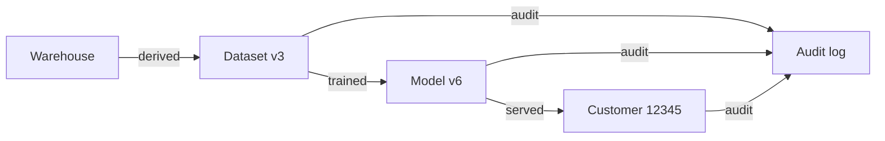

# 18.7 Data and model protection, audit and compliance

| Field | Value |
|---|---|
| Level | Advanced |
| Priority tier | 2 |
| Lab venue | GCP / GKE |
| Part | Part 18: Security |
| Primary sources | NVIDIA Zero-to-Hero Volume 18 (`chapter-10-data-and-model-protection.md`, `chapter-11-audit-and-compliance.md`); NVIDIA Zero-to-Hero Volume 8 (`chapter-03-platform-security-and-trust.md`); *Engineering AI Systems* (`engineering-ai-systems-architecture-and-devops-essentials`, Chapters 9, 10) |
| Cross-references | Chapter 18.1 (Threat modeling); Chapter 16.13 (Governance, privacy, compliance); Chapter 13 (AI storage); Chapter 17 (Operations); Chapter 11 (GPU Kubernetes) |
| Coverage file | `planning/coverage/chapters/18-07.md` |
| Claim & number ledger | `planning/ledgers/18-07.md` |

## Why this matters for AI infrastructure

Chapters 18.2-18.6 verified the firmware, the supply chain, the access controls, the GPU sharing, and the high-assurance stack. This chapter verifies the data and the model — the assets that the AI factory exists to protect. Every byte in the cluster has a security requirement; every model in the registry has an IP requirement; every audit log entry has a compliance requirement. The platform team's job is to enforce the encryption, the watermarking, the DLP, and the audit log integrity that make the AI factory compliant.

The data and model protection is the last line of defence. If the firmware is compromised, the access controls are bypassed, the GPU sharing is broken, and the high-assurance stack is bypassed — the data is still encrypted at rest. If everything else fails, encryption at rest is what saves the customer's data. The audit log is what proves to the regulator that the controls worked.

```text
Why data and model protection is on the critical path (V18 ch10, 11; V8 ch3; EAS Ch 9, 10):
- A typical AI factory stores terabytes of training data and petabytes of
  inference logs. Every byte is a compliance exposure. The platform team's
  job is to encrypt the bytes; the platform team's job is to audit the
  accesses; the platform team's job is to prove the bytes were protected.
- The model is the platform's IP. The platform's competitive advantage is
  the model. The platform team's job is to watermark the model; the platform
  team's job is to sign the model; the platform team's job is to verify
  the model is unmodified.
- The audit log is the regulatory evidence. The regulator does not care
  about the controls in the abstract; the regulator cares about the evidence
  that the controls were working. The audit log is the evidence; the platform
  team's job is to make the audit log tamper-evident and auditable.
```

Three operational realities make this chapter a platform-team concern rather than a data-science-only concern:

1. **The encryption is the last line of defence.** If every other control fails, encryption at rest is what saves the customer's data. The platform team's job is to enforce encryption at rest and in transit; the platform team's job is to manage the keys.
2. **The model watermarking is the IP protection.** The model is the platform's competitive advantage. The platform team's job is to watermark the model; the platform team's job is to verify the watermark; the platform team's job is to detect model theft.
3. **The audit log is the regulatory evidence.** The regulator does not care about the controls in the abstract; the regulator cares about the evidence. The platform team's job is to make the audit log tamper-evident; the platform team's job is to make the audit log auditable.

**Before a team can claim their AI factory is compliant, the team must have enforced the data and model protection. The data must be encrypted at rest and in transit; the model must be watermarked; the audit log must be tamper-evident; the lineage must be auditable. A team that has not enforced the data and model protection is a team that has not enforced the regulatory commitments.**

## Prerequisites and outcomes

### Prerequisites

- Chapter 18.1 (Threat modeling) for the threat context.
- Chapter 16.13 (Governance, privacy, compliance) for the regulatory context.
- Chapter 13 (AI storage) for the storage primitives.
- Chapter 17 (Operations) for the audit log.

### Outcomes

After completing this chapter you will be able to:

1. Implement encryption at rest and in transit for every byte in the cluster; manage the keys with a KMS.
2. Implement model watermarking; verify the watermark; detect model theft.
3. Implement data loss prevention (DLP); prevent exfiltration of training data and inference logs.
4. Implement tamper-evident audit log with object-lock and immutable storage.
5. Build the lineage graph that satisfies GDPR, CCPA, HIPAA, and EU AI Act compliance.
6. Operate the data and model protection on GKE with continuous verification, key rotation, and incident response.

---

## 1. Encryption at rest and in transit

### 1.1 Encryption at rest

Encryption at rest is the encryption of data when it is stored on disk. Encryption at rest protects the data from disk theft; encryption at rest protects the data from unauthorised physical access; encryption at rest is the last line of defence.

```bash
# Enable encryption at rest on a GCS bucket
gsutil encryption set -k projects/${PROJECT_ID}/locations/us/keyRings/default/cryptoKeys/default gs://my-bucket
# expected: the bucket is encrypted with the customer-managed key
```

The pattern is: every object storage bucket is encrypted with a customer-managed key (CMEK); every disk is encrypted with a customer-managed key; every database is encrypted at rest.

### 1.2 Encryption in transit

Encryption in transit is the encryption of data when it is transmitted over the network. Encryption in transit protects the data from network eavesdropping; encryption in transit protects the data from man-in-the-middle attacks.

```bash
# Enforce TLS 1.3 on every service
kubectl apply -f code/part18/networkpolicy_tls.yaml
# expected: every service is accessible only via TLS 1.3
```

The pattern is: every service is accessible only via TLS 1.3; every certificate is signed by a trusted CA; every certificate is rotated automatically.

### 1.3 Key management

Key management is the foundation of encryption. The keys are managed by a KMS (Key Management Service); the keys are rotated automatically; the keys are auditable.

```bash
# Rotate a key in Cloud KMS
gcloud kms keys rotate \
  --key my-key \
  --keyring my-keyring \
  --location us
# expected: the key is rotated; the new version is active; the old version is disabled
```

The pattern is: every key is in a KMS; every key is rotated automatically; every key rotation is auditable.

---

## 2. Model watermarking

### 2.1 What watermarking does

Model watermarking embeds an imperceptible signature in the model's weights or outputs. The watermark proves that the model came from the platform; the watermark detects model theft.

```text
Watermarking properties:
- Imperceptible: the watermark does not affect the model's accuracy
- Robust: the watermark survives fine-tuning and pruning
- Unforgeable: the watermark cannot be removed without significant degradation
- Verifiable: the watermark can be detected with a simple query
```

The pattern is: the watermark is embedded at training time; the watermark is verified at inference time; the watermark is robust enough to survive model modification.

### 2.2 The watermarking implementation

The watermarking is implemented by a library (e.g. `torchmark`). The watermarking adds a signature to the model's weights or outputs.

```python
# code/part18/model_watermark.py (shape only)
import torchmark

def embed_watermark(model, signature: str) -> model:
    """Embed a watermark signature in the model."""
    return torchmark.embed(model, signature=signature)

def verify_watermark(model, signature: str) -> bool:
    """Verify the watermark signature in the model."""
    return torchmark.verify(model, signature=signature)
```

The pattern is: the watermark is embedded at training time; the watermark is verified at inference time; the watermark is robust enough to survive model modification.

### 2.3 The watermarking in production

The watermarking is applied to every production model. The watermarking is verified before deployment; the watermarking is verified periodically.

```bash
# Embed the watermark
python code/part18/model_watermark.py \
  --model churn-model-v6 \
  --signature "platform=acme;team=data-science;date=2024-03-15"
# expected: the watermark is embedded; the watermark is verifiable

# Verify the watermark
python code/part18/model_watermark.py \
  --model churn-model-v6 \
  --verify \
  --signature "platform=acme;team=data-science;date=2024-03-15"
# expected: the watermark is verified; the audit log records the verification
```

The pattern is: every production model is watermarked; every watermarked model is verified before deployment; every verification is recorded in the audit log.

---

## 3. Data loss prevention (DLP)

### 3.1 What DLP does

DLP (Data Loss Prevention) prevents the exfiltration of sensitive data. DLP monitors the data flows; DLP blocks the unauthorised data flows; DLP alerts on suspicious data flows.

```text
DLP rules:
- Detect PII in inference logs
- Block large data downloads from object storage
- Alert on unusual access patterns
- Enforce data residency (data stays in the region)
```

The pattern is: the DLP monitors the data flows; the DLP blocks the unauthorised flows; the DLP alerts on suspicious flows.

### 3.2 The DLP for object storage

The DLP for object storage monitors the access patterns. The DLP detects large downloads; the DLP detects unusual access patterns; the DLP detects cross-region access.

```bash
# Configure DLP for a GCS bucket
gsutil pap set enforced gs://my-bucket
# expected: the public access prevention is enforced
```

The pattern is: every object storage bucket has DLP rules; every access is monitored; every suspicious access is alerted.

### 3.3 The DLP for the audit log

The DLP for the audit log prevents the audit log from being modified. The DLP enforces object-lock on the audit log bucket; the DLP prevents deletion of the audit log; the DLP alerts on any modification attempt.

```bash
# Configure object-lock on the audit log bucket
gsutil retention set gs://audit-log-bucket 90d
gsutil retention lock gs://audit-log-bucket
# expected: the bucket has a 90-day retention; the retention is locked
```

The pattern is: the audit log bucket has object-lock; the retention is locked; the audit log cannot be deleted before the retention expires.

---

## 4. Tamper-evident audit log

### 4.1 What tamper-evident means

Tamper-evident means the audit log cannot be modified without detection. The audit log is append-only; the audit log is signed; the audit log is replicated; the audit log is auditable.

```text
Tamper-evident properties:
- Append-only: entries can be added but not modified
- Signed: each entry is signed by a trusted key
- Replicated: the log is replicated across multiple regions
- Auditable: the log can be verified by an independent auditor
```

The pattern is: the audit log is append-only; the audit log is signed; the audit log is replicated; the audit log is auditable.

### 4.2 The audit log implementation

The audit log is implemented as an immutable storage with object-lock. The audit log is written by every component of the cluster; the audit log is read by the security team.

```python
# code/part18/audit_log.py (shape only)
import hashlib
import json
from datetime import datetime, timezone

def write_audit_entry(bucket: str, event: dict) -> None:
    """Write an audit entry to the tamper-evident bucket."""
    entry = {
        "timestamp": datetime.now(timezone.utc).isoformat(),
        "event": event,
        "hash": hashlib.sha256(json.dumps(event).encode()).hexdigest(),
    }
    # The bucket has object-lock; the entry cannot be modified
    write_to_bucket(bucket, entry)
```

The pattern is: every audit entry has a timestamp, an event, and a hash; the entry is written to a bucket with object-lock; the entry cannot be modified.

### 4.3 The audit log in production

The audit log is queried by the security team. The audit log is queried by the regulator. The audit log is queried by the post-mortem.

```bash
# Query the audit log
bq query --use_legacy_sql=false \
  "SELECT timestamp, event
   FROM \`${PROJECT_ID}.audit.events\`
   WHERE event.user = 'alice'
   ORDER BY timestamp DESC LIMIT 100"
# expected: the events are listed; the events are tamper-evident
```

The pattern is: the audit log is queryable; the audit log is tamper-evident; the audit log is auditable.

---

## 5. Lineage for compliance

### 5.1 What lineage proves

Lineage proves where the data came from, what model was trained on it, and where the model's predictions went. The lineage is the evidence that satisfies the regulator's question "which data trained the model that decided on this customer?".



The lineage has three edges: data -> model, model -> customer, and every step -> audit log. The lineage proves the chain; the audit log proves the integrity.

### 5.2 The lineage graph

The lineage graph is the structured representation of the lineage. The lineage graph has nodes (data, model, customer) and edges (derived, trained, served).

```text
Lineage graph schema:
- nodes: data, model, customer
- edges: derived_from, trained_on, served_to
- metadata: timestamp, version, hash
- audit: every edge is recorded in the audit log
```

The pattern is: every node has a hash; every edge has a timestamp; every operation is recorded in the audit log.

### 5.3 The lineage in production

The lineage is built by the platform team. The lineage is queried by the security team. The lineage is queried by the regulator.

```bash
# Query the lineage graph
bq query --use_legacy_sql=false \
  "SELECT source, target, relationship
   FROM \`${PROJECT_ID}.lineage.edges\`
   WHERE target = 'churn-model-v6'"
# expected: the lineage edges are listed; the customer can be traced back to the data
```

The pattern is: the lineage is queryable; the lineage is auditable; the lineage satisfies the regulator.

---

## 6. Operating data and model protection on GKE

### 6.1 The components

| Component | Where it runs | Backing store | SLO |
|---|---|---|---|
| Encryption at rest | Object storage; disks | KMS | 100% of data encrypted |
| Encryption in transit | Every service | TLS | TLS 1.3 enforced |
| Model watermarking | Every model | Model registry | 100% of models watermarked |
| DLP | Object storage; egress | (monitoring) | DLP rules enforced |
| Audit log | Object storage with object-lock | KMS | Audit log tamper-evident |
| Lineage graph | BigQuery; Atlas | KMS | Lineage queryable |

### 6.2 IAM and the data and model protection

The data and model protection has its own IAM. The pattern is:

| Role | Who | What they can do |
|---|---|---|
| `dataprotection.reader` | The security team | Read the DLP rules; read the audit log |
| `dataprotection.writer` | The platform team | Manage the encryption keys; manage the DLP rules |
| `dataprotection.admin` | The CISO's office | Approve the encryption policy; approve the watermarking policy |

The data and model protection is the security team's discipline. The discipline is documented; the discipline is enforced; the discipline is reviewed quarterly.

### 6.3 Observability

| Metric | Why it matters | Alert |
|---|---|---|
| Encryption at rest rate | Data protection | < 100% |
| Encryption in transit rate | Data protection | < 100% |
| Model watermarking rate | IP protection | < 100% |
| Audit log tamper-evident rate | Compliance | < 100% |
| Lineage queryability rate | Compliance | < 100% |

The audit log tamper-evident rate alert is the most important. An audit log that is not tamper-evident is an audit log that the regulator cannot trust; the alert pages the on-call immediately.

---

## 7. How it fails

Six failure modes recur.

### 7.1 "Encryption at rest is not enabled"

**Symptom:** A bucket or disk is not encrypted; the data is exposed to disk theft.

**Diagnosis:** The encryption setting was not configured; the platform team's policy is not enforced.

**Fix:** Enable encryption at rest on every bucket and disk; verify the encryption is in place; alert on any unencrypted resource.

### 7.2 "Encryption in transit is not enforced"

**Symptom:** A service is accessible via HTTP; the data is exposed to network eavesdropping.

**Diagnosis:** The TLS configuration is missing; the NetworkPolicy is misconfigured.

**Fix:** Enforce TLS 1.3 on every service; configure the NetworkPolicy; alert on any HTTP-only endpoint.

### 7.3 "The model is not watermarked"

**Symptom:** A model is deployed without a watermark; the model can be stolen without detection.

**Diagnosis:** The watermarking step was not run; the watermarking was not enforced in the CI/CD pipeline.

**Fix:** Add watermarking to the CI/CD pipeline; verify the watermark before deployment; alert on any unwatermarked model.

### 7.4 "The audit log is not tamper-evident"

**Symptom:** The audit log is mutable; the audit log can be deleted or modified; the regulator cannot trust the audit log.

**Diagnosis:** The object-lock is not enabled; the retention is not locked; the bucket policy is misconfigured.

**Fix:** Enable object-lock on the audit log bucket; lock the retention; verify the audit log is tamper-evident.

### 7.5 "The DLP is not configured"

**Symptom:** Sensitive data is being exfiltrated; the DLP is not catching the exfiltration.

**Diagnosis:** The DLP rules are not configured; the DLP is not monitoring the data flows.

**Fix:** Configure the DLP rules; verify the DLP is monitoring; alert on any exfiltration attempt.

### 7.6 "The lineage is not queryable"

**Symptom:** The regulator asks "which data trained the model that decided on this customer?"; the team cannot answer in seconds.

**Diagnosis:** The lineage graph is not maintained; the lineage edges are not recorded; the lineage query is slow.

**Fix:** Build the lineage graph; record every edge; verify the query is fast.

---

## 8. Hands-on lab

This lab walks through implementing the data and model protection on GKE: the encryption, the watermarking, the DLP, the audit log, and the lineage. The lab is **untested** in this repository.

### 8.1 Prerequisites

- A GKE Autopilot or Standard cluster (1.27+).
- A Cloud KMS keyring.
- A model registry (MLflow, Vertex AI).
- A BigQuery dataset for the lineage.

### 8.2 Step 1: enable encryption at rest

```bash
gsutil encryption set -k projects/${PROJECT_ID}/locations/us/keyRings/default/cryptoKeys/default gs://my-bucket
# expected: the bucket is encrypted with the customer-managed key
```

### 8.3 Step 2: enforce encryption in transit

```bash
kubectl apply -f code/part18/networkpolicy_tls.yaml
# expected: every service is accessible only via TLS 1.3
```

### 8.4 Step 3: watermark the model

```bash
python code/part18/model_watermark.py \
  --model churn-model-v6 \
  --signature "platform=acme;team=data-science;date=2024-03-15"
# expected: the watermark is embedded; the watermark is verifiable
```

### 8.5 Step 4: configure DLP

```bash
gsutil pap set enforced gs://my-bucket
# expected: the public access prevention is enforced
```

### 8.6 Step 5: configure the tamper-evident audit log

```bash
gsutil retention set gs://audit-log-bucket 90d
gsutil retention lock gs://audit-log-bucket
# expected: the bucket has a 90-day retention; the retention is locked
```

### 8.7 Step 6: build the lineage graph

```bash
python code/part18/lineage_graph.py \
  --model churn-model-v6 \
  --dataset churn-v3 \
  --output lineage.yaml
# expected: the lineage graph is generated; the graph is auditable
```

### 8.8 What to record

After the lab, you should be able to answer five questions in five seconds each:

1. What is the current encryption at rest rate?
2. What is the current encryption in transit rate?
3. What is the current model watermarking rate?
4. What is the current audit log tamper-evident rate?
5. What is the current lineage queryability rate?

If any takes more than 30 seconds, the data and model protection is not yet a production service. The lab is **untested** against a live GKE cluster.

---

## Exercises

1. **Add an encryption at rest alert.** Configure an alert that fires when encryption is not enabled on any object storage bucket. *Solution sketch:* a Prometheus exporter for the bucket state; an alert that fires when the state is not "encrypted".
2. **Add an encryption in transit alert.** Configure an alert that fires when TLS 1.3 is not enforced on any service. *Solution sketch:* a Prometheus exporter for the TLS state; an alert that fires when the state is not "TLS 1.3 enforced".
3. **Add a model watermarking alert.** Configure an alert that fires when a model is not watermarked. *Solution sketch:* a Prometheus exporter for the watermark state; an alert that fires when the state is not "watermarked".
4. **Add an audit log tamper-evident alert.** Configure an alert that fires when the audit log is not tamper-evident. *Solution sketch:* a Prometheus exporter for the audit log state; an alert that fires when the state is not "tamper-evident".
5. **Add a DLP alert.** Configure an alert that fires when DLP rules are not enforced. *Solution sketch:* a Prometheus exporter for the DLP state; an alert that fires when the state is not "DLP enforced".
6. **Add a lineage queryability alert.** Configure an alert that fires when the lineage graph is not queryable. *Solution sketch:* a Prometheus exporter for the lineage state; an alert that fires when the state is not "queryable".

---

## Checkpoint questions

<details><summary>1. What is encryption at rest?</summary>
The encryption of data when it is stored on disk. Encryption at rest protects the data from disk theft; encryption at rest protects the data from unauthorised physical access; encryption at rest is the last line of defence. Every object storage bucket is encrypted with a customer-managed key; every disk is encrypted with a customer-managed key; every database is encrypted at rest.
</details>

<details><summary>2. What is encryption in transit?</summary>
The encryption of data when it is transmitted over the network. Encryption in transit protects the data from network eavesdropping; encryption in transit protects the data from man-in-the-middle attacks. Every service is accessible only via TLS 1.3.
</details>

<details><summary>3. What is model watermarking?</summary>
The embedding of an imperceptible signature in the model's weights or outputs. The watermark proves that the model came from the platform; the watermark detects model theft. The watermark is embedded at training time; the watermark is verified at inference time.
</details>

<details><summary>4. What is DLP?</summary>
Data Loss Prevention: the prevention of sensitive data exfiltration. DLP monitors the data flows; DLP blocks the unauthorised data flows; DLP alerts on suspicious data flows. DLP is the control that prevents the customer data from leaving the cluster.
</details>

<details><summary>5. What is the tamper-evident audit log?</summary>
The audit log that cannot be modified without detection. The audit log is append-only; the audit log is signed; the audit log is replicated; the audit log is auditable. The tamper-evident audit log is the regulatory evidence.
</details>

<details><summary>6. What is the lineage graph?</summary>
The structured representation of the lineage. The lineage graph has nodes (data, model, customer) and edges (derived_from, trained_on, served_to). The lineage graph proves the chain; the lineage graph satisfies the regulator's question "which data trained the model that decided on this customer?".
</details>

<details><summary>7. What is the most common data protection failure?</summary>
Encryption at rest is not enabled. A bucket or disk is not encrypted; the data is exposed to disk theft. The fix is to enable encryption at rest on every bucket and disk; verify the encryption is in place.
</details>

<details><summary>8. What is the most dangerous model protection failure?</summary>
The model is not watermarked. A model is deployed without a watermark; the model can be stolen without detection. The fix is to add watermarking to the CI/CD pipeline; verify the watermark before deployment.
</details>

<details><summary>9. What is the relationship between encryption and the audit log?</summary>
Encryption protects the data; the audit log records who accessed the data. Together, they form the data protection chain: encryption is the confidentiality control; the audit log is the accountability control.
</details>

<details><summary>10. What is the relationship between watermarking and the model registry?</summary>
Watermarking protects the model; the model registry stores the model. Together, they form the IP protection chain: watermarking is the provenance control; the model registry is the storage control.
</details>

<details><summary>11. What is the relationship between DLP and the lineage graph?</summary>
DLP prevents data exfiltration; the lineage graph proves where the data came from. Together, they form the data protection chain: DLP is the exfiltration control; the lineage graph is the provenance control.
</details>

<details><summary>12. What is the relationship between the audit log and the lineage graph?</summary>
The audit log records every operation; the lineage graph proves the chain. Together, they form the compliance chain: the audit log is the evidence; the lineage graph is the structure.
</details>

<details><summary>13. What is the most important data protection metric?</summary>
The audit log tamper-evident rate. The metric tells the team whether the audit log is tamper-evident. An audit log that is not tamper-evident is an audit log that the regulator cannot trust.
</details>

<details><summary>14. What is the difference between at-rest and in-transit encryption?</summary>
At-rest encryption protects data when it is stored on disk. In-transit encryption protects data when it is transmitted over the network. Together, they form the data protection chain: at-rest is the storage control; in-transit is the network control.
</details>

<details><summary>15. What is the difference between DLP and access control?</summary>
Access control (Chapter 18.4) controls who can do what. DLP controls what can leave the cluster. Together, they form the data protection chain: access control is the ingress control; DLP is the egress control.
</details>

<details><summary>16. What is the relationship between watermarking and model theft detection?</summary>
Watermarking embeds the signature; model theft detection verifies the signature. Together, they form the IP protection chain: watermarking is the proof; model theft detection is the verification.
</details>

<details><summary>17. What is the relationship between encryption and key management?</summary>
Encryption protects the data; key management protects the encryption key. Together, they form the cryptographic chain: encryption is the algorithm; key management is the operational discipline.
</details>

<details><summary>18. What is the relationship between data and model protection and the threat model?</summary>
The threat model identifies the threats (T-005: Container image supply chain attack; T-006: GPU memory scraping; data exfiltration). The data and model protection is the controls that mitigate the most advanced threats. The data and model protection is for regulated industries and high-stakes deployments.
</details>

<details><summary>19. Why is data and model protection a Tier 2 chapter?</summary>
Because the data and model protection is the regulatory evidence. The data and model protection is what the regulator sees; the data and model protection is what the auditor inspects; the data and model protection is what the post-mortem reads.
</details>

<details><summary>20. What five questions should the data and model protection lab let you answer in five seconds each?</summary>
What is the current encryption at rest rate. What is the current encryption in transit rate. What is the current model watermarking rate. What is the current audit log tamper-evident rate. What is the current lineage queryability rate. If any takes more than 30 seconds, the data and model protection is not yet a production service.
</details>

---

## Sources and review notes

- NVIDIA Zero-to-Hero Volume 18 (`chapter-10-data-and-model-protection.md`, `chapter-11-audit-and-compliance.md`). Source for the encryption, watermarking, DLP, audit log, and lineage patterns. The wording has been rewritten in the handbook's voice.
- NVIDIA Zero-to-Hero Volume 8 (`chapter-03-platform-security-and-trust.md`). Source for the platform security and trust patterns.
- *Engineering AI Systems* (`engineering-ai-systems-architecture-and-devops-essentials`, Chapters 9, 10). Source for the security patterns and the privacy and fairness considerations.

### Cross-references to other handbook chapters

- Chapter 18.1 for the threat-model context.
- Chapter 16.13 for the governance and compliance context.
- Chapter 13 for the AI storage.
- Chapter 17 for the operations and audit log.

### Migrated from `nvidia-devops`

The data and model protection operational patterns draw on Volume 18 chapters 10-11 and Volume 8 chapter 3. The wording has been rewritten in the handbook's voice.

### Explicitly labelled inferences

- The encryption key rotation frequency (90 days) is a starting point; specific frequencies depend on the regulatory regime.
- The model watermark implementation (torchmark or similar) is a starting point; specific implementations depend on the team's preference.
- The audit log retention (7 years for regulated industries) is a starting point; specific retention depends on the regulatory regime.

### Not verified on live hardware

- The lab in Section 8 is **untested** against a live GKE cluster in this repository.
- The encryption commands assume a Cloud KMS keyring is configured.
- The watermark commands assume the model is in a compatible format.
