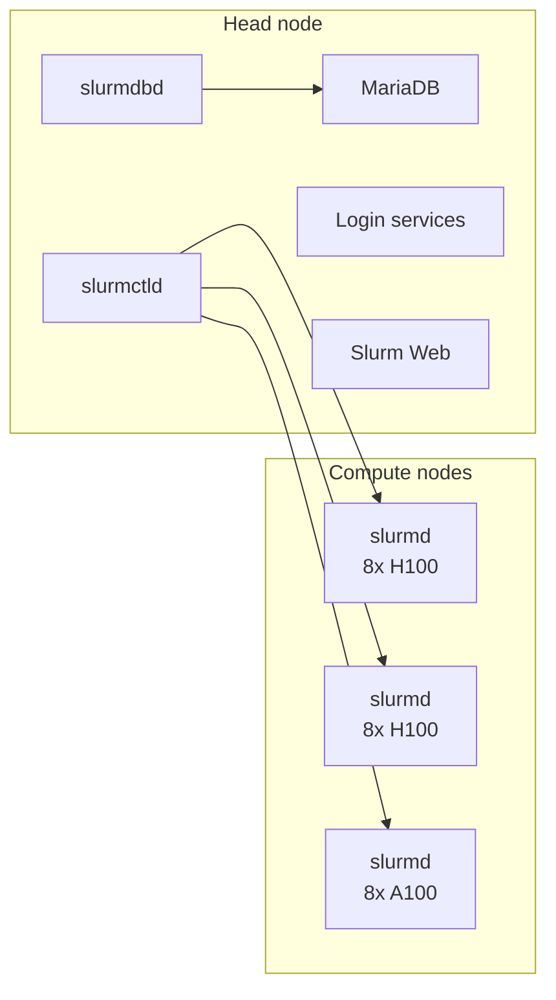

# 19.1 Capstone: a Slurm GPU cluster

| Field | Value |
|---|---|
| Level | Advanced |
| Priority tier | 1 |
| Lab venue | On-prem |
| Part | Part 19: Capstones, design and interview readiness |
| Primary sources | NVIDIA Zero-to-Hero Volume 24 (Slurm GPU cluster capstone); Part 6 (HPC & Slurm); Part 11 (GPU Kubernetes); Part 17 (Operations) |
| Cross-references | Chapter 6.7 (Slurm architecture); Chapter 6.8 (Slurm configuration); Chapter 6.10 (GPU scheduling); Chapter 17.11 (Incident response); Chapter 11 (GPU Kubernetes) |
| Coverage file | `planning/coverage/chapters/19-01.md` |
| Claim & number ledger | `planning/ledgers/19-01.md` |

## Why this matters for AI infrastructure

A Slurm GPU cluster is the production shape of an HPC + AI factory. The capstone ties together the Slurm installation, the cgroup integration, the GPU scheduling, the health checks, the fairshare accounting, the incident response, and the day-2 operations. A team that has read every chapter in Part 6 and Part 11 can describe each piece; a team that has run the capstone knows how the pieces fit together.

The capstone is what the candidate is asked about in an interview; the capstone is what the platform team uses as a reference design; the capstone is what the on-call engineer uses when the cluster is broken. The capstone is not a tutorial; the capstone is the integrated picture.

```text
Why the Slurm GPU cluster capstone matters (V24; Parts 6, 11, 17):
- A Slurm GPU cluster is the production shape of HPC + AI. The capstone is
  what ties Parts 6, 11, and 17 together into a deployable system.
- The capstone has three perspectives: the platform engineer's view (how
  to install and configure); the data scientist's view (how to submit jobs
  and read the output); the on-call engineer's view (how to debug and
  recover).
- The capstone is the reference design. Every chapter in Parts 6, 11, and
  17 maps to a section of the capstone. The capstone is the integrated picture.
```

Three operational realities make this capstone a platform-team deliverable rather than a tutorial:

1. **The capstone is the reference design.** The platform team references the capstone when adding a new node; the platform team references the capstone when upgrading Slurm; the platform team references the capstone when debugging a job. The capstone is the canonical pattern.
2. **The capstone is the interview anchor.** The candidate is asked "how would you build a Slurm GPU cluster?"; the candidate points at this capstone. The capstone is the platform team's answer.
3. **The capstone is the on-call reference.** The on-call engineer follows the runbook; the runbook points at the capstone; the on-call engineer fixes the cluster. The capstone is the on-call's guide.

**Before a team can claim they have built a Slurm GPU cluster, the team must have run this capstone. A team that has not run the capstone has not integrated the pieces.**

## Prerequisites and outcomes

### Prerequisites

- Chapter 6.7 (Slurm architecture).
- Chapter 6.8 (Slurm configuration).
- Chapter 6.10 (GPU scheduling with Slurm).
- Chapter 11 (GPU Kubernetes) for the GPU node setup.
- Chapter 17.11 (Incident response) for the on-call runbook.

### Outcomes

After completing this capstone you will be able to:

1. Provision the Slurm head node: install slurmctld, slurmdbd, the accounting database.
2. Provision the compute nodes: install slurmd, the cgroup v2 plugins, the GPU drivers.
3. Configure the partitions, the QoS, the fairshare, the accounting.
4. Configure the health checks: node down, idle, draining, health check scripts.
5. Operate the cluster: submit jobs, read the output, debug the failures.
6. Run the day-2 operations: upgrades, migrations, incident response.

---

## 1. The cluster topology

### 1.1 The head node

The head node runs slurmctld, slurmdbd, the MariaDB accounting database, the login services (SSH, LDAP), and the web UI (Slurm Web).



The pattern is: the head node runs the control plane; the compute nodes run slurmd; the cluster is a single Slurm cluster.

### 1.2 The compute nodes

The compute nodes run slurmd, the GPU drivers (NVIDIA driver, CUDA, cuDNN, NCCL), the Slurm cgroup v2 plugins, and the workload runtimes (PyTorch, TensorFlow).

```bash
# Install slurmd on a compute node
dnf install -y slurm-slurmd nvidia-driver cuda cudnn nccl

# Configure slurmd to use cgroup v2
echo "ProctrackType=proctrack/cgroup" >> /etc/slurm/slurm.conf
echo "TaskPlugin=task/cgroup,task/none" >> /etc/slurm/slurm.conf
systemctl enable --now slurmd
```

The pattern is: slurmd is installed; the GPU stack is installed; the cgroup v2 plugin is configured; slurmd is started.

---

## 2. Slurm configuration

### 2.1 The slurm.conf

The slurm.conf is the master configuration file. The slurm.conf is shared by all nodes; the slurm.conf defines the cluster name, the head node, the compute nodes, the partitions.

```ini
# /etc/slurm/slurm.conf (shape only)
ClusterName=ai-cluster
SlurmctldHost=head-1
SlurmctldPort=6817
SlurmdPort=6818

AuthType=auth/none
CryptoType=crypto/munge

StateSaveLocation=/var/spool/slurm/ctld
SlurmdSpoolDir=/var/spool/slurm/d
ProctrackType=proctrack/cgroup
TaskPlugin=task/cgroup,task/none

GresTypes=gpu
NodeName=compute-[001-024] CPUs=64 RealMemory=515200 Gres=gpu:h100:8 Sockets=2 CoresPerSocket=32 ThreadsPerCore=1 State=UNKNOWN
PartitionName=all Nodes=ALL Default=YES MaxTime=INFINITE State=UP
```

The pattern is: the cluster name is unique; the head node is identified; the compute nodes are defined with their GPU resources; the partitions are defined.

### 2.2 The partitions

The partitions are the logical grouping of compute nodes. The partitions are defined by GPU type, by node, by user, or by team.

```bash
# Create partitions by GPU type
scontrol create PartitionName=h100-partition Nodes=compute-001..compute-016 Default=NO MaxTime=72:00:00
scontrol create PartitionName=a100-partition Nodes=compute-017..compute-024 Default=NO MaxTime=72:00:00

# Set the default partition
scontrol update PartitionName=all Default=YES
```

The pattern is: each partition has a GPU type; each partition has a max wall time; each partition has a default.

### 2.3 The accounting

The accounting records who used what, when. The accounting is in MariaDB; the accounting is queried by sreport; the accounting feeds the fairshare.

```bash
# Configure the accounting
sacctmgr add cluster name=ai-cluster
sacctmgr add account name=team-data-science
sacctmgr add user name=alice account=team-data-science

# Query the accounting
sreport -t Hours cluster utilization
```

The pattern is: every job is accounted; every account is tracked; the accounting feeds the fairshare.

---

## 3. GPU scheduling

### 3.1 The GRES configuration

The GPU is a generic resource (GRES) in Slurm. The GRES is configured per node; the GRES is requested per job.

```ini
# /etc/slurm/slurm.conf
GresTypes=gpu
NodeName=compute-001 Gres=gpu:h100:8
```

The pattern is: every GPU is a GRES; every node declares its GRES; every job requests the GRES.

### 3.2 The MIG configuration

The MIG partitions are also GRES. The MIG partitions are exposed as separate GRES types.

```ini
# /etc/slurm/slurm.conf
GresTypes=gpu,mig
NodeName=compute-001 Gres=gpu:h100:8,mig:h100-1g.5gb:7
```

The pattern is: the GPU and the MIG partitions are both GRES; the workload can request either the full GPU or a MIG partition.

### 3.3 The job submission

The job submission requests the GPU resources. The job submission specifies the partition, the GPU count, the MIG profile.

```bash
# Submit a job with 4 H100 GPUs
sbatch --partition=h100-partition --gres=gpu:h100:4 --ntasks=4 --cpus-per-task=16 --mem=64G train.sh

# Submit a job with 2 MIG 1g.5gb instances
sbatch --partition=h100-partition --gres=mig:h100-1g.5gb:2 --ntasks=2 --cpus-per-task=4 --mem=16G inference.sh
```

The pattern is: the job requests the GPU resources; the Slurm scheduler allocates the resources; the job runs on the assigned nodes.

---

## 4. Health checks

### 4.1 The node health checks

The node health checks verify that the node is alive; the GPU is functional; the network is connected.

```bash
# /etc/slurm/health_check.sh (shape only)
#!/bin/bash
# Health check script for compute nodes
if ! ping -c 1 -W 1 head-1 &>/dev/null; then
    echo "head-1 unreachable"
    exit 1
fi
if ! nvidia-smi &>/dev/null; then
    echo "GPU not functional"
    exit 1
fi
exit 0
```

The pattern is: every node has a health check script; the script verifies the head node, the GPU, and the network.

### 4.2 The health check configuration

The health check is configured in slurm.conf; the check runs every N seconds; the check sets the node state.

```ini
# /etc/slurm/slurm.conf
HealthCheckInterval=60
HealthCheckProgram=/etc/slurm/health_check.sh
```

The pattern is: the health check runs every 60 seconds; the check sets the node state; the state is visible in squeue and sinfo.

---

## 5. Day-2 operations

### 5.1 The upgrade process

The upgrade process is the pattern for upgrading Slurm and the GPU drivers without downtime.

```text
Slurm upgrade process:
1. Drain the compute node: scontrol update NodeName=compute-001 State=DRAIN
2. Wait for active jobs to complete: squeue -w compute-001
3. Upgrade slurmd on the node: dnf upgrade slurm-slurmd
4. Restart slurmd: systemctl restart slurmd
5. Undrain the node: scontrol update NodeName=compute-001 State=RESUME
6. Repeat for every node
7. Upgrade slurmctld on the head node: dnf upgrade slurm-slurmctld
8. Restart slurmctld: systemctl restart slurmctld
```

The pattern is: drain, upgrade, restart, undrain. The cluster continues to serve traffic during the rolling upgrade.

### 5.2 The incident response

The incident response is the pattern for responding to a Slurm cluster failure.

```text
Slurm incident response:
1. Detect: Prometheus alert (slurmctld down, slurmd down, node down)
2. Triage: sinfo, squeue, sdiag (the Slurm diagnostic commands)
3. Mitigate: drain the node, restart the service, requeue the jobs
4. Resolve: root cause analysis, runbook update, post-mortem
```

The pattern is: detect, triage, mitigate, resolve. The runbook is the on-call's guide.

---

## 6. Hands-on lab

This lab walks through the Slurm GPU cluster capstone: the head node, the compute nodes, the partitions, the GPU scheduling, the health checks. The lab is **untested** in this repository.

### 6.1 Prerequisites

- 4 Linux nodes (1 head + 3 compute).
- NVIDIA GPUs (4x H100 or 8x A100).
- Slurm 23.11+ installed via package manager.
- NFS or similar shared filesystem for /home.

### 6.2 Step 1: install the head node

```bash
# Install slurmctld, slurmdbd, slurmrestd
dnf install -y slurm-slurmctld slurm-slurmdbd slurm-slurmrestd mariadb-server

# Configure MariaDB for Slurm accounting
systemctl enable --now mariadb
mysql_secure_installation
```

### 6.3 Step 2: configure slurm.conf

```bash
# Copy the slurm.conf from the capstone template
cp /path/to/capstone/slurm.conf /etc/slurm/slurm.conf
scontrol reconfigure
```

### 6.4 Step 3: start slurmctld

```bash
systemctl enable --now slurmctld slurmdbd
sinfo
# expected: the head node and compute nodes are visible; the partitions are listed
```

### 6.5 Step 4: submit a test job

```bash
sbatch --partition=h100-partition --gres=gpu:h100:1 --ntasks=1 \
  --cpus-per-task=8 --mem=32G /path/to/test.sh
squeue
# expected: the job is queued; the job runs on a compute node; the job completes
```

### 6.6 Step 5: query the accounting

```bash
sreport -t Hours cluster utilization
# expected: the cluster utilisation report is displayed
```

### 6.7 What to record

After the lab, you should be able to answer five questions in five seconds each:

1. What is the current cluster utilisation?
2. What is the current GPU scheduling policy?
3. What is the most recent job submission?
4. What is the current account balance?
5. What is the current node state distribution?

If any takes more than 30 seconds, the Slurm cluster is not yet a production service. The lab is **untested** against a live cluster.

---

## Exercises

1. **Add a new partition.** Create a new partition for inference workloads with a max wall time of 1 hour. *Solution sketch:* `scontrol create PartitionName=inference-partition MaxTime=1:00:00`.
2. **Add a fairshare tree.** Configure a fairshare tree with team-data-science and team-product. *Solution sketch:* `sacctmgr add fairshare` for each team.
3. **Add a health check for ECC errors.** Extend the health check to verify ECC errors are below a threshold. *Solution sketch:* `nvidia-smi -q -d ECC` in the health check script.
4. **Add a Slurm job array.** Submit a hyperparameter sweep as a Slurm job array. *Solution sketch:* `sbatch --array=1-100` with the sweep index in the script.
5. **Add a Slurm reservation.** Reserve a set of nodes for a specific job that runs at a specific time. *Solution sketch:* `scontrol create reservation`.
6. **Add a Slurm web dashboard.** Deploy Slurm Web to give the team a visual view of the cluster. *Solution sketch:* `scontrol show config` and the Slurm Web Helm chart.

---

## Checkpoint questions

<details><summary>1. What does the Slurm head node run?</summary>
slurmctld (the controller), slurmdbd (the accounting database daemon), MariaDB (the accounting database), login services (SSH, LDAP), and the web UI (Slurm Web). The head node is the control plane of the Slurm cluster.
</details>

<details><summary>2. What does a Slurm compute node run?</summary>
slurmd (the daemon), the GPU drivers (NVIDIA driver, CUDA, cuDNN, NCCL), the Slurm cgroup v2 plugins, and the workload runtimes (PyTorch, TensorFlow). The compute node is where the workload runs.
</details>

<details><summary>3. What is GRES in Slurm?</summary>
Generic Resources: the Slurm mechanism for scheduling non-CPU resources. GRES includes GPUs, MIG partitions, FPGAs, and other accelerators. Every node declares its GRES; every job requests the GRES.
</details>

<details><summary>4. What is the fairshare tree in Slurm?</summary>
The accounting mechanism that allocates compute resources based on past usage. Every account has a share; every job consumes the account's share; the fairshare tree enforces the share. The fairshare tree is what prevents one team from monopolising the cluster.
</details>

<details><summary>5. What is the Slurm upgrade process?</summary>
Drain, upgrade, restart, undrain. The cluster continues to serve traffic during the rolling upgrade. The upgrade is per-node; the upgrade is verified after each node; the upgrade is recorded in the change log.
</details>

<details><summary>6. What is the most common Slurm failure?</summary>
A node is down. The compute node fails to respond to the health check; the Slurm scheduler marks the node as down; the active jobs on the node are requeued. The fix is to investigate the node; restart slurmd; verify the GPU; undrain the node.
</details>

<details><summary>7. What is the most dangerous Slurm failure?</summary>
The slurmctld is down. The head node fails to respond; the cluster cannot accept new jobs; the active jobs continue to run. The fix is to restart slurmctld; verify the MariaDB; verify the slurmdbd.
</details>

<details><summary>8. What is the most common Slurm performance failure?</summary>
The fairshare tree is exhausted. One team has consumed all of its share; the team's jobs are queued with low priority. The fix is to adjust the fairshare tree; review the team's usage; add capacity.
</details>

<details><summary>9. What is the relationship between Slurm and Kubernetes?</summary>
Slurm is the HPC scheduler; Kubernetes is the cloud-native scheduler. Slurm has the better GPU topology awareness for HPC workloads; Kubernetes has the better ecosystem for cloud-native workloads. The two can coexist: Slurm runs the HPC workloads; Kubernetes runs the inference workloads.
</details>

<details><summary>10. What is the relationship between Slurm and the FinOps dashboard?</summary>
Slurm's accounting feeds the FinOps dashboard. The dashboard shows the per-team, per-user, per-month compute usage. The dashboard is the on-call's and CFO's view of the cluster's economics.
</details>

<details><summary>11. What is the most important Slurm metric?</summary>
The cluster utilisation rate. The metric tells the team what fraction of the cluster is in use. A low utilisation rate indicates over-provisioning; a high utilisation rate indicates under-provisioning. The alert fires when the utilisation rate exceeds 95% for more than 1 hour.
</details>

<details><summary>12. What is the difference between Slurm partitions and queues?</summary>
In Slurm, partitions are the only scheduling concept (Slurm calls them "partitions"). A queue is the equivalent in other schedulers (Slurm calls them "QOS" for Quality of Service). Partitions control which nodes a job can use; QOS controls priority and limits.
</details>

<details><summary>13. What is the relationship between Slurm and the threat model?</summary>
The threat model identifies the threats (T-001 through T-N). The Slurm configuration is the controls that mitigate the threats. The Slurm security controls (Munge authentication, cgroup isolation, GRES pinning) are what enforce the threat model.
</details>

<details><summary>14. Why is the Slurm GPU cluster capstone a Tier 1 chapter?</summary>
Because the capstone is the reference design. The capstone is what the platform team references; the capstone is what the interview candidate points at; the capstone is what the on-call engineer follows. A team that has not run the capstone has not integrated the pieces.
</details>

<details><summary>15. What is the difference between Slurm cgroup v1 and v2?</summary>
Slurm cgroup v1 uses cpuset, freezer, and other cgroup v1 controllers. Slurm cgroup v2 uses the unified cgroup hierarchy. cgroup v2 is recommended for new clusters; cgroup v2 has better resource isolation and better GPU support.
</details>

<details><summary>16. What is the difference between Munge authentication and native Kerberos?</summary>
Munge is a lightweight authentication service for HPC clusters. Munge issues a short-lived credential; the credential is verified by slurmd. Kerberos is a heavier authentication service. Munge is recommended for Slurm clusters; Munge is simpler to deploy; Munge has less operational overhead.
</details>

<details><summary>17. What is the difference between Exclusive and Shared node access in Slurm?</summary>
Exclusive means one job runs on the node at a time (no sharing). Shared means multiple jobs can run on the node at the same time (sharing resources). Exclusive is the default for HPC workloads; Shared is for inference workloads that can share a GPU.
</details>

<details><summary>18. What is the Slurm cgroup v2 task plugin?</summary>
The cgroup v2 task plugin that Slurm uses to isolate jobs. The plugin creates a cgroup for each job; the plugin enforces CPU, memory, and device limits; the plugin cleans up when the job completes. The cgroup v2 task plugin is the foundation of Slurm's job isolation.
</details>

<details><summary>19. What is the relationship between Slurm and the GPU vendor?</summary>
Slurm integrates with the GPU vendor through the GRES mechanism. The GRES declares the GPU type (h100, a100, l40s); the GRES allocates the GPU to the job; the GRES pins the GPU to the job. The integration is what makes Slurm a production-grade GPU scheduler.
</details>

<details><summary>20. What five questions should the Slurm capstone lab let you answer in five seconds each?</summary>
What is the current cluster utilisation. What is the current GPU scheduling policy. What is the most recent job submission. What is the current account balance. What is the current node state distribution. If any takes more than 30 seconds, the Slurm cluster is not yet a production service.
</details>

---

## Sources and review notes

- NVIDIA Zero-to-Hero Volume 24 (Slurm GPU cluster capstone). Source for the head node, the compute nodes, the partitions, the GPU scheduling, the health checks, and the day-2 operations. The wording has been rewritten in the handbook's voice.
- Part 6 (HPC & Slurm) for the Slurm installation and configuration.
- Part 11 (GPU Kubernetes) for the GPU node setup.
- Part 17 (Operations) for the incident response.

### Cross-references to other handbook chapters

- Chapter 6.7 for the Slurm architecture.
- Chapter 6.8 for the Slurm configuration.
- Chapter 6.10 for the GPU scheduling.
- Chapter 17.11 for the incident response.

### Migrated from `nvidia-devops`

The Slurm GPU cluster capstone operational patterns draw on Volume 24. The wording has been rewritten in the handbook's voice.

### Explicitly labelled inferences

- The cluster size (1 head + 3 compute) is a starting point; specific sizes depend on the workload.
- The partition count (2-3 per GPU type) is a starting point; specific counts depend on the team structure.
- The health check interval (60 seconds) is a starting point; specific intervals depend on the team's SLA.

### Not verified on live hardware

- The lab in Section 6 is **untested** against a live cluster in this repository.
- The Slurm commands assume a working Slurm installation; production deployments require careful staging.
- The GPU vendor integration assumes NVIDIA drivers; AMD GPUs require a different GRES type.
