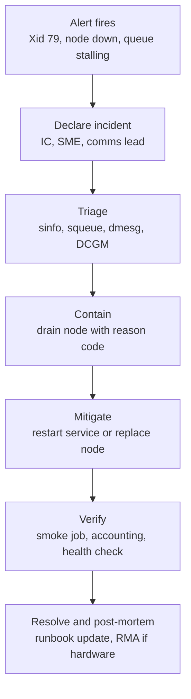

# 19.1 Capstone: a Slurm GPU cluster

| Field | Value |
|---|---|
| Level | Advanced |
| Priority tier | 1 |
| Lab venue | On-prem |
| Part | Part 19: Capstones, design and interview readiness |
| Cross-references | Chapter 6.7 (architecture); 6.8 (configuration); 6.9 (QoS and fairshare); 6.10 (GPU scheduling); 6.11 (job submission); 6.14 (operations); 6.15 (HA and upgrades); 6.31 (local capstone); 17.4 (DCGM exporter); 17.11 (incident response) |
| Coverage file | `planning/coverage/chapters/19-01.md` |
| Claim & number ledger | `planning/ledgers/19-01.md` |

## Why this matters for AI infrastructure

It is 2 a.m., and a 24-hour training run has just died. The on-call engineer opens the dashboards and sees a cluster that looks healthy on every individual check. `sinfo` shows every node up, and the GPU allocation graph sits close to full. Yet fairshare never fired, so one team's 500-job hyperparameter sweep quietly took over the whole cluster. At the same time, two jobs on the same node corrupted each other's results, because neither one was pinned to its own GPUs. Nothing is broken in the sense of a dead machine. The pieces were simply never connected to each other.

Every piece of that story has its own chapter. You learn the installation in 6.7, the configuration in 6.8, the accounting policy in 6.9, and the GPU scheduling in 6.10. The job scripts are in 6.11, the day-2 operations are in 6.14 and 6.15, the GPU metrics are in 17.4, and the incident response is in 17.11. Someone who has read all of those chapters can explain each piece on its own. That is useful, but it does not tell you how the pieces behave together when a real cluster misbehaves in the middle of the night. The capstone exists to answer that harder question.

The answer comes down to five integration surfaces. The first is the `slurm.conf` file that every node reads and trusts. The second is the accounting database, which is what makes QoS and fairshare real instead of decorative. The third is the health-check loop, which turns a dying GPU into a drained node before the scheduler sends it more work. The fourth is an upgrade order that never freezes the cluster. The fifth is a runbook that tells the on-call engineer exactly what to do at 2 a.m. This chapter walks the whole cluster through those five surfaces, one at a time, in the order you would meet them on a real build.

The capstone is also your interview anchor. Suppose an interviewer asks how you would build and operate a Slurm GPU cluster. A list of daemons is a weak answer, because it names the parts without showing how they fit. A stronger answer walks through the integrated picture in the order a real build proceeds. The same picture is the reference design the platform team uses, and it is also what the on-call engineer reads when the cluster is on fire.

## Prerequisites and outcomes

### Prerequisites

Every step in this capstone depends on an earlier chapter covering the same ground in more depth. If a step below feels unfamiliar, go back to the chapter named beside it instead of guessing at the syntax.

- Chapter 6.7: Slurm architecture and installation.
- Chapter 6.8: Slurm configuration, nodes, partitions, and cgroups.
- Chapter 6.9: accounting, QoS, fairshare, and backfill.
- Chapter 6.10: GPU scheduling with GRES and MIG.
- Chapter 6.11: submitting and launching jobs.
- Chapter 6.14: Slurm operations, health checks, and drain.
- Chapter 6.15: high availability, upgrades, and scaling.
- Chapter 17.4 for the DCGM exporter; Chapter 17.11 for incident response.

### Outcomes

Picture the first morning after a new GPU cluster goes live. Users are already submitting jobs, and nobody is yet sure whether the accounting, the limits, and the health checks really work. This section sets out the path the chapter takes to answer that question. The chapter builds the controller with `slurmctld` and `slurmdbd` and the MariaDB accounting database, then writes a complete `slurm.conf` and explains each parameter in it. After that it sets up partitions, accounts, QoS limits, and the fairshare tree, then schedules GPUs with GRES, including MIG instances, and launches multi-node jobs. The last part covers how to operate the result: health checks, node drains, rolling upgrades, incident response, and the observability stack. The first step is always the same one, which is to lay out the topology and see why each role has its own machine.

---

## 1. The cluster topology: five roles, one cluster

### The node that boots up blind

Imagine you just added a fourth compute node to a three-node cluster. The image is right, the GPUs are detected, and the node joins the network cleanly. But every `scontrol` command from that node fails with an authentication error, and `slurmdbd` refuses its accounting traffic. The cause is invisible. The new node carries a different Munge key from the controller, and its clock is 40 seconds behind. Munge is the small authentication service that Slurm daemons use to sign their messages to each other. Each message carries a short credential that proves who sent it and when. Munge credentials are time-stamped, so a skewed clock makes even a correct key fail. The cluster has no idea that a node is broken. It simply sees an entity it cannot trust, and it stops talking to that entity.

This is the first lesson of the topology. A Slurm cluster is a security boundary as much as it is a scheduling domain. Every node must share the Munge key, the same time source, and the same identity configuration before anything else works. Chapter 6.7 covers the installation mechanics. Here the point is the discipline behind them. When you add or replace any node, your first check is not whether the GPUs work. Your first check is whether this node can authenticate to the controller. A node that cannot authenticate is not part of the cluster, and it does not matter what `lspci` reports about its hardware.

It helps to run the checks in a fixed order whenever a new node misbehaves. First confirm that the node can sign a message the controller accepts. Then confirm that its clock agrees with the rest of the cluster. Only after both pass should you look at the GPUs and the configuration files. Doing it in this order saves time, because a hardware check on a node that cannot authenticate tells you nothing about the cluster.

### The five roles

A new cluster design meeting usually begins with one question: which machine does what? A production Slurm GPU cluster separates five roles. The controller runs `slurmctld`, which is the scheduler and the owner of cluster state. It decides which job runs where, and it remembers what is queued and what is running. The accounting service runs `slurmdbd` in front of a MariaDB database. This pair is what makes QoS, multifactor priority, and fairshare functional at all, because it stores the usage records that those features read. The login nodes are where users SSH in, and where they submit and monitor jobs. Compute nodes never double as login nodes. A burst of users logging in would otherwise land on the machines that are supposed to be training models. The compute nodes run `slurmd` plus the full GPU stack. The monitoring role is a fleet of exporters, with DCGM on every GPU node, that feed a Prometheus backend. Each exporter answers a simple question on a timer, and Prometheus stores the answers so you can look back at them later.


Consider what happens when the roles are mixed. A user logs in to a shared machine that is also a training node, and starts copying a large dataset from the login shell. The copy eats the network and the disk, and the training job on the same box slows down for reasons nobody can see in the job log. The user did nothing unusual. The design simply gave the user a way onto the machine that was supposed to be quiet. Separating the roles removes that path entirely, and it makes every later diagnosis simpler, because each machine now has one job.

In a small cluster the roles compress. The controller and the login node are often the same box, and the monitoring backend can share the controller. What never compresses is the compute role. A node that runs user workloads is never also the controller, because a runaway job must not be able to starve the scheduler that owns it. Think of it as the difference between the air traffic control tower and the runways. The tower must keep working even when a plane is misbehaving on the runway.

**Decision rule:** separate the controller, login, and compute roles from day one, even if two of them share a machine. Never mix user workloads with the control plane.

**In one minute:** a Slurm GPU cluster has five roles: controller (`slurmctld`), accounting (`slurmdbd` + MariaDB), login, compute (`slurmd` + GPU stack), and monitoring (DCGM exporters into Prometheus). Every node must share the Munge key and the same clock, or authentication fails. Compute nodes are never login nodes and never controllers.

---

## 2. The controller node: control plane and accounting database

### The accounting database nobody configured

Here is a failure that takes a whole afternoon to diagnose. A team files a complaint that fairshare is not working: their heavy overuse has not lowered their priority compared with anyone else's. The engineer checks `slurm.conf`, finds the priority plugin configured, and starts to wonder. The real cause is that `AccountingStorageType` was never set at all. Without a working accounting backend, Slurm records no usage. With no usage records, QoS, multifactor priority, and the fairshare tree are all silently inert. The configuration looks correct on the page, but the database behind it does not exist.

This is why the controller build has two halves: the control plane and the accounting plane. Chapter 6.7 walks through the package installation. Here we build the accounting plane from end to end, because it is the piece that breaks most often. The reason it breaks so often is that it is easy to set up the scheduler and forget the bookkeeping. Nothing crashes when the bookkeeping is missing. The scheduler simply runs without remembering who used what, and the policy you wrote on paper never takes effect.

### Building the accounting plane

Your first afternoon with a new controller usually starts with an empty server and a request to turn on accounting. The accounting database is a plain MariaDB database with a dedicated user. On the controller you create the database, create a `slurm` user with a password, and grant that user full access to the accounting schema and nothing else. Then `slurmdbd` is configured to connect to it. The reason for the dedicated user is containment. If the password leaks, the damage stops at one schema, and the rest of the database server stays out of reach.

The `slurmdbd.conf` file carries the storage parameters: `StorageType=accounting_storage/mysql` and `StorageLoc=slurm_acct_db`, plus the host, user, and password. One discipline is worth keeping. The database secret belongs in `slurmdbd.conf`, not in `slurm.conf`. The controller only needs to know where to reach `slurmdbd`, and the credential itself stays in one file with mode 600. That mode lets only the owner read or write the file, which limits the damage from a leaked configuration. The commands below create the database, the user, and the grant, and then lock the file down.

```bash
#!/bin/bash
# Controller: create the accounting database (Chapter 6.7 installs the packages)
sudo mysql -e "CREATE DATABASE slurm_acct_db;"
sudo mysql -e "CREATE USER 'slurm'@'localhost' IDENTIFIED BY '<strong-password>';"
sudo mysql -e "GRANT ALL ON slurm_acct_db.* TO 'slurm'@'localhost';"

# After /etc/slurm/slurmdbd.conf is written, lock it down
sudo chown slurm:slurm /etc/slurm/slurmdbd.conf
sudo chmod 600 /etc/slurm/slurmdbd.conf
```

It helps to know what happens when `slurmdbd` starts for the first time. The daemon reads `slurmdbd.conf`, opens a connection to the MariaDB server, and checks that its schema exists. If the schema is missing, it creates the tables it needs. If the password is wrong, the daemon fails at this step, and the log says so. That is why the most useful check after starting the daemon is a simple query. If the query works, the accounting plane is alive. If it does not, the fault is between the daemon and the database, and the scheduler's configuration is not the place to look.

The file that the last two lines protect holds the connection settings:

```ini
# /etc/slurm/slurmdbd.conf (owner slurm, mode 600)
AuthType=auth/munge
DbdHost=controller-1
SlurmUser=slurm
StorageType=accounting_storage/mysql
StorageLoc=slurm_acct_db
StorageHost=localhost
StorageUser=slurm
StoragePass=<strong-password>
```

On the `slurm.conf` side, the controller declares where the accounting backend lives. The line is `AccountingStorageType=accounting_storage/slurmdbd`, pointed at the controller host. With that line present, `sacctmgr` commands start working against the database, and the accounting hierarchy from Chapter 6.9 becomes something you can actually use instead of a diagram on a slide.

### Relocating the controller

Hardware gets replaced, and sooner or later the controller has to move to a new machine. A controller that has run for two years carries a great deal of state with it. The state directory matters most. Slurm keeps controller state under `StateSaveLocation`, and that directory must be writable by the Slurm user on the new host. A safe move stops the old daemons, moves or shares the state location, distributes the configuration, and then starts the new daemons. If you do it in that order, pending jobs are retained through the move. That last detail is the difference between a controlled relocation and a 400-job requeue storm, where every waiting job has to be resubmitted by hand. It earns its place in the runbook, not in someone's memory.

**Decision rule:** never deploy QoS, fairshare, or multifactor priority until `sacctmgr add account` succeeds against a live `slurmdbd`. The accounting database is a prerequisite, not an afterthought.

**In one minute:** the controller runs `slurmctld`, and the accounting plane is `slurmdbd` in front of a MariaDB `slurm_acct_db` database with a dedicated user. Secrets live in `slurmdbd.conf` with mode 600. Without `AccountingStorageType` set, QoS and fairshare are silently inert. Controller relocations must move or share `StateSaveLocation`, or pending jobs are lost.

---

## 3. `slurm.conf` end to end

### The copy-paste node line

A cluster grows for two years, and its hardware changes along the way. In year one, the nodes had 96 cores and 512 GB of memory. In year two, the team adds nodes with 128 cores and 768 GB. The engineer copies the `NodeName` line from the old generation and changes only the node names. Now the scheduler believes the new nodes have less memory than they really do. It packs jobs onto the old nodes until something runs out of memory, while the new nodes sit half empty. The configuration file is the single source of truth for what the hardware looks like to the scheduler, and the `NodeName` line is where that truth lives or dies. A copied line is a quiet lie, and the scheduler will believe it.

### Reading the file as a whole

Picture a new engineer opening `slurm.conf` for the first time, with no one to ask. The file must explain itself by its structure. A complete `slurm.conf` for this capstone reads as follows. The parameter groupings follow the order a real build proceeds: identity, state, containment, accounting, and then the node and partition inventory. Read it top to bottom once, and the rest of this section will make sense.

```ini
# /etc/slurm/slurm.conf (complete for this capstone)
ClusterName=ai-factory
SlurmctldHost=controller-1
AuthType=auth/munge
SlurmUser=slurm
StateSaveLocation=/var/spool/slurm/ctld
SlurmdSpoolDir=/var/spool/slurm/d
SlurmctldPort=6817
SlurmdPort=6818

# Containment: put every job step in a cgroup (limits are set in cgroup.conf)
ProctrackType=proctrack/cgroup
TaskPlugin=task/cgroup,task/affinity

# Consumable resources: memory must be a consumable for ConstrainRAMSpace to work
SelectType=select/cons_tres
SelectTypeParameters=CR_Core_Memory

# Accounting (see Section 2 for the slurmdbd side)
AccountingStorageType=accounting_storage/slurmdbd
AccountingStorageHost=controller-1
AccountingStorageEnforce=limits,qos
AccountingStorageTRES=gres/gpu,gres/gpu:h100
JobAcctGatherType=jobacct_gather/cgroup
JobAcctGatherFrequency=30

# Priority: fairshare has weight 0 until you give it one
PriorityType=priority/multifactor
PriorityWeightFairshare=10000

# Health checks (Section 6)
HealthCheckInterval=300
HealthCheckNodeState=ANY,CYCLE
HealthCheckProgram=/etc/slurm/health_check.sh

# GPU inventory
GresTypes=gpu
NodeName=compute-[001-003] CPUs=128 RealMemory=756000 Gres=gpu:h100:8 \
    Sockets=2 CoresPerSocket=32 ThreadsPerCore=2 State=UNKNOWN

# Partitions (policy in Section 4)
PartitionName=gpu Nodes=compute-[001-003] Default=YES MaxTime=72:00:00 State=UP \
    TRESBillingWeights="GRES/gpu=1.0,CPU=0.001,Mem=0.01G"
```

Containment limits live in a second file, `/etc/slurm/cgroup.conf`, which every compute node needs. Putting these lines in `slurm.conf` is a common mistake, and Slurm will not read them from there. Keep the two files apart in your head: one describes the cluster, and the other describes what each job is allowed to take on a node.

```ini
# /etc/slurm/cgroup.conf
CgroupPlugin=cgroup/v2
ConstrainCores=yes
ConstrainRAMSpace=yes
ConstrainDevices=yes
```

Walk through the groups in order. Identity comes first. `ClusterName` must be unique across your site. `SlurmctldHost` names the controller, and `AuthType=auth/munge` is the default, which is why Munge runs on every node from Section 1. State comes next. `StateSaveLocation` holds controller state and must be writable by `SlurmUser`, and `SlurmdSpoolDir` is the per-node spool area. The default ports are 6817 for the controller and 6818 for the daemons, so explicit port lines are documentation more than configuration. Writing them down still helps the next person who reads the file.

Containment comes third. `ProctrackType=proctrack/cgroup` and `TaskPlugin=task/cgroup,task/affinity` put every job step inside a cgroup. A cgroup is a Linux kernel feature that groups processes and sets limits on what the group may use. The matching `cgroup.conf` selects the unified hierarchy with `CgroupPlugin=cgroup/v2`. The three `Constrain*` parameters in that file are where the copy-paste incident from the opening gets fixed. All three default to `no` in `cgroup.conf`. That default means a job is not actually limited to what it asked for unless you say otherwise. A job requesting 80 GB can wander into its neighbour's memory and pull both jobs down with it. In a shared GPU cluster all three are `yes`. Chapter 6.8 gives the full reasoning on cgroup containment, and Chapter 6.10 covers GPU device pinning.

Accounting comes fourth. The `AccountingStorage*` lines connect to the plane built in Section 2. `JobAcctGatherType=jobacct_gather/cgroup` turns on usage collection, and `JobAcctGatherFrequency=30` sets the task sampling interval to 30 seconds. The frequency setting does nothing without the type, so the two must be read together. That sampling is what makes per-job CPU and memory reports meaningful. A cluster that wants fairshare decisions it can trust leaves it on.

Four more groups make the other parameters take effect, and each one has a sibling that is easy to forget. `ConstrainRAMSpace` does nothing unless memory is a consumable resource, so `SelectType=select/cons_tres` carries `SelectTypeParameters=CR_Core_Memory`. QoS limits are only enforced when `AccountingStorageEnforce` includes `limits` and `qos`. Fairshare has a weight of 0 by default, so `PriorityWeightFairshare` must be set under `PriorityType=priority/multifactor`. Last, `AccountingStorageTRES=gres/gpu,gres/gpu:h100` tells accounting to track the GPUs that the billing weights and the per-user cap refer to. Without that line, a GPU cap has nothing to count.

Inventory is the last group, and the number you write there needs care. A safe way to set `RealMemory` is to start from the memory the node reports to the operating system, then subtract a margin for the kernel and the Slurm daemons. Do this on each node generation separately, because two nodes that look alike on paper can differ by a few gigabytes after firmware and driver updates. Write the value down with the date you measured it. A value you cannot trace back to a measurement is the same kind of quiet lie as a copied line.

The `NodeName` line is the hardware declaration. `CPUs` is the total logical core count, `RealMemory` is the memory in MB that the scheduler will actually commit, and the `Gres=gpu:h100:8` tail declares the GPUs as generic resources of type `h100`. `Sockets`, `CoresPerSocket`, and `ThreadsPerCore` describe the topology, and they feed NUMA-aware placement. NUMA stands for non-uniform memory access. It means that memory close to one CPU socket is faster for that socket than memory on the other side of the machine, and the scheduler uses the topology to keep a job's cores and memory close together. Set `RealMemory` a few percent below physical RAM so the kernel is never starved. Verify the number against the actual node with `free` before you trust it.

**Decision rule:** treat `slurm.conf` as the contract between hardware reality and the scheduler. When a node generation changes, re-derive the `NodeName` line from the new hardware instead of copying it.

**In one minute:** `slurm.conf` has five groups. Identity and state come first, then process tracking in cgroups, with the three `Constrain*` limits set to `yes` in the separate `cgroup.conf`. Accounting is wired to `slurmdbd`, the GPU GRES inventory lives in the `NodeName` lines, and the partition definitions close the file. The defaults that bite are `Constrain* = no` and no accounting backend, so both must be set explicitly on a shared cluster.

---

## 4. Partitions, accounts, QoS, and fairshare

### The team that ate the cluster

A research team launches a 500-job hyperparameter sweep on a Tuesday morning. Each job asks for a single GPU, so the scheduler obliges, and by lunch the entire cluster is running that team's experiments. The ML platform team's model regression run sits in the queue behind 400 of them. Nobody did anything wrong, and nobody did anything fair. This is the failure mode that partitions and fairshare exist to prevent. It is also the most common operational complaint in any shared GPU cluster you will ever run.

### Partitions: the hard boundaries

Someone asks you to take one node out of service for a repair on Thursday, and the question is which part of the cluster stays open. The partition answers that question, because it is the hard grouping of nodes. This capstone uses one partition, a single `gpu` partition that holds all three compute nodes. A cluster with CPU-only nodes would add a second partition for them. The partition attributes you set are `Nodes`, `Default`, `MaxTime`, and `State`. A `MaxTime` of 72 hours on the GPU partition is a policy choice, documented as such in the ledger. It protects the fleet from a forgotten 30-day job that holds GPUs for weeks.

Here is how the states play out during a real repair. A node shows a fault at the start of a working day. You set the node to drain, so that the queue stops placing new work on it while the jobs already running there finish. The partition stays open, and the other nodes keep serving the users. Once the repair is done, you return the node to service, and the queue resumes using it without anyone resubmitting a job. The same drain state is what the health check uses in Section 6, so the two procedures share one vocabulary.

The states are where the subtlety lives, and they matter most during an incident. `UP` is normal. `DOWN` still accepts job submissions but starts nothing, which is wrong for a dead node, because you want the queue to be honest about what will run. `DRAIN` is the working state for a suspect node. It rejects new submissions while letting already-queued jobs run on other nodes. Chapter 6.14 uses these states in its operations material. Here they are part of the cluster's policy vocabulary, and the on-call engineer must know which one means "I can still submit to this partition."

```bash
#!/bin/bash
# Adjust the gpu partition at runtime (slurm.conf in Section 3 defines the same policy)
scontrol update partitionname=gpu MaxTime=72:00:00 State=UP
scontrol update partitionname=gpu Default=YES
```

### Accounts, QoS, and the fairshare tree

A manager asks for a monthly report that shows which team used the GPUs and whether each team stayed within its share. You cannot answer that question from the scheduler alone. The accounting hierarchy from Chapter 6.9 answers it, and it becomes operational now that `slurmdbd` is live. Accounts form a tree. Users are associated into accounts, and jobs charge to the account of the submitting user. The policy layer on top has two instruments, and they do different jobs. QoS gives you hard limits. The `normal` QoS caps a user at 64 GPU TRES, for example, so that no single user can hold the fleet. The fairshare tree gives you soft balance. Every account gets a share, and accounts that have overused their share see their priority fall while others rise. Fairshare is what turns "500 queued jobs" into "500 queued jobs that will eventually run, in proportion to entitlement."

A short walkthrough shows how the balance recovers. Suppose one account used far more than its share last week. Its usage is recorded in the database, and the fairshare factor for that account falls. The next time the scheduler ranks the queue, the overused account's jobs sit lower, and the jobs from quieter accounts move ahead of them. Nothing is cancelled and nothing is punished in a visible way. The overused team simply waits longer until its balance decays back toward its share. That quiet behavior is the reason fairshare is easy to live with, and it is also the reason people forget it is working until someone asks why their job is still waiting.

```bash
#!/bin/bash
# Account hierarchy and association
sacctmgr add account name=team-data-science
sacctmgr add user name=alice,bob account=team-data-science

# QoS hard limit (Chapter 6.9)
sacctmgr add qos name=normal priority=10 maxtresperuser=gres/gpu=64

# Fairshare weights (SCL)
sacctmgr modify account team-data-science set fairshare=100
```

`TRESBillingWeights` is a partition option, so it sits on the `PartitionName` line in `slurm.conf`. It decides what usage costs against the tree. The example used here is `GRES/gpu=1.0,CPU=0.001,Mem=0.01G`. It says GPUs dominate the billing, so a GPU-hungry team is penalized far harder than a memory-hungry one. That is usually the right trade for a GPU cluster, because a GPU is the scarce resource. Reporting closes the loop. `sreport cluster utilization Start=2026-10-01 End=2026-11-01 -t percent` is the number you put in the monthly review, and it is the same number the FinOps dashboard in Chapter 17 displays.

**Decision rule:** give every team an account, a QoS cap, and a fairshare weight before the first real workload lands. Retrofitting all three after the cluster is busy means rewriting the queue while it is on fire.

**In one minute:** partitions are the hard node groupings with `MaxTime` and state policy, where `DRAIN` rejects new jobs but lets queued ones run elsewhere. Accounts form a tree that jobs charge to. QoS sets hard per-user TRES limits, fairshare sets soft priority weights, and `TRESBillingWeights` decides what counts as usage. `sreport cluster utilization` is the standing report.

---

## 5. GPU scheduling: GRES, autodetect, and MIG

### The job that saw eight GPUs

Two teams submit single-GPU jobs to the same 8-GPU node on the same afternoon. Both jobs run. Both jobs finish, both report success, and both produced garbage. The reason is that Slurm allocated one GPU to each job, but nothing told the CUDA runtime which GPU belonged to which job. A PyTorch process that calls `cuda.set_device` without being pinned sees all eight devices, and it defaults to using all of them. The two jobs now read and write each other's allocations through the shared memory bus. The scheduler's bookkeeping said one GPU each, while the hardware offered eight to everyone. GRES plus device pinning is the fix, and it is the single most important integration point in this capstone. GRES stands for generic resources, which is Slurm's way of counting things such as GPUs that are not CPUs or memory.

### GRES with NVML autodetect

Suppose you add a new GPU node with the same model as the others. The `Gres=` tail on its `NodeName` line tells the scheduler how many GPUs exist, and that number is the only thing the scheduler knows about the hardware. GPUs are generic resources, declared per node in the `Gres=` tail of the `NodeName` line, as `Gres=gpu:h100:8` in Section 3. Chapter 6.10 builds this up in detail. The capstone keeps two settings from that chapter that are easy to lose. The first is `AutoDetect=nvml` in `gres.conf` on the compute nodes. It makes `slurmd` enumerate the GPUs the node actually has, instead of trusting a number that can drift. NVML is the NVIDIA Management Library, the interface that lets software ask the driver what hardware is present. The second setting is `ConstrainDevices=yes` in `cgroup.conf`. It puts the allocated devices into the job's cgroup, so the runtime can only see what was given to it. With both set, the corruption scenario from the opening cannot happen, because the job's cgroup exposes exactly the devices Slurm allocated.

The `AutoDetect` parameter belongs to `gres.conf`, not `slurm.conf`. The file for every GPU node is short.

```ini
# /etc/slurm/gres.conf (compute nodes)
AutoDetect=nvml
```

A job requests GPUs with `--gres`. A small job that needs one card asks for it like this, and the scheduler picks an idle GPU for it.

```bash
#!/bin/bash
# One H100
sbatch --partition=gpu --gres=gpu:h100:1 --cpus-per-task=16 \
    --mem=64G --time=4:00:00 single_gpu_job.sh
```

A multi-node job follows the pattern from Chapter 6.11. You request the node count and the per-node GPU count, and then you launch with `srun` over PMIx, so that the runtime knows the topology. PMIx is the process management interface that MPI jobs use to find their peers, and it is what lets the ranks on different nodes discover each other.

```bash
#!/bin/bash
#SBATCH --job-name=pretrain
#SBATCH --partition=gpu
#SBATCH --nodes=2
#SBATCH --gpus-per-node=8
#SBATCH --ntasks-per-node=8
#SBATCH --cpus-per-task=12
#SBATCH --mem=700G
#SBATCH --time=24:00:00
#SBATCH --output=pretrain-%j.out

srun --mpi=pmix python train.py
```

Batch arrays cap out the same way as everywhere else in Slurm. `--array=0-31%8` runs 32 array tasks with at most 8 running at once. That keeps a sweep from filling the queue with 32 identical entries that all want the GPUs at the same moment. The cap is the lever that stops one sweep from becoming the 500-job problem from Section 4.

### MIG: the same GRES machinery, smaller slices

A product team asks for small GPU slices for notebooks and quick experiments, because a whole H100 is too much for a notebook. Multi-Instance GPU partitioning, usually called MIG, splits one physical GPU into isolated instances with their own memory and compute. Slurm exposes those instances through the same GRES mechanism it uses for whole GPUs. Chapter 6.10 introduces the syntax, and the capstone adds the operational constraints. An H100 with 80 GB of memory supports the instance profiles `1g.10gb`, `1g.20gb`, `2g.20gb`, `3g.40gb`, `4g.40gb`, and `7g.80gb`. The cluster declares whichever mix it wants per node. With MIG on, the node line lists each instance profile as its own GPU type.

```ini
# slurm.conf (excerpt): compute-002 with two 1g.10gb MIG instances reserved for small jobs.
# This line replaces compute-002 in the compute-[001-003] range of the complete file,
# so that range becomes compute-001 and compute-003 on their own NodeName line.
GresTypes=gpu
NodeName=compute-002 CPUs=128 RealMemory=756000 \
    Gres=gpu:h100:6,gpu:h100_1g.10gb:2 Sockets=2 CoresPerSocket=32 \
    ThreadsPerCore=2 State=UNKNOWN
```

Planning the mix is a workload question before it is a hardware question. If most of your small requests are notebooks that need a sliver of memory, a node with several small slices serves them well. If most requests are full training runs, slices only add a restart cost and a scheduling puzzle. Write down the request sizes you actually see in the queue for two weeks, and then choose the layout that matches them. The layout you pick is the one you will live with until the next maintenance window.

A small job then requests a slice the same way it requests a whole GPU, with `sbatch --gres=gpu:h100_1g.10gb:1`. Slurm does not create MIG instances itself. It expects them to be partitioned already. The GRES type must be a substring of the MIG Profile string that `slurmd` logs at debug2 level, so `h100_1g.10gb` here is an example to check against your own node. The operational trap is timing. The MIG instances must be created on the node before `slurmd` starts, because `slurmd` with `AutoDetect=nvml` reads the instance layout at startup. If you reconfigure MIG later, you restart the daemon, and a daemon restart is a node drain. Plan the MIG layout into the provisioning step, not into day-2 improvisation.

**Decision rule:** always run `AutoDetect=nvml` plus `ConstrainDevices=yes` on every GPU node. Treat the MIG instance layout as part of provisioning, because changing it requires a daemon restart.

**In one minute:** GPUs are GRES. `AutoDetect=nvml` keeps the declaration honest, and `ConstrainDevices=yes` pins each job to its allocation, so two jobs can never share a device. Multi-node jobs launch with `srun --mpi=pmix`. MIG instances are declared as GRES per node and must exist before `slurmd` starts.

---

## 6. Health checks and the node lifecycle

### The zombie node

A GPU dies with a Xid 79 event. Xid is the name NVIDIA gives to the error codes that the driver writes to the kernel log when the GPU misbehaves, and code 79 means the GPU has fallen off the bus. The driver has reset, and the card is gone. But `slurmd` is still running, so the scheduler still sees an idle node, and it keeps sending jobs to it. Every job fails at step start, and the failure is attributed to the workload, not the hardware. The node is a zombie: alive as a process, dead as a machine, and the cluster has no idea. This is the failure the health-check loop exists to catch. The design rule that prevents it is the one people most often miss. The health check script is not allowed to only report. It has to act, by draining the node itself.

### The check loop

A monitoring dashboard can look fine while a card has already dropped out. That is why the check loop is built into Slurm itself, not left to a dashboard. Two parameters configure the loop. `HealthCheckInterval` is the period in seconds, and its default is 0, which means checks are off entirely. A cluster that never set it has no health checking at all. That is a more common configuration than anyone expects, and it is worth checking on your own cluster today. `HealthCheckNodeState` controls which node states get checked. The capstone uses `ANY,CYCLE`, taken from Chapter 6.14, so checks spread across the interval instead of hitting every node at the same instant. The interval here is 300 seconds, matching 6.14.

```ini
# slurm.conf (excerpt, also present in the complete file)
HealthCheckInterval=300
HealthCheckNodeState=ANY,CYCLE
HealthCheckProgram=/etc/slurm/health_check.sh
```

The script checks three things, in order. First, it asks whether `slurmd` is alive at all. Second, it looks for a Xid event in the kernel ring buffer, which is the signature of a GPU driver crash and the subject of Chapter 6.21. The kernel ring buffer is the log the kernel keeps in memory, and `dmesg` reads it. Third, it asks whether `nvidia-smi` reports ECC errors, which are memory errors that the GPU corrected or could not correct. A rising ECC count is the early warning for a degrading card. Any failure drains the node with a reason code that names the evidence. The reason code is what the on-call engineer reads on the pager, instead of the raw alert.

```bash
#!/bin/bash
# /etc/slurm/health_check.sh - runs on compute nodes
HOST=$(hostname)

if ! pgrep -x slurmd >/dev/null; then
    scontrol update NodeName="$HOST" State=drain Reason="slurmd not running"
    exit 1
fi

if dmesg 2>/dev/null | grep -qi "xid"; then
    scontrol update NodeName="$HOST" State=drain Reason="Xid event in dmesg"
    exit 1
fi

if ! nvidia-smi -q -d ECC 2>/dev/null | grep -q "No ECC errors detected"; then
    scontrol update NodeName="$HOST" State=drain Reason="ECC errors detected"
    exit 1
fi

exit 0
```

Follow one failing check from start to finish, because the path is the lesson. The loop wakes up on the node and runs the script. The first test, whether `slurmd` is running, passes. The second test finds a Xid line in the kernel log, so the script calls `scontrol` and marks the node as drained, with the reason `Xid event in dmesg`. The script then exits with an error code. The scheduler sees the drained state and stops placing new jobs on that node. Jobs already running there are not killed by the drain, so the users on that node keep their work. The on-call engineer sees the reason code on the next look at `sinfo`, and the reason tells them where to start.

One honest limitation is worth remembering. A polling script that runs every 300 seconds is a tripwire, not a monitor. It catches a dead card within five minutes, but it cannot tell you that the card has been running at degraded clocks for two hours. That is the DCGM exporter's job, covered in Section 8. The two layers are complementary. The script isolates the node, and the exporter explains why.

Maintenance uses the same lifecycle. A planned kernel or driver update drains the node with a reason, reboots it, and brings it back with `scontrol reboot ASAP nextstate=resume reason="kernel update" compute-002`. The node then returns to service without a human touching its state by hand. Chapter 6.14 owns the full drain and reboot procedure. Here it is part of the operating rhythm, the same rhythm you use for every planned change.

**Decision rule:** the health check script must drain the node itself with a named reason. A script that only exits nonzero leaves the scheduler placing jobs on a dead GPU.

**In one minute:** `HealthCheckInterval` defaults to 0, which means no checking, so set it to 300 with `ANY,CYCLE`. The script checks `slurmd` liveness, Xid events in `dmesg`, and ECC errors, and it drains the node with a reason code on failure. The script is a tripwire, while continuous GPU telemetry is DCGM's job. Planned maintenance uses drain-plus-reboot with `nextstate=resume`.

---

## 7. Day-2 operations: upgrades, incidents, and runbooks

### The upgrade that froze the cluster

It is Friday at 3 p.m. The team wants to upgrade the fleet, and it chooses the approach that feels fastest. It installs the new `slurmd` packages on every compute node at once, and then it upgrades the controller. The compute daemons come up speaking the new protocol, while the controller is still on the old one. The nodes fall out of the cluster in a wave. Every running job's step management breaks, the queue fills with pending jobs that no node can take, and the afternoon becomes the rest of the week. The fix was never heroic. It was an ordering. Chapter 6.15 states the rule, and this section makes it operational. The order is `slurmdbd` first, then `slurmctld`, then `slurmd`, then the client tools. Never the reverse, and never all at once.

### The rolling upgrade

A full cluster upgrade proceeds in waves, and a wave is a small group of nodes that you take out, upgrade, and bring back before you touch the next group. Before the first wave, back up `StateSaveLocation` and the accounting database. If the upgrade goes wrong, those two artifacts are what let you restore the cluster to a known state. Then, for each compute node, drain it with a reason so the scheduler stops placing new work on it. Wait for the active jobs to finish, upgrade the `slurmd` package, restart the daemon, and resume the node. Repeat through the fleet in waves, so that at no moment is more than one node unavailable. The controller and `slurmdbd` upgrade at the end, in that order, because the daemons above them still speak the old protocol until they are upgraded in turn.

After the last node returns, the cluster earns a smoke test before the change is declared done. Run one single-GPU job, one small array, and one accounting query. If all three behave, the upgrade is verified against the things the fleet actually does. It is not verified by the package manager saying the install succeeded. Version policy follows the supported upgrade windows from Chapter 6.15. A cluster on 23.11 moves through the released line step by step, and it does not jump over versions. Optional daemons such as `slurm-sackd`, available from 23.11 onward, are upgraded with the rest.

### Incident response: roles, then commands

An alert fires at night. Xid 79 on one node, the node is down, and the queue has stopped moving. The instinct is to start typing commands. The better first move is to assign roles. The incident command structure from Chapter 17.11 separates three people. The Incident Commander owns the timeline and the decisions. The subject-matter engineer owns the diagnosis. The communications lead owns the status updates to the teams whose jobs are stuck. Without that split, the person closest to the failure also becomes the person furthest from the users, and the incident outlives the root cause.



The communications lead has a job that is easy to underrate. Every team whose jobs are stuck wants to know three things, and the lead should answer them in every update. What is broken, when the next update will come, and what the affected users should do in the meantime. An update that says only "we are investigating" invites a flood of messages, and each message pulls the engineers away from the diagnosis. A short, regular update keeps the people with the most work to do out of the chat window.

The command path is short. Triage with `sinfo`, `squeue`, and `dmesg` on the suspect node, plus the DCGM evidence for GPU failures. Contain the problem by draining the node with a reason code, exactly as the health script in Section 6 does. For a serious Xid or hardware event, the troubleshooting runbook says to drain or quarantine first and to collect the `dmesg` and DCGM evidence. Only then reset or reboot the device. A reset before the drain risks another job landing on the dying GPU in the middle of the reset. If the same fault recurs on the same card, the outcome is an RMA, which means the vendor replaces the hardware. Another reboot will not fix a card that is failing.

The runbook that carries all of this has a fixed anatomy. It has a symptom, an impact, a mitigation, a verification, and a resolution or RMA step. Each step carries the exact commands and the expected output, plus an escalation path for when the mitigation does not work. A runbook without expected outputs is a wish list. With them, the 2 a.m. engineer can check each step against what the screen actually shows, and can tell at once when something is wrong.

### Game days

The last day-2 practice is the game day. A game day is a planned drill in which you break something on purpose, in a controlled window, and watch what the team does. Pick a hypothesis, such as "a Xid 79 on one node should drain that node within five minutes and requeue its jobs." Inject the fault. Watch the alerts fire, the drain happen, and the SLO hold. Record every gap between what happened and what the runbook promised. The gaps are the next quarter's runbook work, found on a Tuesday afternoon instead of at 2 a.m.

**Decision rule:** upgrade in the order `slurmdbd`, `slurmctld`, `slurmd`, clients, in per-node waves, with backups first and a three-part smoke test after. Run incidents with separate IC, SME, and comms roles.

**In one minute:** upgrades proceed from `slurmdbd` to `slurmctld` to `slurmd` to clients, node by node. Back up `StateSaveLocation` and the database first, and finish with a smoke test of one GPU job, one array, and one accounting query. Incidents run on an ICS split: IC, SME, comms. The runbook anatomy is symptom, impact, mitigation, verification, and resolution or RMA, each with expected output. Game days inject the failure on purpose.

---

## 8. Observability for the cluster: DCGM, Prometheus, and the zombie GPU problem

### The cluster that is full and doing nothing

A capacity review starts with a contradiction. Allocation is at 98 percent, which means nearly every GPU on the cluster has a job assigned to it. Utilization is at 12 percent on the 30-day average of SM activity. SM stands for streaming multiprocessor, the unit inside the GPU that does the arithmetic. Somebody has allocated the fleet to jobs that spend their time waiting, on data, on the network, or on a bug that makes them idle-spin. The allocation number is a lie the scheduler tells, because it measures what was assigned, not what is being computed. Put the two numbers side by side and the story becomes clear. A GPU that is allocated and busy shows high SM activity. A GPU that is allocated and waiting shows high allocation with low activity, and it is the second case that costs money. Capacity decisions based on allocation alone tend to buy more hardware for a queue that was never using the hardware it already had. The observability stack exists to put the second number next to the first, so that capacity decisions run on activity instead of allocation.

### The stack

A new teammate asks where to look first when the fleet feels slow. The reference stack from the observability capstone material is small and standard, and it answers that question. Every GPU node runs a DCGM exporter on port 9400 next to a node exporter on port 9100. DCGM is NVIDIA's data center GPU manager, and its exporter turns GPU telemetry into metrics that Prometheus can read. Prometheus scrapes both at a 30-second interval, and Alertmanager listens on 9093 and pages the on-call engineer. The target the capstone holds to is that a failed node raises a failure alert within two minutes of the exporter going dark. Chapter 17.4 builds the DCGM exporter in detail, so this section only fixes the topology. Every GPU node runs its exporters, and a central Prometheus scrapes them. Recording rules aggregate every five minutes. At fleet scale, a remote-write backend such as Thanos, Cortex, or VictoriaMetrics sits in front of the query layer, so that long history stays fast to query.

The alerts that matter for this cluster are the ones that map to Section 6. A DCGM Xid event, ECC error counts crossing a threshold, and sustained temperature above the model's limit all point at hardware. SM activity collapsing while allocation stays high points at the workload. That last one is not a hardware alert. It is a workload alert, and it saves the most money, because it tells you the queue is full of jobs that should not be running.

### The troubleshooting tree

A user says training is slow. The on-call engineer has to decide where to look, and the wrong first guess can waste the whole night. The decision tree from the troubleshooting material walks in a fixed order. When utilization is low, check memory pressure first, then the collective-communication path, then the host CPU. A collective operation is a step where every GPU exchanges data with the others before any of them can continue, so a slow network stalls all of them. When clocks are low, inspect temperature to separate a thermal throttle from a power or driver problem. Then correlate the GPU metrics against NCCL logs and the fabric counters. NCCL is NVIDIA's collective communication library, and its logs show where the exchange slowed down. The tree exists so that the on-call engineer follows the same path at 2 a.m. that the team followed in the lab. Every branch of it has a command and an expected result, in the runbook format from Section 7.

**Decision rule:** alert on activity, not allocation. If you cannot see SM activity next to allocation on one dashboard, you do not have a capacity story yet.

**In one minute:** the stack is a DCGM exporter on 9400 plus a node exporter on 9100 per node. Prometheus scrapes at 30 seconds, Alertmanager listens on 9093, and recording rules aggregate every five minutes. At scale, a remote-write backend sits in front. The key numbers are SM activity versus allocation, which is the zombie-GPU signal. Low utilization walks memory, NCCL, and host CPU, and low clocks separate thermal from power.

---

## 9. Hands-on lab

This lab builds the capstone cluster on four on-prem Linux nodes: one controller and three compute nodes, with the GPU nodes carrying 8 GPUs each. The steps were not run on a live cluster, so treat every expected output as a target to check on your own hardware. The lab assumes a working NFS mount for shared home and spool directories. NFS is the network file system that lets several machines see the same folders.

### 9.1 Prerequisites

Before anything is installed, someone has to confirm that the machines exist and that they agree on the time. Most failed lab runs trace back to one of these two checks. Write the node names, the GPU count per node, and the shared folder paths on a sheet before you begin. Each later step refers to those names, and a typo in a name shows up as a failure several steps further on, far from its cause.

- 4 Linux nodes: 1 controller plus 3 compute, all time-synchronized with NTP.
- 8 NVIDIA GPUs per compute node, driver and CUDA installed.
- NFS shared directories for `/home` and `/var/spool/slurm`.
- Slurm packages available from your distribution's repository or SchedMD.

### 9.2 Step 1: identity and time on every node

Imagine you are the new engineer on the first day, with four blank servers and a request to make them into one cluster. The first question is whether the four machines can trust each other at all. Munge and the clock are the answer, and they come before everything else in the lab. The first step is to give every node the same key and the same clock. The commands below install Munge and chrony, copy the key to the compute nodes, and check the time offset.

```bash
#!/bin/bash
# Every node, controller included
sudo apt-get install -y munge chrony
sudo systemctl enable --now munge chrony
# Controller: distribute the key to every compute node and check time
for n in compute-001 compute-002 compute-003; do
    sudo scp /etc/munge/munge.key "$n":/etc/munge/
done
chronyc tracking   # expect: System time offset near zero on all nodes
```

### 9.3 Step 2: the controller and its accounting database

The next step is the controller. This is the point where the accounting database gets created, because nothing about QoS or fairshare can work without it. Run the commands on the controller only.

```bash
#!/bin/bash
# Controller
sudo apt-get install -y munge mariadb-server slurm-wlm slurmdbd
sudo mysql -e "CREATE DATABASE slurm_acct_db;"
sudo mysql -e "CREATE USER 'slurm'@'localhost' IDENTIFIED BY '<strong-password>';"
sudo mysql -e "GRANT ALL ON slurm_acct_db.* TO 'slurm'@'localhost';"

# /etc/slurm/slurmdbd.conf per Section 2, mode 600
sudo systemctl enable --now slurmdbd
```

### 9.4 Step 3: `slurm.conf` and the daemons

Write the `slurm.conf` from Section 3 with your real node names and memory values. Then start the controller. The first `sinfo` call is the check that tells you the controller is answering.

```bash
#!/bin/bash
# Controller
sudo systemctl enable --now slurmctld
sinfo    # expected: controller visible, partition gpu listed
```

### 9.5 Step 4: the compute nodes

Each compute node needs the same packages and the same configuration files that the controller uses. Copy the Munge key, `slurm.conf`, `cgroup.conf`, and `gres.conf` over from the controller. Then start `slurmd` and check from the controller that the nodes registered.

```bash
#!/bin/bash
# Each compute node
sudo apt-get install -y munge slurm-wlm
# copy munge key, slurm.conf, cgroup.conf and gres.conf from the controller
sudo systemctl enable --now slurmd
# Controller: confirm
sinfo -l   # expected: compute nodes idle, GPU GRES visible
```

### 9.6 Step 5: accounts, QoS, and the first GPU job

With the cluster up, the first real job tests the whole chain at once. You create an account, a user, and a QoS, then submit a one-GPU job and watch it run. Each command checks a different layer, so a failure points you to the layer that broke.

```bash
#!/bin/bash
sacctmgr add account name=team-data-science
sacctmgr add user name=alice account=team-data-science
sacctmgr add qos name=normal priority=10 maxtresperuser=gres/gpu=64

sbatch --partition=gpu --gres=gpu:h100:1 --cpus-per-task=16 \
    --mem=64G --time=0:30:00 /path/to/test_gpu.sh
squeue   # expected: job RUNNING on a compute node
sacct -j "$JOBID"   # JOBID from the sbatch output; expected: job COMPLETED with GPU time recorded
```

### 9.7 Step 6: health check and a deliberate drain

Install the script from Section 6 and set the `HealthCheck*` parameters. Then simulate a failure. Stop `slurmd` on one compute node and watch the health loop drain it within one interval, with the reason code visible in `sinfo`. A drain you have caused on purpose is the best way to learn what the reason code looks like before a real incident shows it to you.

### 9.8 What to record

After the lab, try to answer five questions from the cluster itself, each in about five seconds. If an answer takes longer, the cluster is not yet an operating service. Go back to the section that owns the gap.

1. What is the current cluster utilization, from `sreport`?
2. Which node states are non-idle, and why is each one there?
3. What is the QoS GPU cap per user, and which account holds it?
4. When did the last health check run, and what did it do?
5. What is the upgrade order for this cluster, and what do you back up first?

---

## Exercises

Suppose a new project starts on Monday, and the team needs its accounts and limits in place before anyone can submit a job. The six exercises below practice that kind of work. Each one has a solution sketch you can check against.

1. **Build the fairshare tree.** Create two accounts, `team-data-science` and `team-product`, each with a fairshare weight. Then verify with `sacctmgr show account` that both are visible. *Solution sketch:* `sacctmgr add account name=team-product`, `sacctmgr modify account team-product set fairshare=80`, then `sacctmgr show account`.
2. **Reserve nodes for a critical run.** Create a reservation named `launch-window` for two nodes. It starts tomorrow at 08:00. It lasts 6 hours and is restricted to one user. Then submit a job into it with `--reservation`. *Solution sketch:* `scontrol create reservation name=launch-window StartTime=2026-11-09T08:00:00 Duration=6:00:00 Users=alice NodeCnt=2`, then `sbatch --reservation=launch-window -N 2 job.sh`.
3. **Cap a sweep.** Submit a 32-task array that never runs more than 8 tasks at once. Confirm the cap with `squeue -a`. *Solution sketch:* `#SBATCH --array=0-31%8`, where the `%8` suffix is the concurrency cap.
4. **Declare MIG on a node.** Extend a compute node's `Gres` line so it exposes two `1g.10gb` H100 instances alongside six whole GPUs. Then submit a job that requests one instance. *Solution sketch:* `Gres=gpu:h100:6,gpu:h100_1g.10gb:2` with `GresTypes=gpu`. Create the instances on the node before restarting `slurmd`, then `sbatch --gres=gpu:h100_1g.10gb:1`.
5. **Harden the health check.** Extend the Section 6 script so it also drains a node whose DCGM exporter has been silent for more than 10 minutes. Use a `curl` probe of the local exporter endpoint to decide. *Solution sketch:* add a `curl -s --max-time 5 http://localhost:9400/health` check that drains with `Reason="DCGM exporter silent"`.
6. **Run one upgrade wave.** Perform the full drain, upgrade, restart, and resume cycle on a single compute node. Take the `StateSaveLocation` backup first, and run the three-part smoke test after. *Solution sketch:* `scontrol update NodeName=compute-002 State=drain Reason="upgrade"`, wait for active jobs, upgrade the `slurmd` package, restart the daemon, `scontrol update NodeName=compute-002 State=resume`, then run the smoke job, array, and accounting query.

---

## Checkpoint questions (20)

<details><summary>1. What roles does a production Slurm GPU cluster separate, and which one never shares a machine?</summary>
Controller, accounting, login, compute, and monitoring. The compute role never shares a machine with the control plane, because a runaway job must not be able to starve the scheduler that owns it.
</details>

<details><summary>2. Why must every node share the Munge key and the same clock?</summary>
Munge is the default authentication, and its credentials are time-stamped. A different key or a skewed clock makes the node's credentials fail validation, so the node is invisible to the cluster even though its hardware is fine.
</details>

<details><summary>3. What silently stops working if AccountingStorageType is never set?</summary>
QoS limits, multifactor priority, and the fairshare tree all depend on recorded usage. Without an accounting backend there is no usage to record, so all three are inert even though the priority plugin appears configured.
</details>

<details><summary>4. What does slurmdbd.conf configure, and where does the database secret belong?</summary>
It points `slurmdbd` at the accounting database: `StorageType=accounting_storage/mysql` and `StorageLoc=slurm_acct_db`, plus host, user, and password. The secret belongs in `slurmdbd.conf` with mode 600, not in `slurm.conf`.
</details>

<details><summary>5. What are the default Slurm ports for the controller and the compute daemons?</summary>
6817 for `slurmctld` and 6818 for `slurmd`. Explicit port lines in `slurm.conf` are therefore documentation as much as configuration.
</details>

<details><summary>6. Why does the NodeName line use RealMemory instead of a physical-memory figure?</summary>
RealMemory is the memory in MB the scheduler will actually commit to jobs. Setting it slightly below physical RAM keeps the kernel from being starved, and it is the value that prevents the overcommit incident where a copied node line understates new hardware.
</details>

<details><summary>7. What do ConstrainCores, ConstrainRAMSpace, and ConstrainDevices do, and what is their default?</summary>
They put a job inside its declared limits for cores, memory, and devices. All three default to no in `cgroup.conf`, which means a job is not limited to what it asked for unless you say otherwise, so a shared cluster sets all three to yes.
</details>

<details><summary>8. What is the difference between the DOWN and DRAIN partition or node states?</summary>
DOWN still accepts job submissions but starts nothing, which misleads the queue about what will run. DRAIN rejects new submissions while letting already-queued jobs run elsewhere, which is the working state for a suspect node.
</details>

<details><summary>9. What is the one rule the health check script must follow?</summary>
It must act, not just report. On a failed check it drains the node itself with a named reason code. A nonzero exit alone does not change the node state, and the scheduler would keep placing jobs on the dead hardware.
</details>

<details><summary>10. What is the default value of HealthCheckInterval, and what does that imply?</summary>
Zero, which disables health checking entirely. A cluster that never set the parameter has no health loop at all, which is a more common configuration than most teams expect.
</details>

<details><summary>11. What does AutoDetect=nvml do on a compute node?</summary>
It makes `slurmd` enumerate the GPUs and MIG instances it actually has at startup, instead of trusting a declared number that can drift when hardware changes. It is why MIG layout changes require a daemon restart.
</details>

<details><summary>12. Which MIG instance profiles does an H100 with 80 GB of memory support?</summary>
The profiles are 1g.10gb, 1g.20gb, 2g.20gb, 3g.40gb, 4g.40gb, and 7g.80gb. The cluster declares its chosen mix per node in the Gres line.
</details>

<details><summary>13. Why must MIG instances exist before slurmd starts?</summary>
With NVML autodetect, `slurmd` reads the instance layout at startup. Reconfiguring MIG afterwards means restarting the daemon, which is a node drain, so the layout belongs in the provisioning step.
</details>

<details><summary>14. How does a multi-node GPU job launch its processes?</summary>
The job requests nodes and per-node GPUs with sbatch directives, then launches with `srun --mpi=pmix`, which gives the runtime the process topology it needs to place one rank per GPU.
</details>

<details><summary>15. What is the upgrade order for a Slurm cluster, and what must be backed up first?</summary>
slurmdbd, then slurmctld, then slurmd, then the client tools, with the compute nodes upgraded in per-node waves. Back up StateSaveLocation and the accounting database before the first wave.
</details>

<details><summary>16. What three-part smoke test verifies a completed upgrade?</summary>
One single-GPU job, one small array, and one accounting query. They cover the three things the fleet actually does: GPU scheduling, queue mechanics, and the accounting plane.
</details>

<details><summary>17. What three roles does an incident run on, and why?</summary>
Incident Commander, subject-matter engineer, and communications lead. Without the split, the person closest to the failure is also furthest from the users, and the incident outlives the root cause.
</details>

<details><summary>18. What is the fixed anatomy of an AI runbook?</summary>
Symptom, impact, mitigation, verification, and resolution or RMA, each with the exact commands and the expected output, plus an escalation path. Expected outputs are what make a step verifiable at 2 a.m.
</details>

<details><summary>19. What is the zombie GPU problem, and which two numbers expose it?</summary>
Allocation at 98 percent with a 30-day SM activity average of 12 percent: the fleet is full of jobs that are waiting, not computing. Allocation measures what was assigned; SM activity measures what is being computed.
</details>

<details><summary>20. What is the observability stack for the capstone cluster, and what is its alert target?</summary>
A DCGM exporter on port 9400 and a node exporter on 9100 per node, Prometheus scraping at a 30-second interval, Alertmanager on 9093, and recording rules aggregating every five minutes. The target is a failure alert within two minutes of an exporter going dark.
</details>

---

## Sources and review notes

- *Supercomputers for Linux Sysadmins* (), Chapter 15 "Slurm": installation and Munge/time discipline, accounting setup with the MariaDB schema, partition states, QoS and limits, priorities and fairshare, reservations, and the job-submission experience. Corpus folder: `supercomputers-for-linux-sysadmins-managing-modern-hpc-clusters-and-supercomputers-from-software-to`.
- Slurm official documentation (mirrored under the author's corpus): `slurm.conf` reference, `slurmdbd.conf` reference, cgroup reference, and job-array reference, for parameter names, defaults, ports, and the array concurrency cap.
- nvidia-devops Zero-to-Hero Volume 19, production operations: incident response and game-day execution, capacity planning and the zombie-GPU metric, monitoring and observability at scale, and on-call handoff with the runbook anatomy.
- nvidia-devops Zero-to-Hero Volume 24, capstone projects 4, 5, 6, and 9: observability system design, troubleshooting incident response, MIG configuration for multi-tenant workloads, and capacity planning forecast. The specific figures taken from each are listed in the ledger.
- nvidia-devops Zero-to-Hero Volume 16, Chapter 1: why GPU observability is fundamentally different, covering the DCGM signal set and the limitation of snapshot tooling.
- nvidia-devops Zero-to-Hero Volume 20, Chapter 2: GPU driver crashes and Xid errors, covering the drain-before-reset discipline and the RMA path.
- Slurm man pages `slurm.conf`, `cgroup.conf`, `gres.conf`, `slurmdbd.conf`, plus the GRES, TRES, `sacctmgr`, `scontrol` and `sbatch` pages, all fetched from https://slurm.schedmd.com on 2026-11-10. The site header showed Version 26.05 and the man2html footer showed "Time: 20:36:52 GMT, October 13, 2026". Every parameter in the code files was checked against that one version.
- Book use: *Supercomputers for Linux Sysadmins* Chapter 15 and *How Linux Works, 3rd edition* (cgroups and process-management chapters) were the book sources for the narrative. This light pass did not re-read them chapter by chapter.
- Handbook Part 6: Chapters 6.7 through 6.11 (the Slurm build), 6.14 (operations, health checks, drain, reboot), 6.15 (HA and upgrades), and 6.31 (the local Slurm capstone this chapter generalizes).
- Handbook Part 17: Chapter 17.4 (DCGM exporter) and 17.11 (incident response).

### Cross-references to other handbook chapters

- Chapter 6.7 through 6.11 for the Slurm build this capstone integrates.
- Chapter 6.14 for drain, reboot, and the health-check operations.
- Chapter 6.15 for HA, backups, and upgrade windows.
- Chapter 6.31 for the single-source local variant of this capstone.
- Chapter 17.4 for the DCGM exporter build; Chapter 17.11 for incident response roles.

### Migrated from `nvidia-devops`

- `nvidia-zero-to-hero/volume-19/chapter-02-incident-response-and-game-day-execution.md`
- `nvidia-zero-to-hero/volume-19/chapter-03-capacity-planning-and-forecasting.md`
- `nvidia-zero-to-hero/volume-19/chapter-09-monitoring-and-observability-at-scale.md`
- `nvidia-zero-to-hero/volume-19/chapter-12-on-call-handoff-and-operational-runbooks.md`
- `nvidia-zero-to-hero/volume-16/chapter-01-why-gpu-observability-is-fundamentally-different.md`
- `nvidia-zero-to-hero/volume-20/chapter-02-gpu-driver-crash-and-xid-errors.md`
- `nvidia-zero-to-hero/volume-24/chapter-04-observability-system-design.md`
- `nvidia-zero-to-hero/volume-24/chapter-05-troubleshooting-incident-response.md`
- `nvidia-zero-to-hero/volume-24/chapter-06-mig-configuration-multi-tenant.md`
- `nvidia-zero-to-hero/volume-24/chapter-09-capacity-planning-forecast.md`

The wording has been rewritten in the handbook's voice; no verbatim passages were carried over.

### Explicitly labelled inferences

- The 72-hour `MaxTime` on the GPU partition, the 4-node lab scale, and the 64-GPU per-user QoS cap are policy choices, not source-mandated values. The `TRESBillingWeights` values and the 300-second health interval are starting points, and the interval matches Chapter 6.14.
- The `RealMemory=756000` figure is an example for an 8-GPU node; replace it with the value from `free` on your nodes.
- The lab's five-question checklist is an author synthesis of the operating skills this chapter covers.

### Not verified on live hardware

- The hands-on lab in Section 9 is **untested** against a live cluster in this repository; it assumes working NFS, NTP, and current Slurm packages for your distribution.
- All `scontrol`, `sacctmgr`, `sbatch`, and `sreport` output shown as "expected" is illustrative; production deployments require staging and a rollback plan for the upgrade wave.
- MIG instance creation was not executed on live GPUs, and the slurmd restart behavior described is from the source material, not from a live test in this repository.

### Code files

Every configuration and script block in this chapter equals a file in `code/part19/`: `c01_slurm.conf`, `c01_cgroup.conf`, `c01_gres.conf`, `c01_slurmdbd.conf`, `c01_slurm_health_check.conf`, `c01_slurm_mig_node.conf`, `c01_health_check.sh`, `c01_pretrain_job.sh`, and the other `c01_*.sh` files. The shell files pass `bash -n`. The test file `test_c01_slurm_configs.py` checks that each parameter sits in the right file, that sibling parameters are present, and that the chapter blocks equal the files.

### Verification log

Slurm version checked: man pages for Version 26.05, fetched 2026-11-10. The Slurm version in the lab is whatever your distribution packages, so recheck defaults against your own `man slurm.conf`.

| Item | Count |
|---|---|
| Claims checked against man pages | 58 |
| Confirmed unchanged | 48 |
| Corrected | 6 |
| Siblings added | 4 |
| Removed | 0 |
| Still unverified | 8 |

Corrections made:

1. `TaskPlugin=task/cgroup,task/none` became `task/cgroup,task/affinity`, the stacking the `slurm.conf` page recommends. `task/none` is not listed there.
2. `TRESBillingWeights` is a partition option. It moved onto the `PartitionName` line, and the TRES name `GPU` became `GRES/gpu`, the form the TRES page shows.
3. `AutoDetect=nvml` is a `gres.conf` parameter. It was prose only, so `c01_gres.conf` now exists.
4. The partition script created a partition and updated a `cpu` partition that the chapter never defines. It now updates the one `gpu` partition.
5. The lab used the `ntp` package but checked time with `chronyc`, and copied the Munge key to one node. It now installs `chrony` and copies the key to all three.
6. The diagram showed `8x A100` for the third node while every config says H100. The diagram now says H100.

Siblings added to `slurm.conf`: `SelectType` with `SelectTypeParameters=CR_Core_Memory` (needed by `ConstrainRAMSpace`), `AccountingStorageEnforce=limits,qos` (needed for QoS limits), `PriorityType` with `PriorityWeightFairshare` (default weight is 0), and `AccountingStorageTRES=gres/gpu,gres/gpu:h100`. The weight 10000 is my example value, not a documented default.

Still unverified:

- The MIG profile list for an 80 GB H100 comes from NVIDIA's MIG guide, not from Slurm pages.
- The GRES type string `h100_1g.10gb` must match the MIG Profile in the `slurmd` debug2 log on real hardware.
- That `sacctmgr add qos name=normal` succeeds on a fresh database, since `normal` may already exist.
- The `dmesg` Xid match and the `nvidia-smi -q -d ECC` phrase "No ECC errors detected".
- The `slurm-sackd` and 23.11 upgrade statement in Section 7.
- The 400-job requeue figure and the other illustrative incident numbers.
- The `apt` package names `slurm-wlm` and `slurmdbd` on your distribution.
- The claim that two unpinned jobs corrupt each other through the shared memory bus is an illustration, not a sourced mechanism.
