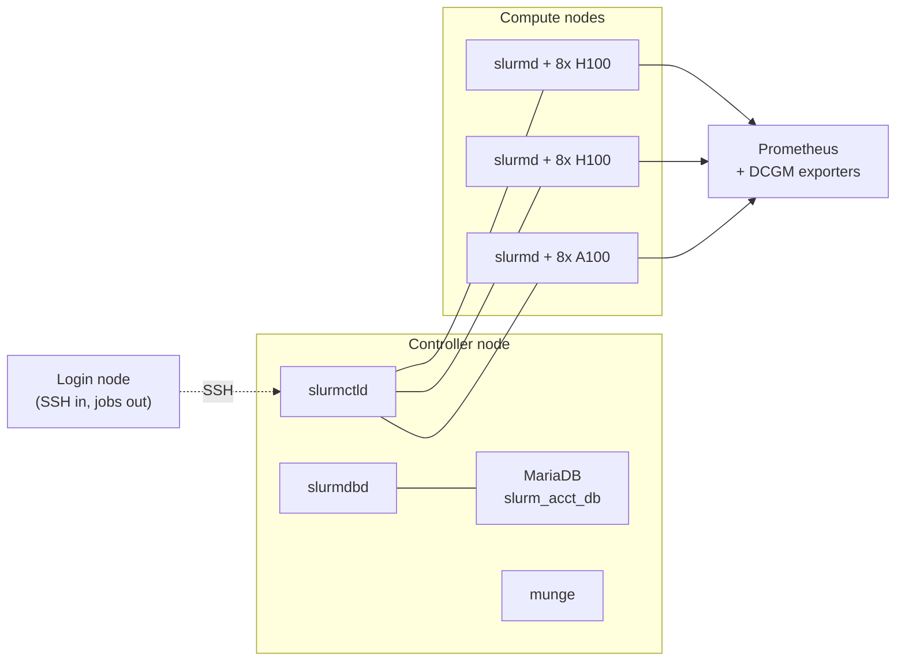
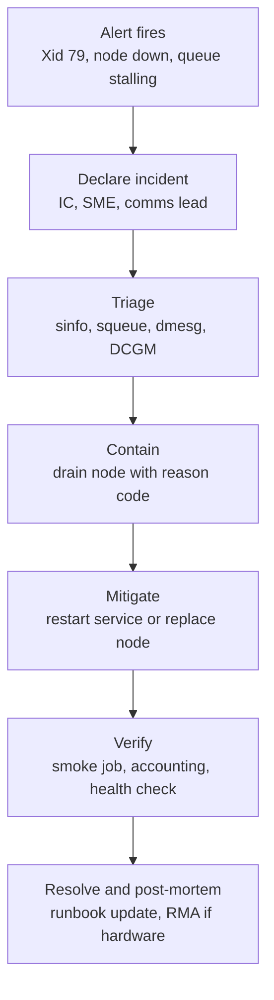

# 19.1 Capstone: a Slurm GPU cluster

| Field | Value |
|---|---|
| Level | Advanced |
| Priority tier | 1 |
| Lab venue | On-prem |
| Part | Part 19: Capstones, design and interview readiness |
| Primary sources | SCL Ch. 15 (Slurm); Slurm official documentation; nvidia-devops Zero-to-Hero Volume 19 (production operations), Volume 24 (capstone projects 4–6), Volume 16 and Volume 20 (observability and troubleshooting); handbook Part 6 (6.7–6.15) and Part 17 |
| Cross-references | Chapter 6.7 (architecture); 6.8 (configuration); 6.9 (QoS and fairshare); 6.10 (GPU scheduling); 6.11 (job submission); 6.14 (operations); 6.15 (HA and upgrades); 6.31 (local capstone); 17.4 (DCGM exporter); 17.11 (incident response) |
| Coverage file | `planning/coverage/chapters/19-01.md` |
| Claim & number ledger | `planning/ledgers/19-01.md` |

## Why this matters for AI infrastructure

It is 2 a.m. A 24-hour training run has just died, and the on-call engineer is staring at a cluster that, by every individual check, looks healthy. `sinfo` shows every node healthy. The dashboards show GPU allocation near saturation. But fairshare never fired, so one team's 500-job hyperparameter sweep quietly consumed the entire cluster. And two co-scheduled jobs on the same node just corrupted each other's results, because neither was pinned to its own GPUs. Nothing is broken. The pieces are simply not integrated.

Every piece in that story has its own chapter. The installation lives in 6.7, the configuration in 6.8, the accounting policy in 6.9, and the GPU scheduling in 6.10. The job scripts are 6.11, the day-2 operations are 6.14 and 6.15, the GPU metrics are 17.4, and the incident response is 17.11. A team that has read all of them can describe each piece in isolation. The capstone exists to answer the harder question, which is what holds the pieces together.

The answer is five integration surfaces. One is the `slurm.conf` that every node trusts. The second is the accounting database that makes QoS and fairshare real. The third is the health-check loop that turns a dying GPU into a drained node before the scheduler sends it more jobs. The fourth is an upgrade order that never freezes the cluster, and the fifth is a runbook that tells the on-call engineer exactly what to do at 2 a.m. This chapter walks the whole cluster through those five surfaces.

The capstone is also the interview anchor. When an interviewer asks how you would build and operate a Slurm GPU cluster, the answer is not a list of daemons; it is this integrated picture, told in the order a real build proceeds. The same picture is what the platform team uses as its reference design and what the on-call engineer uses when the cluster is on fire.

## Prerequisites and outcomes

### Prerequisites

- Chapter 6.7: Slurm architecture and installation.
- Chapter 6.8: Slurm configuration, nodes, partitions, and cgroups.
- Chapter 6.9: accounting, QoS, fairshare, and backfill.
- Chapter 6.10: GPU scheduling with GRES and MIG.
- Chapter 6.11: submitting and launching jobs.
- Chapter 6.14: Slurm operations, health checks, and drain.
- Chapter 6.15: high availability, upgrades, and scaling.
- Chapter 17.4 for the DCGM exporter; Chapter 17.11 for incident response.

### Outcomes

After completing this capstone you will be able to:

1. Lay out the cluster topology and explain why each role is separate.
2. Build the controller node: `slurmctld`, `slurmdbd`, the MariaDB accounting database, and Munge.
3. Write a complete `slurm.conf` and explain every parameter in it.
4. Configure partitions, accounts, QoS limits, and the fairshare tree.
5. Schedule GPUs with GRES, including MIG instances, and launch multi-node jobs.
6. Operate the cluster: health checks, node drains, rolling upgrades, incident response, and the observability stack.

---

## 1. The cluster topology: five roles, one cluster

### The node that boots up blind

Imagine you just added a fourth compute node to a three-node cluster. The image is right, the GPUs are detected, and the node joins the network cleanly. But every `scontrol` command from that node fails with an authentication error, and `slurmdbd` refuses its accounting traffic. The cause is invisible: the new node carries a different Munge key from the controller, and its clock is 40 seconds behind. Munge credentials are time-stamped, so a skewed clock makes even a correct key fail. The cluster has no idea that a node is broken; it simply sees an entity it cannot trust, and it stops.

This is the first lesson of the topology: a Slurm cluster is a security boundary as much as a scheduling domain. Every node must share the Munge key, the same time source, and the same identity configuration before anything else works. Chapter 6.7 covers the installation mechanics; here the point is the discipline. When you add or replace any node, the first verification is not "do the GPUs work" but "can this node authenticate to the controller." A node that cannot authenticate is not part of the cluster. It does not matter what `lspci` says.

### The five roles

A production Slurm GPU cluster separates five roles. The controller runs `slurmctld`, the scheduler and the owner of cluster state. The accounting service runs `slurmdbd` in front of a MariaDB database, and this pair is what makes QoS, multifactor priority, and fairshare functional at all. The login nodes are where users SSH in and from where they submit and monitor jobs. Compute nodes never double as login nodes. A burst of users would otherwise land on the nodes that are supposed to be training models. The compute nodes run `slurmd` plus the full GPU stack. The monitoring role is a fleet of exporters, DCGM on every GPU node, that feed a Prometheus backend.



In a small cluster the roles compress: the controller and the login node are often the same box, and the monitoring backend can share the controller. What never compresses is the compute role. A node that runs user workloads is never also the controller, because a runaway job must not be able to starve the scheduler that owns it.

**Decision rule:** separate the controller, login, and compute roles from day one, even if two of them share a machine; never mix user workloads with the control plane.

**In one minute:** a Slurm GPU cluster has five roles: controller (`slurmctld`), accounting (`slurmdbd` + MariaDB), login, compute (`slurmd` + GPU stack), and monitoring (DCGM exporters into Prometheus). Every node must share the Munge key and the same clock or authentication fails. Compute nodes are never login nodes and never controllers.

---

## 2. The controller node: control plane and accounting database

### The accounting database nobody configured

Here is a failure that takes a whole afternoon to diagnose. A team files a complaint that fairshare is not working: their overuse has not lowered anyone else's priority. The engineer checks `slurm.conf`, finds the priority plugin configured, and wonders. The real cause is that `AccountingStorageType` was never set at all. Without a working accounting backend, Slurm records no usage, and with no usage records, QoS, multifactor priority, and the fairshare tree are all silently inert. The configuration looks correct; the database behind it simply does not exist.

This is why the controller node build has two halves: the control plane and the accounting plane. Chapter 6.7 walks the package installation; here we build the accounting plane end to end, because it is the piece that breaks most often.

### Building the accounting plane

The accounting database is a plain MariaDB database with a dedicated user. On the controller you create the database, create a `slurm` user with a password, and grant that user full access to the accounting schema and nothing else. Then `slurmdbd` is configured to connect to it. The `slurmdbd.conf` file carries the storage parameters: `StorageType=accounting_storage/mysql` and `StorageLoc=slurm_acct_db`, plus the host, user, and password. One discipline worth keeping: the database secret belongs in `slurmdbd.conf`, not in `slurm.conf`. The controller only needs to know where to reach `slurmdbd`; the credential itself stays on one file with mode 600, which limits the blast radius of a leaked configuration.

```bash
# Controller: create the accounting database (Chapter 6.7 installs the packages)
sudo mysql -e "CREATE DATABASE slurm_acct_db;"
sudo mysql -e "CREATE USER 'slurm'@'localhost' IDENTIFIED BY '<strong-password>';"
sudo mysql -e "GRANT ALL ON slurm_acct_db.* TO 'slurm'@'localhost';"

# /etc/slurm/slurmdbd.conf (key parts)
cat > /etc/slurm/slurmdbd.conf <<'EOF'
AuthType=auth/munge
DbdHost=controller-1
SlurmUser=slurm
StorageType=accounting_storage/mysql
StorageLoc=slurm_acct_db
StorageHost=localhost
StorageUser=slurm
StoragePass=<strong-password>
EOF
sudo chown slurm:slurm /etc/slurm/slurmdbd.conf
sudo chmod 600 /etc/slurm/slurmdbd.conf
```

On the `slurm.conf` side, the controller declares where the accounting backend lives: `AccountingStorageType=accounting_storage/slurmdbd`, pointed at the controller host. With that line present, `sacctmgr` commands start working against the database, and the accounting hierarchy from Chapter 6.9 becomes operational instead of theoretical.

### Relocating the controller

When you eventually move the controller to a new machine, the state directory matters. Slurm keeps controller state under `StateSaveLocation`, and that directory must be writable by the Slurm user on the new host. If you stop the old daemons, move or share the state location, distribute the configuration, and start the new daemons, pending jobs are retained through the move. That last detail is the difference between a controlled relocation and a 400-job requeue storm, so it earns its place in the runbook, not in someone's memory.

**Decision rule:** never deploy QoS, fairshare, or multifactor priority until `sacctmgr add account` succeeds against a live `slurmdbd`; the accounting database is a prerequisite, not an afterthought.

**In one minute:** the controller runs `slurmctld`, and the accounting plane is `slurmdbd` in front of a MariaDB `slurm_acct_db` database with a dedicated user. Secrets live in `slurmdbd.conf` with mode 600. Without `AccountingStorageType` set, QoS and fairshare are silently inert. Controller relocations must move or share `StateSaveLocation` or pending jobs are lost.

---

## 3. `slurm.conf` end to end

### The copy-paste node line

A cluster grows for two years. In year one, nodes had 96 cores and 512 GB of memory. In year two, the team adds nodes with 128 cores and 768 GB, and the engineer copies the `NodeName` line from the old generation, changing only the node names. Now the scheduler believes the new nodes have less memory than they do, so it packs jobs on old nodes until something OOMs, while new nodes sit half empty. The configuration file is the single source of truth for what the hardware looks like to the scheduler, and the `NodeName` line is where that truth lives or dies.

### Reading the file as a whole

A complete `slurm.conf` for this capstone reads as follows. The parameter groupings follow the order a real build proceeds: identity, state, containment, accounting, then the node and partition inventory.

```ini
# /etc/slurm/slurm.conf (complete for this capstone)
ClusterName=ai-factory
SlurmctldHost=controller-1
AuthType=auth/munge
SlurmUser=slurm
StateSaveLocation=/var/spool/slurm/ctld
SlurmdSpoolDir=/var/spool/slurm/d
SlurmctldPort=6817
SlurmdPort=6818

# Containment: put every job step in a cgroup (limits are set in cgroup.conf below)
ProctrackType=proctrack/cgroup
TaskPlugin=task/cgroup,task/none

# Accounting (see Section 2 for the slurmdbd side)
AccountingStorageType=accounting_storage/slurmdbd
AccountingStorageHost=controller-1
JobAcctGatherType=jobacct_gather/cgroup
JobAcctGatherFrequency=30

# GPU inventory
GresTypes=gpu
NodeName=compute-[001-003] CPUs=128 RealMemory=756000 Gres=gpu:h100:8 \
    Sockets=2 CoresPerSocket=32 ThreadsPerCore=2 State=UNKNOWN

# Partitions (policy in Section 4)
PartitionName=gpu Nodes=compute-[001-003] Default=YES MaxTime=72:00:00 State=UP
```

Containment limits live in a second file, `/etc/slurm/cgroup.conf`, which every compute node needs. Putting these lines in `slurm.conf` is a common mistake, and Slurm will not read them from there.

```ini
# /etc/slurm/cgroup.conf
CgroupPlugin=cgroup/v2
ConstrainCores=yes
ConstrainRAMSpace=yes
ConstrainDevices=yes
```

Walk the groups. Identity: `ClusterName` must be unique across your site, `SlurmctldHost` names the controller, and `AuthType=auth/munge` is the default, which is why Munge runs on every node from Section 1. State: `StateSaveLocation` holds controller state and must be writable by `SlurmUser`; `SlurmdSpoolDir` is the per-node spool. The default ports are 6817 for the controller and 6818 for the daemons, so explicit port lines are documentation more than configuration.

Containment: `ProctrackType=proctrack/cgroup` and `TaskPlugin=task/cgroup,task/none` put every job step inside a cgroup, and the matching `cgroup.conf` selects the unified hierarchy with `CgroupPlugin=cgroup/v2`. The three `Constrain*` parameters in that file are where the copy-paste incident from the opening gets fixed. All three default to `no` in `cgroup.conf`, which means a job is not actually limited to what it asked for unless you say otherwise. A job requesting 80 GB can wander into its neighbour's memory and pull both down with it. In a shared GPU cluster all three are `yes`, and Chapter 6.8 gives the full reasoning on cgroup containment and Chapter 6.10 on GPU device pinning.

Accounting: the `AccountingStorage*` lines connect to the plane built in Section 2, and `JobAcctGatherType=jobacct_gather/cgroup` turns on usage collection. `JobAcctGatherFrequency=30` sets the task sampling interval to 30 seconds. The frequency setting does nothing without the type. That sampling is what makes per-job CPU and memory reports meaningful, so a cluster that wants fairshare decisions it can trust leaves it on.

Inventory: the `NodeName` line is the hardware declaration. `CPUs` is the total logical cores, `RealMemory` is the memory in MB that the scheduler will actually commit, and the `Gres=gpu:h100:8` tail declares the GPUs as generic resources of type `h100`. `Sockets`, `CoresPerSocket`, and `ThreadsPerCore` describe the topology, and they feed NUMA-aware placement. Set `RealMemory` a few percent below physical RAM so the kernel is never starved. Verify it against the actual node with `free` before you trust it.

**Decision rule:** treat `slurm.conf` as the contract between hardware reality and the scheduler; when a node generation changes, re-derive the `NodeName` line from the new hardware instead of copying it.

**In one minute:** `slurm.conf` has five groups. Identity and state come first, then process tracking in cgroups, with the three `Constrain*` limits set to `yes` in the separate `cgroup.conf`. Accounting is wired to `slurmdbd`, the GPU GRES inventory lives in the `NodeName` lines, and the partition definitions close the file. Defaults that bite are `Constrain* = no` and no accounting backend, so both must be set explicitly on a shared cluster.

---

## 4. Partitions, accounts, QoS, and fairshare

### The team that ate the cluster

A research team launches a 500-job hyperparameter sweep on a Tuesday morning. Each job asks for a single GPU, so the scheduler obliges, and by lunch the entire cluster is running that team's experiments. The ML platform team's model regression run sits in the queue behind 400 of them. Nobody did anything wrong; nobody did anything fair. This is the failure mode that partitions and fairshare exist to prevent, and it is the most common operational complaint in any shared GPU cluster you will ever run.

### Partitions: the hard boundaries

Partitions are the hard grouping of nodes, and this capstone uses two: a single `gpu` partition that holds all three compute nodes. A cluster with CPU-only nodes would add a second partition for them. The partition attributes you set are `Nodes`, `Default`, `MaxTime`, and `State`. A `MaxTime` of 72 hours on the GPU partition is a policy choice, documented as such in the ledger, that protects the fleet from a forgotten 30-day job.

The states are where the subtlety lives, and they matter in an incident. `UP` is normal. `DOWN` still accepts job submissions but starts nothing, which is wrong for a dead node because you want the queue honest about what will run. `DRAIN` is the working state for a suspect node: it rejects new submissions while letting already-queued jobs run on other nodes. Chapter 6.14 uses these states in its operations chapter. Here they are part of the cluster's policy vocabulary, and the on-call engineer must know which one means "I can still submit to this partition."

```bash
# Create the partitions (Section 3 defines the same in slurm.conf)
scontrol create partitionname=gpu Nodes=compute-[002-003] \
    MaxTime=72:00:00 State=UP
scontrol update partitionname=cpu Default=YES
```

### Accounts, QoS, and the fairshare tree

The accounting hierarchy from Chapter 6.9 becomes operational now that `slurmdbd` is live. Accounts form a tree, users are associated into accounts, and jobs charge to the account of the submitting user. The policy layer on top has two instruments. QoS gives you hard limits: the `normal` QoS caps a user at 64 GPU TRES, for example, so no single user can hold the fleet. The fairshare tree gives you soft balance: every account gets a share, and accounts that have overused their share see their priority fall while others rise. Fairshare is what turns "500 queued jobs" into "500 queued jobs that will eventually run, in proportion to entitlement."

```bash
# Account hierarchy and association
sacctmgr add account name=team-data-science
sacctmgr add user name=alice,bob account=team-data-science

# QoS hard limit (Chapter 6.9)
sacctmgr add qos name=normal priority=10 maxtresperuser=gres/gpu=64

# Fairshare weights (SCL)
sacctmgr modify account team-data-science set fairshare=100
```

The `TRESBillingWeights` line in `slurm.conf` decides what usage costs against the tree. The example used here is `GPU=1.0,CPU=0.001,Mem=0.01G`. It says GPUs dominate the billing, so a GPU-hungry team is penalized far harder than a memory-hungry one. Reporting closes the loop: `sreport cluster utilization Start=2026-10-01 End=2026-11-01 -t percent` is the number you put in the monthly review, and it is the same number the FinOps dashboard in Chapter 17 displays.

**Decision rule:** give every team an account, a QoS cap, and a fairshare weight before the first real workload lands. Retrofitting all three after the cluster is busy means rewriting the queue while it is on fire.

**In one minute:** partitions are the hard node groupings with `MaxTime` and state policy, where `DRAIN` rejects new jobs but lets queued ones run elsewhere. Accounts form a tree that jobs charge to. QoS sets hard per-user TRES limits, fairshare sets soft priority weights, and `TRESBillingWeights` decides what counts as usage. `sreport cluster utilization` is the standing report.


---

## 5. GPU scheduling: GRES, autodetect, and MIG

### The job that saw eight GPUs

Two teams submit single-GPU jobs to the same 8-GPU node on the same afternoon. Both jobs run. Both jobs finish, both report success, and both produced garbage. The reason is that Slurm allocated one GPU to each job, but nothing told the CUDA runtime which one. A PyTorch process that calls `cuda.set_device` without being pinned sees all eight devices and defaults to all of them; the two jobs now read and write each other's allocations through the shared memory bus. The scheduler's bookkeeping said one GPU each; the hardware saw eight. GRES plus device pinning is the fix, and it is the single most important integration point in this capstone.

### GRES with NVML autodetect

GPUs are generic resources, declared per node in the `Gres=` tail of the `NodeName` line, as `Gres=gpu:h100:8` in Section 3. Chapter 6.10 builds this up in detail; the capstone keeps two settings from that chapter that are easy to lose. The first is `AutoDetect=nvml` on the compute nodes, which makes `slurmd` enumerate the GPUs it actually has instead of trusting a number that drifts. The second is `ConstrainDevices=yes` in `cgroup.conf`, which puts the allocated devices into the job's cgroup so the runtime can only see what was given to it. With both set, the corruption scenario from the opening cannot happen: the job's cgroup exposes exactly the devices Slurm allocated.

A job requests GPUs with `--gres`:

```bash
# One H100
sbatch --partition=gpu --gres=gpu:h100:1 --cpus-per-task=16 \
    --mem=64G --time=4:00:00 single_gpu_job.sh
```

Multi-node jobs follow the pattern from Chapter 6.11: request the node count and per-node GPU count, then launch with `srun` over PMIx so the runtime knows the topology:

```bash
#!/bin/bash
#SBATCH --job-name=pretrain
#SBATCH --partition=gpu
#SBATCH --nodes=2
#SBATCH --gpus-per-node=8
#SBATCH --ntasks-per-node=8
#SBATCH --cpus-per-task=12
#SBATCH --mem=700G
#SBATCH --time=24:00:00
#SBATCH --output=pretrain-%j.out

srun --mpi=pmix python train.py
```

Batch arrays cap out the same way as everywhere else in Slurm: `--array=0-31%8` runs 32 array tasks with at most 8 running at once, which keeps a sweep from filling the queue with 32 identical entries.

### MIG: the same GRES machinery, smaller slices

Multi-Instance Partitioning splits one physical GPU into isolated instances with their own memory and compute, and Slurm exposes those instances through the same GRES mechanism. Chapter 6.10 introduces the syntax; the capstone adds the operational constraints. An H100 with 80 GB of memory supports the instance profiles `1g.10gb`, `1g.20gb`, `2g.20gb`, `3g.40gb`, `4g.40gb`, and `7g.80gb`, and the cluster declares whichever mix it wants per node. With MIG on, the node line lists each instance profile as its own GPU type:

```ini
# Compute node with two 1g.10gb MIG instances reserved for small jobs
GresTypes=gpu
NodeName=compute-002 CPUs=128 RealMemory=756000 \
    Gres=gpu:h100:6,gpu:h100_1g.10gb:2 Sockets=2 CoresPerSocket=32 \
    ThreadsPerCore=2 State=UNKNOWN
```

A small job then requests a slice the same way it requests a whole GPU: `sbatch --gres=gpu:h100_1g.10gb:1`. The operational trap is timing: the MIG instances must be created on the node before `slurmd` starts, because `slurmd` with `AutoDetect=nvml` reads the instance layout at startup. Reconfigure MIG later and you restart the daemon, which is a node drain. Plan the MIG layout into the provisioning step, not into day-2 improvisation.

**Decision rule:** always run `AutoDetect=nvml` plus `ConstrainDevices=yes` on every GPU node, and treat the MIG instance layout as part of provisioning because changing it requires a daemon restart.

**In one minute:** GPUs are GRES; `AutoDetect=nvml` keeps the declaration honest and `ConstrainDevices=yes` pins each job to its allocation so two jobs can never share a device. Multi-node jobs launch with `srun --mpi=pmix`. MIG instances are declared as GRES per node and must exist before `slurmd` starts.

---

## 6. Health checks and the node lifecycle

### The zombie node

A GPU dies with a Xid 79 event: the driver has reset, the card is gone. But `slurmd` is still running, so the scheduler still sees an idle node, and it keeps sending jobs to it. Every job fails at step start, and the failure is attributed to the workload, not the hardware. The node is a zombie: alive as a process, dead as a machine, and the cluster has no idea. This is the failure the health-check loop exists to catch, and the design rule that prevents it is the one people most often miss: the health check script is not allowed to only report. It has to act, by draining the node itself.

### The check loop

Two parameters configure the loop. `HealthCheckInterval` is the period in seconds, and its default is 0, meaning checks are off entirely. A cluster that never set it has no health checking at all, which is a more common configuration than anyone expects. `HealthCheckNodeState` controls which node states get checked; the capstone uses `ANY,CYCLE`, taken from Chapter 6.14, so checks spread across the interval instead of hitting every node at the same instant. The interval here is 300 seconds, matching 6.14.

```ini
# slurm.conf
HealthCheckInterval=300
HealthCheckNodeState=ANY,CYCLE
HealthCheckProgram=/etc/slurm/health_check.sh
```

The script checks three things, in order. First, is `slurmd` alive at all. Second, does the kernel ring buffer show a Xid event, which is the signature of a GPU driver crash and the subject of Chapter 6.21. Third, does `nvidia-smi` report ECC errors, the early-warning signal for a degrading card. Any failure drains the node with a reason code that names the evidence, and the reason code is what the on-call engineer reads on the pager instead of the raw alert:

```bash
#!/bin/bash
# /etc/slurm/health_check.sh — runs on compute nodes
HOST=$(hostname)

if ! pgrep -x slurmd >/dev/null; then
    scontrol update NodeName="$HOST" State=drain Reason="slurmd not running"
    exit 1
fi

if dmesg 2>/dev/null | grep -qi "xid"; then
    scontrol update NodeName="$HOST" State=drain Reason="Xid event in dmesg"
    exit 1
fi

if ! nvidia-smi -q -d ECC 2>/dev/null | grep -q "No ECC errors detected"; then
    scontrol update NodeName="$HOST" State=drain Reason="ECC errors detected"
    exit 1
fi

exit 0
```

One honest limitation: a 300-second polling script is a tripwire, not a monitor. It catches a dead card within five minutes, but it cannot tell you that the card has been running at degraded clocks for two hours. That is the DCGM exporter's job, covered in Section 8, and the two layers are complementary: the script isolates the node, the exporter explains why.

Maintenance uses the same lifecycle. A planned kernel or driver update drains the node with a reason, reboots it, and brings it back with `scontrol reboot ASAP nextstate=resume reason="kernel update" compute-002`, so the node returns to service without a human touching the state by hand. Chapter 6.14 owns the full drain and reboot procedure; here it is part of the operating rhythm.

**Decision rule:** the health check script must drain the node itself with a named reason; a script that only exits nonzero leaves the scheduler scheduling onto a dead GPU.

**In one minute:** `HealthCheckInterval` defaults to 0, which means no checking, so set it to 300 with `ANY,CYCLE`. The script checks `slurmd` liveness, Xid events in `dmesg`, and ECC errors, and it drains the node with a reason code on failure. The script is a tripwire; continuous GPU telemetry is DCGM's job. Planned maintenance uses drain-plus-reboot with `nextstate=resume`.

---

## 7. Day-2 operations: upgrades, incidents, and runbooks

### The upgrade that froze the cluster

It is Friday at 3 p.m. The team upgrades the fleet the only way that feels fast: install the new `slurmd` packages on every compute node at once, then upgrade the controller. The compute daemons come up on the new protocol and the controller is still on the old one, so the nodes fall out of the cluster in a wave. Every running job's step management breaks, the queue fills with pending jobs that no node can take, and the afternoon becomes the rest of the week. The fix was never heroic; it was an ordering. Chapter 6.15 states the rule and this section makes it operational: `slurmdbd` first, then `slurmctld`, then `slurmd`, then the client tools. Never the reverse, never all at once.

### The rolling upgrade

A full cluster upgrade proceeds in waves. Before the first wave, back up `StateSaveLocation` and the accounting database; if the upgrade goes wrong, those two artifacts are what let you restore the cluster to a known state. Then, per compute node: drain it with a reason so the scheduler stops placing new work on it, wait for active jobs to finish, upgrade the `slurmd` package, restart the daemon, and resume the node. Repeat through the fleet in waves, so that at no moment is more than one node unavailable. The controller and `slurmdbd` upgrade at the end, in that order, because the daemons above them are still speaking the old protocol until they are upgraded in turn.

After the last node returns, the cluster earns a smoke test before the change is declared done: one single-GPU job, one small array, and one accounting query. If all three behave, the upgrade is verified against the things the fleet actually does, not against the package manager saying it succeeded. Version policy follows the supported upgrade windows from Chapter 6.15. A cluster on 23.11 moves through the released line step by step. Optional daemons such as `slurm-sackd`, available from 23.11 onward, are upgraded with the rest.

### Incident response: roles, then commands

When the cluster is broken, the first move is to assign roles, not to run commands. The incident command structure from Chapter 17.11 separates three people. The Incident Commander owns the timeline and the decisions. The subject-matter engineer owns the diagnosis, and the communications lead owns the status updates to the teams whose jobs are stuck. Without that split, the person who is closest to the failure also becomes the person who is furthest from the users, and the incident outlives the root cause.



The command path is short. Triage with `sinfo`, `squeue`, and `dmesg` on the suspect node, plus the DCGM evidence for GPU failures. Contain by draining the node with a reason code, exactly as the health script in Section 6 does. For a serious Xid or hardware event, the troubleshooting runbook says: drain or quarantine first, and collect the `dmesg` and DCGM evidence. Only then reset or reboot the device. A reset before the drain risks another job landing on the dying GPU mid-reset. If the same fault recurs on the same card, the outcome is an RMA, not another reboot.

The runbook that carries all of this has a fixed anatomy: symptom, impact, mitigation, verification, and resolution or RMA. Each step carries the exact commands and the expected output, plus an escalation path for when the mitigation does not work. A runbook without expected outputs is a wish list; with them, the 2 a.m. engineer can verify each step against what the screen actually shows.

### Game days

The last day-2 practice is the game day, taken from the incident-response material in Volume 19. Pick a hypothesis, such as "a Xid 79 on one node should drain that node within five minutes and requeue its jobs." Inject the fault in a controlled window. Watch the alerts fire, the drain happen, and the SLO hold. Record every gap between what happened and what the runbook promised. The gaps are the next quarter's runbook work, found on a Tuesday afternoon instead of at 2 a.m.

**Decision rule:** upgrade in the order `slurmdbd`, `slurmctld`, `slurmd`, clients, in per-node waves with backups first and a three-part smoke test after; run incidents with separate IC, SME, and comms roles.

**In one minute:** upgrades proceed `slurmdbd` to `slurmctld` to `slurmd` to clients, node by node. Back up `StateSaveLocation` and the database first, and finish with a smoke test of one GPU job, one array, and one accounting query. Incidents run on an ICS split: IC, SME, comms. The runbook anatomy is symptom, impact, mitigation, verification, resolution or RMA, each with expected output. Game days inject the failure on purpose.

---

## 8. Observability for the cluster: DCGM, Prometheus, and the zombie GPU problem

### The cluster that is full and doing nothing

The capacity review starts with a contradiction. Allocation is at 98 percent: nearly every GPU on the cluster has a job assigned to it. Utilization is at 12 percent on the 30-day average of SM activity. Somebody, somewhere, has allocated the fleet to jobs that spend their time waiting, on data, on the network, or on a bug that makes them idle-spin. The allocation number is a lie the scheduler told, because it measures what was assigned, not what is being computed. The observability stack exists to make the second number visible next to the first, so that capacity decisions run on activity instead of allocation.

### The stack

The reference stack from the observability capstone material is small and standard. Every GPU node runs a DCGM exporter on port 9400 next to a node exporter on port 9100; Prometheus scrapes both at a 30-second interval; Alertmanager listens on 9093 and pages the on-call engineer. The target the capstone holds to is that a failed node raises a failure alert within two minutes of the exporter going dark. Chapter 17.4 builds the DCGM exporter in detail, so this section only fixes the topology. Every GPU node runs its exporters, and a central Prometheus scrapes them. Recording rules aggregate every five minutes, and at fleet scale a remote-write backend such as Thanos, Cortex, or VictoriaMetrics sits in front of the query layer.

The alerts that matter for this cluster are the ones that map to Section 6. A DCGM Xid event, ECC error counts crossing a threshold, and sustained temperature above the model's limit all point at hardware. SM activity collapsing while allocation stays high points at the workload. That last one is not a hardware alert. It is a workload alert, and it saves the most money, because it tells you the queue is full of jobs that should not be running.

### The troubleshooting tree

When utilization is low, the decision tree from the troubleshooting material walks in a fixed order: check memory pressure first, then the collective-communication path, then the host CPU. When clocks are low, inspect temperature to separate a thermal throttle from a power or driver problem, and correlate the GPU metrics against NCCL logs and the fabric counters. The tree exists so that the on-call engineer follows the same path at 2 a.m. that the team followed in the lab, and every branch of it has a command and an expected result, in the runbook format from Section 7.

**Decision rule:** alert on activity, not allocation; if you cannot see SM activity next to allocation on one dashboard, you do not have a capacity story yet.

**In one minute:** the stack is a DCGM exporter on 9400 plus a node exporter on 9100 per node. Prometheus scrapes at 30 seconds, Alertmanager listens on 9093, and recording rules aggregate every five minutes. At scale, a remote-write backend sits in front. The key numbers are SM activity versus allocation, the zombie-GPU signal. Low utilization walks memory, NCCL, host CPU; low clocks separate thermal from power.

---

## 9. Hands-on lab

This lab builds the capstone cluster on four on-prem Linux nodes: one controller and three compute nodes, with the GPU nodes carrying 8 GPUs each. It is **untested** in this repository and assumes a working NFS mount for shared home and spool directories.

### 9.1 Prerequisites

- 4 Linux nodes: 1 controller plus 3 compute, all time-synchronized with NTP.
- 8 NVIDIA GPUs per compute node, driver and CUDA installed.
- NFS shared directories for `/home` and `/var/spool/slurm`.
- Slurm packages available from your distribution's repository or SchedMD.

### 9.2 Step 1: identity and time on every node

```bash
# Every node, controller included
sudo apt-get install -y munge ntp
sudo systemctl enable --now munge ntp
# Controller: distribute the key and check time
sudo scp /etc/munge/munge.key compute-002:/etc/munge/
chronyc tracking   # expect: System time offset near zero on all nodes
```

### 9.3 Step 2: the controller and its accounting database

```bash
# Controller
sudo apt-get install -y munge mariadb-server slurm-wlm slurmdbd
sudo mysql -e "CREATE DATABASE slurm_acct_db;"
sudo mysql -e "CREATE USER 'slurm'@'localhost' IDENTIFIED BY '<strong-password>';"
sudo mysql -e "GRANT ALL ON slurm_acct_db.* TO 'slurm'@'localhost';"

# /etc/slurm/slurmdbd.conf per Section 2, mode 600
sudo systemctl enable --now slurmdbd
```

### 9.4 Step 3: `slurm.conf` and the daemons

Write the `slurm.conf` from Section 3 with your real node names and memory values, then:

```bash
# Controller
sudo systemctl enable --now slurmctld
sinfo    # expected: controller visible, partitions cpu and gpu listed
```

### 9.5 Step 4: the compute nodes

```bash
# Each compute node
sudo apt-get install -y munge slurm-wlm
# copy munge key and slurm.conf from the controller
sudo systemctl enable --now slurmd
# Controller: confirm
sinfo -l   # expected: compute nodes idle, GPU GRES visible
```

### 9.6 Step 5: accounts, QoS, and the first GPU job

```bash
sacctmgr add account name=team-data-science
sacctmgr add user name=alice account=team-data-science
sacctmgr add qos name=normal priority=10 maxtresperuser=gres/gpu=64

sbatch --partition=gpu --gres=gpu:h100:1 --cpus-per-task=16 \
    --mem=64G --time=0:30:00 /path/to/test_gpu.sh
squeue   # expected: job RUNNING on a compute node
sacct -j <jobid>   # expected: job COMPLETED with GPU time recorded
```

### 9.7 Step 6: health check and a deliberate drain

Install the script from Section 6, set the `HealthCheck*` parameters, then simulate a failure: stop `slurmd` on one compute node and watch the health loop drain it within one interval, with the reason code visible in `sinfo`.

### 9.8 What to record

After the lab, you should be able to answer five questions in five seconds each:

1. What is the current cluster utilization, from `sreport`?
2. Which node states are non-idle, and why is each one there?
3. What is the QoS GPU cap per user, and which account holds it?
4. When did the last health check run, and what did it do?
5. What is the upgrade order for this cluster, and what do you back up first?

If any of them takes longer, the cluster is not yet an operating service; go back to the section that owns the gap. The lab is **untested** against a live cluster in this repository.

---

## Exercises

1. **Build the fairshare tree.** Create two accounts, `team-data-science` and `team-product`, each with a fairshare weight, and verify with `sacctmgr show account` that both are visible. *Solution sketch:* `sacctmgr add account name=team-product`, `sacctmgr modify account team-product set fairshare=80`, then `sacctmgr show account`.
2. **Reserve nodes for a critical run.** Create a reservation named `launch-window` for two nodes starting tomorrow at 08:00 with a 6-hour duration, restricted to one user, and submit a job into it with `--reservation`. *Solution sketch:* `scontrol create reservation name=launch-window StartTime=2026-11-09T08:00:00 Duration=6:00:00 Users=alice NodeCnt=2`, then `sbatch --reservation=launch-window -N 2 job.sh`.
3. **Cap a sweep.** Submit a 32-task array that never runs more than 8 tasks concurrently, and confirm the cap with `squeue -a`. *Solution sketch:* `#SBATCH --array=0-31%8`; the `%8` suffix is the concurrency cap.
4. **Declare MIG on a node.** Extend a compute node's `Gres` line to expose two `1g.10gb` H100 instances alongside six whole GPUs, and submit a job that requests one instance. *Solution sketch:* `Gres=gpu:h100:6,gpu:h100_1g.10gb:2` with `GresTypes=gpu`; create the instances on the node before restarting `slurmd`, then `sbatch --gres=gpu:h100_1g.10gb:1`.
5. **Harden the health check.** Extend the Section 6 script so it also drains a node whose DCGM exporter has been silent for more than 10 minutes, using a `curl` probe of the local exporter endpoint. *Solution sketch:* add a `curl -s --max-time 5 http://localhost:9400/health` check that drains with `Reason="DCGM exporter silent"`.
6. **Run one upgrade wave.** Perform the full drain-upgrade-restart-resume cycle on a single compute node, with the `StateSaveLocation` backup first and the three-part smoke test after. *Solution sketch:* `scontrol update NodeName=compute-002 State=drain Reason="upgrade"`, wait for active jobs, upgrade the `slurmd` package, restart the daemon, `scontrol update NodeName=compute-002 State=resume`, then run the smoke job, array, and accounting query.

---

## Checkpoint questions (20)

<details><summary>1. What roles does a production Slurm GPU cluster separate, and which one never shares a machine?</summary>
Controller, accounting, login, compute, and monitoring. The compute role never shares a machine with the control plane, because a runaway job must not be able to starve the scheduler that owns it.
</details>

<details><summary>2. Why must every node share the Munge key and the same clock?</summary>
Munge is the default authentication, and its credentials are time-stamped. A different key or a skewed clock makes the node's credentials fail validation, so the node is invisible to the cluster even though its hardware is fine.
</details>

<details><summary>3. What silently stops working if AccountingStorageType is never set?</summary>
QoS limits, multifactor priority, and the fairshare tree all depend on recorded usage. Without an accounting backend there is no usage to record, so all three are inert even though the priority plugin appears configured.
</details>

<details><summary>4. What does slurmdbd.conf configure, and where does the database secret belong?</summary>
It points `slurmdbd` at the accounting database: `StorageType=accounting_storage/mysql` and `StorageLoc=slurm_acct_db`, plus host, user, and password. The secret belongs in `slurmdbd.conf` with mode 600, not in `slurm.conf`.
</details>

<details><summary>5. What are the default Slurm ports for the controller and the compute daemons?</summary>
6817 for `slurmctld` and 6818 for `slurmd`. Explicit port lines in `slurm.conf` are therefore documentation as much as configuration.
</details>

<details><summary>6. Why does the NodeName line use RealMemory instead of a physical-memory figure?</summary>
RealMemory is the memory in MB the scheduler will actually commit to jobs. Setting it slightly below physical RAM keeps the kernel from being starved, and it is the value that prevents the overcommit incident where a copied node line understates new hardware.
</details>

<details><summary>7. What do ConstrainCores, ConstrainRAMSpace, and ConstrainDevices do, and what is their default?</summary>
They put a job inside its declared limits for cores, memory, and devices. All three default to no in `cgroup.conf`, which means a job is not limited to what it asked for unless you say otherwise, so a shared cluster sets all three to yes.
</details>

<details><summary>8. What is the difference between the DOWN and DRAIN partition or node states?</summary>
DOWN still accepts job submissions but starts nothing, which misleads the queue about what will run. DRAIN rejects new submissions while letting already-queued jobs run elsewhere, which is the working state for a suspect node.
</details>

<details><summary>9. What is the one rule the health check script must follow?</summary>
It must act, not just report. On a failed check it drains the node itself with a named reason code. A nonzero exit alone does not change the node state, and the scheduler would keep placing jobs on the dead hardware.
</details>

<details><summary>10. What is the default value of HealthCheckInterval, and what does that imply?</summary>
Zero, which disables health checking entirely. A cluster that never set the parameter has no health loop at all, which is a more common configuration than most teams expect.
</details>

<details><summary>11. What does AutoDetect=nvml do on a compute node?</summary>
It makes `slurmd` enumerate the GPUs and MIG instances it actually has at startup, instead of trusting a declared number that can drift when hardware changes. It is why MIG layout changes require a daemon restart.
</details>

<details><summary>12. Which MIG instance profiles does an H100 with 80 GB of memory support?</summary>
The profiles are 1g.10gb, 1g.20gb, 2g.20gb, 3g.40gb, 4g.40gb, and 7g.80gb. The cluster declares its chosen mix per node in the Gres line.
</details>

<details><summary>13. Why must MIG instances exist before slurmd starts?</summary>
With NVML autodetect, `slurmd` reads the instance layout at startup. Reconfiguring MIG afterwards means restarting the daemon, which is a node drain, so the layout belongs in the provisioning step.
</details>

<details><summary>14. How does a multi-node GPU job launch its processes?</summary>
The job requests nodes and per-node GPUs with sbatch directives, then launches with `srun --mpi=pmix`, which gives the runtime the process topology it needs to place one rank per GPU.
</details>

<details><summary>15. What is the upgrade order for a Slurm cluster, and what must be backed up first?</summary>
slurmdbd, then slurmctld, then slurmd, then the client tools, with the compute nodes upgraded in per-node waves. Back up StateSaveLocation and the accounting database before the first wave.
</details>

<details><summary>16. What three-part smoke test verifies a completed upgrade?</summary>
One single-GPU job, one small array, and one accounting query. They cover the three things the fleet actually does: GPU scheduling, queue mechanics, and the accounting plane.
</details>

<details><summary>17. What three roles does an incident run on, and why?</summary>
Incident Commander, subject-matter engineer, and communications lead. Without the split, the person closest to the failure is also furthest from the users, and the incident outlives the root cause.
</details>

<details><summary>18. What is the fixed anatomy of an AI runbook?</summary>
Symptom, impact, mitigation, verification, and resolution or RMA, each with the exact commands and the expected output, plus an escalation path. Expected outputs are what make a step verifiable at 2 a.m.
</details>

<details><summary>19. What is the zombie GPU problem, and which two numbers expose it?</summary>
Allocation at 98 percent with a 30-day SM activity average of 12 percent: the fleet is full of jobs that are waiting, not computing. Allocation measures what was assigned; SM activity measures what is being computed.
</details>

<details><summary>20. What is the observability stack for the capstone cluster, and what is its alert target?</summary>
A DCGM exporter on port 9400 and a node exporter on 9100 per node, Prometheus scraping at a 30-second interval, Alertmanager on 9093, and recording rules aggregating every five minutes. The target is a failure alert within two minutes of an exporter going dark.
</details>

---

## Sources and review notes

- *Supercomputers for Linux Sysadmins* (SCL), Chapter 15 "Slurm": installation and Munge/time discipline, accounting setup with the MariaDB schema, partition states, QoS and limits, priorities and fairshare, reservations, and the job-submission experience. Corpus folder: `supercomputers-for-linux-sysadmins-managing-modern-hpc-clusters-and-supercomputers-from-software-to`.
- Slurm official documentation (mirrored under the author's corpus): `slurm.conf` reference, `slurmdbd.conf` reference, cgroup reference, and job-array reference, for parameter names, defaults, ports, and the array concurrency cap.
- nvidia-devops Zero-to-Hero Volume 19, production operations: incident response and game-day execution, capacity planning and the zombie-GPU metric, monitoring and observability at scale, and on-call handoff with the runbook anatomy.
- nvidia-devops Zero-to-Hero Volume 24, capstone projects 4, 5, 6, and 9: observability system design, troubleshooting incident response, MIG configuration for multi-tenant workloads, and capacity planning forecast. The specific figures taken from each are listed in the ledger.
- nvidia-devops Zero-to-Hero Volume 16, Chapter 1: why GPU observability is fundamentally different; the DCGM signal set and the limitation of snapshot tooling.
- nvidia-devops Zero-to-Hero Volume 20, Chapter 2: GPU driver crashes and Xid errors; the drain-before-reset discipline and the RMA path.
- Handbook Part 6: Chapters 6.7 through 6.11 (the Slurm build), 6.14 (operations, health checks, drain, reboot), 6.15 (HA and upgrades), and 6.31 (the local Slurm capstone this chapter generalizes).
- Handbook Part 17: Chapter 17.4 (DCGM exporter) and 17.11 (incident response).

### Cross-references to other handbook chapters

- Chapter 6.7 through 6.11 for the Slurm build this capstone integrates.
- Chapter 6.14 for drain, reboot, and the health-check operations.
- Chapter 6.15 for HA, backups, and upgrade windows.
- Chapter 6.31 for the single-source local variant of this capstone.
- Chapter 17.4 for the DCGM exporter build; Chapter 17.11 for incident response roles.

### Migrated from `nvidia-devops`

- `nvidia-zero-to-hero/volume-19/chapter-02-incident-response-and-game-day-execution.md`
- `nvidia-zero-to-hero/volume-19/chapter-03-capacity-planning-and-forecasting.md`
- `nvidia-zero-to-hero/volume-19/chapter-09-monitoring-and-observability-at-scale.md`
- `nvidia-zero-to-hero/volume-19/chapter-12-on-call-handoff-and-operational-runbooks.md`
- `nvidia-zero-to-hero/volume-16/chapter-01-why-gpu-observability-is-fundamentally-different.md`
- `nvidia-zero-to-hero/volume-20/chapter-02-gpu-driver-crash-and-xid-errors.md`
- `nvidia-zero-to-hero/volume-24/chapter-04-observability-system-design.md`
- `nvidia-zero-to-hero/volume-24/chapter-05-troubleshooting-incident-response.md`
- `nvidia-zero-to-hero/volume-24/chapter-06-mig-configuration-multi-tenant.md`
- `nvidia-zero-to-hero/volume-24/chapter-09-capacity-planning-forecast.md`

The wording has been rewritten in the handbook's voice; no verbatim passages were carried over.

### Explicitly labelled inferences

- The 72-hour `MaxTime` on the GPU partition, the 4-node lab scale, and the 64-GPU per-user QoS cap are policy choices, not source-mandated values. The `TRESBillingWeights` values and the 300-second health interval are starting points, and the interval matches Chapter 6.14.
- The `RealMemory=756000` figure is an example for an 8-GPU node; replace it with the value from `free` on your nodes.
- The lab's five-question checklist is an author synthesis of the operating skills this chapter covers.

### Not verified on live hardware

- The hands-on lab in Section 9 is **untested** against a live cluster in this repository; it assumes working NFS, NTP, and current Slurm packages for your distribution.
- All `scontrol`, `sacctmgr`, `sbatch`, and `sreport` output shown as "expected" is illustrative; production deployments require staging and a rollback plan for the upgrade wave.
- MIG instance creation was not executed on live GPUs; the slurmd restart behavior described is from the source material, not from a live test in this repository.
