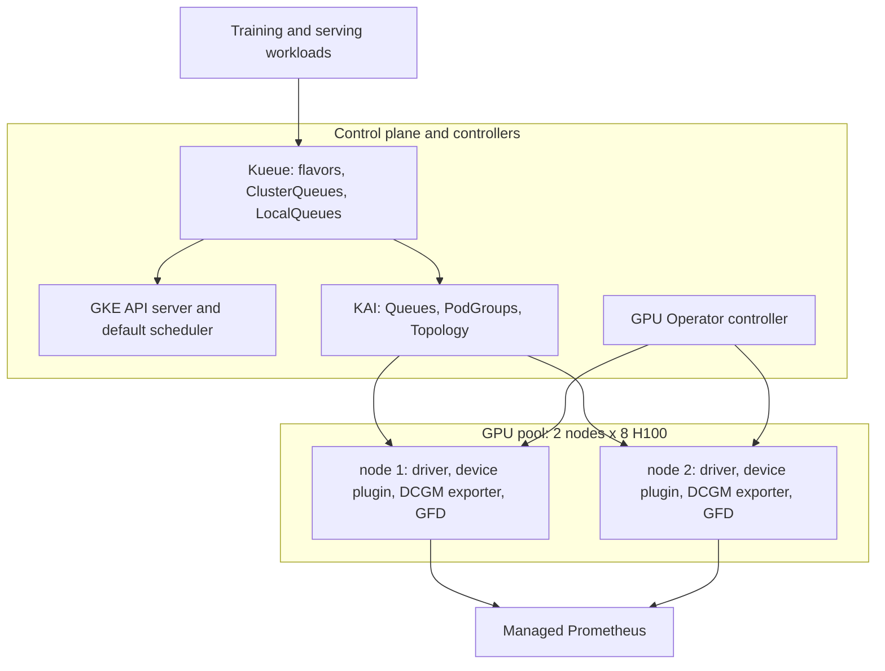

# 19.2 Capstone: a Kubernetes GPU platform with KAI and Kueue

| Field | Value |
|---|---|
| Level | Advanced |
| Priority tier | 1 |
| Lab venue | GCP / GKE (needs H100 quota; not run here) |
| Part | Part 19: Capstones, design and interview readiness |
| Primary sources | Gem books: *Generative AI on Kubernetes* ch. 7; *Kubernetes for Generative AI Solutions* ch. 10; *Production Kubernetes* ch. 12. Upstream docs and CRDs for Kueue, KAI Scheduler, NVIDIA GPU Operator, DCGM exporter, GKE. nvidia-devops Volumes 10 and 24. |
| Cross-references | 5.34 (GKE node pools); 11.1 to 11.9 (platform layer, Kueue, JobSet); 11.13 to 11.18 (KAI); 11.20 (scheduler comparison); 16.14 (tenancy and chargeback); 17.4 (DCGM exporter); 17.11 (incidents); 19.1 (Slurm capstone); 19.3 (inference on GKE) |
| Code | `code/part19/c02_*` (manifests, scripts, `c02_queue_math.py` and its tests) |
| Coverage file | `planning/coverage/chapters/19-02.md` |
| Claim and number ledger | `planning/ledgers/19-02.md` |

## Why this matters for AI infrastructure

A team submits a two-node training job to a cluster that looks healthy on every dashboard. The nodes report `Ready`. The GPUs are advertised as schedulable. The queue says the team is within quota. Yet the job sits half-scheduled for the afternoon, one node busy and the other waiting, and no training step runs. In the same cluster a serving endpoint misses its latency target because a batch sweep holds the GPUs it needed.

Nothing in that story is broken. The pieces were never integrated. The node pool, the GPU software, the queues, the gang scheduler and the health signal each have their own chapter in Parts 5, 11, 16 and 17. This capstone shows what holds them together.

The answer is five integration surfaces. The node plane has one owner per layer. The queue hierarchy turns a shared fleet into tenants with quotas. The gang and topology layer starts a two-node job atomically. The health gate removes a dying GPU before it receives more work. The day-2 rhythm covers canary upgrades, incidents and a cost view.

The capstone is also the interview anchor. When asked how you would build and run a Kubernetes GPU platform, tell this picture in build order: pool, stack, queues, gangs, health, day 2. This chapter says what the topic tests. It does not claim any company asks a particular question.

## Prerequisites and outcomes

### Prerequisites

- 11.1 to 11.5: the platform layer, device plugin, toolkit, CDI, feature discovery and the GPU Operator.
- 11.6 to 11.9: scheduling GPUs, why a Pod cannot span nodes, Kueue, JobSet and LeaderWorkerSet.
- 11.13 to 11.18: the KAI Scheduler. 11.20: the scheduler comparison.
- 5.34: GKE node pools and quotas. 16.14: multi-tenant design. 17.4 and 17.11: DCGM and incident response.

### Outcomes

After this capstone you will be able to:

1. Draw the platform and prove both the allocation path and the execution path before a node takes work.
2. Create a GKE GPU pool and write down who owns the driver, the device plugin and the metrics exporter.
3. Install the GPU Operator with the GKE settings NVIDIA documents, and accept a node with an evidence chain.
4. Set priority classes that work with both the default scheduler and KAI.
5. Configure Kueue flavors, cohort queues, borrowing and reclaim, using the current v1beta2 API.
6. Configure KAI queues and a Topology, and run a two-node PyTorchJob as a gang.
7. Gate nodes on DCGM signals, run a canary upgrade, and compute blast radius in GPUs.

## 1. The platform topology: two paths, one platform

After a node-image refresh, half a GPU pool rejoins the cluster as `Ready`. Training pods on the refreshed nodes fail during container creation, while the older pool trains fine. `nvidia-smi` works on every host. The on-call engineer suspects the scheduler, because the pods look rejected. The real fault is in the container runtime configuration, and it takes an hour to find because nobody asked the right first question.

That question separates two paths. The allocation path runs from the host driver to the device plugin, which registers `nvidia.com/gpu` with the kubelet, to an allocatable count on the node. The execution path runs through the container runtime, which uses the NVIDIA Container Toolkit or a CDI spec to put device files and driver libraries into one container, so that CUDA starts inside it. A node can pass the first path and fail the second. The refreshed pool did exactly that.

A platform therefore cannot treat `Ready` as GPU-ready. Acceptance needs two yes answers. The node advertises capacity, and a real workload runs on it. The diagram draws the platform that way.

The capstone is a zonal GKE Standard cluster. A small CPU pool runs system components. The GPU pool holds two `a3-highgpu-8g` nodes with eight H100 GPUs each, 16 GPUs in total. Three controllers sit on top: the GPU Operator, Kueue and the KAI Scheduler.



| Component | Namespace | Owns | Does not own |
|---|---|---|---|
| GKE control plane | managed | API server, default scheduler, cluster upgrades | GPU software on nodes |
| Google driver installer | `kube-system` (DaemonSet from Google's manifest) | NVIDIA kernel driver | Device plugin, metrics |
| GPU Operator | `gpu-operator` | Toolkit, device plugin, GFD, DCGM exporter | The driver in this design |
| Kueue | `kueue-system` | Quota, admission, borrowing, reclaim | Gang placement, device choice |
| KAI Scheduler | `kai-scheduler` | Gang binding, topology placement, fair share | Admission against Kueue quota |
| Managed Prometheus | managed | Scrape and storage | GPU health decisions |

The namespace for the driver installer is an assumption: Google's manifest decides it, so check it after you apply the file.

**Decision rule:** admit a node only after both paths have evidence, and never read `Ready` as proof of either.

**In one minute:** the allocation path ends in an allocatable count. The execution path ends in CUDA running inside a container. `Ready` proves neither. Kueue admits, KAI places, and DCGM feeds the health signal.

## 2. The GPU node pool: hardware, driver, and ownership

A team creates a GPU pool with GKE's automatic driver, then installs the GPU Operator with its own driver enabled. Two reconcilers now manage one kernel module. The pool flaps for days, CUDA jobs die with version mismatch errors, and nobody can say which system is in charge. Neither product has a bug. An ownership decision was never made.

NVIDIA's GKE page gives two supported ways to use the Operator on GKE. With the Google driver installer, Google manages the driver and the Operator manages everything else. With the NVIDIA Driver Manager, the Operator manages the driver too, on Ubuntu nodes. Both need the GKE device plugin turned off, because the Operator ships its own.

| Ownership model | Fits when | Trade-off |
|---|---|---|
| Host-managed driver and runtime | An image team owns the whole host | Desired state lives outside Kubernetes |
| Operator-managed node stack | Kubernetes controls the lifecycle | Operator, kernel and driver must be qualified together |
| Hybrid with a written boundary | Policy requires host ownership of some layers | Two systems must never reconcile one setting |

The capstone uses the hybrid with the Google driver installer. Google's DaemonSet owns the driver on Container-Optimized OS. The Operator owns the toolkit, device plugin, feature discovery and DCGM exporter. The boundary sits in the Helm values file and is reviewed in the same pull request as the pool definition.

An earlier draft of this chapter used `gpu-driver-version=latest` together with the Operator's device plugin. NVIDIA's page says to disable the GKE device plugin and the automatic driver. It lists these as GKE features the Operator does not support. The script below follows NVIDIA's page.

```bash
#!/usr/bin/env bash
# Chapter 19.2 step 1: zonal GKE Standard cluster plus an H100 pool set up for the GPU Operator path.
# Flags checked against gcloud 592.0.0 --help (2026-11-10). Needs GPU quota; not run here.
set -euo pipefail
: "${PROJECT:?set PROJECT}"
ZONE="${ZONE:-us-central1-a}"
CLUSTER="${CLUSTER:-ml-platform}"

# System pool: CPU only. GKE adds the nvidia.com/gpu=present:NoSchedule taint to GPU nodes
# only when the cluster already has a non-GPU pool, so keep this pool.
gcloud container clusters create "$CLUSTER" \
  --project "$PROJECT" --zone "$ZONE" \
  --release-channel regular \
  --num-nodes 1 --machine-type e2-standard-4 \
  --workload-pool "${PROJECT}.svc.id.goog" \
  --enable-managed-prometheus \
  --monitoring SYSTEM

# GPU pool: the node label turns off the GKE device plugin and gpu-driver-version=disabled
# turns off the automatic driver, as the NVIDIA GPU Operator GKE page requires when the
# Operator owns the device plugin. The Google driver installer is applied separately.
gcloud container node-pools create h100-pool \
  --project "$PROJECT" --cluster "$CLUSTER" --zone "$ZONE" \
  --machine-type a3-highgpu-8g \
  --accelerator type=nvidia-h100-80gb,count=8,gpu-driver-version=disabled \
  --num-nodes 2 \
  --node-labels pool=h100,gke-no-default-nvidia-gpu-device-plugin=true \
  --placement-type COMPACT

gcloud container clusters get-credentials "$CLUSTER" --project "$PROJECT" --zone "$ZONE"
```

Three details matter. The node label `gke-no-default-nvidia-gpu-device-plugin=true` turns off Google's device plugin. The setting `gpu-driver-version=disabled` skips the automatic driver, so you install Google's installer yourself in Section 3. Compact placement asks GKE to put the nodes close together and, per the gcloud help, limits the pool size.

GKE adds the `nvidia.com/gpu=present:NoSchedule` taint to GPU nodes only when the cluster already has a non-GPU pool. That is why the script creates the CPU pool first. The Operator's own tolerations include this key. Workloads in this chapter carry a toleration for it as well, so they do not depend on admission behavior.

Capacity failures on GKE come in two kinds. `QUOTA_EXCEEDED` means the project allowance is too low and you ask for more. `ZONE_RESOURCE_POOL_EXHAUSTED` means Google has no free hardware in that zone, and you try another zone, a reservation or later. GPU nodes cannot live-migrate during maintenance, so checkpointing from Part 14 is part of the platform contract.

**Decision rule:** name the owner of the driver, the device plugin and the metrics exporter before the pool exists, and give each exactly one.

**In one minute:** the pool is two `a3-highgpu-8g` nodes. Google's installer owns the driver. The Operator owns everything else on the node. GKE's device plugin and automatic driver are disabled, as NVIDIA's GKE page requires.

## 3. The GPU Operator stack: from driver to advertised capacity

A platform team runs `helm install` for the GPU Operator and sees `STATUS: deployed`. Twenty minutes later the training queue is empty and the ClusterPolicy reports `notReady`. Five of six canary nodes are healthy. On the sixth, the driver pod crash-loops with a Secure Boot signing error. Helm said success because the API server accepted the objects. It said nothing about a kernel module.

So Helm success is one data point. The acceptance gate is an evidence chain, walked in order.

1. The node is in the intended pool and can run the operands.
2. The driver is healthy: the installer pod is running and `nvidia-smi` on the node lists all eight GPUs.
3. The runtime can start a GPU container, shown by a small CUDA pod running `nvidia-smi`.
4. The node shows `nvidia.com/gpu` allocatable equal to the physical count.
5. Labels and taints match the intended service class.
6. A representative workload and the telemetry path pass.

The Operator reconciles most operands as DaemonSets, and they retry independently. A downstream pod may therefore show a louder symptom than the upstream fault. Walking the chain in order avoids chasing the loud symptom. The Operator places operands on nodes where it finds NVIDIA hardware and sets the `nvidia.com/gpu.present` label, so nothing lands on the CPU pool.

Install uses a values file. It is the Helm form of the ClusterPolicy settings. Rendering the chart with this file produces one ClusterPolicy that passes the upstream CRD schema.

```yaml
# Helm values for the NVIDIA GPU Operator on GKE with the Google driver installer.
# Keys follow the NVIDIA GPU Operator GKE page; checked against the v26.7.2 chart and ClusterPolicy CRD.
driver:
  enabled: false                     # the Google driver installer owns the driver
hostPaths:
  driverInstallDir: /home/kubernetes/bin/nvidia
toolkit:
  enabled: true
  installDir: /home/kubernetes/bin/nvidia
  env:
    - name: RUNTIME_CONFIG_SOURCE    # needed on GKE 1.33 and later, per the NVIDIA GKE page
      value: file
cdi:
  enabled: true
  default: true
devicePlugin:
  enabled: true
gfd:
  enabled: true
dcgmExporter:
  enabled: true
```

Each key comes from NVIDIA's GKE page or the chart. The driver install path `/home/kubernetes/bin/nvidia` is, per NVIDIA, a writable and stateful location on GKE node images. The `RUNTIME_CONFIG_SOURCE` environment variable is NVIDIA's workaround for a known toolkit issue on GKE 1.33 and later. The CDI settings follow the same page. GKE also limits system-critical pods per namespace unless a quota exists, so apply this first.

```yaml
# From the NVIDIA GPU Operator GKE page: GKE limits system-critical pods per namespace unless a quota exists.
apiVersion: v1
kind: ResourceQuota
metadata:
  name: gpu-operator-quota
spec:
  hard:
    pods: "100"
  scopeSelector:
    matchExpressions:
      - operator: In
        scopeName: PriorityClass
        values:
          - system-node-critical
          - system-cluster-critical
```

```bash
#!/usr/bin/env bash
# Chapter 19.2 steps 3 and 4: driver installer, GPU Operator, Kueue, KAI Scheduler. Not run here.
# Versions are the ones the chapter's YAML was validated against (see the chapter's verification log).
set -euo pipefail
GPU_OPERATOR_VERSION="${GPU_OPERATOR_VERSION:-v26.7.2}"
KUEUE_VERSION="${KUEUE_VERSION:-0.20.5}"
KAI_VERSION="${KAI_VERSION:-v0.18.7}"
HERE="$(cd "$(dirname "$0")" && pwd)"

# Google driver installer for Container-Optimized OS (manifest named on the NVIDIA GKE page).
kubectl apply -f https://raw.githubusercontent.com/GoogleCloudPlatform/container-engine-accelerators/master/nvidia-driver-installer/cos/daemonset-preloaded.yaml

kubectl create namespace gpu-operator --dry-run=client -o yaml | kubectl apply -f -
kubectl apply -n gpu-operator -f "$HERE/c02_gpu_operator_quota.yaml"
helm repo add nvidia https://helm.ngc.nvidia.com/nvidia
helm repo update
helm upgrade --install gpu-operator nvidia/gpu-operator \
  --namespace gpu-operator --version "$GPU_OPERATOR_VERSION" \
  -f "$HERE/c02_gpu_operator_values.yaml" --wait --timeout 15m

helm upgrade --install kueue oci://registry.k8s.io/kueue/charts/kueue \
  --version "$KUEUE_VERSION" --namespace kueue-system --create-namespace \
  -f "$HERE/c02_kueue_values.yaml" --wait

helm upgrade --install kai-scheduler oci://ghcr.io/kai-scheduler/kai-scheduler/kai-scheduler \
  --namespace kai-scheduler --create-namespace --version "$KAI_VERSION" --wait
```

After reconciliation, compare capacity with allocatable on each GPU node. Both read eight when the device plugin registered a healthy set. If allocatable is zero while capacity is eight, the plugin lost contact with the driver after boot, and the fix lives in the driver layer. In the lab, `c02_smoke_pod.yaml` is the execution-path check from step 3 of the chain.

Feature discovery turns host facts into node labels. The Operator's source uses `feature.node.kubernetes.io/pci-10de.present` to find NVIDIA hardware and reads `nvidia.com/gpu.product` for the model. Treat these as observations. They are not promises about lifecycle or service.

| Kind | Example | Writer | Reader |
|---|---|---|---|
| Discovered fact | `nvidia.com/gpu.product` | GFD and NFD | Audits, automation |
| Lifecycle assertion | `gpu-validation=passed` (our name) | Acceptance gate | Admission, affinity |
| Service class | `gpu.platform.example/class=training` (our name) | Platform team | Workload manifests |

Workloads select service classes, never product strings. When a hardware generation retires behind a class, no manifest changes. A label that is present is also not a label that is current. After a driver update or GPU swap, rerun discovery and compare labels with the change record.

One more option belongs here. The device plugin can share a GPU by time-slicing. Its README says nothing isolates the workloads, they can read each other's GPU memory, and one crash takes them all down. The setting applies to every GPU on a node, so the H100 pool stays whole-GPU in this capstone.

**Decision rule:** accept a node on the evidence chain, not on DaemonSet status, and let three different writers own facts, assertions and classes.

**In one minute:** `deployed` is not acceptance. The values file disables the Operator's driver and points the toolkit at GKE's install path. The six-step chain ends in a validated workload. Time-slicing gives no isolation, so the pool stays whole-GPU.

## 4. Priority, preemption, and fairness: protecting the inference SLO

An eight-GPU cluster runs a large batch training job and a real-time inference API submitted at the same time. The training job takes all eight GPUs. The API stays `Pending` and users complain. The scheduler is doing what it was told, which was nothing about priority.

The capstone defines three PriorityClass objects.

```yaml
# Three tiers. KAI treats a value of 100 or more as non-preemptible and in-quota only,
# so training sits below that line (docs/priority in KAI Scheduler v0.18.7).
apiVersion: scheduling.k8s.io/v1
kind: PriorityClass
metadata:
  name: inference-critical
value: 1000
globalDefault: false
description: "Critical priority for inference SLOs"
---
apiVersion: scheduling.k8s.io/v1
kind: PriorityClass
metadata:
  name: training-standard
value: 50
globalDefault: false
description: "Preemptible training jobs"
---
apiVersion: scheduling.k8s.io/v1
kind: PriorityClass
metadata:
  name: research-best-effort
value: 0
globalDefault: false
description: "Best effort for research jobs"
```

Serving sits at 1000, training at 50 and research at 0. When a pending pod cannot fit, the default scheduler looks for lower-priority pods to evict. Victims get their graceful termination period, which defaults to 30 seconds in the Kubernetes pod lifecycle docs. A training job that cannot checkpoint inside that window loses progress, so checkpoint intervals must be shorter than the window.

Training is 50 on purpose. An earlier draft used 100, and KAI treats a priority of 100 or more as non-preemptible. Such workloads may use only in-quota resources. A training class at 100 would never borrow idle GPUs and could never be preempted by KAI. KAI also ships `train` at 50 and `inference` at 125. Our class names are ours, so check that the number lands on the right side of 100.

Priority alone does not create free GPUs. The serving class needs capacity it can always reach. The capstone sets aside four of the 16 GPUs through a separate Kueue ClusterQueue in Section 5. Four is a policy choice, not a source-mandated value. Fairness then comes from quota and reclaim rules, not from hope.

Starvation needs a metric. Measure pending time per class and alert when it passes the team's own expectation. A `Pending` pod hides three different faults: no capacity, an untolerated taint and a stale label. The scheduler events name which check rejected each node.

**Decision rule:** give every class a priority, keep preemptible classes under 100 for KAI, and give SLO-bound classes quota they can reclaim.

**In one minute:** three classes at 1000, 50 and 0. Preemption honors the 30-second default grace. Four GPUs are reserved for serving through Kueue. Pending time per class is the starvation metric.

## 5. The Kueue queue hierarchy: multi-tenant admission

A team complains the queue is unfair. Their large jobs run while others wait, yet the quota was meant to cap them. The platform engineer finds the jobs have no queue label. Kueue only manages work that enters through a LocalQueue, so unlabeled jobs bypass every quota. The cure was a one-line label and a process change.

Kueue has three objects. A ResourceFlavor names a hardware tier through node labels. A ClusterQueue is cluster-scoped and carries quota, cohort, queueing strategy and preemption rules. A LocalQueue lives in a namespace and points a team at a ClusterQueue. A ClusterQueue tries its flavors in order and uses the first with room.

An earlier draft used `kueue.x-k8s.io/v1beta1`. In Kueue v0.20.5 that version is no longer served, and `v1beta2` renames the cohort field to `cohortName`. The same draft set `withinClusterQueue: Any`. The CRD allows only `Never`, `LowerPriority` and `LowerOrNewerEqualPriority`, so the schema check rejected it.

```yaml
# Kueue v1beta2 (v1beta1 is no longer served in Kueue v0.20.5). 16 GPUs in the pool: 12 training + 4 serving.
apiVersion: kueue.x-k8s.io/v1beta2
kind: ResourceFlavor
metadata:
  name: h100
spec:
  nodeLabels:
    cloud.google.com/gke-accelerator: nvidia-h100-80gb
---
apiVersion: kueue.x-k8s.io/v1beta2
kind: ClusterQueue
metadata:
  name: cq-training
spec:
  cohortName: ml-platform-cohort
  namespaceSelector: {}
  queueingStrategy: BestEffortFIFO
  resourceGroups:
    - coveredResources: ["nvidia.com/gpu"]
      flavors:
        - name: h100
          resources:
            - name: nvidia.com/gpu
              nominalQuota: 12
  preemption:
    reclaimWithinCohort: Any
    withinClusterQueue: LowerPriority
---
apiVersion: kueue.x-k8s.io/v1beta2
kind: ClusterQueue
metadata:
  name: cq-serving
spec:
  cohortName: ml-platform-cohort
  namespaceSelector: {}
  queueingStrategy: StrictFIFO
  resourceGroups:
    - coveredResources: ["nvidia.com/gpu"]
      flavors:
        - name: h100
          resources:
            - name: nvidia.com/gpu
              nominalQuota: 4
  preemption:
    reclaimWithinCohort: Any
    withinClusterQueue: LowerPriority
---
apiVersion: kueue.x-k8s.io/v1beta2
kind: LocalQueue
metadata:
  name: team-data-science-queue
  namespace: team-data-science
spec:
  clusterQueue: cq-training
---
apiVersion: kueue.x-k8s.io/v1beta2
kind: LocalQueue
metadata:
  name: team-research-queue
  namespace: team-research
spec:
  clusterQueue: cq-training
---
apiVersion: kueue.x-k8s.io/v1beta2
kind: LocalQueue
metadata:
  name: team-ml-platform-queue
  namespace: team-ml-platform
spec:
  clusterQueue: cq-serving
```

The nominal quotas now sum to the hardware: 12 for training and 4 for serving, 16 in total. A draft gave training 16 and serving 4. Kueue allows quotas above the hardware, but then the serving reserve is a hope, not a guarantee. Only GPUs are covered. By default Kueue does not account for resources that no ClusterQueue declares. The config key `resources.quotaCheckStrategy: BlockUndeclared` changes that.

Borrowing works inside a cohort. Kueue's docs say a workload is admitted if it fits unused nominal quota. Otherwise it may borrow unused quota from other queues in the cohort, up to its `borrowingLimit`, and only what each lender allows through `lendingLimit`. A 16-GPU gang from training therefore fits only by borrowing the four serving GPUs. `c02_queue_math.py` computes this, and also shows that `lendingLimit: 0` on serving would block it.

`reclaimWithinCohort: Any` is what makes lending reversible. When a pending workload fits inside its queue's nominal quota, Kueue may preempt workloads in other queues that use more than their nominal quota, whatever their priority. When serving needs its four GPUs back, the borrowed training workload is evicted. Preemption evicts a whole Workload, so the training gang stops, and checkpoints decide what is lost.

The queue label has a counterpart in configuration. By default Kueue manages only labeled jobs. The setting `manageJobsWithoutQueueName: true` makes unlabeled jobs wait for a queue. The values file below also enables the PyTorchJob integration, which is commented out in the chart defaults, and excludes system namespaces.

```yaml
# Helm values for the Kueue chart (v0.20.5). The default frameworks list leaves kubeflow.org/pytorchjob
# commented out, so the capstone enables it. manageJobsWithoutQueueName makes unlabeled Jobs wait for a queue.
managerConfig:
  controllerManagerConfigYaml: |-
    apiVersion: config.kueue.x-k8s.io/v1beta2
    kind: Configuration
    health:
      healthProbeBindAddress: :8081
    metrics:
      bindAddress: :8443
    webhook:
      port: 9443
    leaderElection:
      leaderElect: true
      resourceName: c1f6bfd2.kueue.x-k8s.io
    controller:
      groupKindConcurrency:
        Job.batch: 5
        Pod: 5
        Workload.kueue.x-k8s.io: 10
        LocalQueue.kueue.x-k8s.io: 5
        Cohort.kueue.x-k8s.io: 1
        ClusterQueue.kueue.x-k8s.io: 5
        ResourceFlavor.kueue.x-k8s.io: 1
    clientConnection:
      qps: 300
      burst: 500
    manageJobsWithoutQueueName: true
    managedJobsNamespaceSelector:
      matchExpressions:
        - key: kubernetes.io/metadata.name
          operator: NotIn
          values: [kube-system, kueue-system, gpu-operator, kai-scheduler]
    integrations:
      frameworks:
        - "batch/job"
        - "kubeflow.org/pytorchjob"
        - "jobset.x-k8s.io/jobset"
        - "leaderworkerset.x-k8s.io/leaderworkerset"
```

A workload enters with a label. Kueue creates a Workload object, holds it until quota and preemption rules allow, then admits it and unsuspends the job. For a Kubeflow v1 PyTorchJob, Kueue's docs say its webhook sets `runPolicy.suspend` to true. The admitted Workload records the ClusterQueue and flavor, which is the audit trail the cost review reads in Section 8.

```yaml
# One GPU through the queue. The queue-name label is what puts the Job under Kueue quota.
apiVersion: batch/v1
kind: Job
metadata:
  name: single-gpu-run
  namespace: team-data-science
  labels:
    kueue.x-k8s.io/queue-name: team-data-science-queue
spec:
  backoffLimit: 0
  template:
    spec:
      priorityClassName: training-standard
      restartPolicy: Never
      tolerations:
        - key: nvidia.com/gpu
          operator: Exists
          effect: NoSchedule
      containers:
        - name: train
          image: nvcr.io/nvidia/pytorch:24.08-py3
          command: ["python", "-c", "import torch; print(torch.cuda.device_count())"]
          resources:
            limits:
              nvidia.com/gpu: 1
```

**Decision rule:** no job runs on the GPU pool without a LocalQueue, and quotas should add up to the hardware unless you accept unreserved guarantees.

**In one minute:** flavors name hardware, ClusterQueues hold quota, LocalQueues bind teams. Use `v1beta2` and `cohortName`. Training borrows idle serving GPUs and serving reclaims them with `reclaimWithinCohort: Any`.

## 6. KAI: gang scheduling and topology-aware placement

A team submits a two-node training job when only one node is free. The default scheduler places the first pod, which takes eight GPUs and waits at the PyTorch rendezvous for a peer that never arrives. The second pod stays `Pending`. Those eight GPUs sit at zero compute, and no other team can use that node.

Scale the picture up. In a 12-node cluster, two teams each submit an eight-node job. A default scheduler places pods one at a time, so each job gets six nodes and neither can finish. `c02_queue_math.py` reproduces this: with the default behavior, 12 nodes are stranded, and with a gang the first job runs.

Gang scheduling holds the whole group pending until the minimum fits. The KAI Scheduler, which NVIDIA open-sourced from Run:ai, does this with a PodGroup. Its README requires the GPU Operator for GPU workloads and installs into `kai-scheduler` with Helm from an OCI registry. Workloads opt in by setting `schedulerName: kai-scheduler`. Its docs say to submit workloads from another namespace.

KAI keeps a hierarchy of Queue objects. Only leaf queues run jobs. The Queue API is `scheduling.run.ai/v2`, and units differ from Kubernetes: GPU in devices, CPU in millicores and memory in megabytes. A draft wrote `1Ti` for memory, which the CRD rejects because the field is a number.

```yaml
# KAI Queue (scheduling.run.ai/v2). Units: gpu in devices, cpu in millicores, memory in MB.
# Only leaf queues run jobs. Children quotas sum to the parent: 8 + 4 = 12, the Kueue training quota.
apiVersion: scheduling.run.ai/v2
kind: Queue
metadata:
  name: ml-platform
spec:
  resources:
    gpu: {quota: 12, limit: -1, overQuotaWeight: 1}
    cpu: {quota: 0, limit: -1, overQuotaWeight: 1}
    memory: {quota: 0, limit: -1, overQuotaWeight: 1}
---
apiVersion: scheduling.run.ai/v2
kind: Queue
metadata:
  name: team-data-science
spec:
  parentQueue: ml-platform
  resources:
    gpu: {quota: 8, limit: -1, overQuotaWeight: 1}
    cpu: {quota: 0, limit: -1, overQuotaWeight: 1}
    memory: {quota: 0, limit: -1, overQuotaWeight: 1}
---
apiVersion: scheduling.run.ai/v2
kind: Queue
metadata:
  name: team-research
spec:
  parentQueue: ml-platform
  resources:
    gpu: {quota: 4, limit: -1, overQuotaWeight: 1}
    cpu: {quota: 0, limit: -1, overQuotaWeight: 1}
    memory: {quota: 0, limit: -1, overQuotaWeight: 1}
```

The two team queues sum to the parent's 12 GPUs, which equals Kueue's training quota. KAI's docs describe fair share in two phases. Each queue gets min(quota, request). Surplus then goes to the highest queue priority first and is split by `overQuotaWeight` inside a priority. The CPU and memory entries set `limit: -1` as in KAI's quickstart, because the docs say an unset limit means no additional resources are allowed.

Two upstream rules matter for the capstone. KAI preemption happens inside one queue, between workloads of strictly different priority. Across queues KAI uses reclaim, which takes only over-quota resources by default. KAI cannot see Kueue's quota, so keep the numbers consistent by hand. The test file in `code/part19` asserts that they match.

Division of labor follows *Generative AI on Kubernetes* ch. 7. Kueue admits, and a GPU-aware scheduler such as KAI places. The book calls this combination common and recommended. KAI's own docs do not describe running both on one workload, so treat the pairing as not verified on a live cluster. One open question is how KAI counts GPUs that serving pods hold under the default scheduler.

Capacity, eligibility, locality and coordination are four separate placement questions, and gang admission answers only the last. KAI expresses locality with a Topology resource that lists node labels from coarse to fine.

```yaml
# KAI Topology (kai.scheduler/v1alpha1, cluster scoped). Levels run from coarse to fine.
apiVersion: kai.scheduler/v1alpha1
kind: Topology
metadata:
  name: capstone-topology
spec:
  levels:
    - nodeLabel: topology.kubernetes.io/zone
    - nodeLabel: kubernetes.io/hostname
```

A job attaches through annotations. A required level is a hard limit. A preferred level is a soft one inside the required boundary. The capstone requires the zone and omits a preferred level, because both nodes are equivalent. On a fabric with rack or block labels, name those as preferred so pods land close together.

```yaml
# Two-node gang: Master and Worker each take all eight GPUs of one a3-highgpu-8g node.
# Kueue admits it through the queue-name label. KAI gang-schedules it through schedulerName and the queue label.
apiVersion: kubeflow.org/v1
kind: PyTorchJob
metadata:
  name: pretrain-2node
  namespace: team-data-science
  labels:
    kueue.x-k8s.io/queue-name: team-data-science-queue
    kai.scheduler/queue: team-data-science
  annotations:
    kai.scheduler/topology: capstone-topology
    kai.scheduler/topology-required-placement: topology.kubernetes.io/zone
spec:
  pytorchReplicaSpecs:
    Master:
      replicas: 1
      restartPolicy: OnFailure
      template:
        spec:
          schedulerName: kai-scheduler
          priorityClassName: training-standard
          tolerations:
            - key: nvidia.com/gpu
              operator: Exists
              effect: NoSchedule
          containers:
            - name: pytorch
              image: nvcr.io/nvidia/pytorch:24.08-py3
              command: ["python", "-c", "import torch; print(torch.cuda.device_count())"]
              resources:
                limits:
                  nvidia.com/gpu: 8
    Worker:
      replicas: 1
      restartPolicy: OnFailure
      template:
        spec:
          schedulerName: kai-scheduler
          priorityClassName: training-standard
          tolerations:
            - key: nvidia.com/gpu
              operator: Exists
              effect: NoSchedule
          containers:
            - name: pytorch
              image: nvcr.io/nvidia/pytorch:24.08-py3
              command: ["python", "-c", "import torch; print(torch.cuda.device_count())"]
              resources:
                limits:
                  nvidia.com/gpu: 8
```

The Master and Worker each take eight GPUs, so this job needs the whole pool. That is possible only because the training queue can borrow serving's idle quota. The PyTorchJob controller injects the rendezvous environment into each pod. KAI's docs require the Kubeflow Training Operator v1 for this kind. The current Trainer project replaces PyTorchJob with TrainJob, so pin the v1 operator.

A Pod cannot span nodes. Anything needing more GPUs than one server holds runs as several pods that coordinate over the network. JobSet manages groups of Jobs. Per its docs, one failed child counts as a JobSet failure, and `spec.failurePolicy.maxRestarts` sets how many times the controller recreates all children. LeaderWorkerSet serves the sharded-inference shape, where the group is the restart unit.

```yaml
# One two-pod group sharing a model, 2 GPUs per pod = 4 GPUs, the serving queue's quota.
# Replace the image placeholder with a pinned serving image you built or pulled.
apiVersion: leaderworkerset.x-k8s.io/v1
kind: LeaderWorkerSet
metadata:
  name: sharded-serving
  namespace: team-ml-platform
  labels:
    kueue.x-k8s.io/queue-name: team-ml-platform-queue
spec:
  replicas: 1
  leaderWorkerTemplate:
    size: 2
    restartPolicy: RecreateGroupOnPodRestart
    leaderTemplate:
      metadata:
        labels:
          role: leader
      spec:
        priorityClassName: inference-critical
        containers:
          - name: serve-leader
            image: us-docker.pkg.dev/PROJECT/serving/sharded-server:PINNED_TAG
            resources:
              limits:
                nvidia.com/gpu: "2"
    workerTemplate:
      spec:
        priorityClassName: inference-critical
        containers:
          - name: serve-worker
            image: us-docker.pkg.dev/PROJECT/serving/sharded-server:PINNED_TAG
            resources:
              limits:
                nvidia.com/gpu: "2"
```

The restart policy `RecreateGroupOnPodRestart` is the operational point. When one pod dies, the whole group is recreated, because a sharded model cannot serve with a shard missing. The group uses two GPUs per pod so its four GPUs match the serving quota. The image is a placeholder you must replace. The Kueue values file enables the LeaderWorkerSet integration, so the label routes it to the serving queue.

**Decision rule:** use gang admission where a partial start costs real money, and bind topology levels to labels the fleet actually publishes.

**In one minute:** the default scheduler strands GPUs. KAI holds the PodGroup until the whole gang fits. Queue quotas match Kueue by hand. Required topology is hard, preferred is soft. LeaderWorkerSet recreates its whole group.

## 7. DCGM health gating and observability

A GPU dies with an Xid 79 event, which NVIDIA's catalog describes as the GPU falling off the bus. The kubelet still reports eight allocatable GPUs because nothing told the device plugin to withdraw capacity. New pods land on the dead GPU and fail at CUDA start. The node dashboard looks fine. The node is alive as a process and dead as a machine.

The health signal must gate as well as report. A node with a reliability event leaves the eligible pool until acceptance evidence returns.

The Operator runs the DCGM exporter as a DaemonSet with the label `app=nvidia-dcgm-exporter`. Its container listens on port 9400 and names it `metrics`. The Operator also creates a Service whose port is named `gpu-metrics`. The chart version used here ships exporter 4.6.1-4.8.4, and the metrics below exist in that release.

We scrape with Managed Prometheus through a PodMonitoring. The GKE-managed DCGM option needs GKE-managed drivers, so it does not apply to this pool, and Google warns that running two DCGM collectors duplicates metrics.

```yaml
# Scrape the Operator's DCGM exporter with Google Managed Service for Prometheus.
# The exporter container port is named metrics (assets/state-dcgm-exporter in GPU Operator v26.7.2).
apiVersion: monitoring.googleapis.com/v1
kind: PodMonitoring
metadata:
  name: nvidia-dcgm-exporter
  namespace: gpu-operator
spec:
  selector:
    matchLabels:
      app: nvidia-dcgm-exporter
  endpoints:
    - port: metrics
      interval: 30s
```

The exporter labels each series with the GPU UUID next to the device index. Use the UUID as the join key. Indexes can change after a reboot or reset, and a rule keyed on an index may point at a different card.

Three series matter in this release: `DCGM_FI_DEV_GPU_UTIL`, `DCGM_FI_DEV_POWER_USAGE` and `DCGM_FI_DEV_XID_ERRORS`. The last one holds the value of the most recent Xid code, per the counters file, so zero means none and 79 means the last event was Xid 79. Newer exporter releases rename several metrics, for example to `DCGM_FI_DEV_GPU_UTIL_RATIO`. Check the counters file of the exporter image you deploy before you write alerts.

Expected shape of the scrape, not run here: one line per GPU per metric, with `gpu`, `UUID`, `container`, `namespace` and `pod` labels. Pod labels appear only when the mapper can resolve the assignment.

A production pool needs a small monitoring contract. Every accepted node is scraped, and a missing target alerts. A dashboard pivots from workload to node to GPU UUID. Each alert states its cause, owner, first checks and safe mitigation. Raw data stays long enough to compare a regression with a maintenance window. Labels stay bounded.

Page when someone must stop work: lost schedulable capacity, an actionable hardware event, sustained throttling with measured impact, or lost monitoring. Do not page on low utilization. A zero reading is ambiguous until you check the exporter target is alive.

On a reliability event, cordon the node, drain it when the recovery plan allows, and capture node events, driver logs, GPU identity and DCGM data before any reboot. The node returns only after the Section 3 chain passes again. GKE auto-repair covers infrastructure failures. The DCGM gate covers GPU health that GKE does not see.

**Decision rule:** page on capacity loss and hardware events, never on utilization, and keep a node out of the pool until acceptance evidence returns.

**In one minute:** the Operator's exporter feeds Managed Prometheus through a PodMonitoring. UUID is the join key. The Xid series holds the last code. Events cordon the node, and evidence is captured before reboot.

## 8. Day-2: upgrades, incidents, quotas, and the FinOps view

On Friday a team bumps one shared driver value. The change reaches the whole pool roughly in parallel. If an incompatible kernel hits 35 of 60 nodes, 58 percent of GPU capacity is degraded before the first validation failure appears. The same change on a three-node canary pool caps the damage at 5 percent. That ratio is the argument for pool separation.

An upgrade changes a compatibility set: the Kubernetes version, node image and kernel, driver, runtime, Operator chart, operand images and workload images. The release record lists old and new values, the pools, the window, the workload owners and who may pause or roll back. The canary must match the pool it stands for in hardware batch, image, driver ownership and workload class.

Blast radius is counted in GPUs. A bad change that reaches a 24-node batch in a 120-node fleet removes 192 of 960 GPUs, which is 20 percent. That sentence belongs in the incident summary, not "some nodes are affected". `c02_queue_math.py` computes all three figures. They are illustrative sizes, not figures from a real fleet.

Each batch gates on execution evidence. Allocatable equals the baseline, a fresh validation pod completes CUDA start, and DCGM series are present with stable UUIDs. A green Operator status is not enough.

On GKE, run cluster upgrades through the release channel with `gcloud container clusters upgrade`, and upgrade the control plane and a node pool in separate commands. The Operator upgrade follows a scoped procedure. Archive the recoverable baseline first, drain the canary, upgrade, then validate.

```bash
#!/usr/bin/env bash
# Chapter 19.2 section 8: GPU Operator upgrade on one canary node, with an evidence archive. Not run here.
set -euo pipefail
: "${TARGET_VERSION:?set TARGET_VERSION, for example v26.7.2}"
: "${CANARY_NODE:?set CANARY_NODE to a node name from kubectl get nodes}"
HERE="$(cd "$(dirname "$0")" && pwd)"
EVID=gpu-upgrade-evidence
mkdir -p "$EVID"

helm history gpu-operator -n gpu-operator > "$EVID/helm-history-before.txt"
helm get values gpu-operator -n gpu-operator -a > "$EVID/values-before.yaml"
helm get manifest gpu-operator -n gpu-operator > "$EVID/manifest-before.yaml"
kubectl get node "$CANARY_NODE" -o yaml > "$EVID/canary-before.yaml"

kubectl cordon "$CANARY_NODE"
kubectl drain "$CANARY_NODE" --ignore-daemonsets --delete-emptydir-data --grace-period=120 --timeout=20m
helm upgrade gpu-operator nvidia/gpu-operator \
  --namespace gpu-operator --version "$TARGET_VERSION" \
  -f "$HERE/c02_gpu_operator_values.yaml" --wait --timeout 20m

kubectl get node "$CANARY_NODE" \
  -o jsonpath='{.status.capacity.nvidia\.com/gpu}{" capacity\n"}{.status.allocatable.nvidia\.com/gpu}{" allocatable\n"}'
kubectl apply -f "$HERE/c02_upgrade_validation.yaml"
kubectl wait --for=jsonpath='{.status.phase}'=Succeeded pod/gpu-upgrade-validation --timeout=5m
kubectl delete -f "$HERE/c02_upgrade_validation.yaml"
kubectl uncordon "$CANARY_NODE"
```

```yaml
# Post-upgrade validation pod: must complete CUDA initialization on the canary node.
apiVersion: v1
kind: Pod
metadata:
  name: gpu-upgrade-validation
spec:
  restartPolicy: Never
  nodeSelector:
    pool: h100
  tolerations:
    - key: nvidia.com/gpu
      operator: Exists
      effect: NoSchedule
  containers:
    - name: c
      image: nvidia/cuda:12.4.1-base-ubuntu22.04
      command: ["nvidia-smi"]
      resources:
        limits:
          nvidia.com/gpu: 1
```

The drain size is arithmetic. Each drained node removes eight GPUs. With serving needing four protected GPUs on a 16-GPU pool, `max_parallel_drain` returns one node. A second drain waits until capacity returns. Compute this number before you set the rollout parameter.

A chart rollback restores control-plane configuration. It may not restore a driver module, kernel or runtime setting already changed on the host. When host state changed, the tested node-image and reboot path is the rollback. Afterward, rerun the full acceptance suite.

When a canary fails, stop the rollout and protect the healthy pool. Then walk the layers in dependency order: hardware and driver, runtime injection, device plugin and allocatable, labels and policy, workload. This order keeps a scheduler hunt from hiding a driver failure. Roles follow 17.11: a commander, a diagnosing engineer and a communications lead. A vendor escalation package carries scope, a timestamped change timeline, versions, kernel and runtime details, GPU and firmware inventory, operand state, logs, labels, a minimal reproducer and DCGM evidence. Redact tenant data and keep versions and times.

The money view comes from the queue layer and a cost tool. Per-team quota utilization comes from Kueue Workloads and queue usage. A sustained level above 80 percent for a day is our own alert threshold, an inference, and it starts the capacity conversation. Cost per team comes from a tool such as Kubecost or OpenCost, joined to the same Prometheus data as DCGM so cost and utilization sit in one view. The tier model from 16.14 maps a tier to a ClusterQueue quota.

**Decision rule:** upgrade the compatibility set as a unit, gate every batch on execution evidence, and roll back node state when the driver changed.

**In one minute:** a canary caps blast radius, and blast radius is computed in GPUs. Drain size follows protected capacity. Rollback may mean a node image. Cost and utilization share one view.

## 9. Hands-on lab

The lab builds the platform on GKE. It was not run for this chapter, because it needs H100 quota and a Google Cloud project. What was run here: schema validation of every manifest, a Helm render of the Operator and Kueue charts, and the tests of the queue arithmetic. Everything else is not verified on a live cluster. No output below was captured, and the expected results describe shape only.

Prerequisites: a project with billing, `gcloud`, `kubectl` and `helm`, quota for 16 H100 GPUs in the zone, and Workload Identity.

```bash
#!/usr/bin/env bash
# Chapter 19.2 lab checks, run after c02_install_stack.sh. Not run here (needs a GPU cluster).
set -euo pipefail
HERE="$(cd "$(dirname "$0")" && pwd)"

echo "== node plane: allocatable GPUs and the execution-path check"
kubectl get nodes -L cloud.google.com/gke-accelerator
kubectl get nodes -l pool=h100 -o custom-columns=NAME:.metadata.name,ALLOC:.status.allocatable.nvidia\\.com/gpu
kubectl apply -f "$HERE/c02_smoke_pod.yaml"
kubectl wait --for=jsonpath='{.status.phase}'=Succeeded pod/nvidia-smi-check --timeout=5m
kubectl logs nvidia-smi-check
kubectl delete -f "$HERE/c02_smoke_pod.yaml"

echo "== teams, priorities and queues"
for ns in team-data-science team-research team-ml-platform; do
  kubectl create namespace "$ns" --dry-run=client -o yaml | kubectl apply -f -
done
kubectl apply -f "$HERE/c02_priority_classes.yaml"
kubectl apply -f "$HERE/c02_kueue_queues.yaml"
kubectl apply -f "$HERE/c02_kai_queues.yaml"
kubectl apply -f "$HERE/c02_kai_topology.yaml"
kubectl get clusterqueues
kubectl get queues.scheduling.run.ai

echo "== single-GPU job through Kueue"
kubectl apply -f "$HERE/c02_kueue_job.yaml"
kubectl get workloads -n team-data-science

echo "== two-node gang through Kueue and KAI"
kubectl apply -f "$HERE/c02_pytorchjob.yaml"
kubectl get podgroups.scheduling.run.ai -n team-data-science
kubectl get bindrequests.scheduling.run.ai -n team-data-science
kubectl get pods -n team-data-science -o wide

echo "== serving group and reclaim"
kubectl apply -f "$HERE/c02_lws.yaml"
kubectl get workloads -A

echo "== health gate: exporter pods, Xid series, cordon"
kubectl apply -f "$HERE/c02_dcgm_podmonitoring.yaml"
kubectl get pods -n gpu-operator -l app=nvidia-dcgm-exporter -o wide
POD=$(kubectl get pods -n gpu-operator -l app=nvidia-dcgm-exporter -o name | head -1)
kubectl port-forward -n gpu-operator "$POD" 9400:9400 &
PF=$!
sleep 3
curl -s localhost:9400/metrics | grep DCGM_FI_DEV_XID_ERRORS || true
kill "$PF"
NODE=$(kubectl get nodes -l pool=h100 -o name | head -1)
kubectl cordon "$NODE"
kubectl get "$NODE"
kubectl uncordon "$NODE"
```

Step 1: create the cluster and pool with `c02_create_cluster.sh`. Expected: two GPU nodes labeled `pool=h100`. What to record: the GKE version and the driver installer pod status. Run here: no.

Step 2: install the driver installer, Operator, Kueue and KAI with `c02_install_stack.sh`. Expected: Operator pods ready on both nodes, `kueue-system` and `kai-scheduler` pods running. What to record: chart versions and the ClusterPolicy state. Run here: no, but the chart renders were checked.

Step 3: run the node-plane section of `c02_lab_checks.sh`. Expected: `nvidia-smi` in the smoke pod lists eight GPUs, and allocatable is 8 on each node. What to record: the node name and the driver version shown. Run here: no.

Step 4: run the queue and single-GPU sections of the same script. Expected: a Workload admitted by `cq-training` on flavor `h100`. What to record: the admission time. Run here: schema only.

Step 5: run the two-node PyTorchJob. Expected: Kueue admits it by borrowing, KAI creates a PodGroup, and both pods bind in one session. What to record: whether both pods started within the same scheduling cycle. Run here: no.

Step 6: start the serving group and watch reclaim. Expected: Kueue evicts the training Workload to free four GPUs. What to record: the eviction message and how long serving waited. Run here: no.

Step 7: exercise the health gate. Expected: the Xid series reads 0, and a cordoned node receives no new work. What to record: the UUIDs scraped. Run here: no.

After the lab you should answer five questions in five seconds each. What is the allocatable count per node, and how many GPUs does Kueue show admitted? Which ClusterQueue protects serving, and which rule lets it reclaim? Which topology level is required? Which series proves each exporter is fresh? What do you archive before an upgrade?

## Exercises

1. **Onboard a team.** Add a `team-finance` namespace, a LocalQueue on `cq-training` and a KAI leaf queue with 2 GPUs taken from `team-research`. Verify the quotas still sum. *Solution sketch:* edit `c02_kueue_queues.yaml` and `c02_kai_queues.yaml`, set research to 2 and finance to 2, then extend `test_c02_queue_math.py` and run `c02_validate.sh`.
2. **Block borrowing.** Set `lendingLimit: 0` on `cq-serving`, then decide whether the 16-GPU job can still run. *Solution sketch:* it cannot, because 16 exceeds 12 and nothing may be borrowed. `can_admit` returns false, and the job needs two smaller halves or a reduced size.
3. **Cap training borrowing.** Add `borrowingLimit: 2` to `cq-training`. Compute the largest gang that still fits. *Solution sketch:* 12 plus 2 is 14, so a 16-GPU gang is blocked and a 14-GPU one passes.
4. **Add a preferred topology level.** Add a rack label to a second pool, a third `levels` entry and the preferred annotation. *Solution sketch:* the required zone stays the boundary, and the preferred rack steers pods under one rack when possible.
5. **Test the sharded group.** Kill one worker pod of the LeaderWorkerSet. *Solution sketch:* with `RecreateGroupOnPodRestart` the leader and worker both restart, and the group is unavailable until both are back.
6. **Size a drain.** A pool has 6 nodes of 8 GPUs and serving protects 16 GPUs. How many nodes may drain at once, and what blast radius would a bad batch of 2 nodes cause? *Solution sketch:* `max_parallel_drain(6, 8, 16)` is 4, and 2 nodes remove 16 of 48 GPUs, which is 33 percent.

## Checkpoint questions (20)

<details><summary>1. Why is a `Ready` GPU node not necessarily usable?</summary>
`Ready` reflects kubelet health, which does not touch the driver, device plugin or runtime injection. A node can be `Ready` with a broken device path. Acceptance needs both the allocation path and the execution path proven.
</details>

<details><summary>2. What are the two paths, and what proves each?</summary>
The allocation path runs from driver to device plugin to an allocatable count, proven by a nonzero `nvidia.com/gpu`. The execution path runs through the runtime into one container, proven by `nvidia-smi` succeeding inside the pod.
</details>

<details><summary>3. What is the dual-owner failure on GKE, and how do you prevent it?</summary>
GKE's automatic driver or device plugin and the Operator both manage the same layer, so they fight. NVIDIA's GKE page says to disable the GKE device plugin and the automatic driver when using the Operator. Write one owner per layer into the values file.
</details>

<details><summary>4. Which pool settings does the Operator path require?</summary>
The node label `gke-no-default-nvidia-gpu-device-plugin=true` and `gpu-driver-version=disabled`. With the Google installer you then apply its DaemonSet yourself.
</details>

<details><summary>5. Why is the CPU pool created first?</summary>
GKE adds the `nvidia.com/gpu=present:NoSchedule` taint to GPU nodes only when the cluster already has a non-GPU pool. Workloads still carry the toleration explicitly.
</details>

<details><summary>6. How do `QUOTA_EXCEEDED` and `ZONE_RESOURCE_POOL_EXHAUSTED` differ?</summary>
The first means the project allowance is too low, so request more quota. The second means no free hardware in the zone, so change zone or machine type, use a reservation, or wait.
</details>

<details><summary>7. Why does `helm deployed` not prove the platform works?</summary>
It means the objects were accepted and reached the states Helm waits on. It says nothing about a loaded kernel module, runtime injection or allocatable counts on every node.
</details>

<details><summary>8. What is the node evidence chain?</summary>
Right pool, healthy driver, a working GPU container, expected allocatable count, matching labels and taints, then a representative workload and telemetry. Only the last step clears the node for production work.
</details>

<details><summary>9. What do allocatable zero and capacity eight mean?</summary>
The device plugin registered earlier but lost contact with the driver or crashed. The fault is in the driver or registration layer, not the scheduler.
</details>

<details><summary>10. Why is training priority 50 and not 100?</summary>
KAI treats priority 100 or higher as non-preemptible and in-quota only. At 50 a training job can use surplus and can be preempted by higher-priority work in its queue.
</details>

<details><summary>11. What happens during preemption, and what is the default grace period?</summary>
The scheduler evicts lower-priority pods, which get their graceful termination period, 30 seconds by default. Training must checkpoint inside that window or lose progress.
</details>

<details><summary>12. Why does an SLO class need reserved quota and not only priority?</summary>
Priority orders work but creates no free GPUs. A reserved ClusterQueue with reclaim gives serving a slice it can always take back.
</details>

<details><summary>13. What do the three Kueue objects do?</summary>
A ResourceFlavor names a hardware tier with node labels. A ClusterQueue holds quota, cohort and preemption rules. A LocalQueue ties a namespace to a ClusterQueue.
</details>

<details><summary>14. What changed from Kueue v1beta1 to v1beta2 in this capstone?</summary>
In v0.20.5 `v1beta1` is no longer served. The cohort field is `cohortName`. The earlier `withinClusterQueue: Any` was never valid, because the enum has three other values.
</details>

<details><summary>15. How does cohort borrowing work?</summary>
A workload fits unused nominal quota, or borrows unused quota from other cohort members up to its `borrowingLimit` and each lender's `lendingLimit`. Borrowed capacity can be reclaimed.
</details>

<details><summary>16. What does `reclaimWithinCohort: Any` do?</summary>
When a pending workload fits its queue's nominal quota, Kueue may preempt workloads in other queues that use more than their nominal quota, whatever their priority.
</details>

<details><summary>17. Why must a job carry the queue label?</summary>
Kueue manages only work that enters through a LocalQueue. Unlabeled jobs bypass quota. The setting `manageJobsWithoutQueueName: true` makes them wait for a queue instead.
</details>

<details><summary>18. What is the partial-placement deadlock?</summary>
A scheduler that places pods one at a time gives two big jobs part of the nodes each. Neither can start, and both hold nodes. A gang scheduler starts one whole job instead.
</details>

<details><summary>19. How do required and preferred topology placement differ in KAI?</summary>
Required is a hard boundary at a Topology level. Preferred is a soft steer inside that boundary, with fallback to a higher level when needed.
</details>

<details><summary>20. How do Kueue and KAI divide the work?</summary>
Kueue admits against quota and chooses the flavor. KAI performs gang binding, fair share and topology placement for pods that set its scheduler name. The pairing follows a gem book and is not verified on a live cluster.
</details>

## Sources and review notes

Sources are cited by book and chapter or by URL. Upstream versions and fetch dates are in the verification log.

- *Generative AI on Kubernetes*, ch. 7 "Job Scheduling Optimization": gang scheduling, Kueue admission, KAI, LeaderWorkerSet, topology awareness.
- *Kubernetes for Generative AI Solutions*, ch. 10 "Optimizing GPU Resources": GPU sharing and scheduling context. *Production Kubernetes*, ch. 12 "Multitenancy": quotas and tenancy. *Scalable Kubernetes Infrastructure for AI Platforms*, ch. 3: repeatable training context. These were read for background. Nothing from them changed a manifest.
- Kueue docs: ClusterQueue concepts, installation, "Run a PyTorchJob" (kueue.sigs.k8s.io, fetched 2026-11-10). Kueue v0.20.5 CRDs and chart values.
- KAI Scheduler repository at v0.18.7: README, docs for queues, priority, fairness, batch, topology, scheduling deep dive, and CRDs.
- NVIDIA GPU Operator docs "NVIDIA GPU Operator with Google GKE" and the v26.7.2 chart, CRD and assets. NVIDIA k8s-device-plugin README for time-slicing. DCGM exporter 4.6.0-4.8.3 and 4.9.0 counters. NVIDIA Xid catalog.
- GKE docs "Run GPUs in Standard node pools" and "Collect and view DCGM metrics". `gcloud` 592.0.0 built-in help. Kubernetes docs on pod lifecycle and preemption. JobSet and LeaderWorkerSet docs.

### Cross-references to other handbook chapters

- 5.34 for node pools and quotas. 11.1 to 11.9 for the platform layer, Kueue and JobSet. 11.13 to 11.18 and 11.20 for KAI and the scheduler comparison.
- 16.14 for tiers and chargeback. 17.4 for the DCGM exporter. 17.11 for incidents.
- 19.1 for the Slurm variant. 19.3 for inference on GKE, which can share this pool.

### Migrated from `nvidia-devops`

- `nvidia-zero-to-hero/volume-24/chapter-07-kubernetes-gpu-scheduling.md` for the starting scenario and PriorityClass tiers. The 60 percent fairness cap in that source was dropped, because neither Kueue nor KAI implements it.
- `nvidia-zero-to-hero/volume-10/chapter-01-why-kubernetes-needs-a-gpu-platform-layer.md` through `chapter-11-upgrades-and-production-troubleshooting.md` for the two-path model, the evidence chain, label kinds and canary discipline.

### Explicitly labelled inferences

- The fleet of two nodes, the 12 and 4 GPU split, the KAI queue split of 8 and 4, and the 80 percent utilization alert are author choices.
- The blast radius examples, 35 of 60 nodes and 24 of 120 nodes, are illustrative sizes. The arithmetic is tested.
- The label names `gpu-validation` and `gpu.platform.example/class` are ours.
- Running Kueue and KAI together on one PyTorchJob follows a gem book. Upstream KAI docs do not describe it.

### Not verified or not run

- Not run: cluster creation, driver install, Operator install, any queue behavior, preemption, reclaim, KAI binding and the health gate. Reason: no GPUs and no cloud project here.
- Not verified: how KAI counts GPUs held by pods under the default scheduler. Whether Kueue's `manageJobsWithoutQueueName` interacts well with KAI pods. The Google driver installer URL tracks the `master` branch, so pin it.
- Not verified: the 1.33 toolkit workaround on this machine type, which comes from NVIDIA's page.

### Verification log

| Item | Result |
|---|---|
| Manifests extracted to `code/part19/c02_*` | 13 custom resources and 7 core resources, all in the chapter |
| Schema checks | 13 of 13 custom resources pass `tools/check_crd_yaml.py`. 7 of 7 core resources pass `kubeconform -strict`. The rendered ClusterPolicy passes its CRD. The Kueue chart renders with the values file |
| Upstream versions, fetched 2026-11-10 | Kueue v0.20.5, KAI Scheduler v0.18.7, GPU Operator v26.7.2, Training Operator v1.9.4, JobSet v0.13.0, LeaderWorkerSet v1.0.0, Prometheus engine at main, DCGM exporter 4.6.0-4.8.3 and 4.9.0, gcloud 592.0.0 |
| Claims checked | 52 |
| Confirmed | 38 |
| Corrected | 10 |
| Removed | 4 |
| Still unverified | 3 |
| Corrections | Kueue API version and cohort field. `withinClusterQueue: Any`. KAI memory and CPU units. Training priority 100 to 50. Quotas that summed above the hardware. GKE device plugin and driver settings. Managed DCGM requirements. "Regional" to zonal. Operand node selector claim. Kueue install version v0.9.0 to v0.20.5 and Helm |
| Removed | The 25 to 30 second Spot notice, the 60 percent cap, GFD labels for count and memory, and the `kai-scheduler-release.yaml` install |
| Tests | `python3 -m pytest code/part19/test_c02_queue_math.py` runs 27 tests, including failure cases |
