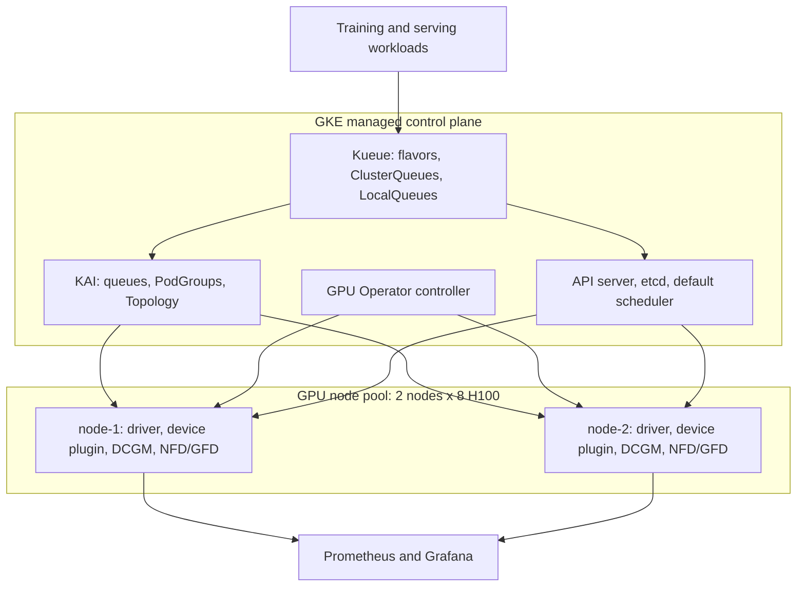

# 19.2 Capstone: a Kubernetes GPU platform with KAI and Kueue

| Field | Value |
|---|---|
| Level | Advanced |
| Priority tier | 1 |
| Lab venue | GCP / GKE |
| Part | Part 19: Capstones, design and interview readiness |
| Primary sources | nvidia-devops Zero-to-Hero Volume 24, Project 7 (Kubernetes GPU Scheduling); Volume 10 (Kubernetes GPU Platform, chapters 1–11); handbook Part 5 ch. 5.34 (GKE for GPU workloads), Part 11 ch. 11.1–11.9, 11.13–11.18, 11.20, Part 16 ch. 16.14 |
| Cross-references | Chapter 5.34 (GKE node pools and quotas); 11.1–11.9 (platform layer, GPU Operator, scheduling, Kueue, JobSet); 11.13–11.18 (KAI Scheduler); 11.20 (scheduler comparison); 16.14 (multi-tenant platform design and chargeback); 17.4 (DCGM exporter); 17.11 (incident response); 19.1 (the Slurm capstone); 19.3 (inference serving on GKE) |
| Coverage file | `planning/coverage/chapters/19-02.md` |
| Claim & number ledger | `planning/ledgers/19-02.md` |

## Why this matters for AI infrastructure

A team submits a two-node training job to a cluster that looks healthy on every dashboard. The nodes report `Ready`. The GPUs are advertised as schedulable resources. The queue manager says the team is within quota. Yet for the rest of the afternoon the job sits half-scheduled: one node's pods run, the other node's pods wait, and the job makes zero training steps while the fleet shows itself full. In the same cluster, a serving endpoint loses its SLO because a batch sweep consumed the GPUs that were supposed to be reserved for it. Nothing is broken. The pieces are simply not integrated.

Every piece in that story has its own chapter. The node pool and driver decisions live in 5.34, the platform layer and its two paths in 11.1, the device plugin and runtime injection in 11.2, feature discovery in 11.3, the GPU Operator in 11.4 and 11.5, topology-aware scheduling in 11.6, the mechanics of multi-node jobs in 11.7 and 11.9, Kueue in 11.8, and the KAI Scheduler in 11.13 through 11.18. A team that has read all of them can describe each piece in isolation. The capstone exists to answer the harder question, which is what holds the pieces together.

The answer is five integration surfaces. One is the node plane: the driver, the runtime injection path, the device plugin, and the discovery labels, all owned by exactly one system each. The second is the queue hierarchy that turns a shared fleet into multi-tenant capacity with real quotas. The third is the gang and topology layer that makes a two-node job start atomically on verified hardware. The fourth is the health gate that takes a dying GPU out of service before the scheduler assigns it another job. The fifth is a day-2 rhythm of canary upgrades, incident response, and a FinOps view that shows each team what its share of the fleet costs. This chapter walks the whole platform through those five surfaces.

The capstone is also the interview anchor. When an interviewer asks how you would build and operate a Kubernetes GPU platform, the answer is not a list of operators; it is this integrated picture, told in the order a real build proceeds: node pool first, then the stack, then the queues, then gang scheduling, then health and day-2. The same picture is the platform team's reference design and the on-call engineer's reference when the cluster is on fire.

## Prerequisites and outcomes

### Prerequisites

- Chapter 11.1: why Kubernetes needs a GPU platform layer; the two-path model.
- Chapter 11.2: device plugin, container toolkit, CDI, and runtime classes.
- Chapter 11.3: Node Feature Discovery and GPU Feature Discovery.
- Chapter 11.4 and 11.5: GPU Operator architecture, operands, installation, and upgrades.
- Chapter 11.6: scheduling GPUs, Topology Manager, CPU and NUMA alignment.
- Chapter 11.7: why a Pod cannot span nodes, and gang scheduling concepts.
- Chapter 11.8: Kueue, Volcano, and scheduler plugins.
- Chapter 11.9: JobSet, LeaderWorkerSet, PyTorchJob, and the MPI Operator.
- Chapter 11.13 through 11.18: the KAI Scheduler in depth.
- Chapter 11.20: the scheduler comparison guide.
- Chapter 5.34: GKE for GPU workloads, node pools, and quotas.
- Chapter 16.14: multi-tenant platform design, quotas, and chargeback.
- Part 14 for distributed training and checkpointing; Chapter 17.4 for the DCGM exporter; Chapter 17.11 for incident response.

### Outcomes

After completing this capstone you will be able to:

1. Lay out the platform topology and explain why the allocation path and the execution path must both be proven before a node accepts work.
2. Create the GPU node pool on GKE and decide who owns the driver, with the ownership boundary written down.
3. Install and validate the GPU Operator stack: device plugin, toolkit, NFD/GFD, and DCGM, using the evidence chain instead of DaemonSet status.
4. Configure the scheduling baseline: priority classes, preemption, guaranteed capacity for SLO-bound work, and fairness caps.
5. Configure the Kueue queue hierarchy: ResourceFlavors, ClusterQueues, LocalQueues, cohort borrowing, and preemption rules.
6. Configure KAI gang scheduling and topology-aware placement, and launch multi-node jobs with JobSet or a PyTorchJob.
7. Operate the platform: DCGM health gating, canary upgrades, incident response, quotas, and the FinOps view.

---

## 1. The platform topology: two paths, one platform

### The pool that looks Ready and refuses to train

After a node-image refresh, half a GPU pool reboots and rejoins the cluster reporting `Ready`. The CPU services come back immediately, and the node dashboards look green. But the training pods on the refreshed pool fail during container creation, while the sibling pool, which was not refreshed, trains normally. `nvidia-smi` works on the host of every node. The on-call engineer's first instinct is to blame the scheduler, because the pods look like they are being rejected for placement. The evidence says otherwise, and finding it took an hour that the right first question would have saved.

The split that this capstone keeps returning to is the split between two paths. The first is the allocation path: the host driver is loaded, the device plugin registers `nvidia.com/gpu` with the kubelet, and the node publishes an allocatable count. The second is the execution path: the container runtime, with the NVIDIA Container Toolkit or a CDI spec, injects the selected device nodes and driver libraries into the specific container's sandbox, and CUDA initializes inside it. A node can be `Ready` on the allocation path and broken on the execution path. The refreshed pool failed at runtime injection: the node image change had altered the runtime configuration, so the sandbox never received the device it had been allocated. The scheduler did nothing wrong.

The consequence for design is that a platform team cannot treat `Ready` as GPU-ready. The acceptance question has two answers, and both must be yes: can the node advertise capacity, and can a representative workload actually execute on it. This is why the topology below is drawn as two columns of evidence rather than one stack of components.

### The capstone cluster

The capstone platform is a regional GKE Standard cluster with a managed control plane. The GPU node pool holds two `a3-highgpu-8g` nodes, each carrying eight H100 accelerators. On top of that node plane sit three control-plane components: the GPU Operator, which reconciles the per-node GPU stack; Kueue, which manages the multi-tenant queue hierarchy; and the KAI Scheduler, which performs gang scheduling and topology-aware placement for multi-node training. Observability runs on the DCGM exporter on every GPU node feeding Prometheus, with Grafana on top.



| Component | Lives | Owns | Does not own |
|---|---|---|---|
| GKE control plane | Managed by Google | API server, etcd, default scheduler, cluster upgrade | GPU software on the nodes |
| GPU node plane | The node pool | Driver, toolkit, device plugin, DCGM exporter, discovery | Which workloads may run |
| GPU Operator | `gpu-operator` namespace | Reconciliation of the node-plane operands | Kernel compatibility, registry access |
| Kueue | `kueue-system` namespace | Quotas, queue admission, borrowing | Gang placement, device selection |
| KAI Scheduler | `kai-scheduler` namespace | Atomic gang binding, topology placement, fair share | Tenant quotas at the admission gate |
| Observability | Managed Prometheus | Scrape, alerts, dashboards | GPU health itself |

### Why the platform must name its pools

The temptation with a GPU fleet is to let every workload share one undifferentiated pool. A pool that carries three workload classes, training, distributed inference, and general batch, needs the boundaries made explicit or the classes will contend in ways no dashboard shows. Picture a 32-GPU pool split by policy into three pools: a 16-GPU training pool restricted to jobs that need adjacent GPU sets, an 8-GPU inference pool, and an 8-GPU general pool with no constraint. A new four-GPU job with no topology requirement can only land in the general pool, even though 24 other GPUs in the cluster are physically idle. The taints make them ineligible, not unavailable. If the general pool already runs one four-GPU job, it shows four of eight allocatable, and the cluster-wide idle figure reads 75 percent. Reporting that figure without naming the pool is exactly the number a customer misreads as spare capacity when none of it is reachable by their request.

Every hard constraint buys predictability at the price of fragmentation. The platform therefore keeps the catalog small: a training class, a serving class, and a general class, each with a documented reason for existing. Review the classes after changes; a constraint that provides no measurable benefit is operational debt.

**Decision rule:** treat the GPU platform as two independent paths, allocation and execution, and admit a node to service only after both paths have been proven with evidence.

**In one minute:** the capstone is a GKE Standard cluster with a two-node H100 pool. The allocation path is driver, device plugin, and kubelet advert capacity; the execution path is runtime injection and CUDA initialization inside the container. `Ready` proves neither path. Kueue sits in front as the admission gate, KAI performs gang and topology placement, and DCGM feeds Prometheus. Pools and classes are named deliberately, because an unnamed pool fragments invisibly.

---

## 2. The GPU node pool: hardware, driver, and ownership

### The node pool with two drivers

A team stands up a GKE GPU node pool with the driver set to `latest`, and separately deploys the GPU Operator with its driver operand enabled. Both systems now believe they manage the same kernel module. The node pool flaps for days: one reconciler loads a driver, the other reloads its own version, CUDA jobs die with driver and library version mismatch errors, and the incident ticket grows longer because nobody can say which system is in charge. The root cause is not a bug in either product. It is an ownership decision that was never made.

This is the first architectural decision of the capstone, and it must be written down before any hardware is bought. The options are the ones from the platform-layer material.

| Ownership model | Appropriate when | Principal trade-off |
|---|---|---|
| Host-managed driver and runtime | A node-image or OS team owns the complete host lifecycle | Desired state and diagnosis partly live outside Kubernetes |
| Operator-managed node stack | Kubernetes is the primary lifecycle control plane and node images are deliberate | Operator, kernel, driver, and runtime versions must be qualified together |
| Hybrid with a written boundary | Enterprise controls require host ownership of selected layers | The boundary must be documented; two systems must never reconcile the same setting |

The capstone uses the hybrid. GKE owns the driver and the node image: the node pool is created with `gpu-driver-version=latest`, and GKE runs its own driver DaemonSet on the GPU nodes. The GPU Operator owns everything else on the node: the device plugin, the DCGM exporter, and feature discovery, with its driver operand disabled. One owner per layer. The boundary is written into the values file and reviewed in the same pull request as the node pool definition.

### Creating the pool

The cluster starts as a Standard cluster with a small CPU-only pool for system components, and the GPU pool is added separately.

```bash
export PROJECT=my-project REGION=us-central1 ZONE=us-central1-a CLUSTER=ml-platform

gcloud container clusters create "$CLUSTER" \
  --project "$PROJECT" --zone "$ZONE" \
  --release-channel regular \
  --num-nodes 1 --machine-type e2-standard-4 \
  --workload-pool "${PROJECT}.svc.id.goog" \
  --enable-managed-prometheus \
  --monitoring SYSTEM,DCGM

gcloud container node-pools create h100-pool \
  --cluster "$CLUSTER" --zone "$ZONE" \
  --machine-type a3-highgpu-8g \
  --accelerator type=nvidia-h100-80gb,count=8,gpu-driver-version=latest \
  --num-nodes 2 \
  --node-labels pool=h100 \
  --placement-type COMPACT
```

Two decisions are worth naming. The compact placement policy keeps the two GPU nodes in the same zone, which the topology work in Section 6 relies on. The `gpu-driver-version=latest` flag is the ownership decision made concrete: because it is not `disabled`, GKE installs and manages the driver DaemonSet. If you instead want the GPU Operator to install the driver, set that flag to `disabled` and enable the operator's driver operand. You must not leave both enabled.

When the pool is up, GKE labels the nodes with the accelerator type and taints them so only GPU-requesting pods land there.

```bash
kubectl get nodes -L cloud.google.com/gke-accelerator
kubectl describe node $(kubectl get nodes -l pool=h100 -o name | head -1) \
  | grep -A8 -i "taints\|nvidia.com/gpu"
```

The default taint is `nvidia.com/gpu=present:NoSchedule`, and a built-in admission step adds the matching toleration to pods that request `nvidia.com/gpu`. If you add your own taints to isolate a team, you must add the tolerations yourself, and the workloads in Sections 5 and 6 carry them.

### Quotas, reservations, and consumption models

Capacity failures on GKE come in two kinds that look similar but need different fixes. A `QUOTA_EXCEEDED` error means the project allowance for that GPU model in that region is too low, and the fix is a quota increase request. A `ZONE_RESOURCE_POOL_EXHAUSTED` error means the quota is fine but Google has no free hardware in the zone, and the fix is another zone, another machine type, a reservation, or waiting. Read the message before you act.

The consumption models, in order of certainty, are reservations, committed-use discounts, on-demand, Spot, and flex-start. A reservation gives guaranteed capacity at a committed price and is what large training clusters run on. Spot is deeply discounted but can be preempted with roughly a 25 to 30 second notice, which is shorter than most checkpoint intervals, so it suits fault-tolerant batch work with healthy checkpoints. One more property matters for upgrades: GPU nodes cannot live-migrate, so host maintenance terminates them. The checkpointing discipline from Part 14 is what makes that survivable.

**Decision rule:** decide the driver owner before the pool exists, write the boundary into the values file, and never let two reconcilers manage the same layer on the same node.

**In one minute:** the capstone pool is two `a3-highgpu-8g` nodes with eight H100s each, compact placement, GKE-managed driver via `gpu-driver-version=latest`, and the GPU Operator's driver operand disabled. GKE taints GPU nodes with `nvidia.com/gpu=present:NoSchedule`. Quota errors and stockout errors need different fixes. GPU nodes terminate on maintenance, so checkpointing is part of the platform contract.

---

## 3. The GPU Operator stack: from driver to advertised capacity

### The install that said deployed

A platform team runs `helm install` for the GPU Operator, and the command reports `STATUS: deployed`. The standup meeting moves on. Twenty minutes later the training queue is empty, and the ClusterPolicy reports `notReady`. The aggregate view shows five of six canary nodes healthy. The sixth node's driver DaemonSet is crash-looping with a Secure Boot signing error: the kernel module the driver container compiled is unsigned for that machine's owner key database. The fleet looks healthy in the aggregate and broken on one node, and the node that is broken is the one a large job just landed on.

The lesson is that Helm success is one data point, not the acceptance gate. `deployed` means the API server accepted the manifests and the objects it knows how to wait on reached a ready state. It says nothing about whether a kernel module loaded, whether the runtime injects devices, or whether the kubelet advertises the resource on every node in the pool. The rest of this section is the acceptance discipline that replaces the single command.

### The operands and the evidence chain

The operator reconciles a set of node-facing operands, most of them DaemonSets because their work is tied to local hardware and the kubelet. In the capstone, with the driver owned by GKE, the operator owns the device plugin, the container toolkit configuration where applicable, the feature-discovery workers, and the DCGM exporter. Reconciliation is not a serial installer: the DaemonSets retry independently, and a downstream operand may show a more visible symptom than the upstream failure it actually depends on. So the platform does not wait for every pod to appear `Running`. It walks an evidence chain, in order:

1. The node is in the intended pool and can run the required operands.
2. The driver interface is healthy, which on this platform means the GKE driver DaemonSet reports a working driver and `nvidia-smi` on the node enumerates all eight GPUs.
3. The runtime can create a GPU-enabled container, proven by a minimal CUDA container that runs `nvidia-smi` inside the pod.
4. The device plugin advertises the expected allocatable resource, so the node status shows `nvidia.com/gpu` equal to the physical count.
5. Discovery labels and the pool taints match the intended service class.
6. A representative workload and the telemetry path pass on the node.

The operator configuration for the capstone is small and deliberate.

```yaml
# clusterpolicy-gke.yaml (shape from the 11.4 production example; untested)
apiVersion: nvidia.com/v1
kind: ClusterPolicy
metadata:
  name: gpu-cluster-policy
spec:
  driver:
    enabled: false          # GKE owns the driver (Section 2)
  toolkit:
    enabled: true
  gfd:
    enabled: true
  devicePlugin:
    enabled: true
```

Install it pinned, scoped to the node pool, and review the rendered manifests before applying.

```bash
helm repo add nvidia https://helm.ngc.nvidia.com/nvidia
export GPU_OPERATOR_VERSION='v26.3.0'
helm template gpu-operator nvidia/gpu-operator \
  --namespace gpu-operator --create-namespace \
  --version "$GPU_OPERATOR_VERSION" -f target-values.yaml > evidence/manifest-target.yaml
helm upgrade --install gpu-operator nvidia/gpu-operator \
  --namespace gpu-operator --create-namespace \
  --version "$GPU_OPERATOR_VERSION" -f target-values.yaml \
  --wait --timeout 15m
kubectl get clusterpolicy
kubectl get pods,daemonsets -n gpu-operator -o wide
```

The node selector in `target-values.yaml` restricts every operand to the `pool=h100` label, so no operand lands on the CPU system pool. After reconciliation, the per-node check is the capacity versus allocatable comparison. If capacity reads eight and allocatable reads eight, the device plugin registered a healthy set of devices. If allocatable reads zero while capacity still reads eight, the plugin lost contact with the driver after boot, and the fix lives in the driver layer, not the plugin.

### The label contract

Feature discovery converts host facts into node labels. The NFD worker reads PCIe and CPU evidence and publishes labels such as `feature.node.kubernetes.io/pci-10de.present`. The GFD worker queries the driver through NVML and publishes `nvidia.com/gpu.product`, `nvidia.com/gpu.count`, `nvidia.com/gpu.memory`, and the MIG state labels. These are discovered facts, observed at a point in time. They are not lifecycle assertions and not service classes.

The capstone keeps three kinds of labels separate, because they have different owners and different lifetimes.

| Kind | Example | Authoritative writer | Consumer |
|---|---|---|---|
| Discovered fact | `nvidia.com/gpu.product=NVIDIA-H100-80GB-HBM3` | GFD/NFD workers | Platform automation, audits |
| Lifecycle assertion | `gpu-validation=passed` | The acceptance gate controller | Admission, node affinity |
| Service class | `gpu.platform.example/class=training-topology` | Platform engineering | Workload manifests |

Workloads select on service classes, never on SKU strings. When the platform retires one hardware generation and replaces it with another behind the same class, zero application manifests change. When manifests hard-select a product label, the same retirement becomes a coordinated manifest migration under a deadline. The lifecycle assertion is the one that gates admission: it is set only after the evidence chain from the previous subsection passes, and it is removed during any disruptive change.

A warning about staleness belongs here. A label that is present is not the same claim as a label that is current. After a driver update, a GPU replacement, or a MIG reconfiguration, the discovery workers must re-run, and the platform must compare the labels against the change record. A stale label produces a confident but wrong placement decision with no error logged anywhere, which is exactly why the maintenance workflow revalidates the class before the node re-enters the pool.

**Decision rule:** accept a node on the strength of the evidence chain, not on DaemonSet status, and keep discovered facts, lifecycle assertions, and service classes owned by three different writers.

**In one minute:** `helm deployed` is not acceptance. The operator reconciles the device plugin, toolkit, GFD, and DCGM exporter, while GKE owns the driver. Admission requires the six-step evidence chain ending in a validated workload and telemetry. Labels come in three kinds with different owners, workloads select on service classes, and the acceptance label is removed during disruptive change.

---

## 4. Priority, preemption, and fairness: protecting the inference SLO

### The inference API that was stuck

An 8-GPU cluster has a large batch training job and a real-time inference API, and both are submitted at the same time. The batch training job consumes all eight GPUs. The inference API is stuck in `Pending`, and the users are furious. Nothing in the cluster is malfunctioning. The scheduler is doing exactly what it was told, and it was told nothing. This is the failure mode that priority classes and guaranteed capacity exist to prevent, and it is the first policy layer the capstone installs.

### The three priority tiers

The capstone defines three `PriorityClass` objects, taken from the Project 7 starter set.

```yaml
# priority-classes.yaml (untested)
apiVersion: scheduling.k8s.io/v1
kind: PriorityClass
metadata:
  name: inference-critical
value: 1000
globalDefault: false
description: "Critical priority for inference SLOs"
---
apiVersion: scheduling.k8s.io/v1
kind: PriorityClass
metadata:
  name: training-high-priority
value: 100
globalDefault: false
description: "High priority for training jobs"
---
apiVersion: scheduling.k8s.io/v1
kind: PriorityClass
metadata:
  name: research-best-effort
value: 0
globalDefault: false
description: "Best effort for research jobs"
```

The tiers run from serving down through training to research. When a high-priority pod arrives and no GPU is free, the scheduler looks for lower-priority pods to displace. It sends a termination signal to the lowest-priority candidate, the job gets the default 30-second grace period to shut down, and if it does not finish, it is killed. The high-priority pod then schedules onto the freed GPU. That 30-second number matters for training: a preempted job that cannot checkpoint within the grace window loses its progress, which is why checkpoint intervals are set shorter than the grace behavior they rely on, a point the multi-node material in Section 6 returns to.

### Guaranteed capacity for the SLO

Priority alone is not enough, because a high-priority job still has to wait for a free GPU. The serving class in the capstone gets capacity it can always reach. The working rule from the Project 7 material is that SLO-bound work holds a small guaranteed slice, and the rest of the cluster is shared. On an 8-GPU cluster the rule of thumb is reserving two to three GPUs for inference; on the 16-GPU capstone pool the platform reserves four GPUs for the serving class. The reservation is implemented as a dedicated ClusterQueue in Section 5 plus the `inference-critical` priority, so that when the four reserved GPUs are occupied by lower-priority training work, the serving pod preempts its way in.

Fairness gets the same treatment as policy, not as hope. The Project 7 constraint set says no workload class may consume more than 60 percent of cluster resources over an observation window. On an 8-GPU cluster that caps training at 4.8 GPUs. The capstone enforces the same principle through the Kueue quota in Section 5, where the serving queue holds its four guaranteed GPUs and the training queue, while larger, can be preempted back into that space. The mechanism differs from the raw `ResourceQuota` example in the source, but the property is identical: no class holds the fleet indefinitely.

### Starvation and the monitoring answer

Best-effort research work must still make progress, or the platform has a class that is silently dead. The practical answer is to measure pending time per class and alert when it crosses the team's own expectation, for example a research job that should start within a bounded window. The scheduler's events name which predicate rejected each node, so a pending pod is diagnosable in one read: insufficient capacity, an untolerated taint, or a stale label are three different failures that the same `Pending` status hides.

One honesty note for the capstone: GPU sharing by time-slicing advertises integer units, so a pod requesting `nvidia.com/gpu: 1` with time-slicing configured consumes one share, roughly one of N of the device, with no memory or fault isolation. Sharing is a policy you configure per pool, and the capstone keeps the H100 pool whole-GPU only. Trust your tenants before you slice their GPUs.

**Decision rule:** give every workload class a priority value, give SLO-bound classes guaranteed capacity they can preempt into, and treat the fairness cap as a quota, not a suggestion.

**In one minute:** three tiers, serving at 1000, training at 100, research at 0. Preemption fires when high-priority work cannot fit, with the default 30-second grace. The serving class holds a reserved slice of four GPUs on the 16-GPU pool. No class holds more than its share indefinitely, and pending time per class is the starvation metric.

---

## 5. The Kueue queue hierarchy: multi-tenant admission

### The team that outran its quota

A team complains that the queue is unfair: their large jobs run while other teams wait, and the quota was supposed to cap each team at eight GPUs. The platform engineer checks and finds the team submitted its jobs without the queue label at all. Kueue only manages work that enters through a LocalQueue. Unlabeled pods bypass every quota the platform configured and run under the raw scheduler rules. The complaint about unfairness was really a complaint that the queue was not being used, and the fix was a one-line label plus a process change, not a new scheduler feature.

### ResourceFlavor, ClusterQueue, LocalQueue

Kueue's hierarchy has three objects. A `ResourceFlavor` names a hardware tier with node labels, so a quota can be attached to a specific kind of node rather than to the cluster as a whole. A `ClusterQueue` is cluster-scoped and carries the quota, the cohort it belongs to, the queueing strategy, and the preemption rules. A `LocalQueue` is namespace-scoped and points a team at the ClusterQueue it may draw from. The flavor list inside a ClusterQueue is evaluated in order, which is how the platform expresses preferences such as a topology-validated tier before a general tier.

The capstone configuration defines one H100 flavor, a training queue that can in principle use the whole pool, and a serving queue that holds four guaranteed GPUs. Both queues share a cohort, which is the unit that borrowing and reclamation operate on.

```yaml
# kueue-flavors-queues.yaml (untested)
apiVersion: kueue.x-k8s.io/v1beta1
kind: ResourceFlavor
metadata:
  name: h100
spec:
  nodeLabels:
    cloud.google.com/gke-accelerator: nvidia-h100-80gb
---
apiVersion: kueue.x-k8s.io/v1beta1
kind: ClusterQueue
metadata:
  name: cq-training
spec:
  cohort: ml-platform-cohort
  namespaceSelector: {}
  resourceGroups:
    - coveredResources: ["cpu", "memory", "nvidia.com/gpu"]
      flavors:
        - name: h100
          resources:
            - name: cpu
              nominalQuota: 256
            - name: memory
              nominalQuota: 1Ti
            - name: nvidia.com/gpu
              nominalQuota: 16
  queueingStrategy: BestEffortFIFO
  preemption:
    reclaimWithinCohort: Any
    withinClusterQueue: LowerPriority
---
apiVersion: kueue.x-k8s.io/v1beta1
kind: ClusterQueue
metadata:
  name: cq-serving
spec:
  cohort: ml-platform-cohort
  namespaceSelector: {}
  resourceGroups:
    - coveredResources: ["nvidia.com/gpu"]
      flavors:
        - name: h100
          resources:
            - name: nvidia.com/gpu
              nominalQuota: 4
  preemption:
    reclaimWithinCohort: Any
    withinClusterQueue: Any
---
apiVersion: kueue.x-k8s.io/v1beta1
kind: LocalQueue
metadata:
  name: team-data-science-queue
  namespace: team-data-science
spec:
  clusterQueue: cq-training
---
apiVersion: kueue.x-k8s.io/v1beta1
kind: LocalQueue
metadata:
  name: team-ml-platform-queue
  namespace: team-ml-platform
spec:
  clusterQueue: cq-serving
```

Read the preemption blocks carefully, because they are the difference between a quota and a guarantee. `reclaimWithinCohort: Any` lets a queue take back GPUs it lent to other queues in the same cohort when it needs its own quota. `withinClusterQueue: Any` on the serving queue means a serving workload can displace any lower-priority work admitted through that queue, which is how the four reserved GPUs stay reachable by the serving SLO even when training has borrowed the capacity. The training queue uses `LowerPriority`, which only allows its high-priority jobs to displace its own lower-priority jobs.

Two semantics are worth being precise about. A `nominalQuota` limits admission, not physical reservation. The cluster can admit work up to the quota even if the physical pool is smaller, and the two queues' nominal quotas can therefore sum to more than the hardware. And a cohort is a borrowing domain: when the serving queue has idle quota, the training queue can borrow it, and the reclaim rule is what makes the lending reversible. The combination is what the raw scheduler layer in Section 4 cannot express: fair multi-tenant admission with reversible lending and SLO-protected reclamation.

### Admission in action

A workload enters the queue with a label on its pods. Kueue creates a `Workload` object, holds it until quota and preemption rules allow, and admits it by reserving quota and unsuspending the pods.

```bash
kubectl get workloads -n team-data-science
kubectl get workload <name> -n team-data-science -o yaml
```

When admitted, the workload status records the ClusterQueue and the flavor chosen for each pod set. That admission section is the audit trail the FinOps review in Section 8 reads: which queue admitted which job, on which hardware tier, and when. Production work can be elevated with a `WorkloadPriorityClass`, which Kueue uses for its own preemption ordering, in addition to the pod `PriorityClass` from Section 4.

```yaml
# queue-labelled single-GPU job (untested)
apiVersion: batch/v1
kind: Job
metadata:
  name: single-gpu-run
  namespace: team-data-science
  labels:
    kueue.x-k8s.io/queue-name: team-data-science-queue
spec:
  backoffLimit: 3
  template:
    spec:
      priorityClassName: training-high-priority
      restartPolicy: Never
      tolerations:
        - key: nvidia.com/gpu
          operator: Exists
          effect: NoSchedule
      containers:
        - name: train
          image: nvcr.io/nvidia/pytorch:24.08-py3
          command: ["python", "train_resnet.py", "--epochs", "1"]
          resources:
            limits:
              nvidia.com/gpu: 1
```

**Decision rule:** no job runs on the GPU pool without a LocalQueue label, because unlabeled work bypasses every quota you configured.

**In one minute:** Kueue has three objects: the ResourceFlavor names hardware tiers with node labels, the ClusterQueue carries quota, cohort, and preemption rules, and the LocalQueue ties a team's namespace to a queue. Quotas limit admission, cohorts enable reversible borrowing, and `reclaimWithinCohort: Any` is how the serving queue takes its four GPUs back. The Workload object's admission section is the audit trail.

---

## 6. KAI: gang scheduling and topology-aware placement

### The job that reserved half the cluster and trained nothing

A team submits a two-node training job to the capstone cluster when only one of the two GPU nodes is free. The default scheduler places the first pod, with all eight GPUs on the free node, and the second pod waits in `Pending`. The running pod blocks at the PyTorch rendezvous barrier waiting for its peer, so eight GPUs sit at zero compute utilization. And no other team's single-node eight-GPU job can use the waiting node either, because that node is already committed to the half-scheduled job. Scale the same picture to a 12-node, 96-GPU cluster where two teams each submit an eight-node job, and neither job can ever reach eight nodes: six plus six consumes all twelve, and both jobs deadlock until an operator deletes one of them. The cluster is allocated and the work is not happening.

This is the failure gang scheduling exists to prevent. A multi-node job is not a set of independent pods. It is one job that must start together or not at all, and the scheduler has to hold the whole group pending until the full minimum fits, rather than placing what it can and stranding the rest.

### The KAI queue and the PodGroup

The capstone installs the KAI Scheduler, which NVIDIA open-sourced from Run:ai, in its own namespace. Its control plane runs a small set of microservices: an admission webhook, a pod grouper, a queue controller, the scheduler engine, and a binder. The scheduler name is `kai-scheduler`, and a workload opts in by setting that name on its pods. The admission webhook validates the queue and injects the scheduler name, the pod grouper synthesizes the `PodGroup` that defines the gang, and the engine works in periodic sessions: it snapshots state, reclaims lent capacity, preempts where policy allows, allocates, and writes `BindRequest` objects that the binder commits as pod bindings.

KAI keeps its own fair-share structure, a hierarchy of `Queue` resources from department down to project. Only leaf queues run jobs.

```yaml
# kai-queues.yaml (untested)
apiVersion: scheduling.run.ai/v2
kind: Queue
metadata:
  name: ml-platform
spec:
  resources:
    gpu:
      quota: 16
      overQuotaWeight: 1
    cpu:
      quota: 256
      overQuotaWeight: 1
    memory:
      quota: 1Ti
      overQuotaWeight: 1
---
apiVersion: scheduling.run.ai/v2
kind: Queue
metadata:
  name: team-data-science
spec:
  parentQueue: ml-platform
  resources:
    gpu:
      quota: 8
      overQuotaWeight: 1
    cpu:
      quota: 128
      overQuotaWeight: 1
    memory:
      quota: 512Gi
      overQuotaWeight: 1
```

The two project quotas sum to the department's sixteen GPUs. Fair share gives each queue its deserved quota first, then divides the surplus by the `overQuotaWeight`. Keep these quotas consistent with the Kueue ClusterQueues from Section 5: Kueue is the platform-wide admission gate, and KAI is the executor for the work that asks for it by scheduler name. The comparison material in 11.20 is explicit that teams usually pick one admission owner per workload class, and the capstone's division of labor is that Kueue decides which job is admitted and which hardware tier it may consume, while KAI handles the atomic gang binding and placement once the job is admitted.

### Topology-aware placement

Capacity, eligibility, locality, and coordination are four separate placement questions, and gang admission answers only the last one. The capstone's H100 pool is a single NVLink island per node, so the binding constraint for a two-node job is that both nodes live in the zone the job was approved for, with the verified fabric in between. KAI expresses the placement hierarchy as a `Topology` resource whose levels are node labels, from coarse to fine.

```yaml
# kai-topology.yaml (untested)
apiVersion: kai.scheduler/v1alpha1
kind: Topology
metadata:
  name: capstone-topology
spec:
  levels:
    - nodeLabel: topology.kubernetes.io/zone
    - nodeLabel: kubernetes.io/hostname
```

A job attaches to the topology with annotations that mark which level is required and which is preferred. A required level is a hard constraint: the job cannot leave it. A preferred level is a scoring preference: the scheduler falls back to a different placement when it has to. The capstone marks the zone as required and omits the preferred level, because both nodes in the pool are equivalent. On a larger fleet with its own InfiniBand fabric, the preferred level would name the fabric leaf switch so that a multi-node job lands under one switch when it can.

```yaml
# pytorchjob-gang.yaml (untested)
apiVersion: kubeflow.org/v1
kind: PyTorchJob
metadata:
  name: pretrain-2node
  namespace: team-data-science
  labels:
    kueue.x-k8s.io/queue-name: team-data-science-queue
    kai.scheduler/queue: team-data-science
  annotations:
    kai.scheduler/topology: capstone-topology
    kai.scheduler/topology-required-placement: topology.kubernetes.io/zone
spec:
  pytorchReplicaSpecs:
    Master:
      replicas: 1
      template:
        spec:
          schedulerName: kai-scheduler
          priorityClassName: training-high-priority
          tolerations:
            - key: nvidia.com/gpu
              operator: Exists
              effect: NoSchedule
          containers:
            - name: pytorch
              image: nvcr.io/nvidia/pytorch:24.08-py3
              resources:
                limits:
                  nvidia.com/gpu: 8
    Worker:
      replicas: 1
      template:
        spec:
          schedulerName: kai-scheduler
          priorityClassName: training-high-priority
          tolerations:
            - key: nvidia.com/gpu
              operator: Exists
              effect: NoSchedule
          containers:
            - name: pytorch
              image: nvcr.io/nvidia/pytorch:24.08-py3
              resources:
                limits:
                  nvidia.com/gpu: 8
```

The PyTorchJob controller creates the headless service, injects `MASTER_ADDR`, `MASTER_PORT`, `WORLD_SIZE`, and `RANK` into every pod, and coordinates with the scheduler so the whole replica group restarts cleanly on failure. A job that stalls at startup is checked against those injected values first.

### JobSet and LeaderWorkerSet

A pod cannot span nodes: one kubelet on one node manages it, and its containers share one network namespace. So any workload that needs more GPUs than one server holds runs as multiple pods, one per node, each claiming the node's eight GPUs and coordinating over the network. The workload operators express that group.

JobSet is the general building block. It manages a coordinated group of indexed jobs under `spec.replicatedJobs`, creates one shared headless service across all of them, gives every pod a deterministic DNS name, sets the startup order so an initializer finishes before the trainers launch, and treats the whole set as a single failure domain: if any child job fails beyond its backoff limit, JobSet tears down and recreates all children together, which keeps distributed ranks from drifting out of sync.

LeaderWorkerSet serves the sharded-inference shape: a leader plus a fixed number of workers per replica group, where the whole group is the restart unit.

```yaml
# lws-sharded-inference.yaml (untested)
apiVersion: leaderworkerset.x-k8s.io/v1
kind: LeaderWorkerSet
metadata:
  name: vllm-sharded
  namespace: team-ml-platform
spec:
  replicas: 1
  leaderWorkerTemplate:
    size: 2
    restartPolicy: RecreateGroupOnPodRestart
    leaderTemplate:
      metadata:
        labels:
          role: leader
      spec:
        containers:
          - name: vllm-leader
            image: vllm/vllm-openai:latest
            resources:
              limits:
                nvidia.com/gpu: "8"
    workerTemplate:
      spec:
        containers:
          - name: vllm-worker
            image: vllm/vllm-openai:latest
            resources:
              limits:
                nvidia.com/gpu: "8"
```

The `RecreateGroupOnPodRestart` line is the operational point: when one pod in the group dies, the group is recreated, not the single pod, because a sharded model cannot keep serving with one shard missing.

**Decision rule:** use gang admission only for workloads where a partial start costs real money, and bind the topology levels to labels the fleet actually publishes.

**In one minute:** the default scheduler places what it can, which for multi-node jobs means stranded GPUs and deadlocked rendezvous barriers. KAI holds the whole `PodGroup` pending until the minimum fits, binds it atomically through `BindRequest` objects, and places it along a `Topology` level list where required levels are hard and preferred levels are soft. Kueue stays the admission gate; KAI is the executor for admitted multi-node work. JobSet is the single-failure-domain building block, and LeaderWorkerSet restarts its whole group.

---

## 7. DCGM health gating and observability

### The GPU that fell off the bus while still selling capacity

A GPU dies with an Xid 79 event: the device has fallen off the bus. The node's kubelet keeps reporting eight allocatable GPUs, because the failure lives in the driver layer and nothing has told the device plugin to withdraw capacity. New pods land on the dead GPU and fail at CUDA initialization, while the node dashboard still shows the node healthy and the queue still schedules onto it. The node is a zombie: alive as a process, dead as a machine, and the platform has no idea until a workload's failure is attributed to the wrong layer.

This is the failure the health gate exists to catch, and the design rule that prevents it is the one people most often miss: the health signal is not allowed to only report. It has to gate, by keeping the node out of the eligible pool until the acceptance evidence is back.

### The exporter and the join key

The telemetry path runs DCGM on the host, the DCGM exporter as a DaemonSet on port 9400, and Prometheus scraping it. On GKE the same cluster is created with `--monitoring SYSTEM,DCGM`, which requires managed Prometheus, so the platform gets device metrics into the backend without running its own scrape fleet. The exporter tags each series with the GPU UUID alongside the more convenient device index, and with node, pod, and namespace labels where the integration can resolve the mapping.

The UUID is the durable join key. Device indexes are convenient for a human reading one node, but they can be renumbered after a reboot, a reset, or an inventory change. A recording rule or an incident correlation that keys on the index can silently start pointing at a different physical card.

```bash
curl -s localhost:9400/metrics | grep -E 'DCGM_FI_DEV_(GPU_UTIL|POWER_USAGE|XID_ERRORS)' | grep -v '^#'
```

A representative scrape for one GPU looks like this:

```
DCGM_FI_DEV_GPU_UTIL{gpu="0",UUID="GPU-3a1e9f2b-...",Hostname="node-1",pod="train-worker-0",namespace="team-data-science"} 91
DCGM_FI_DEV_POWER_USAGE{gpu="0",UUID="GPU-3a1e9f2b-...",Hostname="node-1",pod="train-worker-0",namespace="team-data-science"} 312.4
DCGM_FI_DEV_XID_ERRORS{gpu="0",UUID="GPU-3a1e9f2b-...",Hostname="node-1",pod="train-worker-0",namespace="team-data-science"} 0
```

The `XID_ERRORS` series at zero is the reliability signal. Nonzero, even briefly, is an actionable condition: it names the UUID of the affected device, and the kernel log on the same node names the event. Pairing the two turns an alert into a fault class. Xid 79 is one of the small set of codes that means the device itself needs escalation, not a workload retry.

### A monitoring contract, not a dashboard

A production GPU pool needs a small, explicit contract, and the capstone holds itself to it.

1. Coverage: every accepted GPU node is scraped, and the platform alerts when an expected target disappears or its data goes stale.
2. Identity: a dashboard can pivot from a workload to its node and GPU UUID, then to node events and driver evidence.
3. Semantics: each alert states the triggering condition, the likely blast radius, the owner, the first checks, and the safe mitigation.
4. Retention: raw data is kept long enough to compare a workload regression against the deployment or maintenance window that caused it.
5. Cost control: labels are bounded, because per-process or highly dynamic labels turn a useful dashboard into an expensive and unreliable scrape target.

The paging rule follows the contract. Page when somebody must interrupt their work: loss of a schedulable GPU, an actionable hardware or driver event, sustained throttling with a measured service impact, or loss of monitoring coverage itself. Do not page on low utilization. A low-utilization alert trains the on-call rotation to ignore it, and a zero utilization reading is ambiguous until you check whether the exporter is alive at all. The first move on any GPU question is the scrape target health. If the exporter target is down, every DCGM-derived number for that node is stale, and the correct response is to restore the scrape, not to investigate why the GPU looks idle.

### Gating admission

The health signal closes the loop on node admission. A reliability event on a GPU, or a missing exporter, takes the node out of the eligible pool: cordon it, drain it when the workload recovery plan allows, and capture the volatile evidence, node events, driver logs, device identity, and DCGM observations, before a reboot or replacement erases it. The node returns to service only after the acceptance gate from Section 3 passes again, which includes a fresh validation workload and a working telemetry path. On GKE, the node auto-repair machinery covers infrastructure-level failures, and the platform's DCGM gate covers GPU-specific health that GKE's checks do not see. A node that fails driver validation, loses the device plugin, or stops exporting must not silently re-enter the general pool.

**Decision rule:** page on reliability events and capacity loss, not on utilization, and keep a node out of the eligible pool until the acceptance evidence is back.

**In one minute:** DCGM feeds the exporter on 9400, and GKE's managed monitoring with DCGM enabled puts it into Prometheus. The UUID is the join key, not the device index. The monitoring contract has five parts: coverage, identity, semantics, retention, cost control. Pages go out for lost capacity, hardware events, sustained throttling with impact, and lost coverage. A reliability event cordons the node, evidence is captured before any reboot, and the acceptance gate gates re-entry.

---

## 8. Day-2: upgrades, incidents, quotas, and the FinOps view

### The Friday upgrade that froze half the fleet

A platform team changes one shared value to bump the driver, and the DaemonSet controller reconciles the change across the entire GPU node pool roughly in parallel. In a 60-node fleet with no pool separation, that single value change can put a meaningful fraction of the fleet into a driver-reload state within minutes, long before the first validation failure is observed. If the incompatible kernel channel affects 35 of the 60 nodes, that is roughly 58 percent of GPU capacity degraded, discovered only when workloads start failing to schedule. The same change applied to a three-node canary pool first caps the worst case at five percent of capacity while validation runs, and the other nodes are never touched until the canary passes a representative workload. The ratio between those two numbers is the entire argument for pool separation, stated as a number instead of a warning.

### The canary discipline

An upgrade changes a compatibility set, not a single component: the Kubernetes version, the node image and kernel, the driver, the runtime, the operator chart and operand images, and the workload images. The release record states the prior and proposed values for each, names the node pools, the maintenance window, the workload owners, and the decision authority for pause or rollback.

The canary must represent the pool it stands in for: same hardware batch, same node image, same driver ownership model, same workload class. A useful sizing pattern from the upgrade material, for a 120-node fleet across hardware batches, is a canary of two nodes per hardware batch, roughly seven percent of the fleet, then a first batch of about ten percent, then doubling each batch while the observation window stays clean. The blast-radius arithmetic belongs in GPUs, not nodes: if a bad change reaches a 24-node batch before detection, that is 192 GPUs unavailable out of a 960-GPU fleet, twenty percent of capacity. That is the number that goes in the incident summary, not "some nodes are affected."

Each batch gates on execution evidence: the allocatable count equals the baseline, a fresh validation workload completes CUDA initialization, and the DCGM series are present with stable device identity. A green operator status is not enough.

On GKE the cluster-level upgrade runs through the release channel:

```bash
gcloud container clusters upgrade "$CLUSTER" --master --node-pools h100-pool
```

And the GPU Operator upgrade follows the scoped procedure. Archive the recoverable baseline first.

```bash
export TARGET_VERSION='v26.3.0'
export CANARY_NODE='node-1'
mkdir -p gpu-upgrade-evidence
helm history gpu-operator -n gpu-operator > gpu-upgrade-evidence/helm-history-before.txt
helm get values gpu-operator -n gpu-operator -a > gpu-upgrade-evidence/values-before.yaml
helm get manifest gpu-operator -n gpu-operator > gpu-upgrade-evidence/manifest-before.yaml
kubectl get node "$CANARY_NODE" -o yaml > gpu-upgrade-evidence/canary-before.yaml

kubectl cordon "$CANARY_NODE"
kubectl drain "$CANARY_NODE" --ignore-daemonsets --delete-emptydir-data --grace-period=120 --timeout=20m
helm upgrade gpu-operator nvidia/gpu-operator \
  --namespace gpu-operator --version "$TARGET_VERSION" \
  -f target-values.yaml --wait --timeout 20m

kubectl get node "$CANARY_NODE" \
  -o jsonpath='{.status.capacity.nvidia\.com/gpu}{" capacity\n"}{.status.allocatable.nvidia\.com/gpu}{" allocatable\n"}'
kubectl apply -f gpu-upgrade-validation.yaml
kubectl wait --for=jsonpath='{.status.phase}'=Succeeded pod/gpu-upgrade-validation --timeout=5m
kubectl uncordon "$CANARY_NODE"
```

The sizing of the drain discipline is arithmetic, not taste. Each drained node takes eight GPUs offline. If the serving SLO needs four GPUs of headroom during the window, one node at a time is the ceiling on this two-node pool, and the upgrade waits until the other node has enough free capacity to absorb the serving work. The general pattern: compute the GPUs-offline-at-once number before setting the rollout parameter, not after an incident caused by it.

### Rollback and incident response

Rollback has to restore a compatible set, and a chart rollback is not always one. Returning Helm values reverts control-plane configuration, but it cannot necessarily revert a driver module, a kernel, or a runtime configuration that already changed on the host. When host state changed, the tested node-image and reboot path is the rollback, not a Helm command. After either rollback or forward recovery, rerun the full acceptance suite.

When the canary fails, the first action is to stop the rollout and protect the healthy comparison pool, then pull time-correlated evidence to find the first failed layer. Walk the layers in dependency order: hardware and driver, then runtime injection, then device plugin registration and allocatable state, then labels and policy, then the workload itself. This order prevents a scheduler investigation from hiding a driver failure, and it prevents a hardware replacement from becoming the default answer to an application image regression.

Incident command structure follows the pattern from 17.11: an incident commander owns the timeline and decisions, a subject-matter engineer owns the diagnosis, and a communications lead owns the status updates to the teams whose jobs are stuck. The escalation package, when the vendor is involved, contains the scope and business impact, a timestamped change timeline, cluster and operator versions, node kernel and runtime details, GPU and firmware inventory, operand state, the relevant logs, node labels and allocatable resources, a minimal reproducer, and the DCGM evidence. Redact tenant data, but do not omit the version and time correlation.

### Quotas, chargeback, and the FinOps view

Day-2 also includes the money view. The standing numbers come from the queue layer and the cost layer. Per-team quota utilization is read from the Kueue workloads and queue usage, and the platform alerts when a team's quota utilization stays above 80 percent for a day, which is the early signal that the capacity review conversation needs to start. Per-team cost per month comes from the cost analyzer, Kubecost or OpenCost, joined against the same Prometheus backend that carries the DCGM and Kubernetes metrics, so that GPU cost and GPU utilization can be read in the same view.

The capacity review asks the fragmentation question from Section 1 per class: what is the queue time per class, and how much capacity is stranded by a constraint? A constraint that provides no measurable benefit is operational debt, and the review is where it gets retired. The onboarding contract stays the tier model from 16.14: each team subscribes to a tier at onboarding, the tier maps to a ClusterQueue with the matching quota, and a team that outgrows its tier asks for an upgrade with the utilization history as the evidence.

**Decision rule:** upgrade the compatibility set as a unit, gate every batch on execution evidence, roll back node state when the driver changed, and keep the FinOps numbers, per-team utilization and per-team cost, in the same view.

**In one minute:** one value change without a canary can degrade most of a fleet; with a canary it caps at a small percentage. Batch sizes grow while the observation window stays clean, and blast radius is computed in GPUs. Rollback restores a coherent set, which sometimes means a node image, not a chart. Incidents run on three roles and a layered diagnosis. The FinOps view pairs per-team quota utilization with per-team cost, and the capacity review retires constraints that earn no measurable benefit.

---

## 9. Hands-on lab

This lab builds the capstone platform on GCP/GKE: the cluster, the two-node H100 pool, the GPU Operator stack, the Kueue queue hierarchy, the KAI gang scheduler, and the DCGM health view. It is **untested** in this repository and assumes a project with H100 GPU quota; request the quota before you start.

### 9.1 Prerequisites

- A GCP project with billing enabled, `gcloud` and `kubectl` installed, and Workload Identity set up.
- H100 GPU quota in the chosen zone for at least 16 GPUs.
- An image registry reachable from the cluster, such as Artifact Registry in the same region.

### 9.2 Step 1: create the cluster and the GPU node pool

```bash
export PROJECT=my-project REGION=us-central1 ZONE=us-central1-a CLUSTER=ml-platform

gcloud container clusters create "$CLUSTER" \
  --project "$PROJECT" --zone "$ZONE" \
  --release-channel regular \
  --num-nodes 1 --machine-type e2-standard-4 \
  --workload-pool "${PROJECT}.svc.id.goog" \
  --enable-managed-prometheus \
  --monitoring SYSTEM,DCGM

gcloud container node-pools create h100-pool \
  --cluster "$CLUSTER" --zone "$ZONE" \
  --machine-type a3-highgpu-8g \
  --accelerator type=nvidia-h100-80gb,count=8,gpu-driver-version=latest \
  --num-nodes 2 \
  --node-labels pool=h100 \
  --placement-type COMPACT

gcloud container clusters get-credentials "$CLUSTER" --zone "$ZONE"
```

### 9.3 Step 2: verify the node plane

```bash
kubectl get nodes -L cloud.google.com/gke-accelerator
kubectl apply -f - <<'YAML'
apiVersion: v1
kind: Pod
metadata:
  name: nvidia-smi-check
spec:
  restartPolicy: Never
  tolerations:
    - key: nvidia.com/gpu
      operator: Exists
      effect: NoSchedule
  containers:
    - name: c
      image: nvidia/cuda:12.4.1-base-ubuntu22.04
      command: ["nvidia-smi"]
      resources:
        limits:
          nvidia.com/gpu: 1
YAML
kubectl logs nvidia-smi-check
# expected: eight GPUs listed on the node the pod landed on
```

### 9.4 Step 3: install the GPU Operator, driver operand disabled

```bash
helm repo add nvidia https://helm.ngc.nvidia.com/nvidia
export GPU_OPERATOR_VERSION='v26.3.0'
helm upgrade --install gpu-operator nvidia/gpu-operator \
  --namespace gpu-operator --create-namespace \
  --version "$GPU_OPERATOR_VERSION" -f target-values.yaml \
  --wait --timeout 15m

kubectl get clusterpolicy
kubectl get pods,daemonsets -n gpu-operator -o wide
# expected: device plugin and DCGM exporter DaemonSets Ready on both GPU nodes
kubectl get node -o custom-columns=NAME:.metadata.name,ALLOC:.status.allocatable.nvidia\\.com/gpu
# expected: 8 on each GPU node
curl -s node-1:9400/metrics | grep -c DCGM_FI_DEV_GPU_UTIL
# expected: nonzero series count
```

### 9.5 Step 4: install Kueue and the KAI Scheduler

```bash
# Kueue (pin the release you use; untested here)
kubectl create namespace kueue-system
kubectl apply -k "https://github.com/kubernetes-sigs/kueue/releases/download/v0.9.0/manifests?ref=v0.9.0"
# KAI Scheduler (pin the release you use; untested here)
kubectl create namespace kai-scheduler
kubectl apply -f kai-scheduler-release.yaml

kubectl get pods -n kueue-system
kubectl get pods -n kai-scheduler
```

### 9.6 Step 5: create the teams and the queue hierarchy

```bash
kubectl create namespace team-data-science
kubectl create namespace team-ml-platform
kubectl apply -f kueue-flavors-queues.yaml   # Section 5
kubectl apply -f kai-queues.yaml             # Section 6
kubectl get clusterqueues
kubectl get queues -o wide
# expected: cq-training and cq-serving; ml-platform with team leaf queues
```

### 9.7 Step 6: run a single-GPU job through the queue

Apply the queue-labelled Job from Section 5, then:

```bash
kubectl get workloads -n team-data-science
# expected: the Workload admitted, admission naming cq-training and the h100 flavor
kubectl get pods -n team-data-science -o wide
# expected: the pod Running on a GPU node
```

### 9.8 Step 7: run the two-node gang job

Apply the PyTorchJob from Section 6, then watch the KAI objects:

```bash
kubectl get podgroups -n team-data-science
kubectl get bindrequests -n team-data-science
kubectl get pods -n team-data-science -o wide
# expected: both pods bound to their nodes in the same scheduling session
```

### 9.9 Step 8: exercise the health gate

```bash
kubectl get pods -n gpu-operator -l app=nvidia-dcgm-exporter -o wide
kubectl logs -n gpu-operator $(kubectl get pods -n gpu-operator -l app=nvidia-dcgm-exporter -o name | head -1) | head
curl -s node-1:9400/metrics | grep DCGM_FI_DEV_XID_ERRORS
# expected: XID_ERRORS series at 0 for every GPU UUID
kubectl cordon node-1
# expected: new work no longer lands on node-1; a queued two-node gang stays pending
kubectl uncordon node-1
```

### 9.10 What to record

After the lab, you should be able to answer five questions in five seconds each:

1. What is the allocatable GPU count per node, and how many GPUs are admitted by Kueue right now?
2. Which ClusterQueue protects the serving SLO, and which preemption rule lets it take its GPUs back?
3. What topology level does the training job bind to as required?
4. Which DCGM series proves the exporter on each node is fresh?
5. What is the upgrade order for this platform, and what do you back up first?

If any of them takes longer, the platform is not yet an operating service; go back to the section that owns the gap. The lab is **untested** against a live GKE cluster in this repository.

---

## Exercises

1. **Onboard a new team.** Create a `team-finance` namespace with a ResourceQuota, a LocalQueue pointed at `cq-training`, and verify the team can submit a one-GPU job that Kueue admits. *Solution sketch:* `kubectl create namespace team-finance`, apply a `ResourceQuota` with `nvidia.com/gpu: "2"`, apply a `LocalQueue` with `clusterQueue: cq-training`, submit a Job labelled `kueue.x-k8s.io/queue-name: team-finance-queue`, and confirm the Workload is admitted.

2. **Add a second hardware tier.** Add an L40S node pool, an `l40s` ResourceFlavor keyed on its accelerator label, and a third ClusterQueue in the same cohort for batch work, and verify the flavor shows up in an admitted workload's `podSetAssignments`. *Solution sketch:* create the pool with `--machine-type a2-highgpu-1g --accelerator type=nvidia-l40s,count=8`, add the ResourceFlavor, add `cq-batch` with `nominalQuota` for the L40S flavor, and read `kubectl get workload -o yaml`.

3. **Protect the serving SLO under contention.** Fill the training quota with single-GPU jobs, then submit a serving workload on `cq-serving` with `inference-critical` priority, and verify Kueue and the scheduler displace training work to reach the serving quota. *Solution sketch:* submit the training Jobs, watch the serving Workload's admission flip to `Admitted`, and check the pod events on the displaced training pods for the preemption eviction; the 30-second default grace period governs the shutdown window.

4. **Define and attach a topology.** Create a three-level `Topology` resource with zone, a fabric leaf label you add to your nodes, and hostname, mark the zone required and the fabric level preferred, and verify the job's placement respects both levels. *Solution sketch:* extend `capstone-topology` with a third `nodeLabel`, annotate the PyTorchJob with `kai.scheduler/topology-preferred-placement`, and compare the bound nodes' labels against the levels.

5. **Deploy sharded inference as a group.** Deploy the LeaderWorkerSet from Section 6 with `size: 2` and one replica, kill one worker pod, and verify the whole group, not the single pod, is recreated. *Solution sketch:* `kubectl delete pod <worker-pod>`, then `kubectl get pods -w` shows the leader and the worker both restarting under `RecreateGroupOnPodRestart`.

6. **Run one upgrade wave.** Perform the full canary cycle from Section 8 on `node-1`: archive the baseline, cordon and drain, run the version-pinned operator upgrade, verify capacity and allocatable equal eight, run the validation pod, and uncordon. *Solution sketch:* the `gpu-upgrade-evidence` archive first, then the cordon, drain, `helm upgrade --version` sequence, the allocatable check, the validation pod wait, and the uncordon; record the wall-clock time and the GPUs-offline number.

---

## Checkpoint questions (20)

<details><summary>1. Why is a `Ready` GPU node not necessarily a usable GPU node?</summary>
`Ready` reflects kubelet heartbeats and basic node health, none of which touch the GPU driver, the device plugin, or the runtime injection path. A node can be `Ready` while the driver failed to load after a reboot, or while a node-image change broke container device injection. Admission requires the allocation path and the execution path to be proven separately.
</details>

<details><summary>2. What are the two paths of the GPU platform, and what evidence proves each?</summary>
The allocation path runs from the host driver through the device plugin to the kubelet, and it is proven by the node advertising a nonzero allocatable `nvidia.com/gpu`. The execution path runs through the container runtime, toolkit, or CDI spec into the specific container, and it is proven only by `nvidia-smi` succeeding inside the container of the allocated pod, not by the pod reaching `Running`.
</details>

<details><summary>3. What is the dual-driver failure mode on GKE, and how do you prevent it?</summary>
If the node pool has `gpu-driver-version` set to something other than `disabled` and the GPU Operator's driver operand is also enabled, two reconcilers manage the same kernel module and the node flaps between driver versions. The prevention is an ownership decision written into the values file: either GKE owns the driver and the operator's driver operand is disabled, or the flag is `disabled` and the operator installs the driver.
</details>

<details><summary>4. What does GKE do automatically for GPU nodes, and when do you turn it off?</summary>
GKE installs a driver DaemonSet on GPU nodes when `gpu-driver-version` is not `disabled`, taints the nodes with `nvidia.com/gpu=present:NoSchedule`, and labels them with the accelerator type. You turn it off, with `gpu-driver-version=disabled`, when you want the GPU Operator to own the driver instead. You never leave both on.
</details>

<details><summary>5. What is the difference between `QUOTA_EXCEEDED` and `ZONE_RESOURCE_POOL_EXHAUSTED`?</summary>
`QUOTA_EXCEEDED` means the project's allowance for that GPU model in that region is too low, and the fix is a quota increase request. `ZONE_RESOURCE_POOL_EXHAUSTED` is a stockout: the allowance is fine but there is no free hardware in the zone, and the fix is another zone, another machine type, a reservation, or waiting. The two need different responses, so read the message before acting.
</details>

<details><summary>6. Why can GPU nodes not live-migrate, and what does that imply for upgrades?</summary>
GPU nodes are terminated rather than live-migrated when host maintenance happens. That means a node pool upgrade or a driver change can interrupt running workloads with no graceful host-side migration, so the platform must plan drains, checkpoint intervals, and spare capacity as part of every upgrade, and must treat checkpointing as part of the platform contract for multi-node training.
</details>

<details><summary>7. Why does `helm deployed` not prove a GPU platform is working?</summary>
`deployed` means the API server accepted the manifests and the objects the installer knows how to wait on reached a ready state. It does not say whether a kernel module loaded, whether the runtime injects devices, or whether every node advertises the resource. The acceptance gate is the evidence chain: operand health, capacity and allocatable per node, a validated workload, and working telemetry.
</details>

<details><summary>8. What is the node acceptance evidence chain, in order?</summary>
The node is in the intended pool; the driver interface is healthy; the runtime can create a GPU-enabled container, proven by a minimal CUDA container; the device plugin advertises the expected allocatable resource; the discovery labels and pool taints match the intended service class; and a representative workload plus the telemetry path pass. Only the last step clears the node for production work.
</details>

<details><summary>9. What are the three kinds of node labels, and who writes each?</summary>
Discovered facts such as the GPU product label are written by the NFD and GFD workers and consumed by platform automation. Lifecycle assertions such as a validation-passed label are written by the acceptance gate controller and consumed by admission. Service classes are written by platform engineering and consumed by workload manifests. Mixing the owners is how a raw inventory label gets mistaken for proof that a node is safe for a workload.
</details>

<details><summary>10. Why do workloads select on service classes rather than SKU labels?</summary>
Selecting on a product label binds every manifest to a specific hardware generation. When the platform retires one generation and replaces it behind the same class, zero application manifests change. With SKU-level selectors, the same retirement becomes a coordinated manifest migration under a deadline, and a refresh that should be a platform config change becomes an incident.
</details>

<details><summary>11. What do Capacity, Allocatable, and Allocated each mean, and what does Allocatable of zero with Capacity of eight indicate?</summary>
Capacity is what the device plugin discovered as present, allocatable is what the kubelet offers to scheduling right now, and allocated is what bound pods have consumed. Allocatable of zero with capacity still at eight means the plugin registered in the past but has since lost contact with the driver or crashed. The fault is in the driver or registration layer, not in the scheduler.
</details>

<details><summary>12. What are the three priority tiers in the capstone, and what does the value do?</summary>
Serving at 1000, training at 100, and research at 0. The value orders pods for scheduling and for preemption: when a higher-priority pod cannot fit, the scheduler displaces the lowest-priority candidates it can find, which is why serving work reaches GPUs that training work is holding.
</details>

<details><summary>13. What happens during a preemption, and what is the default grace period?</summary>
The scheduler selects lower-priority pods to evict, sends them a termination signal, gives them the default 30-second grace period to shut down, and kills any that have not finished. The high-priority pod then schedules onto the freed GPU. For training jobs, that 30-second window is the reason checkpoint intervals are set shorter than the grace behavior they rely on.
</details>

<details><summary>14. Why does an SLO-bound class need guaranteed capacity, not just high priority?</summary>
A high-priority job still has to wait for a free GPU, and priority alone does not create free GPUs. Guaranteed capacity, implemented in the capstone as a dedicated serving ClusterQueue with reclamation rules, means the serving class always has a reachable slice of the fleet. Without it, a burst of training work can hold the whole pool and the serving SLO degrades until something gives.
</details>

<details><summary>15. What do ResourceFlavor, ClusterQueue, and LocalQueue each do in Kueue?</summary>
The ResourceFlavor names a hardware tier with node labels, so a quota attaches to a specific kind of node. The ClusterQueue is cluster-scoped and carries the quota, the cohort, the queueing strategy, and the preemption rules. The LocalQueue is namespace-scoped and ties a team's namespace to the ClusterQueue it may draw from. Work enters through the LocalQueue label.
</details>

<details><summary>16. What does cohort borrowing do, and when does `reclaimWithinCohort: Any` fire?</summary>
A cohort is a borrowing domain: when one queue in the cohort has idle quota, another queue can borrow it. `reclaimWithinCohort: Any` fires when the lending queue needs its own quota back, and it takes the GPUs regardless of which other queue is using them. That rule is how the serving queue keeps its four guaranteed GPUs reachable even after training has borrowed the capacity.
</details>

<details><summary>17. Why must a job carry the queue label, and what happens without it?</summary>
Kueue only manages work that enters through a LocalQueue, which is how quotas, fair sharing, and preemption apply. A pod without the label bypasses every quota the platform configured and runs under the raw scheduler rules. A team that outruns its quota is usually a team that skipped the label, which is a one-line fix plus a process change.
</details>

<details><summary>18. What is the partial-placement deadlock, and how much does it cost?</summary>
The default scheduler places what it can, so a multi-node job gets some pods running while the rest wait pending. The running pods block at the rendezvous barrier, the stranded node is committed and unusable by anyone else, and the whole job makes zero progress while paying for allocated GPUs. In a cluster where two large jobs each hold more than they can complete, neither can ever reach its full node count, and both deadlock until an operator intervenes.
</details>

<details><summary>19. What are required and preferred topology placements, and how are they expressed?</summary>
They are annotations on the workload that reference levels of a KAI `Topology` resource. A required placement is a hard constraint: the job cannot leave that level. A preferred placement is a scoring preference: the scheduler falls back when it has to. The capstone marks the zone as required and omits the preferred level, because both pool nodes are equivalent.
</details>

<details><summary>20. When does the platform use Kueue admission together with the KAI scheduler?</summary>
For multi-node training. Kueue is the platform-wide admission gate for all work and decides which job is admitted and which hardware tier it may consume. For training, the admitted pods carry `schedulerName: kai-scheduler`, so KAI performs the atomic gang binding, the fair share among training teams, and the topology placement. Serving and single-node batch work stay on the default scheduler with priority classes.
</details>

---

## Sources and review notes

- nvidia-devops Zero-to-Hero Volume 24, Project 7 "Kubernetes GPU Scheduling": the scheduling scenario and PriorityClass tiers, preemption with the default grace period, the 60 percent fairness cap and the 4.8-GPU training cap, guaranteed inference capacity, time-slicing integer semantics, and the SLO and starvation constraints. Corpus folder: `nvidia-zero-to-hero/volume-24`.
- nvidia-devops Zero-to-Hero Volume 10 "Kubernetes GPU Platform", chapters 1–11: the two-path model and pool fragmentation, the software lifecycle and qualification matrix, the container toolkit and CDI boundary, the device plugin and kubelet contract, NFD/GFD labels and the label contract, GPU Operator architecture and blast radius, driver containers and the five acceptance gates, scheduling and topology, DCGM observability, production installation, and upgrades with canary sizing.
- Handbook Part 5, Chapter 5.34 (GKE for GPU workloads): cluster and node pool creation flags, `a3-highgpu-8g` and `nvidia-h100-80gb`, `gpu-driver-version` values, GPU node taints, quota versus stockout errors, consumption models including Spot and flex-start, compact placement, and managed DCGM monitoring.
- Handbook Part 11: Chapters 11.1 through 11.9 for the platform layer, device plugin and runtime, feature discovery, GPU Operator architecture and upgrades, topology-aware scheduling, multi-node job mechanics, Kueue configuration, and JobSet/LeaderWorkerSet; Chapters 11.13 through 11.18 for the KAI Scheduler microservices, queues, PodGroup and BindRequest, gang scheduling, topology resources, and operations; Chapter 11.20 for the scheduler comparison and the division of labor between Kueue and KAI.
- Handbook Part 16, Chapter 16.14 (multi-tenant platform design): the quota tiers, Kueue ClusterQueue per tier, namespace ResourceQuota, per-team cost alerting, and the chargeback view used in Section 8.
- Handbook Part 17: Chapter 17.4 for the DCGM exporter build and Chapter 17.11 for incident response roles, cross-referenced from Sections 7 and 8.

### Cross-references to other handbook chapters

- Chapter 5.34 for the GKE node pool, driver ownership, and consumption models used in Section 2.
- Chapter 11.1 through 11.5 for the platform layer and GPU Operator this capstone integrates.
- Chapter 11.6 through 11.7 for topology-aware scheduling and the multi-node failure mechanics.
- Chapter 11.8 for the Kueue configuration patterns; Chapter 11.9 for JobSet, PyTorchJob, and LeaderWorkerSet.
- Chapter 11.13 through 11.18 for the KAI Scheduler in depth; Chapter 11.20 for the scheduler comparison.
- Chapter 16.14 for the multi-tenant quota tiers and chargeback view.
- Chapter 17.4 for the DCGM exporter; Chapter 17.11 for incident response roles.
- Chapter 19.1 for the Slurm variant of the capstone; Chapter 19.3 for the inference serving capstone that shares this node pool.

### Migrated from `nvidia-devops`

- `nvidia-zero-to-hero/volume-24/chapter-07-kubernetes-gpu-scheduling.md`
- `nvidia-zero-to-hero/volume-10/chapter-01-why-kubernetes-needs-a-gpu-platform-layer.md`
- `nvidia-zero-to-hero/volume-10/chapter-02-gpu-software-lifecycle-in-kubernetes.md`
- `nvidia-zero-to-hero/volume-10/chapter-03-container-toolkit-runtimeclass-and-cdi.md`
- `nvidia-zero-to-hero/volume-10/chapter-04-device-plugin-and-kubernetes-resource-model.md`
- `nvidia-zero-to-hero/volume-10/chapter-05-node-and-gpu-feature-discovery.md`
- `nvidia-zero-to-hero/volume-10/chapter-06-gpu-operator-architecture.md`
- `nvidia-zero-to-hero/volume-10/chapter-07-driver-containers-and-node-operands.md`
- `nvidia-zero-to-hero/volume-10/chapter-08-gpu-scheduling-and-topology.md`
- `nvidia-zero-to-hero/volume-10/chapter-09-gpu-observability-with-dcgm.md`
- `nvidia-zero-to-hero/volume-10/chapter-10-production-installation-and-configuration.md`
- `nvidia-zero-to-hero/volume-10/chapter-11-upgrades-and-production-troubleshooting.md`

The wording has been rewritten in the handbook's voice; no verbatim passages were carried over.

### Explicitly labelled inferences

- The capstone fleet size, two nodes with eight H100s each for 16 GPUs total, is an author choice sized to the `a3-highgpu-8g` machine type; the 8-GPU and 60 percent fairness figures quoted from Project 7 are kept at the source's own cluster scale and adapted to this pool by the Kueue quota design in Section 5.
- The four-GPU serving reservation on the 16-GPU pool, the ClusterQueue nominal quotas (16 training, 4 serving, 256 CPU, 1Ti memory), and the KAI department/project quota split are policy starting points in the spirit of the source material, not source-mandated values.
- The upgrade window arithmetic (one node at a time, serving headroom of four GPUs) is an author adaptation of the source's `maxUnavailable` sizing pattern to the two-node pool.
- The lab's five-question checklist and the specific chart and release versions in the lab are author choices; pin against current releases before production use.

### Not verified on live hardware

- The hands-on lab in Section 9 is **untested** against a live GKE cluster in this repository; it assumes H100 quota, current chart releases, and a reachable image registry.
- All `kubectl get` and `curl` output shown as "expected" is illustrative; no GPU node, operator install, queue, or upgrade was executed for this chapter.
- The KAI microservice behavior (session loop, `BindRequest` flow) is described from the source material and handbook chapters 11.13 through 11.18, not from a live scheduler trace in this repository.
- GKE driver DaemonSet behavior after `gpu-driver-version=latest` is documented behavior from the source material and was not verified on a live pool in this repository.


